# Runbook — the AI/ML surface of SageMaker Unified Studio, and the applications built on it

| | |
|---|---|
| **Scope** | What a SageMaker Unified Studio project offers for machine learning and generative AI, entry by entry of its **AI/ML** and **Generative AI** menus; what this estate's controls do to each create; how a model goes from a notebook in a Sandbox project to an application the pipeline promotes through Staging into Production; how a call to a foundation model makes the same journey, with the guardrail, the knowledge base and the agent an application brings; and what of the Generative AI menu stays in Sandbox. The procedures it builds on stay where they are: an application's repository, manifest, pipeline and release in [`sagemaker-application.md`](sagemaker-application.md), a workflow's authoring rules in [`serverless-workflows.md`](serverless-workflows.md), a promotion sitting in [`promotion.md`](promotion.md) |
| **Operator** | Three hands. The **data scientist**, a member of a Sandbox project and a Developer of the application's GitLab project: the notebooks, the experiments, the application's code. The **deployment manager** (`awsds/deployment-managers`, `DeploymentManagerAccess` in AWS), who merges, tags, admits a release at the gates and approves a model version. The **infrastructure user** (`InfrastructureAccess`, the `awsds-infra-*` profiles), who writes the grants, plans the `[P]` slices and raises and lowers each session |
| **The rules** | **The two menus are two services**: AI/ML is Amazon SageMaker AI and Generative AI is Amazon Bedrock, and a control written for one says nothing about the other. **People build in Sandbox alone** (D17): a target has no space, and a page there shows what a task or a pipeline job created. **A bundle carries files and workflows, never an object of either service** (D41): a model's artifact, a pipeline's definition, a prompt or a guardrail's definition travels as a file, and an ML object of a target exists because a task or a pipeline job created it there, or because that account's Terraform declares it. **A model is trained once, in the application's `dev` project, and the trained model is promoted**: a release's bundle carries its archive, a task proposes it as a version in each target's registry, and a target serves the release's version once the account's deploy role approved it, in Production on a deployment manager's job (decisions 21 (b) and 16 (b); Stage 10 decision 22 as the user revised it on 2026-11-17). **Serving is a batch transform** (Stage 10 decision 4): no endpoint stands in a target, and the one a run creates is deleted by that run (decision 18 (b)). **Every job and model states the boundary's settings in its own request** (D13). **A deployment project's role calls one foundation model, under a published guardrail of its account, and holds no other Bedrock action but the ones that keep the application's guardrail** (decisions 22 (a) and 24 (b)), and **each target enforces a guardrail of the account's own on every invocation** (decision 27 (a)), both designed; each later increment adds the calls it names and no more (§G). Until that exception is applied the role calls no Bedrock at all (Stage 19 decision 21 (b)) |
| **The picture around it** | The stage that exercises all of it: [Stage 17](../stages/stage-17-sandbox-machine-learning.md), whose steps, decisions and verifications this file cites by their numbers alone. Why the unit is an application: [D41](../decisions/D41-sagemaker-application.md); what crosses the gate: [D28](../decisions/D28-workflow-contract.md); why people work in Sandbox alone: [D17](../decisions/D17-interactive-vs-runtime.md); the boundary on every project role: [D13](../decisions/D13-lake-formation-enforcement.md) and [`sagemaker-denies`](../../../terraform-modules/sagemaker-denies/main.tf); the portal's concepts: [`docs/SMUS.md`](../../SMUS.md); Claude Code on Bedrock from a space: [`claude-code-sagemaker.md`](claude-code-sagemaker.md); a platform behaviour by its id: [`docs/AWS_SUPPLEMENT.md`](../../AWS_SUPPLEMENT.md); every acronym: [`docs/GLOSSARY.md`](../../GLOSSARY.md) |
| **Written** | 2026-11-16 and 2026-11-17, from a cloud session with no AWS credentials: AWS's user guides read on those days (their entries in [`docs/REFERENCES.md`](../../REFERENCES.md)), the Amazon provider's code at `providers-amazon/9.32.0` and `9.38.0`, botocore's service models at 1.43.1 and 1.44.4, the CI/CD CLI 1.0.9's documents, the code of its released wheel and the files of its `ml/training`, `ml/deployment` and `genai` examples, and this estate's slices, scripts and stage records. Nothing was run for this file. The applications it describes, `app-ml` and `app-genai`, are the designs of passes 9 and 10, and neither is built; the measured model chain is `app-etl`'s, which trains in each target and retires after `app-ml`'s first release (decision 28 (a)). Every decision of those passes is taken, the last three on 2026-11-17, and the stage file holds each. A statement about either application is a design until steps 9.10 and 10.10 replace it with what ran (Lesson 37) |

| Section | Audience | What it holds |
|---|---|---|
| [§A](#a-how-to-read-this-file) | both | how to read this file: the two services, the domain's type, how a fact is marked, the running examples, the vocabulary |
| [§O](#o-the-pieces) | both | the pieces: each ML object, who creates it in Sandbox and in a target, what it bills at rest |
| [§E](#e-the-entries-of-the-menus) | the data scientist | the entries of the two menus: AWS's path by domain type, what each holds, what the lab read |
| [§C](#c-what-the-controls-do-to-a-create) | both | what the controls do to a create: the boundary, the OU, the project tag, the model ceiling, the endpoints |
| [§B](#b-what-a-bundle-carries) | both | what the CI/CD CLI's bundle carries, the one item it reads from a project, which is the trained model, and AWS's examples read against this estate |
| [§W](#w-the-workflows) | the data scientist | the workflows: the operators and their calls, the worker's rules, each application's tasks and increments, the lint |
| [§D](#d-the-development-flow-in-sandbox) | the data scientist | the development flow: from a notebook to an application, step by step, and the same flow for a call to a foundation model |
| [§P](#p-the-promotion) | both | the promotion: the pipeline's jobs for a model and for a model call, each account's part, what must be up |
| [§R](#r-the-registry-and-the-approval) | both | the registry and the approval: who proposes a version in each account, who approves it, what a target serves, and `app-etl`'s earlier shape |
| [§G](#g-the-generative-ai-path) | both | the Generative AI path: what opens the menu, the models, the apps, what reaches a target, what a target owes a model call, the boundary's exception, the guardrails and what enforces each, the knowledge base and the agent that follow, what stays in Sandbox |
| [§F](#f-a-refusal-by-its-wording) | both | a refusal by its wording, and the way through each |
| [§V](#v-the-readings) | both | the instruments, and what has run with its date |
| [§U](#u-what-is-unmeasured) | both | what is unmeasured, each with the step or verification that closes it |

---

## A. How to read this file

**Two services behind two menus.** The **AI/ML** group of a project's left navigation is Amazon
SageMaker AI: jobs, models, endpoints, pipelines, the Model Registry, MLflow and Feature Store. The
**Generative AI** group is Amazon Bedrock: the playground and the apps built in the Bedrock IDE. The
two share a project, its role and its portal, and nothing else: their APIs, their endpoints, their
quotas and this estate's controls differ (§C). A foundation model answers in the *Playground* through
Bedrock, on AWS's capacity; a foundation model listed under *Models* is a JumpStart model, which
SageMaker AI deploys to an endpoint of the project's own account.

**The domain's type decides the labels.** AWS's user guide (read 2026-11-16) documents the AI/ML
entries in a chapter per domain type. *Machine learning in Identity Center-based domains* covers
JumpStart models, building models in JupyterLab, training, inference endpoints, pipelines, the model
registry, MLflow, HyperPod clusters and Partner AI apps. *Machine learning workflows in IAM-based
domains* covers foundation models and their deployment, MLflow, custom training jobs, registered
models and Feature Store. The lab's domain is an Identity Center domain
([`docs/SMUS.md`](../../SMUS.md), "Domain"). The request that opened this file names the entries
*Models*, *Training Jobs*, *MLflow*, *Inference endpoints*, *ML pipelines* and *Feature Store*, labels
of both chapters, and which of them the lab's portal shows is step 0.9's reading, not yet taken. §E
gives each entry by both chapters.

**How a fact is marked.** *Measured*, with its date: it ran in this estate, and a stage log holds the
run. *Read*, with its date: it was read in a page of AWS, in code or in a policy, and nothing ran.
*Designed*: it is pass 9's text for `app-ml` or pass 10's for `app-genai`, and nothing of it is built.
A sentence in italics and quotation marks is AWS's own wording, or a message the lab's portal or an
API returned.

**The running examples.** `app-ml` is a second application on the `app-etl` template. A synthetic churn
table of a few hundred lines and a labelled holdout travel in its bundle. Its training workflow,
`app-ml-train`, runs in the `dev` project alone: it prepares the table in a processing job, trains an
XGBoost classifier in a training job, evaluates it on the worker, logs the run to the project's MLflow
App and publishes the model's archive as the release candidate. A release's bundle carries that archive
into Staging and Production. In every stage `app-ml-register` proposes it as a version in the stage's
model package group, and `app-ml-score` creates a SageMaker model, serves it by a batch transform,
checks the predictions against the holdout's labels and deletes the model. A target serves the release's
version once the account's deploy role approved it: a job of the pipeline in Staging, a deployment
manager's job in Production. Later releases add a workflow each (§W): a real-time endpoint created,
invoked and deleted inside one run, in the three environments, and an ML pipeline created from a
definition the bundle carries, in the `dev` project alone. Where a measurement is needed the example is
`app-etl`, whose workflow `app-etl-train` trains a model in both targets and whose pipeline registers,
approves and serves it. That is the earlier shape, and it retires after `app-ml`'s first release
(decision 28 (a), §R).

`app-genai` is a third application on the template, Amazon Bedrock's, with no image and no SageMaker
job. About forty synthetic support messages travel in its bundle, with the prompt and the definition of
the application's guardrail. Its workflow `app-genai-triage` makes sure that guardrail exists as the
file defines it, sends each message to one foundation model through `Converse` under it, for a label and
a one-line summary, and checks the answers against the labels the sample carries. A second workflow,
`app-genai-probe`, sends one call that names no guardrail and passes when the account refuses it. The
model is Amazon Nova Lite, served inside `us-west-2` (decision 23 (a)). In a target the account's own
guardrail assesses every invocation beside the application's (decision 27 (a)). Later releases add a
knowledge base and then an agent hosted on Amazon Bedrock AgentCore (decisions 25 (b) and 26 (a), §G).
No Bedrock call has run from a workflow task in any account of this estate; what has run is Sandbox's,
from a space and from the portal (§V).

**The vocabulary.** Each word below has more than one meaning on this surface, and a sentence here says
which it means.

| Word | What it means here |
|---|---|
| **model** | Four things. A *model artifact* is the file a training job writes, `model.tar.gz`. A *SageMaker model* is a record (`CreateModel`) that names an image, an artifact or a model package, a role and a network. A *model package* is a version in the Model Registry. A *foundation model* is a model Bedrock or JumpStart publishes |
| **pipeline** | *The pipeline* is GitLab's: the jobs a commit or a tag starts. An *ML pipeline* is SageMaker AI Pipelines, a graph of SageMaker jobs. Neither is a *workflow*, the MWAA Serverless definition an application carries |
| **deploy** | For the CI/CD CLI: copying the manifest's folders into a project and creating its workflows (§B). For SageMaker AI: putting a model behind an endpoint. For the Bedrock IDE: creating an alias and a version of a chat agent app (§G) |
| **registry** | The *Model Registry* is SageMaker AI's model package groups. MLflow keeps a registry of its own inside an app, and ECR is the image registry |
| **app** | A *SageMaker application* is the repository the CLI deploys (D41). An *MLflow App* is the serverless tracking service. An *AI app* is a chat agent app or a flow app of the Bedrock IDE. A space's *app* is its JupyterLab or Code Editor process |
| **agent** | A *chat agent app* is the Bedrock IDE's, built on Amazon Bedrock Agents, which AWS now names Agents Classic. A *runtime* of Amazon Bedrock AgentCore hosts agent code the application wrote. A *harness* is AgentCore's managed agent loop over a model, a prompt and tools (§G) |
| **inference profile** | An ARN a call names in place of a model. A *system-defined* profile, `us.<model>`, routes a call across Regions. An *application inference profile* is the account's own object over one model or over a system-defined profile: it carries tags, and it is what the portal and a project's grant invoke through (§G) |
| **guardrail** | A Bedrock object with content, topic, word, sensitive-information and grounding policies, in numbered versions and a working `DRAFT`. A call names one in its request, and Bedrock assesses the content the request marks and the answer against it. It binds a role only where a policy requires it, and an account can enforce one of its own on every invocation, whatever the request names (§G) |
| **project role** | `datazone_usr_role_<project>_<environment>`, the role every member of a project acts as, under the D13 boundary. In a deployment project it is every workflow's and every job's role |
| **deployment project** | The one project of a target, `deploy-staging` or `deploy-production`, with its spaces off: the CLI deploys every application into it (Stage 19 decision 6 (b)) |
| **stage** | The manifest's `dev`, `staging` and `prod` are the CLI's stages. A "Stage" with a number is a stage of this repository's plan. A GitLab pipeline has stages too, named here by their jobs |

## O. The pieces

Every object below but the model artifact is a record in the account that created it, and no bundle
carries a record (§B). The table says who creates each one in Sandbox and in a target, and what it bills
while nothing runs.

| Object | API | What it is | In Sandbox | In a target | At rest |
|---|---|---|---|---|---|
| Processing job | `CreateProcessingJob` | a container run once over inputs copied from S3, its outputs copied back | a notebook's API call or a workflow task | a workflow task, as the project role (measured for `app-etl`, 2026-11-16) | nothing |
| Training job | `CreateTrainingJob` | an algorithm's container fitted on data channels, which writes the model artifact | the same two paths; JumpStart's form is unread (2.4); `app-ml-train`'s task in `app-ml-dev` (designed) | none for `app-ml`, which no target trains (decision 21 (b)). `app-etl-train`, the earlier shape, is a workflow task there (measured 2026-11-16 as a project role) until it retires (decision 28 (a)) | nothing |
| Model artifact | an S3 object | `model.tar.gz` under the training job's output path | the training job. `app-ml`'s `publish` task copies a passing run's archive to `app-ml/models/latest/`, the release candidate, with `model.json` beside it (designed) | the release's bundle carries it: the deploy writes it under `app-ml/bundle/model/`, and `register` copies it to a key that holds its SHA-256, the copy a version names (decision 21 (b), designed). `app-etl`'s targets each train their own (measured) | its bytes |
| SageMaker model | `CreateModel` | a record: an image and an artifact, or a model package, with a role and a `VpcConfig` | a notebook; `app-ml`'s `resolve` task, from the candidate's archive (designed) | `app-ml`'s `resolve` task, from the approved version (designed); for `app-etl`, a pipeline job (`model-chain.py`, measured) | nothing |
| Transform job | `CreateTransformJob` | batch inference: a model run over a file, an output line per input line | a notebook; `app-ml`'s `score` task (designed) | `app-ml`'s `score` task (designed); for `app-etl`, a pipeline job (measured) | nothing |
| Endpoint configuration and endpoint | `CreateEndpointConfig`, `CreateEndpoint`; `InvokeEndpoint` through `sagemaker.runtime` | a model held on instances, answering requests | a notebook or the portal, deleted in its sitting (decision 6); a run of `app-ml-endpoint` in `dev` (designed) | none stands (Stage 10 decision 4). One release after the first, a run of `app-ml-endpoint` creates one, invokes it and deletes it (decision 18 (b), designed) | 0.115 USD per hour on `ml.m5.large` (price measured 2026-10-12) |
| Model package group and model package | `CreateModelPackageGroup`, `CreateModelPackage`, `UpdateModelPackage` | the Model Registry: a group per model family, each version with an approval status | the project's own group, from a notebook or the portal (pass 3); for `app-ml`, the group `app-ml-dev`, created once from the space, where `app-ml-register` proposes the candidate (designed) | a group in each target, Terraform's: `awsds-staging-model-app-ml` and `awsds-prod-model-app-ml`. The version is the `register` task's, as the project role, and the approval is the account's deploy role's: `staging-test` in Staging, `production-approve` in Production (decision 16 (b), designed). For `app-etl` the pipeline's `production-register` proposes the version, in Production alone (measured, §R) | nothing |
| MLflow App | an environment of the `MLflowApp` blueprint | a serverless tracking service: experiments, runs, their artifacts in S3 | `ml-demo-mlflow`, created 2026-10-19; `app-ml-dev`'s, created the same way (designed) | none: a run is tracked where it trains, in `dev` (decision 17 (a), which decision 21 (b) left as the `dev` project's app alone) | no SKU in the offer read 2026-10-12; the artifacts' bytes |
| ML pipeline | `CreatePipeline`, `UpdatePipeline`, `StartPipelineExecution` | a graph of SageMaker jobs, with its executions | a notebook or the visual editor (pass 5); one release after `app-ml`'s first, a run of `app-ml-pipeline` in `app-ml-dev` creates or updates one from a definition the bundle carries and starts an execution (decision 19 (b), designed) | none: the pipeline wraps the training, which runs in `dev` alone (decision 19's place, taken 2026-11-17) | nothing; each step bills as its job |
| Feature group | `CreateFeatureGroup`; `PutRecord` through Feature Store's runtime | features keyed by a record identifier, in an online store, an offline store or both | none: step 6.4 reads the entry and creates nothing (decision 20 (a)) | none | the online store, while it holds records |
| Application inference profile | `CreateInferenceProfile`, Bedrock's | the account's own name for one model, tagged, which a call invokes in place of the model | the provisioning role, at a project's first use of an enabled model (decision 13); the console, for the playground | each target's Terraform, `awsds-<env>-app-genai`, tagged with the deployment project (designed, 10.5) | nothing expected, which the first bill reads (10.6) |
| Guardrail and its version | `CreateGuardrail`, `UpdateGuardrail`, `CreateGuardrailVersion` | a filter on the content a call marks and on its answer, in numbered versions | the Bedrock IDE's page, for a draft (7.4); the application's, `app-genai-<project id>`, which its `guardrail` task creates and versions in `app-genai-dev` (designed) | the application's, created and versioned by the same task at a run of the triage chain (decision 24 (b)); and the account's own, `awsds-<env>-account-guardrail`, Terraform's, enforced on every invocation of the account (decision 27 (a)); both designed | nothing; its policies bill by the text unit assessed |
| Prompt, flow, evaluation job | Bedrock | the other building blocks the Bedrock IDE creates | the Bedrock IDE (pass 7); an evaluation job over `app-genai`'s sample, in `dev` alone (10.8) | none: an application's prompt travels as a file of its bundle, and a flow and an evaluation promote nothing (decision 26 (a)) | nothing |
| Knowledge base and its vector store | Bedrock, and the store's own service | documents embedded into vectors a model retrieves from | the Bedrock IDE (7.4a); `app-genai`'s tasks in `app-genai-dev`, one release after the first (designed) | none in the first release. One release later the application's tasks create the knowledge base and its data source, over a vector store and a service role each target's Terraform keeps (decision 25 (b), 10.7, designed) | the store's billing shape (decision 12; verification li) |
| Chat agent app, flow app | Bedrock | an agent or a flow with its prompts, guardrails and components | the Bedrock IDE (7.4b) | none: the app's export is read in Sandbox and nothing is deployed from it (10.8) | nothing |
| AgentCore runtime | `CreateAgentRuntime`, `UpdateAgentRuntime`, `InvokeAgentRuntime`, Amazon Bedrock AgentCore's | the application's own agent code, hosted by the service | the `deploy` task of `app-genai-agent` in `app-genai-dev` (10.11, designed); a harness is read there once and deleted (10.8) | the same task, in VPC mode under an execution role each target's Terraform declares, one release after the knowledge base's (decision 26 (a), designed) | unmeasured (verification lvi); a runtime stands between runs |

**`app-ml` in each stage**, designed:

| | `dev` | `staging` | `prod` |
|---|---|---|---|
| The project | `app-ml-dev`, a Sandbox project of the `experimentation` profile | `deploy-staging` | `deploy-production` |
| Deployed by | the data scientist, with the CLI's `bundle` and `deploy` from a space, as the project role | the pipeline's `staging-deploy`, as `awsds-deploy-staging` | `production-deploy`, as `awsds-deploy-prod`, after the gate |
| Workflows | `app-ml-train`, `app-ml-register`, `app-ml-score` | `app-ml-register`, `app-ml-score` | the same two |
| Tasks and jobs run as | the project role | the project role | the project role |
| A workflow is started by | the CLI's `run` | the chains' state machines, started by `staging-test` | `app-ml-register` by the deploy's bootstrap; the scoring chain by the infrastructure user on the user's word, its schedule staying `DISABLED` between sittings |
| The model is read from (`MODEL_PREFIX`) | `app-ml/models/latest`, where `publish` wrote it | `app-ml/bundle/model`, where the deploy wrote the bundle's | the same |
| A version is proposed in (`MODEL_PACKAGE_GROUP`) | `app-ml-dev`, the project's own group | `awsds-staging-model-app-ml` | `awsds-prod-model-app-ml` |
| A version is approved by | nobody: no gate reads the status there | `staging-test`, as `awsds-deploy-staging` | `production-approve`, a deployment manager's job, as `awsds-deploy-prod` |
| The model served (`MODEL_SOURCE`) | the candidate beside `model.json` (`prefix`) | the version that carries the release's hash, once `Approved` (`registry`) | the same |
| Tracking (`MLFLOW_APP_ARN`) | the project's MLflow App | none (the literal `none`) | none |
| The data | the bundle's sample and holdout, under the project's `shared/app-ml/` and the project key | the same | the same |

The training's code, its sample and `app-ml-train`'s definition travel in every bundle, and no target
creates that workflow: a target's part of a model is its registration, its approval and its serving.

**`app-genai` in each stage**, designed:

| | `dev` | `staging` | `prod` |
|---|---|---|---|
| The project | `app-genai-dev`, a Sandbox project of the `experimentation` profile | `deploy-staging` | `deploy-production` |
| Deployed by | the data scientist, with the CLI from a space, as the project role | the pipeline's `staging-deploy`, as `awsds-deploy-staging` | `production-deploy`, as `awsds-deploy-prod`, after the gate |
| The call runs as | the project role, from a worker | the project role | the project role |
| `MODEL_ID` | the project's application inference profile of Nova Lite, created at the model's first use there | `awsds-staging-app-genai`, Terraform's | `awsds-prod-app-genai`, Terraform's |
| The application's guardrail | `app-genai-<project id>`, created and versioned by the `guardrail` task from the bundle's definition | the same, in `deploy-staging` | the same, in `deploy-production` |
| The account's guardrail (decision 27 (a)) | none, but for one sitting of step 10.4, which declares one, measures it and removes it | `awsds-staging-account-guardrail`, Terraform's, enforced on every invocation of the account | `awsds-prod-account-guardrail`, the same |
| What refuses a call that names no published guardrail | a deny on `app-genai-dev`'s role, off until step 10.4 turns it on | the boundary, whose ceiling admits no other invocation | the same |
| Workflows | `app-genai-triage`, `app-genai-probe` | both | `app-genai-triage` alone |
| A workflow is started by | the CLI's `run` | the chains' state machines, started by `staging-test` | the chain's state machine, started by the infrastructure user on the user's word |
| The data | the bundle's sample, under the project's `shared/app-genai/` and the project key | the same | the same |

**No person builds in a target.** A deployment project's `Tooling` environment has its spaces off and
creates no SageMaker AI domain, and the `Workloads` OU refuses the interactive surface (§C). A member
of the project reads its pages in the portal as the project role, and a deny on every session that
carries a person's identity refuses that session each `sagemaker:Create*`, `Update*`, `Delete*`,
`Start*`, `Stop*` and `AddTags` (`awsds-<env>-person-session-deny`, Stage 19 decision 15). An entry of
the AI/ML menu there shows what the tasks and the pipeline's jobs created; the page's own actions, a
registered model's *Approve/Reject* among them, are refused to the person who opens it.

## E. The entries of the menus

AWS's path for each entry, by chapter of its user guide (read 2026-11-16), what the entry holds, and
what the lab's portal has shown, read in `eighth-experimentation` and `app-etl-dev` on 2026-11-21 (Stage
17 0.9).

| AI/ML entry | Identity Center chapter | IAM-based chapter | What it holds | In the lab |
|---|---|---|---|---|
| **Models** | two entries, *JumpStart models* and *Model registry* | *Models*, with the tabs *Foundation Models* and *Registered Models* | pre-trained models to train or deploy; the Model Registry's groups and versions | *Models*, with the tabs *Foundation models* and *My models*, the second empty; no version registered (pass 3) |
| **Training Jobs** | the *Training jobs* page, reached after a JumpStart model's *Train* | *Training Jobs* | the project's training jobs: status, metrics, output | *Training jobs*, empty; no job created from a space (pass 2) |
| **MLflow** | *MLflow*, with *Create MLflow App* | *MLflow*, with *Connect MLflow App* | MLflow Apps and tracking servers; the experiments' interface | the entry opens *Compute → MLflow*, `ml-demo-mlflow` in `eighth-experimentation`; on 2026-10-19 it was the legacy experiments page |
| **Inference endpoints** | *Inference endpoints*, with *Create endpoint* | *Endpoints* | models, endpoint configurations and real-time endpoints | *Inference endpoints*, with *Create new endpoint*; none created (pass 4) |
| **ML pipelines** | *ML pipelines*, with *Create in visual editor* | not in the chapter | SageMaker AI Pipelines: definitions, executions, the graph | *ML pipelines*, with *Create in visual editor*; a pipeline from the SDK that ran, and one from the editor whose training job the boundary refused, deleted the same day (pass 5, 2026-11-22) |
| **Feature Store** | not in the chapter; the SDK works in any domain type | *Feature Store* | feature groups and their stores | *Feature Store*, no feature group (6.4) |

The Identity Center chapter also documents *HyperPod clusters* and *Partner AI apps*. Both provision
standing infrastructure, and Stage 17 reads them without creating anything (6.1, 6.2).

| Generative AI entry | AWS's path | What it holds | In the lab |
|---|---|---|---|
| **Playground** | *"In the left navigation pane, under Generative AI, choose Playground."* | a chat, an image or a video prompt sent to an enabled model; the apps and prompts shared with the user | used 2026-10-19: Haiku 4.5 answered, and Nova Lite was refused by the SCP |
| **AI apps** | *"In the left navigation pane, under Generative AI, choose AI apps."* | the Bedrock IDE: chat agent apps, flow apps, prompts, evaluations, and the components knowledge base, guardrail and function | read 2026-10-19: the pages open; nothing created (7.4) |

AWS's release note of 2026-10-08 moved the Generative AI entries of Identity Center domains: *"Chat
playground, image and video playground, and shared apps and prompts can now be found in Playground."*
and *"Chat agent, flow, prompt, and my apps can now be found in AI apps."*

### Models

Two things share the label. A **pre-trained model** is a JumpStart recipe: an image, an artifact in
AWS's bucket and default settings. In the IAM-based chapter, *"Foundation Models displays pre-trained
models available for immediate use."*, and a model's deploy opens a notebook: *"This will create a
Sample notebook that you can use to review and deploy."* In the Identity Center chapter a trainable
model's page creates a job: *"From the model details page, choose Train to create a training job."* A
**registered model** is a version in the Model Registry: *"You catalog models by creating model
(package) groups that contain different versions of a model."* The IAM-based chapter lists a registered
version's actions as *"Deploy using Notebooks"*, *"Approve/Reject"* and *"Delete"*.

In this estate a JumpStart form creates a job or an endpoint from the form's own fields, and a request
that cannot state the boundary's settings is refused (§C); a JumpStart deploy's default instance type is
expected off the ceiling. Both are unmeasured (2.4, 4.5). JumpStart's artifacts come from
`jumpstart-cache-prod-<region>`, which the S3 gateway endpoint's policy has named since Stage 3 and
nothing has exercised. A target serves a version of its own registry, and the version's approval is the
gate (§R).

### Training Jobs

The page lists the project's training jobs: *"You can view the training job from the Training jobs
page."* AWS's chapters create a job from a JumpStart model's page or from a notebook and read it here.
Every `CreateTrainingJob` in this estate carries the boundary's settings in its request (§C). A training
job created by a workflow task is measured: `app-etl-train` on 2026-10-25 in both targets, and on
2026-11-16 as a deployment project's role. One created from a space is pass 2's, not yet run. `app-ml`
trains in its `dev` project alone, so a target's page lists no job of it (decision 21 (b)).

### MLflow

MLflow comes as two products. An **MLflow App** is serverless: *"MLflow Apps are the latest offering
with faster startup times and cross-account sharing"*, and *"Each MLflow App includes compute
resources, backend metadata storage, and artifact storage in Amazon S3."* A **tracking server** is an
instance billed while it exists: *"Customers pay for MLflow Tracking Servers based on compute and
storage costs."*, 0.60 USD per hour for the smallest in the offer read 2026-10-12. In an Identity
Center domain the page creates an app (*"Choose Create MLflow App."*); in an IAM-based domain it
connects one that exists (*"Choose Connect MLflow App."*, *"Note that you can't create a new MLflow App
in Amazon SageMaker Unified Studio."*). *"Deleting an MLflow App is permanent and cannot be undone."*

The lab, read 2026-10-19:

- The left navigation's *AI/ML → MLflow* is the legacy experiments page. It offers a tracking server
  alone and carried the notice *"This page will be removed on September 16, 2026"*. On 2026-11-21 the
  entry opens *Compute → MLflow* (0.9).
- The app's entry is *Compute → MLflow → Create*. Both of its items stayed greyed out after the
  blueprint's apply, with *"The MLflowApp blueprint is not enabled for this project. Contact your
  administrator to enable it."*: the entry reads the domain account's blueprint configurations, which
  D22 keeps empty.
- The app `ml-demo-mlflow` was created through `datazone create-environment` on the profile's
  `MLflowApp` configuration: MLflow 3.10.1 at its creation and 3.16.0 since its maintenance of 2026-11-15
  (read 2026-11-17), its role the project role, its artifacts under the project's prefix, its
  `ModelRegistrationMode` `AutoModelRegistrationDisabled`. *Open* mints its URL with
  `CreatePresignedMlflowAppUrl`.

A space's client reaches the app through the interface endpoint `aws.sagemaker.<region>.mlflow`, the
optional group `mlflow` of `sandbox/egress` (§C), with the app's ARN as the tracking URI. No run has
been logged yet (1.6). `app-ml` tracks from a worker's Bash task in its `dev` project (§W), and no
target holds an app (decision 17). This estate builds no tracking server (decision 2).

### Inference endpoints

An endpoint is three objects: a SageMaker model, an endpoint configuration (the instance type and count)
and the endpoint itself. *"Endpoint are locations where you send inference requests to your deployed
machine learning models."* It bills each hour it exists, whether or not it answers, and its invocations
travel through `sagemaker.runtime`. In this estate the model's request carries a `VpcConfig` and network
isolation, the configuration's instance type is on the ceiling's list, which holds no GPU type, and
serverless inference is refused (§C). An endpoint in Sandbox stays up after its sitting, as AWS's
`ml/deployment` example leaves its own, and its lifetime is the member's, who deletes it and recreates it
from the model and the configuration as needed (decision 6, taken 2026-11-17). It bills 2.76 USD a day
while it stands, and `make down` does not reach it. No endpoint stands in a target, and
`sagemaker.runtime` is in neither target's endpoint set today. `app-ml`'s endpoint increment creates
one, invokes it and deletes it inside one run, in every stage, with that endpoint raised for its
sittings (decision 18 (b), §W). None has been created yet in any account (pass 4).

### ML pipelines

SageMaker AI Pipelines: *"A pipeline defines a series of interconnected steps in a directed acyclic
graph (DAG)."* The portal offers a visual editor (*"Choose Create in visual editor."*) and exports a
definition (*"Download pipeline definition (JSON)"*); a tag of the user's takes a prefix: *"To add a
custom tag to a pipeline, add the prefix `ProjectUserTag` to the tag name."* Each step is a SageMaker
job created as the pipeline's role, in the session `sagemaker-pipeline-<execution id>-<step name>`, so
each step's arguments carry the boundary's settings. The visual editor writes none of them: it shows
the project's network and key greyed, writes the key into the output alone, and the boundary refuses
its training job (5.3, 2026-11-22, `SUP-468`). A step's arguments name no `AmazonDataZone*` tag, and each job takes
the pipeline's tags (`SUP-467`). `examples/sandbox-ml/pipeline/definition.json` carries the settings and
ran on 2026-11-22 to the registry's second version.

A release promotes no ML pipeline as an object: the workflow is the promoted orchestrator (D41), and the
bundle has no content type for a pipeline. The definition travels as a file. One release after its
first, `app-ml` gains a workflow whose tasks create or update a pipeline from that file, start an
execution with `SageMakerStartPipelineOperator` and read its result, in the `dev` project alone, where
the training it wraps runs (decision 19 (b) and its place, taken 2026-11-17; §W).

### Feature Store

*"A feature group is a collection of features defined in your feature store to describe a record."* A
group has an online store, read at low latency, an offline store, or both: *"Offline stores keep a
historical record of all feature values in your Amazon S3 bucket, stored in Parquet format."* The
offline store's table is a Glue table or an Iceberg one (*"AWS Glue is the default format."*), and a
write reaches it late: *"When you call `PutRecord`, your data is buffered, batched, and written into
Amazon S3 within 15 minutes."* AWS states three limits: *"You can add up to 2,500 features per feature
group."*, *"You cannot edit or delete features after the feature group is saved."* and *"Data stored in
the offline store (Amazon S3) is not automatically deleted."* The portal's page is documented for
IAM-based domains alone (*"The Feature Store interface described on this page is available in Amazon
SageMaker Unified Studio domains configured with AWS IAM."*), and the SDK for all (*"You can use
Feature Store from a notebook or IDE using the SDK in any domain type."*).

Read in the SDK's model (botocore 1.43.1, the worker's, on 2026-11-17): `CreateFeatureGroup` takes a
role its documentation there describes as *"the IAM execution role used to persist data into the
OfflineStore"*, which needs `kms:GenerateDataKey` on the store's key, and registers a Glue table unless
`DisableGlueTableCreation` is set; a write is `PutRecord` on the runtime
`featurestore-runtime.sagemaker`, whose `TargetStores` can name the offline store alone.

Nothing of it has run here (6.4, verification xxxiii): whether an Identity Center domain shows the
entry; what the project role holds for a feature group, where AWS's developer guide asks a role for the
managed policy `AmazonSageMakerFeatureStoreAccess`; the endpoint service of the runtime, which no slice
declares; and how the offline store's Glue table meets this estate's Lake Formation governance. No
application uses a feature group (decision 20 (a)): the entry is read in Sandbox and nothing is built.
The CLI's README marks Feature Store *(future)* in its list of what it deploys, and neither the provider
nor the service's list holds an operator for a feature group, so a task's own code would create one and
write to it.

### Playground and AI apps

Both are Bedrock, and §G holds them: what opens the menu, which models answer, what an app is made of
and what reaches a target. Each object the Bedrock IDE builds, what it is in AWS, the key it needs and the
refusals it meets are [`bedrock-generative-ai.md`](bedrock-generative-ai.md).

## C. What the controls do to a create

A create passes four layers, and the wording of a refusal names the layer that refused (§F):

1. **The project role's policies**: AWS's managed policies and the grants this estate adds. A refusal
   reads *"no identity-based policy allows"*.
2. **The D13 boundary** on every project role. A refusal reads *"with an explicit deny in a
   permissions boundary"*.
3. **The OU's service control policy.** A refusal reads *"with an explicit deny in a service control
   policy"*.
4. **The network path.** A call with no endpoint in the VPC gets no response, or the proxy's refusal
   (Lesson 42).

**The boundary's statements** ([`sagemaker-denies`](../../../terraform-modules/sagemaker-denies/main.tf)):

| Statement | Refuses a request that | On |
|---|---|---|
| `DenySageMakerJobsOffVpc` | names no subnets | `CreateTrainingJob`, `CreateProcessingJob`, `CreateHyperParameterTuningJob`, `CreateAutoMLJob`, `CreateAutoMLJobV2`, `CreateModel` |
| `DenySageMakerJobsWithoutNetworkIsolation` | omits network isolation or sets it false | the same actions but `CreateProcessingJob`, out since 2026-11-17 (Stage 20 decision 13) |
| `DenySageMakerJobsWithoutInterContainerEncryption` | omits inter-container encryption or sets it false | the job actions, without `CreateModel` |
| `DenySageMakerJobsWithoutVolumeEncryption` | names no key for the volume | the job actions and `CreateTransformJob` |
| `DenySageMakerInstanceCeiling` | names an instance type off the list | every action that names one, except a space's `CreateApp`, `CreateSpace` and `UpdateSpace` |

The list is `ml.t3.medium`, `ml.t3.large`, `ml.t3.xlarge`, `ml.m5.large`, `ml.m5.xlarge`,
`ml.c5.large` and `ml.c5.xlarge`. What follows from the statements:

- **A request states each setting itself**: a `VpcConfig` with the project's private subnets and
  security group, `EnableNetworkIsolation: true` on every job but a processing job,
  `EnableInterContainerTrafficEncryption: true` on a job, the project key on the volume, a listed instance type. An omitted field is refused, since each
  deny fires on an absent key.
- **Code inside an isolated job reaches nothing.** A network-isolated container has no network: it calls no
  MLflow App, no registry, no Bedrock model and no S3 API, and it sees its input and output mounts
  alone. Tracking, registration and any model invocation therefore happen around the job, from the
  notebook in a space or from a worker task in a workflow.
- **A processing job is out of the isolation statement since Stage 20's pass 4**, applied 2026-11-17
  (the persona sets 16:01, the `Workloads` SCP 16:02, Sandbox's boundary 16:07, the targets' 16:08 and
  16:09 UTC). [Stage 20](../stages/stage-20-dbt-lineage.md) decision 13, taken 2026-11-16, takes
  `sagemaker:CreateProcessingJob` out of `DenySageMakerJobsWithoutNetworkIsolation` in Sandbox, Staging
  and Production. A processing job that sets `EnableNetworkIsolation: false` then runs in the project's
  subnets with the project role's credentials and reaches what a worker task reaches (`TM-35`). A training, tuning
  or AutoML job and a model stay under the statement, and the table's other rows stay as they are.
  Isolation becomes the application's choice, job by job: `app-ml`'s two `prepare` tasks keep
  `EnableNetworkIsolation: true`, since each reads its input mounts alone. The lint's rule `job` leaves
  it to the task from `awsds-workflows` `1a50ceb` (that stage's step 6.4), in `app-dbt`'s pin `4613ddc`; at
  `app-ml`'s pin `37cb5a6` it still refuses a processing request without it.
- **A batch transform has no `VpcConfig` of its own.** It inherits the model's, which is why
  `CreateModel` is on the first two lists.
- **A workflow's notebook task is refused.** `SageMakerNotebookOperator` runs the notebook as a
  training job and takes no network, isolation or key parameter (`SUP-265`, measured 2026-08-27 and
  2026-09-10).
- **A portal form is only as specified as its fields** (Lesson 16). JumpStart's *Train* and *Create
  endpoint* are unread against the settings (0.7, 2.4, 4.2). The pipeline editor writes none of them,
  and the boundary refuses its training job (5.3, 2026-11-22, `SUP-468`). The paths known to carry them
  are an API call from a notebook and a workflow task's `config`.
- **Serverless inference is refused.** A serverless endpoint's model takes no `VpcConfig`, so
  `DenySageMakerJobsOffVpc` is expected to refuse its `CreateModel` in Sandbox (4.4, unmeasured).

**The `Workloads` OU**, over Staging and Production, carries the same five statements with the same
list as a service control policy, so they bind every principal of the account, the deploy roles
included. It also refuses the interactive surface (`DenyInteractiveSageMakerSurface`: domains, user
profiles, spaces, apps, notebook instances and their presigned URLs) and a serverless endpoint
configuration (`DenySageMakerServerlessInference`, measured 2026-10-18 in Production, `SUP-244`).

**The project tag on a create** (`SUP-267`). AWS's managed policy lets a project role create a
SageMaker resource that carries the tag `AmazonDataZoneProject` with the project's id, describes a
resource only when it carries that tag, and refuses to add a tag whose key starts with
`AmazonDataZone`. A workflow's operator therefore fails twice: on the describe of a job name that does
not exist yet, which the operator makes before every create (*"no identity-based policy allows"*,
measured 2026-10-10 in Sandbox and 2026-11-16 in Staging), and on the tag of the create itself,
authorized as `sagemaker:AddTags` (measured 2026-10-10 on a processing job). This estate closes each
resource type with a pair of statements on the project role: a describe allowed on a resource that
carries no project tag, and `AddTags` allowed for that one key with the caller's own value.

| Resource type | `sandbox/workflows/` | `<env>/studio/workflows.tf`, the deployment projects |
|---|---|---|
| Processing job | held | held |
| Training job | written 2026-11-19 behind `training_pair_enabled`, applied 2026-11-21 after 2.2's readings (9.5) | held since 2026-11-16 for `app-etl-train`, and removed when that workflow retires (9.11): no target trains `app-ml` |
| Transform job | applied 2026-11-19 (9.5) | applied 2026-11-17 (9.5) |
| SageMaker model, the tag alone | applied 2026-11-19 (9.5) | applied 2026-11-17 (9.5) |
| Model package, on the stage's group and its versions: `CreateModelPackage`, `ListModelPackages` and `DescribeModelPackage`, and never `UpdateModelPackage` | `CreateModelPackage` of a `PendingManualApproval` version in the application's own group, applied 2026-11-19; AWS's policy gives the list, the describe and the approval, the member's in the portal (9.5) | applied 2026-11-17 (9.5, decision 16 (b)) |
| Endpoint configuration and endpoint | what 9.8's reading finds the role lacks, with the endpoint increment | the same |
| ML pipeline and its executions | what 9.8's reading finds `app-ml-dev`'s role lacks, with the pipeline increment | none: the pipeline runs in the `dev` project alone |

A model package group is created once from a notebook, never by a workflow: `app-ml-dev`'s in its `dev`
project (9.6) and 3.2's `ml-demo-xgboost` in the exercise's. Its tag is `sandbox/ml/`'s statement
(decision 7 (a)), applied 2026-11-19. The same slice grants the project tag's `AddTags` on endpoint
configurations, endpoints and pipelines since 2026-11-20, for `eighth-experimentation`'s and
`app-ml-dev`'s roles: a notebook's create of each, with the project's tag alone, reads `allowed`. The create carries the project's tag alone, since a
second key reads `implicitDeny`. A target's group is declared by the account's Terraform.

Whether a worker's `CreateModel` and `CreateTransformJob` meet the gap as a processing job did is
verification xxix, and whether a notebook's `CreateTrainingJob` does is 2.2. A model package is outside
the pair's tag half: a versioned package takes no tag argument and uses its group's tags (the SDK's
documentation of `CreateModelPackage`, read 2026-11-17), so the role's statement names the stage's
group. Whether `register`'s create is admitted there and `UpdateModelPackage` refused is verification
lviii.

**The model ceiling on Bedrock.** The interactive OU's policy, over Sandbox, holds
`DenyBedrockInvocationOutsideTheScopedModels`: `InvokeModel` and `InvokeModelWithResponseStream` are
refused on every resource but Claude Opus 4.5, Sonnet 4.5 and Haiku 4.5, as foundation models and
through their `us.` inference profiles, Titan Text Embeddings V2, and an application inference profile,
the object every portal call invokes through. `DenyBedrockReadsOutsideTheRoutedRegions` keeps the calls
in `us-east-1`, `us-east-2` and `us-west-2`. Both are measured (2026-10-19, §G). `app-genai`'s model
joined that list on 2026-11-19: decision 23 (a) added Nova Lite's foundation model in `us-west-2` to the
statement's `NotResource`, with the battery's row, before the loop in `dev` (10.4; the battery's `ou` phase
read the model allowed the same night). The targets hold neither statement.

**Bedrock in a target.** What stands between a deployment project's role and a model, each read in this
repository on 2026-11-16 or 2026-11-17:

- **The boundary.** `DenyServicesNoProjectUsesHere` denies `bedrock:*` and `bedrock-agentcore:*` to
  every project role of the account (`<env>/studio/fence.tf`; Stage 19 decision 21 (b), `TM-30`, applied
  2026-11-11).
- **The network.** Neither target's VPC holds a `bedrock-runtime` or a `bedrock` endpoint, and neither
  has a default route.
- **The account's standing with Bedrock.** The retention mode reads `inherit`, and the account holds no
  use-case form and no model agreement (`INV-18`).
- **The Region.** The `Workloads` OU carries Control Tower's Region deny without the `bedrock:`
  exemptions the interactive OU's copy holds (`INV-12`), so a Bedrock call outside `us-west-2` is
  refused there, a cross-Region profile's pass in another Region included.
- **A model ceiling.** The `Workloads` OU's policy holds no Bedrock statement, so nothing but the
  boundary would say which model a role may call.
- **A guardrail.** No slice of either target declares one, and whether any account of the estate holds
  an account-level one is unread (10.1).

Pass 10's design answers each for one call (§G): an exception in the boundary, the `bedrock-base`
endpoint group, a model that answers inside `us-west-2` and asks for no form, the application's
guardrail kept by its own task, and a guardrail of the account's own enforced on every invocation
(decisions 22 (a), 23 (a), 24 (b) and 27 (a)). Until its applies the six stand.

**The endpoints of each account.** With no default route in any VPC, a call from a space, a worker or
a job leaves through an interface endpoint or does not leave.

| Service | Sandbox | Staging and Production |
|---|---|---|
| `sagemaker.api`, `sts`, `logs`, `kms`, `glue`, `lakeformation`, `secretsmanager`, `datazone` | always | always, while the egress slice is up |
| `sagemaker.runtime`, an endpoint's invocations | always | none today; back in both sets for the sittings of `app-ml`'s endpoint increment (decision 18 (b), designed) |
| `ecr.api`, `ecr.dkr`, `athena` | always | none |
| `aws.sagemaker.<region>.mlflow`, the tracking calls | `GROUPS=mlflow`, for the sittings that train or track | none: no target tracks a run (decision 17 (a), as decision 21 (b) left it) |
| `airflow-serverless`, the CLI's calls from a space | `GROUPS=mwaa` | none |
| `bedrock`, `bedrock-runtime` | `GROUPS=bedrock-base`; the runtime endpoint's policy admits `InvokeModel` and `InvokeModelWithResponseStream` alone | none today; the `bedrock-base` group for the sittings that run `app-genai`, each endpoint narrowed to what the tasks call, designed (10.5) |
| `bedrock-agent`, `bedrock-agent-runtime` | `GROUPS=bedrock-agent` | none today; the `bedrock-agent` group with the knowledge base increment (decision 25 (b), 10.7, designed) |
| `bedrock-agentcore`, `bedrock-agentcore-control` | none: no `vpc-egress` tag holds a group for them; the agent increment's, for its loop in `dev` (10.11, designed) | none; the same group with the agent increment, once the Region's catalog is read for both names (verification lvii) |
| Feature Store's runtime, `featurestore-runtime.sagemaker` in the SDK's model; its endpoint service is unread (6.4) | none | none |

A call the portal makes for a person does not pass these endpoints: the playground's `ConverseStream`
of 2026-10-19 carried no `vpcEndpointId` in the trail.

## B. What a bundle carries

The CI/CD CLI 1.0.9's manifest has six content types (its schema, read 2026-11-16): `storage`, commented
there as *"Storage content (S3 files, data, models)"*, `git`, `workflows`, `quicksight`, `catalog` and
`notebooks`. None is a SageMaker model, a model package, an endpoint, an ML pipeline, a feature group,
an MLflow experiment or a Bedrock object. A file is the only form in which any of those travels in a
bundle: a model's artifact, a pipeline's definition, a prompt, a guardrail's definition. The object
itself exists in a target because a task of a workflow or a job of the pipeline created it there, under
that account's own controls, or because that account's Terraform declares it.

**Where a bundle's files come from.** A storage item with no connection is a folder beside the manifest,
which `bundle` zips from the checkout, so a release's files are the tag's. A storage item that names a
connection is read from the project of the stage `bundle` targets: the CLI's commands page (read
2026-11-16) says `bundle` *"Creates bundle zip files by downloading from S3."* `app-etl`'s manifest
holds no such item, and the lint's rule `manifest` refuses one
([`sagemaker-application.md`](sagemaker-application.md) §M). `app-ml`'s holds one, `model`, on the
connection `default.s3_shared` with the prefix `app-ml/models/latest`, as the `model-artifacts` item of
AWS's `ml/deployment` example names `ml/output/model-artifacts`. The trained model is therefore the one
content of a release that no tag holds (decision 21 (b)), and step 9.3 gives the lint's rule its
exception for that item alone.

**What the CLI does with that item**, read in the released wheel of 1.0.9 on 2026-11-17 and not run here
(`SUP-374`, verification lxii):

- **`bundle` reads the item as its caller.** It resolves the stage's connection and runs `aws s3 sync`
  from the connection's location into the bundle's folder of the item's name, `model/`, with the
  credentials of whoever runs the command: the data scientist's project role in a space, the bundle role
  `awsds-deploy-sandbox-test` in the pipeline.
- **A read that fails does not fail the command.** A connection it does not find, or a sync its caller
  is refused, prints a line, and the bundle is made without the model, with exit code 0. Before the sync
  it lists the connection's whole location, and a refused listing prints `Error accessing S3`.
- **A manifest with such an item needs a bundle for every deploy**, `dev`'s included: without one
  `deploy` stops with *"No bundle file found in ./artifacts directory"*.
- **`deploy` writes the items the stage's deployment configuration lists**, an item with a connection
  from the bundle's folder of its name. Where the bundle lacks it, the deploy prints *"No files found
  for 'model' in bundle"* and goes on.

What this estate puts around that item, designed:

- **The pipeline's `bundle` job checks the model itself**, since the CLI's exit code says nothing of it.
  `scripts/check-model-bundle.py` fails unless the bundle holds `model/model.tar.gz`,
  `model/evaluation.json` and `model/model.json`, the archive's SHA-256 is the one `model.json` names,
  the evaluation's AUC is at least `MIN_AUC` and the candidate's `TRAINING_SOURCE` is the tag's (§W). It
  prints the hash and the training job, which the release's notes name.
- **`dev`'s deployment configuration leaves `model` out**, so no deploy writes a model back into the
  project that trains it. `staging`'s and `prod`'s write it to `app-ml/bundle/model`.
- **The bundle role reads one prefix of one project**: `s3:ListBucket` for `app-ml-dev`'s
  `app-ml/models/latest/` alone, `s3:GetObject` under it and `kms:Decrypt` on the project key, its first
  actions outside DataZone (9.5). The role is a member of each application's `dev` project.
- **The developer's loop gains a `bundle` before each `deploy`** (§D).

AWS's examples for this surface are in the CLI's repository: its README and its examples guide, read
2026-11-16, and the examples' own files on `main`, read 2026-11-16 and 2026-11-17. Each runs one
`SageMakerNotebookOperator` task over a notebook the bundle carries:

| Example | What its workflow runs | What the bundle carries | Here |
|---|---|---|---|
| `ml/training` | a notebook that trains in the stage, copies the model to a `latest` location and tracks through an `MLFLOW` connection a bootstrap action creates. Its training script logs the model with `mlflow.sklearn.log_model` under a registered model's name, and its test asserts a package in the Model Registry. Its manifest's stages are `dev` and `test` | the notebook and its code | `app-ml-train`, job and worker tasks, in the `dev` project alone, which publishes the candidate under `app-ml/models/latest/` (§W). A task proposes the version in every stage's registry (decision 16 (b)), and the run is tracked in `dev`'s MLflow App (decision 17 (a)); the example's connection names a tracking server by ARN, which this estate does not build (decision 2). Whether a model logged that way reaches the registry is verification lx |
| `ml/deployment` | a notebook that deletes the endpoints it finds, creates one from the model file, asks it for one prediction and leaves it standing, described as *"Deploy trained ML models as SageMaker real-time inference endpoints."* | the trained model's artifacts: a storage item `model-artifacts` on the connection `default.s3_shared`, so `test` and `prod` serve the file `dev` trained | the same promotion: `app-ml`'s bundle carries the model `dev` trained (decision 21 (b)). This estate adds a guard on the bundle, a version in each target's registry and an approval before a target serves it (§R), and serves by a batch transform (Stage 10 decision 4). One release after the first, a run creates an endpoint over the stage's model, invokes it and deletes it (decision 18 (b)) |
| `genai` | a notebook, `bedrock_agent_notebook.ipynb`, whose code creates Bedrock agents of the Classic kind, a knowledge base, IAM roles and Lambda functions, and lists the account's guardrails and creates one. Its manifest has one stage, `test` | the notebook, the agent's code and the workflow | `app-genai`: Python tasks that call one foundation model under a guardrail the application's own task creates (decisions 15 and 24 (b)), then a knowledge base (decision 25 (b)) and an agent on Amazon Bedrock AgentCore, which AWS names in place of Agents Classic (decision 26 (a)), each in a release of its own (§G). No task creates a role or a Lambda function |

The notebook operator does not run in this estate: its training job carries no network, isolation or
key parameter, the boundary refuses it (`SUP-265`), and the lint refuses the operator by name. The same
work is written as job tasks and worker tasks (§W).

**A project for each stage, and the applications that share it.** The CLI's README (read 2026-11-16):
*"Each application stage deploys to a dedicated SageMaker Unified Studio (SMUS) project. A project can
host a single application or multiple applications depending on your architecture and CI/CD
methodology."* and *"Organizations can choose between dedicated projects per application (isolation) or
shared projects hosting multiple applications (consolidation), based on security, compliance, and
operational requirements."* In its examples guide the ETL, notebooks and `genai` examples deploy into
one project, `test-marketing`, and the two ML examples into projects of their own; the ML examples'
manifests on `main` name `test-marketing` too (read 2026-11-16 and 2026-11-17). The `genai` example's
project role carries the Bedrock permissions: *"Custom Role: Project-specific IAM role with Bedrock
permissions"*. This estate consolidates: each target has one deployment project, whose role every
application's tasks run as (Stage 19 decision 6 (b)). A grant made there for one application is a grant
to every application deployed there, so what `app-genai` gets is a narrow exception in the boundary,
with statements on the role for the same named calls, and not the example's Bedrock permissions
(decision 22 (a), §G). In Sandbox each application has a `dev` project of its own, `app-ml-dev` and
`app-genai-dev`.

## W. The workflows

**The operators.** MWAA Serverless runs the operators its page lists (read 2026-11-16), from the
Amazon provider, 9.38.0 on that page. The calls below were read in the provider's code at 9.32.0 and
9.38.0 (`SUP-268`, `SUP-372`, `SUP-373`).

| Operator | Its calls, in order | Run in this estate |
|---|---|---|
| `SageMakerProcessingOperator` | `DescribeProcessingJob` on the name, `CreateProcessingJob`, then it polls | measured 2026-10-10 in Sandbox, and in every release since |
| `SageMakerTrainingOperator` | `DescribeTrainingJob` on the name, a head of each S3 channel, `CreateTrainingJob`, then it polls | measured 2026-10-25 in both targets and 2026-11-16 as a deployment project's role |
| `SageMakerTransformOperator` | `DescribeTransformJob` on the name; with a `Model` key, `DescribeModel` then `CreateModel`; a head of the input; `CreateTransformJob`; it polls; `DescribeTransformJob` and `DescribeModel` for its result | read, not run. `app-ml-score`'s `score` task, with no `Model` key (designed) |
| `SageMakerModelOperator` | `CreateModel`, `DescribeModel`, with no check of the name | read, not run, and unused: `resolve` creates the model with boto3, since no value passes into an operator's `config` |
| `SageMakerDeleteModelOperator` | `DeleteModel` | read, not run. `app-ml-score`'s `cleanup` task (designed) |
| `SageMakerEndpointOperator` | `CreateModel` and `CreateEndpointConfig` when its `config` holds them, then `CreateEndpoint`, or `UpdateEndpoint` when the name exists, which drops the tags; then it waits for `InService` | read, not run. `app-ml-endpoint`'s `create` task, with no `Model` key (decision 18 (b), designed) |
| `SageMakerRegisterModelVersionOperator` | `CreateModelPackageGroup` first, with the package's description as the group's, then `CreateModelPackage` | read, not run, and refused by name since step 9.3's rule merged as `37cb5a6`: `app-ml`'s `register` is a Python task (decision 16 (b)) |
| `SageMakerStartPipelineOperator` | `StartPipelineExecution` with `pipeline_params`, a templated field; with `wait_for_completion` it polls the execution | read, not run. `app-ml-pipeline`'s `start` task, in the `dev` project alone (decision 19 (b), designed) |
| `SageMakerTuningOperator`, `SageMakerAutoMLOperator`, `SageMakerEndpointConfigOperator` | not read | not run; step 9.3's rule refuses the last by name |
| `SageMakerNotebookOperator` | a training job named `Notebook-task-…` with no network setting | refused by the boundary (measured) and by the lint |
| `BedrockInvokeModelOperator` | `InvokeModel` with the model, the body and two content types. It names no guardrail, and it writes the prompt and the response to the task log | never run. Read once in `dev`, from a workflow outside the bundle (10.4), and refused in an application since step 10.3's rule merged as `37cb5a6` |
| `BedrockRaGOperator`, `BedrockRetrieveOperator` | `RetrieveAndGenerate`; `Retrieve`. The first logs the prompt, the response and the citations, the second the query and what it retrieved | never run, and refused in an application by the same rule. The first is a call AWS's page keeps away from a role bound to a guardrail (§G) |
| `BedrockIngestDataOperator` | `StartIngestionJob`, repeated after a `ValidationException` that says the index is not ready, then it waits for the job | never run: the knowledge base's ids pass between Python tasks, so `app-genai`'s `sync` starts the ingestion job itself (decision 25 (b), `SUP-277`) |
| `BedrockCreateGuardrailOperator`, `BedrockCreateGuardrailVersionOperator`, `BedrockDeleteGuardrailOperator` | `CreateGuardrail`, which on a `ConflictException` with `if_exists: skip` reads the guardrail's id by its name and leaves the guardrail as it is; `CreateGuardrailVersion`, at every run; `DeleteGuardrail` | never run: `app-genai`'s `guardrail` task makes the calls with boto3, since the operator that updates a guardrail is not on the service's list (decision 24 (b), `SUP-373`) |
| The service's other Bedrock operators, and its four Bedrock sensors | not read past their first call | never run |

The page lists no operator for MLflow, Feature Store, a Bedrock agent, an AgentCore runtime, a Bedrock
flow or Bedrock's `Converse`. Each of those is a task's own code.

**The worker's rules** ([`serverless-workflows.md`](serverless-workflows.md) §A):

- A worker runs Python 3.12 on 1 vCPU and 3 GiB with no internet, from a code archive of at most
  250 MB (the service's page, read 2026-11-16), as the project role in the project's subnets. A call
  it makes needs an endpoint of the account's set (§C).
- A Python task imports the worker's pre-installed package before the archive's copy, and a Bash
  task's `python3` imports the archive's first (`SUP-274`).
- Templates render when the run is created, in a short context (`SUP-269`), and an XCom reaches a
  template as the JSON text of its value (`SUP-277`, measured 2026-10-25).
- The service ignores `trigger_rule`, so no task runs after a failure. `retries` defaults to 1, and a
  task runs for at most 3,600 s.

**`app-ml`'s tasks**, designed (the full table is pass 9's):

| Workflow | Task | Kind | What it does |
|---|---|---|---|
| `app-ml-train`, created in `dev` alone | `prepare` | processing job, the application's image, `ml.t3.medium` | `python -m app_ml.prepare train` over the bundle's sample: the train and validation sets, in XGBoost's CSV layout |
| | `train` | training job, XGBoost `3.0-5` by digest, `ml.m5.large` | fits the classifier and writes the artifact under `app-ml/models/` |
| | `evaluate` | Python task | reads `validation:auc` from the job, writes the evaluation file and the pointer `last-run.json`, and fails under `MIN_AUC` |
| | `track` | Bash task | logs the run `last-run.json` names to the project's MLflow App, which `MLFLOW_APP_ARN` names: the hyperparameters, the AUC and the evaluation file |
| | `publish` | Python task | makes the run's model the release candidate: the archive and the evaluation copied under `app-ml/models/latest/`, then `model.json`, with the training job, both images by digest, the hyperparameters, the AUC, the archive's SHA-256 and `TRAINING_SOURCE` |
| `app-ml-register`, in every stage | `register` | Python task | reads `model.json` under `MODEL_PREFIX` and refuses an archive whose hash differs. It copies the archive to `app-ml/models/sha256/<hash>/model.tar.gz` and proposes that copy in `MODEL_PACKAGE_GROUP` with `CreateModelPackage`: the evaluation as its metrics, the hash in its description, the status `PendingManualApproval`. It proposes none where the group already holds that hash, and it creates no group (decision 16 (b)) |
| `app-ml-score`, in every stage | `prepare` | processing job, the same image | `python -m app_ml.prepare score` over the labelled holdout: the batch set, features alone, and its labels |
| | `resolve` | Python task | finds what to serve from `model.json`. Where `MODEL_SOURCE` is `registry`, it is the version that carries that hash, served only when `Approved`; where it is `prefix`, the archive beside the file. It creates the model `app-ml-score-{proj.id}` with boto3, after deleting one a failed run left |
| | `score` | `SageMakerTransformOperator` with no `Model` key, `ml.m5.large` | the batch transform over the batch set, its output under `app-ml/predictions/` |
| | `check` | Python task | reads the output, a probability for each input line, computes their AUC against the holdout's labels, at least `MIN_AUC`, and writes the score report: the model's hash, its source and its version among its fields |
| | `cleanup` | `SageMakerDeleteModelOperator` | deletes the model |

The rules behind that shape, each from a measurement, from the provider's code or from what a model that
crosses accounts asks:

- **No value passes from a Python task into an operator's `config`**, since an XCom arrives as JSON
  text. The task that knows what to serve creates the model itself, under a name the workflow writes as
  a constant, and the operators carry static values alone.
- **No task cleans up after a failure.** `cleanup` runs only when `check` passed. A failed run leaves
  the model, which bills nothing; the next run's `resolve` replaces it, and `OR-10` reads one that
  outlives a day.
- **The candidate is published last, by a run that passed.** `publish` follows `evaluate` and `track`,
  so `app-ml/models/latest/` holds the model of a run that met `MIN_AUC` and was tracked. It writes
  `model.json` after its two copies: a copy cut short leaves an archive `model.json` does not describe,
  which `register`, `resolve` and the pipeline's guard each refuse.
- **A release carries what `latest/` holds when `bundle` runs, and the pipeline checks that the tag's
  code trained it.** The pipeline trains nothing. `scripts/dev-cli.sh` gives each deploy to `dev` the
  stage variable `TRAINING_SOURCE`: the SHA-256 of `git ls-tree HEAD` over `src/`, `samples/` and
  `workflows/app-ml-train.yaml`, or the word `dirty` where the working copy differs from `HEAD` under
  them. `publish` writes it into `model.json`, and the guard computes the same value over the tag and
  fails where the two differ. A change to the features, the sample or the training request therefore
  asks for a new training run before a tag. The value is the deployer's own statement: it catches a
  mistake, and it is no control over a member who writes the prefix by hand. AWS's examples hold no such
  check.
- **A target serves the release's model or none.** `resolve` looks for the version that carries the hash
  of the model the last deploy wrote, and fails where that version is not `Approved`. Between a deploy
  and its approval the scoring chain fails, and a target never serves one release's model under another
  release's code.
- **A version names bytes that do not change.** A deploy overwrites `app-ml/bundle/model/`, so
  `register` copies the archive to a key that holds its hash and registers the copy, with the hash in
  the version's description, which `UpdateModelPackage` cannot change (the SDK's model at botocore
  1.43.1, read 2026-11-17). `resolve` hashes what it is about to serve.
- **A registration proposes and never approves.** `register` sends `PendingManualApproval` and holds no
  path to another status. The project role holds `CreateModelPackage` on its stage's group and no
  `UpdateModelPackage`, so a version's status moves by the account's deploy role alone (§R). In `dev` no
  gate reads the status, and the version is a record.
- **A model's archive is code.** The XGBoost container's serving code tries Python's `pickle` on the
  model file before the library's own loader (the repository's `master`, read 2026-11-17; the `3.0-5`
  image's copy is unread, verification lxiii), so whoever writes `app-ml-dev`'s `app-ml/models/latest/`
  decides what runs inside a target's serving container: the project's members and every task of the
  project. Four things hold it: the bundle's SHA-256, which pins the bytes from `bundle` on; Staging,
  which serves and scores the archive before Production holds an approved version of it; a person's
  approval in Production, given over the version's hash, training job and metrics; and network isolation
  on every model. What is left is a model that answers wrongly on purpose, which `check`'s AUC bounds
  and does not exclude. The threat-model entry is accepted before the first tag (9.5).
- **The task that tracks is a Bash task**, so the archive's MLflow client is imported before the
  worker's own packages (`SUP-274`). It runs where a run trains, in `dev`: a target's record of a model
  is its registry version, with `dev`'s evaluation as its metrics, and the score report of the stage's
  own run.
- **Each operator reads its job's name before the create**, so the project role holds the describe and
  tag pair for that resource type (§C).
- **The model's request and the package's are code, which the lint does not read.** The application's
  own tests assert the model's `VpcConfig`, its network isolation and its tag, and the package's status,
  with `botocore.stub.Stubber`.
- **A job's name carries a per-run stamp** and `action_if_job_exists: fail`, so a rerun never renames a
  job silently.
- **One run of `app-ml-score` at a time in a project**, since the model's name is the project's. In a
  target the chain is the workflow's only starter.

**`app-ml`'s increments**, one release each after the first (9.8), designed:

| Workflow | Where | Tasks | What it adds | Decision |
|---|---|---|---|---|
| `app-ml-endpoint` | the three environments | `clear`, `resolve`, `create`, `invoke`, `check`, `delete` | a real-time endpoint on `ml.m5.large` over the stage's model, the approved version in a target, created by one `SageMakerEndpointOperator` with no `Model` key, sent the batch set's lines with `InvokeEndpoint` and deleted before the run ends. `clear` first deletes what a failed run left, so the operator never takes its `UpdateEndpoint` path | 18 (b) |
| `app-ml-pipeline` | the `dev` project alone | `upsert`, `start`, `check` | a SageMaker pipeline `app-ml-{proj.id}`, created or updated from `pipeline/definition.json` in the worker's archive, whose two steps repeat `prepare`'s and `train`'s requests. `start` is `SageMakerStartPipelineOperator`, which passes the stage's values as pipeline parameters and waits for the execution; `check` writes the pipeline report. The pipeline publishes no candidate and registers nothing | 19 (b), placed in `dev` on 2026-11-17 |

The service ignores `trigger_rule`, so a run of `app-ml-endpoint` that fails between the create and the
delete leaves an endpoint that bills 0.115 USD per hour: the next run's `clear` deletes it, `OR-10`
fails on any endpoint, and the chain's sitting ends with a read of `ListEndpoints` (verification xxxv).
A pipeline's definition is a second copy of two job requests, in a file the lint does not open: the
application's test asserts each step's settings over the JSON, and a rule that reads a definition file
merges before that increment's tag (verification lxi). No increment uses a feature group (decision 20
(a)).

**`app-genai`'s tasks**, designed (the full table is pass 10's):

| Workflow | Task | Kind | What it does |
|---|---|---|---|
| `app-genai-triage` | `guardrail` | Python task | makes sure the application's guardrail, `app-genai-<project id>`, exists as the archive's `guardrail/definition.json` defines it: `CreateGuardrail` with the project tag where there is none; `UpdateGuardrail` and `CreateGuardrailVersion` where no numbered version carries the definition's SHA-256 as its description; no write over an unchanged definition. It returns the guardrail's ARN and the version |
| | `triage` | Python task | sends one `Converse` request for each message of the bundle's sample to `MODEL_ID`: the prompt file as the system prompt, the message as the content the guardrail assesses, and `guardrailConfig` naming the ARN and the version `guardrail` returned, with the trace on. It writes the answers under `app-genai/work/` and returns the totals |
| | `check` | Python task | reads the answers: each one let through parses with a label of the allowed set; the planted messages came back blocked or masked, by the guardrail's trace; the labels agree with the sample's on at least `MIN_ACCURACY`. It writes the triage report and fails under the threshold |
| `app-genai-probe`, in `dev` and `staging` | `unguarded` | Python task | sends one `Converse` request with no `guardrailConfig`, writes what came back to the probe report, and passes when the outcome, an answer or a refusal, equals `EXPECT_UNGUARDED` |

The rules behind that shape:

- **A call that must name a guardrail is a Python task's**, with boto3. `BedrockInvokeModelOperator` has
  no parameter for a guardrail and logs the prompt and the response (`SUP-373`).
- **The application's guardrail travels with the application** (decision 24 (b)). Its definition is a
  file of the bundle, read at the merge request as the prompt is, and the first task of the workflow
  creates and versions the guardrail in each stage. The provider's guardrail operators cannot keep one:
  the create operator leaves an existing guardrail as it is, the operator that updates one is not on the
  service's list, and the version operator would publish at every run (`SUP-373`).
- **The account's guardrail asks nothing of the task** (decision 27 (a)). In a target the service
  applies `awsds-<env>-account-guardrail` to every invocation of the account, whatever the request
  names, so the task names the application's guardrail alone and an answer's trace shows both.
- **The model is a stage variable, and the guardrail is not.** `MODEL_ID` is filled at deploy from
  Terraform's output, so one bundle serves every stage and no ARN is in git. The guardrail's ARN and its
  version pass from `guardrail` to `triage` as an XCom, which the callable decodes from JSON text
  (`SUP-277`).
- **The task's log holds counts**, never a message or an answer. The answers are an object under the
  project's `shared/app-genai/`, under the project key.
- **`guardrail` and `triage` have `retries: 0`**, so a failed run is read before a guardrail is written
  twice or a message is sent twice.
- **The check asserts the guardrail's trace** for the planted messages and a threshold for the rest: a
  model's answers are not fixed, and `temperature` 0 narrows them without pinning them.
- **The request is code, which the lint does not read.** The application's test asserts the
  `guardrailConfig` of every request with `botocore.stub.Stubber`, and in a target the boundary refuses
  a request that names no published guardrail of the account.

**`app-genai`'s increments**, one release each after the first, designed (§G):

| Release | What the application adds | What Terraform keeps | Decision |
|---|---|---|---|
| The knowledge base (10.7) | two Python tasks before `triage`: `knowledge_base` finds the knowledge base and its data source by their names and creates what is missing, and `sync` starts an ingestion job and waits for it. `triage` then calls `Retrieve` for each message and its own `Converse` with what it retrieved, never `RetrieveAndGenerate` | the vector store, an S3 Vectors index, and the knowledge base's service role, in each target's `genai.tf` | 25 (b) |
| The agent (10.11) | a workflow `app-genai-agent` of Python tasks, `guardrail`, `deploy`, `ask` and `check`: `deploy` creates or updates an AgentCore runtime from the archive the pipeline's `build-agent-code` built, in VPC mode, with the guardrail's ARN and version in its environment, and `ask` sends the sample's questions with `InvokeAgentRuntime` | the runtime's execution role, `awsds-<env>-app-genai-agent`, in each target's `genai.tf` | 26 (a) |

**The lint** (`awsds-workflows`) reads a processing request (rule `job`) and a training request (rule
`treino`) against the boundary's settings, and refuses `SageMakerNotebookOperator` by name, at every pin
in use. Steps 9.3's and 10.3's rules merged on 2026-11-17 as `37cb5a6`, which `app-ml` and `app-genai`
pin and the template's `196acee` lacks: the rule `transformacao` reads the transform operator's request
(a listed instance type, the volume's and the output's keys, `action_if_job_exists: fail`); the rule
`modelo` reads a model's request, the model operator's `config` or the transform operator's `Model`, for
a `VpcConfig` and `EnableNetworkIsolation: true`; the rule `operador` refuses by name
`SageMakerRegisterModelVersionOperator`, `SageMakerEndpointOperator`, `SageMakerEndpointConfigOperator`
and the three Bedrock operators that write what they send and what they receive to the task log,
`BedrockInvokeModelOperator`, `BedrockRaGOperator` and `BedrockRetrieveOperator`; and the rule
`manifest`, which refuses a storage item that names a connection and admits the catalog's export since
2026-11-12, admits the one item that carries the model, named by `--model-item` (§B). Three requests
still pass unread (Lesson 71): a model's `Image` by tag or from any repository; a transform `config` with
a `Model` and no `Transform`, on which the operator 9.32.0 fails with a `KeyError` before it creates the
model while `check_if_model_exists` keeps its default; and `action_if_model_exists` at its default,
`timestamp`, with which a retry creates a second model. No application writes one. From `1a50ceb`, in
`app-dbt`'s pin `4613ddc`, the rule `job` leaves a processing task's isolation to the task (Stage 20 step 6.4). The
endpoint increment replaces the endpoint operator's refusal with a rule that reads its request, and a rule
that reads a pipeline's definition file is a pull request of its own before the pipeline increment's tag
(verification lxi); until then, the boundary and the OU are the only refusal for a pipeline's request.
The operators that create a guardrail, a knowledge base or a data source stay admitted and unused.

**The MLflow client in a worker's archive**, measured 2026-11-16 on a build host: `awsds-workflows
package-task` over `mlflow-skinny==3.10.1` and `sagemaker-mlflow==0.5.0` wrote a `.zip` of 15,288,232
bytes, 55,772,613 uncompressed, with 42 distributions, against the service's 250 MB, and CPython 3.12
imported both packages from it. The import on a worker and a tracking call from one are unmeasured
(verification xxxii). The archive is `app-ml-train`'s, so it runs in `dev` alone. The app runs MLflow
3.16.0 since 2026-11-15 and the house image's lock carries the same, so Stage 17 step 9.4 re-pins the
archive and measures it again before 9.2.

## D. The development flow in Sandbox

```mermaid
flowchart LR
  nb["A notebook in a space:<br/>data, jobs through the API,<br/>runs logged to MLflow"]
  line["What repeats<br/>becomes tasks"]
  app["The application:<br/>manifest, workflows,<br/>code, tests"]
  dev["The loop in dev:<br/>lint, bundle, deploy, run;<br/>the model is trained here"]
  tag["A merge request,<br/>then a tag: the bundle<br/>carries the model"]
  stg["Staging: registers,<br/>approves, serves<br/>and scores it"]
  prod["Production: registers,<br/>a person approves,<br/>serves"]
  nb --> line --> app --> dev --> tag --> stg --> prod
  dev -->|"a refusal, a failing test"| app
```



The flow has two halves. Steps 1 to 3 are the experiment, in a space, where every object is the
project's and nothing is promoted. Steps 4 to 9 turn what the experiment kept into an application, whose
`dev` project is also where the model a release carries is trained. The space, the checkout, the
manifest's values and the CLI's commands are [`sagemaker-application.md`](sagemaker-application.md) §D,
and only what a model adds is written here.

1. **Explore in a space.** The infrastructure user raises the session, `make hub-up` and then
   `make up ENV=sandbox GROUPS=mlflow`. In a JupyterLab space on the house image the data scientist
   reads the data and creates each job through the SageMaker API, with the boundary's settings in the
   request (§C). [`examples/sandbox-ml/`](../../../examples/sandbox-ml/README.md) holds the exercise as
   scripts a person reviews (`data.py`, `train.py`, `register.py`, `serve.py`, `pipeline.py`), written
   2026-10-17 and not yet run against AWS. What the space's SDK configuration fills in by itself is
   0.3's reading.
2. **Track from the notebook, never from the job.** The notebook logs the parameters before
   `CreateTrainingJob`, reads the final metrics back from `DescribeTrainingJob`, downloads the artifact
   from the output path and logs it as an MLflow model. The tracking URI is the app's ARN, and the house
   environment holds `mlflow` 3.16.0 and `sagemaker-mlflow` 0.5.0.
3. **Register and serve once by hand**, to learn what the objects are: a version in the project's own
   registry (pass 3), an endpoint invoked and deleted in the same sitting, a batch transform (pass 4).
   None of these objects is promoted.
4. **Draw the line between the experiment and the application.** What runs again with new data becomes a
   task: the preparation, the training, the evaluation against a threshold, the scoring. What a person
   decides stays a person's act: the approval of a version. What explores stays in the notebook. The
   application's sample is small and synthetic, since the bundle carries it (§B). The training's tasks
   run in `dev` alone, and what a target runs is the registration and the scoring of the model the
   release carries (decision 21 (b)).
5. **Write the application on the template**: `manifest.yaml`, `workflows/`, `src/` for the processing
   job's code, `code/` for the worker's tasks, `samples/`, `tests/`, the `Dockerfile` and the lock
   ([`sagemaker-application.md`](sagemaker-application.md) §R, §C and §I). Every account-scoped value is
   a variable of the CLI's notation, so one bundle deploys into each stage; a stage's difference is a
   stage variable, as `MODEL_PREFIX`, `MODEL_SOURCE` and `MODEL_PACKAGE_GROUP` are for `app-ml` (§O). A
   variable a workflow names is declared in every stage, so `MLFLOW_APP_ARN` and `TRAINING_SOURCE`,
   which `app-ml-train` alone reads, are the literal `none` in a target.
6. **Test before any AWS call.** The unit tests run each task's function over `botocore.stub.Stubber`
   and assert the requests the code builds, the model's and the package's among them, and the refusal of
   an archive whose hash differs. The lint reads the workflows' job requests:

   ```bash
   awsds-workflows lint .
   ```

7. **The loop in `dev`, where the model is trained.** The application's own Sandbox project, of the
   `experimentation` profile, with its MLflow App and its model package group, created once from the
   space. The session is `make up ENV=sandbox GROUPS=mwaa,mlflow`: `mwaa` for the CLI's calls and
   `mlflow` for the tracking task. From a space, the workers' archives are built first; then a `bundle`
   before each `deploy`, since the manifest holds an item the CLI reads from the project (§B), and the
   three workflows:

   ```bash
   scripts/dev-cli.sh bundle --manifest manifest.yaml --targets dev
   scripts/dev-cli.sh deploy --manifest manifest.yaml --targets dev --skip-validation --no-events
   scripts/dev-cli.sh run --manifest manifest.yaml --targets dev --workflow app-ml-train
   scripts/dev-cli.sh run --manifest manifest.yaml --targets dev --workflow app-ml-register
   scripts/dev-cli.sh run --manifest manifest.yaml --targets dev --workflow app-ml-score
   ```

   The first bundle holds no model, the project having trained none, and the CLI says nothing of it.
   `JOB_IMAGE_URI` names the house image by digest until the first release: the application's image is
   built by the first tag's pipeline, and `model.json` records which image prepared the candidate's
   data. Read after the runs: the jobs' settings and tags, the run in the MLflow App, the candidate
   under `app-ml/models/latest/` with its hash against `model.json`, the version `register` proposed and
   no second version after a second run, the model created and deleted by the worker, the score report.
   Every portal tab is closed before `make down ENV=sandbox`.
8. **Read each refusal by its wording** (§F), and change one field at a time, so that a refusal names
   one statement (Lesson 20). A refusal on a describe before a create names a pair the project role
   lacks (§C), which is the infrastructure user's to write.
9. **A merge request, then a tag** (§P). The last run of `app-ml-train` that passed decides what the
   release carries. Before a tag the data scientist reads `model.json` and writes its training job and
   its hash in the merge request, which the deployment manager who tags compares with what the
   pipeline's `bundle` job prints. A change under `src/`, `samples/` or the training workflow after that
   run asks for a new run first: the guard fails the tag's pipeline where the candidate's
   `TRAINING_SOURCE` is not the tag's (§W).

### The same flow for a call to a foundation model

`app-genai`'s flow has the same halves, designed (10.2, 10.4): drafts in the portal, then files in git.

1. **Draft in the portal.** The prompt in the *Playground*, against the model the application will call;
   the guardrail's policies on the Bedrock IDE's guardrail page, tried against sample messages. Neither
   is promoted: the playground leaves no object, and a guardrail the IDE creates is the project's own.
2. **Copy the drafts into files.** The prompt becomes `prompts/triage.md`, and the guardrail's policies
   become `guardrail/definition.json`, the members of a `CreateGuardrail` request but its name and its
   tags, both in the application's repository (decision 24 (b)). The portal's pages hold drafts and git
   holds what is promoted, the rule the user set for a Visual ETL job on 2026-10-14.
3. **Write the calls as Python tasks**, with boto3: `guardrail`, which keeps the application's guardrail
   as the file defines it, and `triage`, whose `converse` carries the prompt file as the system prompt,
   the message marked as the content the guardrail assesses, and `guardrailConfig` with the ARN and the
   version `guardrail` returned and the trace on. The worker's boto3 carries the calls (1.43.1 on step
   9.4's build host), so the archive holds the application's module, the prompt and the definition.
4. **Test before any AWS call.** The tests run each task's function over `botocore.stub.Stubber` and
   assert every request's `guardrailConfig`, a log free of messages, and the `guardrail` task's three
   paths: no guardrail of the name, an unchanged definition and a changed one.
5. **The loop in `dev`**, in the application's own Sandbox project. The session is
   `make up ENV=sandbox GROUPS=mwaa,bedrock-base`: `mwaa` for the CLI's calls and `bedrock-base` for the
   worker's, `bedrock-runtime` for the model calls and `bedrock` for the `guardrail` task's. The model
   reaches the project by the portal's own path, an application inference profile created at its first
   use there (§G), whose ARN is `dev`'s `MODEL_ID`. The first run of `app-genai-triage` creates the
   application's guardrail and publishes its version 1, and a run over an unchanged definition writes
   nothing. Step 10.4 orders the sitting's readings: without the deny, the guardrail's life, the
   operator's probe, with the deny, the variants, and the account's guardrail, which is declared for
   that sitting and removed at its end.
6. **Read a blocked answer as an answer.** A message the guardrail blocks comes back in a call that
   succeeded, with the guardrail's own message in place of the model's text and a trace that says which
   policy acted. A refusal is an `AccessDeniedException`, read by its wording (§F).
7. **A merge request, then a tag** (§P). The application has no image, so every task runs in `dev`
   before any tag.

## P. The promotion

A release is a tag `v<major>.<minor>.<patch>` on `main`, and the tag's pipeline does the rest. The jobs
below are the template's as they ran for `app-etl`'s `v0.5.2` on 2026-11-16, with what `app-ml` changes,
designed ([`sagemaker-application.md`](sagemaker-application.md) §P holds every job).

| Phase | Jobs | What happens for `app-ml` |
|---|---|---|
| Build | `test`, `build-image`, `scan-gate`, `build-task-code` | the unit tests and the lint; the application's image built and scanned; the workers' archives built, the MLflow client inside `app-ml-train`'s |
| Bundle | `bundle`, `store-bundle`, `release` | the CLI bundles from `app-ml-dev` as `awsds-deploy-sandbox-test`, which reads the candidate's three files from the project; the guard checks them against the tag (§B); the bundle is stored in `awsds-prod-releases`, and the tag's GitLab release names its object, its sha256, the image, the model's SHA-256 and its training job |
| Staging | `staging-gate` (manual), `staging-check`, `staging-deploy`, `staging-test` | a deployment manager admits the release; the deploy role checks the egress slice and the deployment project; the CLI deploys the bundle into `deploy-staging` and writes the model under `app-ml/bundle/model/`; `staging-test`, as `awsds-deploy-staging`, starts `awsds-staging-chain-app-ml-register`, approves in `awsds-staging-model-app-ml` the version that carries the release's hash, starts `awsds-staging-chain-app-ml-score` and reads the score report |
| Production | `production-check`, `production-gate` (manual), `production-deploy` | the same check; a deployment manager admits the release; the CLI deploys the same bundle into `deploy-production`, and its bootstrap creates the two workflows and runs `app-ml-register`: the release's model proposed `PendingManualApproval` in `awsds-prod-model-app-ml`, as the project role |
| The approval | a chain's start, `production-approve` (manual), a chain's start | the infrastructure user starts `awsds-prod-chain-app-ml-score`, expected `FAILED` at `resolve` while the version is pending, the reading that the gate holds; a deployment manager approves the version that carries the release's hash; the chain again, expected `SUCCEEDED`, serves that version (§R) |

`app-ml`'s pipeline drops the template's `staging-catalog`, `production-catalog` and
`production-warehouse-ddl`, since it publishes no data product, and `production-register`,
`staging-model` and `production-transform`, whose work its workflows do. It trains nothing: the
release's model is the `dev` project's last published candidate, which the guard ties to the tag's code
on the deployer's word (§W).

**A model in each account**, designed:

| | Sandbox, `dev` | Staging | Production |
|---|---|---|---|
| Trained by | a run of `app-ml-train` the data scientist starts | nobody: the bundle carries `dev`'s model | nobody |
| Proposed by | `app-ml-register`, in the project's group `app-ml-dev` | the chain `app-ml-register`, which `staging-test` starts, in `awsds-staging-model-app-ml` | `app-ml-register`, which the deploy's bootstrap runs, in `awsds-prod-model-app-ml` |
| Approved by | nobody: no gate reads the status | `staging-test`, as `awsds-deploy-staging` | a deployment manager, through `production-approve` |
| The gate on quality | `MIN_AUC` in `evaluate`, on the validation set | the guard on the bundle's evaluation, then `MIN_AUC` in `check`, on the labelled holdout Staging scored; a failure fails Staging's leg | `MIN_AUC` in `check` again, after a person's approval |
| Served from | the candidate beside `model.json` | the registry's version that carries the release's hash, once `Approved` | the same |
| What proves it | the score report in the project's `shared/` | the score report `staging-test` reads: `registry` as the source, the release's hash, one prediction for each line and the AUC | the score report naming `registry`, the approved version's ARN and the hash Staging's report named |

**What must be up.** The hub, GitLab and both targets' egress slices, with no `mlflow` group in either
target: the user raises `staging/egress` before the tag and destroys it after (Stage 8 decision 27), and
`production/workloads-egress` is raised for the sitting. The pipeline raises and destroys no shared
slice. The sitting, command by command, is [`promotion.md`](promotion.md) §N.8.4's for `app-etl`.

**Who starts a chain.** In Staging, `staging-test`, as the deploy role. In Production the chains'
schedules stay `DISABLED` between sittings and the deploy role starts none: `app-ml-register` is run by
the deploy's bootstrap, and the infrastructure user starts the scoring chain on the user's word.

**What a first release needs, once.** A second application adds its names to the estate before its first
tag: the GitLab project, the image repository, the registry's family in Production and the group in
Staging, the deploy roles' statements, the project roles' statements, the chains and the Sandbox grants,
the bundle role's read of the model's prefix among them. The threat-model entry for a model archive that
travels from a Sandbox project into Production's serving container is accepted before that tag (9.5).
The list is Stage 17's "What pass 9 builds", in its own order, which
[`sagemaker-application.md`](sagemaker-application.md) §S points at for release F: the `dev` project before
the Sandbox slices that read its role. Neither has been run for a second application.

### `app-genai`'s release

Designed (10.6). The pipeline is the template's without `build-image` and `scan-gate`, since the
application has no image, and without the catalog, warehouse and model jobs.

| Phase | Jobs | What happens for `app-genai` |
|---|---|---|
| Build | `test`, `build-task-code` | the unit tests and the lint; the worker's archive, `code/app-genai.zip`, with the application's module, the prompt and the guardrail's definition |
| Bundle | `bundle`, `store-bundle`, `release` | the CLI bundles from `app-genai-dev` as `awsds-deploy-sandbox-test`; the bundle is stored, and the tag's release names it |
| Staging | `staging-gate` (manual), `staging-check`, `staging-deploy`, `staging-test` | the CLI deploys the bundle into `deploy-staging`; `staging-test` starts `awsds-staging-chain-app-genai-probe`, which succeeds when the boundary refused the call without a guardrail, then `awsds-staging-chain-app-genai-triage`, whose first run creates the application's guardrail there and publishes its version 1, and reads both reports |
| Production | `production-check`, `production-gate` (manual), `production-deploy` | the CLI deploys the same bundle into `deploy-production`, where `app-genai-triage` is created and does not run |
| The run | a chain's start | the infrastructure user starts `awsds-prod-chain-app-genai-triage` on the user's word; its first run creates the application's guardrail there, and the triage report is read |

**A model call in each account**, designed:

| | Sandbox, `dev` | Staging | Production |
|---|---|---|---|
| The model | Nova Lite, through the project's application inference profile | Nova Lite, through `awsds-staging-app-genai` | Nova Lite, through `awsds-prod-app-genai` |
| The application's guardrail | created and versioned by the `guardrail` task, from the definition the deploy carried | the same task, from the release's definition | the same |
| The account's guardrail | none, but for one sitting of step 10.4 | `awsds-staging-account-guardrail`, enforced on every invocation | `awsds-prod-account-guardrail`, the same |
| The gate on quality | `MIN_ACCURACY` in `check` | the same threshold; a failure fails Staging's leg | the same threshold |
| The gate on the guardrail | the probe, once step 10.4 turns the deny on | the probe chain, before the triage chain | the boundary, which no workflow probes there |
| What proves it | the triage report in the project's `shared/` | both reports, which `staging-test` reads, and both guardrails in the answers' trace | the triage report, both guardrails in the trace, and a trail with no Bedrock event from a project role beyond the model call and the `guardrail` task's |

**What must be up** for this release: the hub, GitLab, and both targets' egress slices raised with the
`bedrock-base` group and lowered at the sitting's end. **What a first release needs, once**: the GitLab
project, the Sandbox project with its grants, and in each target the inference profile, the boundary's
exception, the account's guardrail with its version and the configuration that enforces it, the chains
and the account's retention mode. The application's guardrail is not on the list: its first run creates
it. The list is Stage 17's "What pass 10 builds", and the order is step 10.5's: the threat-model entry
accepted first, then Staging before Production.

## R. The registry and the approval

**A group in each account.** In Sandbox the registry is the project's own: a group the data scientist
creates from a notebook or the portal, with versions nobody else reads. Pass 3's first version, not yet
registered, is the event `EXC-11` waits for, and `app-ml-dev`'s group, `app-ml-dev`, is created once
from the space (9.6). In a target the group is Terraform's, declared with its resource policy:
`awsds-staging-model-app-ml` in `staging/sagemaker/`, which no other account reads, and
`awsds-prod-model-app-ml` in `production/sagemaker/` (`registry.tf`'s `model_families`). No task creates
a group.

**Who does what to a version**, designed for `app-ml` (decisions 16 (b) and 21 (b)):

| Act | In `dev` | In Staging | In Production |
|---|---|---|---|
| Propose a version | `app-ml-register`'s `register` task, as the project role, in a run the data scientist starts | the same task, in the chain `staging-test` starts | the same task, in the run `production-deploy`'s bootstrap makes |
| What it proposes | the candidate under `app-ml/models/latest/` | the release's model, which the deploy wrote under `app-ml/bundle/model/`, by a copy under a key that holds its SHA-256 | the same |
| Approve it | nobody. The data scientist approves one version in the portal once, to read the registry's path (9.6) | `staging-test`, as `awsds-deploy-staging`: the version that carries the release's hash | `production-approve`, a manual job a deployment manager starts, as `awsds-deploy-prod`: `scripts/model-chain.py approve` finds the `PendingManualApproval` version whose description carries the release's hash, prints its training job and its metrics, and approves that one and no other |
| Serve it | `resolve` serves the candidate (`MODEL_SOURCE` `prefix`) | `resolve` serves the version that carries the hash of the model the last deploy wrote, and only when it is `Approved` | the same |

**The grants behind the acts.** A project role holds, on its stage's group and its versions,
`CreateModelPackage`, `ListModelPackages` and `DescribeModelPackage`, and never `UpdateModelPackage`. A
deploy role holds, on its own account's `app-ml` group, the reads and `UpdateModelPackage`, and no
`CreateModelPackage`. For this family no principal both proposes and approves a version (verification
lviii). A person does not approve from the portal in a target: the deployment project's deny refuses a
person's session `sagemaker:Update*` (§O).

**The gate holds by construction**, designed. Before an approval a target's scoring run fails at
`resolve`; after it the run serves the approved version, and its report names that version's ARN and the
hash (verification xxxi). A target therefore never serves one release's model under another release's
code, and a redeploy of an older release's bundle serves that release's version again, under the
approval it already holds. In Staging the approval is a job's, which tests the path Production runs; in
Production it is a person's.

**What the approver is shown.** The version's hash, which the release's notes and the `bundle` job's log
also name; its training job, whose request, images and input SageMaker keeps in Sandbox; and `dev`'s
evaluation as its metrics. The model is not rebuilt from the tag: what ties it to the tag's code is the
guard's `TRAINING_SOURCE`, the deployer's own statement (§W).

**`app-etl`'s chain, the earlier shape.** Each target trains its own model there, as Stage 10 decision
22 was first taken. Measured: `app-etl-train` trained in both targets on 2026-10-25, the pipeline's
`production-register` and `production-approve` registered and approved version 1 of
`awsds-prod-model-app-etl` that day, and a pipeline job served it by a batch transform in each target.
On 2026-11-16 Staging's deployment project trained as its project role and `staging-model` served that
model, and the model jobs of `v0.5.2`'s pipeline stayed `manual`. In Staging `model-chain.py` reads
Production's newest approved version before it serves Staging's own model, the registry half of
`INT-07`. The user revised that decision on 2026-11-17, and the chain retires in a release of `app-etl`
after `app-ml`'s first (decision 28 (a), step 9.11): the workflow, its chains, the four model jobs, the
registry family and the grants behind them leave, and `model-chain.py` keeps the `approve` `app-ml`
uses.

## G. The Generative AI path

**What opens the menu.** The portal opens the whole Generative AI application, the *Playground*
included, only when the project's profile holds seven Bedrock blueprint types: chat agent, evaluation,
flow, function, guardrail, knowledge base and prompt (read in the portal's code 2026-10-19). Until
`AmazonBedrockKnowledgeBase` joined the lab's profile the entries answered *"This tool is not available
for this project."*; since `sagemaker-prereqs-v0.7.0`, applied 2026-10-19, both projects' menus open.

**The models.** *"Your organization's administrator determines which Amazon Bedrock models and
features you have access to."* The layers, each measured 2026-10-19:

- **The account enables a model for the portal.** Every model list read *"No models found. Contact
  your admin to enable more models."* until decision 13 (b): the model governance project in the
  domain account and the slice `sandbox/model-access/`. Five models are enabled: Claude Opus 4.5,
  Sonnet 4.5, Haiku 4.5 and Titan Text Embeddings V2 for projects, and Haiku 4.5 and Nova Lite for the
  playground.
- **The SCP's ceiling** admits the scoped models and refuses the rest (§C). The first chat was refused
  on the application inference profile the portal invokes through; after decision 11's amendment
  Haiku 4.5 answered and Nova Lite was refused on its foundation model.
- **The service's own limits.** *"Amazon Bedrock in SageMaker Unified Studio doesn't support
  Provisioned throughput, custom models or imported models."*

**The playground** sends a prompt as the playground's consumption role, through an application
inference profile, by the portal's own backend: the call carried no `vpcEndpointId`. It leaves no
object in the project. AWS's notice on the page: *"Generative AI may give inaccurate responses. Avoid
sharing sensitive information. Chats may be visible to others in your organization."*

**The apps.** *"Within an Amazon SageMaker Unified Studio project, you can create two types of
generative AI apps: a chat agent app and a flow app."*

| Object | What it is | In the lab |
|---|---|---|
| Chat agent app | a model with instructions, and optionally a knowledge base, a guardrail and functions | built 2026-11-22; its preview and its deploy refused by Agents Classic (7.4b, `SUP-446`) |
| Flow app | *"A flow app let you link prompts, supported foundational models, and other units of work, such as an Amazon Bedrock knowledge base, together and create generative AI workflows for end-to-end solutions."* | created 2026-11-22 with one prompt node, run once (7.4); a knowledge base node added the same day, 7.4b's fallback; no *Share* (`SUP-448`) |
| Prompt, guardrail | a reusable prompt with variables and versions; a filter on a model's input and output | created 2026-11-22 (7.4), the guardrail after `sagemaker-prereqs-v0.14.0` (`SUP-417`) |
| Function | a Lambda function an agent calls | left uncreated: no control names a Lambda (decision 10) |
| Evaluation | a job that scores a model over a dataset; *"Amazon Bedrock in SageMaker Unified Studio doesn't support Human-based evaluations."* | Nova Lite's completed 2026-11-22; Claude Haiku 4.5's refused on the form's `temperature` with `top_p` (7.4, `SUP-418`) |
| Knowledge base | the user's documents embedded into a vector store a model retrieves from | created 2026-11-22 on Titan V2 and S3 Vectors after `sagemaker-prereqs-v0.13.0` (7.4a, decision 12, `SUP-410`); 2 of 20 runbooks indexed (`SUP-411`) |

**Agents Classic.** The IDE's builder carries the notice *"Agents Classic will no longer be open to new
customers starting on July 30, 2026"* (read 2026-10-19). AWS's page (read 2026-11-16): *"Amazon Bedrock
Agents (launched November 2023) is now Amazon Bedrock Agents Classic and will no longer be open to new
customers starting on July 30, 2026."*, *"Only CreateAgent and InvokeInlineAgent are restricted for
accounts without prior usage."*, *"There is no exception process."* and *"Knowledge Bases continue to
work and are not affected by maintenance mode."* The Sandbox account had never created an agent, and verification xxxiv
read 2026-11-22 that the chat agent app is an Agents Classic agent: its preview calls `InvokeInlineAgent`
and its deploy `CreateAgent`, and both are refused (`SUP-446`). The knowledge base and a flow app remain,
and the agent an application promotes is AgentCore's (decision 26 (a)).

**Deploy, share, export.** Three acts of the IDE, each AWS's wording:

- Deploy: *"During deployment Amazon Bedrock creates, or reuses, an alias for the chat agent app and
  creates a new version of the chat agent app."*, with *"You can create up to 8 aliases for a chat
  agent app."*
- Share: *"When you share a chat agent app, Amazon SageMaker Unified Studio also publishes the chat
  agent app to the Amazon SageMaker AI Catalog."*, and *"You can't stop sharing a snapshot without
  deleting the chat agent app."*
- Export: *"When you export an app, Amazon Bedrock in SageMaker Unified Studio exports a zip file with
  the AWS CloudFormation templates and other files required by your app."* The zip comes with a deploy
  script a person runs in the receiving account. *"The data source files for a knowledge base and the
  secrets for a function aren't exported, and you have to configure them during the deployment."* and
  *"You can't export an app unless you first save and run the app."*

**What reaches a target.** None of the IDE's objects is in the CLI's bundle (§B), and a target has no
IDE. What crosses the gate is files, and each Bedrock object of a target is created there by a task or
declared by that account's Terraform.

| Path | What it is | In this estate |
|---|---|---|
| The IDE's export | CloudFormation templates and a script, run by hand in the receiving account | not a release: a person's deploy, `deployApp.sh` under a role that holds `provisioning-inline-policy.json`, with no place in a pipeline whose legs apply no Terraform. The zip is opened in Sandbox and nothing is deployed from it (decision 26 (a), 10.8) |
| A task that invokes a model | a task's own code, or `BedrockInvokeModelOperator` | `app-genai`'s Python tasks, under the boundary's exception (decisions 15 and 22 (a), designed). The operator can name no guardrail and logs the prompt and the response (`SUP-373`), and the lint refuses it since step 10.3's rule merged as `37cb5a6` |
| AWS's `genai` example | a notebook task whose code creates a guardrail, a knowledge base and agents in the stage (§B) | its parts as the application's own Python tasks, one release each: the guardrail with the first (decision 24 (b)), then the knowledge base (decision 25 (b)), then an agent on Amazon Bedrock AgentCore (decision 26 (a)) |

**`app-genai` is this path's application**, designed: its tasks are §W's, its loop in `dev` §D's and its
release §P's. What follows is what a target holds before its first call, what bounds every call after
it, and the two increments.

**What a target owes a model call.** §C lists what stands between a deployment project's role and a
model. Pass 10 answers each, designed (10.5):

| What a target lacks | The answer | Where it is declared |
|---|---|---|
| The call | the boundary's exception, below | a new tag of `sagemaker-prereqs`, behind an input that is null by default; `<env>/studio/fence.tf` and a new `genai.tf` |
| A door | the `bedrock-base` endpoint group, raised for a sitting: `bedrock-runtime` for the model calls and `bedrock` for the `guardrail` task's, each endpoint's policy narrowed to what the tasks call | `staging/egress/` and `production/workloads-egress/` |
| A model | the retention mode `none`, declared in `us-west-2` and read back there. The model is Amazon's, which asks for no model agreement (measured 2026-09-12 in Sandbox); that it asks for no use-case form is 10.1's reading in each account (decision 23 (a)) | the account's Bedrock settings, by the user's hand ([`claude-code-sagemaker.md`](claude-code-sagemaker.md) §M) |
| A Region | none needed: the application inference profile is over the foundation model in `us-west-2`, so no call leaves the Region and Control Tower's Region deny stays as it is | — |
| A model ceiling | the boundary names the one profile and its model, and the `Workloads` OU's document gains nothing | the same module tag |
| A guardrail | two: the application's, which its own task creates at the first run in the stage, and the account's, declared with its published version and enforced on every invocation | the application's bundle; `<env>/studio/genai.tf`, and the account-level configuration by hand where no Terraform resource carries it (10.1) |

The order is step 10.5's. The threat-model entry is accepted first; then the module's tag,
`<env>/studio/` in Staging before Production, the user's acts in each account, `<env>/chains/` and the
GitLab project. In Sandbox the model joins the scoped set before any of it (§C), and the loop in `dev`
measures the enforcement before a target's apply is written (10.4).

**The boundary's exception** (decision 22 (a)), designed. With the module's input set, `bedrock` leaves
the deny `DenyServicesNoProjectUsesHere`, where an explicit deny would win over any allow, and
`bedrock:*` leaves the ceiling's allow. Three sets of statements take its place:

- `bedrock:InvokeModel` on the named inference profile and the model behind it, where
  `bedrock:GuardrailIdentifier` is a numbered version of a guardrail of the account. The condition is
  `ArnLike` on `guardrail/*:*`, the pattern of AWS's example for any numbered version of one guardrail,
  with the guardrail's id left open too, since a task creates the guardrail (decision 24 (b)).
- `bedrock:ApplyGuardrail` on the account's guardrails.
- The `guardrail` task's calls: `ListGuardrails`, `GetGuardrail`, `CreateGuardrail`, `UpdateGuardrail`,
  `CreateGuardrailVersion` and the tagging of a guardrail.

One deny keeps the three writes off the account's own guardrail. Every other Bedrock action is outside
the ceiling: `InvokeModelWithResponseStream`, `DeleteGuardrail`, the account-level configuration's
calls, `InvokeAgent`, `Retrieve` until the knowledge base's release, and any action AWS adds later. A
boundary grants nothing, so the project role holds statements for the same three sets, in `genai.tf`.
`bedrock-agentcore` stays fenced until the agent's release, and `q` and `codewhisperer` stay.

The model's grant follows SageMaker Unified Studio's own shape. There a project receives a model through
a subscription whose target is an application inference profile tagged with the project (decision 13).
`DenyDataZoneSubscriptionRequests` refuses a subscription request to every principal of `Workloads`, so
each target's Terraform declares the profile, `awsds-<env>-app-genai`, with that tag. Whether AWS's
managed policies admit the project role on a profile Terraform created is verification xli.

**The guardrails, and what enforces each**, designed:

| | The application's | The account's |
|---|---|---|
| Its name | `app-genai-<project id>` | `awsds-<env>-account-guardrail` |
| Defined in | `guardrail/definition.json`, a file of the bundle, read at the merge request | `<env>/studio/genai.tf`, with its published version |
| Created and versioned by | the workflow's `guardrail` task, as the project role, where the definition's hash is new | the user's apply |
| Who can write it | every project role of the account, which holds the three writes on any guardrail but the account's | no project role: the boundary denies the three writes on it and leaves the configuration's calls outside its ceiling |
| What makes a call pass it | the request names it, and the boundary refuses an invocation that names no numbered version of a guardrail of the account | the service: the account-level configuration, `PutEnforcedGuardrailConfiguration`, names its version for every model, whatever a request names |
| What it assesses | the answer always, and of the prompt the content the request marks | all content, whatever guard tags a request carries, with both content controls *Comprehensive* |
| Decision | 24 (b), under 22 (a)'s condition | 27 (a) |

AWS's wording on each. On the condition key (read 2026-11-16): *"A user can bypass applying a guardrail
in their prompt by using guardrail input tags. However, the guardrail is always applied on the
response."* The boundary's condition therefore makes every answer pass the guardrail the request names,
and stops no prompt. The same page keeps three calls away from a role bound to a guardrail,
`RetrieveAndGenerate`, `InvokeAgent` and `InvokeInlineAgent`, which *"make multiple `InvokeModel` calls,
and some of these calls don't include a guardrail"*; the boundary admits none of the three. On
enforcements (read 2026-11-17): *"Account-level enforcement – Designate a particular version of a
guardrail within an AWS account for all Amazon Bedrock model invocations from that account."* Where a
request names a guardrail too, *"The net effect is a union of all guardrails, with the most restrictive
control taking precedence."* The content controls default to *Comprehensive*: *"Evaluate all content,
regardless of guard content tags."* `DeleteGuardrail` refuses a guardrail an enforcement names.
*"Charges apply to each enforced guardrail according to its configured safeguards"*, so a text is billed
once for each guardrail that assesses it.

**What the guardrails do not close** (decisions 22 (a) and 24 (b)). The boundary is one document for
every project role of its account, and `deploy-<env>`'s role is the one that reads the data product. Any
application deployed there can therefore put what the role reads into a prompt of that model, under a
guardrail its own task wrote: a task that may create one guardrail may create another, so the boundary
asks for a published guardrail of the account and cannot say which. What holds it:

- The boundary names the one profile and its model.
- An application's prompt and its guardrail's definition are files, read at its merge request.
- The account's guardrail, which no project role can write, assesses every invocation.
- The account's retention mode is `none` wherever a call is served.
- `OR-11` compares the hash of the version each report names with the released definition, and fails on
  a guardrail of the account that no release explains (§V).
- The threat-model entry states the residual, and the user accepts it before any apply in a target
  (10.5).

**What AWS's pages leave unsaid**, each a reading before a target holds either guardrail (10.1, 10.4):
the IAM actions that authorize the account-level configuration's three calls; whether the enforcement
reaches a `Retrieve`, an ingestion's embeddings, a flow or AgentCore; and whether the enforced guardrail
fills the key for a call that names none (verification l). Read in Sandbox on 2026-11-22 (step 10.4): a
guarded call through an application inference profile carries the condition key on both passes
(verification xxxvii, `SUP-463`), and no guarded call asked the caller for `bedrock:ApplyGuardrail`
through an endpoint that admits the two invoke actions alone (verification xxxviii). `awscc` 1.106.0
carries the configuration but cannot name Nova Lite alone (`SUP-466`), so reading 6 waits for the user's
decision on its shape, and the targets' configuration on every model is unmeasured (10.5).

**The knowledge base, one release after the first** (decision 25 (b), 10.7), designed. Retrieval over
documents the bundle carries, in the three environments. As with the guardrail, the application creates
the knowledge base and its data source when it runs, and Terraform keeps what a task must not write.

| Piece | Whose | What it is |
|---|---|---|
| The documents | the bundle's, a storage item `docs` | deployed under `app-genai/docs/` |
| The vector store | Terraform's, in `genai.tf` | an S3 Vectors bucket and index (decision 12) |
| The knowledge base's service role | Terraform's | trusted by `bedrock.amazonaws.com` for the account's knowledge bases, under a permissions boundary, since a task passes it: it reads `app-genai/docs/`, invokes Titan Text Embeddings V2, In-Region in `us-west-2` on AWS's table (read 2026-11-16), and writes the index |
| The knowledge base and its data source | the application's `knowledge_base` task | found by their names and created where missing, over the role and the index the stage variables `KB_ROLE_ARN` and `VECTOR_INDEX_ARN` name |
| The ingestion | the application's `sync` task | an ingestion job the task starts and waits for, inside its 3,600 s |
| The retrieval | `triage` | `Retrieve` for each message, then the task's own `Converse` with what it retrieved, never `RetrieveAndGenerate` |

The boundary and the project role gain the named calls, `CreateKnowledgeBase`, `GetKnowledgeBase`,
`ListKnowledgeBases`, `CreateDataSource`, `GetDataSource`, `ListDataSources`, `StartIngestionJob`,
`GetIngestionJob` and `Retrieve`, and `iam:PassRole` of the service role to `bedrock.amazonaws.com`
alone. The module's next tag admits the embeddings model's invoke to the service role alone, by
`aws:PrincipalArn`, and both egress slices gain the `bedrock-agent` group. The service role is one more
principal that calls a model, the embeddings model alone, so the threat-model entry is amended before
the apply. Unread until `dev` runs it: as which role the ingestion's embeddings calls and the `Retrieve`
run, whether the account's guardrail assesses either, what `CreateKnowledgeBase` asks of an S3 Vectors
store and of the role it is passed, and what the store bills at idle (verification li).

**The agent, one release after the knowledge base's** (decision 26 (a), 10.11), designed. The Bedrock
IDE's chat agent app is built on Agents Classic, which takes no new customers, and AWS's migration table
sends its users to Amazon Bedrock AgentCore, which runs in `us-west-2` (read 2026-11-16). AgentCore has
two shapes:

| Shape | What it is | Here |
|---|---|---|
| Runtime | the application's own agent code, hosted by the service | the one that promotes: the code makes its own `Converse` calls, and each can name a guardrail |
| Harness | the service's managed loop over a model, a prompt and tools | read once in `app-genai-dev` and deleted (10.8): at botocore 1.43.1 and 1.44.4 its model configuration holds no member for a guardrail |

The source is `agent/main.py`, an entry point under `BedrockAgentCoreApp`'s `@app.entrypoint`, whose one
tool retrieves from the knowledge base and whose model calls are `Converse` on `MODEL_ID` with the
`guardrailConfig` its environment names. The workflow `app-genai-agent` is §W's. The pipeline's
`build-agent-code` builds the archive for the service's platform with AWS's own command (read
2026-11-16), zipped with the entry point under the service's 250 MB, and a storage item carries it to
the project's bucket:

```bash
uv pip install --python-platform aarch64-manylinux2014 --python-version 3.13 \
  --target=deployment_package --only-binary=:all: -r pyproject.toml
```

In each target Terraform declares the execution role `awsds-<env>-app-genai-agent`, trusted by
`bedrock-agentcore.amazonaws.com` for the account's runtimes (`aws:SourceAccount`, `aws:SourceArn`),
under the D13 boundary: its logs, its traces, the model call under the guardrail's condition, `Retrieve`
on the knowledge base, and no statement over the data product. `genai.tf` also declares the
service-linked role `AWSServiceRoleForBedrockAgentCoreNetwork`. The boundary takes `bedrock-agentcore`
out of the fenced services for the runtime's named actions alone, `CreateAgentRuntime`,
`UpdateAgentRuntime`, `GetAgentRuntime`, `ListAgentRuntimes`, `InvokeAgentRuntime` and
`StopRuntimeSession`, under the VPC condition the reading finds, with `iam:PassRole` of the execution
role to that service alone. A harness, a gateway, a memory, a runtime in `PUBLIC` mode and `TM-28`'s
managed browser and code interpreter stay outside the ceiling. Both egress slices gain a
`bedrock-agentcore` group, in a new `vpc-egress` tag.

Read before anything is written for a target: who reads the code archive when a runtime starts
(verification liii); what trust the project role holds for the service, and whether a `Null` condition
on `bedrock-agentcore:subnets` refuses a runtime in `PUBLIC` mode (verification liv); who writes a
runtime's logs, through which door, and which endpoint services the Region holds (verification lvii).
Read in `dev`, with a runtime running: whether every model call of the agent carries the guardrail and
whether the account's assesses them (verification lv); what a runtime bills with no session, and which
network interfaces a deleted one leaves (verification lvi). A runtime stands between runs, so a bill at
idle above cents moves a delete into the workflow before a target holds one.

**What stays in Sandbox** (decision 26 (a), 10.8). Each is read there and promotes nothing:

| Object | The reading | Why it does not promote |
|---|---|---|
| The export of a chat agent app, or of a flow app where no chat agent can be created | the zip opened and its files listed against AWS's page (`deployApp.sh`, `provisioning-inline-policy.json`, `kms-key-policy.json`, the stack templates, `amazon-bedrock-ide-app.mjs`), and the policy file read for what it asks of the role that deploys it (verification xliv) | it is a person's deploy by a script |
| An evaluation job | one job over `app-genai`'s sample, from the portal's Evaluations page, in `dev` alone (7.4) | the provider's evaluation operator is not on the service's list of operators (`SUP-373`) |
| A harness | one harness over Nova Lite with one prompt, invoked once and deleted, for the identity that creates it, the role its model call runs as, and whether that call carries a guardrail, the account's included (verification lii) | its model configuration names no guardrail, so the agent that promotes is a runtime |

Claude Code on Bedrock from a space, with the use-case form and the retention mode, is
[`claude-code-sagemaker.md`](claude-code-sagemaker.md).

## F. A refusal by its wording

| The wording | What happened | Way through |
|---|---|---|
| *"with an explicit deny in a permissions boundary"*, on `sagemaker:CreateTrainingJob` for `training-job/Notebook-task-…` | a workflow's notebook task: the operator sends no `VpcConfig`, isolation or key (measured 2026-08-27 and 2026-09-10, `SUP-265`) | write the work as a processing or training task and worker tasks (§W) |
| the same wording on a create from a notebook, a form or a task | the request lacks one of the boundary's settings, or names an instance type off the list | add the field; change one field at a time to name the statement (Lesson 20) |
| *"no identity-based policy allows"*, on `DescribeProcessingJob`, `DescribeTrainingJob` or `glue:GetJob` of a name that does not exist yet | the operator's read before its create, which the managed policy scopes to a project tag a free name cannot carry (measured 2026-10-10 and 2026-11-16, `SUP-267`) | the describe statement of the pair, for that resource type and that project role (§C) |
| `sagemaker:AddTags` refused on a create that carries `AmazonDataZoneProject` | the managed policy's tag statement excludes `AmazonDataZone*` keys (measured 2026-10-10 on a processing job) | the tag statement of the pair |
| *"User template error: DAG template rendering failed: 'dict object' has no attribute 'SUBNET_AZ1'"* | a run started from the portal, which passes none of the stage's parameters (read 2026-10-26) | start the run with the CLI, or through its chain |
| *"'dag_run' is undefined"*; *"access to attribute 'strftime' of 'datetime' object is unsafe"* | a template outside the worker's short context (`SUP-269`) | `{{ macros.time.strftime('%Y%m%dT%H%M%S', macros.time.gmtime()) }}` for a per-run stamp |
| *"'str object' has no attribute 'Training'"* | a template indexing an operator's XCom, which arrives as JSON text (measured 2026-10-25, `SUP-277`) | decode it in a Python task; give an operator static values |
| `Execution environment preparation failed due to an internal server error`, before the first task | the worker could not fetch its code archive: the S3 gateway endpoint's policy does not admit the service's code bucket (`SUP-270`) | the VPC module's endpoint policy; a CloudTrail network activity event names the refusal |
| *"The MLflowApp blueprint is not enabled for this project. Contact your administrator to enable it."* | the portal's *Create* reads the domain account's blueprint configurations, which this estate keeps empty (read 2026-10-19) | create the app with `datazone create-environment` on the profile's `MLflowApp` configuration (1.5) |
| *"This tool is not available for this project."*, on a Generative AI entry | the project's profile lacks one of the seven Bedrock blueprint types (read 2026-10-19) | the blueprint promoted into the profile (done 2026-10-19) |
| *"No models found. Contact your admin to enable more models."* | the account enables no Bedrock model for the portal (read 2026-10-19) | the model governance project and `sandbox/model-access/` (decision 13 (b), done) |
| *"not authorized to perform: bedrock:InvokeModelWithResponseStream on resource: …application-inference-profile/… with an explicit deny in a service control policy"* | the portal invokes through an application inference profile the SCP did not admit (measured 2026-10-19) | admitted since decision 11's amendment, applied 2026-10-19 |
| the same deny on `foundation-model/…` | a model outside the scoped set (Nova Lite, measured 2026-10-19) | none for a model outside the set: the ceiling is the control. Nova Lite's `us-west-2` foundation model joined the set on 2026-11-19, before `app-genai`'s loop in `dev` (decision 23 (a), 10.4) |
| *"Bedrock Agents is in Maintenance Mode. New agent creation is not available for accounts without prior service usage."* | Agents Classic's refusal of an account that never created an agent: met 2026-11-22 in the browser's response to the chat agent app's `InvokeInlineAgent`, while its `CreateAgent` was refused with no message (`SUP-446`) | none, by AWS's page; a flow app and the knowledge base stay (§G, [`bedrock-generative-ai.md`](bedrock-generative-ai.md) §F) |
| an `AccessDeniedException` on `bedrock:InvokeModel`, from a task in a target (designed; its wording is step 10.4's reading) | the request names no numbered version of a guardrail of the account, names a guardrail's `DRAFT`, or names a model outside the stage's profile: the boundary's exception admits none of them (§G) | the version the `guardrail` task returned, in the request's `guardrailConfig`. `app-genai-probe` expects this refusal and passes on it |
| `DENY-SCP` on a `CreateEndpointConfig` that carries a `ServerlessConfig` | `DenySageMakerServerlessInference`, in the `Workloads` OU (measured 2026-10-18) | none: an instance-backed endpoint in Sandbox, a batch transform in a target |
| `A SageMaker job with name … already exists.` | a task with `action_if_job_exists: fail` met its own job's name (read in the provider's code) | a per-run stamp in the job's name |
| `ResourceLimitExceeded` on a create | the instance type's quota for that job kind is 0 or spent; the service checks it after authorization (measured 2026-10-17, `SUP-243`) | a quota increase for that type and job kind, in that account |
| `Error accessing S3`, printed by the CLI's `bundle`, which exits 0 | the caller is refused the listing of the connection's whole location, which the CLI makes before it syncs an item that names a connection (read in the wheel of 1.0.9 on 2026-11-17, not run). As the bundle role it is expected: the role lists the model's prefix alone (9.5) | none where the bundle holds the model, which the guard reads (§B); otherwise the caller's read of the prefix |
| *"No bundle file found in ./artifacts directory"*, from the CLI's `deploy` | the manifest holds an item that names a connection, and no bundle is beside it (the same reading) | a `bundle` before each `deploy`, `dev`'s included (§D) |
| *"No files found for 'model' in bundle"*, from a `deploy` that goes on | the bundle was made without the model: the project held no candidate, or the read of it failed (the same reading) | the pipeline's guard fails such a bundle before any deploy (§B); by hand, a run of `app-ml-train` and a new bundle |
| the `bundle` job fails at `scripts/check-model-bundle.py` (designed) | the bundle lacks one of the model's three files, the archive's SHA-256 is not the one `model.json` names, the AUC is under `MIN_AUC`, or the candidate's `TRAINING_SOURCE` is not the tag's | a run of `app-ml-train` in `dev`, deployed from the commit that is released, and the release cut again (§D) |
| `app-ml-score` fails at `resolve` in a target (designed; the message is the task's own) | the version that carries the hash of the model the last deploy wrote is not `Approved`, the state between a deploy and its approval (§R) | the approval: `staging-test` in Staging, `production-approve` in Production |
| `register` or `resolve` refuses an archive whose hash is not the one `model.json` names (designed) | the prefix was written after `publish`, or holds files of two releases | in `dev`, a new run of `app-ml-train`; in a target, the release's bundle deployed again, never a write by hand |

## V. The readings

**The instruments**, each read-only, run from the laptop ([`aws/INDEX.md`](../../../aws/INDEX.md)):

| Instrument | What it reads |
|---|---|
| `./aws/sandbox-ml.py`, `ML-1`..`ML-9` | Sandbox: the project roles, their managed policy and boundary; the MLflow Apps; each training job against the boundary's settings, the ceiling, the key and the tag; the registry; the serving objects, where no endpoint may outlive its sitting; the pipelines; HyperPod, Partner AI apps and the quotas; the Generative AI objects; the session's endpoints |
| `./aws/orchestration.py`, `OR-1`..`OR-9` | the targets: the workflows, their log groups and roles, the failure rules, the definitions, the registry's writes by the deploy role, the chains |
| `ML-10` and `OR-10`, designed (9.9) | in `app-ml-dev`: the jobs against the settings and the tag, no model named `app-ml-score-*` older than a day, the candidate under `app-ml/models/latest/` with its hash against `model.json`, the version `register` proposed and the MLflow run `track` logged. In the targets: the scoring jobs against the settings and the tag, no such model, no endpoint, no training job of the application, the package group's versions with the hash each carries and who registered and who approved it, the model under `app-ml/bundle/model/` against the hash of the release deployed, and the chains' last executions |
| `ML-11`, `OR-11` and `./aws/deploytargets.py`'s `DT-14`, designed (10.9) | in `app-genai-dev`: the application's guardrail, the hash its newest version carries against the definition in the checkout, the inference profile, both reports, the deny's state on the role, and an empty `ListEnforcedGuardrailsConfiguration` outside step 10.4's sitting. In the targets: the application's guardrail by its name, the hash of the version the last report names against the released definition, any other guardrail of the account, which fails the check unless it is the account's own, the account-level configuration against decision 27 (a), the profile and its model, the retention mode in each Region a call can be served in, the chains' last executions and the reports. `DT-14`: `bedrock` outside the ceiling's allow, the three sets of statements with their resources and their conditions, the deny over the account's guardrail, and no other Bedrock allow |
| `./aws/bedrock-usage.py` | what Bedrock consumed in a window, per model and per application inference profile, and what it costs |
| `./aws/catalog.py` | the catalog, with the data source `EXC-11` names |

**What has run**, with the log that holds it:

| Date | What ran | Where |
|---|---|---|
| 2026-08-27, 2026-09-10 | a portal workflow's notebook task, refused by the boundary on its training job | Stage 6d's log |
| 2026-10-10 | a processing job from a workflow task in Sandbox; the describe before the create and the tag on it, each refused and then granted | Stage 6i's log |
| 2026-10-18 | a serverless endpoint configuration, refused by the `Workloads` OU in Production | Stage 9's log |
| 2026-10-19 | `ml-demo-mlflow` created; the Generative AI menu opened; five models enabled; the playground's two chats, one answered and one refused | Stage 17's log |
| 2026-10-25 | `app-etl-train` in Staging and Production on the Terraform path; version 1 of `awsds-prod-model-app-etl` registered and approved; a batch transform in each target from a pipeline job | Stage 10's log |
| 2026-11-16 | `app-etl-train` in `deploy-staging` as the project role; `staging-model` serving that model, 10 predictions for 10 rows | Stage 19's log |
| 2026-11-16 | the MLflow client's archive built and imported on a build host | Stage 17's log |

Nothing of `app-ml` or `app-genai` is in the table: neither is built. What was read for them and not run
is the provider's code (`SUP-372`, `SUP-373`), the CI/CD CLI 1.0.9's wheel (§B) and botocore's models,
on 2026-11-16 and 2026-11-17.

## U. What is unmeasured

Each line names the step or the verification of Stage 17 that closes it.

- **The lab's AI/ML entries**: which labels the portal shows, and each page's own actions (0.9,
  verification xxvii).
- **A run logged to the MLflow App**: from a space (1.6), from a worker's Bash task (verification
  xxxii), and what the app bills (8.2).
- **A training job from a notebook**, with the tag gap on it (2.2), and JumpStart's form (2.4).
- **The Sandbox registry's first version**, and what it does to `EXC-11` (3.3).
- **An endpoint**: its create, its invocation and its deletion (pass 4), the serverless negative
  (4.4) and the default instance type of a JumpStart deploy (4.5).
- **Feature Store**: the entry, the project role's grant, the runtime endpoint, the offline store's
  table under Lake Formation (6.4, verification xxxiii).
- **The Bedrock IDE's remainder**: no shared snapshot reaches the catalog and no answer cites a chunk,
  the chat agent app being refused and a flow app having no *Share*
  ([`bedrock-generative-ai.md`](bedrock-generative-ai.md) §U).
- **A worker's `CreateModel` and `CreateTransformJob` as a project role**, in any account (verifications
  xxix and xxx).
- **The provider's calls at 9.38.0 on a worker**: read in the code and not seen in a trail (`SUP-372`,
  `SUP-373`).
- **A second application in one deployment project**: what the CLI's deploy of one does to the other
  (verification xxviii), and [`sagemaker-application.md`](sagemaker-application.md) §S.
- **The CLI's storage item that names a connection**, read in the wheel of 1.0.9 and never run: what
  `bundle` reads as the bundle role, and as which principal, under which key and to which path a target's
  deploy writes the model (verification lxii; the project role's `bundle` and `deploy` read 2026-11-22).
- **A version proposed by a task and approved by a deploy role**: `CreateModelPackage` as a project role
  on its stage's group, `UpdateModelPackage` refused to it, no second version after a second run, and
  whom the registry's events name (verification lviii).
- **Whether `CreateModel` from a version compares its `ModelDataETag` with the object it loads**, the
  create itself read as a project role on 2026-11-22 (verification lix).
- **The loader the `3.0-5` XGBoost image runs on a model file**, read in the image and never probed with
  a crafted archive (verification lxiii).
- **A target's scoring chain around the approval**: `FAILED` at `resolve` while the release's version is
  pending, and that version served once approved (verification xxxi).
- **An endpoint created and deleted inside one run** (decision 18 (b), verification xxxv).
- **An ML pipeline started by a task**, and whether a definition takes a parameter inside `VpcConfig`
  (decision 19 (b), verification lxi). A step names no `Tags`, its job taking the pipeline's, read
  from the SDK's pipeline on 2026-11-22 (`SUP-467`).
- **The retirement of `app-etl`'s model half** (decision 28 (a), step 9.11, verification lxiv).
- **Any Bedrock call from a workflow task** beyond Sandbox's of 2026-11-22 (verifications xxxvii to xl
  and xliii): the models that answer inside `us-west-2` and what each account owes one (xxxvi), the
  managed policies on a profile Terraform created (xli), a target's trail (xlii) and the quotas (xlv).
- **The `guardrail` task**: the tag its create needs and the description a version gives back
  (verification xlvi). Its calls, a second run that writes nothing, a new version's delay and a second
  guardrail of the role's own were read on 2026-11-22 (xlvi to xlviii).
- **The account-level guardrail**: the IAM actions of its configuration, which configuration Terraform
  can write (`awscc` 1.106.0 refuses named models alone, `SUP-466`),
  what it does to a call that names no guardrail and to a model outside its list, and what the second
  assessment bills (verifications xlix and l).
- **The export of an app**, opened and not deployed (verification xliv).
- **The knowledge base as an application's tasks**: the roles of the ingestion and of the `Retrieve`,
  the account's guardrail over either, and the store's bill at idle (verification li).
- **AgentCore**: a harness's identity and its model call (verification lii); a runtime's code archive,
  its trust and its VPC condition, its model calls under both guardrails, its bill with no session, its
  logs and its endpoint services (verifications liii to lvii).
