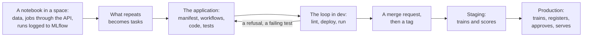

# Runbook — the AI/ML surface of SageMaker Unified Studio, and the applications built on it

| | |
|---|---|
| **Scope** | What a SageMaker Unified Studio project offers for machine learning and generative AI, entry by entry of its **AI/ML** and **Generative AI** menus; what this estate's controls do to each create; how a model goes from a notebook in a Sandbox project to an application the pipeline promotes through Staging into Production; how a call to a foundation model makes the same journey, with the guardrail, the knowledge base and the agent an application brings; and what of the Generative AI menu stays in Sandbox. The procedures it builds on stay where they are: an application's repository, manifest, pipeline and release in [`sagemaker-application.md`](sagemaker-application.md), a workflow's authoring rules in [`serverless-workflows.md`](serverless-workflows.md), a promotion sitting in [`promotion.md`](promotion.md) |
| **Operator** | Three hands. The **data scientist**, a member of a Sandbox project and a Developer of the application's GitLab project: the notebooks, the experiments, the application's code. The **deployment manager** (`awsds/deployment-managers`, `DeploymentManagerAccess` in AWS), who merges, tags, admits a release at the gates and approves a model version. The **infrastructure user** (`InfrastructureAccess`, the `awsds-infra-*` profiles), who writes the grants, plans the `[P]` slices and raises and lowers each session |
| **The rules** | **The two menus are two services**: AI/ML is Amazon SageMaker AI and Generative AI is Amazon Bedrock, and a control written for one says nothing about the other. **People build in Sandbox alone** (D17): a target has no space, and a page there shows what a task or a pipeline job created. **A bundle carries files and workflows, never an object of either service** (D41): a model's artifact, a pipeline's definition, a prompt or a guardrail's definition travels as a file, and an ML object of a target exists because a task or a pipeline job created it there, or because that account's Terraform declares it. **Each target trains its own model; a task proposes it as a version, and a person approves the one Production serves** (decision 16 (b); Stage 10 decision 22). **Serving is a batch transform** (Stage 10 decision 4): no endpoint stands in a target, and the one a run creates is deleted by that run (decision 18 (b)). **Every job and model states the boundary's settings in its own request** (D13). **A deployment project's role calls one foundation model, under a published guardrail of its account, and holds no other Bedrock action but the ones that keep the application's guardrail** (decisions 22 (a) and 24 (b)), designed; each later increment adds the calls it names and no more (§G). Until that exception is applied the role calls no Bedrock at all (Stage 19 decision 21 (b)) |
| **The picture around it** | The stage that exercises all of it: [Stage 17](../stages/stage-17-sandbox-machine-learning.md), whose steps, decisions and verifications this file cites by their numbers alone. Why the unit is an application: [D41](../decisions/D41-sagemaker-application.md); what crosses the gate: [D28](../decisions/D28-workflow-contract.md); why people work in Sandbox alone: [D17](../decisions/D17-interactive-vs-runtime.md); the boundary on every project role: [D13](../decisions/D13-lake-formation-enforcement.md) and [`sagemaker-denies`](../../../terraform-modules/sagemaker-denies/main.tf); the portal's concepts: [`docs/SMUS.md`](../../SMUS.md); Claude Code on Bedrock from a space: [`claude-code-sagemaker.md`](claude-code-sagemaker.md); a platform behaviour by its id: [`docs/AWS_SUPPLEMENT.md`](../../AWS_SUPPLEMENT.md); every acronym: [`docs/GLOSSARY.md`](../../GLOSSARY.md) |
| **Written** | 2026-11-16 and 2026-11-17, from a cloud session with no AWS credentials: AWS's user guides read on those days (their entries in [`docs/REFERENCES.md`](../../REFERENCES.md)), the Amazon provider's code at `providers-amazon/9.32.0` and `9.38.0`, botocore's service models at 1.43.1 and 1.44.4, the CI/CD CLI 1.0.9's documents and the files of its `ml/training`, `ml/deployment` and `genai` examples, and this estate's slices, scripts and stage records. Nothing was run for this file. The applications it describes, `app-ml` and `app-genai`, are the designs of passes 9 and 10, and neither is built; the measured model chain is `app-etl`'s. Where a decision of those passes is not yet taken, the design follows its recommended option and names the decision as open, and the stage file says which are taken. A statement about either application is a design until steps 9.10 and 10.10 replace it with what ran (Lesson 37) |

| Section | Audience | What it holds |
|---|---|---|
| [§A](#a-how-to-read-this-file) | both | how to read this file: the two services, the domain's type, how a fact is marked, the running examples, the vocabulary |
| [§O](#o-the-pieces) | both | the pieces: each ML object, who creates it in Sandbox and in a target, what it bills at rest |
| [§E](#e-the-entries-of-the-menus) | the data scientist | the entries of the two menus: AWS's path by domain type, what each holds, what the lab read |
| [§C](#c-what-the-controls-do-to-a-create) | both | what the controls do to a create: the boundary, the OU, the project tag, the model ceiling, the endpoints |
| [§B](#b-what-a-bundle-carries) | both | what the CI/CD CLI's bundle carries, and AWS's examples read against this estate |
| [§W](#w-the-workflows) | the data scientist | the workflows: the operators and their calls, the worker's rules, each application's tasks and increments, the lint |
| [§D](#d-the-development-flow-in-sandbox) | the data scientist | the development flow: from a notebook to an application, step by step, and the same flow for a call to a foundation model |
| [§P](#p-the-promotion) | both | the promotion: the pipeline's jobs for a model and for a model call, each account's part, what must be up |
| [§R](#r-the-registry-and-the-approval) | both | the registry and the approval: who proposes a version, who approves it, what serves the approved one |
| [§G](#g-the-generative-ai-path) | both | the Generative AI path: what opens the menu, the models, the apps, what reaches a target, `app-genai`'s shape, what a target owes a model, the guardrails and what enforces each, the knowledge base and the agent that follow, what stays in Sandbox |
| [§F](#f-a-refusal-by-its-wording) | both | a refusal by its wording, and the way through each |
| [§V](#v-the-readings) | both | the instruments, and what has run with its date |
| [§U](#u-what-is-unmeasured) | both | what is unmeasured, each with the step or verification that closes it |

---

## A. How to read this file

**Two services behind two menus.** The **AI/ML** group of a project's left navigation is Amazon
SageMaker AI: jobs, models, endpoints, pipelines, the Model Registry, MLflow and Feature Store. The
**Generative AI** group is Amazon Bedrock: the playground and the apps built in the Bedrock IDE. The
two share a project, its role and its portal, and nothing else: their APIs, their endpoints, their
quotas and this estate's controls differ (§C). A foundation model answers in the *Playground* through
Bedrock, on AWS's capacity; a foundation model listed under *Models* is a JumpStart model, which
SageMaker AI deploys to an endpoint of the project's own account.

**The domain's type decides the labels.** AWS's user guide (read 2026-11-16) documents the AI/ML
entries in a chapter per domain type. *Machine learning in Identity Center-based domains* covers
JumpStart models, building models in JupyterLab, training, inference endpoints, pipelines, the model
registry, MLflow, HyperPod clusters and Partner AI apps. *Machine learning workflows in IAM-based
domains* covers foundation models and their deployment, MLflow, custom training jobs, registered
models and Feature Store. The lab's domain is an Identity Center domain
([`docs/SMUS.md`](../../SMUS.md), "Domain"). The request that opened this file names the entries
*Models*, *Training Jobs*, *MLflow*, *Inference endpoints*, *ML pipelines* and *Feature Store*, labels
of both chapters, and which of them the lab's portal shows is step 0.9's reading, not yet taken. §E
gives each entry by both chapters.

**How a fact is marked.** *Measured*, with its date: it ran in this estate, and a stage log holds the
run. *Read*, with its date: it was read in a page of AWS, in code or in a policy, and nothing ran.
*Designed*: it is pass 9's text for `app-ml` or pass 10's for `app-genai`, and nothing of it is built.
A sentence in italics and quotation marks is AWS's own wording, or a message the lab's portal or an
API returned.

**The running examples.** `app-ml` is a second application on the `app-etl` template. A synthetic churn
table of a few hundred lines travels in its bundle. Its first workflow, `app-ml-train`, prepares the
table in a processing job, trains an XGBoost classifier in a training job, evaluates it on the worker,
proposes it as a version in the stage's model package group and logs the run to the stage's MLflow App.
Its second, `app-ml-score`, creates a SageMaker model, serves it by a batch transform, checks the
predictions and deletes the model. In Production a deployment manager approves the proposed version
through the pipeline's job, and the scoring workflow then serves the approved version. Later releases
add a workflow each (§W): a real-time endpoint created, invoked and deleted inside one run, an ML
pipeline created from a definition the bundle carries, and, if decision 21 is taken that way, the model
`dev` trained carried in the bundle. Where a measurement is needed the example is `app-etl`, whose
workflow `app-etl-train` trains a model in both targets and whose pipeline registers, approves and
serves it.

`app-genai` is a third application on the template, Amazon Bedrock's, with no image and no SageMaker
job. About forty synthetic support messages travel in its bundle, with the prompt and the definition of
the application's guardrail. Its workflow `app-genai-triage` makes sure that guardrail exists as the
file defines it, sends each message to one foundation model through `Converse` under it, for a label and
a one-line summary, and checks the answers against the labels the sample carries. A second workflow,
`app-genai-probe`, sends one call that names no guardrail and passes when the account refuses it. The
model is Amazon Nova Lite, served inside `us-west-2` (decision 23 (a)). Later releases add a knowledge
base and then an agent hosted on Amazon Bedrock AgentCore (decisions 25 (b) and 26 (a), §G). No Bedrock
call has run from a workflow task in any account of this estate; what has run is Sandbox's, from a space
and from the portal (§V).

**The vocabulary.** Each word below has more than one meaning on this surface, and a sentence here says
which it means.

| Word | What it means here |
|---|---|
| **model** | Four things. A *model artifact* is the file a training job writes, `model.tar.gz`. A *SageMaker model* is a record (`CreateModel`) that names an image, an artifact or a model package, a role and a network. A *model package* is a version in the Model Registry. A *foundation model* is a model Bedrock or JumpStart publishes |
| **pipeline** | *The pipeline* is GitLab's: the jobs a commit or a tag starts. An *ML pipeline* is SageMaker AI Pipelines, a graph of SageMaker jobs. Neither is a *workflow*, the MWAA Serverless definition an application carries |
| **deploy** | For the CI/CD CLI: copying the manifest's folders into a project and creating its workflows (§B). For SageMaker AI: putting a model behind an endpoint. For the Bedrock IDE: creating an alias and a version of a chat agent app (§G) |
| **registry** | The *Model Registry* is SageMaker AI's model package groups. MLflow keeps a registry of its own inside an app, and ECR is the image registry |
| **app** | A *SageMaker application* is the repository the CLI deploys (D41). An *MLflow App* is the serverless tracking service. An *AI app* is a chat agent app or a flow app of the Bedrock IDE. A space's *app* is its JupyterLab or Code Editor process |
| **agent** | A *chat agent app* is the Bedrock IDE's, built on Amazon Bedrock Agents, which AWS now names Agents Classic. A *runtime* of Amazon Bedrock AgentCore hosts agent code the application wrote. A *harness* is AgentCore's managed agent loop over a model, a prompt and tools (§G) |
| **inference profile** | An ARN a call names in place of a model. A *system-defined* profile, `us.<model>`, routes a call across Regions. An *application inference profile* is the account's own object over one model or over a system-defined profile: it carries tags, and it is what the portal and a project's grant invoke through (§G) |
| **guardrail** | A Bedrock object with content, topic, word, sensitive-information and grounding policies, in numbered versions and a working `DRAFT`. A call names one in its request, and Bedrock assesses the content the request marks and the answer against it. It binds a role only where a policy requires it, and an account can enforce one of its own on every invocation, whatever the request names (§G) |
| **project role** | `datazone_usr_role_<project>_<environment>`, the role every member of a project acts as, under the D13 boundary. In a deployment project it is every workflow's and every job's role |
| **deployment project** | The one project of a target, `deploy-staging` or `deploy-production`, with its spaces off: the CLI deploys every application into it (Stage 19 decision 6 (b)) |
| **stage** | The manifest's `dev`, `staging` and `prod` are the CLI's stages. A "Stage" with a number is a stage of this repository's plan. A GitLab pipeline has stages too, named here by their jobs |

## O. The pieces

Every object below but the model artifact is a record in the account that created it, and no bundle
carries a record (§B). The table says who creates each one in Sandbox and in a target, and what it bills
while nothing runs.

| Object | API | What it is | In Sandbox | In a target | At rest |
|---|---|---|---|---|---|
| Processing job | `CreateProcessingJob` | a container run once over inputs copied from S3, its outputs copied back | a notebook's API call or a workflow task | a workflow task, as the project role (measured for `app-etl`, 2026-11-16) | nothing |
| Training job | `CreateTrainingJob` | an algorithm's container fitted on data channels, which writes the model artifact | the same two paths; JumpStart's form is unread (2.4) | a workflow task (`app-etl-train`, measured 2026-11-16 as a project role) | nothing |
| Model artifact | an S3 object | `model.tar.gz` under the training job's output path | the training job | the target's own training job. Whether the artifact `dev` trained also travels in the bundle, beside the code that trains one, is decision 21, open | its bytes |
| SageMaker model | `CreateModel` | a record: an image and an artifact, or a model package, with a role and a `VpcConfig` | a notebook | a pipeline job (`model-chain.py`, measured) or a task (`app-ml`'s `resolve`, designed) | nothing |
| Transform job | `CreateTransformJob` | batch inference: a model run over a file, an output line per input line | a notebook | a pipeline job (measured) or a task (`app-ml`'s `score`, designed) | nothing |
| Endpoint configuration and endpoint | `CreateEndpointConfig`, `CreateEndpoint`; `InvokeEndpoint` through `sagemaker.runtime` | a model held on instances, answering requests | a notebook or the portal, deleted in its sitting (decision 6); a run of `app-ml-endpoint` in `dev` (designed) | none stands (Stage 10 decision 4). One release after the first, a run of `app-ml-endpoint` creates one, invokes it and deletes it (decision 18 (b), designed) | 0.115 USD per hour on `ml.m5.large` (price measured 2026-10-12) |
| Model package group and model package | `CreateModelPackageGroup`, `CreateModelPackage`, `UpdateModelPackage` | the Model Registry: a group per model family, each version with an approval status | the project's own group, from a notebook or the portal (pass 3); for `app-ml`, the group `app-ml-dev`, created once from the space, where the `register` task proposes a version at each run (designed) | a group in each target, Terraform's: `awsds-staging-model-app-ml` and `awsds-prod-model-app-ml`. The version is the `register` task's, as the project role, and the approval is `production-approve`'s (decision 16 (b), designed). For `app-etl` the pipeline's `production-register` proposes the version, in Production alone (measured, §R) | nothing |
| MLflow App | an environment of the `MLflowApp` blueprint | a serverless tracking service: experiments, runs, their artifacts in S3 | `ml-demo-mlflow`, created 2026-10-19; `app-ml-dev`'s, created the same way (designed) | one in each deployment project, created with `datazone create-environment` on the deployment profile's `MLflowApp` configuration (decision 17 (a), designed) | no SKU in the offer read 2026-10-12; the artifacts' bytes |
| ML pipeline | `CreatePipeline`, `UpdatePipeline`, `StartPipelineExecution` | a graph of SageMaker jobs, with its executions | a notebook or the visual editor (pass 5); a run of `app-ml-pipeline` in `dev` (designed) | none in the first release. One release later a run of `app-ml-pipeline` creates or updates one from a definition the bundle carries and starts an execution (decision 19 (b), designed) | nothing; each step bills as its job |
| Feature group | `CreateFeatureGroup`; `PutRecord` through Feature Store's runtime | features keyed by a record identifier, in an online store, an offline store or both | none: step 6.4 reads the entry and creates nothing | none (decision 20, open with (a) recommended) | the online store, while it holds records |
| Application inference profile | `CreateInferenceProfile`, Bedrock's | the account's own name for one model, tagged, which a call invokes in place of the model | the provisioning role, at a project's first use of an enabled model (decision 13); the console, for the playground | each target's Terraform, `awsds-<env>-app-genai`, tagged with the deployment project (designed, 10.5) | nothing expected, which the first bill reads (10.6) |
| Guardrail and its version | `CreateGuardrail`, `UpdateGuardrail`, `CreateGuardrailVersion` | a filter on the content a call marks and on its answer, in numbered versions | the Bedrock IDE's page, for a draft (7.4); the application's, `app-genai-<project id>`, which its `guardrail` task creates and versions in `app-genai-dev` (designed) | the application's, created and versioned by the same task at a run of the triage chain (decision 24 (b)); and the account's own, `awsds-<env>-account-guardrail`, Terraform's, enforced on every invocation of the account (decision 27, open with (a) recommended); both designed | nothing; its policies bill by the text unit assessed |
| Prompt, flow, evaluation job | Bedrock | the other building blocks the Bedrock IDE creates | the Bedrock IDE (pass 7); an evaluation job over `app-genai`'s sample, in `dev` alone (10.8) | none: an application's prompt travels as a file of its bundle, and a flow and an evaluation promote nothing (decision 26 (a)) | nothing |
| Knowledge base and its vector store | Bedrock, and the store's own service | documents embedded into vectors a model retrieves from | the Bedrock IDE (7.4a); `app-genai`'s tasks in `app-genai-dev`, one release after the first (designed) | none in the first release. One release later the application's tasks create the knowledge base and its data source, over a vector store and a service role each target's Terraform keeps (decision 25 (b), 10.7, designed) | the store's billing shape (decision 12; verification li) |
| Chat agent app, flow app | Bedrock | an agent or a flow with its prompts, guardrails and components | the Bedrock IDE (7.4b) | none: the app's export is read in Sandbox and nothing is deployed from it (10.8) | nothing |
| AgentCore runtime | `CreateAgentRuntime`, `UpdateAgentRuntime`, `InvokeAgentRuntime`, Amazon Bedrock AgentCore's | the application's own agent code, hosted by the service | the `deploy` task of `app-genai-agent` in `app-genai-dev` (10.11, designed); a harness is read there once and deleted (10.8) | the same task, in VPC mode under an execution role each target's Terraform declares, one release after the knowledge base's (decision 26 (a), designed) | unmeasured (verification lvi); a runtime stands between runs |

**`app-ml` in each stage**, designed:

| | `dev` | `staging` | `prod` |
|---|---|---|---|
| The project | `app-ml-dev`, a Sandbox project of the `experimentation` profile | `deploy-staging` | `deploy-production` |
| Deployed by | the data scientist, with the CLI from a space, as the project role | the pipeline's `staging-deploy`, as `awsds-deploy-staging` | `production-deploy`, as `awsds-deploy-prod`, after the gate |
| Tasks and jobs run as | the project role | the project role | the project role |
| A workflow is started by | the CLI's `run` | the chain's state machine, started by `staging-test` | the chain's state machine: its schedule, or the infrastructure user on the user's word |
| A version is proposed in (`MODEL_PACKAGE_GROUP`) | `app-ml-dev`, the project's own group | `awsds-staging-model-app-ml` | `awsds-prod-model-app-ml` |
| The model served | the last one `app-ml-train` trained there (`MODEL_SOURCE` `training`) | the same | the newest `Approved` version of the group (`MODEL_SOURCE` `registry`) |
| Tracking (`MLFLOW_APP_ARN`) | the project's MLflow App | `deploy-staging`'s MLflow App | `deploy-production`'s MLflow App |
| The data | the bundle's sample, under the project's `shared/app-ml/` and the project key | the same | the same |

Under decision 21's option (c), open, a later release also carries the model `dev` trained: Staging then
serves that file (`MODEL_SOURCE` `bundle`), and Production's group holds it as one more proposed version
(§W).

**`app-genai` in each stage**, designed:

| | `dev` | `staging` | `prod` |
|---|---|---|---|
| The project | `app-genai-dev`, a Sandbox project of the `experimentation` profile | `deploy-staging` | `deploy-production` |
| Deployed by | the data scientist, with the CLI from a space, as the project role | the pipeline's `staging-deploy`, as `awsds-deploy-staging` | `production-deploy`, as `awsds-deploy-prod`, after the gate |
| The call runs as | the project role, from a worker | the project role | the project role |
| `MODEL_ID` | the project's application inference profile of Nova Lite, created at the model's first use there | `awsds-staging-app-genai`, Terraform's | `awsds-prod-app-genai`, Terraform's |
| The application's guardrail | `app-genai-<project id>`, created and versioned by the `guardrail` task from the bundle's definition | the same, in `deploy-staging` | the same, in `deploy-production` |
| The account's guardrail (decision 27, open) | none, but for one sitting of step 10.4, which declares one, measures it and removes it | `awsds-staging-account-guardrail`, Terraform's, enforced on every invocation of the account | `awsds-prod-account-guardrail`, the same |
| What refuses a call that names no published guardrail | a deny on `app-genai-dev`'s role, off until step 10.4 turns it on | the boundary, whose ceiling admits no other invocation | the same |
| Workflows | `app-genai-triage`, `app-genai-probe` | both | `app-genai-triage` alone |
| A workflow is started by | the CLI's `run` | the chains' state machines, started by `staging-test` | the chain's state machine, started by the infrastructure user on the user's word |
| The data | the bundle's sample, under the project's `shared/app-genai/` and the project key | the same | the same |

**No person builds in a target.** A deployment project's `Tooling` environment has its spaces off and
creates no SageMaker AI domain, and the `Workloads` OU refuses the interactive surface (§C). A member
of the project reads its pages in the portal as the project role, and a deny on every session that
carries a person's identity refuses that session each `sagemaker:Create*`, `Update*`, `Delete*`,
`Start*`, `Stop*` and `AddTags` (`awsds-<env>-person-session-deny`, Stage 19 decision 15). An entry of
the AI/ML menu there shows what the tasks and the pipeline's jobs created; the page's own actions, a
registered model's *Approve/Reject* among them, are refused to the person who opens it.

## E. The entries of the menus

AWS's path for each entry, by chapter of its user guide (read 2026-11-16), what the entry holds, and
what the lab's portal has shown. "Unread" means no sitting has read the entry in the lab (0.9).

| AI/ML entry | Identity Center chapter | IAM-based chapter | What it holds | In the lab |
|---|---|---|---|---|
| **Models** | two entries, *JumpStart models* and *Model registry* | *Models*, with the tabs *Foundation Models* and *Registered Models* | pre-trained models to train or deploy; the Model Registry's groups and versions | unread; no version registered (pass 3) |
| **Training Jobs** | the *Training jobs* page, reached after a JumpStart model's *Train* | *Training Jobs* | the project's training jobs: status, metrics, output | unread; no job created from a space (pass 2) |
| **MLflow** | *MLflow*, with *Create MLflow App* | *MLflow*, with *Connect MLflow App* | MLflow Apps and tracking servers; the experiments' interface | read 2026-10-19: the entry is the legacy experiments page, and the app is under *Compute → MLflow* |
| **Inference endpoints** | *Inference endpoints*, with *Create endpoint* | *Endpoints* | models, endpoint configurations and real-time endpoints | unread; none created (pass 4) |
| **ML pipelines** | *ML pipelines*, with *Create in visual editor* | not in the chapter | SageMaker AI Pipelines: definitions, executions, the graph | unread; none created (pass 5) |
| **Feature Store** | not in the chapter; the SDK works in any domain type | *Feature Store* | feature groups and their stores | unread (6.4) |

The Identity Center chapter also documents *HyperPod clusters* and *Partner AI apps*. Both provision
standing infrastructure, and Stage 17 reads them without creating anything (6.1, 6.2).

| Generative AI entry | AWS's path | What it holds | In the lab |
|---|---|---|---|
| **Playground** | *"In the left navigation pane, under Generative AI, choose Playground."* | a chat, an image or a video prompt sent to an enabled model; the apps and prompts shared with the user | used 2026-10-19: Haiku 4.5 answered, and Nova Lite was refused by the SCP |
| **AI apps** | *"In the left navigation pane, under Generative AI, choose AI apps."* | the Bedrock IDE: chat agent apps, flow apps, prompts, evaluations, and the components knowledge base, guardrail and function | read 2026-10-19: the pages open; nothing created (7.4) |

AWS's release note of 2026-10-08 moved the Generative AI entries of Identity Center domains: *"Chat
playground, image and video playground, and shared apps and prompts can now be found in Playground."*
and *"Chat agent, flow, prompt, and my apps can now be found in AI apps."*

### Models

Two things share the label. A **pre-trained model** is a JumpStart recipe: an image, an artifact in
AWS's bucket and default settings. In the IAM-based chapter, *"Foundation Models displays pre-trained
models available for immediate use."*, and a model's deploy opens a notebook: *"This will create a
Sample notebook that you can use to review and deploy."* In the Identity Center chapter a trainable
model's page creates a job: *"From the model details page, choose Train to create a training job."* A
**registered model** is a version in the Model Registry: *"You catalog models by creating model
(package) groups that contain different versions of a model."* The IAM-based chapter lists a registered
version's actions as *"Deploy using Notebooks"*, *"Approve/Reject"* and *"Delete"*.

In this estate a JumpStart form creates a job or an endpoint from the form's own fields, and a request
that cannot state the boundary's settings is refused (§C); a JumpStart deploy's default instance type
is expected off the ceiling. Both are unmeasured (2.4, 4.5). JumpStart's artifacts come from
`jumpstart-cache-prod-<region>`, which the S3 gateway endpoint's policy has named since Stage 3 and
nothing has exercised. The registry is the promotion boundary (§R).

### Training Jobs

The page lists the project's training jobs: *"You can view the training job from the Training jobs
page."* AWS's chapters create a job from a JumpStart model's page or from a notebook and read it here.
Every `CreateTrainingJob` in this estate carries the boundary's settings in its request (§C). A
training job created by a workflow task is measured: `app-etl-train` on 2026-10-25 in both targets,
and on 2026-11-16 as a deployment project's role. One created from a space is pass 2's, not yet run.

### MLflow

MLflow comes as two products. An **MLflow App** is serverless: *"MLflow Apps are the latest offering
with faster startup times and cross-account sharing"*, and *"Each MLflow App includes compute
resources, backend metadata storage, and artifact storage in Amazon S3."* A **tracking server** is an
instance billed while it exists: *"Customers pay for MLflow Tracking Servers based on compute and
storage costs."*, 0.60 USD per hour for the smallest in the offer read 2026-10-12. In an Identity
Center domain the page creates an app (*"Choose Create MLflow App."*); in an IAM-based domain it
connects one that exists (*"Choose Connect MLflow App."*, *"Note that you can't create a new MLflow App
in Amazon SageMaker Unified Studio."*). *"Deleting an MLflow App is permanent and cannot be undone."*

The lab, read 2026-10-19:

- The left navigation's *AI/ML → MLflow* is the legacy experiments page. It offers a tracking server
  alone and carried the notice *"This page will be removed on September 16, 2026"*.
- The app's entry is *Compute → MLflow → Create*. Both of its items stayed greyed out after the
  blueprint's apply, with *"The MLflowApp blueprint is not enabled for this project. Contact your
  administrator to enable it."*: the entry reads the domain account's blueprint configurations, which
  D22 keeps empty.
- The app `ml-demo-mlflow` was created through `datazone create-environment` on the profile's
  `MLflowApp` configuration: MLflow 3.10.1, its role the project role, its artifacts under the
  project's prefix. *Open* mints its URL with `CreatePresignedMlflowAppUrl`.

A space's client reaches the app through the interface endpoint `aws.sagemaker.<region>.mlflow`, the
optional group `mlflow` of `sandbox/egress` (§C), with the app's ARN as the tracking URI. No run has
been logged yet (1.6). This estate builds no tracking server (decision 2).

### Inference endpoints

An endpoint is three objects: a SageMaker model, an endpoint configuration (the instance type and count)
and the endpoint itself. *"Endpoint are locations where you send inference requests to your deployed
machine learning models."* It bills each hour it exists, whether or not it answers, and its invocations
travel through `sagemaker.runtime`. In this estate the model's request carries a `VpcConfig` and network
isolation, the configuration's instance type is on the ceiling's list, which holds no GPU type, and
serverless inference is refused (§C). An endpoint in Sandbox is deleted in the sitting that created it
(decision 6), and `ML-5` fails on any that outlives one. No endpoint stands in a target, and
`sagemaker.runtime` is in neither target's endpoint set today. `app-ml`'s endpoint increment creates
one, invokes it and deletes it inside one run, in every stage, with that endpoint raised for its
sittings (decision 18 (b), §W). None has been created yet in any account (pass 4).

### ML pipelines

SageMaker AI Pipelines: *"A pipeline defines a series of interconnected steps in a directed acyclic
graph (DAG)."* The portal offers a visual editor (*"Choose Create in visual editor."*) and exports a
definition (*"Download pipeline definition (JSON)"*); a tag of the user's takes a prefix: *"To add a
custom tag to a pipeline, add the prefix `ProjectUserTag` to the tag name."* Each step is a SageMaker
job created as the pipeline's role, so each step's arguments carry the boundary's settings, and the
editor's forms are unread against them (5.3). `examples/sandbox-ml/pipeline/definition.json` is written
with the settings and has not run.

A release promotes no ML pipeline as an object: the workflow is the promoted orchestrator (D41), and the
bundle has no content type for a pipeline. The definition travels as a file. One release after its
first, `app-ml` gains a workflow whose tasks create or update a pipeline from that file, start an
execution with `SageMakerStartPipelineOperator` and read its result, in every stage (decision 19 (b),
§W).

### Feature Store

*"A feature group is a collection of features defined in your feature store to describe a record."* A
group has an online store, read at low latency, an offline store, or both: *"Offline stores keep a
historical record of all feature values in your Amazon S3 bucket, stored in Parquet format."* The
offline store's table is a Glue table or an Iceberg one (*"AWS Glue is the default format."*), and a
write reaches it late: *"When you call `PutRecord`, your data is buffered, batched, and written into
Amazon S3 within 15 minutes."* AWS states three limits: *"You can add up to 2,500 features per feature
group."*, *"You cannot edit or delete features after the feature group is saved."* and *"Data stored in
the offline store (Amazon S3) is not automatically deleted."* The portal's page is documented for
IAM-based domains alone (*"The Feature Store interface described on this page is available in Amazon
SageMaker Unified Studio domains configured with AWS IAM."*), and the SDK for all (*"You can use
Feature Store from a notebook or IDE using the SDK in any domain type."*).

Read in the SDK's model (botocore 1.43.1, the worker's, on 2026-11-17): `CreateFeatureGroup` takes a
role its documentation there describes as *"the IAM execution role used to persist data into the
OfflineStore"*, which needs `kms:GenerateDataKey` on the store's key, and registers a Glue table unless
`DisableGlueTableCreation` is set; a write is `PutRecord` on the runtime
`featurestore-runtime.sagemaker`, whose `TargetStores` can name the offline store alone.

Nothing of it has run here (6.4, verification xxxiii): whether an Identity Center domain shows the
entry; what the project role holds for a feature group, where AWS's developer guide asks a role for the
managed policy `AmazonSageMakerFeatureStoreAccess`; the endpoint service of the runtime, which no slice
declares; and how the offline store's Glue table meets this estate's Lake Formation governance. No
application uses a feature group: decision 20 is open with (a) recommended, the entry read in Sandbox
and exercised nowhere. The CLI's README marks Feature Store *(future)* in its list of what it deploys,
and neither the provider nor the service's list holds an operator for a feature group, so a task's own
code would create one and write to it.

### Playground and AI apps

Both are Bedrock, and §G holds them: what opens the menu, which models answer, what an app is made of
and what reaches a target.

## C. What the controls do to a create

A create passes four layers, and the wording of a refusal names the layer that refused (§F):

1. **The project role's policies**: AWS's managed policies and the grants this estate adds. A refusal
   reads *"no identity-based policy allows"*.
2. **The D13 boundary** on every project role. A refusal reads *"with an explicit deny in a
   permissions boundary"*.
3. **The OU's service control policy.** A refusal reads *"with an explicit deny in a service control
   policy"*.
4. **The network path.** A call with no endpoint in the VPC gets no response, or the proxy's refusal
   (Lesson 42).

**The boundary's statements** ([`sagemaker-denies`](../../../terraform-modules/sagemaker-denies/main.tf)):

| Statement | Refuses a request that | On |
|---|---|---|
| `DenySageMakerJobsOffVpc` | names no subnets | `CreateTrainingJob`, `CreateProcessingJob`, `CreateHyperParameterTuningJob`, `CreateAutoMLJob`, `CreateAutoMLJobV2`, `CreateModel` |
| `DenySageMakerJobsWithoutNetworkIsolation` | omits network isolation or sets it false | the same actions |
| `DenySageMakerJobsWithoutInterContainerEncryption` | omits inter-container encryption or sets it false | the job actions, without `CreateModel` |
| `DenySageMakerJobsWithoutVolumeEncryption` | names no key for the volume | the job actions and `CreateTransformJob` |
| `DenySageMakerInstanceCeiling` | names an instance type off the list | every action that names one, except a space's `CreateApp`, `CreateSpace` and `UpdateSpace` |

The list is `ml.t3.medium`, `ml.t3.large`, `ml.t3.xlarge`, `ml.m5.large`, `ml.m5.xlarge`,
`ml.c5.large` and `ml.c5.xlarge`. What follows from the statements:

- **A request states each setting itself**: a `VpcConfig` with the project's private subnets and
  security group, `EnableNetworkIsolation: true`, `EnableInterContainerTrafficEncryption: true` on a
  job, the project key on the volume, a listed instance type. An omitted field is refused, since each
  deny fires on an absent key.
- **Code inside a job reaches nothing.** A network-isolated container has no network: it calls no
  MLflow App, no registry, no Bedrock model and no S3 API, and it sees its input and output mounts
  alone. Tracking, registration and any model invocation therefore happen around the job, from the
  notebook in a space or from a worker task in a workflow.
- **A batch transform has no `VpcConfig` of its own.** It inherits the model's, which is why
  `CreateModel` is on the first two lists.
- **A workflow's notebook task is refused.** `SageMakerNotebookOperator` runs the notebook as a
  training job and takes no network, isolation or key parameter (`SUP-265`, measured 2026-08-27 and
  2026-09-10).
- **A portal form is only as specified as its fields** (Lesson 16). JumpStart's *Train*, *Create
  endpoint* and the pipeline editor are unread against the settings (0.7, 2.4, 4.2, 5.3). The paths
  known to carry them are an API call from a notebook and a workflow task's `config`.
- **Serverless inference is refused.** A serverless endpoint's model takes no `VpcConfig`, so
  `DenySageMakerJobsOffVpc` is expected to refuse its `CreateModel` in Sandbox (4.4, unmeasured).

**The `Workloads` OU**, over Staging and Production, carries the same five statements with the same
list as a service control policy, so they bind every principal of the account, the deploy roles
included. It also refuses the interactive surface (`DenyInteractiveSageMakerSurface`: domains, user
profiles, spaces, apps, notebook instances and their presigned URLs) and a serverless endpoint
configuration (`DenySageMakerServerlessInference`, measured 2026-10-18 in Production, `SUP-244`).

**The project tag on a create** (`SUP-267`). AWS's managed policy lets a project role create a
SageMaker resource that carries the tag `AmazonDataZoneProject` with the project's id, describes a
resource only when it carries that tag, and refuses to add a tag whose key starts with
`AmazonDataZone`. A workflow's operator therefore fails twice: on the describe of a job name that does
not exist yet, which the operator makes before every create (*"no identity-based policy allows"*,
measured 2026-10-10 in Sandbox and 2026-11-16 in Staging), and on the tag of the create itself,
authorized as `sagemaker:AddTags` (measured 2026-10-10 on a processing job). This estate closes each
resource type with a pair of statements on the project role: a describe allowed on a resource that
carries no project tag, and `AddTags` allowed for that one key with the caller's own value.

| Resource type | `sandbox/workflows/` | `<env>/studio/workflows.tf`, the deployment projects |
|---|---|---|
| Processing job | held | held |
| Training job | designed (9.5), after 2.2's readings | held since 2026-11-16 |
| Transform job | designed (9.5) | designed (9.5) |
| SageMaker model, the tag alone | designed (9.5) | designed (9.5) |

Whether a worker's `CreateModel` and `CreateTransformJob` meet the gap as a processing job did is
verification xxix, and whether a notebook's `CreateTrainingJob` does is 2.2.

**The model ceiling on Bedrock.** The interactive OU's policy, over Sandbox, holds
`DenyBedrockInvocationOutsideTheScopedModels`: `InvokeModel` and `InvokeModelWithResponseStream` are
refused on every resource but Claude Opus 4.5, Sonnet 4.5 and Haiku 4.5, as foundation models and
through their `us.` inference profiles, Titan Text Embeddings V2, and an application inference
profile, the object every portal call invokes through. `DenyBedrockReadsOutsideTheRoutedRegions`
keeps the calls in `us-east-1`, `us-east-2` and `us-west-2`. Both are measured (2026-10-19, §G). The
targets hold neither statement.

**Bedrock in a target.** Four things stand between a deployment project's role and a model, each read
in this repository on 2026-11-16:

- **The boundary.** `DenyServicesNoProjectUsesHere` denies `bedrock:*` and `bedrock-agentcore:*` to
  every project role of the account (`<env>/studio/fence.tf`; Stage 19 decision 21 (b), `TM-30`,
  applied 2026-11-11).
- **The network.** Neither target's VPC holds a `bedrock-runtime` endpoint, and neither has a default
  route.
- **The account's standing with Bedrock.** The retention mode reads `inherit`, and the account holds
  no use-case form and no model agreement (`INV-18`).
- **The Region.** The `Workloads` OU carries Control Tower's Region deny without the `bedrock:`
  exemptions the interactive OU's copy holds (`INV-12`), so a Bedrock call outside `us-west-2` is
  refused there, a cross-Region profile's pass in another Region included.

Pass 10's design answers each for one call (§G), and until its applies the four stand.

**The endpoints of each account.** With no default route in any VPC, a call from a space, a worker or
a job leaves through an interface endpoint or does not leave.

| Service | Sandbox | Staging and Production |
|---|---|---|
| `sagemaker.api`, `sts`, `logs`, `kms`, `glue`, `lakeformation`, `secretsmanager`, `datazone` | always | always, while the egress slice is up |
| `sagemaker.runtime`, an endpoint's invocations | always | none |
| `ecr.api`, `ecr.dkr`, `athena` | always | none |
| `aws.sagemaker.<region>.mlflow`, the tracking calls | `GROUPS=mlflow` | none |
| `airflow-serverless`, the CLI's calls from a space | `GROUPS=mwaa` | none |
| `bedrock`, `bedrock-runtime` | `GROUPS=bedrock-base`; the runtime endpoint's policy admits `InvokeModel` and `InvokeModelWithResponseStream` alone | none today; the `bedrock-base` group for the sittings that run `app-genai`, designed (10.5) |
| `bedrock-agent`, `bedrock-agent-runtime` | `GROUPS=bedrock-agent` | none (decision 25) |
| Feature Store's runtime | none | none |

A call the portal makes for a person does not pass these endpoints: the playground's `ConverseStream`
of 2026-10-19 carried no `vpcEndpointId` in the trail.

## B. What a bundle carries

The CI/CD CLI 1.0.9's manifest has six content types (its schema, read 2026-11-16): `storage`,
commented there as *"Storage content (S3 files, data, models)"*, `git`, `workflows`, `quicksight`,
`catalog` and `notebooks`. None is a SageMaker model, a model package, an endpoint, an ML pipeline, a
feature group, an MLflow experiment or a Bedrock object. A file is the only form in which a model
travels in a bundle, and everything else exists in a target because a task of a workflow, or a job of
the pipeline, created it there under that account's own controls.

AWS's examples for this surface, in the CLI's repository (its README and its examples guide, read
2026-11-16), each run one `SageMakerNotebookOperator` task over a notebook the bundle carries:

| Example | What its workflow runs | What the bundle carries | Here instead |
|---|---|---|---|
| `ml/training` | a training notebook, tracking to MLflow in every stage through an `MLFLOW` connection a bootstrap action creates | the notebook and its code | job and worker tasks (§W); tracking in `dev` alone (decision 17). The connection names a tracking server by ARN, which this estate does not build (decision 2) |
| `ml/deployment` | a notebook that creates or updates a real-time endpoint, described as *"Deploy trained ML models as SageMaker real-time inference endpoints."* | the trained model's artifacts, as a storage item | each target trains its own model, and serving is a batch transform (decision 21; Stage 10 decisions 22 and 4) |
| `genai` | a notebook that creates a Bedrock agent and a knowledge base in each stage | the notebook and the agent's code | `app-genai`: one call to a foundation model from a Python task, under the account's guardrail, with no agent, and a knowledge base as a later increment (decisions 15, 25 and 26; §G) |

The notebook operator does not run in this estate: its training job carries no network, isolation or
key parameter, the boundary refuses it (`SUP-265`), and the lint refuses the operator by name. The same
work is written as job tasks and worker tasks (§W).

**A project for each stage, and the applications that share it.** The CLI's README (read
2026-11-16): *"Each application stage deploys to a dedicated SageMaker Unified Studio (SMUS) project.
A project can host a single application or multiple applications depending on your architecture and
CI/CD methodology."* and *"Organizations can choose between dedicated projects per application
(isolation) or shared projects hosting multiple applications (consolidation), based on security,
compliance, and operational requirements."* Its ETL, notebooks and `genai` examples deploy into one
project, `test-marketing`, and its two ML examples into projects of their own. The `genai` example's
project role carries the Bedrock permissions: *"Custom Role: Project-specific IAM role with Bedrock
permissions"*. This estate consolidates: each target has one deployment project, whose role every
application's tasks run as (Stage 19 decision 6 (b)). A grant made there for one application is a
grant to every application deployed there, so `app-genai`'s model call is a narrow exception in the
boundary and not a Bedrock permission on the role (decision 22, §G).

## W. The workflows

**The operators.** MWAA Serverless runs the operators its page lists (read 2026-11-16), from the
Amazon provider, 9.38.0 on that page. The calls below were read in the provider's code at 9.32.0 and
9.38.0 (`SUP-268`, `SUP-372`, `SUP-373`).

| Operator | Its calls, in order | Run in this estate |
|---|---|---|
| `SageMakerProcessingOperator` | `DescribeProcessingJob` on the name, `CreateProcessingJob`, then it polls | measured 2026-10-10 in Sandbox, and in every release since |
| `SageMakerTrainingOperator` | `DescribeTrainingJob` on the name, a head of each S3 channel, `CreateTrainingJob`, then it polls | measured 2026-10-25 in both targets and 2026-11-16 as a deployment project's role |
| `SageMakerTransformOperator` | `DescribeTransformJob` on the name; with a `Model` key, `DescribeModel` then `CreateModel`; a head of the input; `CreateTransformJob`; it polls; `DescribeTransformJob` and `DescribeModel` for its result | read, not run |
| `SageMakerModelOperator` | `CreateModel`, `DescribeModel`, with no check of the name | read, not run |
| `SageMakerDeleteModelOperator` | `DeleteModel` | read, not run |
| `SageMakerEndpointOperator` | `CreateModel` and `CreateEndpointConfig` when given, `CreateEndpoint`, `UpdateEndpoint` when the name exists, then it waits for `InService` | read, not run (decision 18) |
| `SageMakerRegisterModelVersionOperator` | `CreateModelPackageGroup` first, then `CreateModelPackage` | read, not run (decision 16) |
| `SageMakerStartPipelineOperator` | `StartPipelineExecution`, then it polls | read, not run (decision 19) |
| `SageMakerTuningOperator`, `SageMakerAutoMLOperator`, `SageMakerEndpointConfigOperator` | not read | not run |
| `SageMakerNotebookOperator` | a training job named `Notebook-task-…` with no network setting | refused by the boundary (measured) and by the lint |
| `BedrockInvokeModelOperator` | `InvokeModel` with the model, the body and two content types. It names no guardrail, and it writes the prompt and the response to the task log | never run. Read once in `dev`, from a workflow outside the bundle (10.4), and refused in an application by the lint (10.3) |
| `BedrockRaGOperator`, `BedrockRetrieveOperator` | `RetrieveAndGenerate`; `Retrieve`. The first logs the prompt, the response and the citations, the second the query and what it retrieved | never run. The first is a call AWS's page keeps away from a role bound to a guardrail (§G) |
| `BedrockIngestDataOperator` | `StartIngestionJob`, repeated after a `ValidationException` that says the index is not ready, then it waits for the job | never run (decision 25) |
| `BedrockCreateGuardrailOperator`, `BedrockCreateGuardrailVersionOperator`, `BedrockDeleteGuardrailOperator` | `CreateGuardrail`, which on a `ConflictException` with `if_exists: skip` reads the guardrail's id by its name; `CreateGuardrailVersion`; `DeleteGuardrail` | never run: each account's Terraform declares the guardrail (decision 24) |
| The service's other Bedrock operators, and its four Bedrock sensors | not read past their first call | never run |

The page lists no operator for MLflow, Feature Store, a Bedrock agent, a Bedrock flow or Bedrock's
`Converse`. Each of those is a task's own code.

**The worker's rules** ([`serverless-workflows.md`](serverless-workflows.md) §A):

- A worker runs Python 3.12 on 1 vCPU and 3 GiB with no internet, from a code archive of at most
  250 MB (the service's page, read 2026-11-16), as the project role in the project's subnets. A call
  it makes needs an endpoint of the account's set (§C).
- A Python task imports the worker's pre-installed package before the archive's copy, and a Bash
  task's `python3` imports the archive's first (`SUP-274`).
- Templates render when the run is created, in a short context (`SUP-269`), and an XCom reaches a
  template as the JSON text of its value (`SUP-277`, measured 2026-10-25).
- The service ignores `trigger_rule`, so no task runs after a failure. `retries` defaults to 1, and a
  task runs for at most 3,600 s.

**`app-ml`'s tasks**, designed (the full table is pass 9's):

| Workflow | Task | Kind | What it does |
|---|---|---|---|
| `app-ml-train` | `prepare` | processing job, the application's image, `ml.t3.medium` | splits the bundle's sample into the train, validation and batch sets |
| | `train` | training job, XGBoost `3.0-5` by digest, `ml.m5.large` | fits the classifier and writes the artifact under `app-ml/models/` |
| | `evaluate` | Python task | reads `validation:auc` from the job, fails under `MIN_AUC`, writes the evaluation file and the pointer `latest.json` |
| | `track` | Bash task | logs the run to the project's MLflow App where `MLFLOW_APP_ARN` names one, and ends 0 where it reads `none` |
| `app-ml-score` | `resolve` | Python task | finds what to serve, `latest.json` or the newest `Approved` version, and creates the model `app-ml-score-{proj.id}` with boto3 |
| | `score` | `SageMakerTransformOperator` with no `Model` key, `ml.m5.large` | the batch transform over the batch set |
| | `check` | Python task | reads the output, a probability per input line, and writes the score report |
| | `cleanup` | `SageMakerDeleteModelOperator` | deletes the model |

The rules behind that shape, each from a measurement or from the provider's code:

- **No value passes from a Python task into an operator's `config`**, since an XCom arrives as JSON
  text. The task that knows what to serve creates the model itself, under a name the workflow writes
  as a constant, and the operators carry static values alone.
- **No task cleans up after a failure.** `cleanup` runs only when `check` passed. A failed run leaves
  the model, which bills nothing, and the next run's `resolve` replaces it.
- **The task that tracks is a Bash task**, so the archive's MLflow client is imported before the
  worker's own packages.
- **Each operator reads its job's name before the create**, so the project role holds the describe and
  tag pair for that resource type (§C).
- **The model's request is code, which the lint does not read.** The application's own test asserts
  its `VpcConfig`, its network isolation and its tag, with `botocore.stub.Stubber`.
- **A job's name carries a per-run stamp** and `action_if_job_exists: fail`, so a rerun never renames a
  job silently.

**`app-genai`'s tasks**, designed (the full table is pass 10's):

| Workflow | Task | Kind | What it does |
|---|---|---|---|
| `app-genai-triage` | `triage` | Python task | sends one `Converse` request for each message of the bundle's sample to `MODEL_ID`: the prompt file as the system prompt, the message as the content the guardrail assesses, and `guardrailConfig` naming `GUARDRAIL_ARN` and `GUARDRAIL_VERSION` with the trace on. It writes the answers under `app-genai/work/` and returns the totals |
| | `check` | Python task | reads the answers: each one let through parses with a label of the allowed set; the planted messages came back blocked or masked, by the guardrail's trace; the labels agree with the sample's on at least `MIN_ACCURACY`. It writes the triage report and fails under the threshold |
| `app-genai-probe`, in `dev` and `staging` | `unguarded` | Python task | sends one `Converse` request with no `guardrailConfig`, writes what came back to the probe report, and passes when the outcome, an answer or a refusal, equals `EXPECT_UNGUARDED` |

The rules behind that shape:

- **A call that must name a guardrail is a Python task's**, with boto3. `BedrockInvokeModelOperator`
  has no parameter for a guardrail and logs the prompt and the response (`SUP-373`).
- **The model, the guardrail and its version are stage variables**, filled at deploy from
  Terraform's outputs, so one bundle serves every stage and no ARN is in git.
- **The task's log holds counts**, never a message or an answer. The answers are an object under the
  project's `shared/app-genai/`, under the project key.
- **`triage` has `retries: 0`**, so a failed run is read before any message is sent twice.
- **The check asserts the guardrail's trace** for the planted messages and a threshold for the rest:
  a model's answers are not fixed, and `temperature` 0 narrows them without pinning them.
- **The request is code, which the lint does not read.** The application's test asserts the
  `guardrailConfig` of every request with `botocore.stub.Stubber`, and in a target the boundary
  refuses a request without it.

**The lint** (`awsds-workflows`, at the template's pin `196acee`) reads a processing request (rule
`job`) and a training request (rule `treino`) against the boundary's settings, and refuses
`SageMakerNotebookOperator` by name. A transform, a model or an endpoint operator passes with its
request unread (Lesson 71) until step 9.3's rules merge; until then the boundary and the OU are the
only refusal for those requests. The rule `operador` likewise admits every Bedrock operator of the
provider until step 10.3's rules merge, which refuse by name, in an application,
`BedrockInvokeModelOperator`, `BedrockRaGOperator` and the operators that create, version, update or
delete a guardrail, a knowledge base or a data source.

**The MLflow client in a worker's archive**, measured 2026-11-16 on a build host: `awsds-workflows
package-task` over `mlflow-skinny==3.10.1` and `sagemaker-mlflow==0.5.0` wrote a `.zip` of 15,288,232
bytes, 55,772,613 uncompressed, with 42 distributions, against the service's 250 MB, and CPython 3.12
imported both packages from it. The import on a worker and a tracking call from one are unmeasured
(verification xxxii).

## D. The development flow in Sandbox



The flow has two halves. Steps 1 to 3 are the experiment, in a space, where every object is the
project's and nothing is promoted. Steps 4 to 9 turn what the experiment kept into an application.
The space, the checkout, the manifest's values and the CLI's commands are
[`sagemaker-application.md`](sagemaker-application.md) §D, and only what a model adds is written here.

1. **Explore in a space.** The infrastructure user raises the session, `make hub-up` and then
   `make up ENV=sandbox GROUPS=mlflow`. In a JupyterLab space on the house image the data scientist
   reads the data and creates each job through the SageMaker API, with the boundary's settings in the
   request (§C). [`examples/sandbox-ml/`](../../../examples/sandbox-ml/README.md) holds the exercise as
   scripts a person reviews (`data.py`, `train.py`, `register.py`, `serve.py`, `pipeline.py`), written
   2026-10-17 and not yet run against AWS. What the space's SDK configuration fills in by itself is
   0.3's reading.
2. **Track from the notebook, never from the job.** The notebook logs the parameters before
   `CreateTrainingJob`, reads the final metrics back from `DescribeTrainingJob`, downloads the artifact
   from the output path and logs it as an MLflow model. The tracking URI is the app's ARN, and the
   house environment holds `mlflow` 3.16.0 and `sagemaker-mlflow` 0.5.0.
3. **Register and serve once by hand**, to learn what the objects are: a version in the project's own
   registry (pass 3), an endpoint invoked and deleted in the same sitting, a batch transform (pass 4).
   None of these objects is promoted.
4. **Draw the line between the experiment and the application.** What runs again with new data becomes
   a task: the preparation, the training, the evaluation against a threshold, the scoring. What a
   person decides stays a person's act: the approval of a version. What explores stays in the
   notebook. The application's sample is small and synthetic, since the bundle carries it (§B).
5. **Write the application on the template**: `manifest.yaml`, `workflows/`, `src/` for the processing
   job's code, `code/` for the worker's tasks, `samples/`, `tests/`, the `Dockerfile` and the lock
   ([`sagemaker-application.md`](sagemaker-application.md) §R, §C and §I). Every account-scoped value is
   a variable of the CLI's notation, so one bundle deploys into each stage; a stage's difference is a
   stage variable, as `MODEL_SOURCE` and `MLFLOW_APP_ARN` are for `app-ml`.
6. **Test before any AWS call.** The unit tests run each task's function over
   `botocore.stub.Stubber` and assert the requests the code builds, the model's among them. The lint
   reads the workflows' job requests:

   ```bash
   awsds-workflows lint .
   ```

7. **The loop in `dev`.** The application's own Sandbox project, of the `experimentation` profile, with
   its MLflow App. The session is `make up ENV=sandbox GROUPS=mwaa,mlflow`: `mwaa` for the CLI's
   calls and `mlflow` for the tracking task. From a space, the workers' archives are built first, then:

   ```bash
   scripts/dev-cli.sh deploy --manifest manifest.yaml --targets dev --skip-validation --no-events
   scripts/dev-cli.sh run --manifest manifest.yaml --targets dev --workflow app-ml-train
   scripts/dev-cli.sh run --manifest manifest.yaml --targets dev --workflow app-ml-score
   ```

   Read after each run: the jobs' settings and tags, the run in the MLflow App, the model created and
   deleted by the worker, the score report. Every portal tab is closed before `make down ENV=sandbox`.
8. **Read each refusal by its wording** (§F), and change one field at a time, so that a refusal names
   one statement (Lesson 20). A refusal on a describe before a create names a pair the project role
   lacks (§C), which is the infrastructure user's to write.
9. **A merge request, then a tag** (§P). The image is built by the tag's pipeline alone, so a
   processing task has no image to run on in `dev` until the first tag has pushed one.

### The same flow for a call to a foundation model

`app-genai`'s flow has the same halves, designed (10.2, 10.4): drafts in the portal, then files in
git.

1. **Draft in the portal.** The prompt in the *Playground*, against the model the application will
   call; the guardrail's policies on the Bedrock IDE's guardrail page, tried against sample messages.
   Neither is promoted: the playground leaves no object, and a guardrail the IDE creates is the
   project's own.
2. **Copy the drafts into files.** The prompt becomes `prompts/triage.md` in the application's
   repository. The guardrail's definition becomes Terraform, one definition for the accounts
   (decision 24), which the infrastructure user writes and the user applies.
3. **Write the call as a Python task**, with boto3's `converse`: the prompt file as the system prompt,
   the message marked as the content the guardrail assesses, and `guardrailConfig` with the
   guardrail's ARN, its version and the trace. The worker's boto3 carries the call (1.43.1 on step
   9.4's build host), so the archive holds the application's module alone.
4. **Test before any AWS call.** The tests run each task's function over `botocore.stub.Stubber` and
   assert every request's `guardrailConfig` and a log free of messages.
5. **The loop in `dev`**, in the application's own Sandbox project. The session is
   `make up ENV=sandbox GROUPS=mwaa,bedrock-base`: `mwaa` for the CLI's calls and `bedrock-base` for
   the worker's. The model reaches the project by the portal's own path, an application inference
   profile created at its first use there (§G), whose ARN is `dev`'s `MODEL_ID`.
6. **Read a blocked answer as an answer.** A message the guardrail blocks comes back in a call that
   succeeded, with the guardrail's own message in place of the model's text and a trace that says
   which policy acted. A refusal is an `AccessDeniedException`, read by its wording (§F).
7. **A merge request, then a tag** (§P). The application has no image, so every task runs in `dev`
   before any tag.

## P. The promotion

A release is a tag `v<major>.<minor>.<patch>` on `main`, and the tag's pipeline does the rest. The
jobs below are the template's as they ran for `app-etl`'s `v0.5.2` on 2026-11-16, with what `app-ml`
changes, designed ([`sagemaker-application.md`](sagemaker-application.md) §P holds every job).

| Phase | Jobs | What happens for `app-ml` |
|---|---|---|
| Build | `test`, `build-image`, `scan-gate`, `build-task-code` | the unit tests and the lint; the application's image built and scanned; the workers' archives built, the MLflow client inside `app-ml-train`'s |
| Bundle | `bundle`, `store-bundle`, `release` | the CLI bundles from `app-ml-dev` as `awsds-deploy-sandbox-test`; the bundle is stored in `awsds-prod-releases`, and the tag's GitLab release names its object, its sha256 and the image |
| Staging | `staging-gate` (manual), `staging-check`, `staging-deploy`, `staging-test` | a deployment manager admits the release; the deploy role checks the egress slice and the deployment project; the CLI deploys the bundle into `deploy-staging`; `staging-test` starts `awsds-staging-chain-app-ml-train`, then `awsds-staging-chain-app-ml-score`, and reads the score report |
| Production | `production-check`, `production-gate` (manual), `production-deploy` | the same check; a deployment manager admits the release; the CLI deploys the same bundle into `deploy-production`, where the workflows are created and none runs |
| The model | a chain's start, `production-register` (manual), `production-approve` (manual), a chain's start | Production trains its own model; the pipeline registers it `PendingManualApproval`; a deployment manager approves it; the scoring chain serves the approved version (§R) |

`app-ml`'s pipeline drops the template's `staging-catalog`, `production-catalog` and
`production-warehouse-ddl`, since it publishes no data product, and `staging-model` and
`production-transform`, whose work its scoring workflow does.

**A model in each account**, designed:

| | Sandbox, `dev` | Staging | Production |
|---|---|---|---|
| Trained by | a run the data scientist starts | `staging-test`, through the train chain | the train chain, started after `production-deploy` |
| The gate on quality | `MIN_AUC` in `evaluate` | the same threshold; a failure fails Staging's leg | the same threshold, then a person's approval |
| Served from | `latest.json`, the last trained | `latest.json` | the registry's newest `Approved` version |
| What proves it | the score report in the project's `shared/` | the score report `staging-test` reads | the score report naming `registry` and the version's ARN |

**What must be up.** The hub, GitLab and both targets' egress slices: the user raises
`staging/egress` before the tag and destroys it after (Stage 8 decision 27), and
`production/workloads-egress` is raised for the sitting. The pipeline raises and destroys no shared
slice. The sitting, command by command, is [`promotion.md`](promotion.md) §N.8.4's for `app-etl`.

**Who starts a chain.** In Staging, `staging-test`, as the deploy role. In Production the chains'
schedules stay `DISABLED` between sittings, the deploy role starts none, and the infrastructure user
starts a chain on the user's word.

**What a first release needs, once.** A second application adds its names to the estate before its
first tag: the GitLab project, the image repository, the registry's family, the deploy roles'
statements, the project roles' pairs, the chains and the Sandbox grant. The list is Stage 17's "What
pass 9 builds", in the order of [`sagemaker-application.md`](sagemaker-application.md) §S, which was
read from the code and has not been run for a second application.

### `app-genai`'s release

Designed (10.6). The pipeline is the template's without `build-image` and `scan-gate`, since the
application has no image, and without the catalog, warehouse and model jobs.

| Phase | Jobs | What happens for `app-genai` |
|---|---|---|
| Build | `test`, `build-task-code` | the unit tests and the lint; the worker's archive, built from the application's module alone |
| Bundle | `bundle`, `store-bundle`, `release` | the CLI bundles from `app-genai-dev` as `awsds-deploy-sandbox-test`; the bundle is stored, and the tag's release names it |
| Staging | `staging-gate` (manual), `staging-check`, `staging-deploy`, `staging-test` | the CLI deploys the bundle into `deploy-staging`; `staging-test` starts `awsds-staging-chain-app-genai-probe`, which succeeds when the boundary refused the call without the guardrail, then `awsds-staging-chain-app-genai-triage`, and reads both reports |
| Production | `production-check`, `production-gate` (manual), `production-deploy` | the CLI deploys the same bundle into `deploy-production`, where `app-genai-triage` is created and does not run |
| The run | a chain's start | the infrastructure user starts `awsds-prod-chain-app-genai-triage` on the user's word, and the triage report is read |

**A model call in each account**, designed:

| | Sandbox, `dev` | Staging | Production |
|---|---|---|---|
| The model | Nova Lite, through the project's application inference profile | Nova Lite, through `awsds-staging-app-genai` | Nova Lite, through `awsds-prod-app-genai` |
| The gate on quality | `MIN_ACCURACY` in `check` | the same threshold; a failure fails Staging's leg | the same threshold |
| The gate on the guardrail | the probe, once step 10.4 turns the deny on | the probe chain, before the triage chain | the boundary, which no workflow probes there |
| What proves it | the triage report in the project's `shared/` | both reports, which `staging-test` reads | the triage report, and a trail with no Bedrock event of another name from a project role |

**What must be up** for this release: the hub, GitLab, and both targets' egress slices raised with
the `bedrock-base` group and lowered at the sitting's end. **What a first release needs, once**: the
GitLab project, the Sandbox project with its grants, and in each target the guardrail, its version,
the inference profile, the boundary's exception, the chains and the account's retention mode. The
list is Stage 17's "What pass 10 builds", and the order is step 10.5's: the threat-model entry
accepted first, then Staging before Production.

## R. The registry and the approval

**In Sandbox** the registry is the project's own: a group the data scientist creates from a notebook
or the portal, with versions nobody else reads. It is pass 3's, not yet run, and its first version is
the event `EXC-11` waits for.

**In Production** each application has one model package group, `awsds-prod-model-<app>`, declared by
`production/sagemaker/` with its resource policy (`registry.tf`'s `model_families`). Nothing else
writes a group.

| Act | Who | How |
|---|---|---|
| Register a version | the pipeline's `production-register`, started by a deployment manager, as `awsds-deploy-prod` | `scripts/model-chain.py register`: the newest completed training job of the application, `PendingManualApproval`, the evaluation as its model metrics, and the tag, the training job and the validation metric in its metadata |
| Approve it | `production-approve`, started by a deployment manager | `scripts/model-chain.py approve`: the version's status becomes `Approved`, the approver's GitLab login in the approval's description |
| Serve it | the scoring workflow's `resolve`, as the project role (designed) | the newest `Approved` version of the group; the model is created from the version's ARN |

Measured for `app-etl`: version 1 of `awsds-prod-model-app-etl` was registered and approved on
2026-10-25, and a pipeline job served it by a batch transform. On 2026-11-16 the model jobs of
`v0.5.2`'s pipeline stayed `manual`. In Staging, `model-chain.py` reads Production's newest approved
version before it serves Staging's own model, the registry half of `INT-07`.

**The gate holds by construction**, designed: before an approval, Production's scoring run fails at
`resolve`, with no `Approved` version to serve, and after it the run serves that version and its report
names the version's ARN (verification xxxi). A person does not approve from the portal: the
deployment project's deny refuses a person's session `sagemaker:Update*` (§O).

**What is open.** Whether Production's project role already reads the group's versions is step 9.1's
reading, and a grant for it is read against `TM-30`'s fence in
[`docs/plan/threat-model.md`](../threat-model.md) (9.10). Decision 16's alternatives move the
registration into a task: a task of the training workflow calling `CreateModelPackage`, which gives
the project role a write on Production's group and proposes a version at every run, or the provider's
`SageMakerRegisterModelVersionOperator`, which calls `CreateModelPackageGroup` first, on a group
Terraform declares (`SUP-372`).

## G. The Generative AI path

**What opens the menu.** The portal opens the whole Generative AI application, the *Playground*
included, only when the project's profile holds seven Bedrock blueprint types: chat agent, evaluation,
flow, function, guardrail, knowledge base and prompt (read in the portal's code 2026-10-19). Until
`AmazonBedrockKnowledgeBase` joined the lab's profile the entries answered *"This tool is not available
for this project."*; since `sagemaker-prereqs-v0.7.0`, applied 2026-10-19, both projects' menus open.

**The models.** *"Your organization's administrator determines which Amazon Bedrock models and
features you have access to."* The layers, each measured 2026-10-19:

- **The account enables a model for the portal.** Every model list read *"No models found. Contact
  your admin to enable more models."* until decision 13 (b): the model governance project in the
  domain account and the slice `sandbox/model-access/`. Five models are enabled: Claude Opus 4.5,
  Sonnet 4.5, Haiku 4.5 and Titan Text Embeddings V2 for projects, and Haiku 4.5 and Nova Lite for the
  playground.
- **The SCP's ceiling** admits the scoped models and refuses the rest (§C). The first chat was refused
  on the application inference profile the portal invokes through; after decision 11's amendment
  Haiku 4.5 answered and Nova Lite was refused on its foundation model.
- **The service's own limits.** *"Amazon Bedrock in SageMaker Unified Studio doesn't support
  Provisioned throughput, custom models or imported models."*

**The playground** sends a prompt as the playground's consumption role, through an application
inference profile, by the portal's own backend: the call carried no `vpcEndpointId`. It leaves no
object in the project. AWS's notice on the page: *"Generative AI may give inaccurate responses. Avoid
sharing sensitive information. Chats may be visible to others in your organization."*

**The apps.** *"Within an Amazon SageMaker Unified Studio project, you can create two types of
generative AI apps: a chat agent app and a flow app."*

| Object | What it is | In the lab |
|---|---|---|
| Chat agent app | a model with instructions, and optionally a knowledge base, a guardrail and functions | not created (7.4b) |
| Flow app | *"A flow app let you link prompts, supported foundational models, and other units of work, such as an Amazon Bedrock knowledge base, together and create generative AI workflows for end-to-end solutions."* | not created (7.4) |
| Prompt, guardrail | a reusable prompt with variables and versions; a filter on a model's input and output | not created (7.4) |
| Function | a Lambda function an agent calls | left uncreated: no control names a Lambda (decision 10) |
| Evaluation | a job that scores a model over a dataset; *"Amazon Bedrock in SageMaker Unified Studio doesn't support Human-based evaluations."* | not created (7.4) |
| Knowledge base | the user's documents embedded into a vector store a model retrieves from | not created (7.4a); Titan V2 and an S3 Vectors store recommended (decision 12) |

**Agents Classic.** The IDE's builder carries the notice *"Agents Classic will no longer be open to new
customers starting on July 30, 2026"* (read 2026-10-19). AWS's page (read 2026-11-16): *"Amazon
Bedrock Agents (launched November 2023) is now Amazon Bedrock Agents Classic and will no longer be open
to new customers starting on July 30, 2026."*, *"Only CreateAgent and InvokeInlineAgent are restricted
for accounts without prior usage."*, *"There is no exception process."* and *"Knowledge Bases continue
to work and are not affected by maintenance mode."* The Sandbox account never created an agent, so
whether a chat agent app can be created there is verification xxxiv. A refusal leaves the knowledge
base and a flow app.

**Deploy, share, export.** Three acts of the IDE, each AWS's wording:

- Deploy: *"During deployment Amazon Bedrock creates, or reuses, an alias for the chat agent app and
  creates a new version of the chat agent app."*, with *"You can create up to 8 aliases for a chat
  agent app."*
- Share: *"When you share a chat agent app, Amazon SageMaker Unified Studio also publishes the chat
  agent app to the Amazon SageMaker AI Catalog."*, and *"You can't stop sharing a snapshot without
  deleting the chat agent app."*
- Export: *"When you export an app, Amazon Bedrock in SageMaker Unified Studio exports a zip file with
  the AWS CloudFormation templates and other files required by your app."* The zip comes with a deploy
  script a person runs in the receiving account. *"The data source files for a knowledge base and the
  secrets for a function aren't exported, and you have to configure them during the deployment."* and
  *"You can't export an app unless you first save and run the app."*

**What reaches a target.** None of the IDE's objects is in the CLI's bundle (§B).

| Path | What it is | In this estate |
|---|---|---|
| The IDE's export | CloudFormation templates and a script, run by hand in the other account | not a release: nothing of the pipeline runs it, and the stacks would be the first Bedrock objects of a target |
| A task that invokes a model | `BedrockInvokeModelOperator`, or a task's own code | not built (decision 15, recommended (a)). Option (b) needs, in one release: the fence reopened for the deployment project's role, a `bedrock-runtime` endpoint in both targets, a model enabled in each account, a model ceiling the `Workloads` OU does not hold, and a threat-model entry for a prompt built from a target's data |
| AWS's `genai` example | a notebook task that creates an agent and a knowledge base in each stage | refused (decision 15 (c)): the notebook operator, Agents Classic, and a store that can bill at idle |

Claude Code on Bedrock from a space, with the use-case form and the retention mode, is
[`claude-code-sagemaker.md`](claude-code-sagemaker.md).

## F. A refusal by its wording

| The wording | What happened | Way through |
|---|---|---|
| *"with an explicit deny in a permissions boundary"*, on `sagemaker:CreateTrainingJob` for `training-job/Notebook-task-…` | a workflow's notebook task: the operator sends no `VpcConfig`, isolation or key (measured 2026-08-27 and 2026-09-10, `SUP-265`) | write the work as a processing or training task and worker tasks (§W) |
| the same wording on a create from a notebook, a form or a task | the request lacks one of the boundary's settings, or names an instance type off the list | add the field; change one field at a time to name the statement (Lesson 20) |
| *"no identity-based policy allows"*, on `DescribeProcessingJob`, `DescribeTrainingJob` or `glue:GetJob` of a name that does not exist yet | the operator's read before its create, which the managed policy scopes to a project tag a free name cannot carry (measured 2026-10-10 and 2026-11-16, `SUP-267`) | the describe statement of the pair, for that resource type and that project role (§C) |
| `sagemaker:AddTags` refused on a create that carries `AmazonDataZoneProject` | the managed policy's tag statement excludes `AmazonDataZone*` keys (measured 2026-10-10 on a processing job) | the tag statement of the pair |
| *"User template error: DAG template rendering failed: 'dict object' has no attribute 'SUBNET_AZ1'"* | a run started from the portal, which passes none of the stage's parameters (read 2026-10-26) | start the run with the CLI, or through its chain |
| *"'dag_run' is undefined"*; *"access to attribute 'strftime' of 'datetime' object is unsafe"* | a template outside the worker's short context (`SUP-269`) | `{{ macros.time.strftime('%Y%m%dT%H%M%S', macros.time.gmtime()) }}` for a per-run stamp |
| *"'str object' has no attribute 'Training'"* | a template indexing an operator's XCom, which arrives as JSON text (measured 2026-10-25, `SUP-277`) | decode it in a Python task; give an operator static values |
| `Execution environment preparation failed due to an internal server error`, before the first task | the worker could not fetch its code archive: the S3 gateway endpoint's policy does not admit the service's code bucket (`SUP-270`) | the VPC module's endpoint policy; a CloudTrail network activity event names the refusal |
| *"The MLflowApp blueprint is not enabled for this project. Contact your administrator to enable it."* | the portal's *Create* reads the domain account's blueprint configurations, which this estate keeps empty (read 2026-10-19) | create the app with `datazone create-environment` on the profile's `MLflowApp` configuration (1.5) |
| *"This tool is not available for this project."*, on a Generative AI entry | the project's profile lacks one of the seven Bedrock blueprint types (read 2026-10-19) | the blueprint promoted into the profile (done 2026-10-19) |
| *"No models found. Contact your admin to enable more models."* | the account enables no Bedrock model for the portal (read 2026-10-19) | the model governance project and `sandbox/model-access/` (decision 13 (b), done) |
| *"not authorized to perform: bedrock:InvokeModelWithResponseStream on resource: …application-inference-profile/… with an explicit deny in a service control policy"* | the portal invokes through an application inference profile the SCP did not admit (measured 2026-10-19) | admitted since decision 11's amendment, applied 2026-10-19 |
| the same deny on `foundation-model/…` | a model outside the scoped set (Nova Lite, measured 2026-10-19) | none: the ceiling is the control |
| *"Bedrock Agents is in Maintenance Mode. New agent creation is not available for accounts without prior service usage."* | AWS's wording for a `CreateAgent` in an account that never created an agent (read 2026-11-16, not met here) | none, by AWS's page; a flow app and the knowledge base stay (§G) |
| `DENY-SCP` on a `CreateEndpointConfig` that carries a `ServerlessConfig` | `DenySageMakerServerlessInference`, in the `Workloads` OU (measured 2026-10-18) | none: an instance-backed endpoint in Sandbox, a batch transform in a target |
| `A SageMaker job with name … already exists.` | a task with `action_if_job_exists: fail` met its own job's name (read in the provider's code) | a per-run stamp in the job's name |
| `ResourceLimitExceeded` on a create | the instance type's quota for that job kind is 0 or spent; the service checks it after authorization (measured 2026-10-17, `SUP-243`) | a quota increase for that type and job kind, in that account |

## V. The readings

**The instruments**, each read-only, run from the laptop ([`aws/INDEX.md`](../../../aws/INDEX.md)):

| Instrument | What it reads |
|---|---|
| `./aws/sandbox-ml.py`, `ML-1`..`ML-9` | Sandbox: the project roles, their managed policy and boundary; the MLflow Apps; each training job against the boundary's settings, the ceiling, the key and the tag; the registry; the serving objects, where no endpoint may outlive its sitting; the pipelines; HyperPod, Partner AI apps and the quotas; the Generative AI objects; the session's endpoints |
| `./aws/orchestration.py`, `OR-1`..`OR-9` | the targets: the workflows, their log groups and roles, the failure rules, the definitions, the registry's writes by the deploy role, the chains |
| `ML-10` and `OR-10`, designed (9.9) | `app-ml`'s jobs against the settings and the tag, no model named `app-ml-score-*` older than a day, no endpoint, the package group's versions with who registered and who approved each |
| `./aws/bedrock-usage.py` | what Bedrock consumed in a window, per model and per application inference profile, and what it costs |
| `./aws/catalog.py` | the catalog, with the data source `EXC-11` names |

**What has run**, with the log that holds it:

| Date | What ran | Where |
|---|---|---|
| 2026-08-27, 2026-09-10 | a portal workflow's notebook task, refused by the boundary on its training job | Stage 6d's log |
| 2026-10-10 | a processing job from a workflow task in Sandbox; the describe before the create and the tag on it, each refused and then granted | Stage 6i's log |
| 2026-10-18 | a serverless endpoint configuration, refused by the `Workloads` OU in Production | Stage 9's log |
| 2026-10-19 | `ml-demo-mlflow` created; the Generative AI menu opened; five models enabled; the playground's two chats, one answered and one refused | Stage 17's log |
| 2026-10-25 | `app-etl-train` in Staging and Production on the Terraform path; version 1 of `awsds-prod-model-app-etl` registered and approved; a batch transform in each target from a pipeline job | Stage 10's log |
| 2026-11-16 | `app-etl-train` in `deploy-staging` as the project role; `staging-model` serving that model, 10 predictions for 10 rows | Stage 19's log |
| 2026-11-16 | the MLflow client's archive built and imported on a build host | Stage 17's log |

## U. What is unmeasured

Each line names the step or the verification of Stage 17 that closes it.

- **The lab's AI/ML entries**: which labels the portal shows, and each page's own actions (0.9,
  verification xxvii).
- **A run logged to the MLflow App**: from a space (1.6), from a worker's Bash task (verification
  xxxii), and what the app bills (8.2).
- **A training job from a notebook**, with the tag gap on it (2.2), and JumpStart's form (2.4).
- **The Sandbox registry's first version**, and what it does to `EXC-11` (3.3).
- **An endpoint**: its create, its invocation and its deletion (pass 4), the serverless negative
  (4.4) and the default instance type of a JumpStart deploy (4.5).
- **An ML pipeline**, and the visual editor's forms (pass 5).
- **Feature Store**: the entry, the project role's grant, the runtime endpoint, the offline store's
  table under Lake Formation (6.4, verification xxxiii).
- **The Bedrock IDE's objects**: a prompt, a guardrail, a flow, an evaluation, the knowledge base and
  the chat agent app (7.4, 7.4a, 7.4b, verification xxxiv).
- **A worker's `CreateModel` and `CreateTransformJob` as a project role**, in any account
  (verifications xxix and xxx).
- **The provider's calls at 9.38.0 on a worker**: read in the code and not seen in a trail
  (`SUP-372`).
- **A second application in one deployment project**: what the CLI's deploy of one does to the other
  (verification xxviii), and [`sagemaker-application.md`](sagemaker-application.md) §S.
- **Production's scoring chain around the approval** (verification xxxi).
- **Any Bedrock call from a workflow task**, in any account (decision 15).
- **An endpoint created and deleted inside one run** (decision 18, verification xxxv).
