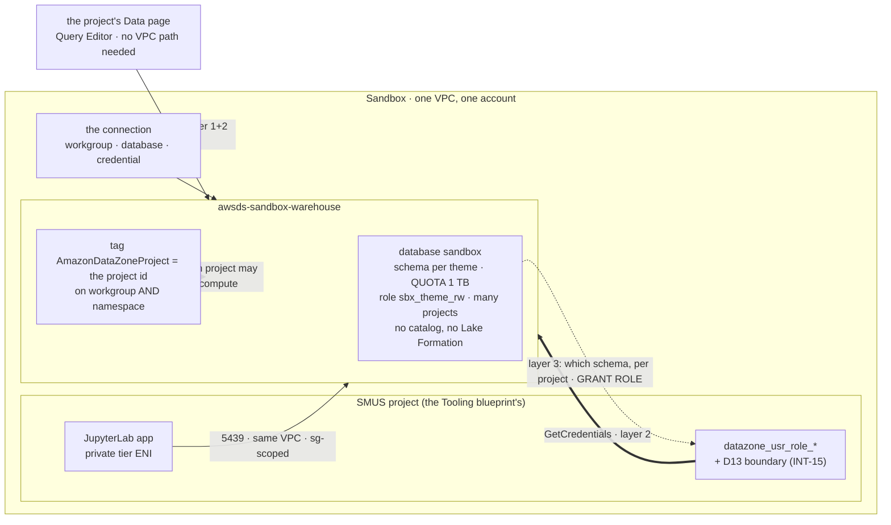

# Stage 6h — The Redshift connection in SageMaker Unified Studio

| | |
|---|---|
| **Status** | **Passes 0-2 done; pass 3's negatives owed** ([log](../../log/log-stage-06h-redshift-connection.md)). Layer 3 on 2026-09-20, layers 1 and 2 on 2026-09-21, and the **access role** the portal's form demands applied 2026-10-09. On 2026-10-10 the user created the connection in the portal (`EXC-17`), and the project wrote and read `lab` through **both doors**, the Data page and JupyterLab over `5439`, with every layer read back on its own. **The doors resolve to different database users**, one per project and one per person, and decision 8a has a notebook chain through the access role so that both land on the per-project one. Decisions 1-7, 8a and 8b are taken; 8 is live, since a second project, `test-experimentation`, exists from 2026-10-15 and is in no map; and **decision 3 is re-opened**: the connection object, readable since 2026-10-15, carries `lineageSync` enabled on a daily schedule the form never showed, and all eight runs to 2026-10-18 failed without minting a database session. **Owed**: step 5's negatives (5.2, 5.2a and 5.3 from the project, 5.4 as the persona, 5.1 and 5.2b from `test-experimentation`); the policy simulator read 5.3 and 5.4 as designed on 2026-10-18, so those two owe their refusals' wording, and the same reading found AWS's managed project policy granting `GetCredentials` and the Data API through layer 1's tag, which bears on decision 8; 0.4's portal half, 6.4 (the user's keep-or-drop of `lab`), decision 3's `lineageSync`, and verifications x and xii. The audit export a DLP feed would read carries nothing while a workgroup exists (`EXC-16`). Two things this file said are corrected in place, each marked `[corrected 2026-09-20]`: `AUTHORIZATION` takes a **user**, not a role, and **layer 1 admits one project**, which adds **decision 8**. Originally written 2026-09-19 from the vendor documentation, in the same sitting as [Stage 5b](stage-05b-redshift-serverless.md) and [D40](../decisions/D40-redshift-warehouse.md). **The first sandbox database and the first connection**: one sandbox schema in the Sandbox warehouse, one SageMaker project given **write** on it, and every layer between the project and the table measured once. **No governed database exists yet, anywhere** — that class arrives at [Stage 9](stage-09-deployment-targets.md), so everything below is about the sandbox class and says so where the difference matters |
| **Prerequisites** | **[Stage 5b](stage-05b-redshift-serverless.md), applied** — the warehouse, its usage limit and its audit groups; without the usage limit this stage's first query is an uncapped one. **[6a](stage-06a-unified-studio.md)/[6d](stage-06d-unified-studio-remainder.md)** — a live project in Sandbox whose id and project role exist, and whose apps start (the `Tooling` blueprint's per-project SageMaker AI domain). **[6c](stage-06c-networking-hub.md) pass 5** — the project's app ENIs land in Sandbox's private tier, the same VPC as the workgroup, which is what makes the JupyterLab path possible at all. **And [5b](stage-05b-redshift-serverless.md) 1.10's endpoint group**, raised with `make up ENV=sandbox GROUPS=redshift`: without it a `redshift-serverless:GetCredentials` call — layer 2, and the whole IAM-credentials path — leaves through the proxy as a public request, which is 6e's *wrong door* repeated. The 5439 data path needs no endpoint, only the security group. **The compute slice must be up**: a `make down` leaves the namespace and removes the workgroup, so a connection to a destroyed workgroup fails the way a space started while `sandbox/egress` is down hangs |
| **Consumes** | [D13](../decisions/D13-lake-formation-enforcement.md), [D17](../decisions/D17-interactive-vs-runtime.md), [D18](../decisions/D18-data-scientist-access.md), [D26](../decisions/D26-unified-studio.md), [D31](../decisions/D31-approver-read.md), [D35](../decisions/D35-sandbox-cardinality.md), [D40](../decisions/D40-redshift-warehouse.md) |
| **Proves** | — (no `INT-nn` row: the project, the workgroup and the database are all in `Sandbox`). What it proves that nothing before it has: the portal's **compute-connection** surface, the third way into data this estate has opened after the governed catalog path (D13) and Stage 16's S3 connection |

*Read with [`docs/SMUS.md`](../../SMUS.md) (the object model, and the `RedshiftServerless` blueprint row this
stage does **not** enable), [`docs/GOVERNANCE.md`](../../GOVERNANCE.md) and
[`docs/plan/conventions.md`](../conventions.md). The documentation rows are the 2026-09-19 entries in
[`docs/REFERENCES.md`](../../REFERENCES.md).*

---

**Objective:** one sandbox database in the warehouse, reachable and **writable** from one SageMaker project
and from no other — and the three layers that make that true, each read back separately so a future failure
is attributable to one of them.

**Everything here is a sandbox-class mechanism.** `objectives.md` (2026-09-20) makes the per database ×
project grant *"the sandbox databases' rule… the only new rule here"*, and says the controls over governed
data do not change. So the connection, its tag, its database user and its `GRANT` **never apply to a governed
database**: that class is read through the federated catalog Lake Formation governs
([Stage 9](stage-09-deployment-targets.md) 9.5) and written by a pipeline, and reusing this stage's wiring
there would put a Redshift `GRANT` beside a Lake Formation grant over governed data — the fork the brief
forbids.

## The layers a grant passes through, and why no one of them is sufficient

The requirement is *access granted per database × project*. No single AWS mechanism expresses it. What
expresses it is three layers, in three different systems, and the first thing this stage has to establish is
which one a refusal came from — because a missing grant in any of them presents as *the project cannot see
the database*, which is the same symptom three times over (Lesson 28's intersection, and the reason
[Stage 5a](stage-05a-data-foundation.md)'s resource-link pair cost a pass to get right).

| # | Layer | Written where | Grain | What its absence looks like |
|---|---|---|---|---|
| 1 | **The tag on workgroup *and* namespace** — `AmazonDataZoneProject=<projectId>` | `sandbox/warehouse/` (Terraform), from the authored map [5b](stage-05b-redshift-serverless.md) 2.2 built | per **workgroup**, and ***one project only*** *[corrected 2026-09-20]* — it is a tag key, so AWS's alternative for more than one is the wide form. Decision 8 | the compute does not appear in the project's dropdown at all |
| 2 | **The IAM reach of the project role** — `redshift-serverless:GetCredentials`, `GetWorkgroup`, `ListTagsForResource`, and no `redshift-data:`, which neither door needed (2.2). **Two principals hold it differently** (simulated 2026-10-18): the access role, which the Data page calls `GetCredentials` as, holds this slice's policy alone; the project role, which a notebook calls it as, also carries AWS's `SageMakerStudioProjectUserRolePolicy`, whose `ComputeCredentials` and `RedshiftDataActions` grant `GetCredentials` and the Data API on a workgroup tagged with its project, so for that role this policy is the declared duplicate of a grant AWS's text carries and moves (open question 22) | `sandbox/warehouse/` beside the tag, attached to the project role the blueprint minted and to the per-project access role the form demands (3.1) | per **workgroup**, per **project role** | the connection is created and every query fails at authentication: on the Data page that is this slice's policy missing from the access role; from a notebook as the project role, AWS's policy answers for a tagged workgroup, so the symptom there means the tag is gone too |
| 3 | **A database role per schema**, holding `USAGE, CREATE` on it, granted to each admitted project's database user — the schema itself carrying a `QUOTA` | SQL, run once per schema from the admin credential; one `GRANT ROLE` per admitted project | per **schema × project**, many-to-many | the project connects, sees the cluster, and the schema is invisible or read-only |

**Layer 3 is the requirement's grain.** Layers 1 and 2 are gates in front of it, and they are per-warehouse:
admitting a second project to the warehouse does not give it anything in any schema. That asymmetry is the
design, and 5.2 is where it is proved rather than asserted.

> **One vocabulary note, and it decides every grain below.** `objectives.md` (2026-09-20) settles that *"in
> Redshift, a schema is a database"* in the sense the brief uses the word. **This file uses Redshift's own
> words**: a Redshift **`database`** is the container, and a Redshift **`schema`** is what the brief calls a
> *base*. So *per base × project* is **per schema × project**, one Redshift database holds every sandbox
> schema, and the class of data is carried by the **account and the enclosing database**, never by a schema
> name — because a schema name is *"chosen when the schema is created, after the theme of the data it will
> hold"* and *"bears no necessary relation to any SageMaker project"*. Spelling the two words as one is
> Lesson 32's shape, and the reason the note is at the top rather than in a step.

**Layer 3 is a grant on a schema that several projects may hold** (`objectives.md`: *"one sandbox schema can be
shared with more than one SageMaker project"*), which rules out the shape this file carried until 2026-09-20 —
a schema owned by *the* project's database user. Ownership is singular and the relation is many-to-many, so
**the grants live on a Redshift database role, one per schema**, and admitting a project is a single
`GRANT ROLE` (1.5).

> ***[corrected 2026-09-20] the sharing requirement is satisfied at layer 3 and blocked at layer 1.*** Layer
> 3 is genuinely many-to-many — one `GRANT ROLE` per project, measured. **Layer 1 is not**:
> `AmazonDataZoneProject` is a tag key and holds one value, on the workgroup and on the namespace alike, and
> AWS's only alternative is `for-use-with-all-datazone-projects=true`, which admits every project in the
> account. So a **second** project cannot be given the compute without taking that trade, and **decision 8**
> is where it is taken. At one project nothing is blocked, which is why the stage proceeded. **What bounds "freely" is the schema's `QUOTA`**, which a superuser sets and no project can
raise (1.3). **A datashare is not the mechanism here**: the projects, the workgroup and the database are in one
account and one namespace, so a datashare would add a producer/consumer chain to reach something already local.
It enters only if a sandbox schema ever has to be read from another namespace, which nothing asks for.

## What this stage builds, and in which accounts

| Where | What | Layer |
|---|---|---|
| the warehouse, by SQL | the database **`sandbox`**, its first themed **schema** with a 1 TB quota, the schema's owner and `_rw` roles, the project's database user, and the `GRANT ROLE` that admits it | data, not a resource |
| `sandbox/warehouse/` (amended) | the project tag on workgroup **and** namespace, and the project role's IAM policy for layer 2 | `[P]` |
| the domain, one connection | the project's Redshift compute connection — portal or `awscc_datazone_connection` (decision 1) | `[P]` |
| `identity/sso/` (possibly amended) | only if decision 4 gives a persona a direct query path; **the default is that it does not** | `[P]` |
| `aws/warehouse.py` (extended) | `WH-9`, `WH-11`, `WH-12` and `WH-14` — the connection, the project role's reach, the database inventory with its grants, and whether a shared schema's tables are readable; the tag pair stays `WH-7`'s | — |
| `runbooks/redshift-connection.md` (new) | the recurring procedure: adding a database, wiring a project, unwiring one | — |

**Contracts this stage fixes, as applied 2026-09-20:** the one sandbox **database** `sandbox` (the container —
the class is the account plus this name, 5b 2.1), the first **schema** `lab` with a **1 TB** quota, its owner
**user** `sbx_lab_owner` and its access **role** `sbx_lab_rw`, and the database user's identifier, whose exact
spelling is **1.4's reading and not this file's claim**. **`lab` is this stage's exercise schema, not a
business theme**: the requirement is that a schema is named after the data it holds, nothing holds data yet,
and naming a theme would be inventing a business fact. The first real theme is the user's to name, and
[`runbooks/redshift-connection.md`](../runbooks/redshift-connection.md) §S is the procedure.

## Step numbers are identifiers, not an order

**Step 1** is cited from [Stage 9](stage-09-deployment-targets.md) (9.3 does for `governed` what 1.1-1.5
did for `sandbox` and `lab`, with a different writer and no connection) and **step 3** from
`runbooks/redshift-connection.md`, `docs/NETWORK.md` and the `sandbox/warehouse/` code, where 3.3 is in a
security group rule's description. The sequence is the passes below:

| Pass | # | What | Applied as |
|---|---|---|---|
| **0** | 0 | the readings: the project's identifiers, what the blueprint already granted, the credential options | `awsds-infra-sandbox-1`; a portal session |
| **1** | 1, 2 | the database and its `GRANT`s, then the gate layers | the admin credential; `awsds-infra-sandbox-1` |
| **2** | 3, 4 | the connection, and the first write from inside the project | the user, in the portal and in a space |
| **3** | 5, 6 | the negatives, then the paperwork and the runbook | the user; Claude |

Pass 1 precedes pass 2 because a connection to a database the project cannot see is a connection whose
failure has three candidate causes instead of one. **Layer 3 before layers 1 and 2** inside pass 1, for the
same reason: a `GRANT` made to a database user that does not exist yet fails loudly, and that ordering is
1.4's whole subject.

---

## To execute

### 0. Preflight — the project's identifiers, and what was already granted

**Action:** collect the four values every later step interpolates, and read what the blueprint already gave
the project role. **Why:** an identifier read out of prose is a claim (Lesson 38), and this stage writes four
of them into a tag, a policy, a `GRANT` and a connection — four places, one of which will be wrong if any is
retyped. **Explanation:** all read-only.

- **0.1 — [Claude] Read the project id, the project role ARN and the domain id** from the API, not from the
  portal's overview page: `datazone list-projects`, then the project's own `get-project`, and the role from
  `iam list-roles` filtered on `datazone_usr_role_`. Record all three in the log with the account resolved by
  **name** (the standing rule: never an account id in a tracked file).
- **0.2 — [Claude] Read what the project role already holds**, with `get-role` per role (never `list-roles`,
  which omits `PermissionsBoundary` by documented contract — `US-8`'s trap): the D13 boundary
  `awsds-sandbox-project-boundary` must be attached (INT-15), and **whether the boundary admits
  `redshift-serverless:` and `redshift-data:` at all**. This is the step that can turn a one-line policy
  attachment into a boundary amendment: a permissions boundary is a ceiling, so a grant the boundary does not
  admit reaches nothing and the failure names neither (Lesson 28). If it has to be amended,
  `terraform-modules/sagemaker-prereqs/boundary.tf` is the single source and the amendment is a module
  version bump under Recipe B, never an edit in one caller.
- **0.3 — [Claude] Read the three credential options the portal offers, and decide before the portal asks.**
  AWS: *"The credential type must be one of the following options: Username and password, IAM credentials,
  AWS Secrets Manager."* Each has a consequence this estate cares about:

  | Option | What it means here | Cost |
  |---|---|---|
  | **IAM credentials** | the project role calls `redshift-serverless:GetCredentials` and Redshift issues a short-lived database session — **no password anywhere** | the portal shows less on the Compute page: *"Using a username and password enables Amazon SageMaker Unified Studio to display more information for a resource"* |
  | **Secrets Manager** | the connection reads [5b](stage-05b-redshift-serverless.md) 1.1's Redshift-managed admin secret, or a purpose-made one | a secret per connection, and whoever holds the connection holds **that user's** rights — the admin's, if it is the admin secret |
  | Username and password | a password typed into a form | refused: principle 2's spirit, and nothing rotates it |

  **Recommended: IAM credentials** (decision 2). It is the only one of the three that carries no standing
  credential, and the price is a portal display rather than a control. **This answer also decides an endpoint**:
  IAM credentials means `redshift-serverless:GetCredentials`, so [5b](stage-05b-redshift-serverless.md) 1.10's
  `redshift-serverless` endpoint is on the critical path — and whether `redshift-data` joins it depends on
  whether the query path is the Data API or a plain JDBC connection over 5439, which is the same question.

  > **One thing the documentation does not say, and it is the thing this step turns on.** The portal's
  > *Authentication* list offers all three types. But AWS's **same-account** procedure names only one:
  > *"The admin then must send you a username and password for a database user that has access to the compute
  > resources."* The IAM-credentials path — and the `RedshiftDbUser={{Username}}` tag that *"determines the
  > federated database user"* — is documented under the **cross-account** heading, on an **access role** that
  > a same-account connection does not have. So whether IAM credentials work same-account, and if so what
  > identity they resolve to, is **unread**: a documented capability is offered by the form, the procedure
  > around it describes a different shape, and neither page says the two compose (Lesson 41 — a vendor
  > "required" travels without its premise, and the same source can carry the table that contradicts it).
  > **This is not a reason to take the password.** It is the reason 1.4 creates the database user explicitly
  > and reads its identifier back, and the reason decision 2's fallback is a **purpose-made** Secrets Manager
  > secret rather than a typed password — a secret is at least one object, rotatable, revocable and nameable
  > in a policy. If IAM credentials turn out not to work same-account, that is verification (iii)'s answer and
  > a finding worth its own line in `lessons.md`'s platform list, with its date.
- **0.4 — the API half answered 2026-10-18: nothing at the domain level governs it.** DataZone's 14
  authorization policy types (`list-policy-grants`' `--policy-type`) name no connection, and `CreateDomain`,
  `UpdateDomain` and `CreateProjectProfile` carry no connection setting; `CreateConnection` takes a `scope`
  of `DOMAIN` or `PROJECT`. A project owner created this stage's connection (3.2), and the user guide does not
  say whether a contributor may. So layer 1's tag is the only thing between a member and this warehouse,
  which is the argument for the per-project tag. **The portal half is the user's**: whether a contributor
  can add a compute connection. **[Claude] Read whether the domain restricts connection creation at all.** [6f](stage-06f-data-governance.md)
  step 1 found that nothing at the domain level restricts a direct Share and that
  `ADD_TO_PROJECT_MEMBER_POOL` is open to every user. The same question applies to
  `datazone:CreateConnection`: if any project member may add a compute connection, then layer 1's tag is the
  only thing standing between a member and this warehouse — which is an argument for the tag being per
  project rather than the wide form, and it is the reading that says so.

### 1. The database, its schema, and the project's `GRANT`s

**Action:** create the database `sandbox` with a named schema, `lab`, and grant the project's database user
exactly what it needs to write. **Why:** this is layer 3, the requirement's own grain. **Explanation:** it is SQL, run once, from
the admin credential — there is no Terraform resource for a Redshift `GRANT`, and inventing one out of a
`local-exec` would put a credential in a plan.

- **1.1 — Done 2026-09-20. Create the one sandbox database** `sandbox`, from the admin credential
  ([5b](stage-05b-redshift-serverless.md) 1.1's Secrets Manager secret), through the Query Editor or
  `redshift-data`. **One database holds every sandbox schema**: the schema is what the brief calls a base, so a
  database per base would put the container at the wrong level and make cross-schema work a cross-database
  query. The class is the **account plus this name**, and **nothing enforces it** — a second database created
  here would succeed and `WH-6` would fail afterwards, which is the designed order: checked, not prevented.
- **1.2 — Done 2026-09-20. Revoke `PUBLIC` on the new database**, the same statement 5b 1.6 wrote for `warehouse`.
  Redshift creates a `public` schema with `USAGE` and `CREATE` granted to the group `PUBLIC`, so **every**
  database user in the namespace can create objects in it until that is revoked. A database created and not
  revoked is a database where layer 3 has a hole nobody granted.
- **1.3 — Done 2026-09-20. Create the schema — named after its data, owned by nobody's project, bounded by a quota.**
  `CREATE SCHEMA <theme> AUTHORIZATION "<the schema-owner role>" QUOTA 1 TB`, inside the one sandbox database,
  and never `public`.
  - **The name is thematic** (`objectives.md`, 2026-09-20): *"chosen when the schema is created, after the theme
    of the data it will hold"*, with *"no necessary relation to any SageMaker project"*. So decision 6 is
    answered against both shapes this file used to offer, and the consequence is worth stating: **a schema name
    carries no authorization information at all**, which is what lets the same schema be shared and what makes
    the `GRANT ROLE` statements, and their rows in `docs/AWS_STATE.md`'s register, the only place the schema ×
    project relation is written down. `sandbox/warehouse/`'s map is per project and names no schema.
  - **`AUTHORIZATION` does not name a project, and it takes a USER rather than a role**
    *[corrected 2026-09-20]*. The first attempt named a Redshift **role** and the service answered
    `ERROR: user "sbx_lab_owner" does not exist` — Redshift roles cannot own a schema. So the owner is a
    **non-login database user** created for the purpose (`PASSWORD DISABLE NOCREATEDB NOCREATEUSER`), never a
    project's database user, which would make one project privileged over the others sharing the schema, and
    never a person. The grants stay on the role (1.5), which is what keeps the relation many-to-many.
  - **`QUOTA` is what makes "freely" bounded.** *"The maximum amount of disk space that the specified schema
    can use… You must be a database superuser to set and change a schema quota"*, and Redshift *"checks each
    transaction for quota violations before committing"*. So no project can raise the ceiling, and the refusal
    happens at commit rather than at some later audit. **The value is 1 TB** (`objectives.md`) — decision 7,
    answered, and its cost arithmetic is in §Cost, because 1 TB is a runaway guard rather than a cost guard.
  > **The default is `UNLIMITED`, and that is the failure mode to name.** *"When you create a schema without
  > defining a quota, the schema has an unlimited quota."* A schema created in a hurry is an unbounded one, on
  > a store nothing expires — the same shape as an empty deny-list permitting everything.
  > ***[corrected 2026-09-20] `WH-13` cannot find one.*** `SVV_SCHEMA_QUOTA_STATE` and its `STV_` sibling are
  > **refused to a superuser**, and no other catalog view carries a quota, so the check is a note and the
  > defence is the runbook's `CREATE SCHEMA`. Two bounds the QUOTA page does not give: *"Schema quota must be
  > between 2048 and 524288000 MB"* — **2 GB floor, 500 TB ceiling**. And the enforcement is measured: the
  > breach aborts the transaction, the usage **overshoots the quota inside it** (2458 against 2048), and
  > **1 KB rows read as 2.4 KB of disk**, so a quota bounds blocks rather than logical bytes.
  > **Freeing the space is not automatic either:** *"A DELETE statement deletes data from a table and disk space
  > is freed up only when `VACUUM` runs"* — and at 4 base RPUs vacuum boost is unavailable, so it is the plain
  > `VACUUM` command ([Stage 5b](stage-05b-redshift-serverless.md)'s capacity reading, which is where that fact
  > was recorded before anything needed it).
- **1.4 — Done 2026-09-21: `IAMR:datazone_usr_role_avhvbqn37ty7m8_5hkjdsy3umpi1c`, non-superuser, created before the connection.** The spelling was confirmed on 2026-10-10: Redshift prefixes the access role's `RedshiftDbUser` value with `IAMR:`, and the unprefixed user made as insurance was dropped. **Create the project's database user, and read its identifier rather than assuming it.**
  With IAM credentials (0.3), Redshift derives the database user from the calling IAM identity, and the
  documented spellings in this family are **`IAM:<user>`** and **`IAMR:<role>`** — plus, on the cross-account
  path, a `RedshiftDbUser=<Username>` **tag on the access role** that *"determines the federated database
  user"*. Which of those applies to a same-account serverless `GetCredentials` call by a project role is
  **not settled by any page read on 2026-09-19**, and guessing it puts the wrong identifier into three later
  statements (Lesson 38).

  > **The chicken-and-egg, named so it is not discovered.** A `GRANT` needs a user that exists; an
  > IAM-derived user may only come into existence at the first connection. Two orders are possible and only
  > one works:
  > **(a)** `CREATE USER "<identifier>" PASSWORD DISABLE;` first, then `GRANT`, then connect — the order
  > this step takes, because it makes the grant a deliberate act with a readable subject; or
  > **(b)** connect first, let the user be auto-created, then `GRANT` — which means the project's very first
  > connection succeeds with no grants, and *"the project can connect but sees nothing"* is the expected
  > state for a while, which is exactly the ambiguity this stage exists to remove.
  > **Take (a).** If the identifier turns out to be wrong, the symptom is a second, auto-created user
  > appearing beside the hand-made one at the first connection — a clean, readable diff in
  > `SVV_USER_GRANTS`/`pg_user`, and the correction is one `DROP USER`.
- **1.5 — Done 2026-09-21: the role holds one project, `admin_option = false`.** **Put the grants on a role, and admit each project by granting it that role.** One database
  role per schema — `sbx_<theme>_rw` — holding `USAGE, CREATE ON SCHEMA <theme>`; then
  `GRANT ROLE sbx_<theme>_rw TO "<each admitted project's database user>"`. **Admitting or removing a project is
  then one statement against one object**, which is what makes the many-to-many maintainable and what a
  per-project grant list would not have been (Lesson 14: a value that must appear in N places by hand will be
  missing from one).
  > **Sharing has one cost this shape does not remove, and it has to be read rather than assumed.** A table is
  > owned by the user that created it, so a table project A creates is not automatically alterable or droppable
  > by project B, even though both hold the schema's role. Redshift's answer is `ALTER DEFAULT PRIVILEGES`, which
  > is set **per granting user**, so a shared schema needs one such statement per contributing project — the
  > `ALTER DEFAULT PRIVILEGES` bookkeeping this file thought ownership had removed, arriving back through the
  > sharing requirement. **Read what the projects actually need before writing it** (verification xiii): if
  > *"creates freely"* means only *creates and reads its own*, nothing more is needed; if it means a second
  > project may drop the first's table, the default-privileges statements are the price, and they are per pair.
  **What must stay absent, whatever that answer is:** no `GRANT ALL ON DATABASE`, nothing on a schema the
  project's map row does not name, and no `CREATE` on `public` (1.2 revoked it). Record the exact statements in
  the log — they are the register for this layer, and there is no `list-permissions` equivalent that shows them
  from outside (`WH-12` reads `SVV_*`, which means the instrument needs a database session, itself a finding
  worth stating).
- **1.6 — Done 2026-09-20. Write the grant register row.** [Stage 5a](stage-05a-data-foundation.md)'s grants are
  registered in `docs/AWS_STATE.md`; Redshift grants are a second system with no LF-Tag and no
  `GetDataAccess`, so they need their own table rather than a row in the LF register. One line per
  (database, schema, principal, privileges, date).

### 2. The gate layers — the tag pair and the project role's reach

**Action:** admit this one project to this one warehouse, in Terraform, and attach the IAM reach the
connection needs. **Why:** both are per-project values that must appear in more than one place, which is
where Lesson 14 bites. **Explanation:** both go in `sandbox/warehouse/`, from one map keyed by project id, so
the two cannot drift by an edit that still plans clean.

- **2.1 — Done 2026-09-21: one entry, `avhvbqn37ty7m8`.** **[Claude] Amend `sandbox/warehouse/` with the project map**: one entry, `<projectId>`, expanding to
  the tag `AmazonDataZoneProject=<projectId>` on **both** the workgroup and the namespace (the documented
  requirement names both objects) and to one IAM policy attached to that project's role.
  **The wide form stays refused**: `for-use-with-all-datazone-projects=true` appears nowhere, and `WH-7`
  fails if it does.
- **2.2 — Done 2026-09-21, and the `redshift-data:` family was LEFT OUT.** So the JDBC path is open and this slice grants no Data API path; 3.4's refusal, if it comes, is what decides whether the family joins. **3.4 needed none** (2026-10-10): the Data page reaches the database through `sqlworkbench`, so the family stays out. **AWS's managed policy grants it anyway** (simulated 2026-10-18, [log](../../log/log-stage-06h-redshift-connection.md)): `SageMakerStudioProjectUserRolePolicy` v75's `RedshiftDataActions` allows `redshift-data:ExecuteStatement` and five more on a workgroup tagged with the caller's project, and `ComputeCredentials` allows `GetCredentials` on the same tag, so layer 1's tag opens both to the admitted project without this policy. **[Claude] Write the project role's policy**, narrow and resource-scoped to this workgroup's ARN:
  `redshift-serverless:GetCredentials`, `GetWorkgroup`, `ListWorkgroups`, `ListTagsForResource`, and — only
  if 0.3's answer needs it — the `redshift-data:ExecuteStatement`/`GetStatementResult`/`DescribeStatement`
  family. **Nothing on the namespace's own management APIs**, no `UpdateWorkgroup`, and **no
  `secretsmanager:GetSecretValue`** on the admin secret: a project role that can read the admin credential
  has the admin's rights and layer 3 stops meaning anything.
- **2.3 — Done 2026-09-21: both slices re-plan `No changes`.** The apply half-failed once, on the `5439` rule's *description*: **EC2 refuses a `>`**, the permitted set being `a-zA-Z0-9. _-:/()#,@[]+=&;{}!$*`, and the apply was then the only validator — the second description refusal in this pair of stages; `./scripts/check-sg-descriptions.py` refuses one before the apply since 2026-10-14. `WH-11` is written (the previous pass deferred it for want of a project); `WH-7` had to be repaired first, its parser having required a quoted HCL map key. **[Claude⚡] Apply as `awsds-infra-sandbox-1`**, re-plan `No changes`, then read back: both tags
  present on both objects (`WH-7`), the policy attached to the project role and **still inside the D13
  boundary** (`get-role`, per role — `WH-11`). If 0.2 required a boundary amendment, it landed first, as its
  own module version.

### 3. The connection, and the first write from inside the project

**Action:** create the connection and write one table from a space. **Why:** everything above is code and
SQL; this is the first time the three layers are exercised by one call, which is the only way any of them is
proven (Lesson 20). **Explanation:** the portal path and the Terraform path are both available and decision 1
picks one.

- **3.1 — [Claude reads, user decides] Portal or Terraform** (decision 1). `awscc_datazone_connection` exists
  and takes `redshift_properties` — `storage.workgroup_name`, `database_name`, `host`, `port`,
  `credentials` (`secret_arn` **or** `username_password`) and `lineage_sync` — plus `aws_location`,
  `environment_identifier` and **`enable_trusted_identity_propagation`**, which is new information against
  open question 13's premise that TIP is a project-profile setting only. The portal path is
  *Compute → Data warehouse → Add compute → Connect to existing compute resources*, and in the same account
  it offers the compute **from a dropdown** rather than asking for a JDBC URL.
  **Answered 2026-09-21: the portal, because the API is closed to the administrator.**
  `ListConnections` is refused to `awsds-infra-sandbox-1` by DataZone's own authorization layer, so the
  portal is not a preference. **The form requires an `Access role ARN` same-account**, which no AWS page
  says it does, and marks the secret optional — so the IAM path carries no standing credential, and
  `sandbox/warehouse/` now authors one access role per admitted project from the same map.
- **3.2 — Done 2026-10-10 by the user: `redshift-serverless.redshift`, `Available`.** The first two
  attempts were refused because `Access role ARN` held the project role's own ARN; with
  `awsds-sandbox-warehouse-access-<project>`, applied 2026-10-09, the form accepted. **`Available` mints
  no database session**: `pg_user` was unchanged until the first query. The object names database `dev`:
  the portal's `GetCredentials` carry `dbName: dev` (read 2026-10-17), and `get-connection` reads
  `databaseName: dev` (2026-10-18). The `dev` confined nothing: the Query editor lists `dev`, `sandbox` and `warehouse` alike, and 3.4's write landed in `lab`.
  **[user] Create the connection.** Measured at the form on 2026-09-21: the compute **did appear** in the
  dropdown, so layer 1 works; `Access role ARN` is mandatory and `AWS Secret` optional; there is **no
  `lineageSync` toggle**; and it is offered as database **`dev`**, while `lab` is in `sandbox` — a
  cross-database read works in Redshift and a cross-database **write** does not, so the connection must
  name `sandbox`, by a database field if the form has one and otherwise through the JDBC URL. In the
  project, with the credential type 0.3 chose, and record
  every field the portal asked for and every default it filled — the `lineageSync` toggle above all, since a
  lineage sync on a schedule is a **recurring query**, and a recurring query on this warehouse is a recurring
  **USD 1.44/hour** meter. Leave it **off** unless somebody asks for it (decision 3).
- **3.3 — Done 2026-10-10: a table written and read back over `5439` from a space.** The session
  resolved to a **per-person** database user holding nothing, which decision 8a answers by chaining
  through the access role. An earlier attempt the same day connected and broke on its first statement
  (`BrokenPipe`); it did not reproduce after the workgroup was rebuilt, so it is unexplained rather than
  solved. **[user] From JupyterLab in a space, write a table into `lab`** and read it back. The path is
  `5439/tcp` inside one VPC, through [5b](stage-05b-redshift-serverless.md) 1.4's security group, and it
  exists only because the workgroup and the project share a VPC — AWS: *"If you want to query the Amazon
  Redshift resources using JupyterLab … the Amazon Redshift resource must use the same VPC as the … project."*
- **3.4 — Done 2026-10-10: the project wrote `lab.hello` from the Query editor**, owned by
  `IAMR:datazone_usr_role_<project>_<env>`. Beside it the editor lists `awsdatacatalog` as failing, by
  design: that mount runs as the namespace role, which holds no policy (5b decision 5).
  **[user] Then the same query from the project's Data page**, which does **not** need the VPC path:
  *"You can still query using the Data page of your project if you are using different VPCs."* Two doors, and
  reading them apart is what makes a later failure diagnosable — the same discipline `docs/NETWORK.md` §5
  applies to the three internet paths.
- **3.5 — Done 2026-10-10.** `GetCredentials` is called by the **access role** on the Data page's path
  and by the **project role** on a direct notebook session, so *whose identity reaches the database*
  depends on the door (verification v). **No provisioned-cluster API was called**, so 5b 1.10's third
  endpoint is not needed. The door half is in [6d's log](../../log/log-stage-06d-unified-studio-remainder.md)
  for the same day, and the trail of 2026-10-17 counts it: AWS's image, which sets no proxy, took the
  `redshift-serverless` endpoint twice, and the house image's environment sent its six calls through the
  proxy as public requests, answered, the chained session's included, because its `NO_PROXY` lacked the
  name — `default-v0.5.0` carries it, and has not been read from a space.
  **[Claude] Attribute the write in CloudTrail**, from the account's own trail: which principal called
  `GetCredentials`, and whether the session that wrote the table is the **project role** or something else.
  **Read two more things off the same trail while it is open**: whether anything called the *provisioned-cluster*
  API `redshift:DescribeClusters`/`GetClusterCredentials` — which is what decides 5b 1.10's third endpoint, and
  which AWS's own SMUS sample policy suggests without the portal necessarily calling it — and whether the
  `redshift-serverless` calls arrived through the **endpoint** rather than the proxy, which the proxy's access
  log answers by being silent on them (6e's method).
  The remote-IDE finding at [6d](stage-06d-unified-studio-remainder.md) step 7 is the reason this is a step
  and not an assumption: `StartSession` turned out to be called **as the project role**, so 6a's tag pair
  never evaluated. The same question here is *whose identity reaches the database*, and the answer decides
  whether layer 3's user is per project or per person.
- **3.6 — Read 2026-10-17 as `EXC-16`: the export carries nothing while a workgroup exists.** Over the
  groups' 30-day retention, no record of any kind arrived during a workgroup's lifetime after
  2026-09-21 05:43:33Z, so no session through the Data page or JupyterLab was ever logged. The only user
  records are the admin's Data API sessions of 2026-09-21 03:00–03:23Z, and the namespace's own `rdsdb`
  sessions arrive only while no workgroup exists. The DLP feed is still a claim (verification ix).
  **[Claude] Read the three audit log groups** for this session: `connectionlog` has the connection,
  `useractivitylog` has the SQL. This is the first content those groups have ever had
  ([5b](stage-05b-redshift-serverless.md) 6.1 created them empty), and it is where the DLP feed stops being a
  claim.

### 4. What a persona may do, and the default is nothing

**Action:** decide, and write down, whether `DataScientistAccess` ever reaches the warehouse outside a
project. **Why:** the persona has Athena on two workgroups (Stage 5a pass 4c) and it would be natural to give
it the same on Redshift. It is not the same: Athena's cost is per TB scanned with a workgroup scan limit, and
Redshift's is **per hour of query time on a shared meter** — a persona's ad-hoc query and a project's job
consume the same RPUs. **Explanation:** 5b 2.3 already withheld `GetCredentials` from the persona; this step
is where that either stands or is revisited with a reason.

- **4.1 — [Claude] Recommendation: it stands** (decision 4). The persona keeps the `Get*`/`List*` read side
  and no credential path, so every query on this warehouse arrives through a project — which is also what
  makes layer 3's register complete, because there is no second kind of grantee.
- **4.2 — [Claude] If it is revisited**, the shape is a **separate database** with read-only grants and its
  own `GRANT` register row, never a wider grant on `lab`: the project writes there and a persona reading a
  project's working schema is a cross-project read nobody approved.

### 5. The negatives — what must not work

**Action:** four refusals, each read by its wording. **Why:** the design's whole content is in what it
refuses, and none of these has ever been measured on this surface. **Explanation:** the standing rule since
1c — read the denial, never the exit code.

- **5.1 — [user] A second project cannot use the compute.** From a project **not** in 2.1's map, the compute
  does not appear and a hand-made connection to the same workgroup fails. This is layer 1 alone, and it is the
  reading that says the tag is a control rather than a label.
  A second project exists since 2026-10-15, `test-experimentation`, in no map, so 5.1 is runnable from it
  with the compute up. **Its IAM half, simulated 2026-10-18**: that project's role reads `implicitDeny`
  for `GetCredentials` and `redshift-data:ExecuteStatement` on a workgroup tagged for the first project,
  and `allowed` for `GetCredentials` that arrives through `sqlworkbench` or the Data API
  (`SageMakerStudioProjectUserRolePolicy` v75's `RssCreds`, any workgroup in any account); the same
  policy grants it `sqlworkbench:CreateConnection` and `DriverExecute` with no condition. So the query-editor door is open to it at the IAM layer, and which
  layer refuses a hand-made connection is this step's reading.
- **5.2 — [user] The admitted project reaches the schema its map row names, and no other.** From the project
  that *is* admitted: the schema it holds the role for works; a **second schema in the same database**, whose
  role it does not hold, does not; and the namespace's own first database does not either. This is layer 3
  alone, with layers 1 and 2 satisfied — the asymmetry the three-layer design exists to produce, and the proof
  that admitting a project to the warehouse grants it nothing in any schema.
- **5.2b — [user] Two projects on one schema, which is the case the requirement adds.** Admit a second project
  to the same schema with one `GRANT ROLE`, and read what each can do to the other's tables: `SELECT`, then
  `INSERT`, then `DROP`. **This is where 1.5's callout gets its answer** — whether *"creates freely"* on a shared
  schema means each project works beside the others or over them, and therefore whether the per-pair
  `ALTER DEFAULT PRIVILEGES` statements are owed. Record the verbs that worked and the verbs that did not.
- **5.2a — [user] The quota refuses, and the project cannot raise it.** Write into the project's schema past
  its `QUOTA` from inside the project — the refusal arrives **at commit**, as documented — then attempt
  `ALTER SCHEMA … QUOTA` as the project's own database user, which needs a superuser and must fail.
  `SVV_SCHEMA_QUOTA_STATE` is refused even to a superuser (verification xiv), so the refusals' wording is
  the reading. **This is the one control that bounds
  a free hand**, and it has never been exercised anywhere in this estate.
  > **Read this one carefully.** The cross-database page says an unconnected database gives *"read access
  > only"* in one bullet and *"you can write … from any other database that you have permissions to"* in the
  > next. So the expected answer is **nothing at all** (no grant, no access), and a *read* succeeding would
  > mean a default grant exists that 1.2's `REVOKE` did not reach. Either outcome is a finding; only one is
  > the design.
- **5.3 — the decisions by simulation, 2026-10-18** (Lesson 22; the tables are in the
  [log](../../log/log-stage-06h-redshift-connection.md)). `iam simulate-principal-policy` on the project
  role and on its access role, which a notebook assumes (8a), with `aws:RequestedRegion`,
  `aws:PrincipalArn` and the roles' and the secret's tags in the context, against a workgroup ARN with a
  made-up id (the workgroup is down). `UpdateWorkgroup` and `DeleteUsageLimit` read `explicitDeny` from
  the organization for both roles. With the carve-out's `InfrastructureAccess` ARN forced into the
  context, the project role's reading becomes `implicitDeny` matching no statement; with the project
  role's ARN forced onto `InfrastructureAccess`, its `allowed` becomes the organization's deny. So the SCP
  verdict is 5b 3.2's `DenyRedshiftCostGuardTamperingExceptInfrastructure`, and no identity policy of
  either role grants either action. `GetSecretValue` on the admin secret reads `implicitDeny` for both,
  with the boundary and the SCPs admitting it. **The secret's tags are what keep it closed**: AWS's
  `SageMakerStudioProjectUserRolePolicy` v75 allows `GetSecretValue` on a secret tagged with the caller's
  project (`AllowGetSecretForRedShift`) or with `for-use-with-all-datazone-projects=true`
  (`DataConnectionAllProjectResources`); the first tag simulated on the secret reads `allowed` for the
  admitted project, the second for `test-experimentation`; and the Redshift-managed secret carries
  neither, while its namespace carries the project's tag. Each verdict covers the identity policies, the D13 boundary (the access role
  has none) and the SCPs, whose statement the simulator never names; it covers no RCP, no session tag and
  no KMS key policy, and the secret has no resource policy. The refusals' wording is the real attempt's.
- **5.3 — [user] The project cannot administer the warehouse**: `UpdateWorkgroup` denied (the policy does not
  grant it), `DeleteUsageLimit` denied (5b 3.2's SCP, if applied), and the admin secret unreadable.
- **5.4 — the decision by simulation, 2026-10-18.** The same simulator on
  `AWSReservedSSO_DataScientistAccess_*` in Sandbox, whose inline policy equals the permission set's in
  Identity: `GetCredentials` reads `explicitDeny` matching `DenyMintingARedshiftDatabaseSession`,
  `redshift-data:ExecuteStatement` the same statement, and the control, `GetWorkgroup`, `allowed` by
  `ReadRedshiftServerlessStatus`; the organization admits all three. The persona's real call, and with it
  verification viii's wording, stays the user's.
- **5.4 — [user] The persona cannot mint a database session**: `redshift-serverless:GetCredentials` as
  `DataScientistAccess` is denied by an **explicit** deny in an identity-based policy,
  `DenyMintingARedshiftDatabaseSession` in the persona set (written at 5b). Its wording differs from an
  SCP's and from an implicit deny's, which is worth recording (the distinction 6g 1.4 turned on).

### 6. Close

- **6.1 — Done 2026-10-10**: §S adding a schema, §P wiring a project, §U unwiring one, §T two projects
  on one schema, §F where a failure comes from, §J SQL from a notebook, §V the instruments. §U is
  written and unexercised (verification x).
  **[Claude] Write `runbooks/redshift-connection.md`**: the
  recurring procedure, in the shape [`sandbox-lake.md`](../runbooks/sandbox-lake.md) takes for the S3
  connection — add a database, wire a project (the three layers, in order), unwire one, and what a failure at
  each layer looks like. **Unwiring is the half that gets forgotten**: a project removed from the map loses
  layer 1 and layer 2 at the next apply, and keeps its layer-3 **role membership** forever, because Terraform
  never wrote it — `REVOKE ROLE` is a second, manual act, and on a **shared** schema it is the only thing that
  distinguishes a project that left from one that never came. `WH-12` is what finds that; the runbook is what
  prevents it. The runbook also carries **adding a schema**, which is now a distinct procedure from adding a
  project: a schema is created once with its theme, its owner role, its `_rw` role and its 1 TB quota, and
  projects come and go against it.
- **6.2 — Done 2026-10-10**: `WH-11` and `WH-12`, plus `WH-14`, which the plan did not have. `WH-9` reads
  the connection object since 2026-10-18: `datazone list-connections`, refused to `InfrastructureAccess` by
  DataZone's own authorization layer three times, answers since Sandbox's `InfrastructureAccess` role was
  made contributor to both Sandbox projects on 2026-10-15, as a group profile. `WH-10` was not written, because `WH-7` already compares the tag pair on both
  objects with the authored map. `./aws/warehouse.py --sql`: 14 pass, 2 notes.
  **[Claude] Extend `./aws/warehouse.py`** with `WH-9`..`WH-12` (the connection, the tag pair, the
  project role's reach and boundary, the database/grant inventory).
- **6.3 — Done 2026-10-10**: `docs/SMUS.md` §Connections, `docs/GOVERNANCE.md`'s consequences,
  `docs/AWS_STATE.md` (the register, `EXC-15` to `EXC-17`), the warehouse rows of `docs/NETWORK.md`, and
  `CLAUDE.md`.
  **[Claude] Bring the documents up**: `docs/SMUS.md` (the connection surface, beside §S3's S3
  connection), `docs/GOVERNANCE.md` (the warehouse's row in §Accounts, and the fact that a Redshift grant is a
  fourth permission system with no LF-Tag), `docs/AWS_STATE.md` (the grant register's new table, and the
  residuals), `docs/NETWORK.md` §6 if the security group changed, and `CLAUDE.md`.
- **6.4 — [user] Keep or drop `lab`.** It has no hourly meter; its storage is cents. The connection has no
  meter either. **The thing with a meter is `lineageSync`**, and 3.2 turned it on (decision 3).
- **6.5 — [Claude] The log**, at the user's request.

---

## Deliverables

- **The three layers, separated** (5.1, 5.2): a project not in the map cannot use the compute; a project in
  the map cannot reach a database it was not admitted to, nor another project's schema.
- **Freedom inside the schema, bounded by the quota** (3.3, 5.2a): the project creates tables with no further
  grant, and the quota refuses at commit while the project cannot raise it.
- **A write from a space** (3.3) and the same query from the Data page (3.4) — two doors, both recorded.
- **The identity that reaches the database** (3.5), read from CloudTrail rather than inferred from the
  connection's configuration.
- **The database user's real identifier** (1.4), and whether a second one appeared at the first connection.
- **The audit groups carrying content** (3.6) — the first time, and the SQL text with it.
- **The connection's own configuration**, field by field, including every default the portal filled (3.2).

## Validation

1. `./aws/warehouse.py --sql` — `WH-7`, `WH-11`, `WH-12` and `WH-14` pass and `WH-9` reads the connection; diff
   two runs across the stage.
2. `./aws/studio.py` — `US-8` still green: the project role carries the D13 boundary after 2.3's attachment.
3. `./aws/datalake.py` — `DL-5`/`DL-6` unchanged; this stage touches no Lake Formation object, and the
   reading proves it.
4. `make check` clean.
5. Read every denial by its wording, never its exit code.

## Cost

| Item | Cost |
|---|---|
| the database `sandbox`, its schema `lab` and its tables | RMS at 0.024 USD/GB-month — cents |
| The connection | free; it is a domain metadata object |
| Every query in pass 2 and pass 3 | **1.44 USD/hour of query time**, 60-second minimum per query — so a dozen interactive queries are well under a dollar, and a **left-open transaction is 8.64 USD** before `SESSION TIMEOUT` ends it |
| `lineageSync`, if enabled | a **recurring** query on a 1.44 USD/hour meter — the one line item that turns this stage into a standing cost (decision 3) |
| JupyterLab app hours | `ml.t3.medium` at 0.050 USD/h, unchanged by this stage |
| The `redshift` endpoint group, while the session is up | ~0.010 USD/h per endpoint, single-AZ (D9) — 5b 1.10, raised by `GROUPS=redshift` and absent unless named |

## Decisions due while executing

**Blocking questions for the user: none — but two decisions now need a portal session rather than a
judgement** (1 and 2, below). Each is decided during the stage and written into
`docs/log/log-stage-06h-redshift-connection.md` with a recommendation stated (Lesson 16).

1. **Portal or Terraform for the connection** (3.1). **Answered 2026-09-21: the portal, and not by
   preference.** `datazone list-connections` as `awsds-infra-sandbox-1` is refused — *"User is not permitted
   to perform operation"* — by **DataZone's own authorization layer**, because the infrastructure identity is
   not a project member. No IAM policy reaches that, so a project member in the portal is the only path that
   exists today. The Terraform shape for a second connection is now writable against a measured object.
2. **The credential type** (0.3). **Answered 2026-09-21: IAM credentials, and the fallback is withdrawn.**
   `create-connection`'s `redshiftProperties.credentials` is a tagged union with exactly two variants,
   `secretArn` and `usernamePassword` — **there is no IAM variant**. So "IAM credentials" is
   `awsLocation.accessRole` plus the role's `RedshiftDbUser` tag, which reaches a database with **no standing
   credential**: what this decision asked for and had no mechanism for. The form makes the access role
   **mandatory same-account** — which AWS's same-account procedure and the field's own help both deny — and
   marks the secret **optional**, so the purpose-made secret stays unbuilt. A typed password is refused.
3. **`lineageSync`** (3.2). **Taken 2026-09-21 as off; re-opened 2026-10-18, because the object carries it
   on.** The form offers no toggle on this path, and the connection it wrote reads `lineageSync.enabled:
   true` on `cron(43 3 * * ? *)` with a lineage job of its own: eight daily runs from 2026-10-11 to
   2026-10-18 at 03:44:44Z, every one `FAILED`, and no `GetCredentials` at those times, the run of
   2026-10-16 included, when a workgroup existed. So it has cost nothing, and the day a run succeeds it is a
   scheduled query on the estate's most expensive meter. **Owed to the user**: switch it off, an
   `UpdateConnection` by a project member, or keep it with the cost named. `WH-9` fails the day a run
   completes. Revisit the sync itself only if [6f](stage-06f-data-governance.md)'s lineage step asks for it.
4. **Whether a persona ever queries the warehouse directly** (step 4). **Taken 2026-09-20: no**, as 5b 2.3
   applied it: the persona keeps the read side and is denied `GetCredentials` and the `redshift-data:`
   family. Every query arrives through a project, which keeps the `GRANT` register complete and the shared
   RPU meter attributable. 5.4 reads `explicitDeny` in the policy simulator (2026-10-18); the refusal's
   wording is the measurement still owed.
5. **~~One database per project, or shared databases with a schema per project~~ — answered by the brief**
   (2026-09-20): *a schema is a base*, one database holds them all, and **a schema may be shared with more than
   one project**. What remains is the mechanism, and it is 1.5's: **a database role per schema**, granted to each
   admitted project. Recommended over a per-project grant list, because admitting or removing a project is then
   one statement against one object.
6. **~~The schema's name~~ — answered by the brief**: *"chosen when the schema is created, after the theme of the
   data it will hold"*, with no relation to a project. Both shapes this file offered — the project's name, the
   project id — are wrong. **The consequence to carry:** a schema name is not an authorization fact, so the
   schema × project relation exists **only** in the `GRANT ROLE` statements and their register rows, and a
   reader comparing `WH-12`'s list of user-role grants with the register is the only thing that finds a drift.
7. **~~The quota value~~ — answered by the brief: 1 TB.** What is left to decide is the **compensating control**,
   because at 1 TB the quota is a runaway guard and not a cost guard: one filled schema is **USD 24.58 a month**,
   half the D12 ceiling, and nothing bounds the *number* of schemas. Recommended: a **CloudWatch alarm on
   `DataStorage`** for the namespace, at a threshold the user sets in USD rather than GB, applied with the
   schema — the same discipline that puts the RPU usage limit in the workgroup's own apply. **Applied
   2026-09-20**: `awsds-sandbox-warehouse-data-storage`, threshold **10 USD/month** converted in the slice's
   `locals` (426,667 MB — the metric is in megabytes, on the `Namespace` dimension, so it keeps reading while
   the `[E]` compute is down). The threshold is a variable in USD so that the arithmetic moves with the price
   and the argument stays in dollars.
8a. **How the per-person user on the JupyterLab door gets its grants** — **taken 2026-10-10: it does
   not, and a notebook chains through the access role instead.** Measured in one run: assuming
   `awsds-sandbox-warehouse-access-<project>` from a space lands the session on
   `IAMR:<the project role's name>`, which holds `sbx_lab_rw` already and is already the owner the
   schema's default privilege names — so the privilege **fires** on what the chained session writes and
   read-across needs no per-person statement. `WH-14` reads two relations, each reachable, and
   `EXC-15` is closed. The direct session in the same run is the control: still per person, still no
   role, still `permission denied for schema`. **Nothing in AWS changed**: the tag, the trust policy
   and layer 2's `sts:AssumeRole` were all in place, so this is a convention in how a notebook connects
   (§P step 3a). The costs, stated before it was taken: in-database attribution becomes per project;
   the chain is a convention with a loud failure rather than a control; and a helper belongs in the
   image if it becomes the house path. **CloudTrail still names the person** (verification xv, read
   2026-10-17): the chained session carries the space's `sourceIdentity`, the data scientist's Identity
   Center user id, although §J's `assume_role` passes none.
   **The paths not taken, each for a measured reason:**
   - **`RedshiftDbUser` on the project role**, collapsing both doors onto one user (8b). SMUS sets
     `RedshiftDbUser` as a **session** tag, per person, on every `AssumeRole` of the project role, and a
     session tag overrides the role's: the role already carries `RedshiftDbUser = user-project@<project>`
     and the session's value wins. `aws_iam_role_tag` does not exist in the AWS provider either, so such
     a tag would have no declarative home.
   - **`RedshiftDbRoles`**, the tag that maps database roles at sign-in. SMUS passes
     `RedshiftDbRoles = datazone_env_<environmentId>`, and Redshift had silently ignored it because no
     such role existed — the same tag this stage refused for the access role on 2026-09-21 for its
     silent ignore, which had already happened. `CREATE ROLE datazone_env_<env>` with `sbx_lab_rw`
     nested in it was applied, and **it never fires on this door**: the tag rides the **portal's**
     session (named `<user id>@<environment id>`) and not the **space's** (named `SageMaker`). The role
     is kept, unexercised, because a project-role connection initiated from the portal would use it. As
     a tag on the role instead, it would need a tag on a role SMUS owns, which has no provider resource,
     and AWS's procedure for that path also wants `tag:GetResources` on the signing identity.
   - **A per-person `GRANT` after each first connect**, guarded by `WH-14` and an empty `3c`, or a
     **reconciler** granting both halves on a schedule — the recurring act decision 3 refused for
     `lineageSync`, and needing a runner this estate has not chosen. Both were the only answers while
     the per-person user was the only path, because `ALTER DEFAULT PRIVILEGES` is per creating user with
     no `FOR ROLE`, no wildcard and no tag. The per-person `GRANT` was applied once at 3.3 as a stopgap
     and revoked the same day.

8b. **~~Whether both doors should resolve to ONE database user~~ — closed 2026-10-10, unavailable**
   (8a's first path not taken). The Data page resolves to `IAMR:<the project role's name>`, because the
   **access role** carries `RedshiftDbUser`. JupyterLab resolves to
   `IAMR:user-<Identity Center user id>@<project id>` — **per person, auto-created at first connect,
   holding nothing** — because the space's session carries a per-person `RedshiftDbUser` that overrides
   the role's. A shared schema then needs two per-principal things and **only one is declarative**:
   `RedshiftDbRoles` can carry the role grant at sign-in where the session passes it, and
   `ALTER DEFAULT PRIVILEGES` is **per creating user**, with no `FOR ROLE`, no wildcard and no tag. So
   **read-across cannot be made declarative while the grantee is per person**, which is why 8a moves the
   notebook to the per-project grantee instead of granting the per-person one.

8. **How a second project is admitted to the warehouse** — **new 2026-09-20**, and it exists because
   `AmazonDataZoneProject` turned out to be a **single-valued tag key** on both the workgroup and the
   namespace. **At one project nothing is blocked**; the question arrives with the second. The options:
   **(a)** the wide `for-use-with-all-datazone-projects=true`, accepting that the compute-admission gate
   becomes per-account and leaning on layers 2 and 3, which are per project role and per schema × project;
   **(b)** a second workgroup per project on the same namespace — but the **namespace** tag is single-valued
   too, so this probably does not work and would have to be measured before it is chosen; **(c)** one project
   per warehouse, which multiplies the `[E]` object rather than the data and spends a workgroup quota on a
   permission.
   **Recommended: (a), with the argument written down rather than assumed.** A project whose role lacks
   `GetCredentials` still cannot connect and a project without a `GRANT ROLE` still sees nothing, so the wide
   tag widens a gate that has two narrower, genuinely per-project gates behind it — and `WH-7` would have to
   change from *"the wide tag appears on neither object"* to *"it appears on both, and the authored map is the
   register of who may actually connect"*, which is a real loss of one independent check. **Live and not
   taken**: a second project, `test-experimentation`, exists since 2026-10-15 and is in no map. Whether it
   needs the warehouse is the user's to say, and the shape follows that requirement rather than preceding it.
   **Under (a) the argument's layer 2 does not hold** (simulated 2026-10-18): AWS's
   `SageMakerStudioProjectUserRolePolicy` v75, on both Sandbox project roles, carries
   `ExistingRedshiftCompute`, which allows `GetCredentials` and the Data API on a workgroup tagged
   `for-use-with-all-datazone-projects=true` that carries no `AmazonDataZoneEnvironment` tag, and
   `test-experimentation`'s role reads `allowed` for both under that tag. So with the wide tag every
   project role holds layer 2, and layer 3 is the only per-project gate left.
   **The recommendation stands as (a), on a narrower argument.** With the wide tag, layer 2 holds for the
   Data page alone, whose `GetCredentials` the per-project access role makes (3.1, `SMUS.md` §Connections)
   and no AWS policy grants; a direct notebook session or a Data API call as the project role reaches the
   compute under `ExistingRedshiftCompute`, so for those doors the schema `GRANT` is the only per-project
   gate. The register of who may connect is then the map's access roles for the Data page and `WH-12`'s
   roles for everything else, `WH-7` inverts as written above, and 5.2b, a project in no map reading
   nothing from a notebook, is the check that carries the design. (b) and (c) keep their objections.

## Verifications to answer while executing

| # | Question | Step |
|---|---|---|
| i | **Answered 2026-10-10**: the boundary is **attached** to the project role (INT-15 holds, and the slice's own precondition checks it) and it **admits** `redshift-serverless:GetCredentials`: the project role called it from a space at 3.3 and was answered. The boundary admits `redshift-data:ExecuteStatement` too (simulated 2026-10-18), which AWS's `SageMakerStudioProjectUserRolePolicy` grants on a workgroup tagged with the project (2.2) | 0.2 |
| ii | **Answered 2026-09-21**: the compute is offered from a dropdown, as database `dev`; the form demands `Access role ARN`, leaves `AWS Secret` optional and offers no `lineageSync` toggle. The object it wrote has `lineageSync` **enabled**, read 2026-10-18 (decision 3) | 3.1, 3.2 |
| iii | **Answered 2026-10-10**: the user is `IAMR:` plus the `RedshiftDbUser` value the calling session carries — `IAMR:datazone_usr_role_<project>_<env>` through the access role, `IAMR:user-<Identity Center user id>@<project id>` on a direct notebook session, auto-created holding nothing. Read first on 2026-09-20: `pg_user` already carries `IAMR:AWSReservedSSO_InfrastructureAccess_<suffix>`, created by nobody and **`usesuper = true`**, so an `InfrastructureAccess` session that reaches the database by IAM is a **superuser** session | 1.4, 3.3 |
| iv | **Answered 2026-10-10: both doors work**, JupyterLab over `5439` inside the VPC and the Data page through `sqlworkbench` | 3.3, 3.4 |
| v | **Answered 2026-10-10: it depends on the door.** The access role calls `GetCredentials` on the Data page and on a notebook's chained session, the project role on a direct notebook session, and each lands on the database user its session's `RedshiftDbUser` names | 3.5 |
| vi | Does a project outside the map fail, and at which layer does it fail? | 5.1 |
| vii | Does the admitted project reach `warehouse` — and if it reads it, which default grant did 1.2's `REVOKE` miss? | 5.2 |
| xiii | **Answered 2026-10-10**: the role's `USAGE, CREATE` lets the project create tables in `lab` with no further grant, each owned by the database user that created it, and its sessions on `sandbox` needed nothing beyond the role. Reading another creator's tables needs the default privilege written for that creator (runbook §T) | 1.5, 3.3 |
| xiv | **Mostly answered without the project.** It refuses **at commit**, with the wording in the log, and the usage **overshoots the quota inside the transaction**. `SVV_SCHEMA_QUOTA_STATE` **cannot be read at all** — refused to a superuser — so neither it nor the violations view is an instrument here. Owed: that `ALTER SCHEMA … QUOTA` fails for a non-superuser, which the project's own session can now attempt | 5.2a |
| viii | Does the persona's `GetCredentials` refusal name the identity-based policy? The set carries an explicit `Deny`, `DenyMintingARedshiftDatabaseSession`, so it should. **The decision is read, 2026-10-18**: the policy simulator returns `explicitDeny` matching that statement in the provisioned inline policy, with the organization admitting the call. The simulator gives no wording, so the persona's real call stays owed | 5.4 |
| ix | **Answered: no, read 2026-10-17.** Nothing reaches the groups while a workgroup exists, so no session through either door has been logged; the only user records are the admin's Data API sessions of 2026-09-21 (`EXC-16`) | 3.6 |
| x | Does removing a project from the map remove layers 1 and 2 — and does its layer-3 `GRANT` survive, as predicted? | 6.1 |
| xi | Does anything at the domain level stop a project member creating a connection of their own? **The API half answered 2026-10-18: no** — no policy type and no domain setting governs `CreateConnection` (0.4). The portal half, whether a contributor can, is the user's | 0.4 |
| xii | What did the stage's queries cost, read from the bill rather than predicted? **2026-10-10 burned 24,359 RPU-seconds = 2.44 USD by `ComputeSeconds`** (read by the hour on 2026-10-17): 109 in the morning session, whose 100 the log recorded as the day's, and 24,220 between 16:00Z and 18:59Z. The free trial absorbed it ([5b](stage-05b-redshift-serverless.md) verification xiii), so the bill can answer only after 2026-12-19 | 6.4 |
| xv | **Answered 2026-10-17: yes.** All 148 `GetCredentials` of 2026-10-10 to 2026-10-16 carry one `sourceIdentity`, the data scientist's Identity Center user id: the portal's sessions, the space's project-role session and the chained `redshift-per-project` one, which carries it although §J passes none | 8a |

## Risks

- **A `GRANT` is state no Terraform plan can see.** Layers 1 and 2 are code and diff; layer 3 is SQL run once,
  and removing a project from the map does not revoke it. Every unwiring is therefore a two-system operation
  and one of the systems has no plan — Lesson 4's shape (state living only inside something no plan reads),
  with `WH-12` and the runbook as the whole defence.
- **Three layers, one symptom.** *The project cannot see the database* is what a missing tag, a missing IAM
  action and a missing `GRANT` all look like. The mitigation is the order of pass 1 and 2 and the separated
  negatives of step 5; the hazard is a future operator who wires all three at once and then cannot say which
  one mattered.
- **The tag is a selector written over an attribute** (Lesson 29): `AmazonDataZoneProject` is a tag AWS reads
  as an authorization input, so anything else that ever wears it — a copy, a restored namespace, a snapshot
  clone — inherits the admission. `WH-7` compares the live tags against the authored map for that
  reason, rather than merely asserting the map.
- **`lineageSync` is a scheduled query on an hourly meter**, and it is a checkbox on the connection form.
  Nothing in AWS's UI says what it costs on Redshift Serverless; this file is the only place that does.
- **The portal writes an object this repository did not author.** A connection created by hand is a
  `ManagedBy=console` object outside the seven Stage 2 names, so either it is adopted into Terraform (decision
  1's second half) or `docs/AWS_STATE.md` carries it as a named exception. It must not simply exist.
- **A second project's grant is a governance question, not a mechanical one.** Two projects writing one
  sandbox database is exactly the case the register exists for, and nothing in this stage decides *who
  approves* it. That belongs with the Governance Manager, the same way `INT-11`'s "should every business unit
  get the same data" does — and it arrives with the second project, not with the second database.
- **Nothing here is governed data, and nothing here may become the path to it.** A sandbox schema carries no
  LF-Tag, no classification and no Lake Formation grant, and a project can write anything into it — including a
  copy of something governed, read through the lake share and written here. That is
  [D19](../decisions/D19-derived-zone.md)'s shape in a fourth store, and the compensation is the same: the
  destination is inside the perimeter, the CMK is the account's, and the copy is not prevented. Say it in
  `docs/GOVERNANCE.md` rather than leaving it for Stage 11 to find (Lesson 1 — a copy somewhere less governed
  is not a hole to be closed). **The pressure this stage creates is the other direction**: a connection that
  works is the obvious thing to point at a governed database next, and the brief forbids exactly that. `WH-7`
  reading *no project tag* on the Production namespace is the mechanical half; the sentence above is the
  reason.

---

*Stage index: [stages/INDEX.md](INDEX.md) · Plan core: [GENERAL_PLAN.md](../../GENERAL_PLAN.md)*
