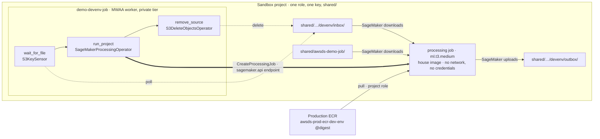

# Stage 6i — Sandbox orchestration: a MWAA Serverless workflow inside a SageMaker project

| | |
|---|---|
| **Status** | **pass 0 done 2026-10-10** ([log](../../log/log-stage-06i-sandbox-orchestration.md)): the CLI at 2.37.12, the instrument and the files written, and the instrument's first run is the before (no contract workflow, no job, an empty `orchestration-demo/`). **Pass 1 done the same day**: the project at `shared/awsds-demo-job/`, read back. **Pass 2 done 2026-10-11**: the boundary admits the job (v), the image comes across accounts (iv), and the container's user writes the output mount only after `sudo chown` (ii, 2.5). **Pass 3's project run done the same day**: the house Python wrote the sample's summary, byte for byte the local run's, under the project key. 3.4's empty-inbox run ended `SUCCESS` after a 611 s wait (xi). **Pass 4's first run failed in the worker's environment preparation, before any task (2026-10-11), and decision 7 was taken the same day as (a):** a trail (`sandbox/endpoint-audit/`) recorded the refusal, a `GetObject` by `airflow-serverless.amazonaws.com` of the code snapshot in `mwaa-serverless-code-files-<account>-<region>-prod`, refused by the S3 gateway endpoint's policy; `vpc-v0.4.0` admits that family, `sandbox/foundation` applied it, and **pass 4 ran `SUCCESS`** (verifications vii's first half, viii, x and xv answered). **Pass 5's control ran the same day (5.0)**: a probe version of `demo-bash-operator`, inline Bash tasks and no `Code` object, prepared its worker for every task, so the `Code` object is decision 7's variable; verifications ix and x are answered. **Pass 5 done the same day**: the exercise version ran its package and its script from the archive (`run_command` `SUCCESS`, `reach_pypi` `FAILED` by design), every `SO-` check passes, and an edit was measured to re-snapshot the code (vii). **Pass 3b done the same day, at the user's request**: `demo-devenv-deps` ran a uv project whose dependencies the house image lacks, its folder built by `package-uv-job.py` in a space after a fix that let the script run there; `petl` and `msgspec`'s extension module loaded from the code input and `pyarrow` from the house environment (xvi). Written 2026-10-10. An exercise, not a promotion path: one workflow authored and stored in the Sandbox project waits for a file in the project's `shared/` storage, runs a Python project's command in the house image as a SageMaker processing job, and removes the source once the result is in a second `shared/` folder. Two smaller workflows then run the same exercise on the MWAA worker, one with `PythonOperator` and one with `BashOperator`. One Terraform change, by decision 6: the `[P]` grant slice `sandbox/workflows/` |
| **Prerequisites** | **[6d](stage-06d-unified-studio-remainder.md)**: step 4's workflow surface (it exists with no blueprint change, and its workers land on Sandbox's private tier) and step 2's house image, selectable and pulled cross-account by the project role, by digest (INT-01). **[6c](stage-06c-networking-hub.md)**: the private tier with no default route. **A raised session**: `make hub-up`, then `make up ENV=sandbox`, because `sagemaker.api`, `logs`, `sts`, `kms`, `ecr.api` and `ecr.dkr` are `[E]` endpoints of `sandbox/egress`; only the gateway endpoints are `[P]`. **An AWS CLI that knows the workflow's `Code` field** (step 0.2, moved here from Stage 10 0.2) |
| **Consumes** | [D7](../decisions/D07-orchestration.md), [D9](../decisions/D09-az-count.md), [D11](../decisions/D11-lab-lifecycle.md), [D13](../decisions/D13-lake-formation-enforcement.md), [D14](../decisions/D14-supply-chain-account.md), [D17](../decisions/D17-interactive-vs-runtime.md), [D26](../decisions/D26-unified-studio.md), [D28](../decisions/D28-workflow-contract.md), [D38](../decisions/D38-single-egress-hub.md) |
| **Proves** | — (no `INT-nn` row: the workflow, the job and the data are in Sandbox, and the image's cross-account pull is INT-01's, already closed). It answers [Stage 10](stage-10-orchestration-promotion.md)'s verifications (i) and (xv) and the Sandbox halves of its steps 0.2 and 0.4, all moved here (§"What this stage took from Stage 10"), and it runs the multi-task workflow [6d](stage-06d-unified-studio-remainder.md) step 4.2 still owes |

*Read with [`docs/SMUS.md`](../../SMUS.md) §"The workflow surface", [`docs/GOVERNANCE.md`](../../GOVERNANCE.md)
(the project's `shared/` scope) and [`docs/plan/conventions.md`](../conventions.md). The documentation rows
are the 2026-10-10 entries in [`docs/REFERENCES.md`](../../REFERENCES.md), under Stage 10's documentation pass.*

---

**Objective:** a workflow that lives in the project and whose code runs in the dev-env image, from the file's
arrival to the source's removal, with every identity, key and path inside the project. The two ways a task
can run code on the MWAA worker itself are then measured beside it.

**The definitions are not promotable, by design.** They name the project's subnets, security group, key,
role and tag, which D28's lint refuses for a deployment target. Stage 10 authors `app-etl` separately and
consumes what this stage measures.

## The workflow, task by task

The main workflow, `demo-devenv-job`, has three tasks in sequence:

| Task | Operator | Runs on | As | Touches |
|---|---|---|---|---|
| `wait_for_file` | `S3KeySensor` | the MWAA worker, Sandbox's private tier | the project role, session `AmazonMWAAServerless` | lists `…/devenv/inbox/` through the S3 gateway endpoint |
| `run_project` | `SageMakerProcessingOperator` | the MWAA worker, which starts a processing job on `ml.t3.medium` (the house image, network-isolated) and waits for it | the project role, as the caller and as the job's `RoleArn` | SageMaker downloads `code/` and `inbox/`, then uploads the result to `outbox/` |
| `remove_source` | `S3DeleteObjectsOperator` | the MWAA worker | the project role | deletes under `…/devenv/inbox/` |

Every task carries `retries: 0`. The service's default is 1, so a failed task otherwise runs twice, which 6d
measured as a retry the definition never asked for.

### Why the workflow removes the source, and the code does not

The D13 boundary refuses every SageMaker job without network isolation
(`DenySageMakerJobsWithoutNetworkIsolation`, [sagemaker-denies](../../../terraform-modules/sagemaker-denies/main.tf)).
An isolated container makes no outbound call, S3 included, and receives no AWS credentials. SageMaker moves
the files outside the container, with the project role, through the job's subnet. The container paths must
begin with `/opt/ml/processing/`; the rest of each name is ours:

| In S3, under the project's `shared/` | In the job's container | Moved by |
|---|---|---|
| `awsds-demo-job/` | `/opt/ml/processing/code` | SageMaker, before the command starts |
| `orchestration-demo/devenv/inbox/` | `/opt/ml/processing/inbox` | SageMaker, before the command starts |
| `orchestration-demo/devenv/outbox/<run>/` | `/opt/ml/processing/outbox` | SageMaker, after the command exits |
| the source under `inbox/` | — | `remove_source`, on the worker |

The container's paths are the job's own disk, encrypted with the project key and deleted with the job. The
restriction to `shared/` holds by construction: the code knows no bucket and cannot choose a destination,
because the definition names every S3 URI. The order is also the safe one: SageMaker uploads the outputs when
the job ends, so a delete inside the container would precede the upload it depends on.

### Where each piece lives

| Piece | What it is | Inside the project? |
|---|---|---|
| Identity | the project role, `datazone_usr_role_<project>_<environment>`, for the workflow and the job; it may pass itself to SageMaker | yes |
| Definitions | the portal stores each at `dzd-<domain>/<project>/dev/workflows/<name>.yaml` in the projects bucket (6d step 4.3); where it stores the operator files is 4.3's reading | yes |
| Key | the project CMK `alias/awsds-sandbox-project`, the role's `KmsKeyId` tag: the bucket's SSE, the workflow's encryption, the job's volume and outputs | yes. It exists once per account, shared by the account's projects |
| Storage | `shared/orchestration-demo/` in `awsds-sandbox-smus-projects`, versioned, SSE-KMS, TLS-only | yes |
| Network | the two private subnets and the security group `datazone-<project>-dev` the portal already puts on the project's workflows (self-referencing inbound, all IPv4 outbound) | the security group is the project's; the subnets are Sandbox's |
| Image | `awsds-prod-ecr-dev-env` at `default-v0.5.0`, by digest, in Production's ECR (D14) | no, and it needs nothing new: the spaces already pull it the same way |
| Endpoints | the `[E]` interface endpoints of `sandbox/egress` | no; they exist while a session is up |

The permission half was read on 2026-10-10 from the project role's managed policies
(`SageMakerStudioProjectRoleMachineLearningPolicy` v44, `SageMakerStudioProjectUserRolePolicy` v75) and from
this repository's boundary and key policy:

- **`SageMakerCreatePermissions`** allows `sagemaker:CreateProcessingJob` when the job carries
  `AmazonDataZoneProject=<project>`, so the definition sets that tag.
- **`AllowPassRoleOnProjectRoles`** lets the role pass itself to `sagemaker`, `airflow-serverless`, `glue`,
  `emr-serverless` and `scheduler` among others, and not to `ecs-tasks`.
- **`SageMakerECRPermissions`** allows the pull from any repository, so Production's repository policy is the
  half that decides, and INT-01 measured it for a space.
- **Nothing allows describing a job before it exists.** `SageMakerDescribeUpdateDeletePermissions` grants
  `DescribeProcessingJob` only on a job tagged with the caller's project, and the operator describes the
  name it proposes before creating it (measured 2026-10-10). Decision 6's slice is the grant for that gap.
- **Nothing allows creating the tagged job `SageMakerCreatePermissions` asks for.** A create with tags is
  also authorized as `sagemaker:AddTags`, and `SageMakerTagPermissions` excludes every `AmazonDataZone*`
  key (measured 2026-10-10, run `FVyFira1LY3BuGi`). Decision 6's slice carries that grant too.
- **`SageMakerKmsPermissions`** allows `kms:CreateGrant` on the project key through SageMaker, which is what
  `VolumeKmsKeyId` needs. The boundary's one KMS deny names the lake's data key, never the project key.
- **The boundary's four job denies** require `VpcConfig`, `EnableNetworkIsolation: true`,
  `EnableInterContainerTrafficEncryption: true` (set even for one instance, since the deny is `BoolIfExists`)
  and `VolumeKmsKeyId`. The instance ceiling admits seven CPU types, `ml.t3.medium` the smallest.

### Where project isolation does not hold

The job's container output goes to **`/aws/sagemaker/ProcessingJobs`**, an account-level log group that does
not exist yet (read 2026-10-10). The first job creates it with no retention and no CMK, `EXC-10`'s shape, and
`AllowSageMakerLogAccess` lets every project role in the account read `/aws/sagemaker/*` with no project
condition. With one project in the account nobody else reads it today. The rule the exercise's code follows:
it prints counts and paths, never data. The workflow's own logs are per project
(`/aws/mwaa-serverless/<domain>-<project>/<workflow>`).

### The worker-side variants

`demo-python-operator` and `demo-bash-operator` run the same exercise on the MWAA worker, each with its own
`inbox/` and `outbox/` under `orchestration-demo/`. The vendor's pages (read 2026-10-10) describe the worker,
and steps 4 and 5 measure it:

- **The worker** is 1 vCPU and 3 GiB, Python **3.12**, x86_64, with Airflow 3.0.6, the Amazon provider 9.32.0
  and boto3 1.43.1 pre-installed; a pre-installed package wins over a bundled copy of it.
- **The code** travels in the workflow's `Code` object: the portal's *Settings → Storage → Python/Bash Operator
  Files* zips the uploads and references them from the definition. It is extracted to
  `/usr/local/airflow/dags`, which is also a Bash task's working directory.
- **The credentials** are the project role's, and the network is the private tier with no proxy and no
  internet. A worker task can therefore do the whole job itself, reading, writing and deleting through the S3
  gateway endpoint.
- **The interpreters differ.** The house image's own environment, `/opt/awsds/venv`, is Python **3.13**, so a
  dependency installed there as is will not import on the worker. A worker package's dependencies are built
  for `cp312` and `manylinux2014_x86_64`, the vendor's recipe.

**A worker task that moves data is a Sandbox-only shape.** In Stage 10 the execution role holds no data
permission (its step 1.3), so these variants measure the operators; they are not a pattern Stage 10 adopts.

## What this stage took from Stage 10

The two stages meet only where Stage 10 measures something in Sandbox before it builds anything in Staging.
Those items moved here, and Stage 10 keeps a pointer at each address:

| Stage 10 address | What moved | Here |
|---|---|---|
| step 0.2, its CLI half | the CLI that knows `--code` and the `Code` field | 0.2 |
| step 0.4 and verification (i) | the reading of the serverless Workflows surface, every field recorded; 6d step 4.1 had already answered that nothing enables it | 2.1, 3.1, verification i |
| step 2.1, the operator clause, and verification (xv) | `PythonOperator` and `BashOperator` measured on Sandbox's private shape | steps 4 and 5, verifications viii-x |

Stage 10 keeps the `awscc` half of 0.2, the `app-etl` authoring of 2.1, and step 3.3's lineage question. That
question can only be measured on a workflow the domain knows, which means a Sandbox project's, but it is not a
prerequisite of this exercise and stays where 6f handed it.

## What this stage builds, and in which accounts

| Where | What | Layer |
|---|---|---|
| this repository, `examples/sandbox-orchestration/` (decision 1) | the Python projects (`awsds-demo-job`, and `awsds-demo-deps`, whose dependencies the house image lacks), the operator files, each pass's importable definition, and after each pass the definition the portal holds; placeholders for every account-scoped value | — |
| the project's `shared/orchestration-demo/` | the uploaded copies, and an `inbox/` and `outbox/` per variant | data, not a resource |
| the project's Workflows, in the portal | `demo-devenv-job`, `demo-devenv-deps`, `demo-python-operator`, `demo-bash-operator` | portal objects, free at rest |
| SageMaker | one processing job per run of `demo-devenv-job` | `[E]`, nothing at rest |
| `aws/sandbox-orchestration.py` (new) | `SO-1`..`SO-8`, read-only | — |
| `sandbox/workflows/` (new, rank 56) | one policy, `DescribeProcessingJob` on a processing job no project tag marks, and one attachment per project role (decision 6) | `[P]` |

**Contracts this stage fixes:** the project's code at `shared/awsds-demo-job/`, and `awsds-demo-deps`'s
packaged folder at `shared/jobs/awsds-demo-deps-0.1.0/`; the prefix
`shared/orchestration-demo/<variant>/` with `inbox/` and `outbox/`, where `<variant>` is `devenv`,
`devenv-deps`, `python` or `bash`; the workflow names; the job-name prefix
`demo-devenv-`; the task ids `caller_identity` and `run_command`, which tell `demo-bash-operator`'s probe
from its exercise, and `reach_pypi`, the negative in both; and the Python packages `awsds_demo_job` and
`awsds_demo_deps`. `./aws/sandbox-orchestration.py` reads each one, so a
rename fails in a check.

## Who executes each action

| Marker | Meaning |
|---|---|
| **[Claude]** | repository edits and read-only AWS calls, as the [infrastructure user](../../ORGANIZATION.md#infrastructure-user), `InfrastructureAccess`, on `awsds-infra-sandbox-1` (Sandbox) and `awsds-infra-prod` (Production, for the registry's CloudTrail) |
| **[Claude⚡]** | an AWS write, only after the user authorizes that act in chat with the SSO user, account and permission set stated first. None is planned beyond raising and lowering the session |
| **[user]** | the portal and JupyterLab, signed in as the **Data Scientist User**, a member of the Sandbox project; uploads, authoring, runs, and log entries whenever the user wants |

## Step numbers are identifiers, not an order

| Pass | # | What | Done by |
|---|---|---|---|
| **0** | 0 | the readings, the CLI, the instrument, the repository files | Claude; the user upgrades the CLI |
| **1** | 1 | the files in the project's `shared/` | the user, from JupyterLab |
| **2** | 2 | a probe job: the container's user, the paths, the tag on create, the pull by a job | the user, in the portal |
| **3** | 3 | `demo-devenv-job` end to end, then once with an empty inbox | the user, in the portal |
| **3b** | 3.5-3.8 | `demo-devenv-deps`: a project whose dependencies the house image lacks, through `package-uv-job.py` | Claude packages and imports; the user builds the folder in a space and drops the sample |
| **4** | 4 | `demo-python-operator` | the user, in the portal |
| **5** | 5 | `demo-bash-operator`, and the PyPI negative | the user, in the portal |
| **6** | 6 | the readings, the records, the close | Claude; the user decides decision 5 |

Pass 2 precedes pass 3 because its questions are cheaper to answer with a probe than with a failed project
run: a job whose container cannot write its output fails the same way as a project with a bug.

---

## To execute

### 0. Preflight

**Action:** read what the definitions interpolate, bring the CLI up to the service, and write the instrument
and the files before anything runs.

- **0.1 — Done 2026-10-10. [Claude] Read the identifiers**, with the API rather than this file (Lesson 38): the project id and
  domain id, the project role's ARN and its `KmsKeyId` tag, the key's ARN, the two private subnet ids and the
  security group id from the existing workflows' `NetworkConfiguration`, the `shared/` prefix, and the house
  image's digest from `./aws/devenv.py`. Read on 2026-10-10: project `avhvbqn37ty7m8`, domain
  `dzd-d8yrvx1ko7im6o`, security group `datazone-avhvbqn37ty7m8-dev`, subnets
  `awsds-sandbox-private-usw2-az1` and `-usw2-az2`, both existing workflows `manual_only` on the project key.
- **0.2 — Done 2026-10-10 by the user: 2.37.12**, whose `create-workflow` takes `--code`. **[user] Upgrade the
  AWS CLI** (moved from Stage 10 0.2). 2.36.18 knows neither `create-workflow
  --code` nor the `Code` and `CodeSnapshottedAt` fields `get-workflow` returns, so no instrument can read where
  the portal stored the operator files. The check after the upgrade:
  `aws mwaa-serverless create-workflow help | grep -- '--code'`.
- **0.3 — Done 2026-10-10, and run.** A self-test that pointed the contract at the two earlier workflows
  exercised `SO-2`..`SO-4` before any contract workflow exists, and it found one defect, fixed: a retried
  task's state was read from whichever attempt the listing returned last, not from the highest attempt.
  **[Claude] Write `./aws/sandbox-orchestration.py`**, read-only, one profile (`awsds-infra-sandbox-1`),
  and run it once before pass 1 so every later run has a before:
  - `SO-1` the workflows exist, `READY`, created by the project role (CloudTrail `CreateWorkflow`);
  - `SO-2` each one's role, `NetworkConfiguration` (two private subnets, no default route) and project key;
  - `SO-3` where the definition and the `Code` object live, with `CodeSnapshottedAt` and the version count,
    and each version's `WorkflowDefinition` saved under `aws/output/`;
  - `SO-4` the recent runs: state, type read per run, each task instance's duration;
  - `SO-5` each `demo-devenv-` processing job: isolation, inter-container encryption, subnets, volume key,
    role, tag, image digest, status and billed seconds;
  - `SO-6` the log groups the exercise made and their retention;
  - `SO-7` the `shared/orchestration-demo/` prefixes: what each `inbox/` and `outbox/` holds;
  - `SO-8` the CloudTrail record of `CreateProcessingJob`: caller, session name, `vpcEndpointId`.
  Its row joins [`aws/INDEX.md`](../../../aws/INDEX.md) in the same commit.
- **0.4 — Done 2026-10-10**, with `render.py` beside the files: it reads the live values as the
  infrastructure user and prints a file with its placeholders filled, so the real values never reach a
  tracked file. The project's 6 tests pass. **[Claude] Write the files** under
  `examples/sandbox-orchestration/` (decision 1), with the
  repository layout line in `README.md` in the same commit:
  - the Python project `awsds-demo-job`: a `pyproject.toml`, the package `src/awsds_demo_job/` with
    `transform.py` (stdlib only: for each input CSV, a JSON result with the row count, the column names and
    the input's sha256), `__main__.py` (local mode, `--input DIR --output DIR`) and `s3.py` (worker mode,
    boto3), and a test for `transform.py`;
  - `demo-devenv-job`'s definition for passes 2 and 3, importable, every account-scoped value a placeholder,
    so the pre-commit check on account ids holds;
  - the operator files for steps 4 and 5;
  - one sample CSV.

  The code flows from the repository to the project. The definition flows the other way: the portal
  generates and versions it, so each read step below ends with the definition the portal now holds committed
  beside the code, placeholders substituted, as the record of what ran.

### 1. The files in the project

**Action:** put the code and a sample where the workflows read them, written by the project role.

- **1.1 — [user] Copy the project into the shared folder**, which is `shared/` in S3. Done 2026-10-10 from a
  clone of this repository in a space: `examples/sandbox-orchestration/awsds-demo-job/` copied whole to
  `~/shared/awsds-demo-job/` (`pyproject.toml`, `src/`, `tests/`), which the job reads as its code input; the
  `tests/` folder travels along and is not run. A drop is a copy of the clone's sample into an `inbox/`, made
  only when a workflow is about to run, so no `samples/` prefix exists.
- **1.2 — Done 2026-10-10: six objects, the repository's byte counts, the project key.** **[Claude] Read
  the objects back** with `SO-7`, and the encryption of one of them (`head-object`:
  `SSEKMSKeyId` is the project key).

### 2. A probe job

**Action:** the first version of `demo-devenv-job`, with the processing task's command replaced by a probe.
**Why:** four questions belong to the platform rather than to the project, and one job of about a minute
answers them.

- **2.1 — [user] Create `demo-devenv-job` in the portal's visual editor** with the three tasks, and record
  every field the editor offers (Lesson 16), above all **whether `SageMakerProcessingOperator` is among its
  tasks**. If it is not, the definition is created from a space as the project role with
  `aws mwaa-serverless create-workflow`, and that surface is then the workflow's only one: an
  `update-workflow` from outside the portal is a full replace that severs the state the portal injects
  (Lesson 60).
  - **Measured 2026-10-10: a save with no operator file is refused.** The portal sends
    `code.s3Location` = `dev/operatorFiles/<workflow name>.zip` on every `CreateWorkflow`, and uploads
    nothing there unless a file was added in *Settings → Storage*, so the service answers
    `ValidationException: Code not found in specified S3 location`. It sent `code: null` on 2026-09-10. The
    way through is any `.py` in *Settings → Storage* (pass 2's `hello.py`), or an import into a new
    empty workflow, which saved with `code: null` (2026-10-10). The portal writes
    the definition first and deletes it after a refusal, and it injects seven `DataZone*`
    environment variables into every workflow ([log](../../log/log-stage-06i-sandbox-orchestration.md)).
- **2.2 — [user] Import the definition**, which sets the processing task's `config` with every boundary
  field named. **Measured 2026-10-10: the editor's SageMaker Processing task is a form** (task name, job
  name, input and output data, image URI, entrypoint, arguments, instance type and count, volume, execution
  role) **with no field for `NetworkConfig`, either KMS key or the tags**, the notebook operator's shape
  again. *Actions → Import definition file* takes the whole workflow as YAML, so the rendered
  `devenv-job/demo-devenv-job.probe.yaml` is imported, and the definition the portal saves is read back
  before the first run, in case the import drops what the form cannot show:

  | Field | Value |
  |---|---|
  | `ProcessingJobName` | `demo-devenv-` and the run's UTC time from `macros.time.strftime(..., macros.time.gmtime())`; the operator's `action_if_job_exists` default handles a collision. The service renders a definition's templates when it creates a run, with the documented variables only (`macros`, `ti`, `params`, `ds`, `ts` and their `_nodash` forms): `{{ ts_nodash }}` is the day's midnight on a manual run, `dag_run` fails the run before its first task, and so does a method called on an object a macro returned (`strftime` of a `datetime`), while a module's own functions pass (measured 2026-10-10) |
  | `RoleArn` | the project role (0.1) |
  | `AppSpecification.ImageUri` | `<registry>.dkr.ecr.us-west-2.amazonaws.com/awsds-prod-ecr-dev-env@sha256:<digest>` (0.1) |
  | `AppSpecification.ContainerEntrypoint` and `ContainerArguments` | the probe: `["/bin/bash", "-c"]` and `["id; ls -ln /opt/ml/processing; touch /opt/ml/processing/outbox/probe && echo WRITE-OK"]`. The editor refuses a processing task with no arguments, which the API does not (measured 2026-10-10), so every command is a program and its arguments |
  | `ProcessingResources.ClusterConfig` | `InstanceCount: 1`, `InstanceType: ml.t3.medium`, `VolumeSizeInGB: 10`, `VolumeKmsKeyId`: the project key |
  | `NetworkConfig` | `EnableNetworkIsolation: true`, `EnableInterContainerTrafficEncryption: true`, `VpcConfig`: the two private subnets and the project's security group |
  | `ProcessingInputs` | `code/` and `inbox/` as `S3Prefix`, `File` mode, to `/opt/ml/processing/code` and `/opt/ml/processing/inbox` |
  | `ProcessingOutputConfig` | `outbox/{{ ts_nodash }}/` from `/opt/ml/processing/outbox`, `EndOfJob`; `KmsKeyId`: the project key |
  | `StoppingCondition.MaxRuntimeInSeconds` | 1800, under the worker's 3600 s task cap |
  | `Tags` | `AmazonDataZoneProject: <project>` |

  The sensor watches `orchestration-demo/devenv/inbox/*` with `wildcard_match: true`, `poke_interval: 30`,
  `timeout: 600` and `soft_fail: true`; the delete names `prefix: …/devenv/inbox/`.
- **2.3 — [user] Drop the sample into `devenv/inbox/` and run** the workflow from the portal.
- **2.4 — [Claude] Read the probe**:
  - the job's stream in `/aws/sagemaker/ProcessingJobs`, where the container's output goes, for `id`, the
    mounts' owners and `WRITE-OK` (verification ii);
  - `SO-5` for the job's settings and outcome, which is the boundary's verdict (v);
  - `SO-8` for the create call's caller and door (vi);
  - Production's CloudTrail for the `BatchGetImage` that served the job: principal and session name (iv);
  - the definition, read back and committed (decision 1).
  A tag refusal names `CreateProcessingJob` or `AddTags` in its wording (iii).
- **2.5 — If `WRITE-OK` is missing**, the container's user cannot write the output mount, and the fallback is
  the image's own `sudo`, which works in spaces (measured 2026-09-08): the command opens with
  `sudo chown "$(id -u)" /opt/ml/processing/outbox`. A tag of the image for jobs is the larger alternative,
  and it is a Stage 8 build, not this stage's. **Measured 2026-10-11: `WRITE-OK` is missing.** The container
  runs as `uid=1000(sagemaker-user) gid=100(users)`, the platform creates `code/`, `inbox/` and `outbox/` as
  `0 0` with `drwxr-xr-x`, and `touch` is refused, so the job ends `AlgorithmError: , exit code: 1` (job
  `demo-devenv-20261011T024724`). The probe now runs `sudo -n chown "$(id -u)"` between two listings and
  prints `CHOWN-OK`; `-n` fails at once where sudo would ask for a password. **Measured the same day: the
  fallback works.** The probe printed `CHOWN-OK`, `outbox` owned by `1000`, and `WRITE-OK`; the job ended
  `Completed` and its object landed under `outbox/<run>/` with the project key (job
  `demo-devenv-20261011T033717`).

### 3. The project's command, end to end

**Action:** replace the probe with the project's command, which makes the second version of the workflow.

- **3.1 — [user] Import `devenv-job/demo-devenv-job.project.yaml` over the probe** (Stage 10's 0.4,
  verification i, closes here with the editor's fields recorded in 2.1 and 2.2). It changes the processing
  task's command:
  - `ContainerEntrypoint`: `["/bin/bash", "-c"]`, and one argument: `sudo -n chown "$(id -u)"
    /opt/ml/processing/outbox && exec /opt/awsds/venv/bin/python -m awsds_demo_job --input
    /opt/ml/processing/inbox --output /opt/ml/processing/outbox`. The `chown` is 2.5's; `exec` gives the job
    the interpreter decision 2 took and its exit code;
  - `Environment`: `{"PYTHONPATH": "/opt/ml/processing/code/src"}`.
  The absolute interpreter path is deliberate: a `ContainerEntrypoint` replaces the image's entry point, so
  the distribution's `_entrypoint.sh` does not run and its `PATH` is not to be assumed.
- **3.2 — [user] Drop the sample and run.** The expected end state: the result under `outbox/<run>/`, the
  `inbox/` empty, three task instances `SUCCESS`, one processing job `Completed`.
- **3.3 — [Claude] Read the run**: `SO-4` for the durations, `SO-5` for the job's billed seconds, `SO-7` for
  the prefixes, and the result file's content against the sample's sha256. The definition is read back and
  committed as `definitions/demo-devenv-job.project.yaml` (decision 1). Each import so far deleted the
  workflow and created it again, so its version count restarts at 1 (`SO-3`). **Measured 2026-10-11, run
  `f9L7CKQzmUQWQTR`:** three tasks `SUCCESS` (7 s, 758 s, 7 s); job `demo-devenv-20261011T041223`
  `Completed` in 485 s; the container printed `python 3.13.15 at /opt/awsds/venv/bin/python` and `sample.csv:
  10 rows`; `outbox/20261011T041223/sample.result.json`, 378 bytes, carries the sample's sha256 and is byte
  for byte the result of the same command run locally; `inbox/` is empty.
- **3.4 — [user] Run once with an empty `inbox/`.** The sensor times out after 600 s, and `soft_fail` should
  end the run `SUCCESS` with the downstream tasks skipped. **[Claude]** reads the run's state and what the wait
  billed (xi).

The exercise's project has no dependency, so 3.1-3.4 never ran the case the runbook's J1 is for. Steps
3.5-3.8 run it, at the user's request (2026-10-11): a uv project whose dependencies the house image partly
lacks, packaged by `package-uv-job.py` and run by a fourth workflow, `demo-devenv-deps`.

- **3.5 — Done 2026-10-11. [Claude] The project and its folder.** `awsds-demo-deps` turns each CSV into
  `awsds-demo-job`'s summary and a Parquet table. It depends on `petl` (pure Python) and `msgspec` (an
  extension module), both absent from the house environment, and on `pyarrow`, which the house environment
  holds. Its command first prints each dependency's version, the folder it was imported from and its
  extension module. **Measured:** the fresh lock took pyarrow 26.0.0, and the script stopped on "pyarrow:
  26.0.0 in the lock, 24.0.0 in the image"; the block it printed went into `pyproject.toml` and `uv lock`
  moved pyarrow to 24.0.0 (J1 step 3). The folder is 176 files: the project, msgspec 0.22.0 with
  `_core.cpython-313-x86_64-linux-gnu.so`, and petl 1.7.29. The local run's summary is byte for byte
  `awsds-demo-job`'s result, sha256 `1b2bc4d7…a248191`. `demo-devenv-deps` is `demo-devenv-job` with the
  code input at that folder, `PYTHONPATH` at its root, and the sensor on `inbox/?*`.
- **3.6 — Done 2026-10-11. [user] The folder built in a space**, by J1 step 2 run from a clone in a new
  space, then copied to `~/shared/jobs/awsds-demo-deps-0.1.0/`. **Measured: the script could not run in a
  space.** uv reads `.python-version` from the script's folder upwards, so the repository's 3.14 chose the
  script's interpreter, and the image's `UV_PYTHON_DOWNLOADS=never` refused it; past that, the project's
  lock check and build need a CPython 3.13, and the house interpreter is on no search path. The fix
  (`fcc760b`) asks the shebang for `>=3.11` and names `$AWSDS_PYTHON_ENV/bin/python` to the inner uv
  commands. The same command then built the folder in the space, 1,735,841 bytes, and the copy reached S3
  as the 176 files, with their names and sizes, plus a zero-byte marker per folder (`SO-7`).
- **3.7 — Done 2026-10-11. [Claude⚡] Import, drop and run.** `devenv-job/demo-devenv-deps.yaml` imported
  into a new, empty workflow, with *Settings → Storage*'s pre-filled operator-files location emptied before
  the save; the sample dropped from the space; the run started from the portal.
- **3.8 — Done 2026-10-11. [Claude] Read the run.** The expected end state: three tasks `SUCCESS`; the
  job's stream naming `petl` and `msgspec` under `/opt/ml/processing/code`, msgspec's extension the Linux
  one, and `pyarrow` under `/opt/awsds/venv`; `outbox/<run>/sample.summary.json` byte for byte pass 3's
  result; the inbox empty. The definition is read back to `definitions/demo-devenv-deps.yaml`.
  **Measured, run `aB2zorz48GP67hx`:** three tasks `SUCCESS` (5 s, 791 s, 6 s); job
  `demo-devenv-deps-20261011T230601` `Completed` in 450 s; the container printed `petl 1.7.29 from
  /opt/ml/processing/code/petl`, `msgspec 0.22.0 from /opt/ml/processing/code/msgspec, extension
  _core.cpython-313-x86_64-linux-gnu.so` and `pyarrow 24.0.0 from
  /opt/awsds/venv/lib/python3.13/site-packages/pyarrow` (xvi). The summary is pass 3's result byte for
  byte, sha256 `1b2bc4d7…a248191`, and the Parquet table the laptop's, both under the project key; the
  inbox is empty, and every `SO-` check passes. The saved definition is the imported one plus
  `is_paused_upon_creation: false`.

### 4. `demo-python-operator`

**Action:** the same exercise as one `PythonOperator` task on the worker, after the same sensor. **Why:**
Stage 10's verification (xv), moved here: whether vendored dependencies run with no internet path, and whose
identity a worker task's calls carry.

- **4.1 — [Claude] Build the code package**: `awsds_demo_job` and a module `demo_tasks.py` at the archive's
  root, plus one small pure-Python package absent from the worker's pre-installed list, vendored with
  `--platform manylinux2014_x86_64 --python-version 3.12 --only-binary=:all:`. The callable `demo_tasks.run`:
  - prints the caller's ARN from `sts:GetCallerIdentity`;
  - prints the vendored package's version and `__file__`;
  - for each object under `python/inbox/`: reads it, writes the result to `python/outbox/<run>/`, and deletes
    the source only after the write returns.

  **Built 2026-10-11** by `operators/build.sh`: `python-operator.zip`, 187 entries and 996,234 bytes, holding
  `demo_tasks.py`, `awsds_demo_job/`, petl 1.7.28 (`py3-none-any`) and PyYAML 6.0.1 (`cp312`,
  `manylinux2014_x86_64`, with its compiled `_yaml`). The definition is
  `operators/python/demo-python-operator.yaml`, with `python_callable: demo_tasks.run`, the guide's
  `<module>.<function>` form. Its sensor watches `python/inbox/?*`: a space's `mkdir` leaves a folder marker
  `inbox/`, `*` matches it, and this variant deletes only the files it processed.
- **4.2 — [user] Create the workflow in the portal**: the sensor on `python/inbox/`, then the *Python Operator*
  with module `demo_tasks` and function `run`. Upload 4.1's archive as one `.zip` in *Settings → Storage*, and
  record whether the *File* field can name a module inside it. The rendered definition is imported as in 2.2,
  so the form is read, not relied on. If it cannot, upload the files loose and read
  what the portal zipped (`SO-3`): a `.zip` uploaded beside loose files may arrive nested, unextracted. Drop
  the sample and run.
- **4.2a — The refused bucket, measured** (decision 7 (a)). A trail records S3 network activity events
  with `errorCode` `VpceAccessDenied`, the only record this account can hold of a gateway endpoint's refusal.
  Whether those events cover a gateway endpoint at all is unread, so a positive control runs beside the
  re-run:
  - **[Claude⚡]** apply `sandbox/endpoint-audit/` (`7 to add`: the trail and its bucket), the peer sessions
    told first. **Applied 2026-10-11**, re-plan `No changes`, the trail logging since 20:49:49Z;
  - **[Claude]** run `demo-bash-operator` again: its `endpoint_refusal` task lists `sentinel-cogs` from the
    worker, on the code fetch's own path, and is the positive control (5.0);
  - **[Claude]** run `demo-python-operator` again; the sample is still in `python/inbox/`;
  - **[Claude]** read the trail's files in its bucket (`AWSLogs/<account>/CloudTrail/<region>/`), which
    arrive within about 15 minutes. The control's events name `sentinel-cogs`; none within 30 minutes means
    the events do not cover a gateway endpoint, the instrument is blind, and decision 7 is taken again
    without it. The code fetch's refused request names the service's bucket, and its family goes into the
    `vpc` module's `default_aws_buckets`.
  - **Measured 2026-10-11** ([log](../../log/log-stage-06i-sandbox-orchestration.md)): the files arrived
    within five minutes, under `CloudTrail-NetworkActivity/` rather than `CloudTrail/`. The control's two
    `ListObjects` (20:52:34Z) and the Python worker's `GetObject` (20:52:51Z) all read `VpceAccessDenied`
    through `vpce-0cc3e139c1167ca83`; the second came from `airflow-serverless.amazonaws.com` and named
    `mwaa-serverless-code-files-<AWS-owned account>-us-west-2-prod`.

  **The store was refused on 2026-10-11:** "CloudTrail Lake is no longer accepting new customers", and this
  account had never created one. Nothing was created, and the slice was removed from the branch the same
  day; its empty state object stays in `awsds-sandbox-tfstate` under `sandbox/endpoint-audit/`. The
  remaining instrument is a trail with the same selector, delivering to a bucket of its own, and whether to
  build it is the user's call. The CloudTrail guide (read 2026-10-11) gives a trail the same selector
  and never says whether a gateway endpoint is covered. A third-party write-up describes `VpceAccessDenied`
  events from an S3 endpoint that works by a route-table entry, naming the bucket in `resources`: a
  reason to expect coverage, not a measurement, so the positive control stays first.

  The trail is the first CloudTrail resource this project creates in a member account, the revision
  trigger `POLICIES.md` names for its CloudTrail absence. No statement follows, and `POLICIES.md` records
  the trigger met: the trail is an instrument in Sandbox, destroyed when the decision closes, and
  tampering with it blinds only this measurement.
- **4.3 — [Claude] Read it**. **Measured 2026-10-11, run `N05WyTNjUcdxbw0`, after decision 7's
  apply ([log](../../log/log-stage-06i-sandbox-orchestration.md)):** `SUCCESS` in 96 s, both tasks'
  environments `ready`; `petl` imported from `/usr/local/airflow/dags`, the worker's PyYAML 6.0.2 won over
  the archive's 6.0.1, the caller was the project role with session `AmazonMWAAServerless`, and the result
  is byte for byte the processing job's, under the project key, the source deleted. The run was started
  from the CLI as the infrastructure user, the portal's session having ended:
  - `SO-3` for the `Code` location and `CodeSnapshottedAt` (vii);
  - the task log for the ARN, expected `assumed-role/<project role>/AmazonMWAAServerless` (x);
  - the vendored package's `__file__`: under `/usr/local/airflow/dags` it ran from the package, and under
    site-packages the pre-installed copy won (viii);
  - `SO-7` for the prefixes;
  - the definition, read back and committed (decision 1).

### 5. `demo-bash-operator`, and the PyPI negative

**Action:** the same project as a command on the worker, and a task that reaches for the internet on purpose.

- **5.0 — The control, before the exercise.** Decision 7's reading rests on one variable, the `Code`
  object. `operators/bash/demo-bash-operator.probe.yaml` is the first version of `demo-bash-operator`:
  two Bash tasks with inline commands and no `Code` object, on the worker and the network the failed
  Python run had. `caller_identity` prints the worker's Python and boto3, the region variables, where the
  STS endpoint resolves and the caller's ARN (x); `reach_pypi` runs `reach_pypi.sh`'s commands inline (ix).
  - **[Claude] Written 2026-10-11.** Both tasks' commands ran on the laptop: with the internet
    `reach_pypi` exits 0, and against an unresolvable name and index it exits 1 with each cause on one
    line. `reach_pypi.sh` carries the same commands for the exercise. `./aws/sandbox-orchestration.py`
    tells the two versions apart by a task id: `SO-3` fails a probe that carries a `Code` object, and
    `SO-4` passes when `reach_pypi` `FAILED` and every other task `SUCCESS`.
  - **[user] Create a new, empty workflow, `demo-bash-operator`, import the rendered probe and upload
    nothing in *Settings → Storage*.** The editor pre-fills *Operator files zip S3 location*, and a save
    with that field set and no file is refused (`Code not found in specified S3 location`); emptying the
    field makes the save send no `Code`. A code file makes the probe no control. Run it; no drop is
    needed.
  - **[Claude] Read it**: `SO-3` and `SO-4`, the task logs, `/awsds/sandbox/dns-firewall` for the
    worker's queries, and the trail's `GetCallerIdentity` for its door.
  - **The outcomes.** The tasks reach their commands: the `Code` object is decision 7's variable, and
    ix and x are answered without it. They fail in environment preparation: the reading is wrong, the
    failure belongs to the worker's operators rather than to its code fetch, and (a)'s instrument would
    measure the wrong request.
  - **A third task, `endpoint_refusal`, is (a)'s positive control**, run from the worker on the code
    fetch's own path: it lists `sentinel-cogs`, a public bucket in the region, with virtual-hosted and
    path-style addressing. The project role's identity policy allows `s3:ListBucket` on another account's
    bucket (`DataLakeCrossAccountS3Permissions`) and the boundary allows it, so only the endpoint policy
    can refuse.
  - **Measured 2026-10-11, run `b7FgLsjotHxaCde` ([log](../../log/log-stage-06i-sandbox-orchestration.md)):
    the `Code` object is decision 7's variable.** The workflow saved with `Code` null on the second try,
    the field emptied by Claude in the user's Chrome. `caller_identity` `SUCCESS`: the worker is
    `/opt/mwaa-serverless-venv/bin/python3` 3.12.14 with boto3 1.43.1, the caller is the project role
    with session `AmazonMWAAServerless` (x), and its `GetCallerIdentity` took Sandbox's `sts` endpoint.
    `reach_pypi` `FAILED` in about 2 s per reach with `[Errno 16] Device or resource busy`, Python's
    reading of the Sandbox DNS Firewall's `BLOCK`, an `NXDOMAIN` for `pypi.org` (ix). `endpoint_refusal`
    met `AccessDenied` on both styles in about 35 ms and failed only on its own criterion, which expected
    the detailed wording S3 gives a requester in the bucket owner's account alone; the template now
    counts the code. The run: 92 s, three tasks at the one-minute minimum, about 0.0044 USD.
- **5.1 — [Claude] The operator files**: the package directory `awsds_demo_job/` at the archive's root and a
  script `reach_pypi.sh` that opens `https://pypi.org/simple/` with Python's `urllib` and a 10-second timeout,
  then runs `pip download --no-deps --timeout 10 -d /tmp/x six`. Python rather than `curl`, because the
  worker's image is not ours and `curl` on it is an assumption.
- **5.2 — [user] Import the exercise over the probe**, once a workflow with a `Code` object runs, three
  tasks:
  - the sensor on `bash/inbox/`;
  - `run_command`, a *Bash Operator* with
    `python3 -m awsds_demo_job.s3 --bucket <bucket> --inbox <prefix>/bash/inbox/ --outbox <prefix>/bash/outbox/`
    (the worker's `python3` is its 3.12);
  - `reach_pypi`, a *Bash Operator* whose command is the script's name, `reach_pypi.sh`, the form the portal
    documents for an uploaded script; it runs after `run_command`, so its failure cannot hide the exercise.
  Drop the sample and run.
- **5.3 — [Claude] Read it**, and commit the definition (decision 1): `run_command` `SUCCESS` and the
  prefixes in `SO-7`; `reach_pypi` `FAILED`
  within seconds, with the error wording and how long each call took to fail (ix). A refusal that arrives as a
  timeout and one that arrives as a resolver error are different readings: the second instrument is the
  Sandbox DNS Firewall's log group, `/awsds/sandbox/dns-firewall`.
- **Measured 2026-10-11, run `xn9EZ2kgVIMcI7h`** ([log](../../log/log-stage-06i-sandbox-orchestration.md)):
  the sample dropped through the portal's *Files* page, the definition imported and `bash-operator.zip`
  uploaded in *Settings → Storage*, both in the user's Chrome. The import does not replace a saved
  workflow: the save met `ConflictException: Workflow with given name already exists`, and the probe was
  deleted (with the user's approval) before the save went through. `run_command` `SUCCESS` in 9 s, its
  `PYTHONPATH` already carrying `/usr/local/airflow/dags`; `reach_pypi` `FAILED` in 13 s, the operator
  having rendered `reach_pypi.sh` into a temporary file and run it with `bash`. The result is byte for
  byte the other two variants', under the project key; `./aws/sandbox-orchestration.py` exits 0 with
  every check passing, and the trail recorded no refusal. About 0.0044 USD.

### 6. Close

- **6.1 — [Claude] The records. Done 2026-10-11 at the user's request, except `AWS_STATE.md`, which
  waits on decision 3**:
  - [`docs/SMUS.md`](../../SMUS.md) §"The workflow surface" gets the editor's fields, the operators measured
    and the `Code` location;
  - [`docs/AWS_STATE.md`](../../AWS_STATE.md) gets the log groups per decision 3;
  - Stage 10's pointers name what this stage answered, and its decision 7 (new) takes the processing
    input's missing version pin; Stage 8 step 5.6 points at it;
  - [`docs/PRICING.md`](../../PRICING.md) gets the run costs read in 3.3, beside the measured unit prices;
  - [`docs/plan/lessons.md`](../lessons.md) gets Lesson 65, instances of Lessons 54 and 55, and the
    platform behaviours this stage measured.
- **6.2 — [Claude] The log**, `docs/log/log-stage-06i-sandbox-orchestration.md`: each step Claude executed,
  in the sitting it ran.
- **6.3 — [user] Decision 5**: keep or delete the workflows and the demo prefixes.
- **6.4 — [user or Claude⚡] Lower the session**: `make down ENV=sandbox`, then `make hub-down`, after telling
  the peer sessions.

## Deliverables

- **The workflow inside the project** (3.2): a file detected, the project's command run in the house image, the
  result in `outbox/`, the source gone, and every step attributable to the project role.
- **The boundary's verdict on a job built to satisfy it** (2.4): the four settings accepted by the same
  policy that refused the portal's notebook task.
- **The platform answers** (2.4): the container's user against the output mount, the tag on create, and the
  image pulled by a job rather than a space.
- **Stage 10's (xv)** (4.3, 5.3): a vendored dependency, a reach for PyPI, the identity on the worker.
- **A project with dependencies in a job** (3.8): J1's folder built in a space and run with no network,
  a vendored extension module among its imports (xvi).
- **What a run costs** (3.3, 3.4), read from the durations rather than predicted.
- **The runbook** [`serverless-workflows.md`](../runbooks/serverless-workflows.md), written 2026-10-11 at the
  user's request: the editor and its import, the grant, the processing task, the code archive, the readings.
  Since 2026-10-12 its tool is `awsds-workflows` (its §T), which replaced `render.py`, `package-uv.sh` and
  `package-uv-job.py`; the steps above name the scripts they ran.

## Validation

1. `./aws/sandbox-orchestration.py`: `SO-1`..`SO-8` pass after pass 5; diff the runs before pass 1 and after
   pass 5.
2. `./aws/studio.py`: `US-8` still green, the project role still carrying the D13 boundary.
3. `./aws/devenv.py`: the digest the job pulled is the registered version's.
4. `make check` clean.
5. Every denial read by its wording, never its exit code.

## Cost

Unit prices measured (`docs/PRICING.md` §1.3 and §8), `us-west-2`:

| Item | Cost |
|---|---|
| MWAA Serverless task-hours | 0.088/task-hour, one-minute minimum per task. The processing task holds a worker while the job runs, because `deferrable` is ignored |
| Processing `ml.t3.medium` | 0.050/hour (measured 2026-10-10) |
| One run of `demo-devenv-job` | about 0.02, with a job of 5 to 8 minutes including the pull. **Measured 2026-10-11 on the probe: about 0.027**, 14 task-minutes (0.021) and a 465 s job (0.0065). The job spent 7.4 of its 7.75 minutes before the container, pulling the 6.97 GB image and staging the inputs |
| One run of `demo-devenv-deps` | **Measured 2026-10-11: about 0.029**, 15.2 task-minutes (0.022) and a 450 s job (0.006): `demo-devenv-job`'s figure, the vendored folder adding nothing measurable |
| One run of each worker variant | about 0.003 to 0.005: two or three tasks at the one-minute minimum. **Measured 2026-10-11**: `demo-python-operator` 0.0029 (two tasks, 96 s), `demo-bash-operator` 0.0044 (three tasks, 148 s) |
| The empty-inbox run of 3.4 | about 0.015: the sensor's 10 minutes |
| S3 | cents |
| The session itself | 0.180/hour for Sandbox's 18 endpoints plus 0.0156/hour for the hub's two hosts, which is the dominant line |

No schedule is set. A cron every 15 minutes left active would cost about 4/month in sensor minutes alone.

## Decisions due while executing

**Blocking questions for the user: none.** Each is decided during the stage and written into the stage log
with the recommendation stated (Lesson 16).

1. **Where the reference copy of the files lives** (0.4). Recommended: **`examples/sandbox-orchestration/` in
   this repository**, as templates with a placeholder for every account-scoped value. The files are code a
   person reviews, and a procedure that depends on a file only its author holds runs for its author alone
   (Lesson 61). The alternative, the project's `shared/` only, is the exercise's premise for execution and
   leaves nothing reviewable. Taking it adds a line to the repository layout in `README.md`. **Taken
   2026-10-10 (the user): this repository, with the two directions split.** The code is written here and
   uploaded to the project. The definition's source is the portal, which generates and versions it: before a
   pass the repository holds the importable definition (first written as a paste-ready `config`, which the
   editor's form has no field for), and after it the definition the portal holds, read back
   (`get-workflow`'s `WorkflowDefinition`, the YAML *View code* shows) and committed with the same
   placeholders.
2. **Which interpreter the job runs** (3.1). Recommended: **the house environment, `/opt/awsds/venv/bin/python`**
   (Python 3.13, the *Python (awsds dev-env)* kernel), the one this repository curates. The alternative is the
   distribution's `/opt/conda/bin/python` (3.12, its default `python3` kernel). Either is named by absolute
   path. **Taken 2026-10-10 (the user): the house environment.** The worker variants of steps 4 and 5 run on
   the worker's own Python 3.12 regardless, so their packages are still built for `cp312`.
3. **The log groups the exercise creates as a side effect**: `/aws/sagemaker/ProcessingJobs` and one
   `/aws/mwaa-serverless/<domain>-<project>/<workflow>` per workflow, all without retention. Recommended:
   **record them under `EXC-10`**, whose open decision is the same one: a group the service chooses, with no
   retention, that no slice declares. One decision for the family beats a hand write here. The alternatives are a retention set by hand (an authorized write
   on a group no slice declares) or adoption into `sandbox/sagemaker/`.
4. **The inbox contract** (2.2). Recommended: **any file under the variant's `inbox/`, consumed as a prefix,
   one drop at a time.** A file that lands between the job's download and `remove_source` is deleted
   unprocessed, and it is recoverable as a noncurrent version because the bucket is versioned. The
   alternatives are an exact key per drop, or a claim step that moves the files to a run's own prefix first.
   The general case, many files with unknown names, is Stage 10's, and this stage hands it the measured limit:
   a templated list arrives as a string, because `render_template_as_native_obj` is ignored.
5. **Keep or delete at close** (6.3). Recommended: **keep the workflows**: they bill nothing at rest, they
   are the reference Stage 10's authoring starts from, and the quota is 100 per account. Empty the `inbox/`
   prefixes so a later run starts from a known state.
6. **The operator's existence check** (2.4). `SageMakerProcessingOperator.execute()` describes the name it
   proposes before creating the job, and counts only a `ValidationException` as absent; no parameter turns
   it off (Amazon provider 9.32.0). The project role may describe only a job tagged with its project, so
   the first run failed before any job existed. **Taken 2026-10-10 (the user): a grant in Terraform**, the
   `[P]` slice `sandbox/workflows/`: `DescribeProcessingJob` on `processing-job/*` when
   `aws:ResourceTag/AmazonDataZoneProject` is absent. A name not yet taken passes, and a job of another
   project, which SMUS refuses to create untagged, stays out of reach. It keeps the operator Stage 10
   promotes, whose own execution role describes what it needs. The alternative was a `PythonOperator` that
   creates the job and a `SageMakerProcessingSensor` that waits for it: no Terraform, but a Sandbox shape
   the promoted workflow would not share. **Applied 2026-10-10**: `2 added`, re-plan `No changes`. The next
   run met the create's own refusal, `sagemaker:AddTags` on the `AmazonDataZoneProject` tag, so the same
   policy gained a second statement: that tag alone, with the caller's value, on a job that carries no
   project tag or the caller's, applied the same day (`1 changed`, re-plan `No changes`, policy `v2`).
   ([log](../../log/log-stage-06i-sandbox-orchestration.md)).
7. **How a workflow with a `Code` object reaches its code inside the perimeter** (4.2). The first
   `demo-python-operator` run failed in the worker's environment preparation, before any task: the worker
   held one short exchange with S3 by its path-style name and never downloaded the 996 KB archive (run
   `hmcXpEy18zOKCPR`, 2026-10-11). The service keeps its own encrypted copy of the code from the workflow's
   creation, and the reading is that the worker fetches it from a bucket the service owns, which the S3
   gateway endpoint's allow-list (Stage 3 step 3.4) refuses. Unmeasured: no trail here sees a gateway
   endpoint's refusal, and a path-style request names its bucket only in the URL.
   - (a) **Measure, then name the bucket in the allow-list.** CloudTrail network activity events for S3,
     filtered to `VpceAccessDenied`, on a trail in Sandbox (an event data store is refused to this
     account, 4.2a); a positive control from a space first (a read of a bucket outside the list), since
     whether these events cover a gateway endpoint is unread; then a re-run. The event names the bucket, and the `vpc` module's `default_aws_buckets`
     gains its family as it carries ECR's layer bucket. Keeps the perimeter's design; costs a CloudTrail
     resource for the measurement, a module release and an apply of the network slice.
   - (b) **The worker variants outside the VPC**, with no `NetworkConfiguration`, so the service's network
     reaches its own bucket. Through the API only, since the portal injects the project's network, and it
     moves the workers outside every control this estate places on them.
   - (c) **No `Code` object**: each task fetches the project's code from the project's own storage, which the
     perimeter admits. Exercises neither the `Code` mechanism nor verifications vii and viii as written.

   **Taken 2026-10-11 as (a)**, the applies authorized by the user. The trail measured the premise: the
   worker's environment preparation is a `GetObject` by the service principal `airflow-serverless.amazonaws.com`
   of the snapshot at `mwaa-serverless-code-files-<AWS-owned account>-<region>-prod/<account>/<workflow>/<version>/<key>`,
   refused with `VpceAccessDenied` by the S3 gateway endpoint. `vpc-v0.4.0` adds the family
   `mwaa-serverless-code-files-*-<region>-prod` to `default_aws_buckets`, `sandbox/foundation` applied it
   (`1 changed`, re-plan `No changes`), and the re-run ended `SUCCESS`. Staging's and Production's callers
   stay on `vpc-v0.3.1` until Stage 10 runs a workflow with a `Code` object there.

   Recommended: **(a)**. The list exists to name AWS-owned buckets that a service needs, and this is one.
   It was written on 2026-08-16 (Stage 3 pass 1), the day before AWS gave the two operators a `Code`
   object, so the dependency is new rather than missed. Its names come from documentation or measurement,
   never a guess (Lesson 23), and neither guide page names this bucket. The name belongs in the module's
   default rather than in Sandbox's `s3_endpoint_allowed_bucket_names`, which replaces the whole list:
   Stage 10's workflows in Staging and Production fetch their code the same way. The premise is tested
   first, with no instrument: 5.0's probe runs on the same worker and network with no `Code` object.

## Verifications to answer while executing

| # | Question | Step |
|---|---|---|
| i | Which fields does the portal's editor offer for a serverless workflow, and is `SageMakerProcessingOperator` among its tasks (moved from Stage 10 0.4)? **Answered 2026-10-11: yes, as a form** with no field for `NetworkConfig`, either KMS key or the tags (2.2). *Actions → Import definition file* carries them, and the saved definition kept every field, adding only `is_paused_upon_creation: false` | 2.1, 3.1 |
| ii | Can the house image's user write to the output mount the job creates? **Answered 2026-10-11: no.** The container runs as `sagemaker-user` (uid 1000, gid 100) and the platform creates the three mounts as root, mode 755; 2.5 is the fallback | 2.4 |
| iii | Does `CreateProcessingJob` carrying `AmazonDataZoneProject` succeed, while `sagemaker:AddTags` excludes `AmazonDataZone*` keys? **Answered 2026-10-10: no.** The create is also authorized as `AddTags` and refused, and decision 6's second statement is the grant | 2.4 |
| iv | Does a job pull the house image cross-account by digest, and as which principal and session? **Answered 2026-10-11: yes**, as the project role with session name `SageMaker`. Production's CloudTrail holds three `BatchGetImage` by digest from Sandbox: two at the create (02:47:27Z and 02:47:28Z, SageMaker's control plane) and the pull at the job's start (02:50:34Z, invoked by `ecr.amazonaws.com`), none through a VPC endpoint | 2.4 |
| v | Does the boundary admit a job carrying its four settings, with no other deny naming it? **Answered 2026-10-11: yes.** `CreateProcessingJob` with the four settings and the project tag succeeded | 2.4 |
| vi | Which door does the worker's `CreateProcessingJob` take: Sandbox's `sagemaker.api` endpoint, from which address? **Answered 2026-10-11:** Sandbox's `sagemaker.api` interface endpoint, from `10.20.95.168` in `awsds-sandbox-private-usw2-az2`, as the project role with session name `AmazonMWAAServerless`. No network interface holds the address after the run | 2.4 |
| vii | Where does the portal store the operator files, and does `CodeSnapshottedAt` move with each edit? **First half answered 2026-10-11:** the portal stores one uploaded `.zip` as it is at `dev/operatorFiles/<file>` and pins its S3 version; at the workflow's creation the service copies it to `mwaa-serverless-code-files-<AWS-owned account>-<region>-prod/<account>/<workflow>/<version>/<key>`, the copy the worker fetches. **Second half answered the same day: yes.** A description-only save of `demo-bash-operator` (`UpdateWorkflow`, the code pinned to the same S3 version) made a new workflow version and moved `CodeSnapshottedAt` from 21:35:48Z to 21:42:08Z; the portal also uploads the file again at every save, a refused one included | 4.3, 5.3 |
| viii | Does a vendored dependency import with no internet path, and which copy wins against the pre-installed set (from Stage 10 (xv))? **Answered 2026-10-11: yes, and the pre-installed copy wins.** `petl` 1.7.28 imported from `/usr/local/airflow/dags/petl/`; the archive's PyYAML 6.0.1 lost to the worker's 6.0.2 in `/opt/mwaa-serverless-venv` | 4.3 |
| ix | Does a reach for PyPI fail visibly, in seconds, and with which wording (from Stage 10 (xv))? **Answered 2026-10-11: yes, in about 2 s per reach, at name resolution.** urllib reads `URLError(OSError(16, 'Device or resource busy'))` and pip `Failed to establish a new connection: [Errno 16] Device or resource busy`; the Sandbox DNS Firewall answered `NXDOMAIN` with `BLOCK` for `pypi.org`, and no packet left for PyPI | 5.0, 5.3 |
| x | Whose identity do the worker task's AWS calls carry (from Stage 10 (xv))? **Answered 2026-10-11: the project role, session `AmazonMWAAServerless`**, through Sandbox's `sts` interface endpoint from the worker's private address | 5.0, 4.3 |
| xi | Does `soft_fail` end an empty-inbox run `SUCCESS`, and what did the wait bill? **Answered 2026-10-11: yes**, after 611 s of one task, about 0.015 USD. The API reads the skipped sensor's `Status` as `NONE` and creates no instance for the downstream tasks | 3.4 |
| xii | What did each run cost, read from the run and job durations? **The project run, 2026-10-11: about 0.029 USD**, 15 task-minutes (0.022) and 485 s of `ml.t3.medium` (0.0067). **The run with dependencies, the same day: about 0.029 USD**, 15.2 task-minutes and 450 s of the job | 3.3, 3.8, 6.1 |
| xiii | Do the outputs land encrypted with the project key? **Answered 2026-10-11: yes**, the probe's object and the project's result both `aws:kms` with the project key and the bucket key on, written by the project role in the job's session through S3. The direct `CreateGrant` refused at each create does not reach them | 3.3 |
| xiv | Does decision 6's grant let the existence check through, and does it leave another project's jobs out of reach? The second half needs a second project, and is a reading of the condition until one exists. **First half answered 2026-10-11: yes.** The first `DescribeProcessingJob` got `ValidationException` ("Could not find requested job"), not `AccessDenied`, and the create followed | 2.4 |
| xv | Which bucket does a worker with a `Code` object read its code from, and do network activity events record a gateway endpoint's refusal? **Answered 2026-10-11: `mwaa-serverless-code-files-<AWS-owned account>-<region>-prod`, read by `airflow-serverless.amazonaws.com` itself; and yes**, with `errorCode` `VpceAccessDenied`, under the trail's `CloudTrail-NetworkActivity/` prefix, a path-style request naming its bucket as a virtual-hosted one does | 4.2a |
| xvi | Does a processing job import a vendored pure-Python package and a vendored extension module from its code input, while the house environment serves what it holds? **Answered 2026-10-11: yes.** `petl` 1.7.29 and `msgspec` 0.22.0 loaded from `/opt/ml/processing/code`, msgspec's `_core.cpython-313-x86_64-linux-gnu.so` included, and `pyarrow` 24.0.0 from `/opt/awsds/venv`; the outputs are byte for byte the laptop's | 3.8 |

## Risks

- **The container's user cannot write the output mount** (measured 2026-10-11, verification ii). The house
  image runs as `sagemaker-user` and the platform creates the mounts as root, so every job's command opens
  with 2.5's `sudo chown`, which works in a processing container. An image that drops passwordless `sudo`
  breaks every job at its first write.
- **The editor may not offer the processing operator.** Then the workflow is created from a space and stays a
  CLI object, and a portal edit afterwards would sever it (Lesson 60).
- **A pre-installed package wins silently.** The worker imports its boto3 1.43.1 whatever the package
  bundles, so code written against the house image's newer boto3 can fail only on the worker.
- **A package built in the house environment does not import on the worker**: 3.13 against 3.12. The build
  flags of 4.1 are the guard.
- **A peer's endpoint groups.** A bare `make up ENV=sandbox` removes the optional groups a peer session raised
  (for example `GROUPS=redshift` for 6h). The session is raised with the union of the groups in use, after
  telling the peers.
- **A run outside a session fails partway.** The S3 gateway endpoint is `[P]` and keeps answering, so the
  sensor can succeed, and the first call that needs an `[E]` endpoint fails: `sagemaker.api` in
  `run_project`, `logs` for the task logs.
- **Decision 6's grant reaches a job that carries no project tag.** That includes a job a principal outside
  SMUS created untagged, whose configuration any listed project role can then describe.
- **The job's logs are readable by every project role in the account**, and nothing in this stage changes
  that; the code's rule is to print no data.
- **The definitions carry account-scoped identifiers.** The portal copy needs them and the repository copy must
  not hold them; the pre-commit check on account ids is the guard on the second.

---

*Stage index: [stages/INDEX.md](INDEX.md) · Plan core: [GENERAL_PLAN.md](../../GENERAL_PLAN.md)*
