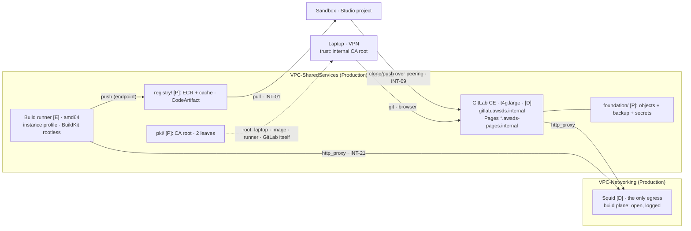

# Stage 7 — GitLab, Runners and ECR

| | |
|---|---|
| **Status** | **in progress - pass 1 closed and pass 2 nearly so, 2026-10-12** ([log](../../log/log-stage-07-gitlab-runners-ecr.md)): `foundation/`'s anchors (`18 added`), `egress/` at v0.17.0 with `secretsmanager` (`14 added`), `pki/` (`20 added`; the root's fingerprint in the log), `tooling/` (`17 added`; the first boot deadlocked on Omnibus's unit ordering and the host was replaced the same day with the fix, `3 added, 4 changed, 3 destroyed`; the second boot's reconfigure took 5 min 03 s), `registry/` 5.b (`8 added, 6 changed`, the Staging cut included); every slice re-planned `No changes`. 1.8's first sign-in done by the user (the administrator is `felipenoris`, local). The root is trusted on the user's laptop; verifications i, x (the laptop) and xiii are answered; the first `gitlab-down`/up cycle ran. **Pass 1 is closed.** Pass 2 has begun: 3.4, 3.5 and 3.6 done (the namespace, the persona groups, the two repositories with `dev-env`'s roles and protected tag), 3.1 and 3.2 done, the SAML round-trip proven by the user (verification iii); the data-scientist persona is a Developer in `awsds/data-scientists` (the user); the other three personas join their subgroups at their first sign-in, and Pages (4.2) waits for the first pipeline. **Pass 3 has begun (2026-10-12)**: the runner applied (`6 added`) and registered in 1 min 42 s as a protected project runner of `awsds/app-etl`, and the first pipeline is green: verifications vii and viii answered yes, the immutable tag refused a second push, the proxy pair read on both halves (the job, and the access log naming every runner request). Pages served and read back on the laptop and the runner (4.2). `default-v0.6.0` built on the runner and registered as Sandbox's image version 6 (2.6), the smoke test green; owed: INT-09's clone from a notebook, 6.5's buildbox retirement, then 8.x. `saml.auto.tfvars` lives only in the session's worktree (runbook §A). Decisions 1, 5 and 8 taken as recommended; 3, 6 and 7 taken by the user as recommended, in chat; 9 opened by the user's reading of the first `gitlab-down`, recommendation stated, not taken. Three implementation choices departed from the text below and are recorded where they land: the published certificates and `config/gitlab.rb` sit in the objects bucket (the only pre-existing bucket was the state bucket), the root volume (12 GiB) is separate from the 50 GiB data volume, and the cache's creation templates use AES256 and carry no tags. Everything lands in **`VPC-SharedServices`** (Production's 10.30.0.0/16), on the **build plane, which is `open`**: any public name answers through the proxy and is logged, so an unlisted host is not a 403 here. The names are in the **`awsds.internal` family**; **there is no NAT anywhere**, so every outbound call is an explicit-proxy call. The **buildbox retires into the build runner** after six hand builds (`default-v0.1.0` to `default-v0.5.0`, on an `m8i.xlarge`). **CodeArtifact, applied at 6a, has no consumer**: every installer in the estate reads public PyPI through the proxy (decision 6). Three readings from the executed stages shape the build: `make up`/`down ENV=production` starts and stops the hub with GitLab, so GitLab gets targets of its own (1.6); a `[D]` host's rendered user data is a replacement in waiting (Lesson 64), so GitLab's configuration travels outside it (1.3); and Pages is not resolvable from a Sandbox notebook, by design (4.2). One GitLab group `awsds/` is the shared namespace. **Pass 0 is applied**: step 5.a ran inside 6a on 2026-08-21 (`14 added`) |
| **Prerequisites** | **[6c](stage-06c-networking-hub.md) passes 1-4 — met 2026-09-06**: `VPC-SharedServices` exists under its new name, `awsds.internal` resolves in all five VPCs, the Sandbox↔SharedServices peering carries routes both ways, and the proxy answers on `proxy.awsds.internal:3128`. **[6d](stage-06d-unified-studio-remainder.md)** for one deliverable only — the INT-09 clone needs a live Sandbox project. **`production/registry/` exists**: step 5.a was applied at 6a, so this stage starts with the two ECR repositories and CodeArtifact already there and **`production/pki/` not yet written** |
| **Consumes** | [D8](../decisions/D08-gitlab-hosting.md), [D9](../decisions/D09-az-count.md), [D11](../decisions/D11-lab-lifecycle.md), [D12](../decisions/D12-budget-ceiling.md), [D14](../decisions/D14-supply-chain-account.md), [D15](../decisions/D15-tls-internal.md), [D20](../decisions/D20-staging-account.md), [D35](../decisions/D35-sandbox-cardinality.md), [D36](../decisions/D36-internal-pki.md), **[D38](../decisions/D38-single-egress-hub.md)** |
| **Proves** | [INT-09](../integrations.md) (the `git clone` from a **Sandbox** project over the SharedServices peering), [INT-13](../integrations.md) (CodeConnections against a private GitLab — expected to fail; the manual `git remote add` is the accepted path), [INT-19](../integrations.md) (the CA root on **four** client surfaces — the laptop, the `dev-env` image, the runner and GitLab itself), and [INT-21](../integrations.md) for GitLab and the runners, which the buildbox first exercised at 6c 5.8. **Supplies** [INT-02](../integrations.md)'s provider half — already applied at 6a. INT-08 is **not** here: the deploy roles are Stage 8's |

*Read with [`docs/plan/conventions.md`](../conventions.md) §6 (naming, layout, `[P]`/`[D]`/`[E]`, the slice
tree) and [`docs/NETWORK.md`](../../NETWORK.md) (which VPC each thing lands in, and what `NO_PROXY` holds).*

---

**Objective:** source control, CI, docs hosting and the artifact registries — private, in
`VPC-SharedServices`, with TLS from the internal CA, no local accounts, and no path to the internet except
the proxy.

## What this stage builds, and where

Everything below is in the **Production** account, **`VPC-SharedServices`** (10.30.0.0/16), AZ
**`usw2-az1`** (D9: the hub hosts and every endpoint set sit there, so peering traffic stays in one AZ and
costs nothing), unless stated.

| Slice | What | Layer |
|---|---|---|
| `production/pki/` (new) | the CA root, its own KMS key, the publication of the root, and the **two** leaves: certificates published beside the root, keys in Secrets Manager (a third leaf, the proxy's, only if it ever terminates TLS) | `[P]` |
| `production/foundation/` (amended) | GitLab's `[P]` anchors: the object-storage bucket, the backup bucket, the `gitlab-secrets.json` container, and the runner-token secret container | `[P]` |
| `production/registry/` (amended — **5.b only**) | the pull-through cache and the per-application repositories, and the consumer map decision 7 settles. **5.a is applied** | `[P]` |
| `production/tooling/` (new) | the GitLab instance, EBS, the DLM snapshot policy, the instance role, the rendered `gitlab.rb` as an object the host fetches, the two DNS records | `[D]` — stopped, never destroyed |
| `production/runners/` (new) | the build runner and its role — **and the retired buildbox's job** | `[E]` |
| `production/egress/` (amended) | **13 endpoints today** (6c 5.5: the core 8 — `sts`, `logs`, `kms`, `ecr.api`, `ecr.dkr`, `athena`, `glue`, `lakeformation` — plus `sagemaker.api`, `sagemaker.runtime` and the SSM trio), on `vpc-egress-v0.11.1`. This stage bumps it to v0.17.0 (`no_proxy_all_groups`, 1.3) and adds `secretsmanager`; CodeArtifact's two only with decision 6 | `[E]` |
| Identity Center console, by hand | the custom SAML 2.0 application | — |
| GitLab itself, by hand | the `awsds/` group, the four persona groups, the repositories, the protected release tags | — |
| `scripts/`, `Makefile` | `layers.py`: `tooling` `[D]`, `runners` `[E]`; `make gitlab-up`/`gitlab-down`, and `ENV=production` leaving the hub to `hub-up`/`hub-down` (1.6); `slices.py`: `-input=false` on every apply and destroy (Lesson 47) | — |

## Readings to know before executing

What the vendor documentation says and what the executed stages measured, each where it lands.

| Subject | Reading | Source | Where it lands |
|---|---|---|---|
| Let's Encrypt on an HTTPS `external_url` | **on by default** whenever `external_url` is HTTPS and no certificate is configured, and GitLab **retries the renewal on every `reconfigure`**; on a `.internal` name with no route to the ACME server that is a failing reconfigure, every time | GitLab documentation | 1.3 |
| GitLab's own trust store | a **fourth** CA surface: roots are dropped in **`/etc/gitlab/trusted-certs/`** and picked up by `reconfigure`; the leaf pair is **hostname-named**, `/etc/gitlab/ssl/gitlab.awsds.internal.{crt,key}`, 644/600 | GitLab documentation | 1.3, 2.5 |
| Omnibus and the proxy | taken **per component**: `gitlab_rails['env']`, `gitaly['env']`, `gitlab_workhorse['env']`, `gitlab_pages['env']`; `no_proxy` accepts wildcards and **must carry no port**, which breaks DNS resolution for repository mirroring | GitLab documentation | 1.3, 7.1 |
| The runner and the proxy | GitLab Runner needs its own **systemd drop-in**, the docker daemon a second one, and the build container the values through `config.toml`'s `environment`, **in both cases**; `NO_PROXY` wildcards work only as **suffixes**: no prefixes, **no CIDR** | GitLab documentation | 6.2 |
| **A reconfigure run from cloud-init deadlocks on Omnibus's unit ordering** | `gitlab-runsvdir.service` is `After=multi-user.target` by default; the bootstrap runs inside cloud-init's final stage, a dependency of that target, so Chef's `systemctl start gitlab-runsvdir` waits for the stage that is waiting for Chef. Measured 2026-10-12: the console stopped at the start job, CPU 1% for twenty minutes, and Chef gave up after its 3600 s timeout with cloud-init's final stage failed. The fix is `package['systemd_after'] = 'network-online.target'` in `gitlab.rb`, GitLab's own troubleshooting page naming the two `package['systemd_*']` settings | GitLab troubleshooting, the log | 1.3, 1.5 |
| **A health probe by name is a client outside the monitoring allowlist** | `/-/readiness` answers `404` to a client the allowlist does not admit, and the default admits loopback only; a probe from the host that connects to its own name arrives from its VPC address. Measured 2026-10-12: the bootstrap's probe read `404` for its five minutes on a host that was up. The probe now connects over loopback (`--resolve`), the name kept for TLS | GitLab health check and IP allowlist pages, the log | 1.5, 8.2 |
| **A fresh instance turns things on that nobody asked for** | Read 2026-10-12 on CE v19.4.2: sign-up enabled, Auto DevOps `instance enabled` (a project without a `.gitlab-ci.yml` runs a pipeline nobody wrote once a runner exists), and a `GitLab Duo` bot user created by the instance itself (Lesson 17). Runbook §I step 6 turns the first two off; the bot stays, holding nothing | the admin area, the log | 1.8, 3 |
| A host's boot and the proxy | cloud-init does not read `/etc/environment`, so the boot script needs its own `export`; `dnf.conf`'s `proxy=` broke the AL2023 repositories, which come through the S3 gateway endpoint, so `dnf` takes no proxy; the docker client's `proxies` block injects the host's `noProxy` into every container, outranking an image's own `ENV` | 6c, `buildbox.md` | 1.3, 6.2 |
| The build plane | `open` since 2026-09-08: any public name through the proxy, logged; the only 403s are the global denies (a private destination, a non-443 `CONNECT`), and a refusal over `https://` reads `000` at the client. A name missing from a host's `NO_PROXY` fails open: the call leaves by the proxy to the public endpoint instead of the VPC endpoint | 6c, 6d, `NETWORK.md` | 1.3, 6.2, 6.3 |
| A `[D]` host's user data | runs at first boot only, and a change replaces the instance only under `user_data_replace_on_change`, which the proxy host sets; an SSM-resolved AMI also replaced a `[D]` host on its next apply (6g). A comment edited inside a rendered template is a replacement in waiting (Lesson 64) | 6g, Lesson 64 | 1.2, 1.3 |
| `make up`/`down ENV=production` | starts and stops every Production `[D]` host, the hub's two included, and applies every Production `[E]` slice; `ENV=prod` is not an environment name | `scripts/slices.py`, `Makefile` | 1.6, 8.1 |
| The pull-through cache's first pull | ECR documents that it *"may require a route to the internet"*, its remedy a public subnet with an internet gateway, which design B removed; unauthenticated upstream pulls are *"initiated by AWS IP addresses"*, so the reading decides. The fallback is measured: 6c 5.8 pulled a public image through the proxy and pushed it into ECR | ECR documentation, 6c | 5.2, decision 3, verification vii |
| Repository creation templates | they **exist** and can set tag immutability, encryption, policies and lifecycle on repositories ECR creates for the cache; immutability *"will prevent Amazon ECR from updating images using the same tag"* | ECR documentation | 5.2 |
| CodeArtifact behind a gateway endpoint | the **service** fetches from the external connection, one connection per repository (why `pypi` and `crates` are two); a client downloads package assets from an AWS-owned `assets-<account>-<region>` bucket through the S3 gateway, *"not needed when using Python or Swift"* — so `crates` needs that bucket in the gateway policy and `pypi` does not | CodeArtifact documentation | 5.3 |
| Pages on a wildcard domain | behind the Omnibus nginx proxy, **no secondary IP** is required (a second address is for custom domains); Pages **access control is a Free-tier feature** | GitLab documentation | 4.1 |
| Pages and the spokes | `awsds-pages.internal` is associated with `VPC-SharedServices` and `VPC-Networking` only: Pages is reached from the tunnel and the runners, never from a spoke's compute | `production/foundation/peers.tf`, `NETWORK.md` | 4.2 |

## Who executes each action

| Marker | Meaning |
|---|---|
| **[Claude]** | repository edits and read-only AWS calls — done without asking |
| **[Claude⚡]** | `terraform apply`/`destroy` or any AWS write — run **only after the user authorizes that specific action in chat**, with the SSO user / account / permission set stated first |
| **[user]** | the Identity Center console, everything inside GitLab's own UI, browser flows, SSM sessions on the host, git tags, and every log entry |
| **[Claude reads, user decides]** | a measurement Claude takes and a choice only the user can make, in the same sitting |

Every apply runs as the **infrastructure user** through **`awsds-infra-prod`** (Production,
`InfrastructureAccess`), except step 3's SAML application — **`awsds-infra-identity`**'s console (Identity,
the IdC delegated administrator, D10). The hub is up for every pass (`make hub-up`): GitLab is reached
through the tunnel and reaches the internet through the proxy.

## Step numbers are identifiers, not an order

Numbers are **stable addresses cited from other files** and do not change. The sequence is four passes;
pass 0 is applied.

| Pass | Steps | What | Slice · layer | Applied as |
|---|---|---|---|---|
| **0** | 5.a | the `base`/`dev-env` repositories, CodeArtifact, the key and the consumer policies | `registry/` `[P]` | **DONE at 6a, 2026-08-21 (`14 added`)** |
| **1** | 1, 2, 5.b | the `[P]` anchors, the whole CA, `tooling/`, the cache and the app repositories | `foundation/` (amended), `pki/`, `tooling/` `[D]`, `registry/` (amended), `egress/` (amended) | `awsds-infra-prod` |
| **2** | 3, 4 | SAML, the edition check, the groups and repositories, Pages | IdC console, GitLab UI, `tooling/` | user + Claude drafts |
| **3** | 6, 7 | the build runner (the buildbox's successor); the mirroring decision and the INT-13 reading | `runners/` `[E]` | `awsds-infra-prod`; INT-13: user, console |
| **4** | 8 | the lifecycle, the rehearsed restore, the deliverables | `make gitlab-down`/`gitlab-up`, readings | user + Claude |

**The internal order inside pass 1**: the leaves are issued from the root (2.4 after 2.1); `tooling/` reads
the backup bucket and the leaf secrets, so the `foundation/` amendment and `pki/` precede it; 2.6 needs
2.3's publication. **Pass 2 needs pass 1** — the SAML round-trip is a browser flow through
`gitlab.awsds.internal`, and an untrusted certificate turns it into an unexplained loop. **Pass 3 needs pass
2** (a runner registers against a project). **Pass 4 proves everything before it.**

---

## To execute

### 1. Stand up GitLab CE — `production/tooling/` `[D]`, its `[P]` anchors in `foundation/`

**Action:** put GitLab CE Omnibus on a `t4g.large` in `VPC-SharedServices`' private tier, its bulky state
in S3, its secrets in Secrets Manager, reached by name over the VPN. **Why:** the objectives require source
control reachable only through the intranet, and D8/D14 fix the how and the where. **Explanation:** the
instance is `[D]` — stopped between sessions, ~USD 4/month of EBS — because rebuilding real state from
backup every session is the fragile path (conventions §5.1 rule 2). Everything that must survive a rebuild
lives in `[P]` slices.

- **1.1 — Done 2026-10-12** (`gitlab-anchors.tf`, `18 added`, re-plan `No changes`): the two buckets under a key of their own, `alias/awsds-prod-gitlab`, the backup bucket expiring at 30 days, the two containers with a `GetSecretValue` deny carved for the consuming role and `InfrastructureAccess`.
- **1.1 — [Claude] Create GitLab's `[P]` anchors in `production/foundation/`**, exported for `tooling/`:
  the object-storage bucket `awsds-prod-gitlab-objects` (one bucket, virtual buckets by prefix — the
  documented consolidated form: artifacts, LFS, uploads), the backup bucket `awsds-prod-gitlab-backup`
  (versioned, lifecycle-expiring), and two secret containers, `awsds-prod-gitlab-secrets` and
  `awsds-prod-runner-token` — `aws_secretsmanager_secret` with **no value resource**, so no value enters
  Terraform state. They sit in `foundation/` because 8.2's rehearsal destroys `tooling/` and every session
  destroys `runners/`: an anchor must survive the destruction of the slice it serves.
- **1.2 — Done 2026-10-12**: the host, a separate 50 GiB data volume (`aws_ebs_volume` + attachment, so a replaced instance re-attaches it) at `/var/opt/gitlab`, a 12 GiB root, the DLM daily snapshot (03:30 UTC, 7 kept, by the volume's tag). The DLM description admits `[0-9A-Za-z _-]` only - the first plan refused an apostrophe. The runners' group is declared here too, so GitLab's HTTPS rule never names an `[E]` object.
- **1.2 — [Claude] Write `production/tooling/`**: a `t4g.large` on **Amazon Linux 2023 arm64** (Omnibus has
  supported it since 16.3.0), in `usw2-az1`; the AMI is resolved once from the SSM public parameter and
  then held — pinned in the slice, or `ignore_changes = [ami]` — because an SSM-resolved AMI replaced a
  `[D]` host on its next apply at 6g, and a replaced GitLab moves its address and its root volume. EBS gp3 50
  GB with `delete_on_termination = false` on the data volume; one **Data Lifecycle Manager** daily snapshot
  policy (DLM is free, snapshot storage is billed). Instance `Name` tag **`awsds-prod-gitlab`** — a contract
  with `./aws/supplychain.py`. No port 22, SSM Session Manager only. The security group admits HTTPS from
  three sources and no other: the **WireGuard host's security group** in `VPC-Networking` (a same-account,
  cross-VPC reference over the peering — the host still masquerades everything but proxy-bound traffic after
  6c pass 8 and 6g, so a tunnel client arrives as the host's address, never as `10.90.0.0/24`); **Sandbox's
  two private subnets**, `10.20.0.0/18` and `10.20.64.0/18`, where a space's app ENI is the source the group
  matches (INT-09; inside the container the socket reads `169.255.254.3`); and the **runners' security
  group**, in this VPC. A security-group description refuses `'` and `>`, and only at apply.
- **1.3 — Done 2026-10-12**: `gitlab.rb.tftpl` rendered into `s3://awsds-prod-gitlab-objects/config/gitlab.rb` (the backup bucket expires whole, so the object sits in the objects bucket, outside every GitLab prefix); `no_proxy` is the 60-entry literal of `production/egress`'s plan-time `no_proxy_all_groups` (sha256 `f8bc1df99d224181`), which the slice now re-exports; the bootstrap installs `/usr/local/sbin/awsds-gitlab-refresh` for decision 8's re-fetch. The plan printed the rendered file (Lesson 54).
- **1.3 — [Claude] Render `gitlab.rb` from a Terraform template, and deliver it outside the user data** —
  configuration is code, not console, and the user data of a `[D]` host is the wrong carrier for code that
  changes. User data runs at first boot only; with `user_data_replace_on_change = true` (the proxy host's
  setting) every template edit would replace GitLab, and without it an edit never reaches the host. So the
  user data is a small bootstrap that rarely changes — install Omnibus, fetch `gitlab.rb` and the leaves,
  restore-or-generate the secrets (1.5), reconfigure, install the backup cron (8.2) — held with
  `ignore_changes = [user_data]`, and `gitlab.rb` is rendered into an S3 object, `config/gitlab.rb` in the
  backup bucket, whose expiry rule is scoped to the backups' prefix. The bootstrap fetches it, and a later
  change reaches the host through an SSM session: fetch again, `gitlab-ctl reconfigure` (decision 8).
  Comments stay out of the rendered file (Lesson 64), and the
  template is rendered with real values and read before the first apply (Lesson 54). Six blocks:
  1. `external_url "https://gitlab.awsds.internal"` **with `letsencrypt['enable'] = false`** — Let's Encrypt
     is on by default whenever `external_url` is HTTPS, and it retries on *every* reconfigure. The leaf pair
     is hostname-named: `/etc/gitlab/ssl/gitlab.awsds.internal.crt` (644) and `.key` (600), the key read
     from its secret (2.4).
  2. **The proxy, per component**: `gitlab_rails['env']`, `gitaly['env']`, `gitlab_workhorse['env']` and
     `gitlab_pages['env']` each carry `http_proxy`/`https_proxy` = `http://proxy.awsds.internal:3128` and a
     `no_proxy` that is **a dated literal in the template**, copied from `production/egress`'s
     `no_proxy_all_groups` (the plan-time output `vpc-egress-v0.17.0` carries) and read against it by
     `./aws/supplychain.py`, the shape 6d decision 8 gave the image. `tooling/` cannot read that output
     at apply time: it is `[D]` and applied by hand, while `egress/` is `[E]` and a destroyed slice's outputs
     fail the plan by name. **Suffixes and literal addresses only, and never a port**, which GitLab documents
     as breaking DNS resolution for repository mirroring. On this `open` plane a missing name fails open: the
     call leaves by the proxy to the public endpoint, the wrong door, with no error.
  3. The **consolidated object storage** block on 1.1's bucket with **`use_iam_profile = true`** — no keys
     anywhere (principle 2) — and `backup_upload_connection` to the backup bucket, which the consolidated
     form deliberately excludes.
  4. `registry['enable'] = false` (ECR is the registry, by objective) and the packages feature off.
  5. Pages, per step 4.
  6. SAML, per step 3.

  The instance role gets S3 on the two buckets, `GetSecretValue` on the two leaf secrets,
  `PutSecretValue`/`GetSecretValue` on 1.1's GitLab secret, and nothing else.
- **1.4 — Done 2026-10-12**: both records read back carrying the host's primary private address.
- **1.4 — [Claude] Create the two DNS records in `tooling/`**: `gitlab.awsds.internal` and
  `*.awsds-pages.internal` → the instance's **primary private IPv4**, documented to survive stop/start and
  measured to at 6g on the proxy host (one address throughout); verification i reads it again for GitLab.
  Both zones are `[P]` and were created at 6c pass 2; the record is still owed and belongs here.
- **1.5 — Done 2026-10-12** in `user-data.sh.tftpl`. **The first boot deadlocked** at `systemctl start gitlab-runsvdir` (the readings table above) and Chef timed out after 3600 s; the instance and its data volume were replaced with `package['systemd_after']` in `gitlab.rb`, and the second boot ran through: `gitlab Reconfigured!` after 5 min 03 s of Chef, the generated `gitlab-secrets.json` pushed as the container's first version at 14:19:59 UTC (verification ii's generate half; the restore half is 8.2's). The readiness probe read `404` for its five minutes (the readings table: the monitoring allowlist) and now connects over loopback, a held user-data change that rides the next first boot.
- **1.5 — [Claude] Write the restore-or-generate flow into the bootstrap**: on first boot, if 1.1's secret
  holds a value, install it as `/etc/gitlab/gitlab-secrets.json` **before** `gitlab-ctl reconfigure`; if not,
  reconfigure and push the generated file with `put-secret-value`. GitLab excludes this file from its own
  backups by design, and a backup restored without it cannot decrypt the database. The bootstrap exports
  the proxy variables for itself (cloud-init does not read `/etc/environment`), leaves `dnf` unproxied (the
  AL2023 repositories come through the S3 gateway, and `dnf.conf`'s `proxy=` broke them), and reaches
  Secrets Manager through `egress/`'s endpoint, so the first boot happens with `egress/` up.
- **1.6 — Done 2026-10-12**: `tooling` 42 `[D]`, `runners` 57 `[E]`, `layers.DORMANT_HOST_NAMES` (the slice is `tooling/`, the host `awsds-prod-gitlab`); `slices.py` refusal 6 and the hub check on Production's own `up`; `make gitlab-up`/`gitlab-down`. `-input=false` on `apply`/`destroy` was left to the session that announced it.
- **1.6 — [Claude] Add the machinery in the same commit**: `("production", "tooling")` `[D]` and
  `("production", "runners")` `[E]` in `scripts/tfhygiene/layers.py`, `runners` ranked **above `egress`
  (50)**, since it needs the endpoints and the `[D]` hook acts on GitLab as one block before or after the
  `[E]` loop. **A GitLab session leaves the hub alone**: `make up`/`down ENV=production` starts and stops
  every Production `[D]` host, the hub's two included, and applies every Production `[E]` slice (`probes`,
  and later `workloads-egress` and `warehouse-compute`). So the `Makefile` gains `gitlab-up`/`gitlab-down`
  (`--only tooling,egress,runners`, the way `hub-up` narrows to the hub), and the dormant hook stops treating
  the hub's two rows as `ENV=production`'s, printing the refusal instead: a `make down ENV=production` that
  stops the proxy blackholes every peer session's spoke. `ENV=production`'s own `up` then checks the hub as a
  spoke's does, since the runner it raises reaches the internet only through the proxy. A slice with no row
  fails `make check`.
- **1.7 — Done 2026-10-12**, in that order, `egress/` through `./scripts/slices.py up --env production --only egress` (the hub check read both hosts `running`). The `awsds` SSO token expired between `tooling/`'s apply and its re-plan.
- **1.7 — [Claude⚡] Apply `foundation/` (amended), then `egress/` (amended), then `tooling/`** as
  `awsds-infra-prod`, `fmt`/`validate`/`plan` clean first, `-input=false` always. `egress/` comes before
  `tooling/`: without its SSM endpoints there is no shell on the host, Session Manager does not work through
  an HTTPS proxy listener, and the bootstrap reads its secret through the `secretsmanager` endpoint. **The SSM
  trio is already there** (6c 5.5); this amendment bumps the module and adds `secretsmanager`. The two
  SageMaker endpoints stay: the deploy runner's calls into Sandbox's and Production's SageMaker (Stage 8 1.6,
  Stage 9 and 10's registry) leave from this VPC.
- **1.8 — Done 2026-10-12** by the user: the SSM session, the initial password, the first sign-in as `root`, the account renamed `felipenoris` with a new password and kept local (the break-glass). The browser marked the address "Not secure": the root was in no keychain, while the served chain verified against the published root (the log); runbook §I step 2 is the trust step.
- **1.8 — [user] Take first sign-in**: wait for the bootstrap to finish (`cloud-init status --wait` in the
  SSM session — the agent reports `Online` before the user data is done), read
  `/etc/gitlab/initial_root_password` (it self-deletes after 24 h), set the root password, and record in the
  log that **the local `root` account is kept** — it is GitLab's own break-glass when SAML breaks, and step 3
  creates no other local account.

### 2. Issue TLS from the internal CA — `production/pki/` (D36, D15, INT-19)

**Action:** generate the root, issue the leaves, and put the root on every client surface. **Why:** ACM
cannot issue for `.internal` names and Private CA is over budget (D15), so the trust chain is ours; a missed
surface fails as an opaque TLS error at `git clone` time rather than as an access denial. **Explanation:**
the whole CA is one pass. The fourth trust surface is GitLab itself, which needs the root in
`/etc/gitlab/trusted-certs/` to trust its own Pages and webhook targets.

- **2.1, 2.2 — Done 2026-10-12** (`20 added`, re-plan `No changes`): an ECDSA P-384 root valid to 2036-10-09, two P-256 leaves valid to 2027-10-22 with `early_renewal_hours` 720; the root's SHA256 fingerprint is in the log.
- **2.1 — [Claude] Write `production/pki/`**: the root CA through the `tls` provider — its own slice, its
  own state file, its own KMS key, and **the private key never an output** (D36 states the state-file
  custody trade). Outputs: the CA certificate, and from 2.4 the leaves' certificates.
- **2.2 — [Claude⚡] Apply it** as `awsds-infra-prod`. Its state key has existed since 2026-08-15
  (`alias/awsds-prod-tfstate-pki`, created by `production/bootstrap/` at Stage 2 step 3.4) and encrypts
  nothing until this apply. **[user]** Record the CA certificate's **fingerprint** in the stage log in the
  same sitting (D36 §5) — without it a substituted root is indistinguishable from the real one.
- **2.3, 2.4 — Done 2026-10-12**: three parameters under `/datascience/prod/pki/`, three objects under the objects bucket's `pki/` prefix, two leaf-key secrets `awsds-prod-tls-{gitlab,pages}` written by the slice (the one place a secret version exists in this repository) with the host-role carve-out.
- **2.3 — [Claude] Publish the root from one source** (INT-19, Lesson 14): a `[P]` S3 object in an existing
  Production bucket **and** the SSM parameter `/datascience/prod/pki/ca-root-pem` (the `/datascience/` path
  because Parameter Store reserves `aws*`). 2.6's image rebuild, step 6's runner user data and 1.3's
  `trusted-certs` drop all read these; nothing pastes a PEM. Each leaf's **certificate** is published beside
  the root, which is what `SC-8` reads the expiry from: it reads imported ACM certificates today, and under
  decision 1's nginx option nothing is imported.
- **2.4 — [Claude] Issue two leaves** (same pass, amending `pki/`): `gitlab.awsds.internal` and
  `*.awsds-pages.internal`. **`proxy.awsds.internal` gets one only if the proxy ever gains a TLS
  listener** — Squid listens on plain `3128` (6c 4.8), so nothing would validate it. **≤ 398 days** each
  (D15 note 5). Each leaf's key is written into a Secrets Manager secret (`awsds-prod-tls-gitlab`,
  `awsds-prod-tls-pages`) that GitLab's role reads at boot and at reconfigure, never into user data, which
  anyone holding `ec2:DescribeInstanceAttribute` reads. The re-issue date goes into the log, and `SC-8`
  watches the expiry.
- **2.5 — [user] Trust the root on all four surfaces**: the laptop (macOS keychain, plus `git`, `curl` and
  Python, which each have their own CA-bundle opinion — Claude drafts the exact commands); the `dev-env`
  image (2.6); the runner (step 6's user data); and **GitLab itself** — `/etc/gitlab/trusted-certs/*.crt`
  followed by `gitlab-ctl reconfigure`, which rehashes them into the embedded bundle. The four-surface
  proof is this stage's INT-19 deliverable.
- **2.6 — Built and registered 2026-10-12**: pipeline #4 of GitLab's `awsds/dev-env` (`images/build.gitlab-ci.yml`, the recipe cloned at `e885dcd`) pushed `base:default-v0.6.0` `sha256:94359041…1975` and `dev-env:default-v0.6.0` `sha256:43079013…5518` in about 16 minutes, the distribution pulled through the cache; the smoke test read GitLab with curl, git and both Pythons through the image's own trust (`base` section 5 now points OpenSSL, `requests`, curl and Node at the system bundle). Registered the same evening by `dev-env.md` §B (version 6, `ContainerImage` the pushed digest, re-attached at 19:48:45 UTC, no space stranded); INT-09's clone from a notebook is owed.
- **2.6 — [user] Rebuild and repush the images with the root**: the recipe carries an **empty CA-install
  layer** in `base` (§5: the copy, the count assertion and `update-ca-certificates`, with `ARG
  CA_ROOTS_EXPECTED=0`), filled here from 2.3's one source. Drop the PEM into `images/base/ca-certificates/`
  with a `.crt` extension and build with **`--build-arg CA_ROOTS_EXPECTED=1`**, so a forgotten file fails the
  build instead of shipping a trusting-nothing image; fix the layer's comments, which still name
  `gitlab.prod.internal` and `*.pages.internal`, in the same commit. **The tag is `default-v0.6.0`**, the
  next free minor ([`docs/SMUS.md`](../../SMUS.md) owns the convention; any recipe change takes a minor, and
  this build also carries `redshift-connector`'s declaration, `11a790e`); a hand build carries no
  `-<short-sha>`. **No cache shortens it**: the layer sits in `base`, upstream of every `dev-env` layer, and
  the recipe is not byte-reproducible, so it is a full rebuild — about 15 minutes of build on the buildbox's
  shape, and 4.67 GiB through the proxy took about 27 minutes there (6d). **The OS store is one of
  several**: Python is
  two environments in this image, the distribution's conda Python and `/opt/awsds/venv`, and `certifi`,
  conda, `git` and `curl` each carry a bundle of their own, while uv already reads the system store
  (`UV_SYSTEM_CERTS=true`). The layer points each at the system bundle it fills, or appends the root to each
  bundle, and the smoke test is a `git clone` and a `requests` call against `gitlab.awsds.internal` from both
  Pythons. **Making it selectable is [`dev-env.md`](../runbooks/dev-env.md) §B's six steps**, not a
  repointing: delete the apps, detach, apply (`1 to add, 1 to destroy`), read the new version's
  `ContainerImage` against the pushed digest, re-attach, and sweep every existing space, which keeps the
  version number it was created with and does not start once that version is gone (`EXC-09`, Lesson 63);
  `./aws/devenv.py` `DE-3` before the build, `DE-5` after. It runs on the build runner of step 6, so 2.6 is
  written up in pass 1 and executes in pass 3, from this repository, where the recipe lives until Stage 8
  decision 6 moves it. If Stage 8 has already landed, it is that pipeline's first run and this becomes a
  reading. **It gates the INT-09 clone**: a notebook that does not trust the root fails `git clone` with the
  opaque error INT-19 exists to prevent.

### 3. Make Identity Center the only sign-in, and read the edition answer (D20, Lesson 12)

**Action:** wire SAML, mirror the personas as GitLab groups, create the shared namespace, and verify which
approval-gate features this CE instance actually has. **Why:** no local accounts is the identity model
(principle 2's human half), and **two Stage 8 gates hang on the edition answer**.
**Explanation:** SAML *login* is Free; **Group Sync, protected
environments and deployment approvals are Premium** — memberships are maintained by hand and the CE gate
shape is `when: manual` under `rules:` on a protected tag.

- **3.1 — [user] Create the custom SAML 2.0 application in the Identity Center console** (Identity account,
  the delegated administrator), with every field named (Lesson 16): display name `GitLab`; **ACS URL**
  `https://gitlab.awsds.internal/users/auth/saml/callback`; **SAML audience**
  `https://gitlab.awsds.internal`; attribute mappings **Subject →** `${user:email}` (format `emailAddress`)
  and **`email` →** `${user:email}` (format `basic`); assign the four persona groups of the five
  `sso-group-*` groups (`INV-04`) — `sso-group-infrastructure` is left out, since GitLab's administrator is
  the local root (1.8). Download the IdC metadata (SSO URL + certificate) for 3.2.
- **3.2 — Claude's half done 2026-10-12**: the two values from the application's metadata URL into the gitignored `saml.auto.tfvars`, the object applied (`0 added, 1 changed`, 16:37 UTC), the refresh and the round-trip the user's; the Identity Center certificate runs to 2031-10-12 (fingerprint in the log).
- **3.2 — [Claude] Add the SAML block to the `gitlab.rb` template**: `idp_sso_target_url` and
  `idp_cert_fingerprint` from 3.1 as variables, not literals; `issuer "https://gitlab.awsds.internal"`;
  `name_identifier_format "urn:oasis:names:tc:SAML:1.1:nameid-format:emailAddress"`;
  `attribute_statements email: ['email']`; `block_auto_created_users = false`;
  `omniauth_auto_link_saml_user = true`. **[Claude⚡]** Apply, and deliver it through 1.3's path.
  **[user]** Prove the round-trip as a data-scientist user and record which NameID/attribute shape worked
  (verification iii). The IdC portal is reachable from any network (D39); the *GitLab* half is on the private
  network, so sign-in works only with the tunnel up. A loop has two suspects, not one: an untrusted
  certificate, and the browser's own policy on a `POST` from IdC's public origin to a private host
  (private-network access, cookie partitioning), which no AWS instrument reads (Lesson 43); record the
  browser and what it did.
- **3.3 — Read 2026-10-12**: CE v19.4.2 shows neither section in a project's CI/CD settings; the CE fallback is Stage 8's shape.
- **3.3 — [user] Read the edition answer off the running instance** (verification iv): in a test project's
  settings, are **Protected environments** and **deployment approval rules** present at all? Expected:
  absent in CE. The answer decides whether Stage 8's two gates are D20's approval as designed (Premium) or
  the CE fallback — **protected tags plus hand-maintained membership**, where the control becomes *who can
  push the tag* and CloudTrail on the deploy roles (INT-08) becomes the record of what happened.
- **3.4 — Done 2026-10-12** by Claude through the user's browser session: group `awsds`, ID 4, private.
- **3.4 — [user] Create the shared namespace `awsds/`** — one group holding `base`, `dev-env` and `app-etl`.
  It is what D21's larger branch requires: with one Interactive account, the repositories are shared by
  every persona rather than owned per environment.
- **3.5 — Done 2026-10-12** the same way: `awsds/data-scientists` (5), `awsds/deployment-managers` (6), `awsds/governance-managers` (7), `awsds/dev-env-stewards` (8), private, the administrator their only member at creation. The data-scientist persona is a Developer in `awsds/data-scientists` since 2026-10-12, added by the user after its first SAML sign-in; the other three follow the same way.
- **3.5 — [user] Create the four persona groups inside it**, mirroring the Identity Center groups 1:1 in
  *membership* and deliberately not in name — `data-scientists`, `deployment-managers`,
  `governance-managers`, `dev-env-stewards`, **without** the `sso-group-` prefix (the identity seam's first
  rule: a bare name is a GitLab object that grants nothing in AWS). Nothing enforces the pairing until a
  Premium upgrade automates it — re-check it by hand when people change. `governance-managers` holds no
  repository role yet: `docs/GOVERNANCE.md` routes a table's classification through a merge request on the
  versioned schema source, and which repository holds that source is Stage 9 decision 3's.
- **3.6 — Done 2026-10-12** by Claude through the user's browser session: `awsds/app-etl` (ID 2) and `awsds/dev-env` (ID 3), private and empty; on `dev-env`, `data-scientists` Developer, `dev-env-stewards` Maintainer, the tag pattern `*-v*` protected with creation Maintainers-only (Stage 8 step 1.0's shape, taken here). `app-etl`'s roles are Stage 8's.
- **3.6 — [user] Create the repositories**: `app-etl` (conventions §6's template) and `dev-env`, the latter
  writable by `data-scientists` with its **release tag protected** so only `dev-env-stewards` can push it —
  the CE shape of Stage 8 step 1's gate. `dev-env` starts empty: the recipe lives in this repository's
  `images/` until Stage 8 decision 6.

### 4. Publish docs on GitLab Pages (D36)

**Action:** enable Pages on `*.awsds-pages.internal`, VPN-only. **Why:** the objectives require docs over
the intranet, and Pages serves **user-supplied content** — it must live on a domain distinct from the GitLab
host, or a published page could read the GitLab session cookie. **Explanation:** the zone and its
associations already exist (6c pass 2): `VPC-SharedServices` and `VPC-Networking`, so the tunnel and the
runners resolve it and no spoke's compute does. This step adds the configuration on top of 1.4's record and
2.4's leaf. A **wildcard** domain behind the Omnibus nginx proxy needs **no secondary IP**, and access
control is a **Free-tier** feature.

- **4.1 — [Claude] Add the Pages block to `gitlab.rb`**: `pages_external_url
  "https://awsds-pages.internal"`, `pages_nginx['enable'] = true`, the wildcard leaf and key as
  `pages_nginx['ssl_certificate']`/`ssl_certificate_key`, and `gitlab_pages['access_control'] = true` — a
  page visit then requires a GitLab session on top of the VPN, and the docs stop being readable by anything
  that merely reaches the network.
- **4.2 — Done 2026-10-12**: `app-etl`'s `pages` job published `https://app-etl-ffa1fa.awsds-pages.internal` (a unique domain, GitLab's default); the runner read it back with `http=302 ssl_verify=0` against the CA root, and the laptop rendered it after a one-time OAuth consent to GitLab's own Pages application (scope `api`, authorized by the user as the administrator) (the log).
- **4.2 — [user] Prove it end to end**: a docs build published by a pipeline (pass 3) serves at
  `https://<project>.awsds-pages.internal` from the laptop through the tunnel, and the runner's job that
  published it reads the page back — two of INT-19's four surfaces exercised by one URL. A notebook cannot
  resolve the Pages zone, by design; its trust of the root is proved by INT-09's clone instead.

### 5. Finish the registries — `production/registry/` `[P]`, **5.b only** (D14, INT-02)

**Action:** add the pull-through cache and the per-application repositories to the applied slice, and
settle who consumes what. **Why:** under design B this is how public images reach a private build at all,
and no application image exists until Stage 8. **Explanation:** 5.a is already applied (6a, `14 added`), so
this is a second apply of one folder. Everything is `[P]` and free at rest except stored bytes.

- **5.1, 5.2, 5.3, 5.4 — Written 2026-10-12, apply owed**: `awsds-prod-ecr-app-etl` with no cross-account principal (decision 7), three cache rules with `MUTABLE`/AES256 creation templates (`cache.tf`), CodeArtifact untouched (decision 6, the user), `REGISTRY_CONSUMERS = ["sandbox"]` (decision 7, the user) with the Staging alias and identity read removed from the slice and `supplychain.py`'s consumer list. The plan read `8 to add, 6 to change, 0 to destroy`.
- **5.1 — [Claude] Record what 5.a already built, and do not re-author it**: `awsds-prod-ecr-base` and
  `awsds-prod-ecr-dev-env` (tag immutability on, basic scan-on-push, a lifecycle policy of two rules:
  untagged images expire after 14 days, and the 30 newest tagged images are kept, counted across flavours),
  CodeArtifact `awsds-prod-packages` with `pypi` and `crates`, `alias/awsds-prod-registry`, and the four
  consumer-facing policies. **Add only `awsds-prod-ecr-app-etl`** — one repository per application, same
  three settings.
- **5.2 — [Claude reads, user decides] Create the pull-through cache rules — and measure the first pull
  before believing it works.** Rules for the credential-free upstreams (ECR Public, `registry.k8s.io`, Quay;
  Docker Hub would need an `ecr-pullthroughcache/…` Secrets Manager secret — its documented prefix, an
  exception to the `awsds-` convention — and is added only when a build needs it). **The documented traps:**
  - **Immutability must not reach the cache repositories.** An immutable tag blocks the cache update.
    Repository creation templates *can* set immutability, so the rule is *do not write one that does* for
    the cache prefix; our own repositories set it per-repository, which does not collide.
  - **The first pull may need a route to the internet, and this estate has none.** AWS's own remedy is a
    public subnet with an internet gateway and a route from the private tier, which D38 removed. The
    upstreams above need no authentication and their pulls are *"initiated by AWS IP addresses"*, so the
    requirement may not bite; **the reading is the deliverable** (verification vii). If it does bite, the
    fallbacks in order are: (a) **pull the public image through the proxy and push it into ECR** — measured
    end to end at 6c 5.8 (`public.ecr.aws` with its CloudFront redirect on the build plane; the layers took
    the free S3 gateway path), no host in the hub and no route; (b) run the first pull from
    `VPC-Networking`'s public tier, which has the route, then let SharedServices pull the cached copy; (c) a
    NAT gateway in `VPC-SharedServices` — **the first named candidate for D38's contingency**, with a cost
    row and a removal trigger. Mirroring by hand into `base` is (a) by another name. A build on the `open`
    build plane can also pull a public image directly through the proxy, so the cache is for what a build
    should not fetch twice or should find scanned, not for reach.
  - **Cached repositories are created by ECR**, so a consumer grant rides on the **registry-level**
    permission policy, never on per-repository ones.
- **5.3 — [Claude reads, user decides] Settle CodeArtifact, which nothing consumes** (decision 6). The
  recipe's `PIP_INDEX_URL` is empty, so every build installs from public PyPI; spaces install from PyPI,
  Julia's registry and CRAN through the proxy (6d measured `uv add pandas` in 1.56 s); INT-02's consumer half
  has never moved a byte; and no mechanism in the repository mints the CodeArtifact token a client needs.
  If it gets a consumer: the **service** fetches from the external connection, so a client with no internet
  still resolves a package that has never been cached; each repository carries **one** external connection,
  which is why `pypi` (`public:pypi`) and `crates` (`public:crates-io`) are two; and a client in a no-route
  VPC downloads `crates` assets from the AWS-owned `assets-<AWS account>-<region>` bucket through the S3
  gateway endpoint, which the `vpc` module's bucket families do not admit (a `vpc-v0.x` release, the shape
  6i's MWAA code bucket took), while `pypi` needs no S3 at all.
- **5.4 — [Claude reads, user decides] Re-cut the consumer map** (decision 7). `REGISTRY_CONSUMERS` in
  `scripts/tfhygiene/backend.py` reads `["sandbox", "staging"]`: 6b renamed the Development row, and its
  comment records Staging as deliberate (*"a deployment target pulls images and packages like anything
  else"*). This step's design differs: the Interactive consumer set is **N Sandboxes, N = 1**, and Staging and
  Production consume the **application** repositories through Stage 8's own grant, never through this map,
  which keeps a deployment target off the `dev-env` image and the package proxy. Cutting Staging re-applies
  5.a's policies (both repository policies, CodeArtifact's two, the key) and rewrites the comment.
- **5.5 — Done 2026-10-12**: `egress/` at 06:33 UTC (`14 added`, through `slices.py`) and `registry/` at
  14:11 UTC (`8 added, 6 changed, 0 destroyed`, after the morning's attempt died on an expired SSO token),
  both re-planned `No changes`. `SC-12` reads red until 6.4's first pull (the log).
- **5.2 — Read 2026-10-12, at 6.4's first pipeline**: the first pull through each rule succeeded with no
  route (verification vii), once a fourth trap was cleared. Without a creation role ECR creates the cache's
  repositories as `AWSServiceRoleForECRTemplate`, which holds `ecr:CreateRepository` alone, so a template
  carrying tags is refused `ecr:TagResource` and the pull reads `not found`; the templates carry no tags
  since 18:34 UTC (`0 added, 3 changed`, the user's option (a)). A pull imports every platform of a
  multi-architecture index, Windows images included (the log).
- **5.5 — [Claude⚡] Apply `registry/` (5.b) and the amended `egress/`** as `awsds-infra-prod`. The
  cross-account pull proof is 6d's (INT-01); `./aws/supplychain.py` §§5-7 keep the mechanical half readable.

### 6. Stand up the build runner — `production/runners/` `[E]`, and retire the buildbox

**Action:** put one runner on EC2 in `VPC-SharedServices`, authenticating to AWS through its **instance
profile** and to the internet through the **proxy**. **Why:** a VPN-only GitLab cannot serve a JWKS that IAM
can fetch, so OIDC federation is structurally unavailable and the instance profile *is* the machine
credential (principle 2); the runner is `[E]` because it holds nothing worth keeping. **Explanation:** this
host is also the **buildbox's successor** — the same `amd64` shape, in the same VPC, behind the same proxy,
pushing with its instance profile rather than a hand-carried ECR token. The buildbox's role holds no `ecr:`
permission and every push used the person's own token, an absence its README calls the whole control; the
runner pushes by itself, so the control moves to who can run a job on it (protected refs, project locks)
and to the immutable tags.

- **6.1, 6.2 — Written 2026-10-12, unapplied** (`production/runners/`): the role, the host, the five proxy layers in the user data, registration from the token container, the CA root from the parameter at `/etc/gitlab-runner/certs/gitlab.awsds.internal.crt` and mapped into every job as `/etc/gitlab-runner/certs/ca.crt`. `seccomp=unconfined` on the docker executor is the trade BuildKit rootless asks for; verification viii measures it.
- **6.1, 6.2 — Applied 2026-10-12** through `make gitlab-up` (`6 added`); the first boot registered in 1 min 42 s. Before the apply the boot gained Amazon's ECR credential helper, pinned by digest and mounted read-only into every job beside `ECR_REGISTRY` (`moby/buildkit:rootless` runs as UID 1000 and cannot install a registry client), and a wait for GitLab's sign-in page. The runner is a **protected project runner** of `awsds/app-etl`, not an instance runner: any job reads the role's credentials, and sign-up is open (runbook §K). `make gitlab-up RUNNERS=0` raises GitLab without it.
- **6.4 — The first pipeline ran 2026-10-12** (runbook §K's three files): the push to `awsds-prod-ecr-app-etl`, the retry refused by the immutable tag, the cache's three rules each pulled through once, the proxy pair's job half. 2.6 is next.
- **6.1 — [Claude] Write `production/runners/`**: instance `Name` tag **`awsds-prod-runner`** (the script's
  contract), **`amd64`** — the images are `amd64` and the laptop is not, which was the buildbox's whole
  reason to exist. The shape is the buildbox's, measured: **`m8i.xlarge`** (4 vCPU, 16 GiB, 0.2117 USD/h) in
  `usw2-az1`, and a 64 GiB gp3 root, which fits a second ~23 GB copy of the images and little more. The build
  is CPU-bound: on a `t3.xlarge` the host sat at 99.98% CPU while the proxy moved 414 Mbps at 2.7%. User
  data installs `gitlab-runner`, **trusts the CA root from 2.3's one source**, and registers with an
  **authentication token** (`glrt-…`) read at boot from 1.1's `awsds-prod-runner-token` secret — never a
  git-ignored tfvars (a worktree has none, and a procedure that depends on a file it did not create runs only
  for its author, Lesson 61) and never a user-data literal. The runner is created first in GitLab's UI/API,
  which hands the token back (registration tokens are deprecated, removal at 20.0); each session's new
  instance registers as a new runner manager under the same token. Instance role: push to the three image
  repositories, `GetSecretValue` on the token, CodeArtifact only if decision 6 gives it a consumer — **no
  deploy permissions**; the deploy runner and its roles are Stage 8's, kept apart so this role never
  accumulates them.
- **6.2 — [Claude] Make every layer of the runner a proxy client**, because none of them inherits it:
  1. **The boot script** — its own `export` (cloud-init does not read `/etc/environment`), and `dnf`
     unproxied (the AL2023 repositories come through the S3 gateway, and `dnf.conf`'s `proxy=` broke them).
  2. **The runner service** — `/etc/systemd/system/gitlab-runner.service.d/http-proxy.conf` with
     `HTTP_PROXY`/`HTTPS_PROXY`/`NO_PROXY`.
  3. **The docker daemon** — its own systemd drop-in, same values. The docker client's `proxies` block, if
     one is written, injects the host's `noProxy` into every container and outranks an image's own `ENV`,
     which is why Stage 8's smoke test reads the image's environment from its configuration.
  4. **The build container** — `config.toml`'s `[[runners]] environment`, carrying **both cases**
     (`HTTP_PROXY` and `http_proxy`), since tools disagree on which they read.
  5. **The build itself** — BuildKit `--build-arg http_proxy=…` for `FROM` and package steps.

  `NO_PROXY` is `production/egress`'s `no_proxy_all_groups` (`vpc-egress-v0.17.0`), never written by hand,
  and is **suffixes and literals only**: GitLab documents that wildcards work as suffixes, never prefixes, and
  that **CIDR notation does not work** — so `10.0.0.0/8` in that variable is silently ignored, and the
  intranet names are listed as suffixes instead (`.awsds.internal`, `.awsds-pages.internal`,
  `169.254.169.254`, `169.254.170.2`, `localhost`, `127.0.0.1`, plus this VPC's endpoint names). The runner
  is `[E]` and applied after `egress/`, so unlike GitLab it can read the output at apply time.
- **6.3 — [Claude] Build containers with BuildKit rootless** (or Buildah) — **not Kaniko**, archived in
  2025-06 with its GitLab tutorial removed — and **no privileged Docker-in-Docker**. Public dependencies
  (Julia, R, Rust, `conda.anaconda.org`, which the compute plane refuses) come through the proxy, and the
  build plane answers every public name: a failing fetch is a real failure of the upstream or of the name,
  never a 403 from a list.
- **6.4 — [Claude⚡] Apply through `make gitlab-up`**, and **[user]** run the first pipeline: a
  `.gitlab-ci.yml` on `app-etl` that builds and pushes an image. Then run **2.6** here — the image rebuild
  now has a host that can do it.
- **6.5 — [Claude⚡] Retire the buildbox in the same sitting**: destroy `production/buildbox/` if it is up
  (`[E]`), then delete the slice, its `layers.py` row (rank 55), `scripts/buildbox.py` and
  [`docs/plan/runbooks/buildbox.md`](../runbooks/buildbox.md). **Move its §P first**: it is the only complete
  ledger of the six hand-built tags, and `docs/SMUS.md` points at it; the ledger moves to `images/README.md`.
  Then every live reference goes with the files — `grep -rn 'buildbox'` names them, about fifteen today
  (`CLAUDE.md`, the `Makefile`, `aws/devenv.py`, `scripts/slices.py`, `docs/SMUS.md`, `docs/NETWORK.md`,
  `dev-env.md`, `images/README.md`, `pyproject.toml`, `conventions.md` §6, `terraform-live/README.md` among
  them), each replaced by a pointer to this step. A runbook for a host that no longer exists is the stale path
  that still succeeds (Lesson 35).

### 7. Settle mirroring, and read INT-13

**Action:** decide what mirrors between this GitHub repository and GitLab, and record whether CodeConnections
can reach a VPN-only GitLab at all. **Why:** Stage 8 step 6 needs the mirroring answer to place the
infrastructure pipeline, and INT-13 is answered at the first moment GitLab exists. **Explanation:** both are
recordings, not builds.

- **7.1 — [user] Decide the mirror** (decision 4; recommended: none standing — GitLab hosts the application
  repositories, this infrastructure repository stays on GitHub, and a per-repository **push mirror** — a
  Free-tier feature; pull mirroring is Premium — is added only if INT-09's fallback needs it). **If a mirror
  is ever enabled, re-read 1.3's `no_proxy`:** GitLab documents a port in that list as breaking DNS
  resolution for exactly this feature.
- **7.2 — [user] Read INT-13**: from Data Governance (the domain's account, which has **no VPC** by
  D22/D26), attempt a CodeConnections **host** for `https://gitlab.awsds.internal` in the console — a host
  for a private instance requires VPC connectivity the account does not have, so the expected answer is that
  it cannot reach it. Record the wording, delete anything half-created, and record the **manual
  `git remote add` + push from inside the project** as the accepted path. 6d named `codeconnections.api` as
  this stage's input (open question 26's `gitConnectionArn`), and no slice added it, so the reading is taken
  without it and the finding is about reach.

### 8. Prove the lifecycle and rehearse the restore (D11, conventions §5.1 rule 6)

**Action:** run the GitLab lifecycle against the new slices, measure the boot, and walk the
backup→destroy→restore path once. **Why:** a `[D]` choice is a cost judgement that rule 7 re-opens if the
boot is slow, and a recovery path that has never been walked is a claim, not a path. **Explanation:** the
rehearsal happens now, while the instance holds throwaway content.

- **8.1 — [user] Run the cycle**: `make gitlab-down` destroys the runner and `VPC-SharedServices`' `[E]`
  endpoints and **stops** GitLab, leaving the hub running for every other session; `make gitlab-up`
  restores it. Measure the boot to first HTTPS answer (verification vi) — D8 assumed 3-5 minutes; much worse
  re-opens the layer choice.
- **8.2 — [user] Rehearse the restore, once**: `gitlab-backup create` to the backup bucket, destroy
  `tooling/`, re-apply, let 1.5's flow restore `gitlab-secrets.json`, `gitlab-backup restore`, and prove a
  pre-backup repository clones cleanly. Record the measured time; the backup schedule (a cron entry the
  bootstrap installs, daily while the instance runs) is set in the same sitting.
- **8.3 — [Claude] Diff `./aws/supplychain.py` across the cycle** — only timestamps and instance state may
  change; anything else is state that leaked into the wrong layer.
- **8.4 — [Claude] Extend the two instruments in the same sitting**: `./aws/supplychain.py` gains
  **`SC-11`** (the GitLab host, the runner and every build container carry a proxy configuration whose target
  is `proxy.awsds.internal:3128` — no address is exported since 6g — and GitLab's `no_proxy` literal equals
  `no_proxy_all_groups`), and **`SC-12`** (each pull-through cache rule has at least one cached repository,
  which is 5.2's first-pull reading made durable); `SC-8` reads the published leaves' expiry (2.3); its
  header, which still describes imported ACM leaves and a "TLS triple", is brought to the nginx option and the
  four surfaces. `SC-9` (the CA root parameter) and `SC-10` (the runner's presence) keep their meanings.
  `./aws/proxy.py` `PX-3` already compares all five planes, the SharedServices one included.

---

## Deliverables

Each is written so its output differs between working and broken (Lesson 13). **The mechanical half is
`./aws/supplychain.py`** — the host and its `[D]` state, the anchors, the leaf expiry, the repositories with
immutability and scan-on-push, the cache rules, the CodeArtifact domain, the consumer policies, the runner,
and 8.4's two new checks. The behavioural proofs are the stage's own (Lesson 20):

- **The clone pair:** `git clone https://gitlab.awsds.internal/awsds/app-etl` succeeds from the laptop with
  the tunnel up and fails with it down — and succeeds **from a notebook in a Sandbox project**, which is
  INT-09 re-homed onto the Sandbox↔SharedServices peering. Its network half is in place since 6c: the apex
  zone resolves in all five VPCs, the image's `NO_PROXY` begins with `.awsds-pages.internal,.awsds.internal`,
  Sandbox's DNS Firewall allows both zones, and the peering routes both ways. What this stage adds is the
  record (1.4), the security-group rule (1.2) and the root in the image (2.6).
- **The pipeline:** a commit to `app-etl` runs on the private runner and pushes to
  `awsds-prod-ecr-app-etl`; a second push of the **same tag is rejected** (immutability doing its job).
- **The proxy pair (INT-21):** the same build fails with the proxy variables removed (no route leaves the
  VPC but the proxy) and succeeds with them present; the access log names the runner's requests. On this
  `open` plane the readable refusal is a private destination or a non-443 `CONNECT`, a 403 read over
  `http://` or in the log, never an unlisted public host.
- **The TLS quadruple (INT-19):** GitLab and Pages answer over HTTPS with certificates that validate against
  the internal CA on **all four surfaces** — the laptop's browser and `git`, a `dev-env` notebook's `git
  clone` and `requests` call (GitLab only: the notebook does not resolve Pages), the runner's job log, and
  GitLab's own `reconfigure` output.
- **The identity pair:** an Identity Center user signs in through SAML with no local account created by
  hand; the kept `root` account still signs in locally.
- **The lifecycle and the restore:** 8.1's cycle with the boot time recorded and the hub left running;
  8.2's restore proving a repository survives the death of the instance.
- **Three recordings:** the edition answer (3.3), the pull-through cache's first-pull behaviour (5.2), and
  INT-13's reading (7.2).

## Validation

1. Run `./aws/supplychain.py` — all `SC-*` pass, including 8.4's `SC-11`/`SC-12`; diff two runs across
   8.1's cycle.
2. Run `./aws/proxy.py` — `PX-1`..`PX-4` pass (`PX-5` is retired at Stage 6g); `PX-3` covers the build plane
   already.
3. Run `./aws/egress.py` §6 at the session's end — zero burn; a forgotten runner is this stage's likeliest
   leak, at 0.2117 USD/h.
4. Read every denial by its wording, never its exit code (standing rule since 1c).

## Cost

Measured (`docs/PRICING.md`), `us-west-2`:

| Item | Cost | Layer |
|---|---|---|
| GitLab `t4g.large` while up | 0.0672/h | `[D]` |
| GitLab EBS 50 GB gp3 | ~USD 4.00/month | `[D]` idle — the largest idle item |
| EBS snapshots (DLM daily) | snapshot storage, measured at the first backup | `[P]` |
| Object-storage + backup buckets | ~USD 0.023/GB-month — cents at lab scale | `[P]` |
| Secrets: `gitlab-secrets.json`, the runner token, the two leaf keys | USD 0.40/month each + 0.05/10k calls | `[P]` |
| ECR storage | 0.10/GB-month. One release is 10.7 GB compressed across `base` and `dev-env`, and the lifecycle keeps 30 tagged images per repository; read the real figure from the bill, which deduplicates layers, rather than from image sizes, which do not | `[P]` |
| CodeArtifact | 0.05/GB-month + 0.05/10k requests — nothing stored and nothing requested while it has no consumer | `[P]` |
| Build runner `m8i.xlarge` while up | 0.2117/h, measured on the buildbox — it replaces the buildbox's line, not adds to it | `[E]` |
| SharedServices interface endpoints | 0.010/h each while `egress/` is up; 14 after this stage, 16 if decision 6 adds CodeArtifact's two | `[E]` |
| **A NAT gateway in this VPC, only if 5.2 forces it** | 0.045/h + 0.005/h for the address | contingency |
| Enhanced scanning (deferred, decision 2) | 0.09/image + 0.01/re-scan | Stage 11's |

There is no internal ALB in this table. With no public certificate there is nothing for one to terminate
(D15), Omnibus's nginx serves the internal leaves including the Pages wildcard, and the primary private IP
survives stop/start so the records hold. It stays the documented alternative if instance-side TLS proves
awkward, and it would land in `production/egress/`.

## Decisions due while executing

**Blocking questions for the user: none.** Each is decided during the stage and written into
`docs/log/log-stage-07-gitlab-runners-ecr.md` (Lesson 16), with a recommendation stated.

1. **TLS termination: nginx on the instance, or an internal ALB** (steps 1-2) — **taken 2026-10-12: nginx on the instance**, for the reasons in the Cost note above.
2. **ECR scanning: basic or enhanced** (5.1) — recommended: **basic scan-on-push** (free), which feeds
   `DescribeImageScanFindings`, the API Stage 8's gate reads. Enhanced (Inspector) is measured at USD
   0.09/image + 0.01/re-scan and is decided at **Stage 11 step 4** against a real bill.
   The deferral is not eventual full coverage. Inspector's supported languages for ECR
   images are C#, Go, Java, JavaScript, PHP, Python, Ruby and Rust — **Julia and R are on no AWS service's
   list**. What Stage 11 can buy is Rust, Python beyond the OS packages and continuous re-scanning; what it
   cannot buy at any price is the two ecosystems the `dev-env` image exists to deliver. 6a's two images
   scanned to **identical** counts (CRITICAL 30, HIGH 430, all inherited from the SageMaker Distribution), so
   everything `dev-env` adds over `base` produced zero findings. The Julia/R residual is **accepted rather
   than deferred**, with the Dev Env Steward's review of a pinned text manifest as its named control; the
   acceptance lives in `institutional-delta.md`.
3. **The pull-through cache, after 5.2's reading** — recommended: keep the credential-free three if the
   first pull succeeds through the proxy or from the hub's public tier; if it needs a route, prefer fallback
   (a) — measured at 6c 5.8 — or (b) over standing up this estate's first NAT gateway. **Read 2026-10-12**:
   the first pull needed no route at all (verification vii). **Taken by the user 2026-10-12: the three stay.**
4. **The mirroring policy** (7.1) — recommended: no standing mirror.
5. **Runner shape** (6.1) — **taken 2026-10-12 as written**: **one `[E]` `amd64` instance, `m8i.xlarge` as measured on the
   buildbox, docker executor**, rebuilt per session. The docker-autoscaler/fleeting path is adopted when a
   measured queue wait justifies it.
6. **CodeArtifact** (5.3). **Taken by the user 2026-10-12, as recommended.** Nothing consumes it, and it costs nothing at rest. Recommended: **keep it, idle,
   and add neither its endpoints nor the `assets` bucket family until a consumer exists**; the first consumer
   that needs it is a build that must not reach public PyPI, and it arrives with a token mechanism, an
   index URL and the gateway family in one change. The alternative is to retire it, which loses D14's package
   proxy and INT-02 with it.
7. **Staging in the registry consumer map** (5.4). **Taken by the user 2026-10-12: cut**, applied with 5.b. Recommended: **cut it**: Staging pulls application
   images through Stage 8's grant and has no use for the `dev-env` image or the package proxy; the comment in
   `backend.py` records the other choice, made at a rename, not argued.
8. **How a change to `gitlab.rb` reaches the host** (1.3). **Taken 2026-10-12 as recommended**, with the helper `awsds-gitlab-refresh` on the host. Recommended: **the rendered file as an S3 object
   the bootstrap fetches, with a re-fetch and `gitlab-ctl reconfigure` through an SSM session for every later
   change**, and the user data held by `ignore_changes`. The alternative, `user_data_replace_on_change`,
   makes every configuration edit a replacement of the host that holds the repositories.
9. **The SharedServices endpoint set a GitLab session carries** (1.6). Opened 2026-10-12 by the user's reading
   of `make gitlab-down`: `production/egress/` is one flat list, the module's core eight (`sts`, `logs`, `kms`,
   `ecr.api`, `ecr.dkr`, `athena`, `glue`, `lakeformation`) plus the slice's six extras (`sagemaker.api`,
   `sagemaker.runtime`, the Session Manager trio, `secretsmanager`): 14 endpoints at 0.010 USD/h each, created
   by `gitlab-up` and destroyed by `gitlab-down` whole. Production defines no optional group, and the module's
   closed group list names the Sandbox blueprint families. GitLab and the runner use the trio, `secretsmanager`,
   the ECR pair and `sts`; `kms` and `logs` are the core's and unexercised by these hosts; `athena`, `glue`,
   `lakeformation` and the SageMaker pair serve nothing in this VPC today, the pair marked vestigial in the slice
   since 6c with the question deferred to this stage. Recommended: **drop the SageMaker pair from the extras**
   (12 endpoints, 0.120 USD/h; `tooling/`'s bypass literal re-copied, `SC-11` the check) and leave the core
   alone, which the module overrides never and whose `lakeformation` is load-bearing for Production's share
   (D22). A per-session group for the data-plane three is a module change (the closed list, Lesson 33) for
   0.030 USD/h, not worth it. **The plan names no SageMaker caller in this VPC**: Stage 9 3.3a puts the
   job-facing set (`sagemaker.api` among it) in `production/workloads-egress/`, where Production's jobs and
   Stage 10's workers run, and 4.3a re-cuts Staging's; the runner's own SageMaker calls, Stage 10's
   `CreateModelPackage`/`UpdateModelPackage` as `awsds-deploy-prod`, are control-plane calls the proxy carries
   as public calls on this `open` plane, so the stage that makes them declares `sagemaker.api` here if it wants
   them private. Nothing in any stage invokes an inference endpoint from this VPC, so `sagemaker.runtime` has no
   future caller here.

## Verifications to answer while executing

Record every answer, including the ones that come out fine.

| # | Question | Step |
|---|---|---|
| i | Does the primary private IPv4 survive stop/start, so the two records never need repointing (measured for the proxy host at 6g; read for GitLab)? **Yes, 2026-10-12**: stopped 15:44, started 15:59, `10.30.52.94` before and after, both records untouched | 1.4 |
| ii | Does the restore-or-generate flow round-trip `gitlab-secrets.json` through Secrets Manager on a fresh boot? **The generate half, 2026-10-12**: the container was empty, reconfigure generated the file and the bootstrap pushed it (`AWSCURRENT`, 14:19:59 UTC); the restore half is 8.2's rehearsal | 1.5 |
| iii | Does the SAML round-trip complete — and which NameID format + attribute mapping worked, in which browser? **Yes, 2026-10-12**: a data-scientist persona signed in through the Identity Center button and GitLab created the account; NameID `emailAddress` from `Subject = ${user:email}` plus the `email` attribute (`basic`); Chrome on macOS, no loop | 3.2 |
| iv | The edition check: are protected environments / deployment approval rules absent on this CE instance? **Absent, 2026-10-12** (CE v19.4.2, the test project's CI/CD settings read through the user's browser): Stage 8's gates take the protected-tag shape | 3.3 |
| v | Does backup → destroy → restore reproduce a working instance, and in how long? | 8.2 |
| vi | Is the boot inside D8's assumed 3-5 minutes? **No, 2026-10-12**: launch 14:11:09 UTC, `gitlab Reconfigured!` 14:19:53 (8 min 44 s: the package through the proxy, then 5 min 03 s of Chef), cloud-init done 14:25:03 after the probe's five minutes | 8.1 |
| vii | **Does the first pull through a cache rule succeed with no route to the internet?** If not, which fallback was taken, and does the cached copy then pull cleanly? **Yes, 2026-10-12, on all three rules and no fallback**: ECR fetched the upstreams itself, as `AWSServiceRoleForECRPullThroughCache`, once the creation templates stopped carrying tags (5.2) | 5.2 |
| viii | Does the runner register through the authentication-token flow from the Secrets Manager token on a fresh instance, and does BuildKit rootless build and push without privileged mode? **Yes on both, 2026-10-12**: registered at first boot in 1 min 42 s; `moby/buildkit:rootless` under `seccomp=unconfined` built and pushed `awsds-prod-ecr-app-etl:v0.1.0-0817e161`, its registry login from the mounted ECR credential helper | 6.1, 6.3 |
| ix | Can a CodeConnections host be created toward `gitlab.awsds.internal` from the no-VPC domain account (INT-13 — expected: no)? | 7.2 |
| x | Do GitLab and `https://<project>.awsds-pages.internal` validate against the CA on every surface that resolves them (INT-19)? **The laptop, 2026-10-12**: the served chain verifies against the published root (`openssl s_client`, `curl --cacert`), failed against the system store until the root was added, and Chrome accepts it since runbook §C's two commands (the user). The image, the runner and Pages are the other surfaces. **The runner and Pages, 2026-10-12**: the runner's clones verify GitLab's leaf through the helper, and its `pages-readback` job read `https://app-etl-ffa1fa.awsds-pages.internal` with `ssl_verify=0`, as did the laptop; the image (2.6) is the surface left | 2.5, 4.2 |
| xi | Does a Sandbox project clone and push over the SharedServices peering (INT-09)? | deliverables |
| xii | **Does `gitlab-ctl reconfigure` complete without reaching the ACME server** once `letsencrypt['enable'] = false` is set? **Yes, 2026-10-12**: the second boot's reconfigure completed (529/1346 resources, 5 min 03 s) with no `letsencrypt` or ACME line in the console | 1.3 |
| xiii | Does a change to `gitlab.rb` reach the running host through 1.3's path, with the plan proposing no replacement of the instance? **The plan half, 2026-10-12**: adding `ci_catalog_bundles` to the object store planned `0 to add, 1 to change, 0 to destroy`, the S3 object alone, applied 14:22 UTC; the host half, the first `sudo awsds-gitlab-refresh` in 1.8's session, ended in `gitlab Reconfigured!` (the user, 2026-10-12): **yes on both halves** | 1.3 |
| xiv | Does `make gitlab-down` leave both hub hosts running, and does `make down ENV=production` refuse them by name? **The first half yes, 2026-10-12**: after the first `gitlab-down`, `awsds-prod-vpn` and `awsds-prod-proxy` read `running` and the burn 0.0156 USD/h; the second half is unexercised | 1.6, 8.1 |

## Risks

- **A default-on Let's Encrypt makes every reconfigure fail.** The control is 1.3's explicit disable, and
  verification xii is the reading that proves it.
- **Losing `gitlab-secrets.json` loses every backup at once** — the file is excluded from backups by
  design, and a restore without it cannot decrypt the database. The control is 1.5's flow plus 8.2's
  rehearsal, run before the instance holds anything real.
- **A template edit can replace the host that holds the repositories** (Lesson 64): the AMI and the user data
  are held, and the configuration travels outside them (1.2, 1.3, decision 8).
- **A GitLab session can stop the hub for everyone**: `make down ENV=production` stops every Production
  `[D]` host. 1.6's targets and the hub's exclusion are the controls; verification xiv reads them.
- **The pull-through cache may need a route this estate does not have** (5.2). The fallbacks are ranked in
  that step, so standing up a NAT gateway stays a decision with a cost row.
- **A proxy variable missing from one layer** (6.2) fails a build in a way that looks like a network fault,
  and a name missing from `NO_PROXY` on this `open` plane fails open, through the proxy to a public endpoint.
  `SC-11` is the instrument.
- **The edition limit reaches a load-bearing control, not a convenience** (Lesson 12): in CE the gate is
  *who can push a protected tag*, not *who approves this release*. Read in 3.3 and recorded.
- **A missed CA surface fails as an opaque TLS error**, and the image alone carries several bundles (2.6).
  The one-source rule (2.3) and the four-surface deliverable are the controls.
- **The supply chain shares Production's blast radius** (D14, accepted) — and since 6c it shares the account
  with the estate's two internet-facing hosts. The compensations are Stage 8's scoped deploy roles and
  CloudTrail alarms; this stage's contribution is a runner role that deliberately holds no deploy
  permissions (6.1).
- **A forgotten runner burns unwatched** — D12 skipped the alerts; `./aws/egress.py` §6 at session end is
  the instrument.
- **SAML lockout**: a broken IdP mapping with local sign-ups disabled would lock everyone out — the kept
  `root` account (1.8) is the way back in.

---

*Stage index: [stages/INDEX.md](INDEX.md) · Plan core: [GENERAL_PLAN.md](../../GENERAL_PLAN.md)*
