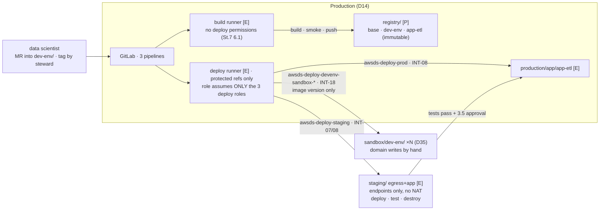

# Stage 8 — CI/CD pipelines

| | |
|---|---|
| **Status** | **in progress since 2026-10-12**: pass 0's readings are taken, step 6.2's workflow is written and proven, and pass 1's `[P]` half is applied with the environment down, and the deploy runner is up since 2026-10-13 with verifications ii and iii answered; 4.6's rule names the runner by its role's unique id since `deploy-role-v0.2.0`, and whether Staging's bus receives a cross-account record is verification xvi's. **The chain is `Sandbox → Staging → Production`** and nothing waits on a vend ([6b](stage-06b-development-becomes-staging.md)). The *engineering* apply of step 2.4 is a `sandbox/app/app-etl/` slice applied **by hand**, and CI never applies an application into Sandbox — D21's surviving objection, held by `layers.py` refusals 6 and 7 (refusal 5 is the `[D]` one, since Stage 4). **The runners sit on the build plane, which is `open`** ([6c](stage-06c-networking-hub.md), [D38](../decisions/D38-single-egress-hub.md)): every build step is an explicit-proxy client and any public name answers, so an unlisted host is not a 403 here. **The dev-env chain ends at the image version** ([6d](stage-06d-unified-studio-remainder.md) step 2, [`dev-env.md`](../runbooks/dev-env.md)): the domain writes that make a version selectable cannot be made from another account and stay the steward's, by hand. Three findings shape the rest: the scan gate meets the SageMaker Distribution's inherited findings (CRITICAL 30 in 6a's first scan, CRITICAL 0 and HIGH 130 in `default-v0.6.0`), so its severity rule is a delta (decision 1); from the runner, `make up`'s hub check is waived, so a job checks the proxy itself (3.1); and no member account has an SNS topic for the misuse alarm to reach (decision 5). The workflow lint's rules come from 6d step 4 and [6i](stage-06i-sandbox-orchestration.md) (5.6), and both gates take the CE shape [Stage 7](stage-07-gitlab-runners-ecr.md) step 3.3 records |
| **Prerequisites** | Stage 7 — the build runner, the registries with immutable tags, the protected-tag shapes (3.5), **the recorded edition answer (3.3)** that fixes both gates' CE form, and the mirror answer (7.1). **6d step 2** — the registration mechanism (`sandbox/dev-env/` and the hand attach) and the image the first pipeline release replaces: `default-v0.6.0`, version 6, registered at Stage 7 step 2.6. **6b** — `Staging` exists, its tree is `terraform-live/staging/` on its own state bucket. **6c** — every runner job is an explicit-proxy client and there is no NAT to bring up. Nothing here waits on a quota |
| **Consumes** | [D5](../decisions/D05-sagemaker-egress.md), [D8](../decisions/D08-gitlab-hosting.md), [D14](../decisions/D14-supply-chain-account.md), [D17](../decisions/D17-interactive-vs-runtime.md), [D20](../decisions/D20-staging-account.md), [D21](../decisions/D21-development-account.md), [D35](../decisions/D35-sandbox-cardinality.md), [D38](../decisions/D38-single-egress-hub.md) |
| **Proves** | [INT-07](../integrations.md) (Staging pulling the application image), [INT-08](../integrations.md) (the two promotion deploy roles, distinguishable in CloudTrail), [INT-18](../integrations.md) (the dev-env deploy role reaching from Production into Sandbox, as far as the image version). **Exercises INT-17's automated half**: INT-17 was answered at 6d (the slice plus a hand attach to the domain's `DefaultUserSettings`), and this stage adds the pipeline making the image version, not the domain writes |

*Read with [`docs/plan/conventions.md`](../conventions.md) (naming, layout, `[P]`/`[D]`/`[E]`, IAM rules).*

**Forward constraint from D35:** step 1's registration writes into **N accounts — every unit's Sandbox,
N = 1 today** — and, inside each, into every project's SageMaker AI domain, since each project has its own
(6d). The target list, the per-target roles and the trust-policy ARNs are enumerated **from the authored map
in `scripts/tfhygiene/backend.py`**, so a vend adds one map entry (Lesson 14). **The promotion chain is
untouched by N** (D21/D35): whatever the Sandbox count, there is one tag, one Staging leg, one gate. `CI-6`'s
image-parity check prints `note` ("N = 1, parity trivially true") until [Stage 14](stage-14-sandbox-vending.md)
vends a second unit.

---

**Objective:** the three pipeline types the objectives name — dev-env, application build, deployment —
plus the promotion gate, on the Stage 7 supply chain. **The promotion boundary is D17's four artifacts**:
the container image (ECR), the model version (Model Registry, from Stage 9), the workflow/application code
(a git tag), and the Terraform that instantiates them.

## What this stage builds, and in which accounts

| Where | What | Layer |
|---|---|---|
| `production/foundation/` (amended) | the deploy runner's role, instance profile and token container (4.3's anchors), `awsds-deploy-prod` (INT-08), the misuse alarm and `awsds-prod-alerts` (decision 5) | `[P]` |
| `staging/foundation/` (amended, **after 6b**) | `awsds-deploy-staging` (INT-08), the same alarm and `awsds-staging-alerts` | `[P]` |
| `sandbox/foundation/` (amended, one per unit) | the dev-env deploy role (INT-18), one per target | `[P]` |
| `terraform-modules/deploy-role/` (new, `deploy-role-v0.1.0`) | one deploy role: its trust, its ceiling, its state access and its misuse rule, one document for every account the deploy runner reaches | — |
| `production/registry/` (amended) | the **app-repository** pull grant for Staging (INT-07), an authored entry of its own beside `REGISTRY_CONSUMERS` (Stage 7 step 5.4 decides whether Staging stays in that map), and `awsds-prod-ecr-deploy`, the deploy jobs' image (3.1, 4.3) | `[P]` |
| `production/runners/` (amended) | the **deploy runner** — protected, project-locked, its role only assumes the three deploy roles | `[E]` |
| `sandbox/app/app-etl/` (new), `staging/`, `production/` idem | the application slices — **Sandbox applied by hand** (2.4), the other two by the pipeline (step 3). **CI never applies an application into Sandbox**, which is the answer to D21's surviving objection | `[E]` |
| GitLab, by hand | the three `.gitlab-ci.yml`s, repository roles, protected release tags, the deploy runner's registration, CI variables | — |
| GitHub | the infrastructure repository's offline-gates workflow (step 6) | — |
| `scripts/` | `layers.py`: the `app/app-etl` rank, the `[E]` rows, **refusals 6 and 7**; `slices.py`: `-input=false` on every apply and destroy (Lesson 47); `backend.py`: the dev-env target map, the app-consumer entry; the `make` `PROFILE` override | — |

## Who executes each action

| Marker | Meaning |
|---|---|
| **[Claude]** | repository edits (Terraform, `.gitlab-ci.yml`, workflow files, scripts) and read-only AWS calls — done without asking |
| **[Claude⚡]** | `terraform apply` or any AWS write — only after the user authorizes that specific action in chat, with the SSO user/account/permission set stated first |
| **[user]** | everything inside GitLab's UI (roles, protected tags, runner registration, CI variables, running manual jobs), git pushes and tags, GitHub settings, the dev-env domain writes, and every log entry |
| **[pipeline]** | a job that runs by itself once its trigger fires — written by Claude, triggered by the user's push or tag, credentialed by step 4 |

Hand applies run as the **infrastructure user**: `awsds-infra-prod` (Production), `awsds-infra-sandbox-1`
(the one Interactive foundation) and `awsds-infra-staging` (Staging, which 6b created). The pipelines run
under the **deploy runner's instance profile** and the step 4 roles — never an SSO profile, never a stored
key.

## Step numbers are identifiers, not an order

These numbers are **stable addresses cited from other files** — step 1 from 6d step 2, Stage 7 steps
3.5/5.1, `docs/plan/conventions.md` §6 (the `dev-env/` slices) and INT-17/INT-18; **steps 1.5 and 3.5** (the
two approvals) from Stage 7 step 3 and `docs/plan/institutional-delta.md`; step 2 from conventions §6 and D21;
step 4 from `docs/GENERAL_PLAN.md` principle 2 and Stage 7 step 6; step 6 from Stage 7 step 7. They do not
change. The sequence to work in is **six passes**:

| Pass | # | What | Needs |
|---|---|---|---|
| **0** | — | consume the recorded answers: the edition (St.7 3.3 → both gates' shape), the registration mechanism (6d step 2, `dev-env.md` §B), the mirror policy (St.7 7.1); read the current image's scan findings | readings, no build |
| **1** | 4 | the deploy credential layer: roles, the deploy runner, the misuse alarm | Stage 7 pass 3 |
| **2** | 2, 5 | the application build pipeline, with the gates written once | pass 1 (runner) |
| **3** | 1 | the dev-env chain, ending in the INT-18 image version and the steward's domain writes | passes 1-2 |
| **4** | 3 | the promotion chain: tag → Staging → Production | passes 1-2 (**6b**, not a vend) |
| **5** | 6 | the infrastructure repository's own pipeline; validation | pass 0 (7.1's answer) |

**Pass 0, read 2026-10-12 with the environment down.** The edition: CE v19.4.2 shows neither protected
environments nor deployment approvals (Stage 7 3.3, its verification iv), so both gates take the
protected-tag shape (verification i). The registration mechanism ran end to end at Stage 7 step 2.6:
`default-v0.6.0` became Sandbox's version 6 in `dev-env.md` §B's order, with no space stranded. The mirror:
none standing (Stage 7 decision 4), and this repository stays on GitHub. The scans, read with
`DescribeImageScanFindings`: `base` and `dev-env` at `default-v0.5.0` and `default-v0.6.0` all read
**CRITICAL 0, HIGH 130, MEDIUM 88, LOW 4, UNDEFINED 45**, against CRITICAL 30, HIGH 430 and MEDIUM 514 for
6a's `default-v0.1.0`, and each scan completed between 1 min 42 s and 7 min 22 s after its push.
`DescribeImages` carries no scan field for any image in either repository, as its reference warns for
AWS-native basic scanning, so a reader of that call sees images that were never scanned. The distribution's own digest has no scan: the cache repositories are
created with scan on push off. `./aws/cicd.py` reads 0 FAILED and 9 notes, each an absence a step of this
stage fills.

**On ordering:** this stage builds the promotion *machinery* — the chain, the gates, the deploy roles. The
Staging and Production *data platforms* are Stage 9's, so until then the chain is exercised with an
application that touches no data.

---

## To execute

### 1. The dev-env pipeline — the runtime release chain (D17, INT-17, INT-18)

**Action:** build the release process for the images every notebook and Studio app runs on — `base` and
`dev-env` — from a data-scientist-writable repository to a steward-gated image version in every Interactive
account. **Why:** D17's "promote only the code" is only true if the runtime the code lands on is identical
to the one it was written against, and the only way to make that true *by construction* is a **common
ancestor image**: application images are `FROM base:<pinned tag>`, never `FROM dev-env` and never a base of
their own — two independently built images with the same package list diverge quietly at the first rebuild.
The repository stays **writable by the data scientist** (which Julia version, which CRAN snapshot is their
expertise): **the control is who may release**, the `dev-env-stewards` gate. **Explanation:** the chain runs
on the protected release tag (Stage 7 step 3.5's shape) and ends at a *new image version*, the Model Registry
shape, so "which runtime is approved" stays a queryable fact with an approval attached. Which runtime a given
space runs is a different fact, read per space: a space keeps the version it was created with (Lesson 63). The
compute plane's allow-list serves PyPI, Julia, crates and CRAN since 6d, and D38 withdrew D5's comparison, so
a space installs most packages in seconds; what still needs this chain is what the image itself carries — the
conda-built R stack, the toolchains under `/opt`, the proxy literal, the assistant's pins.

- **1.0 — Done 2026-10-12, at Stage 7 step 3.6**: on `awsds/dev-env`, `data-scientists` Developer, `dev-env-stewards` Maintainer, the tag pattern `*-v*` protected with creation Maintainers-only; read back in the project's settings (Stage 7's log).
- **1.0 — [user] Set the repository's roles and protection** (with Stage 7 steps 3.4-3.5, restated with
  the fields named): on `dev-env/` — `data-scientists` **Developer**, `dev-env-stewards` **Maintainer**;
  the release tag pattern **protected, creation Maintainers-only** — in CE that role mapping *is*
  the gate's authorization, per 3.3's recorded answer.
  **The pattern is `*-v*`, not `v*`**, and the difference is security-relevant: under the image tag
  convention `<flavour>-v<semver>` ([`docs/SMUS.md`](../../SMUS.md) §*Custom images*) a release of this
  repository is tagged `default-v<semver>`, which **`v*` does not match**. A `v*` protection would apply to
  nothing this repository ever tags, and since 3.3's answer makes *who can push the protected tag* the whole
  of the CE authorization, the gate would be open to every **Developer** — i.e. to `data-scientists` — while
  still reading as protected in the settings page. The failure is invisible from inside GitLab: an
  unprotected tag is created successfully. **Verify by attempting a tag creation as a Developer after
  setting it**, rather than by reading the pattern back. **The recipe moves first** (decision 6): `images/`
  lives in this GitHub repository today, where every hand build took it from, and a protected tag on a
  repository that does not hold the recipe gates nothing.
- **1.1 — Stage 7 left a working shape (2026-10-12)**: `images/build.gitlab-ci.yml`, carried by GitLab's
  `awsds/dev-env` as its `.gitlab-ci.yml`, cloned this repository at a given commit, built `base` with the
  distribution through the pull-through cache, built `dev-env` `FROM` it, pushed both as `default-v0.6.0` with
  the runner's role through the ECR credential helper the runner mounts, and ran a smoke stage (Stage 7 step
  2.6). It runs on a web trigger with `IMAGE_TAG` and `RECIPE_SHA`, so the steward's gate is who can run a
  pipeline on `main` of a project the protected runner serves (Lesson 67), not yet a protected tag.
- **1.1 — [Claude] Write the build jobs**: both images with **BuildKit rootless** on the build runner
  (Stage 7 step 6.2), tagged **`<flavour>-v<semver>-<short-sha>`** — the release tag this pipeline runs
  on, plus the commit — pushed nowhere yet. The `-<short-sha>` suffix keeps two builds of the same release
  tag from colliding in a repository where **a tag is spent on first landing**, and makes a pipeline-built
  image distinguishable from the six hand builds (`default-v0.1.0` to `default-v0.5.0`) and Stage 7's
  web-triggered `default-v0.6.0`, which carry no suffix (ledger: [`images/README.md`](../../../images/README.md)
  §*The releases*). **The
  flavour stays in front**, so the registry's lifecycle rule (untagged after 14 days, the 30 newest tagged
  kept across flavours) can be split per flavour with a plain `tagPrefixList` when a second one exists. The
  recipe's requirements, as the hand builds left them: the SMUS BYOI specification and the activity-monitor
  extension; the CA root from the one source (INT-19, Stage 7 step 2.6), built with `CA_ROOTS_EXPECTED=1`;
  `dev-env`'s `FROM` naming `base` by digest, since the recipe defaults it to `awsds/base:local` and the
  provenance records that name; the uv project built `--frozen` with `UV_NO_CACHE`; the model pins in
  `managed-settings.json`, which must match `sandbox/bedrock/`'s grant and 6e's SCP; and §7, the proxy `ENV`
  and the `NO_PROXY` literal, the recipe's last section. **The literal must equal `sandbox/egress`'s
  `no_proxy_all_groups`** (70 entries, `aafa08da98a61f5c` today): the runner cannot read Sandbox's state, so
  the literal stays committed in the recipe, `./aws/devenv.py` `DE-3` checks it from the laptop before the
  tag, and an endpoint change is itself a release trigger (`dev-env.md` §E).
- **1.2 — [Claude] Write the smoke-test job**: the `dev-env` image starts, every language runtime resolves
  the **pinned** versions the manifest asked for (the image writes them to `/opt/awsds-runtimes.txt`), the
  key libraries import. Read the image's environment from `.Config.Env` or `/opt/awsds-proxy.txt`, never
  from `docker run … printenv`: the docker client's `proxies` block injects the host's `noProxy` into every
  container, outranking the image's own `ENV`. Cheap, and it catches the class of failure that otherwise
  reaches every workstation at once — the analogue of step 3.3's integration tests.
- **1.3 — [Claude] Write the push job**: both images to the Production ECR under the immutable tag.
  Scan-on-push fires on arrival; **nothing consumes the digest yet** — selectability is created only in
  1.6, which is what the approval gates.
- **1.4 — [Claude] Write the scan gate**: `aws ecr wait image-scan-complete` (a bounded waiter, 5 s × 60,
  with a `FAILED` acceptor), then `describe-image-scan-findings`, **blocking on decision 1's rule**. It
  **reads the push's own scan and never triggers another** — basic scanning allows one scan per image per
  24 h — and it covers **OS packages only**; the language-package half is step 5's `pip-audit`. **The two
  compose to OS + Python and no further**: 6a's first `base` and `dev-env` scanned to **identical**
  counts (CRITICAL 30, HIGH 430), every finding inherited from the SageMaker Distribution, so **Julia, R and
  the baked Rust toolchain passed this gate contributing nothing, because nothing looked at them**. That
  residual is **accepted with a named control** — the Dev Env Steward's review of a version-pinned manifest —
  and both the acceptance and its price live in [`institutional-delta.md`](../institutional-delta.md)'s row
  *"Vulnerability scanning of what the notebook image actually contains"*. **Do not close it by enabling
  enhanced scanning**: Inspector's ECR language list has no Julia and no R (Stage 7 decision 2). Pass 0 measured
  two constraints on the gate: the `dev-env` scan of `default-v0.6.0` completed 7 min 22 s after its push,
  past the waiter's 300 s (it exits 255 after 60 checks), so the gate polls under a bound of its own; and the
  counts come from `DescribeImageScanFindings`, since `DescribeImages` carries no scan field here.
- **1.5 — [user] Run the release gate**: a **blocking manual job** — `when: manual` under `rules:`, so
  `allow_failure` defaults false and the pipeline stops — with the package manifests, the scan report and
  the smoke output in its artifacts. A byte diff is not evidence here: a rebuild of an unchanged recipe moved
  the image by −11.8 MB, so the review reads what the manifests changed. Premium form: a deployment approval
  assigned to `dev-env-stewards`. CE reality, per 3.3's answer: the manual job is a deliberate pause and the
  *authorization* is 1.0's protected tag — who could start this pipeline at all.
- **1.6 — [pipeline + user] Register the approved version (INT-17, INT-18)**: the job assumes each target's
  `awsds-deploy-devenv-<unit>` role (4.2) and applies that account's `sandbox/dev-env/` slice with the
  approved tag as its input (`CreateImageVersion` resolves it to the digest), targets enumerated from the
  D35 map. **The pipeline's half ends there.** The domain writes that make the version selectable are the
  steward's, by hand, in `dev-env.md` §B's order, because they cannot be made from another account and each
  needs every app in the domain deleted first: delete the apps; detach (`"CustomImages": []`, since an
  omitted key is not cleared); let the pipeline apply (`1 to add, 1 to destroy`, the attached version
  destroyed before the new one exists, which is why the detach precedes it); read the new version's
  `ContainerImage` against the pushed digest; re-attach; and sweep every existing space's
  `DefaultResourceSpec`, because a space keeps the version number it was created with and a bump strands it
  (`EXC-09`). `./aws/devenv.py` `DE-3` reads the recipe before, `DE-5` the registered bytes after. The writes
  repeat in **every project's domain**, since each project has its own. **The first pipeline run replaces**
  `default-v0.6.0` (version 6). Record the changeover in
  the log. Whether the hand half can shrink is decision 7.
- **1.7 — [user] Measure the release loop once**: time one change the image must carry — MR → tag → chain
  → gate → version → the domain writes — and write the number into `docs/plan/architecture.md` §4.3 as the
  cost of a runtime change; packages the compute plane serves do not pay it.

### 2. Application build pipeline — the `app-etl` template (conventions §6, D21)

**Action:** the second pipeline type — test, lint, docs, image — on the application repository.
**Why:** it is the objectives' build pipeline, and it exercises the runner, the registry and the step 5
gates before any deploy credential exists — failures here are cheap and unambiguous. **Explanation:** the
repository follows conventions §6's `app-etl` template; its `terraform/` is the *source* of a slice, and
what is applied is `terraform-live/<env>/app/app-etl/`. **The Sandbox apply is engineering, not
promotion** — the chain starts at the tag (D21) and its first target is Staging.

- **2.1 — [user] Create `app-etl` from the template** (Stage 7 step 3.6 named it; this step fixes the
  fields): `data-scientists` **Developer**, `deployment-managers` **Maintainer**, release tag pattern
  (`v*`) **protected, creation Maintainers-only** — the CE anchor of step 3.5's gate.
  **`v*` is correct here**, and the difference from 1.0 is deliberate: the flavour segment
  exists because `base`/`dev-env` branch by *runtime* — GPU, Spark, plain — and an application does not.
  Its repository already names it, its ECR repository is `awsds-prod-ecr-app-etl`, and a mandatory
  `default-` on every application tag would be a word that never varies. **Application images are
  `v<semver>-<short-sha>`.** If an application ever does gain a runtime variant, it gets the flavour
  segment and this pattern moves with it.
- **2.2 — [Claude] Write `.gitlab-ci.yml`**: on every branch — `uv sync`, `ruff`, `pytest`, plus step 5's
  gates; on the default branch — docs built and published to **Pages** (Stage 7 step 4); on the protected
  tag — the image built with BuildKit **`FROM base@sha256:<digest>`** (never `FROM dev-env` — the runtime
  has no business carrying Jupyter; a build that floats the base defeats step 1) and pushed to
  `awsds-prod-ecr-app-etl` under the immutable tag, then 1.4's scan gate. **The image is also the job image**
  (Stage 10 decision 7: a processing job's dependencies come from its image, named by digest), and 6i
  measured what that asks of it:
  - **the project and its dependencies installed into an interpreter the image names**: `base` carries
    no `/opt/awsds/venv` (only `dev-env` builds it) and sets `UV_PYTHON_DOWNLOADS=never`, so 6i's
    interpreter path does not describe an image built `FROM base`; extension modules are built as wheels for
    the target platform;
  - **who owns the output mount**: `base` runs as uid 1000, and the platform creates the processing
    mounts as `0 0`, `drwxr-xr-x`. 6i's jobs open with `sudo -n chown "$(id -u)" /opt/ml/processing/outbox`,
    which needs the passwordless `sudo` the image keeps; an image that drops it breaks every job (decision 8);
  - **a smoke test that writes to the processing output mount with networking off**, the condition every job
    runs under (Stage 9 3.5).

  **The data-quality job class hangs here when it arrives** (Stage 5a step 3.8's hook, 2026-08-17): quality
  rules run beside the ETL in the pipeline, because the governed account cannot run them (`DenyUserCompute`)
  — a named placeholder, not a job this stage builds.
- **2.3 — [user] Run it**: a branch push runs tests only; the tag lands the image and the docs serve at
  `https://app-etl.awsds-pages.internal` — two pipeline deliverables in one push.
- **2.4 — [Claude] Write `sandbox/app/app-etl/` and the machinery rows**, then **[Claude⚡] apply as
  `awsds-infra-sandbox-1`**: the application running against Sandbox's own data, applied **by hand** while
  it is being engineered, outside the SMUS project and its role, under the infrastructure user. **The
  engineering apply lands in Sandbox, not in Staging**: Staging is written only by the pipeline (D20), so an
  engineer's iterate-and-re-apply loop has nowhere else to live, and Sandbox keeps CI out of the one account a
  human runs code in (D21's surviving objection). Machinery, same sitting: `RANKS["app/app-etl"]` (after
  `egress`, so `down` destroys the app before the endpoints it reaches AWS through), the three `[E]` rows
  (`sandbox` now, `staging`/`production` at 3.0), and two refusals in `layers.py`, numbered after the
  existing five:
  - **refusal 6: `make up` never applies an `app/` or `orchestration/` slice** — the pipeline (or this hand
    apply) is the applier, since the slice needs a pinned version `make up` does not have; `make down`
    destroys them normally (Stage 10 step 1.4 relies on it);
  - **refusal 7: no pipeline profile applies a `sandbox/` slice**, with one exemption written into the rule:
    `sandbox/dev-env/` under the dev-env deploy role, the one flow where the supply chain writes into Sandbox
    (1.6, INT-18).

### 3. Promotion pipeline — tag → Staging → Production (D20, D21, INT-07, INT-08)

**Action:** the chain from a release tag on the GitLab application repository to a running artifact in
Production, with the integration-tested Staging leg and one human gate in between. **Why:** D20 — there is a
real account between the tag and Production, so the pipeline is a chain with a gate in the middle, not a
deploy with an approval bolted on; a stand-in sharing Production's account could catch a schema error and
never a permission error (Lesson 2). Sandbox work enters only by graduating into the repository through git
(D21) — nothing promotes out of Sandbox. **Explanation:** the chain runs on the deploy runner under **two
roles, not one** — `awsds-deploy-staging` for 3.1-3.4, `awsds-deploy-prod` for 3.6 — separate names on
purpose, so a CloudTrail audit can tell which one ran (INT-08). A failure at 3.3 stops the chain and
Production is never touched. Every `terraform` in it runs with `-input=false` and `-auto-approve`, never
through a pipe whose exit code would hide its own (Lessons 46, 47).

- **3.0 — [Claude⚡] Add the two Staging preconditions this stage owns** — 6b already delivered the
  account, its tree, its state bucket and its `backend.py`/`layers.py` rows: **the app-repository pull
  grant for Staging in `production/registry/`** (INT-07's enabling half — `app-*` repositories only, an
  authored entry of its own) and `staging/foundation/` gaining `awsds-deploy-staging` (4.1's module). Who
  pulls: for a SageMaker job, the job's own role through the service (session `SageMaker`, measured at 6i),
  never through Staging's `ecr.*` endpoints, so the repository policy admits the Staging account and the
  pulling role holds `ecr:BatchGetImage`, `GetDownloadUrlForLayer` and `GetAuthorizationToken`.
  `REGISTRY_CONSUMERS` lists Staging today (6b kept it, on purpose); Stage 7 step 5.4 decides whether it
  stays, and this grant does not depend on the answer. Apply as `awsds-infra-prod` and `awsds-infra-staging`.
- **3.1 — [pipeline] Bring Staging up**: `make up ENV=staging ONLY=egress PROFILE=awsds-deploy-staging AUTO=1` — the
  `[E]` `egress/` slice, which since 6c is **interface endpoints only, with no NAT gateway and no default
  route**, and exists only for the duration of this run. Three things the job does before it:
  - **it checks the proxy itself**, with one request through `proxy.awsds.internal:3128` to an AWS name
    outside its `NO_PROXY`: `make up`'s hub check reads the hub through the laptop's profile and is waived
    when it cannot read (6c step 7.2), which is always the case from the runner, and the runner reaches
    `ec2`, `iam` and every service SharedServices has no endpoint for only through the proxy;
  - **it runs in an image that has `make`, `uv` and Python 3.14**: the targets are `uv run` scripts pinned to
    the repository's Python (Lesson 65), and `hashicorp/terraform` carries none of them, so the deploy jobs
    run a deploy image built from this repository's toolchain, for the deploy runner's architecture;
  - **it raises `egress/` alone**: `make up ENV=staging` also applies `staging/probes/`, whose own header
    says not to run it as written, so `make up` gains an `ONLY=` pass-through to `slices.py --only` (which
    `make hub-up` already uses) and the probes slice is retired or re-pointed in this stage.
- **3.2 — [pipeline] Deploy to Staging**: `terraform apply` of `staging/app/app-etl/` pinned to the
  application tag, the image pulled from the Production ECR by the account INT-07's grant names — **INT-07
  proven here**.
- **3.3 — [pipeline] Run the integration tests against Staging** — the deployed artifact against a real
  catalog, real IAM and a real network, which is what justifies the account. **The tests are API calls from
  the runner or jobs inside Staging**: no network path leads from `VPC-SharedServices` into Staging
  (deployment is an API act, D38), and Staging's proxy plane refuses everything.
- **3.4 — [pipeline] Tear Staging down**: `make down ENV=staging PROFILE=awsds-deploy-staging AUTO=1`, in
  `after_script`/always so a failed run cannot leave the endpoints burning. 6c removed the NAT gateway,
  but an endpoint set left up is still a bill.
- **3.5 — [user] Run the production gate**: a **blocking manual job** (`when: manual` under `rules:`) with
  the Staging test results and the Production `terraform plan` in its artifacts, `resource_group:
  production` serializing deployments. Premium form: a deployment approval assigned to
  `deployment-managers` on a protected environment. CE reality, per 3.3's recorded answer: the
  authorization is 2.1's protected tag — *who can start a release* — and the manual job is the pause where
  the evidence is read; `docs/plan/institutional-delta.md` carries the delta.
- **3.6 — [pipeline] Promote**: `terraform apply` of `production/app/app-etl/` under **`awsds-deploy-prod`**
  — the same immutable image by digest, nothing rebuilt, nothing copied. The pipeline applies named slices
  and never runs `make up` or `make down ENV=production`, which act on every `[E]` slice of the account,
  `production/warehouse-compute/` included, and that one refuses this role by SCP (4.1).
- **3.7 — [user] Record the promoted tag in this repository** (one line in the slice's pinned-version
  file, committed) — the approved version must not live only inside an `[E]` resource's state (Lesson 4);
  this pin is what makes a by-hand re-apply after `make down ENV=production` reproducible.
- **3.8 — [user] Prove the by-hand path once**: the same `make up`/`apply`/`make down` sequence from the
  laptop as `awsds-infra-staging` — a rebuild that only works from CI is the same bug as one that only
  works by hand (conventions §6).

### 4. The deploy credential layer — roles, the deploy runner, the alarm (principle 2, INT-08, INT-18)

**Action:** create the three deploy roles, the dedicated deploy runner whose instance profile is the only
path to them, and the misuse alarm above both. **Why:** no static keys — and **no GitLab OIDC either**: to
validate a job's ID token, STS fetches the issuer's discovery document and JWKS over the public internet,
and a VPN-only GitLab (D8/D14) serves neither; the **instance profile is the machine credential**
(principle 2), and OIDC remains the target design if a minimal public issuer surface ever exists (plausible
at Stage 13 — `docs/plan/institutional-delta.md` records it). **Explanation:** the build runner deliberately
holds no deploy permissions (Stage 7 step 6.1); this step adds a **second, protected runner** so an
ordinary CI job can never schedule onto the deploy credential. D14's consequence, softened by D20: the
deploy runner and its *Production* target share an account, so no account boundary protects Production from
a compromised runner — the Staging leg does cross one, so a compromise now has to survive the integration
tests and the gate; the rest is compensated inside the account by the scoped roles, the plan attached to
the approval, and 4.6's alarm.

- **4.1, 4.2, 4.6 and 4.3's anchors — Written 2026-10-12, not applied.** One module,
  `terraform-modules/deploy-role/` (`deploy-role-v0.1.0`), builds each deploy role: a trust admitting the
  runner's role alone, `sts:AssumeRole` only; the ceiling `awsds-<env>-deploy-boundary`, `Allow *` with the
  denies under it (no change to a deploy identity or a ceiling; in Staging and Production no role created
  or changed unless it carries `awsds-<env>-app-boundary`, the name the first application slice gives its
  ceiling; in Sandbox no role but the image role, and none of the domain writes); read and write on its
  slices' state; and the misuse rule in the state that receives `AssumeRole`. Three callers:
  `production/foundation/deploy-anchors.tf` (the runner's role, instance profile and token container,
  `awsds-deploy-prod`, `awsds-prod-alerts`), `staging/foundation/deploy-role.tf` (`awsds-deploy-staging`
  with the egress half, `awsds-staging-alerts`) and `sandbox/foundation/deploy-role.tf`
  (`awsds-deploy-devenv-sandbox` with the dev-env half). `DEPLOY_ROLES` in `backend.py` generates the
  names and the accounts all three read. Two halves wait for the passes that use them: the application
  grants (2.4, 3.0) and the dev-env slice's read of `production/registry/`'s state (pass 3). Each topic's
  subscriber comes from an untracked `alerts.auto.tfvars` the user writes, and a check block says on every
  plan when it is missing. `production/foundation/` applies first: IAM refuses a trust policy naming a
  role that does not exist.
- **4.1, 4.2, 4.6 and 4.3's anchors — Applied 2026-10-12 by Claude, authorized by the user**, Production
  first: `production/foundation/` 16 added, `staging/foundation/` 9 added, `sandbox/foundation/` 4 added,
  and each re-plan `No changes`. `./aws/cicd.py`: `CI-2`, `CI-3`, `CI-4` and `CI-7` pass, 0 FAILED, `CI-1`
  noting the absent runner. The policy simulator, given the Region and the organization id as context,
  read each role's edges: the Staging role writes `staging/egress/` state and creates an endpoint in its
  VPC, may not write `staging/foundation/` state nor create a resolver rule, and its ceiling denies
  `iam:CreateRole`; the Sandbox role creates an image version and passes the image role to SageMaker,
  while its ceiling denies passing any other role and `sagemaker:UpdateDomain`; the runner's role
  assumes `awsds-deploy-staging` and nothing outside the list. Both email subscriptions wait for their
  confirmation link.
- **4.1 — [Claude] Write the two promotion deploy roles** (INT-08): `awsds-deploy-staging` (in
  `staging/foundation/`, lands at 3.0) and `awsds-deploy-prod` (in `production/foundation/`). Trust policy:
  **exactly the deploy runner's role ARN** — an enumerated principal, never a wildcard account
  (conventions §6). Permissions: the environment's `egress/` and `app/*` slices (the pipeline applies
  both), its state-bucket prefix, `iam:CreateRole`/`AttachRolePolicy` **only with the project permissions
  boundary attached** (`iam:PermissionsBoundary` condition), `iam:PassRole` scoped by
  `iam:PassedToService`. Each role **carries a boundary itself** — INT-14 later has to apply `awscc`
  resources under it (Stage 10), which is where the boundary's shape gets its real test. **Two later stages
  amend this policy, and say so here so the promise exists at both ends (Lesson 34)**: Stage 9 step 9.4 adds
  the Redshift Data API grant the DDL needs, and Stage 10 step 1.5 the saver's reads of a workflow's
  definition and code and the `PassRole` of its execution role. What no amendment can add: the root SCP's
  `DenyRedshiftCostGuardTamperingExceptInfrastructure` exempts only `InfrastructureAccess`, so
  `awsds-deploy-prod` can neither update nor destroy `production/warehouse-compute/`.
- **4.2 — [Claude] Write the dev-env deploy role** (INT-18): `awsds-deploy-devenv-<unit>`, one per
  `DEPLOY_ROLES` row, in each unit's `foundation/` (`awsds-deploy-devenv-sandbox` for unit 1); **`awsds-deploy-devenv-dev` is not written** — it died with the
  second Interactive account (6b). Scope, read from what `sandbox/dev-env/` actually holds: its state prefix;
  the SageMaker image and image-version calls on the named image; the image role and its inline policy, which
  the slice owns with no permissions boundary, by exact ARN; and the cross-account read of
  `production/registry/`'s state the slice makes for the repository URL and ARNs. **No domain writes**:
  `UpdateDomain`, `DeleteApp` and `UpdateSpace` on the blueprint's domain stay out of it, which is why 1.6's
  hand half exists. **Never a general deploy role reused**: this is the one flow where the supply chain writes
  *into* the accounts where people work.
- **4.3 — Read 2026-10-12, before writing it: the runner's role is `[P]` while the runner is `[E]`.** A
  trust policy that names a role stores the role's unique id, and a role destroyed and re-created under
  the same name gets a new one, so every deploy role would stop trusting the next session's runner (the
  IAM reference, *Principal*, "IAM role principals"). The build runner's role lives with its host
  because no trust policy names it; the deploy runner's role, instance profile and token container are
  anchors in `production/foundation/`, the instance alone in `production/runners/`.
- **4.3 — [Claude] Amend `production/runners/` with the deploy runner**: Name tag
  **`awsds-prod-runner-deploy`** (a contract with `./aws/cicd.py`; Stage 7's `awsds-prod-runner*` glob
  still matches), `[E]`, registered **Protected** (runs only jobs on protected branches/tags — a Free-tier
  runner attribute) and **locked to the `dev-env/` and application projects**. Instance role:
  `sts:AssumeRole` on **exactly the three deploy-role ARNs** (from the map), ECR auth/pull for the deploy
  image 3.1 names, which the build runner builds from this repository's toolchain and pushes into a
  repository of its own, `awsds-prod-ecr-deploy`, the CA root parameter — and nothing else; no push, no
  direct deploy permissions. Jobs inside containers reach the instance profile
  because the **declarative policy already defaults IMDSv2 hop limit 2** org-wide (verification (ii)).
- **4.3 — Applied 2026-10-13 by Claude, authorized by the user.** The deploy image is
  `awsds-prod-ecr-deploy:v0.1.0` (`sha256:1b1a5830…a53a`), built on the build runner by the GitLab project
  `awsds/deploy-image`, which holds only that pipeline (`images/README.md`); its two CRITICALs, Debian 13's
  curl with no fixed package, were accepted by the user by name as its baseline (decision 1).
  `production/runners/` 1 added, re-plan `No changes`. The first boot (3 min 31 s) assumed all three deploy
  roles with the instance's credentials, registered under GitLab runner #3 (protected, locked, tag
  `awsds-deploy`, no untagged jobs) and pulled the image by digest; `cicd.py` `CI-1` passes, 0 FAILED. The
  boot proves the host's path to the roles; verification (ii), a job container's, waits for a job.
- **4.4 — [Claude] Write the runner's AWS config and the `make` overrides**: profiles `awsds-deploy-*`
  declared as `role_arn` + `credential_source = Ec2InstanceMetadata` in the runner's `~/.aws/config`
  (rendered from the same map) — the named-profile discipline holds and **nothing is ever exported into a
  shell** (Lesson 25); `make up`/`down` gain `PROFILE=` and `ONLY=` (3.1), the laptop default staying
  `backend.py`'s. The hub check those targets make reads Production through the laptop's profile, so on the
  runner it is waived by design; 3.1's own proxy check replaces it there.
- **4.5 — [Claude⚡] Apply** `production/runners/` (and the Sandbox `foundation/` amendment of 4.2) as
  `awsds-infra-prod` and `awsds-infra-sandbox-1`. **[user]** Create the runner in GitLab (UI → authentication
  token `glrt-…`, Stage 7's flow), mark it **Protected**, lock it to the projects, and store the token where
  Stage 7 step 6.1 stores the build runner's: a Secrets Manager secret the user data reads at boot, never a
  git-ignored file (a worktree has none) and never a user-data literal.
- **4.5 — Done 2026-10-13.** The user created the runner in GitLab as runner #3 and put its token into
  `awsds-prod-runner-deploy-token`; Claude applied `production/runners/` (the 4.2 amendment was applied
  with the anchors, 2026-10-12). A first creation, runner #2, never contacted GitLab and was deleted the same day.
- **4.6 — Read 2026-10-12, before writing it: the rule's state decides whether it fires.** EventBridge
  classes STS `AssumeRole` as a read-only management event, and a rule in the default `ENABLED` state
  matches every event except those, so it would never fire and would read as enabled. The rule takes
  `state = "ENABLED_WITH_ALL_CLOUDTRAIL_MANAGEMENT_EVENTS"`, which the AWS provider's `state` argument
  accepts, and `./aws/cicd.py` `CI-7` fails a plain `ENABLED`, which it used to pass.
- **4.6 — [Claude] Write the misuse alarm — the D14 compensation**: in Staging and Production, an
  EventBridge rule on the CloudTrail `AssumeRole` event for that account's deploy role where the caller is
  **not** the deploy runner's role, to the target decision 5 settles. Rule names
  **`awsds-staging-deploy-misuse`** and **`awsds-prod-deploy-misuse`** — a contract with `./aws/cicd.py`
  (`CI-7`). **It catches a successful misuse only**: a refused `AssumeRole` records no `roleArn` in
  CloudTrail, so neither the rule nor `CI-8` (which filters on it) can see an attempt that failed; that is
  read from the trail by `errorCode`. The builder itself is out of scope by construction (Lesson 18):
  `awsds-infra-*` can always apply directly, and what watches *that* is CloudTrail plus this stage's rule
  that production changes arrive by pipeline.
- **4.6 — Read 2026-10-13: a deploy role's own account records a cross-account caller with no ARN.**
  CloudTrail writes the runner's assumptions of `awsds-deploy-staging` into Staging as `userIdentity.type`
  `AWSAccount`, with no `arn` and a `principalId` of `<runner role unique id>:<session name>`. The rule's
  pattern reads `userIdentity.arn`, and no `MatchedEvents` datapoint exists for either rule over the eight
  assumptions of that morning, so `awsds-staging-deploy-misuse` cannot tell the runner from any other caller
  outside Staging: it sees a Staging principal only. Whether Staging's bus receives the cross-account copy at
  all is unread; verification (xvi) is the positive test. Proposed for the module's next version: match
  `userIdentity.principalId` with `anything-but` prefix `<runner role unique id>:`, which both record shapes
  carry, the id read from Production through the aliased provider, and (xvi) run from each side of the
  account boundary. `./aws/cicd.py` `CI-8` already attributes such a record by that id.
- **4.6 — Applied 2026-10-13 by Claude, authorized by the user: `deploy-role-v0.2.0`.** The rule matches
  `userIdentity.principalId` with `anything-but` prefix `<runner role unique id>:`, the id each caller reads
  from IAM (Staging through the `deploy_runner` alias). `production/foundation/` and `staging/foundation/`
  1 changed each, re-plans `No changes`; `sandbox/foundation/` carries no rule and plans `No changes` on the
  new tag. EventBridge's `TestEventPattern` on the deployed patterns: the runner's real records match
  neither rule, a role from another account matches Staging's, a role of the account matches both.
  `CI-7` fails a pattern that exempts the runner by anything but its role's unique id.

### 5. Security gates — written once, included by every pipeline (Lesson 12)

**Action:** the blocking gates, one file included by the three pipelines. **Why:** a gate that only warns
is documentation, not a gate — each finding class gets a named tool and a named blocking rule, and the
tier of every tool was checked (Lesson 12). **Explanation:** GitLab **Dependency Scanning is Ultimate** and
its analyzer is not available to this CE instance — the dependency gate is **`pip-audit`** (PyPA) in an
ordinary job; **Secret Detection is Free** (a template include); the ECR gate (1.4) covers **OS packages
only** — `pip-audit` covers the Python dependencies, and the two compose rather than substitute.

- **5.1 — [Claude] Write the `checkov` job** for every Terraform directory a pipeline touches (the
  repository's own tool since Stage 0), blocking on its failures.
- **5.2 — [Claude] Write the `pip-audit` job**: `uv export --format requirements-txt -o requirements.txt`,
  then `pip-audit -r requirements.txt`, blocking per decision 1. Two steps rather than a pipe: a pipe hands
  back `pip-audit`'s exit code, and a failed export would audit nothing and pass (Lesson 46). It reaches OSV
  through the proxy on the build plane, which is `open`, so `osv.dev` needs no list entry.
- **5.3 — [Claude] Include the Secret Detection template** (`Jobs/Secret-Detection.gitlab-ci.yml`, Free) —
  findings as artifacts; the richer dashboards are Ultimate and are not pretended.
- **5.4 — [Claude] Extract 1.4's ECR scan gate as the shared job** both image pipelines include.
- **5.5 — [user] Decide and record the blocking rule** — decision 1, written into the gate file and the
  log, not left to each pipeline's author.
- **5.6 — [Claude] Write the D28 workflow lint**, with the rules [6d](stage-06d-unified-studio-remainder.md)
  step 4 and [6i](stage-06i-sandbox-orchestration.md) supply. It refuses a workflow definition that:
  - **(a) carries a project-scoped reference** — a connection, a path or an id that exists only in the
    authoring Sandbox project and would resolve to nothing in Staging or Production. The patterns 6i met:
    `datazone_usr_role_*`, `AmazonDataZoneProject`, a `dzd-` domain id, `DataZone*` and `ProjectS3Path`
    variables, `domain_id`/`project_id`, `smus-projects`, `datazone-<project>-dev`,
    `alias/awsds-<env>-project` and `dev/operatorFiles/`. The domain and project the portal injects at save
    time are invisible in the YAML, so the rule reads the rendered file, never the portal;
  - **(b) hard-codes a `start_date`**, which is **rewritten at deploy time** rather than promoted;
  - **(c) uses an operator outside MWAA Serverless's supported list** (the Amazon-provider operators plus
    `PythonOperator` and `BashOperator`, added by AWS 2026-08-17), names `SageMakerNotebookOperator` (refused
    by name since 6d decision due 14 took (b)), or exceeds a service cap — **3600 s** per task, **50 KB** per
    definition, `retries` above 3 or left implicit (the service defaults it to 1);
  - **(d) references a definition or code object without a pinned S3 `VersionId`**;
  - **(e) names a container by anything but an ECR URI and digest**, or names `awsds-prod-ecr-dev-env` at
    all: a job runs the application image, never the notebook one;
  - **(f) submits a SageMaker job without the five settings** Stage 9 step 3.5 enforces (`VpcConfig`,
    network isolation, inter-container encryption, a volume key, an instance type inside the ceiling), or
    whose `MaxRuntimeInSeconds` plus about 13 minutes of provisioning, pull and teardown exceeds the 3600 s
    task cap while the operator waits. A refusal at run time names the policy and never the statement, so
    CI is the only place that can say which one is missing;
  - **(g) templates what the service does not render**: `dag_run`, or a method called on a macro's result;
    a template sees `macros`, `ti`, `params`, `ds` and `ts` only.

  **Artifact class (2b), the operator code package, joins D28's list** in the same commit — a workflow that
  ships its own operator code carries an artifact none of D28's six classes names. It is the workflow's
  `Code` object: one `.py`, one `.sh` or a `.zip` of at most 250 MB, every dependency vendored at the
  archive root for Linux x86_64 and Python 3.12, versioned by the service together with the definition. The
  job builds it and checks it: no package the worker already carries (its pre-installed copy wins anyway),
  no `__pycache__`, no secret (the service copies the archive outside the account), and every
  `python_callable` naming a module at the archive's root, imported with networking off against the
  worker's pre-installed packages on x86_64 CPython 3.12 — on the `amd64` build runner, never the `arm64`
  deploy runner. A Bash task's script is rendered as a Jinja template with the code folder on its
  `PYTHONPATH`, so the job renders each `.sh` the same way before it runs it. The packaging and rendering
  tool is `awsds-workflows` ([`serverless-workflows.md`](../runbooks/serverless-workflows.md) §T): the
  runbook installs it from `main` for hand use, and CI installs it by URL at a commit recorded in `app-etl`,
  never by name, so two builds of one tag cannot differ. No folder or archive it built has run in a job or
  on a worker yet, so one does before this gate trusts it; its `compare` reads a graduated definition
  against its template at review. A processing task's code input is a different case: a
  `ProcessingInput` names a prefix the job reads at each run, with no version to pin
  ([Stage 6i](stage-06i-sandbox-orchestration.md) verification xvi), so rule (d) cannot cover it; Stage 10
  decision 7 recommends the job's image instead, which rule (e) then covers.
- **5.7 — [Claude] Record what the SMUS CI/CD CLI is**: `aws-smus-cicd-cli` deploys **only into existing
  SMUS projects**, and a Workload account has none. It is therefore an **exporter on the Sandbox side** —
  `bundle` may produce the artifact this pipeline promotes — and **this stage's pipeline stays the
  deployer** (D26/D28). Using it as the promotion path would mean associating deployment targets to the
  domain and carving `datazone:*` out of the `Workloads` SCP, which is the isolation 6b just bought.

### 6. The infrastructure repository's own pipeline (conventions §6, Stage 7 step 7)

**Action:** CI for *this* repository, and the mirror that lets the deploy jobs read it. **Why:**
conventions §6 sends the wildcard-ARN check "into the pipeline at Stage 8", and this repository lives on
**GitHub** — GitLab hosts the application repositories, not this one. **Explanation:** the offline gates
need **no AWS credentials at all**, which is the recommendation: `plan`/`apply` stay by hand under
[`docs/plan/runbooks/terraform-changes.md`](../runbooks/terraform-changes.md). The RCP was read first —
`sts:AssumeRoleWithWebIdentity` is **excluded** from `EnforceOrgIdentitiesOnRoleAssumption` (AWS's
`CT.STS.PV.1` exclusion, `POLICIES.md`), so GitHub OIDC *would* work; a standing cloud credential for a
convenience is still declined (decision 3), and `docs/plan/institutional-delta.md` records OIDC as the
institutional answer.

- **6.1 — [user] Mirror this repository into GitLab for the deploy jobs** — decision 2, consuming Stage 7
  step 7.1's answer (its "only if a need appears" trigger fires here): the promotion and registration jobs
  check out `terraform-live/` and the `Makefile`, and a VPN-only GitLab can be reached by neither GitHub
  nor its Actions runners, while **pull mirroring is Premium**. The CE path is a **dual-push from the
  laptop** (a second push URL on `origin` — the same manual-path shape as INT-13), refreshed in the same
  sitting as any change the pipelines consume; each deploy job **prints the mirror's commit SHA** into its
  log so a stale mirror is visible in the evidence, not discovered by drift.
- **6.2 — Written 2026-10-12**: [`offline-gates.yml`](../../../.github/workflows/offline-gates.yml), on
  every pull request and by hand, with the pinned tool versions, every action pinned by commit, the module
  sources read over HTTPS, and every folder initialised one at a time before the hooks run, because the
  plugin cache is not safe for concurrent writes; an init that rewrites a committed lock file fails the job.
  The validate hook now runs three folders at a time: its default, one per CPU less one, failed five module
  folders with "Failed to load plugin schemas" in each of two `--all-files` runs on the 11-core laptop.
- **6.2 — [Claude] Write the GitHub Actions workflow**: on pull requests, `pre-commit run --all-files`
  (`fmt`, `validate -backend=false`, `tflint`, `checkov`, `ruff` and the repository's own hooks) and
  `make check` (the scripts: layers, the 9.2 wildcard check, `check-index.py`, the plan references, the
  identifiers, the provider locks). **No AWS credentials, no `plan`** — nothing to steal and nothing to
  misfire. What a hosted runner lacks, set up in the workflow: the tool versions `CLAUDE.md` pins (Terraform
  1.15.8, tflint v0.64.0, checkov 3.3.11, uv, which installs the Python `.python-version` names — a pin is a
  claim about the machine, Lesson 65); `TF_PLUGIN_CACHE_DIR`; and `git config --global
  url."https://github.com/".insteadOf "git@github.com:"`, since every module source is an SSH URL and the
  repository is public. **`validate` is not a plan**: a module change can pass it while a caller's plan fails,
  so the gate says so in its own output rather than reading as a check of every slice (Lesson 54).
- **6.3 — Done 2026-10-12, by Claude with the user's go-ahead**: PR #123's run `38314108044` passed in
  7 min 50 s, and a deliberate `terraform fmt` violation failed run `38328376553` at `terraform_fmt`,
  naming `terraform-live/staging/foundation/variables.tf`; the violation was reverted in the next commit.
- **6.3 — [user] Enable it and prove it**: a pull request shows the gates; a deliberate `fmt` violation
  fails.

---

## Deliverables

Each is written so its output differs between working and broken (Lesson 13). **The mechanical half is
`./aws/cicd.py`** ([`aws/INDEX.md`](../../../aws/INDEX.md)): the deploy runner and its narrow role, the
three deploy roles with boundaries and single-principal trust, the misuse alarms, the Staging app-pull
grant, the registered dev-env versions side by side, the recent `AssumeRole` events per deploy role. The
behavioural proofs are the stage's own (Lesson 20):

- **The promotion:** a version tag on `app-etl` flows through Staging to a running artifact in Production
  with one human approval — and **a deliberately broken version fails at 3.3 and never reaches
  Production**, the test that proves the D20 account earns its keep.
- **The gate pair:** a build with a known-vulnerable dependency is stopped by 5.2; an image with a
  blocking finding under decision 1's rule is stopped by 1.4.
- **The dev-env release:** a steward-approved tag ends as an image version whose `ContainerImage` is the
  pushed digest, attached in every project domain by the steward's hand writes, with no space stranded by the
  bump (`EXC-09`'s sweep); with N = 1 the parity check is `note` rather than `pass` until Stage 14. The first
  pipeline digest replaces the hand-built one, recorded.
- **The credential negatives:** a job on a non-protected branch never schedules onto the deploy runner;
  CloudTrail names which deploy role ran each leg (INT-08); and **no pipeline profile can apply a
  `sandbox/` slice other than `sandbox/dev-env/`** (refusal 7, proved once by attempting it).
- **The proxy negative:** a gate job with its proxy variables removed fails, since no route leaves
  `VPC-SharedServices` but the proxy; on the build plane, which is `open`, the refusal to read is a private
  destination or a `CONNECT` to a port other than 443 (a 403 read over `http://` or in the access log), never
  an unlisted public host.
- **The release loop:** 1.7's measured time, written into `docs/plan/architecture.md` §4.3.

## Validation

1. Run `./aws/cicd.py` — all `CI-*` pass; diff two runs across a promotion (only scan timestamps and
   event rows may change).
2. Run `./aws/egress.py` §6 after every pipeline session — zero burn everywhere, and **no NAT gateway in
   any account**; a Staging endpoint set left up by a half-failed promotion is this stage's likeliest leak
   (3.4's `after_script` is the control, this the instrument).
3. Prove 3.8's by-hand parity once.
4. Read every denial by its wording, never its exit code (standing rule since 1c).

## Cost

Measured (`docs/PRICING.md`), us-west-2:

| Item | Cost | Layer |
|---|---|---|
| Deploy runner `t4g.small` while up | 0.0168/h | `[E]` |
| Staging `egress/` during a promotion | endpoints only since 6c — 0.010/h each × minutes, no NAT line | `[E]`, pipeline-scoped |
| EventBridge rules + SNS notifications (4.6) | free tier at this volume | `[P]` |
| GitHub Actions (public runners, this volume) | free tier | — |
| Everything else | existing floors (ECR storage, GitLab `[D]`, the build runner Stage 7 prices) | — |

## Decisions due while executing

**Blocking questions for the user: none.** Each is decided during the stage and written into
`docs/log/log-stage-08-cicd-pipelines.md` (Lesson 16), with a recommendation stated.

1. **The blocking rule for the two scanners** (1.4, 5.2, 5.5). Every image inherits the SageMaker
   Distribution's findings, identical in `base` and `dev-env`: 6a's first scan read CRITICAL 30 and HIGH
   430, and pass 0 read `default-v0.5.0` and `default-v0.6.0` (SageMaker Distribution 4.5.2) at CRITICAL 0
   and HIGH 130. The distribution's own digest has no scan to compare against (the cache repositories scan
   nothing on push). Recommended: **block on a CRITICAL or HIGH finding absent from a baseline file
   committed beside the gate**, the findings of the release the steward last approved, starting from
   `default-v0.6.0`'s, which holds no CRITICAL, so every CRITICAL blocks until someone writes it into the
   baseline by name; warn on the rest; for `pip-audit`, block on a known vulnerability with a fixed version
   available. Tightened against real findings rather than set maximally strict and then overridden ad hoc. **Taken by the user 2026-10-12, as recommended.**
2. **The infrastructure-repository mirror for the deploy jobs** (6.1) — recommended: **dual-push from the
   laptop**, no standing mirror machinery; revisit only if staleness actually bites (the printed SHA is
   the instrument). **Taken by the user 2026-10-12, as recommended.**
3. **The infrastructure pipeline's credentials** (6.2) — recommended: **none** — offline gates only;
   GitHub OIDC is possible (the RCP excludes `AssumeRoleWithWebIdentity`) and declined while `plan`/`apply`
   are deliberate by-hand acts under the runbook. **Taken by the user 2026-10-12, as recommended.**
4. **Deploy runner size** (4.3). Its jobs are `terraform` and tests, not image builds, which stay on
   the build runner. A `t4g.small` (0.0168/h) needs an `arm64` deploy image, and the build runner is
   `amd64` with rootless BuildKit and its user data registers no emulator, so a `RUN` step in an `arm64`
   stage has nothing to execute it; an `amd64` runner takes the image the build runner already builds,
   at `t3a.small` 0.0188/h or `t3.small` 0.0208/h (measured 2026-10-12). Recommended: **`t3a.small`**,
   +0.0020/h over `t4g.small` while up, against an emulator on the build host or an image assembled with
   no `RUN` in its target stage. The lint's offline import runs on the build runner either way. **Taken by the user 2026-10-12, as recommended.**
5. **The alarm target** (4.6; Stage 9 6.2 and Stage 10 3.1/5.3 consume it). The "Stage 1b SNS pattern" is
   one topic, `awsds-org-break-glass-alerts`, in the Management account, and no member account has a topic
   (`sandbox/warehouse/alarms.tf` says so and defers it to Stage 12). Recommended: **one topic per
   deployment-target account, `awsds-<env>-alerts`, created here and subscribed to the operator's address**,
   which Stage 12 then adopts; the alternative, EventBridge forwarding to Management's bus, puts a
   cross-account rule in the path of every alarm and the break-glass topic in the path of routine ones. **Taken by the user 2026-10-12, as recommended.**
6. **Where the image recipe lives** (1.0). `images/` is in this GitHub repository, every hand build took it
   from there, and `./aws/devenv.py` reads it there. GitLab's `awsds/dev-env` holds only
   `images/build.gitlab-ci.yml`, as Stage 7 step 2.6 ran it: the pipeline clones this repository at the
   commit a web trigger names (`RECIPE_SHA`), so the authorization is who can run a pipeline on that
   project. Recommended: **the recipe moves to GitLab `awsds/dev-env`** at pass 3, with `devenv.py` reading
   a checkout of it by path: the protected tag is the steward's control only on the repository that holds
   what it builds, and the brief names GitLab as the source-code control
   ([`objectives.md`](../objectives.md)). The alternative is this repository as the source and GitLab's
   `dev-env` as its mirror (6.1's dual push), which keeps one home and makes a GitHub write the real
   authorization. **Taken by the user 2026-10-12, as recommended.**
7. **Whether the dev-env hand half can shrink** (1.6). `dev-env.md` records two levers, both undecided:
   omitting `ImageVersionNumber` at the attach, so the domain follows the image's newest version and an apply
   alone changes what every new space starts (the review gate goes with it); and version aliases.
   Recommended: **neither yet**: the hand writes are the review gate, and a release is rare enough to pay for
   it; re-read when a second project domain makes the sweep a multiple. **Taken by the user 2026-10-12, as recommended.**
8. **Who owns a processing job's output mount** (2.2). Recommended: **the image keeps passwordless `sudo`
   and the job's command opens with 6i's `chown`**, the measured shape; running jobs as root would remove a
   step and widen every job's container to root for a mount's sake. **Taken by the user 2026-10-12, as recommended.**
9. **Where the D28 workflow lint lives** (5.6). The packaging and rendering tool is `awsds-workflows`,
   which `app-etl`'s CI installs by URL at a pinned commit, and the lint reads the files that tool renders.
   Recommended: **a `lint` command in `awsds-workflows`**, so one pin covers rendering, packaging and the
   lint; the alternative is a script in this repository's `scripts/`, which `app-etl`'s CI would clone
   from GitHub at a pinned commit, the way Stage 7's image pipeline clones the recipe. **Taken by the user 2026-10-12, as recommended.**

## Verifications to answer while executing

Record every answer, including the ones that come out fine.

| # | Question | Step |
|---|---|---|
| i | Which gate shape did Stage 7 3.3's edition answer fix — and are both gates (1.5, 3.5) written in that shape? **The protected-tag shape, read 2026-10-12** (CE v19.4.2 has neither protected environments nor deployment approvals); the second half is answered when 1.5 and 3.5 are written | pass 0 |
| ii | Does a job container on the deploy runner obtain instance-profile credentials — the declarative hop-limit-2 default reaching a real launch? **Yes, read 2026-10-13**: `awsds/app-etl`'s job #15 printed the instance role through the metadata service and each of the three deploy roles assumed through its profile | 4.3 |
| iii | Does a job on a non-protected ref fail to schedule onto the protected runner? **Yes, read 2026-10-13**: job #16, the same job on the unprotected branch `deploy-runner-probe`, sat `pending` with no runner for 314 s under GitLab's stuck notice, runner #3 `online` | 4.5 |
| iv | Does the scan gate read the push's scan (wait → findings), and is a re-scan inside 24 h refused rather than silently absorbed? | 1.4 |
| v | Does Staging pull the application image from the Production ECR (INT-07), and as which principal — the job's own role through the service, as 6i measured in Sandbox? | 3.2 |
| vi | Do CloudTrail's `AssumeRole` events name the two roles distinguishably across one full promotion (INT-08)? | 3.6 |
| vii | Does 1.6's apply land from the pipeline, does the version's `ContainerImage` equal the pushed digest, and does the attachment survive the next blueprint reconciliation (INT-17's open half — diff of two `./aws/cicd.py`/`./aws/studio.py` runs)? | 1.6 |
| viii | Is the registered dev-env digest identical across all N targets (D17 by construction — `note` at N = 1), and does every existing space start on the new version after the sweep? | 1.6 |
| ix | Does a deliberately broken version stop at 3.3 with Production untouched? | 3.3 |
| x | Does 5.2 stop a known-vulnerable dependency (pin one deliberately, once), and does a failed export fail the job rather than pass it? | 5.2 |
| xi | Does the by-hand `make up ENV=staging` path produce the same result as the pipeline's (3.8)? | 3.8 |
| xii | Is the Staging burn zero after a failed promotion — does 3.4's `after_script` hold? | 3.4 |
| xiii | Does every gate job carry the proxy variables, and does a job with them removed fail rather than hang? | 5.2 |
| xiv | Does the workflow lint reject each of its rule violations, one deliberate example each? | 5.6 |
| xv | With the proxy stopped, does 3.1's own check fail the job in seconds, given that `make up`'s hub check is waived on this path? | 3.1 |
| xvi | Does a successful `AssumeRole` of a deploy role by a caller other than the deploy runner fire 4.6's rule — and is a refused one found in CloudTrail by its `errorCode`? | 4.6 |
| xvii | Does the first pipeline-built `dev-env` keep `./aws/devenv.py` green: `DE-3` on the recipe before the tag, `DE-5` on the registered bytes after? | 1.1, 1.6 |
| xviii | Does the application image write to a processing output mount as uid 1000, with networking off? | 2.2 |

## Risks

- **The supply chain shares Production's blast radius** (D14, accepted): no boundary between the runner
  and its Production target. Compensations, all built here: the three narrow roles, the boundary condition
  on role creation, the plan attached to 3.5, the 4.6 alarms — and the Staging leg's real account
  boundary. `docs/plan/institutional-delta.md` records the build/deploy account split.
- **In CE the gate constrains who can push the tag, not who approves the release** (Lesson 12) — read at
  Stage 7 3.3 and consumed here as fact, with hand-maintained role/membership pairing as the standing
  duty.
- **The registration path writes from the supply chain into the accounts where people work** (INT-18) —
  the reversal of every other flow; the control is the per-target narrow role, and the domain writes stay
  with the steward.
- **A version bump strands every existing space** (`EXC-09`, Lesson 63): a space keeps the version number it
  was created with, and the apply destroys that version. 1.6's sweep is the control, and a project domain the
  sweep forgets is a project whose spaces do not start.
- **A blueprint reconciliation may undo the attachment** (INT-17's open half) — verification (vii)'s
  diff is the instrument; the fallback chain is INT-17's row.
- **The scan gate meets debt it did not create**: the inherited CVEs make a severity-only rule either
  block everything or pass everything (decision 1).
- **A stale infrastructure mirror deploys yesterday's slice** — the printed SHA (6.1) makes it visible in
  the pipeline evidence; the dual-push sits in the same sitting as the change.
- **A stopped proxy reads as a hang on the pipeline path**: the hub check is waived from the runner, so
  3.1's own check is what turns a blackhole into a named failure.
- **A half-failed promotion leaves Staging burning** — 3.4 runs in `after_script`; `./aws/egress.py` §6 at
  session end is the instrument (D12 skipped the alerts).
- **Nothing prevents an infrastructure-profile bypass of the whole chain** (Lesson 18: the builder is not
  constrained by what it authors) — stated, not solved: the record is CloudTrail, and the rule that
  production changes arrive by pipeline is a convention this lab accepts.

---

*Stage index: [stages/INDEX.md](INDEX.md) · Plan core: [GENERAL_PLAN.md](../../GENERAL_PLAN.md)*
