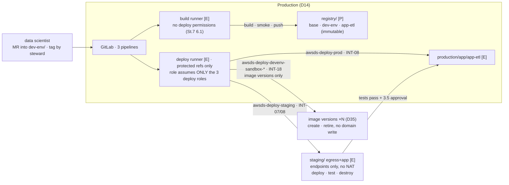

# Stage 8 — CI/CD pipelines

| | |
|---|---|
| **Status** | **in progress since 2026-10-12**: pass 0's readings are taken, step 6.2's workflow is written and proven, and pass 1's `[P]` half is applied with the environment down, and the deploy runner is up since 2026-10-13 with verifications ii and iii answered; 4.6's rule names the runner by its role's unique id since `deploy-role-v0.2.0`, and verification xvi saw it fire in both accounts. **Pass 2 is done (2026-10-13/14, PR #125)**: the shared gates in `ci-gates/` for the GitLab project `awsds/ci-gates` (decision 10), the application template in `examples/app-etl/`, the test runner (decision 11), `sandbox/app/app-etl/` with its two `[P]` halves (decision 12), refusals 7 and 8, and 4.4's `ONLY=`/`PROFILE=`. Its `[P]` slices were applied 2026-10-13; on 2026-10-14 `awsds/ci-gates` reached `gates-v0.2.0`, the test runner registered as runner #4, `awsds/app-etl` took the template and released `v0.1.0`, and `sandbox/app/app-etl/` ran it once (verifications xiii and xviii, and iv's first half). The user amended decision 1 the same day: the ECR scan informs and blocks no deployment. **Pass 3 written 2026-10-14** (PR #131, decisions 13 to 17): the house environment on Python 3.12; everything under `images/` moved to the private GitLab, copied here under `gitlab/`; the release chain, `scripts/devenv-register.py`, the runner's read of the registry's state and `gates-v0.3.0`. **Run 2026-10-15**: the mirror `awsds/infrastructure` (6.1); `default-v0.7.0`'s release gate failed on a shell quote, and the register path's two first-run defects were fixed before the next gate; `default-v0.7.1-c268de48` registered by the pipeline as Sandbox's version 7, attached by hand, and a new space started on it (verifications vii, viii and xvii); the release loop measured (1.7). **The chain is `Sandbox → Staging → Production`** and nothing waits on a vend ([6b](stage-06b-development-becomes-staging.md)). The *engineering* apply of step 2.4 is a `sandbox/app/app-etl/` slice applied **by hand**, and CI never applies an application into Sandbox — D21's surviving objection, held by `layers.py` refusals 7 and 8 (refusal 5 is the `[D]` one, since Stage 4, and 6 the hub's, since Stage 7). **The runners sit on the build plane, which is `open`** ([6c](stage-06c-networking-hub.md), [D38](../decisions/D38-single-egress-hub.md)): every build step is an explicit-proxy client and any public name answers, so an unlisted host is not a 403 here. **The dev-env chain ends at the image version, and since decisions 7 and 18 (2026-10-15) the version is the whole release** ([`dev-env.md`](../runbooks/dev-env.md) §B): the pipeline creates it through the API and retires every version past the newest 10 that nothing names, and the domain, attached once with no version number, offers every version with no write of its own. Both decisions rest on readings of a probe image taken that day, and the change is `deploy-role-v0.4.0`, the slice's `removed` block, refusal 8 widened and `awsds/dev-env`'s `release/versions.py`. Applied the same day (PR #134): version 7 out of the slice's state, the deploy role narrowed and read back by the policy simulator, and the house image attached with no version number; `awsds/dev-env` !4 merged and copied back in PR #135. The first release under them ran the same day: `default-v0.7.2` stopped at `pip-audit` on the steward's accepted fsspec finding under a new OSV id, decision 15 was amended to match an accepted finding by any of its ids (`gates-v0.4.0`), and `default-v0.7.3` became Sandbox's version 8 through `register`, with no domain write, `retire` deleting nothing (verification vii); 29 min from the tag to the version. Three findings shape the rest: the scan gate meets the SageMaker Distribution's inherited findings (CRITICAL 30 in 6a's first scan, CRITICAL 0 and HIGH 130 in `default-v0.6.0`), so its severity rule is a delta (decision 1); from the runner, `make up`'s hub check is waived, so a job checks the proxy itself (3.1); and no member account has an SNS topic for the misuse alarm to reach (decision 5). The workflow lint's rules come from 6d step 4 and [6i](stage-06i-sandbox-orchestration.md) (5.6), and both gates take the CE shape [Stage 7](stage-07-gitlab-runners-ecr.md) step 3.3 records. **[D41](../decisions/D41-sagemaker-application.md) (2026-10-15) makes `app-etl` a SageMaker application**: the change, step 2.5, waits on the lab measurement D41 records, and decision 19 is not taken; decision 20 (2026-10-15) stores each release's bundle in `awsds-prod-releases`, a bucket of `production/registry/` that the tag's GitLab release names |
| **Prerequisites** | Stage 7 — the build runner, the registries with immutable tags, the protected-tag shapes (3.5), **the recorded edition answer (3.3)** that fixes both gates' CE form, and the mirror answer (7.1). **6d step 2** — the registration mechanism (`sandbox/dev-env/` and the hand attach) and the image the first pipeline release replaces: `default-v0.6.0`, version 6, registered at Stage 7 step 2.6. **6b** — `Staging` exists, its tree is `terraform-live/staging/` on its own state bucket. **6c** — every runner job is an explicit-proxy client and there is no NAT to bring up. Nothing here waits on a quota |
| **Consumes** | [D5](../decisions/D05-sagemaker-egress.md), [D8](../decisions/D08-gitlab-hosting.md), [D14](../decisions/D14-supply-chain-account.md), [D17](../decisions/D17-interactive-vs-runtime.md), [D20](../decisions/D20-staging-account.md), [D21](../decisions/D21-development-account.md), [D26](../decisions/D26-unified-studio.md), [D28](../decisions/D28-workflow-contract.md), [D35](../decisions/D35-sandbox-cardinality.md), [D38](../decisions/D38-single-egress-hub.md), [D41](../decisions/D41-sagemaker-application.md) (the application, the CLI's deploy to the `test` project and its bundle, 2.5) |
| **Proves** | [INT-07](../integrations.md) (Staging pulling the application image), [INT-08](../integrations.md) (the two promotion deploy roles, distinguishable in CloudTrail), [INT-18](../integrations.md) (the dev-env deploy role reaching from Production into Sandbox, as far as the image version). **Exercises INT-17's automated half**: INT-17 was answered at 6d (the slice plus a hand attach to the domain's `DefaultUserSettings`), and this stage adds the pipeline making the image version, not the domain writes |

*Read with [`docs/plan/conventions.md`](../conventions.md) (naming, layout, `[P]`/`[D]`/`[E]`, IAM rules).*

**Forward constraint from D35:** step 1's registration writes into **N accounts — every unit's Sandbox,
N = 1 today** — and, inside each, into every project's SageMaker AI domain, since each project has its own
(6d). The target list, the per-target roles and the trust-policy ARNs are enumerated **from the authored map
in `scripts/tfhygiene/backend.py`**, so a vend adds one map entry (Lesson 14). **The promotion chain is
untouched by N** (D21/D35): whatever the Sandbox count, there is one tag, one Staging leg, one gate. `CI-6`'s
image-parity check prints `note` ("N = 1, parity trivially true") until [Stage 14](stage-14-sandbox-vending.md)
vends a second unit.

---

**Objective:** the three pipeline types the objectives name — dev-env, application build, deployment —
plus the promotion gate, on the Stage 7 supply chain. **The promotion boundary is D17's four artifacts**:
the container image (ECR), the model version (Model Registry, from Stage 9), the workflow/application code
(a git tag), and the Terraform that instantiates them.

## What this stage builds, and in which accounts

| Where | What | Layer |
|---|---|---|
| `production/foundation/` (amended) | the deploy runner's role, instance profile and token container (4.3's anchors), the role's read of `awsds-prod-releases` (decision 20), `awsds-deploy-prod` (INT-08), the misuse alarm and `awsds-prod-alerts` (decision 5), the test runner's token container (decision 11) | `[P]` |
| `staging/foundation/` (amended, **after 6b**) | `awsds-deploy-staging` (INT-08), the same alarm and `awsds-staging-alerts` | `[P]` |
| `sandbox/foundation/` (amended, one per unit) | the dev-env deploy role (INT-18), one per target | `[P]` |
| `terraform-modules/deploy-role/` (new, `deploy-role-v0.1.0`) | one deploy role: its trust, its ceiling, its state access and its misuse rule, one document for every account the deploy runner reaches | — |
| `production/registry/` (amended) | the **app-repository** pull grant, an authored entry of its own beside `REGISTRY_CONSUMERS`: Sandbox at 2.4, Staging at 3.0 (INT-07); `awsds-prod-ecr-deploy`, the deploy jobs' image (3.1, 4.3); and `awsds-prod-releases`, the bucket each application release's bundle is stored in (2.5, decision 20) | `[P]` |
| `production/runners/` (amended) | the **deploy runner** — protected, project-locked, its role only assumes the three deploy roles; the **test runner** — unprotected, project-locked, no AWS identity reachable from its jobs (decision 11); the build runner's role, which writes `awsds-prod-releases` (decision 20) | `[E]` |
| `sandbox/app/app-etl/` (new), `staging/`, `production/` idem | the application slices — **Sandbox applied by hand** (2.4), the other two by the pipeline (step 3). **CI never applies an application into Sandbox**, which is the answer to D21's surviving objection | `[E]` |
| GitLab, by hand | the three `.gitlab-ci.yml`s, repository roles, protected release tags, the deploy and test runners' registrations, CI variables, and the project `awsds/ci-gates` the gates live in (decision 10), written here under `ci-gates/` | — |
| GitHub | the infrastructure repository's offline-gates workflow (step 6) | — |
| `scripts/` | `layers.py`: the `app/app-etl` rank, the `[E]` rows, **refusals 7 and 8**; `slices.py`: `-input=false` on every apply and destroy (Lesson 47); `backend.py`: the dev-env target map, the app-consumer entry; the `make` `PROFILE` override | — |



## Who executes each action

| Marker | Meaning |
|---|---|
| **[Claude]** | repository edits (Terraform, `.gitlab-ci.yml`, workflow files, scripts) and read-only AWS calls — done without asking |
| **[Claude⚡]** | `terraform apply` or any AWS write — only after the user authorizes that specific action in chat, with the SSO user/account/permission set stated first |
| **[user]** | everything inside GitLab's UI (roles, protected tags, runner registration, CI variables, running manual jobs), git pushes and tags, GitHub settings, the dev-env domain writes, and every log entry |
| **[pipeline]** | a job that runs by itself once its trigger fires — written by Claude, triggered by the user's push or tag, credentialed by step 4 |

Hand applies run as the **infrastructure user**: `awsds-infra-prod` (Production), `awsds-infra-sandbox-1`
(the one Interactive foundation) and `awsds-infra-staging` (Staging, which 6b created). The pipelines run
under the **deploy runner's instance profile** and the step 4 roles — never an SSO profile, never a stored
key.

## Step numbers are identifiers, not an order

These numbers are **stable addresses cited from other files** — step 1 from 6d step 2, Stage 7 steps
3.5/5.1, `docs/plan/conventions.md` §6 (the `dev-env/` slices) and INT-17/INT-18; **steps 1.5 and 3.5** (the
two approvals) from Stage 7 step 3 and `docs/plan/institutional-delta.md`; step 2 from conventions §6 and D21;
step 4 from `docs/GENERAL_PLAN.md` principle 2 and Stage 7 step 6; step 6 from Stage 7 step 7. They do not
change. The sequence to work in is **six passes**:

| Pass | # | What | Needs |
|---|---|---|---|
| **0** | — | consume the recorded answers: the edition (St.7 3.3 → both gates' shape), the registration mechanism (6d step 2, `dev-env.md` §B), the mirror policy (St.7 7.1); read the current image's scan findings | readings, no build |
| **1** | 4 | the deploy credential layer: roles, the deploy runner, the misuse alarm | Stage 7 pass 3 |
| **2** | 2, 5 | the application build pipeline, with the gates written once | pass 1 (runner) |
| **3** | 1 | the dev-env chain, ending in the INT-18 image version and the steward's domain writes | passes 1-2 |
| **4** | 3 | the promotion chain: tag → Staging → Production | passes 1-2 (**6b**, not a vend) |
| **5** | 6 | the infrastructure repository's own pipeline; validation | pass 0 (7.1's answer) |

**Pass 0, read 2026-10-12 with the environment down.** The edition: CE v19.4.2 shows neither protected
environments nor deployment approvals (Stage 7 3.3, its verification iv), so both gates take the
protected-tag shape (verification i). The registration mechanism ran end to end at Stage 7 step 2.6:
`default-v0.6.0` became Sandbox's version 6 in `dev-env.md` §B's order, with no space stranded. The mirror:
none standing (Stage 7 decision 4), and this repository stays on GitHub. The scans, read with
`DescribeImageScanFindings`: `base` and `dev-env` at `default-v0.5.0` and `default-v0.6.0` all read
**CRITICAL 0, HIGH 130, MEDIUM 88, LOW 4, UNDEFINED 45**, against CRITICAL 30, HIGH 430 and MEDIUM 514 for
6a's `default-v0.1.0`, and each scan completed between 1 min 42 s and 7 min 22 s after its push.
`DescribeImages` carries no scan field for any image in either repository, as its reference warns for
AWS-native basic scanning, so a reader of that call sees images that were never scanned. The distribution's own digest has no scan: the cache repositories are
created with scan on push off. `./aws/cicd.py` reads 0 FAILED and 9 notes, each an absence a step of this
stage fills.

**On ordering:** this stage builds the promotion *machinery* — the chain, the gates, the deploy roles. The
Staging and Production *data platforms* are Stage 9's, so until then the chain is exercised with an
application that touches no data.

---

## To execute

### 1. The dev-env pipeline — the runtime release chain (D17, INT-17, INT-18)

**Action:** build the release process for the images every notebook and Studio app runs on — `base` and
`dev-env` — from a data-scientist-writable repository to a steward-gated image version in every Interactive
account. **Why:** D17's "promote only the code" is only true if the runtime the code lands on is identical
to the one it was written against, and the only way to make that true *by construction* is a **common
ancestor image**: application images are `FROM base:<pinned tag>`, never `FROM dev-env` and never a base of
their own — two independently built images with the same package list diverge quietly at the first rebuild.
The repository stays **writable by the data scientist** (which Julia version, which CRAN snapshot is their
expertise): **the control is who may release**, the `dev-env-stewards` gate. **Explanation:** the chain runs
on the protected release tag (Stage 7 step 3.5's shape) and ends at a *new image version*, the Model Registry
shape, so "which runtime is approved" stays a queryable fact with an approval attached. Which runtime a given
space runs is a different fact, read per space: a space keeps the version it was created with (Lesson 63). The
compute plane's allow-list serves PyPI, Julia, crates and CRAN since 6d, and D38 withdrew D5's comparison, so
a space installs most packages in seconds; what still needs this chain is what the image itself carries — the
conda-built R stack, the toolchains under `/opt`, the proxy literal, the assistant's pins.

- **1.0 — Done 2026-10-12, at Stage 7 step 3.6**: on `awsds/dev-env`, `data-scientists` Developer, `dev-env-stewards` Maintainer, the tag pattern `*-v*` protected with creation Maintainers-only; read back in the project's settings (Stage 7's log). **Attempted 2026-10-14**: the data-scientist persona, a Developer, could not create the tag `default-v0.0.0`, and the project holds no tag. The recipe moved there the same day (decision 16): the seed at `f44f19e3`, and the release's merge request !1 merged at `69ad278e`.
- **1.0 — [user] Set the repository's roles and protection** (with Stage 7 steps 3.4-3.5, restated with
  the fields named): on `dev-env/` — `data-scientists` **Developer**, `dev-env-stewards` **Maintainer**;
  the release tag pattern **protected, creation Maintainers-only** — in CE that role mapping *is*
  the gate's authorization, per 3.3's recorded answer.
  **The pattern is `*-v*`, not `v*`**, and the difference is security-relevant: under the image tag
  convention `<flavour>-v<semver>` ([`docs/SMUS.md`](../../SMUS.md) §*Custom images*) a release of this
  repository is tagged `default-v<semver>`, which **`v*` does not match**. A `v*` protection would apply to
  nothing this repository ever tags, and since 3.3's answer makes *who can push the protected tag* the whole
  of the CE authorization, the gate would be open to every **Developer** — i.e. to `data-scientists` — while
  still reading as protected in the settings page. The failure is invisible from inside GitLab: an
  unprotected tag is created successfully. **Verify by attempting a tag creation as a Developer after
  setting it**, rather than by reading the pattern back. **The recipe moves first** (decisions 6 and 16): `images/`
  leaves this GitHub repository for the GitLab projects `awsds/dev-env` and `awsds/deploy-image`, whose
  copies this repository keeps under `gitlab/`, since a protected tag on a repository that does not hold
  the recipe gates nothing.
- **1.1 — Stage 7 left a working shape (2026-10-12)**: `images/build.gitlab-ci.yml`, carried by GitLab's
  `awsds/dev-env` as its `.gitlab-ci.yml`, cloned this repository at a given commit, built `base` with the
  distribution through the pull-through cache, built `dev-env` `FROM` it, pushed both as `default-v0.6.0` with
  the runner's role through the ECR credential helper the runner mounts, and ran a smoke stage (Stage 7 step
  2.6). It runs on a web trigger with `IMAGE_TAG` and `RECIPE_SHA`, so the steward's gate is who can run a
  pipeline on `main` of a project the protected runner serves (Lesson 67), not yet a protected tag.
- **1.1 to 1.6 — Written 2026-10-14, not run** (decisions 13 to 17): the copy of `awsds/dev-env` under
  `gitlab/awsds/dev-env/` holds the chain as its `.gitlab-ci.yml`. Every push runs the gates of `ci-gates`
  and `recipe-checks` on the test runner. A tag `<flavour>-v<semver>` runs `build-images` on the build runner:
  `base` and `dev-env` pushed as `<tag>-<short sha>`, `dev-env` `FROM` the base by digest (`ARG BASE_REF`),
  then the smoke build `FROM` the pushed `dev-env`, which fails on a client that does not trust the root, a
  runtime at another version than the recipe's ARGs, or a key import, and exports the manifests of both
  Pythons, R, Julia, the runtimes, the proxy list's digest and the imports. Then `scan-base` and
  `scan-dev-env`, informative; `release-gate`, manual and blocking; and `register` on the deploy runner,
  which clones the mirror `awsds/infrastructure` with the job token and runs `scripts/devenv-register.py
  --pipeline`: each target's slice as its own deploy role, the registry's state through the runner's own
  profile (decision 14), with no guard (decision 17). `sandbox/dev-env/` accepts the `-<short sha>` suffix.
  The include stood at `gates-v0.2.0` until the release's merge request !1 moved it to `gates-v0.3.0`, which
  carries decision 15's accepted list; `scripts/devenv-register.py --dry-run` prints both paths' commands, and
  every pipeline file parses. **Decision 14 applied 2026-10-14 by Claude, authorized by the user**:
  `production/foundation/` 1 added, 1 changed (the runner role's `registry-state` and its description),
  `sandbox/dev-env/` 1 changed (the image's description), each re-plan `No changes`. The policy simulator,
  given the Region and the organization as context, reads the runner role's `s3:GetObject` and
  `s3:ListBucket` allowed on the registry's key alone, `kms:Decrypt` on the state key, and `s3:PutObject`
  denied; the runner's profile is unexercised until a `make gitlab-up` from this branch.
- **1.1 to 1.6 — Run 2026-10-15** ([the log](../../log/log-stage-08-cicd-pipelines.md)). The tag
  `default-v0.7.0` built both images and their manifests, and its `release-gate` failed at bash's parse,
  an apostrophe inside `${BASE_DIGEST:-...}`, so `register` was skipped and nothing applied;
  `scripts/check-gitlab-ci.py` reads every script item with `bash -n` since. Before the next gate, two
  readings found the register path's own defects: the provider calls `sagemaker:ListAliases` on every
  refresh of an image version, which `awsds-deploy-devenv-sandbox` lacked, and Terraform refuses the
  runner's own profile as written, a `credential_source` with no `role_arn`, where the AWS CLI of the
  runner's boot ignores the key. Both were applied with the user's authorization: the role's policy
  (`sandbox/foundation/`) and the runner's profile with a region alone (`production/runners/`, the
  runner replaced). The tag `default-v0.7.1` at `c268de48` then ran the chain: `build-images` 956 s, the
  scans 593 `linux-libc-dev` findings past the baseline each, the gate run by the steward, and
  `register` in 58 s on the deploy runner, version 6 destroyed and version 7 created with the pushed
  digest as its `ContainerImage`. The steward's detach, re-attach and sweep ran in §B's order, and a
  new space started on version 7.
- **1.7 — Measured 2026-10-15** on `default-v0.7.1`, a one-line change: merge request to registered
  version 37 min 38 s, about 24 min of it the pipeline's machine time and 11 min the steward's gate;
  the re-attach 11 min later. Written into [`architecture.md`](../architecture.md) §4.3.
- **1.6 under decision 18 — Run 2026-10-15** ([the log](../../log/log-stage-08-cicd-pipelines.md)). The
  tag `default-v0.7.2` stopped at `pip-audit`: OSV now reports fsspec's accepted `CVE-2026-104851` as
  `PYSEC-2026-4217`, so the accepted list missed it and nothing was built. Decision 15's amendment,
  `gates-v0.4.0`, matches an entry against the finding's id and aliases; `awsds/dev-env` !5 moved the
  include and the tag `default-v0.7.3` at `15fac237` ran the chain. `register` created version 8 from
  the pushed digest with the alias `0.7.3` in 21 s as `awsds-deploy-devenv-sandbox`, `retire` read every
  space and domain and kept versions 8 and 7, and both domains read unchanged. From the tag to the
  registered version, 29 min 3 s with no domain write; the steward's gate waited 8 of them.
- **1.1 — [Claude] Write the build jobs**: both images with **BuildKit rootless** on the build runner
  (Stage 7 step 6.2), tagged **`<flavour>-v<semver>-<short-sha>`** — the release tag this pipeline runs
  on, plus the commit — pushed nowhere yet. The `-<short-sha>` suffix keeps two builds of the same release
  tag from colliding in a repository where **a tag is spent on first landing**, and makes a pipeline-built
  image distinguishable from the six hand builds (`default-v0.1.0` to `default-v0.5.0`) and Stage 7's
  web-triggered `default-v0.6.0`, which carry no suffix (ledger: [`gitlab/awsds/dev-env/README.md`](../../../gitlab/awsds/dev-env/README.md)
  §*The releases*). **The
  flavour stays in front**, so the registry's lifecycle rule (untagged after 14 days, the 30 newest tagged
  kept across flavours) can be split per flavour with a plain `tagPrefixList` when a second one exists. The
  recipe's requirements, as the hand builds left them: the SMUS BYOI specification and the activity-monitor
  extension; the CA root from the one source (INT-19, Stage 7 step 2.6), built with `CA_ROOTS_EXPECTED=1`;
  `dev-env`'s `FROM` naming `base` by digest, since the recipe defaults it to `awsds/base:local` and the
  provenance records that name; the uv project built `--frozen` with `UV_NO_CACHE`; the model pins in
  `managed-settings.json`, which must match `sandbox/bedrock/`'s grant and 6e's SCP; and §7, the proxy `ENV`
  and the `NO_PROXY` literal, the recipe's last section. **The literal must equal `sandbox/egress`'s
  `no_proxy_all_groups`** (70 entries, `aafa08da98a61f5c` today): the runner cannot read Sandbox's state, so
  the literal stays committed in the recipe, `./aws/devenv.py` `DE-3` checks it from the laptop before the
  tag, and an endpoint change is itself a release trigger (`dev-env.md` §E).
- **1.2 — [Claude] Write the smoke-test job**: the `dev-env` image starts, every language runtime resolves
  the **pinned** versions the manifest asked for (the image writes them to `/opt/awsds-runtimes.txt`), the
  key libraries import. Read the image's environment from `.Config.Env` or `/opt/awsds-proxy.txt`, never
  from `docker run … printenv`: the docker client's `proxies` block injects the host's `noProxy` into every
  container, outranking the image's own `ENV`. Cheap, and it catches the class of failure that otherwise
  reaches every workstation at once — the analogue of step 3.3's integration tests.
- **1.3 — [Claude] Write the push job**: both images to the Production ECR under the immutable tag.
  Scan-on-push fires on arrival; **nothing consumes the digest yet** — selectability is created only in
  1.6, which is what the approval gates.
- **1.4 — [Claude] Write the scan gate**: `aws ecr wait image-scan-complete` (a bounded waiter, 5 s × 60,
  with a `FAILED` acceptor), then `describe-image-scan-findings`, **reporting on decision 1's rule**,
  informative since its amendment (2026-10-14). It
  **reads the push's own scan and never triggers another** — basic scanning allows one scan per image per
  24 h — and it covers **OS packages only**; the language-package half is step 5's `pip-audit`. **The two
  compose to OS + Python and no further**: 6a's first `base` and `dev-env` scanned to **identical**
  counts (CRITICAL 30, HIGH 430), every finding inherited from the SageMaker Distribution, so **Julia, R and
  the baked Rust toolchain passed this gate contributing nothing, because nothing looked at them**. That
  residual is **accepted with a named control** — the Dev Env Steward's review of a version-pinned manifest —
  and both the acceptance and its price live in [`institutional-delta.md`](../institutional-delta.md)'s row
  *"Vulnerability scanning of what the notebook image actually contains"*. **Do not close it by enabling
  enhanced scanning**: Inspector's ECR language list has no Julia and no R (Stage 7 decision 2). Pass 0 measured
  two constraints on the gate: the `dev-env` scan of `default-v0.6.0` completed 7 min 22 s after its push,
  past the waiter's 300 s (it exits 255 after 60 checks), so the gate polls under a bound of its own; and the
  counts come from `DescribeImageScanFindings`, since `DescribeImages` carries no scan field here.
- **1.5 — [user] Run the release gate**: a **blocking manual job** — `when: manual` under `rules:`, so
  `allow_failure` defaults false and the pipeline stops — with the package manifests, the scan report and
  the smoke output in its artifacts. A byte diff is not evidence here: a rebuild of an unchanged recipe moved
  the image by −11.8 MB, so the review reads what the manifests changed. Premium form: a deployment approval
  assigned to `dev-env-stewards`. CE reality, per 3.3's answer: the manual job is a deliberate pause and the
  *authorization* is 1.0's protected tag — who could start this pipeline at all.
- **1.6 — [pipeline + user] Register the approved version and retire old ones (INT-17, INT-18)**: since
  decisions 7 and 18 (2026-10-15) the version is a release artifact. `awsds/dev-env`'s `register` job runs
  the project's `release/versions.py register` as each target's `awsds-deploy-devenv-<unit>` role (4.2), the
  targets found by the deploy runner's profile names (D35): `create-image-version` from the pushed digest,
  the release's semver as an alias, read back against that digest. Its `retire` job deletes every version
  past the newest 10 that no space and no domain names, and lists the ones a space still names. **No domain
  write follows**: each domain attaches the image once with no version number, so the portal offers every
  version, newest first, and a new space pins the one it is created on. An existing space keeps its version
  until it is moved (`dev-env.md` §B), and a deleted version would strand it (`EXC-09`), which is why
  `retire` keeps it. The steward's hand writes are one attach per domain and the moves. `./aws/devenv.py`
  `DE-3` reads the recipe before, `DE-5` the registered bytes after. Until 2026-10-15 the job applied
  `sandbox/dev-env/` with the tag as `-var`, around the steward's apps deleted, detach, re-attach and
  sweep; version 7 was the last release registered that way.
- **1.7 — [user] Measure the release loop once**: time one change the image must carry — MR → tag → chain
  → gate → version, with no domain write since decision 18 — and write the number into
  `docs/plan/architecture.md` §4.3 as the cost of a runtime change; packages the compute plane serves do
  not pay it.

### 2. Application build pipeline — the `app-etl` template (conventions §6, D21)

**Action:** the second pipeline type — test, lint, docs, image — on the application repository.
**Why:** it is the objectives' build pipeline, and it exercises the runner, the registry and the step 5
gates before any deploy credential exists — failures here are cheap and unambiguous. **Explanation:** the
repository follows conventions §6's `app-etl` template and carries no Terraform: each environment's slice
is `terraform-live/<env>/app/app-etl/` (decision 12). **The Sandbox apply is engineering, not
promotion** — the chain starts at the tag (D21) and its first target is Staging.

- **2.1 — [user] Create `app-etl` from the template** (Stage 7 step 3.6 named it; this step fixes the
  fields): `data-scientists` **Developer**, `deployment-managers` **Maintainer**, release tag pattern
  (`v*`) **protected, creation Maintainers-only** — the CE anchor of step 3.5's gate.
  **`v*` is correct here**, and the difference from 1.0 is deliberate: the flavour segment
  exists because `base`/`dev-env` branch by *runtime* — GPU, Spark, plain — and an application does not.
  Its repository already names it, its ECR repository is `awsds-prod-ecr-app-etl`, and a mandatory
  `default-` on every application tag would be a word that never varies. **Application images are
  `v<semver>-<short-sha>`.** If an application ever does gain a runtime variant, it gets the flavour
  segment and this pattern moves with it.
- **2.2 — Written 2026-10-13, in GitLab since 2026-10-14**: [`examples/app-etl/`](../../../examples/app-etl/README.md), the
  content `awsds/app-etl` receives in place of Stage 7's first pipeline: a uv project on CPython 3.12,
  base's interpreter, whose command turns every CSV in a directory into a Parquet table and a JSON summary,
  pyarrow its one runtime dependency, resolved with `exclude-newer` two weeks back. The `Dockerfile` builds
  `FROM awsds-prod-ecr-base@sha256:94359041…1975` (`default-v0.6.0`), the project in a virtual environment
  of its own on `/opt/conda/bin/python3.12`, the sample under `/opt/app-etl/samples/`; its `smoke` target
  runs the job's command as the image's user, `RUN --network=none`, on an output directory owned by root
  with mode 755, opening with the job's `sudo -n chown` (decision 8): the SageMaker Distribution writes
  `ALL ALL=(ALL) NOPASSWD: ALL` into `/etc/sudoers` (its v4.5 template, read 2026-10-13), so base and every
  image `FROM` it keep passwordless sudo. The `.gitlab-ci.yml` includes `awsds/ci-gates` at `gates-v0.2.0`'s
  commit, `a335f37f…`, pushed 2026-10-14 after `gates-v0.1.0` (`9ae8f1b4…`) built the first release; tests, ruff and the gates run on the test runner on every push, Pages on `main`, and on a
  tag `v<semver>` BuildKit `v0.34.0-rootless` by digest builds `smoke`, then pushes `app` as
  `v<semver>-<short sha>` and hands the digest to the scan gate as a dotenv report; a manual job measures
  verification (xiii). Offline: ruff clean, 7 tests pass.
- **2.2 — [Claude] Write `.gitlab-ci.yml`**: on every branch — `uv sync`, `ruff`, `pytest`, plus step 5's
  gates, on the test runner, which holds no AWS identity (decision 11); on the default branch — docs built
  and published to **Pages** (Stage 7 step 4); on the protected tag — the image built with BuildKit
  **`FROM base@sha256:<digest>`** (never `FROM dev-env` — the runtime has no business carrying Jupyter; a
  build that floats the base defeats step 1) and pushed to `awsds-prod-ecr-app-etl` under the immutable tag,
  then 1.4's scan gate. **The image is also the job image** (Stage 10 decision 7, taken as its
  alternative by D41 item 7: the image carries the lock's dependencies and is named by digest, and the
  job's code input is the project's `src/`), and 6i measured what that asks of it:
  - **the dependencies installed into an interpreter the image names**, from the lock with the project
    left out (`uv sync --locked --no-install-project`): `base` carries no `/opt/awsds/venv` (only `dev-env`
    builds it) and sets `UV_PYTHON_DOWNLOADS=never`, so 6i's interpreter path does not describe an image
    built `FROM base`; extension modules are built as wheels for the target platform;
  - **who owns the output mount**: `base` runs as uid 1000, and the platform creates the processing
    mounts as `0 0`, `drwxr-xr-x`. 6i's jobs open with `sudo -n chown "$(id -u)" /opt/ml/processing/outbox`,
    which needs the passwordless `sudo` the image keeps; an image that drops it breaks every job (decision 8);
  - **a smoke test that writes to the processing output mount with networking off**, the condition every job
    runs under (Stage 9 3.5).

  **The data-quality job class hangs here when it arrives** (Stage 5a step 3.8's hook, 2026-08-17): quality
  rules run beside the ETL in the pipeline, because the governed account cannot run them (`DenyUserCompute`)
  — a named placeholder, not a job this stage builds.
- **2.3 — [user] Run it**: a branch push runs tests only; the tag lands the image and the docs serve at
  `https://app-etl.awsds-pages.internal` — two pipeline deliverables in one push. **Run 2026-10-14**: GitLab
  refused the first branch pipeline (#12) at creation, a job named `image` being the global keyword, and
  the job is `build-image` since; #13 on the branch and #14 on `main` ran green on the test runner, Pages
  serving pdoc's page at the project's unique domain `https://app-etl-ffa1fa.awsds-pages.internal`; #15 on
  `v0.1.0` built and pushed `v0.1.0-d7e093a9` (`sha256:33f76dec…`, 3,796,518,899 bytes) in 217 s, and its
  scan gate failed on 593 `linux-libc-dev` findings past the baseline, which decision 1's amendment turned
  into a report.
- **2.4 — Written 2026-10-13, its two `[P]` halves applied the same day, the slice and its first run 2026-10-14**, under decision 12. `sandbox/app/app-etl/` (`[E]`, rank 58)
  holds the processing jobs' role `awsds-sandbox-app-etl-job` and its security group, no ingress and HTTPS
  to the S3 gateway endpoint's prefix list and to the VPC's range; its output `processing_job_request` is
  the whole `CreateProcessingJob` request but its name, with Stage 9 3.5's settings (`VpcConfig`, network
  isolation, inter-container encryption, the volume key) and 6i's command, null until `release.tf` names a
  release. Two `[P]` halves elsewhere: `production/registry/` grants Sandbox the pull on
  `awsds-prod-ecr-app-etl` (`APP_REGISTRY_CONSUMERS`, apart from `REGISTRY_CONSUMERS`, Lesson 51; plan `1 to
  add`), and `sandbox/data/` gains `awsds-sandbox-outputs`, where an application run by hand writes, 30-day
  expiry, under the data key, and the key statement `AllowApplicationJobRolesViaS3`: the root, the S3
  `kms:ViaService` pin and an `aws:PrincipalArn` match on `awsds-<env>-app-*-job`, since a key policy
  naming the `[E]` role would keep a unique id the next session's role does not carry (plan `6 to add, 1 to
  change`). It is D31's fourth reader, of the third's shape. The role carries no ceiling: its applier is
  the infrastructure user, and `awsds-<env>-app-boundary` bounds what a deploy role may create, so it
  lands in Staging and Production at 3.0. The job reads the image's own sample: the infrastructure user
  holds no cryptographic action on the data key (D31), so no person writes an input under it.
  Refusals 7 and 8 are in `layers.py`, read by `slices.py` (8 when `--profile` names a deploy role), and
  `slice_dirs_on_disk` makes `make check`, the lock check and the network-doc check see a slice under
  `app/`. With `DRY=1`: `make up ENV=sandbox` refuses `app/app-etl` by 7, `make down ENV=sandbox` destroys it
  between `probes` and `warehouse-compute`, and a deploy-role `PROFILE` meets 8 on every Sandbox slice.
  The two halves were applied 2026-10-13 by Claude, authorized by the user: `production/registry/` `1
  added`, `sandbox/data/` `6 added, 1 changed`, each re-plan `No changes`. `./aws/cicd.py` `CI-5` passes
  the repository policy, which admits Sandbox, and Sandbox's `DescribeImages` on the repository;
  `./aws/s3-persistence.py` passes `awsds-sandbox-outputs` on `SP-1` to `SP-6` and `SP-8`.
  The run, once `sandbox/app/app-etl/` is applied and `release.tf` names the first release: `make up ENV=sandbox`
  for the endpoints its logs take, then as the infrastructure user in Sandbox (`awsds-infra-sandbox-1`):

  ```bash
  terraform -chdir=terraform-live/sandbox/app/app-etl output -raw processing_job_request > "$HOME/tmp/app-etl-job.json"
  ```

  ```bash
  aws sagemaker create-processing-job --profile awsds-infra-sandbox-1 --region us-west-2 --processing-job-name "app-etl-$(date -u +%Y%m%dT%H%M%S)" --cli-input-json "file://$HOME/tmp/app-etl-job.json"
  ```

  The reading is the job's status, its log in `/aws/sagemaker/ProcessingJobs` (versions, counts, file
  names) and the keys under `s3://awsds-sandbox-outputs/app-etl/<tag>/`; listing needs no decrypt, and the
  content stays the job role's to read (verification xviii). **Run 2026-10-14** with `release.tf` naming
  `v0.1.0`: the slice's first apply stopped after the role, EC2 refusing a security group description that
  carried an apostrophe, which no plan checks; reworded, it applied (`4 added`, re-plan `No changes`). The
  job `app-etl-20261014T175359` on `ml.t3.medium` processed from 17:54:53Z to 17:59:32Z and read
  `Completed`; its log printed the versions and `trades.csv: 10 rows -> trades.parquet`, and
  `trades.parquet` (1,780 bytes) and `trades.summary.json` (407 bytes) arrived under `app-etl/v0.1.0/`,
  SSE-KMS under `alias/awsds-sandbox-data`, expiring 2026-11-14.
- **2.4 — [Claude] Write `sandbox/app/app-etl/` and the machinery rows**, then **[Claude⚡] apply as
  `awsds-infra-sandbox-1`**: the application running against Sandbox's own data, applied **by hand** while
  it is being engineered, outside the SMUS project and its role, under the infrastructure user. **The
  engineering apply lands in Sandbox, not in Staging**: Staging is written only by the pipeline (D20), so an
  engineer's iterate-and-re-apply loop has nowhere else to live, and Sandbox keeps CI out of the one account a
  human runs code in (D21's surviving objection). Machinery, same sitting: `RANKS["app/app-etl"]` (after
  `egress`, so `down` destroys the app before the endpoints it reaches AWS through), the three `[E]` rows
  (`sandbox` now, `staging`/`production` at 3.0), and two refusals in `layers.py`, numbered after the
  existing six (refusal 6 is the hub's, Stage 7 step 1.6):
  - **refusal 7: `make up` never applies an `app/` or `orchestration/` slice** — the pipeline (or this hand
    apply) is the applier: a `make up` for an unrelated session would deploy the recorded release outside
    both (decision 12); `make down` destroys them normally (Stage 10 step 1.4 relies on it);
  - **refusal 8: no pipeline profile applies a `sandbox/` slice**, with one exemption written into the rule:
    `sandbox/dev-env/` under the dev-env deploy role, the one flow where the supply chain writes into Sandbox
    (1.6, INT-18).
- **2.5 — [Claude] Make `app-etl` a SageMaker application** (D41, 2026-10-15; not written yet, after the
  lab measurement D41 records): the repository gains `manifest.yaml` and `workflows/app-etl.yaml` in the
  CI/CD CLI's notation, the four tasks of D41's scope (a Glue job with a Python Spark transform, a
  processing task on the application image with the code as the job's input, a light Python task, an S3
  operator task writing the result), and `.gitlab-ci.yml` gains three jobs on the tag after `build-image`,
  which end in the tag's GitLab release, as the user proposed on 2026-10-15 at 22:06 UTC. The first builds
  what the application needs built, the Python task's code package from `code/` (5.6, class 2b) or a
  compiled extension, into folders the manifest includes, since `bundle` builds nothing: it copies each
  `include` path and only warns when one is missing. The second runs
  `aws-smus-cicd-cli bundle --targets test` over those folders and fails on that warning, `--targets test`
  pointing its project lookup at the project the job deploys to; the bundle is the artifact step 3
  promotes, packed with the variables unresolved because the manifest's `content.storage` items name no
  connection (Stage 10 step 2.2). The same job then runs
  `deploy --targets test --skip-validation --no-events`, which for such items reads the manifest's folder
  and never the bundle (the bootstrap `workflow.create` and `workflow.run` with `wait`, the application's
  own test), so `test` runs the bytes the bundle carries. The zip stays in the job's folder, the
  `--output-dir` default, and reaches the third job as a job artifact, since this job holds a Sandbox
  identity. The third, once `test` passes, runs on the build runner: it copies the zip to
  `s3://awsds-prod-releases/<application>/<tag>/` with the runner's own role and creates the tag's GitLab
  release with `glab release create`, its notes naming the object, the image digest and the bundle's
  SHA256 (decision 20): a tag whose `test` failed gets no release, and the protected tag stays D21's gate.
  The same SHA256, computed over the bytes `test` ran, reaches each leg's release job as a job artifact,
  and the job checks a downloaded bundle against it, never against the release's notes or anything the
  bucket keeps beside the file (Stage 10 step 2.4). The digest `build-image` reports reaches the run as a
  stage variable: the second job exports it, the `test` stage's `environment_variables` read it through
  the manifest's own `${VAR}`, and the workflow names it `{env.VAR}`, which `workflow.run` fills as the
  run's `OverrideParameters` (D41 item 1, Stage 10 verification xxix). The second job's identity is
  decision 19. `processing_job_request` stays the diagnostic it is; the image is built from the lock alone
  (`uv sync --locked --no-install-project`) and `smoke` mounts the code, the shape Stage 10 decision 7's
  taking fixes. The image is built on the tag alone, so a change of the lock first runs in a job in the
  `test` project, and a deploy to `dev` runs the last released image.

### 3. Promotion pipeline — tag → Staging → Production (D20, D21, INT-07, INT-08)

**Action:** the chain from a release tag on the GitLab application repository to a running artifact in
Production, with the integration-tested Staging leg and one human gate in between. **Why:** D20 — there is a
real account between the tag and Production, so the pipeline is a chain with a gate in the middle, not a
deploy with an approval bolted on; a stand-in sharing Production's account could catch a schema error and
never a permission error (Lesson 2). Sandbox work enters only by graduating into the repository through git
(D21) — nothing promotes out of Sandbox. **Explanation:** the chain runs on the deploy runner under **two
roles, not one** — `awsds-deploy-staging` for 3.1-3.4, `awsds-deploy-prod` for 3.6 — separate names on
purpose, so a CloudTrail audit can tell which one ran (INT-08). A failure at 3.3 stops the chain and
Production is never touched. Every `terraform` in it runs with `-input=false` and `-auto-approve`, never
through a pipe whose exit code would hide its own (Lessons 46, 47).

- **3.0 — [Claude⚡] Add the two Staging preconditions this stage owns** — 6b already delivered the
  account, its tree, its state bucket and its `backend.py`/`layers.py` rows: **the app-repository pull
  grant for Staging in `production/registry/`** (INT-07's enabling half — `app-*` repositories only, an
  authored entry of its own) and `staging/foundation/` gaining `awsds-deploy-staging` (4.1's module). Who
  pulls: for a SageMaker job, the job's own role through the service (session `SageMaker`, measured at 6i),
  never through Staging's `ecr.*` endpoints, so the repository policy admits the Staging account and the
  pulling role holds `ecr:BatchGetImage`, `GetDownloadUrlForLayer` and `GetAuthorizationToken`.
  `REGISTRY_CONSUMERS` lists Staging today (6b kept it, on purpose); Stage 7 step 5.4 decides whether it
  stays, and this grant does not depend on the answer. Apply as `awsds-infra-prod` and `awsds-infra-staging`.
- **3.1 — [pipeline] Bring Staging up**: `make up ENV=staging ONLY=egress PROFILE=awsds-deploy-staging AUTO=1` — the
  `[E]` `egress/` slice, which since 6c is **interface endpoints only, with no NAT gateway and no default
  route**, and exists only for the duration of this run. Three things the job does before it:
  - **it checks the proxy itself**, with one request through `proxy.awsds.internal:3128` to an AWS name
    outside its `NO_PROXY`: `make up`'s hub check reads the hub through the laptop's profile and is waived
    when it cannot read (6c step 7.2), which is always the case from the runner, and the runner reaches
    `ec2`, `iam` and every service SharedServices has no endpoint for only through the proxy;
  - **it runs in an image that has `make`, `uv` and Python 3.14**: the targets are `uv run` scripts pinned to
    the repository's Python (Lesson 65), and `hashicorp/terraform` carries none of them, so the deploy jobs
    run a deploy image built from this repository's toolchain, for the deploy runner's architecture;
  - **it raises `egress/` alone**: `make up ENV=staging` also applies `staging/probes/`, whose own header
    says not to run it as written, so `make up` gains an `ONLY=` pass-through to `slices.py --only` (which
    `make hub-up` already uses) and the probes slice is retired or re-pointed in this stage.
- **3.2 — [pipeline] Deploy to Staging**: `terraform apply` of `staging/app/app-etl/` pinned to the
  application tag, the image pulled from the Production ECR by the account INT-07's grant names — **INT-07
  proven here** — and the definition, the code and the Glue scripts written from the tag's bundle,
  downloaded from `awsds-prod-releases` with the deploy runner's own role (decision 20) and checked
  against its SHA256 before a file of it is read (Stage 10 step 2.4).
- **3.3 — [pipeline] Run the integration tests against Staging** — the deployed artifact against a real
  catalog, real IAM and a real network, which is what justifies the account. **The tests are API calls from
  the runner or jobs inside Staging**: no network path leads from `VPC-SharedServices` into Staging
  (deployment is an API act, D38), and Staging's proxy plane refuses everything. The application's own run
  was tested earlier in the same pipeline, in the `test` project by the CLI's `workflow.run` (2.5), before
  the Staging leg; what Staging tests is the deployed artifact against a real account.
- **3.4 — [pipeline] Tear Staging down**: `make down ENV=staging PROFILE=awsds-deploy-staging AUTO=1`, in
  `after_script`/always so a failed run cannot leave the endpoints burning. 6c removed the NAT gateway,
  but an endpoint set left up is still a bill.
- **3.5 — [user] Run the production gate**: a **blocking manual job** (`when: manual` under `rules:`) with
  the Staging test results and the Production `terraform plan` in its artifacts, `resource_group:
  production` serializing deployments. Premium form: a deployment approval assigned to
  `deployment-managers` on a protected environment. CE reality, per 3.3's recorded answer: the
  authorization is 2.1's protected tag — *who can start a release* — and the manual job is the pause where
  the evidence is read; `docs/plan/institutional-delta.md` carries the delta.
- **3.6 — [pipeline] Promote**: `terraform apply` of `production/app/app-etl/` under
  **`awsds-deploy-prod`** — the same immutable image by digest, nothing rebuilt, nothing copied, and the
  same bundle, checked against its SHA256 before Stage 10 step 2.4 writes from it. The pipeline applies
  named slices and never runs `make up` or `make down ENV=production`, which act on every `[E]` slice of
  the account, `production/warehouse-compute/` included, and that one refuses this role by SCP (4.1).
- **3.7 — [user] Record the promoted release in this repository** (the slice's `release.tf`, committed:
  the tag, the image digest and the bundle's SHA256, a field its object gains with step 2.5) — the
  approved version must not live only inside an `[E]` resource's state (Lesson 4); this pin is what makes
  a by-hand re-apply after `make down ENV=production` reproducible, the SHA256 included, which a
  downloaded bundle is checked against (Stage 10 step 2.4).
- **3.8 — [user] Prove the by-hand path once**: the same `make up`/`apply`/`make down` sequence from the
  laptop as `awsds-infra-staging` — a rebuild that only works from CI is the same bug as one that only
  works by hand (conventions §6).

### 4. The deploy credential layer — roles, the deploy runner, the alarm (principle 2, INT-08, INT-18)

**Action:** create the three deploy roles, the dedicated deploy runner whose instance profile is the only
path to them, and the misuse alarm above both. **Why:** no static keys — and **no GitLab OIDC either**: to
validate a job's ID token, STS fetches the issuer's discovery document and JWKS over the public internet,
and a VPN-only GitLab (D8/D14) serves neither; the **instance profile is the machine credential**
(principle 2), and OIDC remains the target design if a minimal public issuer surface ever exists (plausible
at Stage 13 — `docs/plan/institutional-delta.md` records it). **Explanation:** the build runner deliberately
holds no deploy permissions (Stage 7 step 6.1); this step adds a **second, protected runner** so an
ordinary CI job can never schedule onto the deploy credential. D14's consequence, softened by D20: the
deploy runner and its *Production* target share an account, so no account boundary protects Production from
a compromised runner — the Staging leg does cross one, so a compromise now has to survive the integration
tests and the gate; the rest is compensated inside the account by the scoped roles, the plan attached to
the approval, and 4.6's alarm.

- **4.1, 4.2, 4.6 and 4.3's anchors — Written 2026-10-12, not applied.** One module,
  `terraform-modules/deploy-role/` (`deploy-role-v0.1.0`), builds each deploy role: a trust admitting the
  runner's role alone, `sts:AssumeRole` only; the ceiling `awsds-<env>-deploy-boundary`, `Allow *` with the
  denies under it (no change to a deploy identity or a ceiling; in Staging and Production no role created
  or changed unless it carries `awsds-<env>-app-boundary`, the name the first application slice gives its
  ceiling; in Sandbox no role but the image role, and none of the domain writes); read and write on its
  slices' state; and the misuse rule in the state that receives `AssumeRole`. Three callers:
  `production/foundation/deploy-anchors.tf` (the runner's role, instance profile and token container,
  `awsds-deploy-prod`, `awsds-prod-alerts`), `staging/foundation/deploy-role.tf` (`awsds-deploy-staging`
  with the egress half, `awsds-staging-alerts`) and `sandbox/foundation/deploy-role.tf`
  (`awsds-deploy-devenv-sandbox` with the dev-env half). `DEPLOY_ROLES` in `backend.py` generates the
  names and the accounts all three read. Two halves wait for the passes that use them: the application
  grants (2.4, 3.0) and the dev-env slice's read of `production/registry/`'s state (pass 3). Each topic's
  subscriber comes from an untracked `alerts.auto.tfvars` the user writes, and a check block says on every
  plan when it is missing. `production/foundation/` applies first: IAM refuses a trust policy naming a
  role that does not exist.
- **4.1, 4.2, 4.6 and 4.3's anchors — Applied 2026-10-12 by Claude, authorized by the user**, Production
  first: `production/foundation/` 16 added, `staging/foundation/` 9 added, `sandbox/foundation/` 4 added,
  and each re-plan `No changes`. `./aws/cicd.py`: `CI-2`, `CI-3`, `CI-4` and `CI-7` pass, 0 FAILED, `CI-1`
  noting the absent runner. The policy simulator, given the Region and the organization id as context,
  read each role's edges: the Staging role writes `staging/egress/` state and creates an endpoint in its
  VPC, may not write `staging/foundation/` state nor create a resolver rule, and its ceiling denies
  `iam:CreateRole`; the Sandbox role creates an image version and passes the image role to SageMaker,
  while its ceiling denies passing any other role and `sagemaker:UpdateDomain`; the runner's role
  assumes `awsds-deploy-staging` and nothing outside the list. Both email subscriptions wait for their
  confirmation link.
- **4.1 — [Claude] Write the two promotion deploy roles** (INT-08): `awsds-deploy-staging` (in
  `staging/foundation/`, lands at 3.0) and `awsds-deploy-prod` (in `production/foundation/`). Trust policy:
  **exactly the deploy runner's role ARN** — an enumerated principal, never a wildcard account
  (conventions §6). Permissions: the environment's `egress/` and `app/*` slices (the pipeline applies
  both), its state-bucket prefix, `iam:CreateRole`/`AttachRolePolicy` **only with the project permissions
  boundary attached** (`iam:PermissionsBoundary` condition), `iam:PassRole` scoped by
  `iam:PassedToService`. Each role **carries a boundary itself** — INT-14 later has to apply `awscc`
  resources under it (Stage 10), which is where the boundary's shape gets its real test. **Two later stages
  amend this policy, and say so here so the promise exists at both ends (Lesson 34)**: Stage 9 step 9.4 adds
  the Redshift Data API grant the DDL needs, and Stage 10 step 1.5 the saver's reads of a workflow's
  definition and code and the `PassRole` of its execution role, with the chain layer's `states:`,
  `scheduler:` and `events:` actions and the `PassRole` of the two chain roles (D41). What no amendment
  can add: the root SCP's
  `DenyRedshiftCostGuardTamperingExceptInfrastructure` exempts only `InfrastructureAccess`, so
  `awsds-deploy-prod` can neither update nor destroy `production/warehouse-compute/`.
- **4.2 — [Claude] Write the dev-env deploy role** (INT-18): `awsds-deploy-devenv-<unit>`, one per
  `DEPLOY_ROLES` row, in each unit's `foundation/` (`awsds-deploy-devenv-sandbox` for unit 1); **`awsds-deploy-devenv-dev` is not written** — it died with the
  second Interactive account (6b). Scope, read from what `sandbox/dev-env/` actually holds: its state prefix;
  the SageMaker image and image-version calls on the named image; the image role and its inline policy, which
  the slice owns with no permissions boundary, by exact ARN; and the cross-account read of
  `production/registry/`'s state the slice makes for the repository URL and ARNs. **No domain writes**:
  `UpdateDomain`, `DeleteApp` and `UpdateSpace` on the blueprint's domain stay out of it, which is why 1.6's
  hand half exists. **Never a general deploy role reused**: this is the one flow where the supply chain writes
  *into* the accounts where people work.
- **4.2 — Narrowed by decision 18, written and applied 2026-10-15** (`deploy-role-v0.4.0`, whose `state_prefixes` may be
  empty): the role applies no slice and holds no state. It finds the image by name, creates, reads and
  deletes its versions, reads their aliases, and reads every space and domain for the version each names;
  its ceiling denies every role change and every domain and space write. `CreateImageVersion` has no
  dependent action in the service authorization reference, read the same day.
- **4.3 — Read 2026-10-12, before writing it: the runner's role is `[P]` while the runner is `[E]`.** A
  trust policy that names a role stores the role's unique id, and a role destroyed and re-created under
  the same name gets a new one, so every deploy role would stop trusting the next session's runner (the
  IAM reference, *Principal*, "IAM role principals"). The build runner's role lives with its host
  because no trust policy names it; the deploy runner's role, instance profile and token container are
  anchors in `production/foundation/`, the instance alone in `production/runners/`.
- **4.3 — [Claude] Amend `production/runners/` with the deploy runner**: Name tag
  **`awsds-prod-runner-deploy`** (a contract with `./aws/cicd.py`; Stage 7's `awsds-prod-runner*` glob
  still matches), `[E]`, registered **Protected** (runs only jobs on protected branches/tags — a Free-tier
  runner attribute) and **locked to the `dev-env/` and application projects**. Instance role:
  `sts:AssumeRole` on **exactly the three deploy-role ARNs** (from the map), ECR auth/pull for the deploy
  image 3.1 names, which the build runner builds from this repository's toolchain and pushes into a
  repository of its own, `awsds-prod-ecr-deploy`, the CA root parameter — and nothing else; no push, no
  direct deploy permissions. Jobs inside containers reach the instance profile
  because the **declarative policy already defaults IMDSv2 hop limit 2** org-wide (verification (ii)).
- **4.3 — Applied 2026-10-13 by Claude, authorized by the user.** The deploy image is
  `awsds-prod-ecr-deploy:v0.1.0` (`sha256:1b1a5830…a53a`), built on the build runner by the GitLab project
  `awsds/deploy-image`, which then held only that pipeline (its copy:
  [`gitlab/awsds/deploy-image/README.md`](../../../gitlab/awsds/deploy-image/README.md)); its two CRITICALs, Debian 13's
  curl with no fixed package, were accepted by the user by name as its baseline (decision 1).
  `production/runners/` 1 added, re-plan `No changes`. The first boot (3 min 31 s) assumed all three deploy
  roles with the instance's credentials, registered under GitLab runner #3 (protected, locked, tag
  `awsds-deploy`, no untagged jobs) and pulled the image by digest; `cicd.py` `CI-1` passes, 0 FAILED. The
  boot proves the host's path to the roles; verification (ii), a job container's, waits for a job.
- **4.4 — `make`'s half written 2026-10-13, with refusal 8**: `make up`/`down` take `ONLY=` and `PROFILE=`,
  passed to `slices.py --only` and `--profile`; every command of the run, the `[D]` hook's included, runs
  as the profile named, and a deploy role's profile meets refusal 8 in an Interactive account. With
  `DRY=1`, `make up ENV=staging ONLY=egress PROFILE=awsds-deploy-staging` prints `staging/egress/`'s init
  and apply as `awsds-deploy-staging` and nothing else. The runner's AWS config was 4.3's.
- **4.4 — [Claude] Write the runner's AWS config and the `make` overrides**: profiles `awsds-deploy-*`
  declared as `role_arn` + `credential_source = Ec2InstanceMetadata` in the runner's `~/.aws/config`
  (rendered from the same map) — the named-profile discipline holds and **nothing is ever exported into a
  shell** (Lesson 25); `make up`/`down` gain `PROFILE=` and `ONLY=` (3.1), the laptop default staying
  `backend.py`'s. The hub check those targets make reads Production through the laptop's profile, so on the
  runner it is waived by design; 3.1's own proxy check replaces it there.
- **4.5 — [Claude⚡] Apply** `production/runners/` (and the Sandbox `foundation/` amendment of 4.2) as
  `awsds-infra-prod` and `awsds-infra-sandbox-1`. **[user]** Create the runner in GitLab (UI → authentication
  token `glrt-…`, Stage 7's flow), mark it **Protected**, lock it to the projects, and store the token where
  Stage 7 step 6.1 stores the build runner's: a Secrets Manager secret the user data reads at boot, never a
  git-ignored file (a worktree has none) and never a user-data literal.
- **4.5 — Done 2026-10-13.** The user created the runner in GitLab as runner #3 and put its token into
  `awsds-prod-runner-deploy-token`; Claude applied `production/runners/` (the 4.2 amendment was applied
  with the anchors, 2026-10-12). A first creation, runner #2, never contacted GitLab and was deleted the same day.
- **4.6 — Read 2026-10-12, before writing it: the rule's state decides whether it fires.** EventBridge
  classes STS `AssumeRole` as a read-only management event, and a rule in the default `ENABLED` state
  matches every event except those, so it would never fire and would read as enabled. The rule takes
  `state = "ENABLED_WITH_ALL_CLOUDTRAIL_MANAGEMENT_EVENTS"`, which the AWS provider's `state` argument
  accepts, and `./aws/cicd.py` `CI-7` fails a plain `ENABLED`, which it used to pass.
- **4.6 — [Claude] Write the misuse alarm — the D14 compensation**: in Staging and Production, an
  EventBridge rule on the CloudTrail `AssumeRole` event for that account's deploy role where the caller is
  **not** the deploy runner's role, to the target decision 5 settles. Rule names
  **`awsds-staging-deploy-misuse`** and **`awsds-prod-deploy-misuse`** — a contract with `./aws/cicd.py`
  (`CI-7`). **It catches a successful misuse only**: a refused `AssumeRole` records no `roleArn` in
  CloudTrail, so neither the rule nor `CI-8` (which filters on it) can see an attempt that failed; that is
  read from the trail by `errorCode`. The builder itself is out of scope by construction (Lesson 18):
  `awsds-infra-*` can always apply directly, and what watches *that* is CloudTrail plus this stage's rule
  that production changes arrive by pipeline.
- **4.6 — Read 2026-10-13: a deploy role's own account records a cross-account caller with no ARN.**
  CloudTrail writes the runner's assumptions of `awsds-deploy-staging` into Staging as `userIdentity.type`
  `AWSAccount`, with no `arn` and a `principalId` of `<runner role unique id>:<session name>`. The rule's
  pattern reads `userIdentity.arn`, and no `MatchedEvents` datapoint exists for either rule over the eight
  assumptions of that morning, so `awsds-staging-deploy-misuse` cannot tell the runner from any other caller
  outside Staging: it sees a Staging principal only. Whether Staging's bus receives the cross-account copy at
  all is unread; verification (xvi) is the positive test. Proposed for the module's next version: match
  `userIdentity.principalId` with `anything-but` prefix `<runner role unique id>:`, which both record shapes
  carry, the id read from Production through the aliased provider, and (xvi) run from each side of the
  account boundary. `./aws/cicd.py` `CI-8` already attributes such a record by that id.
- **4.6 — Applied 2026-10-13 by Claude, authorized by the user: `deploy-role-v0.2.0`.** The rule matches
  `userIdentity.principalId` with `anything-but` prefix `<runner role unique id>:`, the id each caller reads
  from IAM (Staging through the `deploy_runner` alias). `production/foundation/` and `staging/foundation/`
  1 changed each, re-plans `No changes`; `sandbox/foundation/` carries no rule and plans `No changes` on the
  new tag. EventBridge's `TestEventPattern` on the deployed patterns: the runner's real records match
  neither rule, a role from another account matches Staging's, a role of the account matches both.
  `CI-7` fails a pattern that exempts the runner by anything but its role's unique id.
- **4.6 — Verified 2026-10-13 (xvi), authorized by the user.** Each deploy role's trust was widened for
  15 s to the infrastructure user's Production `InfrastructureAccess` role and restored: the assumption of
  `awsds-deploy-prod` fired Production's rule and the one of `awsds-deploy-staging` from Production fired
  Staging's, one message on each alerts topic, so the role's account delivers a cross-account record to
  its bus, and both emails reached the subscriber. Each email is the whole CloudTrail record, the new
  session's access key id and session token included (no secret key); an input transformer would trim it.
  The refused attempts are recorded in the caller's account only, with `requestParameters` null:
  neither rule nor `CI-8` can see them, and the trail's `errorCode` and `errorMessage` can. `CI-8`
  excuses the two test sessions by name and minute.
- **4.6 — Applied 2026-10-13 by Claude, authorized by the user: `deploy-role-v0.3.0`.** The rule's target
  carries an input transformer: one line each for the rule, the time, the role, the caller's principal id,
  type and account, the session name, the source address and the event id, and no credential. No field
  the caller writes freely goes in, since EventBridge does not escape an extracted value. Production and
  Staging 1 changed each, re-plans `No changes`; the message is unread until the rule next fires.

### 5. Security gates — written once, included by every pipeline (Lesson 12)

**Action:** the gates, one file included by the three pipelines from the GitLab project
`awsds/ci-gates` (decision 10). **Why:** a gate that only warns is documentation, not a gate — each finding
class gets a named tool and a named blocking rule, and the tier of every tool was checked (Lesson 12). The
ECR scan gate is the exception the user chose: it informs since decision 1's amendment (2026-10-14). **Explanation:** GitLab **Dependency Scanning is Ultimate** and
its analyzer is not available to this CE instance — the dependency gate is **`pip-audit`** (PyPA) in an
ordinary job; **Secret Detection is Free** (a template include); the ECR gate (1.4) covers **OS packages
only** — `pip-audit` covers the Python dependencies, and the two compose rather than substitute.

- **5.1-5.4 — Written 2026-10-13, in GitLab as `gates-v0.1.0` since 2026-10-14** (decision 10): [`ci-gates/`](../../../ci-gates/README.md),
  the content of the GitLab project `awsds/ci-gates`. The project is private, the four persona groups
  read it as Reporter, `main` and `gates-v*` are Maintainers-only, and the tag's commit `9ae8f1b4…`
  carries the four files with this repository's blob hashes. `gates.gitlab-ci.yml` carries GitLab's Secret
  Detection template with its analyzer by digest (`7.39.0`) on every branch and a gate job that fails on
  any finding the template's job reports and never fails on; `pip-audit 2.10.1` over the runtime set each
  uv lock pins, exported with `--locked` in one step and audited from the hashed export in the next,
  blocking on a vulnerability with a fixed version; `checkov 3.3.11` over the Terraform directories a
  pipeline names; and `.gates-ecr-scan`, which waits for the push's own basic scan under a 900 s bound and
  lists each CRITICAL or HIGH finding absent from the lineage's baseline, chosen by the repository the
  image was pushed to; since `gates-v0.2.0` the job may fail without stopping the pipeline (decision 1, as
  amended). `baselines.gitlab-ci.yml` seeds the SageMaker Distribution lineage from
  `default-v0.6.0` (HIGH 130, 121 of them `linux-libc-dev`) and the deploy lineage from `v0.1.0` (the two
  curl CRITICALs the user accepted by name, HIGH 8). Offline, with a stand-in `aws` serving the real scans:
  both seeds pass; Stage 7's alpine image in `app-etl` fails on `CVE-2026-85091|zlib`; a baseline missing
  `CVE-2026-8927` fails; a refused call, a `FAILED` scan and an unknown repository fail. The pip-audit
  script passed `app-etl`, blocked a project pinning `requests==2.19.0` (38 vulnerabilities with a fixed
  version) and failed at the export on a project with no lock: verification (x)'s two halves, offline.
- **5.1 — [Claude] Write the `checkov` job** for every Terraform directory a pipeline touches (the
  repository's own tool since Stage 0), blocking on its failures.
- **5.2 — [Claude] Write the `pip-audit` job**: `uv export --format requirements-txt -o requirements.txt`,
  then `pip-audit -r requirements.txt`, blocking per decision 1. Two steps rather than a pipe: a pipe hands
  back `pip-audit`'s exit code, and a failed export would audit nothing and pass (Lesson 46). It reaches OSV
  through the proxy on the build plane, which is `open`, so `osv.dev` needs no list entry.
- **5.3 — [Claude] Include the Secret Detection template** (`Jobs/Secret-Detection.gitlab-ci.yml`, Free) —
  findings as artifacts; the richer dashboards are Ultimate and are not pretended.
- **5.4 — [Claude] Extract 1.4's ECR scan gate as the shared job** both image pipelines include.
- **5.5 — [user] Decide and record the blocking rule** — decision 1, written into the gate file and the
  log, not left to each pipeline's author. Amended 2026-10-14: the ECR scan informs.
- **5.6 — [Claude] Write the D28 workflow lint**, with the rules [6d](stage-06d-unified-studio-remainder.md)
  step 4 and [6i](stage-06i-sandbox-orchestration.md) supply. It refuses a workflow definition that:
  - **(a) carries a project-scoped reference** — a connection, a path or an id that exists only in the
    authoring Sandbox project and would resolve to nothing in Staging or Production. The patterns 6i met:
    `datazone_usr_role_*`, `AmazonDataZoneProject`, a `dzd-` domain id, `DataZone*` and `ProjectS3Path`
    variables, `domain_id`/`project_id`, `smus-projects`, `datazone-<project>-dev`,
    `alias/awsds-<env>-project` and `dev/operatorFiles/`, and in a rendered copy a CI/CD CLI variable left
    unresolved (`{proj.*}`, `{domain.*}`, `{env.*}`; D41, Stage 10 decision 6). The domain and project the
    portal injects at save time are invisible in the YAML, so the rule reads the rendered file, never the
    portal;
  - **(b) hard-codes a `start_date`**, which is **rewritten at deploy time** rather than promoted;
  - **(c) uses an operator outside MWAA Serverless's supported list** (the Amazon-provider operators plus
    `PythonOperator` and `BashOperator`, added by AWS 2026-08-17), names `SageMakerNotebookOperator` (refused
    by name since 6d decision due 14 took (b)), or exceeds a service cap — **3600 s** per task, **50 KB** per
    definition, `retries` above 3 or left implicit (the service defaults it to 1);
  - **(d) references a definition or code object without a pinned S3 `VersionId`**;
  - **(e) names a container by anything but an ECR URI and digest**, or names `awsds-prod-ecr-dev-env` at
    all: a job runs the application image, never the notebook one;
  - **(f) submits a SageMaker job without the five settings** Stage 9 step 3.5 enforces (`VpcConfig`,
    network isolation, inter-container encryption, a volume key, an instance type inside the ceiling), or
    whose `MaxRuntimeInSeconds` plus about 13 minutes of provisioning, pull and teardown exceeds the 3600 s
    task cap while the operator waits. A refusal at run time names the policy and never the statement, so
    CI is the only place that can say which one is missing;
  - **(g) templates what the service does not render**: `dag_run`, or a method called on a macro's result;
    a template sees `macros`, `ti`, `params`, `ds` and `ts` only;
  - **(h) gives a processing job a code input outside the release's own prefix**
    (`workflows/<app>/<tag>/src/`), or one whose objects differ from the manifest the release job wrote
    there: a `ProcessingInput` takes no version, so the prefix, written once and kept from change by Stage
    10 decision 12's statement, is the pin (D28 class 2d).

  The same lint reads the application's `manifest.yaml` and refuses one whose `content` takes anything
  from outside the tag: a `content.storage` item that names a connection, a `content.git` item,
  `content.catalog` or `content.notebooks` enabled, or a `content.quicksight` dashboard exported from the
  service (an `assetBundle` absent or `export`). With any of them `bundle` packs what a project, a remote
  repository or an account holds instead of the tag's files and what the pipeline built from them (D21,
  2.5; the CLI's 1.0.9 code, read 2026-10-15).

  **Artifact class (2b), the operator code package, is D28's since 2026-10-13**, beside (2c), a Glue job's
  script, whose rule Stage 10 step 2.3 adds. (2b) is the workflow's `Code` object: one `.py`, one `.sh` or
  a `.zip` of at most 250 MB, every dependency vendored at the archive root for Linux x86_64 and Python
  3.12, versioned by the service together with the definition. The
  job builds it and checks it: no package the worker already carries (its pre-installed copy wins anyway),
  no `__pycache__`, no secret (the service copies the archive outside the account), and every
  `python_callable` naming a module at the archive's root, imported with networking off against the
  worker's pre-installed packages on x86_64 CPython 3.12, on an `amd64` runner. A Bash task's script is rendered as a Jinja template with the code folder on its
  `PYTHONPATH`, so the job renders each `.sh` the same way before it runs it. The packaging and rendering
  tool is `awsds-workflows` ([`serverless-workflows.md`](../runbooks/serverless-workflows.md) §T): the
  runbook installs it from `main` for hand use, and CI installs it by URL at a commit recorded in `app-etl`,
  never by name, so two builds of one tag cannot differ. No folder or archive it built has run in a job or
  on a worker yet, so one does before this gate trusts it; its `compare` reads a graduated definition
  against its template at review. A processing task's code input is a different case: a
  `ProcessingInput` names a prefix the job reads at each run, with no version to pin
  ([Stage 6i](stage-06i-sandbox-orchestration.md) verification xvi), so rule (d) cannot cover it; Stage 10
  decision 7, taken as its alternative (D41 item 7), keeps the code out of the image, and rule (h) covers
  it as class (2d).
- **5.7 — [Claude] Record what the SMUS CI/CD CLI is**: `aws-smus-cicd-cli` deploys **only into existing
  SMUS projects**, and a Workload account has none. It is therefore **the deployer between the Sandbox
  projects and the bundle's maker** (D41, 2026-10-15): `deploy` puts an application from its repository
  into the `dev` project and the `test` project (the content synced into the project's S3, the workflow
  born by the bootstrap action `workflow.create` with the project role, `manual_only`, six tags), `run`
  and `workflow.run` test it there, and `bundle` produces the artifact this pipeline promotes — and
  **this stage's pipeline stays the deployer in Staging and Production** (D26/D28). Measured in the lab on
  2026-10-15: the first deploy into the `dev` project, with `--skip-validation`, since the CLI's
  pre-deployment validation simulates the role's policies without context keys and reads every
  conditioned SCP as a denial, and `--no-events`. Using it as the promotion path would mean associating
  deployment targets to the domain and carving `datazone:*` out of the `Workloads` SCP, which is the
  isolation 6b just bought.

### 6. The infrastructure repository's own pipeline (conventions §6, Stage 7 step 7)

**Action:** CI for *this* repository, and the mirror that lets the deploy jobs read it. **Why:**
conventions §6 sends the wildcard-ARN check "into the pipeline at Stage 8", and this repository lives on
**GitHub** — GitLab hosts the application repositories, not this one. **Explanation:** the offline gates
need **no AWS credentials at all**, which is the recommendation: `plan`/`apply` stay by hand under
[`docs/plan/runbooks/terraform-changes.md`](../runbooks/terraform-changes.md). The RCP was read first —
`sts:AssumeRoleWithWebIdentity` is **excluded** from `EnforceOrgIdentitiesOnRoleAssumption` (AWS's
`CT.STS.PV.1` exclusion, `POLICIES.md`), so GitHub OIDC *would* work; a standing cloud credential for a
convenience is still declined (decision 3), and `docs/plan/institutional-delta.md` records OIDC as the
institutional answer.

- **6.1 — Done 2026-10-15 by the user** ([`gitlab.md`](../runbooks/gitlab.md) §M): the private project
  `awsds/infrastructure`, `main` protected for Maintainers, `awsds/dev-env-stewards` as Reporter, the job
  token's allowlist admitting `awsds/dev-env`, and `main` pushed at `b7d37ff` through a second remote,
  `gitlab`, rather than a second push URL on `origin`, which would send every session's push there too.
- **6.1 — [user] Mirror this repository into GitLab for the deploy jobs** — decision 2, consuming Stage 7
  step 7.1's answer (its "only if a need appears" trigger fires here): the promotion and registration jobs
  check out `terraform-live/` and the `Makefile`, and a VPN-only GitLab can be reached by neither GitHub
  nor its Actions runners, while **pull mirroring is Premium**. The CE path is a **dual-push from the
  laptop** (a second push URL on `origin` — the same manual-path shape as INT-13), refreshed in the same
  sitting as any change the pipelines consume; each deploy job **prints the mirror's commit SHA** into its
  log so a stale mirror is visible in the evidence, not discovered by drift.
- **6.2 — Written 2026-10-12**: [`offline-gates.yml`](../../../.github/workflows/offline-gates.yml), on
  every pull request and by hand, with the pinned tool versions, every action pinned by commit, the module
  sources read over HTTPS, and every folder initialised one at a time before the hooks run, because the
  plugin cache is not safe for concurrent writes; an init that rewrites a committed lock file fails the job.
  The validate hook now runs three folders at a time: its default, one per CPU less one, failed five module
  folders with "Failed to load plugin schemas" in each of two `--all-files` runs on the 11-core laptop.
- **6.2 — [Claude] Write the GitHub Actions workflow**: on pull requests, `pre-commit run --all-files`
  (`fmt`, `validate -backend=false`, `tflint`, `checkov`, `ruff` and the repository's own hooks) and
  `make check` (the scripts: layers, the 9.2 wildcard check, `check-index.py`, the plan references, the
  identifiers, the provider locks). **No AWS credentials, no `plan`** — nothing to steal and nothing to
  misfire. What a hosted runner lacks, set up in the workflow: the tool versions `CLAUDE.md` pins (Terraform
  1.15.8, tflint v0.64.0, checkov 3.3.11, uv, which installs the Python `.python-version` names — a pin is a
  claim about the machine, Lesson 65); `TF_PLUGIN_CACHE_DIR`; and `git config --global
  url."https://github.com/".insteadOf "git@github.com:"`, since every module source is an SSH URL and the
  repository is public. **`validate` is not a plan**: a module change can pass it while a caller's plan fails,
  so the gate says so in its own output rather than reading as a check of every slice (Lesson 54).
- **6.3 — Done 2026-10-12, by Claude with the user's go-ahead**: PR #123's run `38314108044` passed in
  7 min 50 s, and a deliberate `terraform fmt` violation failed run `38328376553` at `terraform_fmt`,
  naming `terraform-live/staging/foundation/variables.tf`; the violation was reverted in the next commit.
- **6.3 — [user] Enable it and prove it**: a pull request shows the gates; a deliberate `fmt` violation
  fails.
- **6.4 — Done 2026-10-14, by Claude**: the offline gates read the GitLab CI files, after GitLab refused
  `awsds/app-etl`'s pipeline #12 for a job named `image` ([the log](../../log/log-stage-08-cicd-pipelines.md),
  2026-10-14). [`check-gitlab-ci.py`](../../../scripts/check-gitlab-ci.py), in `make check` and
  pre-commit, fails a job named after a global keyword, and a `needs:`, `dependencies:` or `rules:needs`
  entry naming no job of its pipeline. `awsds/ci-gates` is read from `ci-gates/` at the same commit, not
  at the include's `ref`; a template, remote or component include is listed as not read. GitLab
  v19.4.2's source reserves eight of the ten keywords: a top-level `default` or `workflow` holding
  `script`, `run`, `trigger` or `needs` becomes a job and the keyword is lost, and the check refuses it
  all the same. Over the tree: 6 files, 4 pipelines, 3 names resolved, `OK`; pipeline #12's file
  (`1e92dee`) fails both checks.

---

## Deliverables

Each is written so its output differs between working and broken (Lesson 13). **The mechanical half is
`./aws/cicd.py`** ([`aws/INDEX.md`](../../../aws/INDEX.md)): the deploy runner and its narrow role, the
three deploy roles with boundaries and single-principal trust, the misuse alarms, the Staging app-pull
grant, the registered dev-env versions side by side, the recent `AssumeRole` events per deploy role. The
behavioural proofs are the stage's own (Lesson 20):

- **The promotion:** a version tag on `app-etl` flows through Staging to a running artifact in Production
  with one human approval — and **a deliberately broken version fails at 3.3 and never reaches
  Production**, the test that proves the D20 account earns its keep.
- **The gate pair:** a build with a known-vulnerable dependency is stopped by 5.2; an image with a
  blocking finding under decision 1's rule is stopped by 1.4.
- **The dev-env release:** a steward-approved tag ends as an image version whose `ContainerImage` is the
  pushed digest, attached in every project domain by the steward's hand writes, with no space stranded by the
  bump (`EXC-09`'s sweep); with N = 1 the parity check is `note` rather than `pass` until Stage 14. The first
  pipeline digest replaces the hand-built one, recorded.
- **The credential negatives:** a job on a non-protected branch never schedules onto the deploy runner;
  CloudTrail names which deploy role ran each leg (INT-08); and **no pipeline profile can apply a
  `sandbox/` slice other than `sandbox/dev-env/`** (refusal 8, proved once by attempting it).
- **The proxy negative:** a gate job with its proxy variables removed fails, since no route leaves
  `VPC-SharedServices` but the proxy; on the build plane, which is `open`, the refusal to read is a private
  destination or a `CONNECT` to a port other than 443 (a 403 read over `http://` or in the access log), never
  an unlisted public host.
- **The release loop:** 1.7's measured time, written into `docs/plan/architecture.md` §4.3.

## Validation

1. Run `./aws/cicd.py` — all `CI-*` pass; diff two runs across a promotion (only scan timestamps and
   event rows may change).
2. Run `./aws/egress.py` §6 after every pipeline session — zero burn everywhere, and **no NAT gateway in
   any account**; a Staging endpoint set left up by a half-failed promotion is this stage's likeliest leak
   (3.4's `after_script` is the control, this the instrument).
3. Prove 3.8's by-hand parity once.
4. Read every denial by its wording, never its exit code (standing rule since 1c).

## Cost

Measured (`docs/PRICING.md`), us-west-2:

| Item | Cost | Layer |
|---|---|---|
| Deploy runner `t3a.small` while up (decision 4) | 0.0188/h | `[E]` |
| Test runner `t3a.small` while up (decision 11) | 0.0188/h | `[E]` |
| The test runner's token container (Secrets Manager) | 0.40/month | `[P]` |
| Staging `egress/` during a promotion | endpoints only since 6c — 0.010/h each × minutes, no NAT line | `[E]`, pipeline-scoped |
| EventBridge rules + SNS notifications (4.6) | free tier at this volume | `[P]` |
| GitHub Actions (public runners, this volume) | free tier | — |
| Everything else | existing floors (ECR storage, GitLab `[D]`, the build runner Stage 7 prices) | — |

## Decisions due while executing

**Blocking questions for the user: none.** Each is decided during the stage and written into
`docs/log/log-stage-08-cicd-pipelines.md` (Lesson 16), with a recommendation stated.

1. **The blocking rule for the two scanners** (1.4, 5.2, 5.5). Every image inherits the SageMaker
   Distribution's findings, identical in `base` and `dev-env`: 6a's first scan read CRITICAL 30 and HIGH
   430, and pass 0 read `default-v0.5.0` and `default-v0.6.0` (SageMaker Distribution 4.5.2) at CRITICAL 0
   and HIGH 130. The distribution's own digest has no scan to compare against (the cache repositories scan
   nothing on push). Recommended: **block on a CRITICAL or HIGH finding absent from a baseline file
   committed beside the gate**, the findings of the release the steward last approved, starting from
   `default-v0.6.0`'s, which holds no CRITICAL, so every CRITICAL blocks until someone writes it into the
   baseline by name; warn on the rest; for `pip-audit`, block on a known vulnerability with a fixed version
   available. Tightened against real findings rather than set maximally strict and then overridden ad hoc. **Taken by the user 2026-10-12, as recommended.**
   **Amended by the user 2026-10-14: the ECR scan gate informs and blocks no deployment**; the operator
   reads its findings in the job's log. The first application release met 593 `linux-libc-dev` findings
   past the baseline, from two days of the vulnerability source on an unchanged package set. `pip-audit`,
   Secret Detection and `checkov` still block.
2. **The infrastructure-repository mirror for the deploy jobs** (6.1) — recommended: **dual-push from the
   laptop**, no standing mirror machinery; revisit only if staleness actually bites (the printed SHA is
   the instrument). **Taken by the user 2026-10-12, as recommended.** Why a copy rather than a clone of
   GitHub from the job (the user's question, 2026-10-15): the build plane is `open` and the repository
   public, so a job could clone it through the proxy, as the deploy image already fetches the modules at
   `init`. The copy keeps what runs with a deploy role a GitLab act: a Maintainer of `awsds/infrastructure`
   pushes it, and a job token reads it only from a project on its allowlist, so a merge on GitHub reaches
   no deploy job until it is pushed (Lesson 67). It costs a push that can go stale, which the printed
   commit shows, and the modules still come from GitHub, pinned by tag.
3. **The infrastructure pipeline's credentials** (6.2) — recommended: **none** — offline gates only;
   GitHub OIDC is possible (the RCP excludes `AssumeRoleWithWebIdentity`) and declined while `plan`/`apply`
   are deliberate by-hand acts under the runbook. **Taken by the user 2026-10-12, as recommended.**
4. **Deploy runner size** (4.3). Its jobs are `terraform` and tests, not image builds, which stay on
   the build runner. A `t4g.small` (0.0168/h) needs an `arm64` deploy image, and the build runner is
   `amd64` with rootless BuildKit and its user data registers no emulator, so a `RUN` step in an `arm64`
   stage has nothing to execute it; an `amd64` runner takes the image the build runner already builds,
   at `t3a.small` 0.0188/h or `t3.small` 0.0208/h (measured 2026-10-12). Recommended: **`t3a.small`**,
   +0.0020/h over `t4g.small` while up, against an emulator on the build host or an image assembled with
   no `RUN` in its target stage. The lint's offline import runs on the build runner either way. **Taken by the user 2026-10-12, as recommended.**
5. **The alarm target** (4.6; Stage 9 6.2 and Stage 10 3.1/5.3 consume it). The "Stage 1b SNS pattern" is
   one topic, `awsds-org-break-glass-alerts`, in the Management account, and no member account has a topic
   (`sandbox/warehouse/alarms.tf` says so and defers it to Stage 12). Recommended: **one topic per
   deployment-target account, `awsds-<env>-alerts`, created here and subscribed to the operator's address**,
   which Stage 12 then adopts; the alternative, EventBridge forwarding to Management's bus, puts a
   cross-account rule in the path of every alarm and the break-glass topic in the path of routine ones. **Taken by the user 2026-10-12, as recommended.**
6. **Where the image recipe lives** (1.0). `images/` is in this GitHub repository, every hand build took it
   from there, and `./aws/devenv.py` reads it there. GitLab's `awsds/dev-env` holds only
   `images/build.gitlab-ci.yml`, as Stage 7 step 2.6 ran it: the pipeline clones this repository at the
   commit a web trigger names (`RECIPE_SHA`), so the authorization is who can run a pipeline on that
   project. Recommended: **the recipe moves to GitLab `awsds/dev-env`** at pass 3, with `devenv.py` reading
   a checkout of it by path: the protected tag is the steward's control only on the repository that holds
   what it builds, and the brief names GitLab as the source-code control
   ([`objectives.md`](../objectives.md)). The alternative is this repository as the source and GitLab's
   `dev-env` as its mirror (6.1's dual push), which keeps one home and makes a GitHub write the real
   authorization. **Taken by the user 2026-10-12, as recommended.**
7. **Whether the dev-env hand half can shrink** (1.6). `dev-env.md` records two levers, both undecided:
   omitting `ImageVersionNumber` at the attach, so the domain follows the image's newest version and an apply
   alone changes what every new space starts (the review gate goes with it); and version aliases.
   Recommended: **neither yet**: the hand writes are the review gate, and a release is rare enough to pay for
   it; re-read when a second project domain makes the sweep a multiple. **Taken by the user 2026-10-12, as recommended.**
   **Re-read 2026-10-15 on a probe image** (decision 18; the readings are the log's). `UpdateDomain` on
   `CustomImages` was accepted four times with apps running, one of them on the image being removed, so the
   apps never had to go (Lesson 41). An entry with no `ImageVersionNumber` makes the portal offer every
   version of the image, newest first, and `CreateSpace` pins the chosen number into the new space, which
   keeps it. `VendorGuidance ARCHIVED` hides nothing, and an archived version still starts. A deleted version
   leaves the picker and strands the spaces that name it. A space's alias resolves at each start, and the
   portal then banners the space as an outdated SageMaker Distribution. Recommended: **attach once with no
   version number, and retire by deletion**: one domain write per domain, on both app types, after which a
   release is the pipeline's `create-image-version` alone, behind the steward's `release-gate`; the
   retirement deletes every version past the newest 10 that no space names, and lists the ones a space
   still names. **Taken by the user 2026-10-15, as recommended.**
8. **Who owns a processing job's output mount** (2.2). Recommended: **the image keeps passwordless `sudo`
   and the job's command opens with 6i's `chown`**, the measured shape; running jobs as root would remove a
   step and widen every job's container to root for a mount's sake. **Taken by the user 2026-10-12, as recommended.**
9. **Where the D28 workflow lint lives** (5.6). The packaging and rendering tool is `awsds-workflows`,
   which `app-etl`'s CI installs by URL at a pinned commit, and the lint reads the files that tool renders.
   Recommended: **a `lint` command in `awsds-workflows`**, so one pin covers rendering, packaging and the
   lint; the alternative is a script in this repository's `scripts/`, which `app-etl`'s CI would clone
   from GitHub at a pinned commit, the way Stage 7's image pipeline clones the recipe. **Taken by the user 2026-10-12, as recommended.**
10. **Where the shared gates live** (5.1-5.5). One file is included by every pipeline, so its home decides
    who may change a blocking rule or accept a finding into the baseline. A copy in each repository lets
    each gated team edit the gate that stops it, and the copies diverge (Lessons 14, 33); a file in this
    GitHub repository, fetched with `include:remote`, makes GitHub and the proxy a dependency of every
    pipeline's creation and runs against decision 6. Recommended: **a GitLab project of their own,
    `awsds/ci-gates`**, included with `include:project` pinned by commit, the rules and the baseline side by
    side and edited by its maintainers alone; the files are written and reviewed here under `ci-gates/` and
    pushed there, the way `images/deploy/build.gitlab-ci.yml` reaches `awsds/deploy-image`. **Taken by the
    user 2026-10-13, as recommended.**
11. **Which runner serves an unprotected branch** (2.2, 2.3, step 5). Both runners are protected (Stage 7
    step 6.1, step 4.3 here), so a job on an unprotected branch never schedules, which is what verification
    (iii) measured. Protecting every branch would hand any Developer the build runner's push role (Lesson
    67); a second registration on the build host, the metadata service blocked for its jobs by an iptables
    rule, costs nothing and runs every Developer's code on the kernel and daemon of the jobs that hold that
    role. Recommended: **a third runner, `awsds-prod-runner-test`**, `[E]` beside the other two, unprotected,
    tag `awsds-test` with no untagged jobs, its metadata hop limit 1 so that a job container obtains no AWS
    identity: `t3a.small` at 0.0188 USD/h while GitLab is up, and 0.40 USD a month for its token container.
    **Taken by the user 2026-10-13, as recommended.** Built 2026-10-14: runner #4 registered at the end of
    a first boot of 3 min 30 s, which read `no token from a container: the jobs hold no AWS identity`;
    `CI-9` passes, and `awsds/ci-gates`' first two pipelines ran on it.
12. **Where the application's Terraform lives** (2.4, 3.2, 3.7). Conventions §6 had the application
    repository's `terraform/` as the source of each slice, a module sourced from GitLab at a tag: the offline
    gates cannot reach a VPN-only GitLab and would skip every application slice, an `init` on the laptop needs
    a GitLab token and the tunnel, and a module source is a literal, so the pipeline would rewrite the ref to
    the tag it promotes. Recommended: **each application slice is written in
    `terraform-live/<env>/app/<app>/`** from `terraform-modules/`, validated by the offline gates and applied
    with an SSO session alone; the application repository carries the code, the image, the workflow and the
    Glue scripts, and no Terraform. The release a slice runs is a variable whose default is the tracked line
    3.7 records, and the pipeline passes the release it promotes. **Taken by the user 2026-10-13, as
    recommended.**
13. **The house environment's Python** (1.1, 5.2). The image carries two Python environments: the SageMaker
    Distribution's `/opt/conda`, 3.12, and the house environment `/opt/awsds/venv`, 3.13 since 6d set it
    (TensorFlow publishes nothing past `cp313`). The shared pip-audit gate runs on CPython 3.12 with
    downloads off, and `uv export --locked` needs an interpreter the project's `requires-python` admits, so
    the gate could not export the house environment's lock: exit 2, `No interpreter found for Python
    >=3.13`, read 2026-10-14 on the laptop under the gate's conditions. **Taken by the user 2026-10-14:
    every Python environment on 3.12**, the distribution's minor. The recipe carries `requires-python =
    ">=3.12,<3.13"` and `PYTHON_VERSION=3.12`; the re-lock kept all 453 packages at their versions and
    needs one source build fewer (`statsforecast` 2.0.1 publishes a `cp312` wheel and no `cp313`), and the
    export then passes under the gate's conditions. 6i's `awsds-demo-deps` moved with it. The first image
    carrying it is `default-v0.7.0`; `default-v0.6.0`, and the `default-v0.5.0` that 6i's kept workflows
    run, stay 3.13. This repository's own tooling stays on 3.14, the version `CLAUDE.md` pins.
14. **How a pipeline job reads `production/registry/`'s state** (1.6; 3.2's Staging slice). `sandbox/dev-env/`
    reads it for the repository URL and ARNs through `awsds-infra-prod`, the infrastructure user's SSO
    session, which the runner does not have. Recommended: **the deploy runner's own role reads that one
    object** (`s3:GetObject` on its key, `kms:Decrypt` on Production's state key) through a profile named
    after the role that carries the instance's credentials, and `gen-tfvars.py --pipeline` emits that profile
    for the registry read. Rejected: the read as `awsds-deploy-prod`, which puts Production's deploy role
    into every Sandbox and Staging leg's CloudTrail (INT-08); a cross-account grant on Production's state
    bucket and key per target, which widens the estate's most sensitive bucket policy. **Taken by the user
    2026-10-14, as recommended.**
15. **The pip-audit findings the house environment cannot shed** (5.2). Its lock carries 73 vulnerabilities
    with a fixed version in 14 packages; a targeted `uv lock --upgrade-package` moves 13 packages and clears
    65, and 8 stay because other packages of the environment require the old versions (fsspec 2025.3.0,
    setuptools 81.0.0, sqlparse 0.5.0). Recommended: **an accepted list per GitLab project** in
    `baselines.gitlab-ci.yml`, `<id>|<package>`, chosen by `CI_PROJECT_PATH` so a gated pipeline cannot edit
    its own list, each entry naming the package that holds it and entered by name in a commit that carries
    the steward's acceptance, the ECR baseline's discipline; in the same `gates-v0.3.0`, **the gate fails
    when it audits fewer packages than the export pins**, since it audited 0 of 452 on the laptop and passed;
    and the first release, `default-v0.7.0`, carries the targeted upgrade as a data scientist's merge
    request. **Taken by the user 2026-10-14, as recommended**, and the 8 accepted by name the same day by the
    user as the Dev Env Steward: `CVE-2026-104851|fsspec`, `PYSEC-2026-3447|setuptools` and six of `sqlparse`,
    held by `autogluon-multimodal` 1.6.1, `autogluon-core` 1.6.1 and `amazon-sagemaker-sql-magic` 0.1.3.
    **Amended by the user 2026-10-15: an entry matches a finding by its id or any of its aliases**
    (`gates-v0.4.0`). pip-audit reports one id per alias group and OSV's records decide which: that day
    fsspec's accepted `CVE-2026-104851` came back as `PYSEC-2026-4217`, the same vulnerability, version and
    fix, and blocked `default-v0.7.2` before its build.
16. **Where the image recipes live, and the copy this repository keeps** (1.0, decision 6). Recommended: a
    clone of `awsds/dev-env` in a gitignored folder of the project folder, read by `devenv.py` and
    `bedrock-scope.py`. **Taken by the user 2026-10-14, wider than recommended: everything under `images/`
    moves to the private GitLab, which becomes its source of truth**, the house image's recipe to
    `awsds/dev-env` and the deploy image's to `awsds/deploy-image`. This repository keeps a tracked copy of
    each project's last commit under `gitlab/`, written by `scripts/gitlab-mirror.py`, and
    `scripts/check-gitlab-mirror.py` reads the copy's NO_PROXY literal and Bedrock pins against the estate. A
    change it asks for is made in GitLab by the user, then copied back; an edit under `gitlab/` is a proposal
    until GitLab holds it and the copy reads equal.
17. **The register job's guards** (1.6). The apply destroys the version the domain attaches before it creates
    the next one, AWS refuses neither, and the failure arrives at the next attach (`dev-env.md` §B).
    Recommended: the registration refuses while any domain's `CustomImages` names the image, and refuses a
    plan that changes anything but the image version; after the apply it compares `ContainerImage` with the
    pushed digest and lists the spaces the bump strands, for four read actions on the dev-env deploy role.
    **Taken by the user 2026-10-14: no guard, the steward's discipline in §B's order is the control**; the
    guards wait in [issue #129](https://github.com/felipenoris/AWS-DataScience/issues/129).
    **Overtaken 2026-10-15 by decision 18**: no release destroys a version, so the first two guards have
    nothing to guard; `release/versions.py register` compares `ContainerImage` with the pushed digest, and
    `retire` keeps every version a space or a domain names instead of listing the stranded spaces.
18. **Where an image version lives** (1.6, decision 7). `sandbox/dev-env/` holds one
    `aws_sagemaker_image_version`, force-new on `base_image`, so a release destroys the version the domain and
    every space created on it name. The release tag reaches the slice as `-var image_tag=`, and the tracked
    default is committed back by hand (`ffa23d7` for `default-v0.7.1`). The user proposed on 2026-10-14 that
    each release add a version, as SageMaker publishes its own images, and that a second flow retire any
    version past a history of 10. Recommended: **the version is a release artifact**, like an ECR image or a
    Model Registry version. The slice keeps the image, the two app image configurations and the image role,
    applied by hand; `awsds/dev-env`'s `register` job creates the version with `create-image-version` and a
    semver alias, and a second job retires every version past the newest 10, archiving or deleting as
    decision 7's readings decide. That removes the tracked line, the job's clone of `awsds/infrastructure` and
    every IAM write from the dev-env deploy role; the versions leave Terraform's state, so their record is
    `ListImageVersions` and the GitLab tags. Two alternatives: a `for_each` over the last 10 tags in the slice,
    which provider 6.64.0 supports (a version keyed by name and number, aliases and `VendorGuidance` updated
    in place) and which needs the whole list passed on every apply; and the slice moved to GitLab whole,
    which keeps four couplings to this repository (the deploy role, `backend.py`'s targets, the two
    generators, refusal 8) and hands the image role's policy to the stewards' merge requests (Lesson 11).
    **Taken by the user 2026-10-15, as recommended.**
19. **Which identity runs the CI/CD CLI in the pipeline** (2.5). The CLI calls `datazone` (the project's
    connections, which `bundle` looks up too, even for an application whose items are all local, and goes
    on without them when the call fails), S3 on the project's storage and `airflow-serverless`
    (`CreateWorkflow`, `StartWorkflowRun`, the reads) in the Sandbox account, and the lab ran it as
    `InfrastructureAccess` from the laptop (2026-10-15); no pipeline identity reaches Sandbox today but
    the dev-env deploy role (refusal 8). Recommended: **a deploy role for the CLI in Sandbox**,
    `awsds-deploy-sandbox-test` (the name is fixed with the decision), trusted by the deploy runner's role
    alone, confined to the `test` project's storage prefix and to `airflow-serverless` on that project's
    workflows under the project boundary: the second flow where the supply chain writes into Sandbox after
    1.6's. Refusal 8 cannot hold it, since the CLI applies no slice, so the role's policy is the whole
    control, and D21's answer to its surviving objection ("CI applies into Staging and never into
    Sandbox") gains this exception in writing when it is taken. The alternative: the person who tags runs
    `deploy --targets test` of the tagged commit from the laptop and the pipeline waits at a manual job
    for it, while `bundle`, which writes nothing in AWS, stays in the pipeline. It keeps CI out of Sandbox
    at the cost of a person in every release, and with the files the pipeline builds (2.5), `test` would
    run the laptop's build of them, not the bytes the bundle carries. Either is measured first on the
    `test` project, with CloudTrail naming the calls, before the job is written (verification xix).
20. **Where a release's bundle is stored** (2.5, 3.2, 3.6; Stage 10 step 2.4). A GitLab release holds
    links, not files, and GitLab's page on release fields points a release's binaries at the project's
    generic package registry and advises against linking job artifacts, which expire. The user proposed on
    2026-10-15 at 22:06 UTC that the tag pipeline attach the bundle to the tag's GitLab release and that
    Staging and Production receive that file. Recommended: **a bucket of Production**,
    `awsds-prod-releases` in `production/registry/` (D14, beside ECR and CodeArtifact), built by the
    `s3-bucket` module, so versioned, its public access blocked and TLS only, under the slice's key
    `alias/awsds-prod-registry`, which delegates to IAM. Its policy denies `s3:DeleteObject` and
    `s3:DeleteObjectVersion` to every principal but `InfrastructureAccess`. The build runner's role
    `awsds-prod-runner` gains `s3:PutObject` on it and the deploy runner's role `awsds-prod-runner-deploy`
    `s3:GetObject`, each with the key's use through S3, and no Sandbox role reaches it. 2.5's third job
    writes `<application>/<tag>/<application>.zip` from the build runner and names the object in the
    release's notes, so nothing downloads from the release page, and each leg's release job reads it with
    the deploy runner's own role, decision 14's profile, before it assumes the account's deploy role. The
    CLI keeps bundles the same way, its `bundle --output-dir` and `deploy --bundle-archive-path` taking an
    `s3://` path, but the `bundle` job cannot write here, since it holds a Sandbox identity and runs
    before `test`. Production's S3 gateway endpoint, where the runners' `NO_PROXY` sends S3, admits the
    bucket unchanged by its `AllowWithinOrganization` statement (`terraform-modules/vpc/endpoints.tf`).
    Optional and unmeasured: a deny of `s3:PutObject` without `If-None-Match` (the condition key
    `s3:if-none-match`), which would refuse overwriting a release; without it, versioning keeps an
    overwritten object as a noncurrent version for the module's 90 days and the SHA256 check refuses the
    new one. S3 records an object's read or deletion only as a data event, and no trail here records data
    events before Stage 11, so CloudTrail cannot say who downloaded a bundle. The alternative: **the
    CodeArtifact domain `awsds-prod-packages`** (D14, INT-02), in a repository of its own, whose upload
    carries the file's SHA256 as an integrity check, whose version, published without `--unfinished`,
    takes no further asset, and whose every upload and download needs an AWS identity the domain grants.
    **Taken by the user 2026-10-15 at 23:21 UTC, as recommended**, in place of the application project's
    generic package registry, which the user took at 22:54 UTC and which needed the packages feature that
    Stage 7 step 1.3 leaves off (`gitlab_rails['packages_enabled']` in `tooling/`'s `gitlab.rb.tftpl`,
    whose object storage already names a `packages` prefix): GitLab's page on protection rules says that
    by default any Developer of the project can create, edit and delete packages, and a minimum role for
    delete exists only behind a feature flag, off by default since GitLab 17.10, so a member of the
    project could delete a release's bundle and stop a promotion or a re-apply. Wherever the file lives, a
    record kept beside it is no evidence of what `test` ran: each leg's release job checks the bundle
    against the SHA256 the pipeline computed (2.5) or the one `release.tf` holds (3.7), as verification
    xxii measures. In `terraform-reference/` the role `gitlab_cicd` already holds `s3:*` and `kms:*` in
    its region (`modules/security/iam_roles.tf`, read 2026-10-15), so its change is the bucket, or a
    prefix of an existing one, and the delete deny, which names every role but `gitlab_cicd` and the
    administrators', since its account also holds the data scientists' projects.

## Verifications to answer while executing

Record every answer, including the ones that come out fine.

| # | Question | Step |
|---|---|---|
| i | Which gate shape did Stage 7 3.3's edition answer fix — and are both gates (1.5, 3.5) written in that shape? **The protected-tag shape, read 2026-10-12** (CE v19.4.2 has neither protected environments nor deployment approvals); 1.5 is written in it on 2026-10-14, `awsds/dev-env`'s `release-gate` a manual job on the protected tag `*-v*`, and 3.5's half waits for pass 4 | pass 0 |
| ii | Does a job container on the deploy runner obtain instance-profile credentials — the declarative hop-limit-2 default reaching a real launch? **Yes, read 2026-10-13**: `awsds/app-etl`'s job #15 printed the instance role through the metadata service and each of the three deploy roles assumed through its profile | 4.3 |
| iii | Does a job on a non-protected ref fail to schedule onto the protected runner? **Yes, read 2026-10-13**: job #16, the same job on the unprotected branch `deploy-runner-probe`, sat `pending` with no runner for 314 s under GitLab's stuck notice, runner #3 `online` | 4.5 |
| iv | Does the scan gate read the push's scan (wait → findings), and is a re-scan inside 24 h refused rather than silently absorbed? **The first half yes, read 2026-10-14** on `awsds/app-etl`'s pipeline #15: `scan-gate` waited for `v0.1.0-d7e093a9`'s scan, complete 5 min 44 s after the push, read 723 CRITICAL and HIGH findings and failed on the 593 absent from the baseline; the re-scan half is not exercised | 1.4 |
| v | Does Staging pull the application image from the Production ECR (INT-07), and as which principal — the job's own role through the service, as 6i measured in Sandbox? | 3.2 |
| vi | Do CloudTrail's `AssumeRole` events name the two roles distinguishably across one full promotion (INT-08)? | 3.6 |
| vii | Does 1.6's apply land from the pipeline, does the version's `ContainerImage` equal the pushed digest, and does the attachment survive the next blueprint reconciliation (INT-17's open half — diff of two `./aws/cicd.py`/`./aws/studio.py` runs)? **The first two yes, read 2026-10-15**: `awsds/dev-env` pipeline #28's `register` applied `sandbox/dev-env/` as `awsds-deploy-devenv-sandbox`, and version 7's `ContainerImage` is the pushed `sha256:3b6d706a…84a4`. The attachment read unchanged 65 min after the re-attach, the domain's `LastModifiedTime` still the re-attach's; no reconciliation was seen in that window, so the third half stays open. **Asked again under decision 18**, at the next release: does `register` create the version from the pipeline as the narrowed role, and does the version-less attachment survive. **Yes to the first, read 2026-10-15** on `default-v0.7.3`: pipeline #38's `register` created version 8 as `awsds-deploy-devenv-sandbox`, which Sandbox's CloudTrail names on `CreateImageVersion` at 16:34:29Z, its `ContainerImage` the pushed `sha256:38f4864c…dd6f` and its alias `0.7.3`; `retire` made only `List*` and `Describe*` calls, spaces and domains included, and deleted nothing. Both domains' `DefaultUserSettings` and `LastModifiedTime` read the same before and after, so the version reached the picker with no domain write. The version-less attachment read unchanged 10 h 21 min after it was written; no reconciliation was seen, so the third half stays open | 1.6 |
| viii | Is the registered dev-env digest identical across all N targets (D17 by construction — `note` at N = 1), and does every existing space start on the new version after the sweep? **`note` at N = 1, read 2026-10-15**: `CI-6` names `awsds-prod-ecr-dev-env@sha256:3b6d706a…84a4`. The project's one existing space runs AWS's distribution by alias, so the sweep had nothing to repair and it keeps that image; a new space, `jup-house-image`, started on version 7 and pulled the image by digest. **Under decision 18** no sweep follows a release: an existing space keeps its version until it is moved, and `retire` lists the ones past the history | 1.6 |
| ix | Does a deliberately broken version stop at 3.3 with Production untouched? | 3.3 |
| x | Does 5.2 stop a known-vulnerable dependency (pin one deliberately, once), and does a failed export fail the job rather than pass it? **Yes to both**: offline on 2026-10-13 a pinned `requests==2.19.0` blocked and a project with no lock failed at the export; on 2026-10-14 the house lock itself, `awsds/dev-env` pipeline #2 failing on 73 findings with a fixed version and #3 and #4 passing on the upgraded lock with the steward's 8 accepted, 452 of 452 audited; and a set the interpreter's platform skips, 0 of 452 audited on the laptop, fails since `gates-v0.3.0` instead of passing | 5.2 |
| xi | Does the by-hand `make up ENV=staging` path produce the same result as the pipeline's (3.8)? | 3.8 |
| xii | Is the Staging burn zero after a failed promotion — does 3.4's `after_script` hold? | 3.4 |
| xiii | Does every gate job carry the proxy variables, and does a job with them removed fail rather than hang? **Yes to both, read 2026-10-14** on `awsds/app-etl`'s pipeline #13: `pip-audit` and `test` reached OSV and PyPI through the variables the test runner sets, and `gate-without-proxy`, with them removed, failed in 45 s with exit 2, uv's "Request failed after 3 retries in 44.5s" on a connect timeout, under its 300 s bound | 5.2 |
| xiv | Does the workflow lint reject each of its rule violations, one deliberate example each? | 5.6 |
| xv | With the proxy stopped, does 3.1's own check fail the job in seconds, given that `make up`'s hub check is waived on this path? | 3.1 |
| xvi | Does a successful `AssumeRole` of a deploy role by a caller other than the deploy runner fire 4.6's rule — and is a refused one found in CloudTrail by its `errorCode`? **Yes to both, read 2026-10-13**: the infrastructure user's assumptions fired `awsds-prod-deploy-misuse` (same account) and `awsds-staging-deploy-misuse` (from Production), one alerts message each, both emails received by the user; a refused one is recorded in the caller's account only, with `requestParameters` null and the role named in `errorMessage` | 4.6 |
| xvii | Does the first pipeline-built `dev-env` keep `./aws/devenv.py` green: `DE-3` on the recipe before the tag, `DE-5` on the registered bytes after? **Yes, read 2026-10-15**: before the tag, `check-gitlab-mirror.py` `GM-4` read the recipe at `69ad278e` against the account's list, 70 names and sha256 `aafa08da98a61f5c` on both sides (2026-10-14); after it, `DE-3` the same on the copy at `c268de48`, the commit the release built, and `DE-5` version 7, `sha256:3b6d706a9a16…`, 70 names with the same sha256. **Again on `default-v0.7.3`, 2026-10-15**, with `sandbox/egress` down: `GM-4` by plan before the tag, 70 names and `aafa08da98a61f5c` on both sides, and `DE-5` on version 8, `sha256:38f4864c8b85…`, the same 70 names | 1.1, 1.6 |
| xviii | Does the application image write to a processing output mount as uid 1000, with networking off? **Yes, read 2026-10-14**: pipeline #15's smoke stage, networking off, printed `uid 1000, output owned 0:0 755` and wrote the Parquet after `sudo -n chown`; the Sandbox job `app-etl-20261014T175359` ran the same command on the same image under network isolation and its two outputs arrived in `awsds-sandbox-outputs` | 2.2 |
| xix | Which calls do `bundle` and `deploy --targets test` make, read in Sandbox's CloudTrail on the `test` project under the identity decision 19 picks, and which of them does AWS's example policy for the CLI leave out? | 2.5 |
| xx | Does 2.5's third job write the bundle to `awsds-prod-releases` under `<application>/<tag>/` as `awsds-prod-runner`, and create the tag's release under `CI_JOB_TOKEN` on the lab's GitLab CE 19.4.2, its notes naming the object, the image digest and the SHA256? | 2.5, decision 20 |
| xxi | Is a `DeleteObject` on `awsds-prod-releases` refused by the bucket's deny to a principal whose own policy allows it, while `InfrastructureAccess` deletes a test object, and is a Sandbox role refused a read? With the optional `If-None-Match` deny written, is a second upload under the same key refused, and with what response? | decision 20 |
| xxii | Does the downloaded bundle's SHA256 equal the one 2.5's third job passed down the pipeline and the one `release.tf` records, and does a release job handed another file under the same key stop before it renders? | 2.5, 3.2, 3.6, 3.7 |

## Risks

- **The supply chain shares Production's blast radius** (D14, accepted): no boundary between the runner
  and its Production target. Compensations, all built here: the three narrow roles, the boundary condition
  on role creation, the plan attached to 3.5, the 4.6 alarms — and the Staging leg's real account
  boundary. `docs/plan/institutional-delta.md` records the build/deploy account split.
- **In CE the gate constrains who can push the tag, not who approves the release** (Lesson 12) — read at
  Stage 7 3.3 and consumed here as fact, with hand-maintained role/membership pairing as the standing
  duty.
- **The registration path writes from the supply chain into the accounts where people work** (INT-18) —
  the reversal of every other flow; the control is the per-target narrow role, and the domain writes stay
  with the steward.
- **A deleted version strands the spaces that name it** (`EXC-09`, Lesson 63): a space keeps the version it
  was created on. Since decision 18 no release deletes a version and `retire` keeps every version a space
  names, so only a hand deletion strands a space. **A space left on an old version keeps that version's
  image**: the steward moves it when a release must reach every space, as an endpoint change does
  (`dev-env.md` §E).
- **A blueprint reconciliation may undo the attachment** (INT-17's open half) — verification (vii)'s
  diff is the instrument; the fallback chain is INT-17's row.
- **The scan gate meets debt it did not create**: the inherited CVEs make a severity-only rule either
  block everything or pass everything (decision 1). Measured 2026-10-14: two days of the vulnerability
  source put 593 `linux-libc-dev` findings past the baseline, and the user made the gate informative.
- **A stale infrastructure mirror deploys yesterday's slice** — the printed SHA (6.1) makes it visible in
  the pipeline evidence; the dual-push sits in the same sitting as the change.
- **A stopped proxy reads as a hang on the pipeline path**: the hub check is waived from the runner, so
  3.1's own check is what turns a blackhole into a named failure.
- **A half-failed promotion leaves Staging burning** — 3.4 runs in `after_script`; `./aws/egress.py` §6 at
  session end is the instrument (D12 skipped the alerts).
- **Nothing prevents an infrastructure-profile bypass of the whole chain** (Lesson 18: the builder is not
  constrained by what it authors) — stated, not solved: the record is CloudTrail, and the rule that
  production changes arrive by pipeline is a convention this lab accepts.

---

*Stage index: [stages/INDEX.md](INDEX.md) · Plan core: [GENERAL_PLAN.md](../../GENERAL_PLAN.md)*
