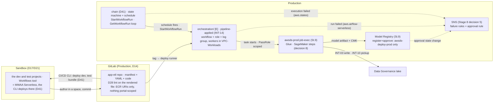

# Stage 10 — Workflow orchestration and promotion

| | |
|---|---|
| **Status** | not started. **MWAA Serverless only** (D7 amended): **step 4 is the fallback ladder**, `OR-6` is an **absence** check (`airflow list-environments` empty everywhere), the `Workflows` blueprint is category 3, and a `DenyProvisionedMwaa` (`airflow:CreateEnvironment`) statement joins the root SCP with a battery probe, because the SMUS provisioning role's AWS-managed policy grants that action today. **Design B is built, as the layer above the workflows** ([D41](../decisions/D41-sagemaker-application.md), 2026-10-15): one Step Functions state machine per chain starts the workflows and waits for each, one EventBridge Scheduler schedule starts the machine, both in the same slice; INT-14's terminal rung is the `CreateWorkflow` call from the release job (4.2). **The workflow is born in the application repository** as a SageMaker application, deployed by the CI/CD CLI from the `dev` project to the `test` project and bundled, the pipeline deploying the bundle here (2.1-2.4; the first CLI deploy ran in the lab on 2026-10-15). **`NetworkConfiguration` is always set, on AWS's documented private routing** (1.2), and the service takes **no proxy setting**, so the workers are the first named exception to D38's single egress, one with *no* internet path: a task's dependencies arrive in its code package or its container image. **[6i](stage-06i-sandbox-orchestration.md) measured the Sandbox half** (verifications (i) and (xv) are its), and four of its readings change this stage: workers land in both AZs and reached single-AZ endpoints, with no `monitoring` endpoint, so nothing is duplicated (decision 3); the definition and its code are read at save time in the saver's session, which here is the deploy role (1.5); a SageMaker job's settings bind whoever submits it, which here is this stage's execution role (1.3, Stage 9 decision 9); and a Sandbox run is the workflow's shape only, since Stage 9's jobs exist in Production alone (2.1). **Production cannot post lineage to the domain** under `DenyDataZoneEntirely` (3.3). **Staging gets its own orchestration slice**: a serverless workflow bills nothing at rest |
| **Prerequisites** | Stage 8 (the deploy runner and `awsds-deploy-prod` — the orchestration slice is applied by the pipeline, which is INT-14's proof; the shared gates file the lint joins; the alarm target its decision 5 settles). Stage 9 (`awsds-prod-job-exec` and the LF regrants the workflow's jobs run under; the registry with its resource policies; `awsds-prod-outputs`, the definitions home, and its key policy; the job settings where its decision 9 put them; `VPC-Workloads`' endpoint slice). **[6i](stage-06i-sandbox-orchestration.md)**: the authoring surface, `PythonOperator`, `BashOperator` and a SageMaker processing job measured on Sandbox's private shape, the four kept workflows, and the CLI that reads a workflow's `Code`. **6b** — Staging exists, so nothing here waits on a vend. **6c** — `VPC-Workloads` and its two private subnets in two AZs are where the workers land. **[D41](../decisions/D41-sagemaker-application.md)** — the application format, the CI/CD CLI's deploy into the `dev` project measured in the lab on 2026-10-15, and the chain layer this stage builds above the workflows (3.4-3.7) |
| **Consumes** | [D7](../decisions/D07-orchestration.md), [D11](../decisions/D11-lab-lifecycle.md), [D13](../decisions/D13-lake-formation-enforcement.md), [D17](../decisions/D17-interactive-vs-runtime.md), [D20](../decisions/D20-staging-account.md), [D26](../decisions/D26-unified-studio.md), [D28](../decisions/D28-workflow-contract.md), **[D38](../decisions/D38-single-egress-hub.md)** (the workers are its first named exception — see 1.2), **[D41](../decisions/D41-sagemaker-application.md)** (the application format, the CLI between the Sandbox projects, the chain layer) |
| **Proves** | [INT-14](../integrations.md). **Exercises, without re-proving:** INT-03 (the workflow's jobs write through Stage 9's share) and INT-07's registry half, which absorbed INT-04 at 6b (the model chain consumes Stage 9 step 3's policies as built) |

*Read with [`docs/plan/conventions.md`](../conventions.md) (naming, layout, `[P]`/`[D]`/`[E]`, IAM rules).*

---

**Objective:** explore deploying a workflow developed in SageMaker to production, as `objectives.md` puts
it, with a scheduled run there as the measure — and close the notebook-to-production gap for **models**, not
just for ETL. **D7 was settled by measurement on
2026-09-05, before this stage runs: MWAA Serverless only**, at USD 0.088 per task-hour with no standing
fee, against USD 0.29/h for the smallest provisioned environment. Design B (EventBridge Scheduler + Step
Functions) is **the layer above the workflows** since D41 (2026-10-15): a state machine per chain starts
them and a schedule starts the machine (step 3); no DAG is ported to ASL, and there is **no comparison
pass**. The Studio's *Workflows* tool **is** MWAA (open question 15), so the workflow a data scientist
authors in a **Sandbox** project and what this stage deploys are one artifact, not two that meet at D28's
contract: the application repository holds it, the CI/CD CLI puts it in the `dev` and `test` projects,
and the pipeline deploys its bundle here (D41).

## What this stage builds, and in which accounts

| Where | What | Layer |
|---|---|---|
| `production/orchestration/` (new) | `awscc_mwaaserverless_workflow` + its execution role + its log group + its failure rule, and the chain layer of D41: per account the schedule group, the state machines' log group and the two roles (the Step Functions role and the Scheduler role), per chain the state machine, its schedule and its failure rule, per bridge its rule and the role `awsds-<env>-chain-events` (3.4-3.7). **Applied by the pipeline** (INT-14) | `[E]` |
| `staging/orchestration/` (new) | the same slice, same module, Staging's account — **a serverless workflow bills nothing at rest**, so the promotion chain gains a rehearsal that is not Production | `[E]` |
| `production/workloads-egress/` (amended) + `staging/egress/` (amended) | the worker endpoints, filled into `vpc-egress`'s reserved `mwaa` group (1.2): the documented private-routing set (`logs`, `monitoring`, `kms`) against what 6i's workers used, beside the job-facing set Stage 9 3.3a and 4.3a already give both VPCs. Single-AZ (decision 3) | `[E]` |
| `production/workloads/` + `staging/foundation/` (amended) | `vpc-v0.4.0`: the S3 gateway endpoint's policy admits `mwaa-serverless-code-files-*`, the service bucket a worker reads a task's `Code` from. `prod-<region>-starport-layer-bucket` is in every VPC's policy since Stage 3 | `[P]` |
| `production/sagemaker/` (amended) | the model-approval notification rule (`awsds-prod-model-approval`) on the documented `SageMaker Model Package State Change` event | `[P]` |
| `production/data/` (amended) | on `awsds-prod-outputs`: the `Object Created` notification to EventBridge for the bridge decision 16 took (3.6), decision 12's statement on `workflows/*`, and a principal branch admitting the release job's role to `workflows/*` from the deploy runner's network, which the perimeter does not trust (2.4); on `alias/awsds-prod-data`, which delegates nothing to IAM, the deploy role and the workflows' execution roles named (1.3, 1.5, 2.4) | `[P]` |
| `staging/data/` (amended) | `awsds-staging-outputs`, if decision 17 takes its recommendation: Staging's copy of what `awsds-prod-outputs` holds for a workflow (its definition, its code, its result file and its inbox), with the same statements, under `alias/awsds-staging-data` | `[P]` |
| `identity/sso/` (amended) | `airflow-serverless:` reads for the persona that diagnoses a run (decision 11), beside the `states:` and `scheduler:` reads it holds, which read the chain layer: no set holds an `airflow-serverless:` read today, so 3.2's diagnosis has no reader | `[P]` |
| `app-etl` repository (GitLab) | the SageMaker application (D41): `manifest.yaml`, the workflow definition in the CI/CD CLI's notation (`workflows/app-etl.yaml`), the code package its Python and Bash tasks run (D28 class 2b, built from `code/` when there are such tasks), the processing task's code (D28 class 2d, `src/`, beside the `Dockerfile` that builds the lock's dependencies into the application image), the scripts its Glue steps run (D28 class 2c, from `glue/`); its Terraform is `terraform-live/<env>/app/app-etl/` (Stage 8 decision 12), and **the D28 promotion lint** is a command of `awsds-workflows` (Stage 8 decision 9) the pipeline runs on the rendered file. No ASL lives here: a chain's definition is the `orchestration/` slice's (decision 14) | — |
| Domain portal (console, recorded) | the serverless-Workflows surface of a Sandbox project, as 6i used it (the `engineering` project profile left at 6b); the **OnDemand Workflows blueprint stays off** (it provisions a fee-bearing MWAA environment) | — |
| `scripts/` | `layers.py`: `RANKS["orchestration"]` + the `[E]` row; `backend.py`: the slice row | — |

**Contracts this stage fixes, each read by `./aws/orchestration.py` so a rename fails in a check rather
than in a later stage:** the workflow **`awsds-<env>-wf-app-etl`** (the resource, its execution role and
its failure rule all carry the name — the `-a`/`-b` suffixes left with the comparison pass D7's amendment
of 2026-09-05 withdrew); the chain layer **`awsds-<env>-chain-<chain>`** (the state machine, its schedule
and its failure rule), the schedule group **`awsds-<env>-chains`**, its log group
**`/aws/vendedlogs/states/awsds-<env>-chains`**, the roles **`awsds-<env>-chain-exec`**,
**`awsds-<env>-chain-scheduler`** and **`awsds-<env>-chain-events`**, and the bridge rule
**`awsds-<env>-inbox-<app>`** (3.4-3.6); the log group
**`/awsds/<env>/wf/app-etl`**; the definitions home **`s3://awsds-prod-outputs/workflows/<app>/<tag>/`**,
Staging's in the bucket decision 17 names; the model-approval rule **`awsds-prod-model-approval`**; and,
consumed from earlier stages: the job roles `awsds-prod-job-exec` and `awsds-staging-job-exec` (Stage 9)
and the application image by digest (Stage 8). The task-definition family
`awsds-prod-app-etl` exists only if decision 8 keeps an ECS step.

## Who executes each action

| Marker | Meaning |
|---|---|
| **[Claude]** | repository edits (Terraform, YAML/ASL, `.gitlab-ci.yml`, scripts) and read-only AWS calls — done without asking |
| **[Claude⚡]** | `terraform apply` or any AWS write — only after the user authorizes that specific action in chat, with the SSO user/account/permission set stated first |
| **[user]** | the Studio/portal work, git pushes and tags, gate approvals, behavioural proofs from persona sessions, and every log entry |
| **[Claude reads, user decides]** | a measurement Claude takes and a choice only the user can make, in the same sitting |
| **[pipeline]** | the deploy runner under `awsds-deploy-prod` (Stage 8 step 4) — the orchestration applies run here **because that is INT-14's proof** |

Hand applies run as the **infrastructure user**: `awsds-infra-prod` (the `production/sagemaker/`
amendment, and the by-hand parity check of the orchestration slice — Stage 8 3.8's discipline).
Authoring sessions sign in as the **data-science user** into a Sandbox project.

## Step numbers are identifiers, not an order

These numbers are **stable addresses cited from other files** — step 4 from `docs/REFERENCES.md`, step 5
from Stage 9 step 3 and D28 item 6 (the registry this stage consumes rather than invents). They do not
change. The sequence is **five passes**:

| Pass | # | What | Slice · layer | Applied as / by |
|---|---|---|---|---|
| **0** | 0 | preflights: instruments green, INT-14's surface, the SLR baseline (the Studio surface is [6i](stage-06i-sandbox-orchestration.md)'s) | readings | Claude |
| **1** | 2 | the artifact set: the application in the repository, deployed to the `dev` and `test` projects by the CLI, the lint on the rendered file, the definitions home | repo + CLI + gates | user (author, deploy, tag); Claude (lint) |
| **2** | 1, 3 | the workflow, its network shape, its failure rule, and the chain's state machine and schedule above it — applied by the pipeline in **Staging first, then Production**; **INT-14 proven or its fallback recorded** | `staging/orchestration/`, then `production/orchestration/` `[E]` | **pipeline** |
| **3** | 5 | the model chain: retrain → register → approve → serve | `production/sagemaker/` `[P]` amendment + pipeline | `awsds-infra-prod`; pipeline |
| **4** | 6 | the end-to-end scheduled promotion and the negative sweep | sessions + pipeline | user; pipeline |

Pass 1 precedes pass 2 because `CreateWorkflow` **snapshots the definition at creation** — the YAML must
sit in S3 first. **Pass 2 lands in Staging before Production** for the same reason Stage 8's chain does: the
first `CreateWorkflow` in the estate creates a service-linked role and spends a version, and it is better
that it does so in the account whose failure costs nothing. Step 4 is not a pass — it is the fallback
ladder, read only if pass 2's apply is refused.

---

## To execute

### 0. Preflight — read what this stage consumes before building on it

**Action:** confirm the substrate (Stage 8's credential layer, Stage 9's runtime) and enumerate what the new
service will create. **Why:** INT-14 was verified to *exist* on 2026-08-08, never to *apply*, and the first
`CreateWorkflow` creates a service-linked role nobody chose (Lesson 17). Open question 15's reading, that the
Studio surface and this stage's alternative A are one product, is [6i](stage-06i-sandbox-orchestration.md)'s.
**Explanation:** all readings.

- **0.1 — [Claude] Run the instruments**: `./aws/cicd.py` (CI-2/CI-3 — `awsds-deploy-prod` exists, with
  boundary and single-principal trust) and `./aws/deploytargets.py` (DT-3/DT-4/DT-5/DT-11 — the registry
  policies, the job role's D13 absence, the LF parameters intact in every account Stage 9 extended `DT-5`
  to, the job settings where Stage 9 decision 9 put them). Red here is an unfinished Stage 8/9, not a
  Stage 10 problem.
- **0.2 — [Claude] Verify INT-14's surface, still read-only**: `awscc_mwaaserverless_workflow` present in
  the pinned `awscc` provider (re-verified 2026-08-16 — the classic provider merged only scaffolding,
  PR #45256, issue #45254 still open); `aws mwaa-serverless` present in the installed CLI. The *apply*
  under the boundary is pass 2's. **A workflow with Python or Bash tasks needs `awscc` v1.99.0** (read
  2026-10-10): the `code` attribute first appears there (2026-08-28), and the estate locks **v1.98.0**
  (2026-08-19) in its two `awscc` slices. The CLI half is [6i](stage-06i-sandbox-orchestration.md)
  step 0.2's: 2.36.18 knew neither `--code` nor the `Code` field `GetWorkflow` returns, and the laptop runs
  2.37.12 since 2026-10-10, so `./aws/orchestration.py`'s reader of the code location can rely on it here.
- **0.3 — [Claude] Record the service-linked-role baseline**: `AWSServiceRoleForAmazonMWAAServerless`
  absent today (`aws iam get-role`, as `awsds-infra-prod`). It auto-creates at the first
  `CreateWorkflow`, manages the service's networking, and carries
  `AmazonMWAAServerlessServiceRolePolicy` — enumerate it **when it appears** (verification (iii)), so it
  is a recorded principal rather than a discovered one (Lesson 17).
- **0.5 — [Claude] Re-read the `lakeformation` endpoint question 6d left here** (6d step 3.7, decision due
  11). On 2026-09-12 every Lake Formation call in Sandbox's 90-day CloudTrail window — 202 events —
  arrived service-side (`athena.amazonaws.com`, `glue.amazonaws.com`, `datazone.amazonaws.com`) or from an
  operator's laptop, and **none through the endpoint**. The flow that would need it is an engine vending
  its own Lake Formation credentials from inside a VPC; the first such engine is Stage 9 step 2.4's Glue
  job, which reads its Lake Formation events for `vpcEndpointId`, so this step consumes that reading and
  removes or keeps the Sandbox endpoint on it. Removing it is not one edit: the house image's `NO_PROXY`
  literal names `lakeformation.<region>.amazonaws.com`, and a name the image bypasses the proxy for, with
  no endpoint behind it, times out. So removal is a recipe change ([`dev-env.md`](../runbooks/dev-env.md)
  §E, "What an endpoint change costs") followed by a release and every space moved to it (§B), plus a `core_services` override in
  `sandbox/egress`.
- **0.4 — Moved to [6i](stage-06i-sandbox-orchestration.md) steps 2.1 and 3.1.** The toggle
  half was answered at [6d](stage-06d-unified-studio-remainder.md) step 4.1 (2026-09-09): nothing enables
  the serverless surface, and the eleven blueprint configurations already provide it. The field-by-field
  reading of the editor (Lesson 16) is 6i's, made while it authors its workflows. The **OnDemand Workflows
  blueprint** stays off: it provisions a fee-bearing MWAA environment, the D7 shape this stage rejects.

### 1. The workflow slice — one design, two accounts (D7, D28, INT-14)

**Action:** write `orchestration/` once as a module and call it from Staging and Production, **applied by
the pipeline**. **Why:** the pipeline apply *is* INT-14 — `awscc` resources under a deploy role's
permissions boundary, the test Stage 8 step 4.1 said this stage would run. **Explanation:** the workflow
drives Glue jobs, which read and write governed data, and SageMaker jobs running the application image,
which read what a Glue step staged (Stage 9 3.1); every data-touching step runs under
`awsds-<env>-job-exec` (Stage 9), and decision 8 settles whether an ECS step exists at all. The
**execution role is an orchestrator credential**: it starts and observes jobs, holds **no lake data
permissions and no lake S3** (D13 one level up), and receives an LF regrant through Stage 9 2.3's local
two-step only if a task ever queries governed data directly. It is **free at rest**; what meters is the
run, plus the `[E]` endpoint set while tasks are in the VPC.

- **1.1 — [Claude] Write the workflow resource**: one `awscc_mwaaserverless_workflow` per application —
  `awsds-<env>-wf-app-etl` — with `definition_s3_location` pinned to 2.4's object **and `version_id`**,
  and `code.s3_location` pinned the same way when the workflow has Python or Bash tasks (the service
  versions the code with the definition); `role_arn` = the execution role;
  `logging_configuration.log_group_name` = `/awsds/<env>/wf/app-etl`, an
  explicit `aws_cloudwatch_log_group`, retention 90 days (D28 item 5 — never the auto-created
  `/aws/mwaa-serverless/<id>/` group, which nobody expires; [6i](stage-06i-sandbox-orchestration.md)
  measured the portal's group existing from the workflow's first save, before any run, with no
  retention); `encryption_configuration` per decision 2.

  **An update is a full replace** (Lesson 60): 6i's `update-workflow` dropped the `NetworkConfiguration`
  it was not given. So the resource declares every attribute the service accepts, nothing relies on a
  value `get-workflow` does not return (it returns no `EnvironmentVariables`), and the workflow is read back
  after every apply rather than trusted from the plan. A replacement is a new ARN (the service appends a
  random suffix) and takes the run history with it, so a plan that proposes one is read before it is
  applied. The deliberate break of 3.2 goes through the slice too, never through a hand `update-workflow`; the
  pause of 6.1 is the schedule's `state` (3.5), and a workflow a chain starts carries `TriggerMode`
  `manual_only`, the literal the service writes with no schedule given (the portal's workflows, 2026-10-10;
  the CLI's, 2026-10-15).
- **1.2 — [Claude] Set `network_configuration`, always, on AWS's documented private-routing shape.**
  Omitting it runs tasks in the *service's* VPC, outside every endpoint policy and flow log — the
  Athena-Spark bypass again, which is why `OR-3` reads it. The private shape's constraints, read against
  what [6i](stage-06i-sandbox-orchestration.md) measured on Sandbox's copy of it:
  1. **Two private subnets in two AZs** — the documented minimum, and free: every VPC in the estate has
     two private subnets in two AZs, `VPC-Workloads` included. The workers cannot be pinned to one AZ: in
     6i one run placed tasks in both, `caller_identity` in `usw2-az1` and `reach_pypi` in `usw2-az2`.
  2. **No route to a NAT device or an internet gateway** — AWS's own words. This is why **MWAA Serverless
     is not D38's NAT contingency candidate** (D38 §1 amended): the requirements list that demands two NAT
     gateways belongs to the *public*-routing shape on the same page (Lesson 41).
  3. **Interface endpoints**: the vendor names `logs`, `monitoring` and `kms`, private DNS on, associated
     to both subnets. 6i's workers ran against Sandbox's endpoints, every one of them in a single AZ and none
     of them `monitoring`, and every run succeeded; the `usw2-az2` worker reached `sts` and `sagemaker.api`
     in `usw2-az1`. So the set here is single-AZ (decision 3), filled into `vpc-egress`'s reserved `mwaa`
     group, and `monitoring` joins only if a reading shows the workers' metrics refused: a refusal the
     sender cannot see reads as success (Lesson 55). The jobs' own set (`sts`, `logs`, `kms`, `glue`,
     `sagemaker.api`, `secretsmanager`) is Stage 9 3.3a's and 4.3a's. A SageMaker job pulls its image
     through the service and stages S3 through the gateway, so neither `ecr.*` nor `sagemaker.runtime` is on
     a processing step's path.
  4. **The S3 gateway policy**: `prod-<region>-starport-layer-bucket` is in every VPC's policy since Stage
     3; **a workflow with a Python or Bash task's `Code` also needs `mwaa-serverless-code-files-*-<region>-prod`**:
     the worker's environment preparation reads the code snapshot from that service-owned bucket as
     `airflow-serverless.amazonaws.com`, through the S3 gateway endpoint, and a refusal surfaces only as
     "Execution environment preparation failed due to an internal server error" (measured by 6i decision 7,
     2026-10-11). `vpc-v0.4.0` carries the family; `staging/foundation/` and `production/workloads/` are on
     `vpc-v0.3.1` and take the bump here. The trail that named the bucket, 6i's `sandbox/endpoint-audit/`,
     was destroyed on 2026-10-12 and is recoverable from `c0baddd` for the next refusal of this kind.
  5. **A security group with a self-referencing inbound rule** and an all-traffic outbound rule.

  **The service exposes no proxy setting**, which makes it **the first named exception to D38's single
  egress — an exception with *no* internet path at all** rather than a second one. A task that wants PyPI
  at run time therefore has no route: a Python task's dependencies are vendored into its code package
  (2.3), never fetched. With Stage 9's DNS Firewall in both VPCs, such a reach fails at resolution in about
  2 s (`errno 16`, 6i); without it the name resolves and the connection hangs. Verify the guide's
  private-shape NACL line (inbound allow-all, **outbound deny-all**) at build time rather than copying it: a
  stateless ACL denying all egress would break the endpoints it fronts.
- **1.3 — [Claude] Write the execution role**: trust `airflow-serverless.amazonaws.com`
  (`sts:AssumeRole`; add `aws:SourceAccount` — the docs sample omits it, so if creation fails naming
  trust, drop the condition and record it). Permissions, enumerated:
  - Glue: `glue:GetJob`, `StartJobRun`, `GetJobRun`, `GetJobRuns` and `BatchStopJobRun` on the named jobs.
    `GlueJobOperator` calls `GetJob` before every start and counts only `EntityNotFoundException` as
    absent, so without it the task fails before the job starts (the Amazon provider 9.32.0 the worker
    carries, read 2026-10-13, unmeasured). On an absent job it calls `CreateJob`, which this role does not
    hold, so a name the application slice did not declare fails closed rather than creating a job.
  - SageMaker, from 6i's processing operator: `sagemaker:CreateProcessingJob` and `StopProcessingJob`;
    `DescribeProcessingJob` on a name that does not exist yet, since the operator checks first and counts
    only a `ValidationException` as absent, with no parameter to turn it off; `sagemaker:AddTags`, because a
    create with tags is also authorized as `AddTags`; `CreateTrainingJob`/`DescribeTrainingJob`/
    `StopTrainingJob` for step 5, whose operator's existence check is unread; `kms:CreateGrant` on the
    volume key, which the submitting session creates for `sagemaker.amazonaws.com`; and `iam:PassRole` on
    `awsds-prod-job-exec` conditioned `iam:PassedToService = sagemaker.amazonaws.com` (conventions §6).
  - ECS only if decision 8 keeps it: `ecs:RunTask`/`DescribeTasks`/`StopTask` on the `awsds-prod-app-etl`
    task definition and `iam:PassRole` on its task roles, conditioned on `iam:PassedToService`.
  - `logs:CreateLogStream`/`PutLogEvents` on its own group.
  - S3, for the S3 operator tasks (D41 item 10) and the sensors of 3.6, in its account's outputs bucket
    and never a lake bucket: `s3:PutObject` on its application's prefix (the result file and its
    `_SUCCESS` marker) and on the inbox prefixes it writes, `s3:GetObject` and `ListBucket` on the
    markers its sensors read and on the object an `S3CopyObjectOperator` copies, which therefore lies
    outside the lake too, `s3:DeleteObject` on its own inbox if decision 10 keeps the consume here;
    and `kms:GenerateDataKey` and `kms:Decrypt` on the bucket's key, conditioned on `kms:ViaService`. The
    key delegates nothing to IAM (Stage 9 1.1), so its policy names these roles too, by `aws:PrincipalArn`
    on `awsds-<env>-wf-*` and never by the `[E]` role's ARN, whose unique id the next session's role does
    not carry (Stage 8 2.4's `AllowApplicationJobRolesViaS3`).

  **This role is the caller of every `Create*Job` the workflow makes, so the job settings bind it** (Stage
  9 3.5, Lesson 66): each job carries `VpcConfig` with the job subnets, `EnableNetworkIsolation: true`,
  `EnableInterContainerTrafficEncryption: true` and a `VolumeKmsKeyId`, on an instance type inside the
  ceiling, and the lint checks each (Stage 8 5.6), because a run-time refusal names the policy and never the
  statement. **No `s3:*` on any lake bucket, no `lakeformation:GetDataAccess`** — the role orchestrates, the
  job role touches data. **A Python or Bash task runs with this role's credentials**, measured at 6i (the
  project role, session `AmazonMWAAServerless`), which is the second reason it holds no lake permission: a
  Python task is orchestration code, never a data path. An S3 operator task, a sensor and a delete on a
  worker run as this role too, so its S3 reaches the result file and the inbox markers outside the lake
  (the bullet above), and decision 10 settles whether the consume-and-delete stays here. The definition and the
  code package are read at save time in the saver's session (1.5), so this role's `s3:GetObject` and
  `kms:Decrypt` on the definitions prefix are granted only if a run is read to need them.

  **The chain roles are written beside it** (3.4, 3.6): `awsds-<env>-chain-exec`, which Step Functions
  assumes to start and poll the workflows (`airflow-serverless:StartWorkflowRun` and `GetWorkflowRun` on
  the account's `awsds-<env>-wf-*` workflows, the ten `logs:*` delivery actions, nothing on jobs or S3);
  `awsds-<env>-chain-scheduler`, which EventBridge Scheduler assumes to start a machine
  (`states:StartExecution` on `awsds-<env>-chain-*`); and `awsds-<env>-chain-events`, the same grant for
  the EventBridge rules that start a machine. None touches data, and none is the workflow's execution
  role.
- **1.4 — [Claude] Write the machinery rows in the same sitting**: `RANKS["orchestration"]` above
  `app/app-etl` (so `make down` removes the trigger before the thing it triggers), **two** `[E]` `SLICES`
  rows — `staging` and `production` (`usd_per_hour` 0.0: nothing in the slice meters by the hour; the runs
  meter) — and the `backend.py` rows. A slice with no row fails `make check`. **`make up` never applies
  this slice**: the refusal Stage 8 step 2.4 writes for `app/` slices covers `orchestration/` too, since the
  slice needs a pinned definition version `make up` does not have, and a `make up ENV=production` for an
  unrelated session would otherwise create a chain whose schedule fires. The state machine and the
  schedule are born after the workflow they reference by ARN, in the same apply (3.5). `make down` destroys it
  normally.
- **1.5 — [pipeline] Apply in Staging first, then Production — INT-14's proof**: a deploy job applies
  `staging/orchestration/` as `awsds-deploy-staging`, then `production/orchestration/` as
  `awsds-deploy-prod`, with `-input=false` (Lesson 47). Success **is** INT-14 (the `awscc`/Cloud Control
  path under a permissions boundary — the deploy role needs the `cloudcontrol:*Resource*` reads/writes plus
  `airflow-serverless:*` workflow actions inside its boundary, plus the `states:` and `scheduler:` actions
  of the chain's machine and schedule, the `events:` of its failure and bridge rules and the `iam:PassRole`
  of the chain roles (3.4-3.6); a denial names which). **The deploy role is
  the saver**: the service reads the definition and the code package at save time in the saver's session
  (6i measured the archive read as a `Decrypt` through S3 in the portal's session), so the role also needs
  `s3:GetObject` and `kms:Decrypt` on `workflows/<app>/<tag>/`, `s3:PutObject` and `kms:GenerateDataKey`
  there for the release job's copy (2.4), and `iam:PassRole` of the execution role to
  `airflow-serverless.amazonaws.com`; Stage 8 step 4.1's policy gains them here, and 2.4's bucket and key
  statements admit them. From the runner, `make up`'s
  hub check is waived (it reads the hub through the laptop's profile), so the job checks the proxy itself
  before its first apply (Stage 8 3.1). On refusal, read step 4's ladder rather than improvising.
  **[Claude⚡]** Prove the by-hand parity once as `awsds-infra-prod` (Stage 8 3.8's rule: a slice that only
  applies from CI is as broken as one that only applies by hand).
- **1.6 — [Claude] Record what the first `CreateWorkflow` created**: the service-linked role now exists
  (0.3's pair reading — verification (iii)); the workflow ARN and version; **the version counter starts
  spending the 50-version quota** — every save is a new version, a description-only edit included (6i), and
  no prune API is documented (risk 4).

### 2. The workflow artifact — born in the application repository, deployed to the Sandbox projects by the CI/CD CLI, promoted through git (D21, D26, D28, D41)

**Action:** keep the deployable workflow definition in the application repository, in the CI/CD CLI's
notation, deploy it to the `dev` and `test` projects with the CLI, and put the D28 lint in front of its
rendered copies. **Why:** D28's whole point is that what crosses the gate is repository content — a
workflow that references portal-scoped anything only runs where the portal exists, and **only Sandbox has
a portal** (D17 sharpened at 6b). **Explanation:** [6d](stage-06d-unified-studio-remainder.md) step 4
and [6i](stage-06i-sandbox-orchestration.md) measured that portability: a definition authored in the
portal names project-scoped values by design. D41 turns the rewrite into the authoring form: the YAML in
the repository carries the CLI's variables (`{proj.id}`, `{proj.iam_role_arn}`,
`{proj.connection.default.s3_shared.s3Uri}`, `{domain.region}`), which the CLI resolves per project
when it deploys, and which the release job renders per environment (decision 6). The first such deploy
ran in the lab on 2026-10-15 (D41).

- **2.1 — [user] Author the workflow in the application repository and deploy it to the `dev` project with
  the CLI**: `aws-smus-cicd-cli deploy --manifest manifest.yaml --targets dev --skip-validation
  --no-events`, run from the laptop (the identity the pipeline runs it as is Stage 8 decision 19).
  `deploy` syncs the manifest's `storage` content into the project's S3 (`aws s3 sync`, no `--delete`),
  and the workflow is born by the bootstrap action `workflow.create`: the CLI resolves the variables,
  rewrites the YAML at the same key and calls `CreateWorkflow` with the project role, the Tooling subnets,
  security group and key, no `TriggerMode` (so `manual_only`), the log group
  `/aws/mwaa-serverless/<domain>-<project>/<name>` with no retention, and six tags
  (`AmazonDataZoneProject`, `AmazonDataZoneDomain`, `Target`, `CreatedBy=SMUS-CICD`, `STAGE`, `Pipeline`),
  which `monitor` and `logs` filter by. The name is `<application>_<project>_<workflow>`, every
  character outside `[A-Za-z0-9_]` turned into `_`. Measured in the lab on 2026-10-15: the deploy of
  15:52 UTC left the workflow `READY`, its resolved YAML identical to `WorkflowDefinition`, encrypted
  with the project key. `--skip-validation` is needed: the CLI's pre-deployment validation simulates the
  project role's policies with no context keys, so every SCP conditioned on `aws:RequestedRegion` or
  `aws:ResourceOrgID` reads denied (Lesson 30), and the simulation never reads a bucket or key policy
  anyway. Then test-run its shape there (Sandbox task-hours, metered per run). **This is where D21's
  "authored and test-run" clause now points**, and Sandbox is the only account it can point at. What a
  Sandbox run can test is the workflow's shape, not its jobs: every task runs as the project role, against
  the project's `shared/` storage and the application image (D41 item 7; the project role's pull of it is
  verification xxiii), the lake share there is read-only, and the Stage 9 producer and pickup Glue jobs
  exist in Production alone, so **Staging is the first real run**. No task is a portal *Notebook task*:
  6d decision due 14 took (b). Nor is a Visual ETL flow or a query book scheduled from the portal: the
  documentation runs both scheduling routes as the same notebook execution
  ([`docs/SMUS.md`](../../SMUS.md), the workflow surface). The code a task runs itself uses
  `PythonOperator`, `BashOperator` or a SageMaker processing job, the three shapes 6i measured on
  Sandbox's private shape. The portal's authoring rules (an import into an empty workflow, an import that
  cannot replace a saved one, the pre-filled operator-files location to empty when no file is uploaded)
  are [`serverless-workflows.md`](../runbooks/serverless-workflows.md) §A, and a save in the portal over
  a CLI-made workflow is an `update-workflow` that replaces it whole (Lesson 60) and writes a second copy
  under `dev/workflows/`, so the portal is where the workflow is read, never saved. Its Tags tab shows
  the CLI's six tags under a notice that tags come from the definition file, where the CLI never
  wrote them (`TagResource`), so a save there would also drop the tags `monitor` and `logs` filter by
  (read 2026-10-15; no save has measured it).
- **2.2 — [user + pipeline] Bundle and deploy to the `test` project** (D21 — the gate is the tag, and the
  rewrite happened in the repository): on the release tag, once the image is built (Stage 8 step 2.5,
  under the identity its decision 19 settles), `bundle` packs the checkout and the files the tag pipeline
  built from it into the artifact the pipeline promotes, its workflows with their variables unresolved,
  and `deploy --targets test` deploys the same folders, running `workflow.create` in the `test` project
  and `workflow.run` with `wait` as the test, so what `test` runs is what the bundle carries, both read in
  one job; once `test` passes, the tag's GitLab release links to the bundle, stored where Stage 8 decision
  20 says. The manifest's `content.storage` items name no connection, so `bundle` reads each from the
  checkout, the manifest naming it per stage under `deployment_configuration`, and `deploy` reads each
  from the manifest's folder, opening a bundle archive only for a catalog export or notebooks, which the
  manifest does not enable and the lint refuses (Stage 8 step 5.6); an item that named a connection would
  make `bundle` download it from the stage's project, where `deploy` left the YAML resolved for that
  project, and `deploy` read it from the bundle. `--local` only
  changes the default stage's name (the CLI's 1.0.9 code, read 2026-10-15; verification xxvii). A value no
  project holds, the image by digest first, reaches the run as a stage variable, `{env.VAR}` in the YAML
  (D41 item 1): `workflow.create` writes it as `{{ params.VAR }}` and `workflow.run` passes the stage's
  `environment_variables` as the run's `OverrideParameters`; a `${VAR}` stays in the YAML as written
  (verification xxix). The repository's YAML is the source: the portal's own YAML is never the artifact
  (6i: no Python authoring and no converter in the path), project-scoped values are the CLI's variables,
  and the job image is the application image (Stage 8, decision 7). `schedule` (cron) belongs to no
  workflow promoted to Staging or Production, since a chain starts every one (decision 13, taken), and the
  lint refuses one in the rendered copy (2.3). The validated parameter set: `retries` ≤ 3 and set
  explicitly (the service defaults it to 1), `retry_delay` ≤ 300 s, `execution_timeout` ≤ 3 600 s.
  The service **ignores** `catchup`, callbacks, `trigger_rule`, `deferrable`, `render_template_as_native_obj`,
  `do_xcom_push` and `is_paused_upon_creation`; a template sees only `macros`, `ti`, `params`, `ds` and `ts`
  (no `dag_run`, and `ts_nodash` reads midnight on a manual run); and a templated list arrives as a string
  (6i decision 4's hand-over). A DAG that leans on any of these behaves differently here than in an
  ordinary Airflow, which is a fact to record about the service, not a defect to chase. Python callables
  live as modules in `code/`. A Visual ETL flow graduates as the script its editor
  generates, into `glue/` as a Glue job of the application (D28 class 2c), its project connections turned
  into job arguments; the `.vetl` and its portal schedule stay in the project. A Python or Bash task runs
  on a 1 vCPU / 3 GiB x86_64 worker (vendor page) on Python 3.12, against a pre-installed Airflow 3.0.6 and Amazon provider 9.32.0 that win
  over any bundled version (6i measured the worker's PyYAML beating the archive's copy), so heavy work
  belongs in Glue or SageMaker. If authoring ever produces Python, AWS's
  `python-to-yaml-dag-converter-mwaa-serverless` converts it (AWS-provider operators only, no dynamic task
  mapping), and what it warned about is verification (viii).
- **2.3 — [Claude] Consume the D28 promotion lint — it is authored once, at Stage 8 step 5.6**, so there
  is one copy. It runs on the rendered file (decision 6), never on the repository's YAML, whose CLI
  variables are not values. It rejects a definition that references a domain resource (project connections,
  portal-scoped ids), names a container by anything other than an **ECR URI and digest**, exceeds **50 KB**,
  hard-codes a `start_date` (rewritten at deploy time), uses an operator outside MWAA Serverless's
  supported list (the Amazon-provider operators, plus `PythonOperator` and `BashOperator`, which AWS
  added on 2026-08-17 by the guide's document history, the day after this stage's 2026-08-16 reading),
  exceeds the **3600 s** task cap, or omits a pinned `DefinitionS3Location.VersionId`; for a workflow a
  state machine starts, a `schedule` line is refused too (decision 13). **This stage needs one rule 5.6
  does not list yet, for class 2c**: reading the application slice rather than the
  definition, it refuses a Glue job whose script, or a file its arguments name, lies outside the release's
  own prefix (decision 12), and it applies rule (a)'s project-scoped patterns to the scripts in `glue/`,
  where a Visual ETL flow's connection names surface. Class 2d's rule is 5.6's (h): a processing job's
  code input lies under the release's own prefix and matches the release's manifest. **The code package is what carries the no-internet
  constraint now**: with no internet path in the worker subnets (1.2), a
  Python task's dependencies must be vendored into its package for Linux x86_64 and Python 3.12, so CI
  builds the package and imports every `python_callable` from it with networking off, which turns a
  runtime import failure into a CI failure. **[user]** Prove it once with a deliberately portal-scoped
  definition (verification (xi)).

  **A processing task's code is a different artifact.** 6i ran one (its verification xvi,
  2026-10-11): the folder `awsds-workflows package-job` builds
  ([`serverless-workflows.md`](../runbooks/serverless-workflows.md) §J1), the project plus the packages
  the house image lacks, given to the job as a code input with no network. A `ProcessingInput` names an
  S3 prefix the job reads at each run, with no version to pin, so the lint's `VersionId` rule cannot
  hold it, and what runs is whatever the prefix holds when the job starts: decision 7. Decision 7 is
  **taken by the user on 2026-10-15, as the alternative** (D41 item 7): the application image carries
  the dependencies alone, built from the lock, and the code input is the project's `src/` (D28 class
  2d), copied by the CLI in `dev` and `test` and written by the release job under the release's prefix,
  kept from overwrite by decision 12's statement and checked by rule (h). No CI job builds 6i's folder
  for an application: what the code needs beyond itself is in the image, whose interpreter runs it.
- **2.4 — [pipeline] Deploy the definition to the versioned home**: in each leg the release job downloads
  the tag's bundle (2.2) from where Stage 8 decision 20 stores it, checks its SHA256, before it reads a
  file of it, against the value Stage 8 step 2.5's third job passed down the pipeline, never against
  GitLab's record of the file, and rebuilds nothing; step 3.7 commits that value for a later re-apply. It
  renders `workflows/app-etl.yaml` for its account (decision 6) and copies the rendered copy to
  **`s3://awsds-prod-outputs/workflows/app-etl/<tag>/workflow.yaml`** in Production (decision 1 — the
  bucket is versioned, CMK-protected, perimeter-branched since Stage 9 1.1), or to the same key of
  Staging's bucket (decision 17), and records the returned S3 `VersionId` — the value 1.1 pins, so a
  definition edit without a deploy cannot reach the workflow (`CreateWorkflow` snapshots anyway; the pin
  makes the intent explicit). When the workflow has Python or Bash tasks, the code package the tag pipeline
  built from `code/`, which the bundle carries, goes beside it and its `VersionId` is recorded the same
  way; the processing task's `src/` goes to `workflows/app-etl/<tag>/src/`, the job's input (D28 class 2d,
  decision 7, taken). The scripts in `glue/` go to `workflows/app-etl/<tag>/glue/`, where the application
  slice's Glue jobs name them; Glue reads them at every run and pins no version, so what keeps them from
  changing is decision 12. **The release job writes from the deploy runner**, in `VPC-SharedServices`,
  whose gateway endpoint the perimeter leaves out by name (Stage 9 1.1), and under a key that delegates
  nothing to IAM: so `production/data/` gains a principal branch admitting the role the release job runs as
  to `workflows/*` alone, the shape of `DataScientistProdAccess`'s branch (D39), and a key-policy statement
  naming that role; Staging's bucket gains the same for `awsds-deploy-staging`.

### 3. Schedule, retry, alerting, and the chain layer (D28 item 5, D41)

**Action:** make the workflow fire unattended and page on failure, and build the layer that starts the
workflows in order. **Why:** a scheduled run in production is how this stage measures the exploration
`objectives.md` asks for, and a failed nightly run nobody hears about is worse than no schedule.
**Explanation:** a standalone workflow's cron lives **in the YAML** (EventBridge Scheduler underneath;
`TriggerMode` pauses it; only one workflow version holds the active schedule), so it is promoted with the
definition rather than configured beside it; a chain's cron lives in the Scheduler schedule that starts
its state machine (3.5), in the slice, and no production workflow keeps the first form (decision 13,
taken). The service has no dependency between workflows: a workflow starts by its cron, by a call or
by nothing, `outlets` are ignored, and the worker reaches no API, so what orders the workflows is the
state machine (3.5) and what carries data between them is a contract on S3 (3.6).

- **3.1 — [Claude] Write the failure rule** (in the slice): `awsds-<env>-wf-app-etl-failed` on source
  **`aws.airflow-serverless`**, detail-types `Workflow Run Failed` and `Workflow Run Timeout`, to the target
  Stage 8 decision 5 settles (the Stage 1b topic lives in the Management account, and no member account has
  one). Delivery is documented durable; duplicates tolerated. **A silent success is not covered**: a sensor
  with `soft_fail` ends an empty-inbox run `SUCCESS`, its task's status `NONE` and no downstream task
  created (6i), so "nothing arrived" needs its own signal if the workflow is file-triggered. A chain has its own rule
  (3.7), on the state machine's execution: a workflow failure inside a chain fires both.
- **3.2 — [user] Prove it, and prove the diagnosis path with it**: break a step deliberately (a wrong job
  argument, through the slice and never through a hand `update-workflow`, 1.1), run once — the rule fires,
  and the failure is *diagnosable* from what the service offers: `list-workflow-runs`, `list-task-instances`,
  `get-task-instance` (the `LogStream` field), the log group and the console page. **Record the diagnosis
  session**: with no environment to log into, what those APIs report is the whole operational surface. What
  6i taught about reading it: a run's `RunState` lags its task instances (`QUEUED` after the first task had
  finished), so the diagnosis reads the task instances and the alert reads 3.1's rule, never a poll of the
  run's state; a failed task is retried once and its attempts are listed out of order; a task's
  `DurationInSeconds` is the number to read, never the run's; and a name the DNS Firewall blocks fails in the
  worker as `errno 16` at resolution. **Who reads it is decision 11**: no persona set holds an
  `airflow-serverless:` read today; `DeploymentManagerAccess` reads the `states:` and `scheduler:`
  families (`ReadOrchestrationExecutionStatus`), which with D41 read the chain layer: the state machine's
  history says which workflow failed, the workflow's APIs which task.
- **3.3 — [Claude reads, user decides] Does the orchestrator emit lineage, and where can it land?** Handed
  over from [6f](stage-06f-data-governance.md) step 6.2 (2026-09-18) rather than left in that stage's log
  (Lesson 34). What the vendor page **does** say: DataZone captures lineage automatically from Glue and
  Redshift databases added to the domain, from **Spark ETL job runs in AWS Glue v5.0 and higher**, and from
  anything that posts to its **OpenLineage-compatible API**; the automatic half is switched on **in the
  blueprint configuration**, which in this estate is Terraform (`sandbox/sagemaker/`) and reaches Sandbox's
  data sources only. What it **does not** say is whether **MWAA Serverless** emits anything. **Production
  cannot post at all**: lineage is a DataZone call, and the `Workloads` OU denies `datazone:*`
  (`DenyDataZoneEntirely`, whose own revision trigger is the first time Production must publish); 6f
  settled that Production publishes through the lake, not through an association. So the reading is taken
  in Sandbox, on one of 6i's kept workflows (a run costs about 0.003-0.03 USD): run it, then
  `list-lineage-events` on the domain, with a second reading after a delay before "nothing" is believed
  (Lesson 62). The outcomes: the service emits; Airflow's OpenLineage provider is configured to emit, which
  has nothing to configure here, since the worker's packages are AWS's and win over any bundled copy; or the
  job posts its own events, which meets the same SCP in Production. What Production lineage costs is
  decision 9. **Today the domain's `list-lineage-events` is
  empty**, so whatever this finds is the first event the estate ever produces.
- **3.4 — [Claude] Write the chain layer's base, per account** (D41; decision 15 for its slice): the
  schedule group `awsds-<env>-chains`; the state machines' log group
  `/aws/vendedlogs/states/awsds-<env>-chains`, retention 90 days, encrypted with the account's data CMK,
  on the documented `/aws/vendedlogs/` prefix that keeps every state machine inside one CloudWatch Logs
  resource policy; the Step Functions role `awsds-<env>-chain-exec`, trusted by `states.amazonaws.com`
  with `aws:SourceAccount`, holding `airflow-serverless:StartWorkflowRun` and `GetWorkflowRun` on
  `arn:aws:airflow-serverless:<region>:<account>:workflow/awsds-<env>-wf-*` (the ARN carries the name and
  a ten-character suffix the service appends, so the resource is a pattern) and the documented ten
  `logs:*` delivery actions on `Resource: "*"`, nothing on jobs and nothing on S3 (`ListWorkflows` only
  if a chain resolves a workflow by name instead of by ARN); and the Scheduler role
  `awsds-<env>-chain-scheduler`, trusted by `scheduler.amazonaws.com`, holding `states:StartExecution` on
  `arn:aws:states:<region>:<account>:stateMachine:awsds-<env>-chain-*`. This is
  `terraform-reference/`'s `modules/orchestration/` base (its `controladoria-schedules` group, its
  `<prefixo>-pipelines` log group and its `<prefixo>-step-functions` and `<prefixo>-eventbridge-scheduler`
  roles), with the EMR, crawler, SNS and X-Ray grants that estate's role carries left out until a chain
  needs one. Sandbox gets none of it: a chain exists where a workflow is promoted, and `sandbox/workflows/`
  (rank 56) stays what it is.
- **3.5 — [Claude] Write a chain: one state machine and one schedule** (decision 14 for where its
  definition lives): `aws_sfn_state_machine` `awsds-<env>-chain-<chain>`, type Standard (Express has no
  `.sync` pattern and a five-minute cap), whose definition starts each workflow with the SDK integration
  `arn:aws:states:::aws-sdk:mwaaserverless:startWorkflowRun` (the service's SDK name is read at the
  first apply, verification xxii; the console's integration list is the reading), `WorkflowArn` from
  `awscc_mwaaserverless_workflow.<app>.workflow_arn` and a `ClientToken` built from `$$.Execution.Name`
  and the step, then waits in a `Wait` of 60 s and `getWorkflowRun` loop until the run's `Status` leaves
  the running states, a `Choice` sending a failed run to a `Fail` state; a `Parallel` branch runs
  workflows that do not depend on each other, and `Retry`/`Catch` are per step. `WorkflowVersion` is
  accepted by `StartWorkflowRun`, so a chain pins the version it starts if `awscc` exposes it
  (verification xxii). The schedule is `aws_scheduler_schedule` `awsds-<env>-chain-<chain>` in the group,
  a cron with its time zone, `flexible_time_window` `OFF`, the machine as target through the Scheduler
  role, `<aws.scheduler.scheduled-time>` passed as the chain's date (the machine forwards it as
  `OverrideParameters`), and `state` `ENABLED` or `DISABLED`, which is the pause lever (6.1). The machine
  and the schedule are born in the same apply as the workflow and after it. A chain of one workflow is
  still a chain (decision 13): the workflow carries `TriggerMode` `manual_only`, and nothing else starts
  it.
- **3.6 — [Claude] Write how one workflow depends on another** (D41): inside a chain the machine's order
  is the dependency, and a data contract guards it — the producing workflow's last task, the S3 operator
  task of D41 item 10, writes a `_SUCCESS` marker under its application's prefix of the outputs bucket
  once its output is complete, and the consuming workflow's `S3KeySensor`, without `soft_fail`, fails the
  run when the marker is missing, so a chain never reads a partial output and no execution role reads the
  lake. Between chains, or when an event starts a chain: the inbox `inbox/<app>/` of the account's outputs
  bucket (`s3://awsds-prod-outputs/inbox/<app>/` in Production, Staging's per decision 17), outside the
  `workflows/*` prefix decision 12 locks, where the producing workflow's `S3CreateObjectOperator` writes a
  marker and the consuming workflow's `S3KeySensor` reads it and empties it under decision 10; and the
  bridge decision 16 took, `aws_s3_bucket_notification` with `eventbridge = true` on the bucket (whether
  `awsds-prod-outputs` publishes today is unread) and the rule `awsds-<env>-inbox-<app>` on `aws.s3`
  `Object Created` under `inbox/<app>/`, whose target is the consuming chain's state machine through
  `awsds-<env>-chain-events`, trusted by `events.amazonaws.com` with `aws:SourceAccount` and holding
  `states:StartExecution` on `awsds-<env>-chain-*`: a role apart from the Scheduler's, so that CloudTrail
  tells a start on an inbox write from a scheduled one (D41). MWAA Serverless is not a rule target, so the machine is the target in every
  form; a Lambda is not written, since it would need a network of its own; two objects start two
  executions, and the `ClientToken` protects one execution only (verification xxv). The service's own
  events (`aws.airflow-serverless`, fifteen detail types since 2026-06-11) serve 3.1 and the form "A
  succeeded" only when B reads no data of A's; the model-approval rule (5.3) gains the serving chain's
  machine as a target, through the same role, when that chain exists.
- **3.7 — [Claude] Write the chain's failure rule** (in the slice): `awsds-<env>-chain-<chain>-failed` on
  source **`aws.states`**, detail-type `Step Functions Execution Status Change`, statuses `FAILED`,
  `TIMED_OUT` and `ABORTED`, to the target Stage 8 decision 5 settles. `./aws/orchestration.py` gains
  `OR-9` for the layer when it is built: the group, the log group, the chain roles, each machine with its
  schedule's state and its rule, and each bridge rule. **[user]** Prove it with 3.2's deliberate break run through a chain.

### 4. The fallback ladder — documented, not built (INT-14)

**Action:** write down, in order, what is tried if 1.5's apply is refused — and what is *no longer* on the
ladder. **Why:** INT-14 is the one integration whose failure has no workaround inside the design, so the
alternatives are decided while nobody is under pressure. **Explanation:** nothing here is built. Reading
this step is what pass 2 does on a refusal; each rung's denial wording is recorded before the next is
tried.

- **4.1 — [Claude] Rung one, the CloudFormation wrapper**: `aws_cloudformation_stack` wrapping
  `AWS::MWAAServerless::Workflow`. Same service, same resource, a different provider path — so it answers
  whether the refusal was Cloud Control's or the boundary's.
- **4.2 — [Claude] Rung two, the API call from the release job**: `CreateWorkflow` (and `UpdateWorkflow`
  on a later release) called by the deploy role from the pipeline, the CI/CD CLI's own form, measured in
  the lab on 2026-10-15 under a project role; same service, same resource, no provider in the path, at the
  cost of a workflow outside Terraform's state, which `OR-1` then reads from the service alone. **Design B
  left the ladder on 2026-10-15** (D41): it is the chain layer above the workflows (3.4-3.7), built, and
  it replaces nothing, so no DAG is ported to ASL; the `/aws/vendedlogs/states/` prefix and the ten
  `logs:*` actions it once listed are 3.4's. **This rung is the terminal one**: D7 chose against a second
  orchestrator while a supported path exists.
- **4.3 — [Claude] The rung that left the ladder**: **provisioned MWAA
  (`aws_mwaa_environment`, `mw1.micro`) is no longer an option.** It was measured at USD 0.29/h — about
  USD 212/month standing against a USD 50 ceiling (D12) — and an option that expensive left in a fallback
  chain is an option that gets taken at 2 a.m. It is replaced by a **preventive** control rather than a
  note: `DenyProvisionedMwaa` (`airflow:CreateEnvironment`) joins the root SCP with its own battery probe,
  because the SMUS provisioning role's AWS-managed policy grants that action today. `OR-6` flips from
  *"the environment is torn down"* to an **absence** check — `airflow list-environments` empty in every
  account — and the price stays in `PRICING.md` as the record of why.

### 5. The model chain — registry consumed, approval gated, served through Staging (D17, D20, D28 item 6)

**Action:** define and exercise how a trained model reaches production: who registers, who approves, how
an approved version is served, and what is recorded alongside it. **Why:** Stage 8 promotes containers;
the other thing this environment produces is a model, and without this half "data science environment"
means "notebooks with a nice network". The registry and its resource policies exist (Stage 9 step 3) —
this stage **consumes them unchanged**: the workflow ends at the artifact, the pipeline registers, so
3.2's "register and approve for `awsds-deploy-prod` alone" stays true. **Explanation:** the production
retraining job runs where D17 puts it — in Production, under `awsds-prod-job-exec`, submitted by the
orchestrator built above; Interactive-account training never produces a registered version (D21 —
registration is the pipeline's act, after graduation through git).

- **5.1 — [Claude] Add the training step to the workflow**: a SageMaker training job
  under `awsds-prod-job-exec` (the `PassRole` grants of 1.3), artifact to
  `awsds-prod-outputs/models/app-etl/` — **`OutputDataConfig` names the Stage 9 CMK**: documented as
  *required* for cross-account deployment, and the Staging read of 5.4 fails without it. The job carries the
  settings 1.3 lists, on an instance type inside the ceiling, and reads its training data from a prefix of
  `awsds-prod-outputs` a Glue step wrote first: a SageMaker job reads no governed data (Stage 9 3.1).
- **5.2 — [Claude] Write the registration/approval jobs in the promotion pipeline** (under
  `awsds-deploy-prod`): `CreateModelPackage` into `awsds-prod-model-app-etl` with
  `PendingManualApproval`, carrying what D28 item 6 asks recorded — `ModelMetrics` from the evaluation,
  the git tag and training-data version in `CustomerMetadataProperties`; then the approval as a
  **blocking manual job** (`when: manual` under `rules:` — Stage 8 3.5's CE shape, the deployment
  manager's pause) whose script runs `UpdateModelPackage` → `Approved`. Rejection is the same job
  answering `Rejected`.
- **5.3 — [Claude] Write the approval-notification rule and amend `production/sagemaker/`**:
  `awsds-prod-model-approval` on source `aws.sagemaker`, detail-type **`SageMaker Model Package State
  Change`**, to the target Stage 8 decision 5 settles — every approval flip is heard, duplicates
  tolerated (the documented caveat). **[Claude⚡]** Apply as `awsds-infra-prod`.
- **5.4 — [pipeline] Serve the approved version through the chain (D20)**: in Staging,
  `CreateModel` with `Containers = [{ModelPackageName: <approved version ARN>}]` (the documented
  reference shape) and a **batch transform** against Staging's sampled data — the promotion asserts the
  model loads and returns predictions of the expected shape **before** the Production deploy step runs
  (INT-07's registry half, proven at Stage 9 4.6, exercised here). Then the same serve in Production
  under `awsds-prod-job-exec`. The job settings cover both calls whoever makes them (Stage 9 3.5):
  `CreateModel` carries `VpcConfig` and `EnableNetworkIsolation: true`, and `CreateTransformJob` a
  `VolumeKmsKeyId`. Serving mechanism per decision 4: **batch transform** (idle cost zero,
  VPC-capable); serverless inference is the endpoint-shaped alternative — pay-per-use, **but documented
  as supporting no VPC configuration**, so it sits outside the network perimeter and is named, not
  built — **and Stage 9 step 3.7 decides whether "named" means an `AWS_STATE.md` exception row or an SCP
  deny; this stage consumes that answer rather than re-taking it.** A standing real-time endpoint is
  idle-billed and priced out (D12).
- **5.5 — [user] Prove the gate still holds from the far side**: from **Sandbox**, as the reader Stage 9
  decision 10 named,
  `DescribeModelPackage` answers and `UpdateModelPackage` is denied by the group policy's wording — Stage 9
  step 3.4's proof re-read now that a real version exists (INT-04 was merged into INT-07 at 6b).

### 6. The end-to-end, and the boundary sweep

**Action:** the closing proofs — the scheduled promotion with no manual steps between tag and scheduled
production runs, and the negatives that show the new surface added no new reach. **Why:** every earlier
pass proved a piece; the deliverable is the chain. **Explanation:** run each proof from the stated
session; read every denial by its wording (standing rule since 1c).

- **6.1 — [user + pipeline] The scheduled end-to-end**: tag → Stage 8's chain (Staging leg, gate) → the
  orchestration slice applies in both accounts, the chain's machine and schedule with the workflow → the
  schedule fires **unattended** — at least one execution started by `scheduler.amazonaws.com` with nobody
  at the keyboard, read in the machine's execution history, and the workflow run it started, whose type
  the service reports per run with `get-workflow-run`, since `list-workflow-runs` returns it null
  (measured 2026-10-10); a run a machine starts is expected to read `ON_DEMAND`, the type a
  `StartWorkflowRun` call gets, never the `SCHEDULED` of a workflow's own cron, inferred until
  verification xxiv reads it — the run writes a curated table through the LF share (INT-03 exercised under
  the job role), and the failure rules stay quiet. Then the pause lever works, applied through the slice:
  the schedule's `state` → `DISABLED`, no further executions (3.5); no production workflow has a cron of
  its own to pause (decision 13).
- **6.2 — [user] The negatives, from a data-science Production session**: `airflow-serverless:StartWorkflowRun`
  denied, and `airflow-serverless:ListWorkflows` too unless decision 11 granted this set the read (implicit
  deny; the wording names no allow, not an SCP) — and `airflow:CreateEnvironment` denied by **`DenyProvisionedMwaa`**
  from every account, which is the 4.3 control exercised rather than assumed. From the same session, `states:StartExecution`
  and `scheduler:CreateSchedule` denied too, the chain layer's writes (the approver set already denies
  `StartExecution` under `DenyControlPlaneInFull`), and the SNS topic and log groups read but do not
  write. **[Claude]** the role-side negative is a reading, not an
  attempt (Lesson 22): `OR-3` shows the execution roles hold no lake S3, no `GetDataAccess` and no
  `NetworkConfiguration` gap.
- **6.3 — [user] Record the run-history disposition before the first `make down`** (Lesson 4): the run
  history lives in the service against the workflow resource and **dies with the `[E]` slice**, and the
  machines' execution history with them. The log
  group is `[P]`-adjacent and its retention bounds what CloudWatch keeps; write that sentence in the log
  rather than leaving it implicit (conventions §5.1 rule 2).

---

## Deliverables

Each is written so its output differs between working and broken (Lesson 13). **The mechanical half is
`./aws/orchestration.py`** ([`aws/INDEX.md`](../../../aws/INDEX.md)): both workflows with their roles'
shapes (boundary, trust, the D13 absences, `NetworkConfiguration` **present and private**), the named log
groups with retention, the failure rules and the approval rule ENABLED, the definitions home, recent
run outcomes, `OR-6`'s absence reading, the chain layer once built (`OR-9`), and the registry's recent
register/approve callers. The behavioural
proofs are the stage's own (Lesson 20):

- **INT-14 answered in writing** (1.5): the `awscc` apply under the deploy role's boundary — or which rung
  of step 4's ladder, and the wording that forced it.
- **The scheduled run (6.1):** one execution started by the schedule unattended and the workflow run it
  started, then the pause lever holding.
- **The chain's order (3.5, 3.6):** the second workflow (decision 18) starts only after the first run
  ends, and a missing `_SUCCESS` marker fails the consuming run rather than reading a partial output.
- **The failure path (3.2):** the rule fires on a broken step, and the diagnosis is reachable from the
  service APIs alone — recorded, because there is no environment to log into.
- **The lint (2.3):** a portal-scoped definition rejected in CI, and a code package whose `python_callable`
  does not import with networking off rejected with it.
- **The network negative (1.2):** a task started with `network_configuration` omitted lands **outside** the
  VPC — provoked once, in Staging, and read from an instrument that shows the presence: the worker's own
  address in the CloudTrail record of its first AWS call, beside the private address of a run with the
  configuration (6i read its workers' addresses this way). A flow log's silence is not that reading: the
  logs aggregate over 600 s, and their absence would look the same for a task that never ran (Lesson 62).
- **The model chain (5.x):** a version registered `PendingManualApproval` by the pipeline, approved at the
  manual gate, served in Staging first, then Production — and the Sandbox reader still reads status only.
- **The provisioned deny (6.2):** `airflow:CreateEnvironment` refused from every account — 4.3's control,
  exercised.

## Validation

1. Run `./aws/orchestration.py` — all `OR-*` pass; diff two runs across a deploy (only versions,
   run rows and timestamps may change).
2. Run `./aws/egress.py` §6 at session end — the slice itself burns nothing; a leftover `[E]` endpoint set
   in `VPC-Workloads` or Staging is this stage's likeliest leak. `OR-6` separately asserts **no MWAA
   environment exists anywhere**, which is now an absence check rather than a teardown check.
3. Run `./aws/deploytargets.py` after the 5.3 apply — `DT-5` (the LF parameters) and `DT-3` (the group
   policies unchanged — this stage added no principal).
4. Read every denial by its wording, never its exit code (standing rule since 1c).

## Cost

Measured (`docs/PRICING.md` §1.3-1.5, §5, §8), us-west-2:

| Item | Cost | Layer |
|---|---|---|
| The workflow at rest | **0** — no environment fee, no standing resource that meters | `[E]` |
| Managed task-hours | 0.088/task-h, 1-min minimum (~4.40/month for the §1.5 nightly); Python and Bash tasks bill the same (vendor page, 2026-10-10) | per run |
| Task compute | Glue 0.44/DPU-h; SageMaker processing/training/transform per instance-h (§8); Fargate ARM ~0.036/vCPU-h + memory only if decision 8 keeps an ECS step | per run |
| A processing task | holds its worker for the whole job, provisioning and teardown included: about 13 task-minutes per run in [6i](stage-06i-sandbox-orchestration.md) for a one-second command (about 3 of provisioning, 7 of pulling the 6.97 GB house image, 2.5 after the job), about 0.029 with `ml.t3.medium`. An application image `FROM base` pulls less; the wait counts against the 3600 s task cap | per run |
| The worker endpoint set while runs execute | 0.010/h per endpoint, single-AZ (decision 3): 6i's workers in both AZs reached single-AZ endpoints, so the two-AZ requirement costs nothing beyond cross-AZ transfer | `[E]` |
| The chain layer | Step Functions Standard 0.000025 per state transition: about 550 transitions for a chain of three workflows polled every 60 s for an hour, about 0.014 per execution, and about 180 for a chain of one, about 0.005; EventBridge Scheduler 1.00 per million invocations after the free tier (§1.4) | per execution |
| Provisioned MWAA | **not a line** — 0.29/h, removed from the ladder and denied by SCP (4.3); kept in `PRICING.md` as the record of why | — |
| Log storage, the EventBridge rules, SNS | cents; free tier at this volume | `[P]`/`[E]` |

## Decisions due while executing

**Blocking questions for the user: none.** Each is decided during the stage and written into
`docs/log/log-stage-10-orchestration-promotion.md` (Lesson 16), with a recommendation stated.

1. **The definitions home** (2.4) — recommended: **`awsds-prod-outputs/workflows/<app>/<tag>/` with the
   S3 `VersionId` pinned** — the bucket is already versioned, CMK-protected and perimeter-branched; a
   dedicated bucket buys nothing at N=1. Revisit only if verification (iv) shows the service's
   definition read failing the perimeter. This answers for Production; Staging's copy is decision 6.
2. **The encryption configuration** (1.1) — recommended: **`CUSTOMER_MANAGED_KEY` with each account's own
   data CMK** (`alias/awsds-prod-data`, `alias/awsds-staging-data`) — D31's argument: what the approvers
   cannot decrypt stays expressible; fall back to `AWS_MANAGED_KEY` only if the service's grant path fails,
   recorded. Neither key delegates to IAM, so each names the service's calls Stage 9 1.1 lists (6i measured
   `GenerateDataKey` with the encryption context `aws:airflow-serverless:workflow-arn` at creation and
   `Decrypt` at each run) and CloudWatch Logs for the encrypted group; which principal makes those calls is
   read at the first apply.
3. **The endpoint set's AZs** (1.2) — recommended: **single-AZ, like every other endpoint set in the
   estate**. 6i's workers landed in both AZs and reached Sandbox's single-AZ endpoints, so nothing is
   duplicated unless a reading shows an endpoint refused from the second AZ, and the module places every
   interface endpoint in one subnet, so a per-AZ split would be a module change made for that reading.
4. **The serving mechanism** (5.4) — recommended: **batch transform** — idle cost zero and VPC-capable;
   serverless inference recorded as the alternative with its documented no-VPC limit named; a standing
   real-time endpoint declined on D12 arithmetic (idle instance-hours).
5. **The slice's layer** (6.3) — recommended: **`[E]`, as conventions §6 has it** — the schedule exists
   only while the slice is applied, which under D11 is a session property, not a defect. The revisit
   trigger (§5.1 rule 7): the day a workload needs the schedule to survive sessions, the workflow is free
   at rest and promotion to `[P]` costs nothing — record it then, with the bill in hand. The chain layer's base is decision 15.
6. **How one definition reaches two accounts** (1.1, 2.4). Both slices pin 2.4's object, but the
   definition names per-account things: the job role (`awsds-prod-job-exec` against
   `awsds-staging-job-exec`), the subnets and security group, the data key, the prefixes it reads and
   writes. One YAML cannot name both, and the plan already rewrites one value at deploy time
   (`start_date`, 2.3). Recommended: **render per environment, each copy in its own account**: the release
   job renders the release's YAML (2.2) with the account's values, read from the slices that own them (the
   job role, the subnets and security group, the data key) before the `orchestration/` slice applies,
   since that slice pins the rendered copy, and never from a SMUS project's, which the CI/CD CLI resolves
   in `dev` and `test` (D41). The rendering is a translation, not a value per variable (`houseprice-etl`'s
   YAML and the CLI's 1.0.9 code, read 2026-10-15): one `{proj.connection.default.s3_shared.s3Uri}` names
   the code, the input and the output, which land under the release's prefix and in the lake; the names
   DataZone generates for a project (the Glue network connections, the log prefix, the
   `AmazonDataZoneProject` tag) have no counterpart; a Glue task drops its creation arguments, the job
   being the application slice's (D41 item 9); and an `{env.VAR}` becomes the account's literal, or stays
   a `{{ params.VAR }}` the chain's machine fills, as it fills the date (3.5). So the application keeps a
   fixed layout under the project's `s3Uri`, one prefix per class (`glue/`, `src/`, `code/`, the input,
   the output), the render holds the table that maps each class and each variable to its place in the
   account, and the D28 lint, run on every rendered file, refuses a `{proj.*}` the table does not know.
   Each copy (definition, code package, `src/` and `glue/`) lands in its account's outputs bucket,
   Staging's written by `awsds-deploy-staging` in the Staging leg and Production's by `awsds-deploy-prod`
   after the gate. A failed Staging leg then leaves Production untouched (Stage 8 step 3), and Staging
   reads nothing of Production's outputs, the deny Stage 9 decision 1 keeps its key for. The alternative,
   every copy under `awsds-prod-outputs/workflows/<app>/<tag>/<env>/` with Staging reading its own through
   a bucket-policy and key grant, follows the precedent of the images Staging pulls from Production's ECR
   (INT-07, D14), but writes into Production before the gate and is a new `INT` row. Staging's home is
   decision 17. `OR-5` encodes today's text (every definition under `awsds-prod-outputs/workflows/`) and
   changes with this decision.
7. **Where a promoted processing job's dependencies come from** (2.3). [6i](stage-06i-sandbox-orchestration.md)
   ran the Sandbox path: the folder [`serverless-workflows.md`](../runbooks/serverless-workflows.md) §J1
   builds, as the job's code input (its verification xvi). The processing API pins no version on an
   input, so in Staging and Production that folder would run
   whatever its prefix holds when the job starts, past the lint's `VersionId` rule. Recommended: **the job's
   own image**: the project and its dependencies built into the application image by Stage 8 and named by
   digest, D28's class (1), the one pin the processing API honours, and the form the lint's container rule
   (2.3) requires. The alternative is the folder under the
   release's prefix (`workflows/<app>/<tag>/src/`), written once by the release job, kept from overwrite
   and delete by a bucket-policy statement on that prefix, and checked against the release's manifest: a
   new artifact class and a new lint rule. Either way the image pull is the cost to watch: about 7 of the
   processing task's 13 minutes in 6i (step 3.8). **Taken by the user on 2026-10-15 (D41 item 7), as the
   alternative**: the application image carries the dependencies alone, built from the lock with no
   project, and the code is the job's input in every stage, the CLI copying it into the project's storage
   in `dev` and `test`, and the release job writing it under the release's prefix, kept from overwrite by
   decision 12's statement: D28's class (2d), checked by Stage 8 5.6's rule (h). The image is built on the
   release tag alone, so a change of the lock first runs in a job in the `test` project (Stage 8 step 2.5),
   and an iteration in `dev` runs the last released image.
8. **The container step: a SageMaker processing job or an ECS task** (1.3, 2.1). Recommended: **the
   processing job**, the shape 6i measured. The job role's trust stays `sagemaker.amazonaws.com` and
   `glue.amazonaws.com`, the job settings bind it (Stage 9 3.5), the service pulls its image, and no `ecs`
   endpoint or task definition exists. An ECS task needs `ecs-tasks.amazonaws.com` in the job role's trust,
   endpoints of its own and a shape nobody has measured; it comes back only for a workload a processing job
   cannot serve.
9. **Lineage from Production** (3.3). Recommended: **none for now**: the reading is taken in Sandbox, and a
   Production event needs a carve-out from `DenyDataZoneEntirely` for one action to one domain, which belongs
   with [6f](stage-06f-data-governance.md)'s decision on publishing Production's outputs through the lake
   rather than here.
10. **A file-triggered workflow's own data permissions** (1.3). Recommended: **`ListBucket`, `GetObject`
    and `DeleteObject` on its own inbox prefix, outside the lake**, the shape 6i's Sandbox-only workflow
    used: since D41 item 10 the execution role writes S3 outside the lake anyway (the result file and the
    inbox markers, 1.3), so a Glue step that only empties an inbox would add a job and keep no permission
    off the role that matters. The alternative is the consume-and-delete in a Glue step, which keeps the
    delete off the execution role.
11. **Who reads a run's status** (3.2, 6.2). Recommended: **`DeploymentManagerAccess` gains the
    `airflow-serverless:` reads** (`ListWorkflows`, `GetWorkflow`, `ListWorkflowRuns`, `GetWorkflowRun`,
    `ListTaskInstances`, `GetTaskInstance`) beside its `states:` and `scheduler:` reads (`ReadOrchestrationExecutionStatus`), which
    with D41 read the chain layer that starts the workflows: the person who approves a promotion is the one who reads why its run failed.
    Open question 2's second part, which still names a comparison and a step 3.3 diagnosis, is answered by
    this.
12. **Where a Glue job's script lives, and who may write it** (1.3, 2.4; D28 class 2c). Glue reads a job's
    `ScriptLocation`, and every file its arguments name, from S3 when each run starts and pins no version,
    so a job runs whatever the key holds then: decision 7's problem, on the path that writes governed
    data. Its dependencies travel the same way, as wheels beside the script, since a PyPI name needs a
    route no job subnet has. Under the definitions home the problem has a second half:
    `awsds-prod-job-exec` holds read and write on `awsds-prod-outputs` (Stage 9 3.1), so the role that runs
    a script could rewrite it. Recommended: **the scripts under the release's own prefix,
    `workflows/<app>/<tag>/glue/`, with a statement in `production/data/`'s bucket policy denying
    `PutObject` and `DeleteObject` on `workflows/*` to every principal but the role the release job runs
    as**, and 2.3's Glue rule refusing a script outside the release's prefix. The same statement serves
    decision 7 as taken (class 2d under `src/`) and keeps every definition and code package out of reach
    of the roles that run them. The alternative is a release bucket written by the deploy role alone: the
    same separation, at the cost of a second bucket and its key policy. Staging's copy follows decisions 6
    and 17. D41 (2026-10-15)
    fixes the owner: the application slice declares the job in Staging and Production and the workflow's
    role holds no `glue:CreateJob`; in the `dev` and `test` projects the operator creates and updates it,
    under a stage variable.
13. **Whether every production workflow is started by a state machine** (3.5, 6.1). Recommended: **yes,
    a chain of one included**: every workflow carries `TriggerMode` `manual_only`, the cron lives in the
    Scheduler schedule, the pause is the schedule's `state`, the date is an `OverrideParameters` the
    machine passes, and one mechanism answers 3.2's diagnosis and 6.1's proof. The alternative keeps the
    YAML's `schedule` for a standalone workflow and the chain for the others, two mechanisms to read and
    to pause. **Taken by the user 2026-10-15, as recommended**: every production workflow starts from a
    chain, and the copy rendered for Staging and Production carries no `schedule` (2.3 refuses one).
14. **Where a chain's definition lives** (3.5). Recommended:
    **`terraform-live/<env>/orchestration/chains/<chain>.asl.json`** with its cron in the slice's `chains`
    variable, since a chain names several applications' workflows and belongs to none of them; the
    alternative, an ASL file in the application repository, serves the chain of one and nothing larger.
    **Taken by the user 2026-10-15, as recommended.**
15. **The chain layer's base slice** (3.4). Recommended: **the same `[E]` `orchestration/` slice**, since
    the group, the log group and the roles meter nothing and are recreated with the workflows; the
    alternative is a `[P]` `<env>/orchestration-base/` so the log group outlives a session, at the cost
    of a rank and a backend row. **Taken by the user 2026-10-15, as recommended.**
16. **The bridge from an inbox write to a chain** (3.6). Recommended: **an EventBridge rule whose target is
    the consuming chain's state machine**, with the bucket's notification to EventBridge turned on; the
    alternative, a Lambda that calls `StartWorkflowRun`, needs a network of its own in `VPC-Workloads` and
    a role, for the same call the machine makes. **Taken by the user 2026-10-15, as recommended.**
17. **Staging's home for a workflow's objects** (2.4, 3.6; decision 6). The Staging leg needs in its own
    account what `awsds-prod-outputs` holds in Production: the rendered definition, the code package,
    `src/` and `glue/` under the release's prefix, the result file, and the inbox its bridge reads, since
    an S3 event reaches only the bus of the bucket's own account. Stage 9 4.1 gives Staging one content
    bucket, `awsds-staging-data`, which holds the sampled data. Recommended: **`awsds-staging-outputs`** in
    `staging/data/`, Stage 9 1.1's `s3-bucket` call under `alias/awsds-staging-data`: versioned, the
    perimeter on Staging's `[P]` gateway endpoint, decision 12's statement, the notification to
    EventBridge, and the deploy role and the execution roles named in the key policy, so the Staging leg
    runs under the statements Production runs under (D20). The alternative, prefixes of
    `awsds-staging-data`, saves a bucket and puts decision 12's statement on the bucket the sample seed
    (Stage 9 4.4) rewrites.
18. **The second workflow the chain proofs need** (3.5, 3.6, verification xxv). The order inside a chain,
    the missing marker that fails a run and the bridge each need a workflow that consumes another's
    marker, and `app-etl` is one workflow. Recommended: **a second workflow in `app-etl`'s manifest,
    `awsds-<env>-wf-app-etl-check`**, an `S3KeySensor` on `app-etl`'s `_SUCCESS` marker and an S3
    operator task, which the `app-etl` chain runs after `app-etl` and which a second chain, started by the
    bridge from an inbox write, runs again: a few worker task-minutes per proof, inside the stage that
    builds the layer. The alternative waits for a second application, and the deliverable and
    verification xxv stay open until one exists.

## Verifications to answer while executing

Record every answer, including the ones that come out fine.

| # | Question | Step |
|---|---|---|
| i | Moved to [6i](stage-06i-sandbox-orchestration.md) (its verification i). The toggle half is answered: nothing enables the surface (6d step 4.1); the editor's fields are 6i's reading, and the OnDemand blueprint stays off | 0.4 |
| ii | Does `awscc_mwaaserverless_workflow` apply under a deploy role's boundary (INT-14) — in **Staging first** — and if not, which rung of step 4, on which wording? | 1.5 |
| iii | Does `AWSServiceRoleForAmazonMWAAServerless` appear at the first `CreateWorkflow` — absent in 0.3, present and enumerated afterwards (Lesson 17)? | 0.3, 1.6 |
| iv | Does the release job's copy pass the outputs bucket's perimeter through 2.4's principal branch, and does the saver's definition read, made in the deploy role's session at save time, pass it — in each account's bucket (decisions 6, 17)? | 1.5, 2.4 |
| v | Moved to xxiv: decision 13 starts every production workflow from a chain, so the unattended run and the pause are the schedule's | 6.1 |
| vi | Does a broken step fire the failure rule, and is the failure diagnosable from the service APIs alone? | 3.2 |
| vii | Which app-etl steps fit inside the **60-minute task cap**, a processing task's provisioning, image pull and teardown counted (about 13 minutes in 6i) — and what is the plan for a step that does not (fire-and-poll, or the step split)? | 2.2 |
| viii | If authoring ever produced Python: what did the Python→YAML converter warn about or drop, and did the round-trip stay faithful? | 2.2 |
| ix | Do both execution roles read back with no lake S3 (their S3 only 1.3's result and inbox prefixes), no `GetDataAccess`, boundary attached, `NetworkConfiguration` set and **private** (`OR-3`)? | 1.3, 6.2 |
| xiii | Is `airflow list-environments` empty in **every** account, and does `airflow:CreateEnvironment` deny from a Production session (`OR-6`, `DenyProvisionedMwaa`)? | 4.3, 6.2 |
| xiv | Does the private-routing NACL the guide describes actually work with the endpoints in front of it, or does its outbound deny-all break them (verified, never copied)? | 1.2 |
| x | Does the model chain hold end to end — registration only under `awsds-deploy-prod`, training `OutputDataConfig` carrying the CMK, the approved version served in **Staging before Production**? | 5.1-5.4 |
| xi | Does the lint reject a portal-scoped / non-ECR-URI / oversized definition, and a code package whose `python_callable` does not import offline (deliberate bad artifacts)? | 2.3 |
| xii | After the stage's redeploys, how many workflow versions exist against the 50-version quota — and is the run-history disposition written before the first `make down` (Lesson 4)? | 1.6, 6.3 |
| xv | Moved to [6i](stage-06i-sandbox-orchestration.md) (its verifications viii-x): Sandbox's workers sit on a private shape with no internet path, so the vendored package, the reach for PyPI and the task's identity are measured there and consumed here. A processing job's vendored folder is its verification xvi, answered 2026-10-11 | 2.1, 2.3 |
| xvi | Do the workers in `VPC-Workloads` reach its single-AZ endpoints from both AZs, and do their metrics arrive with no `monitoring` endpoint, read on the receiving side rather than from a run's success (Lesson 55)? | 1.2 |
| xvii | Does the deploy role's save read the definition and the code package in its own session, and does a run need the execution role to read them again? | 1.3, 1.5 |
| xviii | Does a `Create*Job` from the execution role without one of the five settings fail, naming the policy Stage 9 decision 9 chose? | 1.3 |
| xix | What does the domain's `list-lineage-events` hold after a Sandbox workflow run, read twice with a delay between? | 3.3 |
| xx | Does a `GlueJobOperator` task start a job the application slice declared, with `GetJob` in the execution role's grant, and does an undeclared name fail on `CreateJob` rather than create a job? | 1.3 |
| xxi | Under decision 12's statement, is a write to `workflows/` refused to `awsds-prod-job-exec` by the bucket policy's explicit deny, while the release job's copy lands? | 2.4 |
| xxii | Which SDK integration name starts a workflow from a state machine (`aws-sdk:mwaaserverless`, read in the console's integration list at the first apply), which `Status` values `getWorkflowRun` returns while a run is live, does the `ClientToken` make a repeated `startWorkflowRun` idempotent, and does `awscc` expose the version `WorkflowVersion` pins? | 3.5 |
| xxiii | Does the project role pull the application image from Production's ECR in a Sandbox run, and does the CLI's deploy copy a task's `Code` object as `workflow.create` copies the definition? | 2.1, 2.2 |
| xxiv | Does the schedule start the machine unattended, what `RunType` does the workflow run it started report, and does `state = DISABLED` stop the next execution? | 3.5, 6.1 |
| xxv | Do a `Workflow Run Succeeded` event and an `Object Created` under `inbox/<app>/` start the consuming chain, with what delay, and does a second object start a second execution? | 3.6, decision 18 |
| xxvi | Do `aws_sfn_state_machine` and `aws_scheduler_schedule` apply under the deploy role's boundary beside the `awscc` workflow, and does `OR-9` read the layer back? | 1.5, 3.7 |
| xxvii | Does `bundle` carry the checkout's YAML with its variables unresolved when the manifest's `content.storage` items name no connection, and a project's copy, resolved for that project, when one names a connection, and does `deploy --targets test` write the tag's files from the checkout, whatever bundle it is given, as the CLI's 1.0.9 code reads? | 2.2 |
| xxviii | Does the S3 operator task write the result file and an inbox marker as the execution role, admitted by the key policy's `aws:PrincipalArn` statement, while the same role's read of a lake bucket is refused? | 1.3, 3.6 |
| xxix | Does a run the CLI's `workflow.run` starts receive the stage's `environment_variables` as `OverrideParameters` and render them where the YAML reads `{{ params.VAR }}`, in a processing task's `ImageUri` and in a Glue task's arguments, and what does a run started from the portal, without them, read? | 2.2 |

## Risks

- **INT-14 remains the load-bearing unknown** — the resource exists (re-verified 2026-08-16), the apply
  under a boundary does not; the fallback chain is ordered and each rung is recorded, not improvised.
- **A workflow without `NetworkConfiguration` runs outside the VPC silently** — the same shape as
  Athena Spark's non-VPC default (open question 12); the slice always sets it and `OR-3` fails on its
  absence.
- **The hard caps bound what can be orchestrated at all**: a Glue step longer than 60 minutes, a YAML over
  50 KB, a fourth retry. A chain's state machine starts workflows and runs no task, so there is no second orchestrator to
  fall to, and these are
  **constraints on the workflow**, not a comparison input — the lint enforces the two it can see, and
  verification (vii) settles the long-step case before a real batch meets it.
- **Version churn against the 50-version quota** — every redeploy is a new version, no prune API is
  documented, and deleting the workflow deletes its run history; watched at 1.5/(xii), escalated to a
  support ticket only if a real cadence approaches it.
- **Run history and logs are state inside `[E]` resources** (Lesson 4) — the evidence lives in the log
  before any teardown; retention bounds the rest; 6.3 writes the sentence.
- **The workers have no internet path at all** (1.2), since the service takes no proxy setting. Anything
  a task needs from the internet must arrive in the container image, in the code package or through an
  endpoint, and CI's offline import of the package says so at CI time.
- **`TriggerMode`'s literal values are undocumented** (a plain string in every schema) — read the accepted
  values at 1.5 rather than hard-coding; a wrong literal fails at apply, loudly. One literal is read:
  Sandbox's portal workflows carry `manual_only` (2026-10-10), and the CLI's workflow of 2026-10-15 too; a
  workflow a chain starts needs no other (decision 13).
- **An update replaces everything it is not given** (Lesson 60). A field the slice does not declare is a
  field the next apply clears, a replacement loses the run history, and every save spends one of fifty
  versions (1.1, 1.6).
- **A processing task's overhead counts against the task cap**: about 3 minutes of provisioning, 7 of image
  pull and 2.5 after the job in 6i, around a one-second command. A job longer than about 45 minutes does not
  fit one task as a waiting operator (verification vii).
- **A workflow that writes the governed warehouse needs its compute up, and only a person can raise it**:
  the `[E]` workgroup is managed by `InfrastructureAccess` alone (Stage 9 9.4), the workers need the
  `redshift` endpoint group (and `redshift-data` if a task uses the Data API), and each per-workflow role
  that creates tables owes its own `ALTER DEFAULT PRIVILEGES` (Stage 9 9.3). A scheduled run that meets a
  deleted workgroup fails, and 3.1's rule is what says so.

---

*Stage index: [stages/INDEX.md](INDEX.md) · Plan core: [GENERAL_PLAN.md](../../GENERAL_PLAN.md)*
