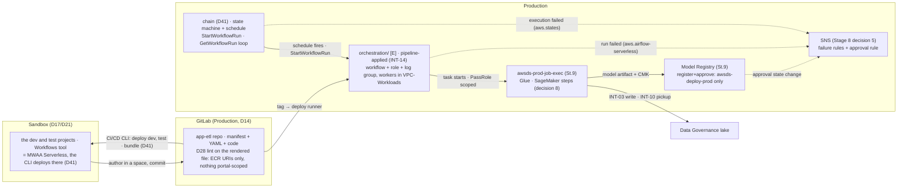

# Stage 10 — Workflow orchestration and promotion

| | |
|---|---|
| **Status** | **pass 0 read and step 4.3's deny applied on 2026-10-18** ([the log](../../log/log-stage-10-orchestration-promotion.md)): `awscc` v1.106.0 carries the workflow resource with `code` while both locks read 1.98.0, the service-linked role is absent in Production (Staging's, created by Stage 18's first `CreateWorkflow` on 2026-10-19, was enumerated on 2026-10-20: verification iii), and `DenyProvisionedMwaa` is the baseline's thirteenth statement, read `DENY-SCP` by the battery with `OR-6` passing. The same day, with the environment down, step 5.3's `awsds-prod-model-approval` was written into `production/sagemaker/`, planned and applied (2 added, 23:19Z, `OR-4` passing), and verification xxvii's first clause was answered by an offline `bundle`. **Prepared on 2026-10-22 with the environment down** (the log): the module `terraform-modules/orchestration/` and the slices `staging/orchestration/` and `production/orchestration/` are written, with `RANKS["orchestration"]` 59, their `[E]` rows and `OR-9`; each slice plans `No changes` with no release and, with a stand-in release, stops at the objects other stages create: since the application ceilings' apply at 19:27Z the same day, the data key in both accounts and Staging's job role. The chain's definition validates in Step Functions, which refuses a misspelt integration, action or argument (verification xxii). Two corrections came out of the readings: the service's detail types carry the `MWAA Serverless ` prefix (3.1), and the Cloud Control API's IAM actions the `cloudformation:` prefix (1.5). The module's tag `orchestration-v0.1.0`, on `26bfc15d`, was pushed on the user's authorization after the auto-mode classifier refused the session's first push, and both slices pin it, each planning `No changes` with no release. **Decision 1 was taken by the user the same day, revised**: the bundle stays intact in `awsds-prod-releases`, each leg extracts its tree under `applications/<app>/<tag>/` of the account's outputs bucket with the workflow's YAML its only rendered file, and `MANIFEST.sha256` shows it; the prefix `workflows/` became `applications/` everywhere. Every decision of the stage is taken: the user confirmed 5, 8 and 12 and took 2, 3, 4, 9, 11, 19 and 20 the same day, as recommended, 20 (d) as an explicit exception for the template. Passes 1 and 2 run after Stage 9 with Stage 8's pass 4 (its decision 23). **The third sitting of 2026-10-22, the environment down**: 2.3's promoted lint runs in each leg's release job (`release-application.py --lint`, Stage 8 3.2), read offline on `v0.2.1`'s bundle against Staging's live state, the rendered copy `ok` and a `dev-env` image refused; pass 3 waits on the training and transform quotas (Stage 9 3.5), and 5.1's training task joins the manifest as a second workflow after them, never `app-etl`'s promoted workflow, which the Staging leg would fail at the job; `./aws/orchestration.py` 0 FAILED. **2026-10-23, the environment down** (the log): 6.2's negatives written as commands and run by the user the same evening, every call refused by the set's own policy, the provisioned deny one layer behind it; 0.5's `vpcEndpointId` reading comes from Stage 9 2.4's proof job, written the same day; the sittings in order in [`runbooks/promotion.md`](../runbooks/promotion.md), pass 1's `deploy --targets dev` in the Sandbox sitting, passes 1 and 2 in the tag's (§T), pass 3 after the quotas (§Q), whose codes and request commands Stage 9 3.5 carries, the `ml.m5.large` pair requested by the user the same day at 2 in both accounts, `PENDING`; `./aws/orchestration.py` all checks passed on the five infrastructure profiles, `OR-9` a note. **MWAA Serverless only** (D7 amended): **step 4 is the fallback ladder**, `OR-6` is an **absence** check (`airflow list-environments` empty everywhere), the `Workflows` blueprint is category 3, and a `DenyProvisionedMwaa` (`airflow:CreateEnvironment`) statement joins the root SCP with a battery probe, because the SMUS provisioning role's AWS-managed policy grants that action today. **Design B is built, as the layer above the workflows** ([D41](../decisions/D41-sagemaker-application.md), 2026-10-15): one Step Functions state machine per chain starts the workflows and waits for each, one EventBridge Scheduler schedule starts the machine, both in the same slice; INT-14's terminal rung is the `CreateWorkflow` call from the release job (4.2). **[Stage 18](stage-18-staging-deployment-project.md)'s verdict kept this design** (the user, 2026-10-22) after measuring its alternative, a deployment-only project in Staging: 1.1's workflow stays in Terraform's state on INT-14, 4.2's rung being the CLI's own form; the pipeline's `get-workflow-run` loop that followed a run the CLI started to `SUCCESS` is 3.4's minimal form; and a non-member starts a workflow by IAM and the workflow's key alone (0.4). **The workflow is born in the application repository** as a SageMaker application, deployed by the CI/CD CLI from the `dev` project to the `test` project and bundled, the pipeline deploying the bundle here (2.1-2.4; the first CLI deploy ran in the lab on 2026-10-15). **`NetworkConfiguration` is always set, on AWS's documented private routing** (1.2), and the service takes **no proxy setting**, so the workers are the first named exception to D38's single egress, one with *no* internet path: a task's dependencies arrive in its code package or its container image. **[6i](stage-06i-sandbox-orchestration.md) measured the Sandbox half** (verifications (i) and (xv) are its), and four of its readings change this stage: workers land in both AZs and reached single-AZ endpoints, with no `monitoring` endpoint, so nothing is duplicated (decision 3); the definition and its code are read at save time in the saver's session, which here is the deploy role (1.5); a SageMaker job's settings bind whoever submits it, which here is this stage's execution role (1.3, Stage 9 decision 9); and a Sandbox run is the workflow's shape only, since Stage 9's jobs exist in Production alone (2.1). **Production cannot post lineage to the domain** under `DenyDataZoneEntirely` (3.3). **Staging gets its own orchestration slice**: a serverless workflow bills nothing at rest |
| **Prerequisites** | Stage 8 (the deploy runner and `awsds-deploy-prod` — the orchestration slice is applied by the pipeline, which is INT-14's proof; the shared gates file the lint joins; the alarm target its decision 5 settles; its pass 4, the promotion, runs together with this stage's passes 1 and 2 by its decision 23 of 2026-10-16). Stage 9 (`awsds-prod-job-exec` and the LF regrants the workflow's jobs run under; the registry with its resource policies; `awsds-prod-outputs`, the definitions home, and its key policy; the job settings where its decision 9 put them; `VPC-Workloads`' endpoint slice). **[6i](stage-06i-sandbox-orchestration.md)**: the authoring surface, `PythonOperator`, `BashOperator` and a SageMaker processing job measured on Sandbox's private shape, the four kept workflows, and the CLI that reads a workflow's `Code`. **6b** — Staging exists, so nothing here waits on a vend. **6c** — `VPC-Workloads` and its two private subnets in two AZs are where the workers land. **[D41](../decisions/D41-sagemaker-application.md)** — the application format, the CI/CD CLI's deploy into the `dev` project measured in the lab on 2026-10-15, and the chain layer this stage builds above the workflows (3.4-3.7). **[Stage 18](stage-18-staging-deployment-project.md)** — its verdict on D41 item 2 (the user's, 2026-10-22) kept 1.1, 2.4 and 4.2 as written. Taken by the user on 2026-10-22 (Stage 8's log): the job role in Staging and Production is Stage 9's `awsds-<env>-job-exec` (Stage 8 2.5), and `awsds/infrastructure` stays the promotion jobs' reader, so 1.5's applies clone it (Stage 8 decision 2). **Read 2026-10-22**: neither deployment target holds `awsds-<env>-app-boundary` (Stage 8 3.0), `alias/awsds-<env>-data` or `awsds-<env>-outputs` (Stage 9), and `awsds-staging-job-exec` does not exist (Stage 9 4.3); `awsds-prod-job-exec` does, since 2026-10-18. The orchestrating session applied both ceilings, `v1`, at 19:27Z the same day, with 1.5's grant on both deploy roles |
| **Consumes** | [D7](../decisions/D07-orchestration.md), [D11](../decisions/D11-lab-lifecycle.md), [D13](../decisions/D13-lake-formation-enforcement.md), [D17](../decisions/D17-interactive-vs-runtime.md), [D20](../decisions/D20-staging-account.md), [D26](../decisions/D26-unified-studio.md), [D28](../decisions/D28-workflow-contract.md), **[D38](../decisions/D38-single-egress-hub.md)** (the workers are its first named exception — see 1.2), **[D41](../decisions/D41-sagemaker-application.md)** (the application format, the CLI between the Sandbox projects, the chain layer) |
| **Proves** | [INT-14](../integrations.md). **Exercises, without re-proving:** INT-03 (the workflow's jobs write through Stage 9's share) and INT-07's registry half, which absorbed INT-04 at 6b (the model chain consumes Stage 9 step 3's policies as built) |

*Read with [`docs/plan/conventions.md`](../conventions.md) (naming, layout, `[P]`/`[D]`/`[E]`, IAM rules).*

---

**Objective:** explore deploying a workflow developed in SageMaker to production, as `objectives.md` puts
it, with a scheduled run there as the measure — and close the notebook-to-production gap for **models**, not
just for ETL. **D7 was settled by measurement on
2026-09-05, before this stage runs: MWAA Serverless only**, at USD 0.088 per task-hour with no standing
fee, against USD 0.29/h for the smallest provisioned environment. Design B (EventBridge Scheduler + Step
Functions) is **the layer above the workflows** since D41 (2026-10-15): a state machine per chain starts
them and a schedule starts the machine (step 3); no DAG is ported to ASL, and there is **no comparison
pass**. The Studio's *Workflows* tool **is** MWAA (open question 15), so the workflow a data scientist
authors in a **Sandbox** project and what this stage deploys are one artifact, not two that meet at D28's
contract: the application repository holds it, the CI/CD CLI puts it in the `dev` and `test` projects,
and the pipeline deploys its bundle here (D41).

## What this stage builds, and in which accounts

| Where | What | Layer |
|---|---|---|
| `terraform-modules/orchestration/` (new) | the module both slices call (1.1): per workflow the `awscc_mwaaserverless_workflow`, its execution role, its log group and its failure rule; the workers' security group `awsds-<env>-wf-workers` (1.2); the chain layer of D41: per account the schedule group, the state machines' log group and the three chain roles, per chain the state machine, its schedule and its failure rule, per bridge its rule (3.4-3.7). Written and tagged `orchestration-v0.1.0` (`26bfc15d`) on 2026-10-22 | — |
| `production/orchestration/` (new) | the module with VPC-Workloads, Production's alerts topic, job role, data key and application ceiling, the release (its tag and S3 `VersionId`s, null until the first promotion: `release.tf`), and `chains/app-etl.asl.json` (decision 14). **Applied by the pipeline** (INT-14). Written 2026-10-22, not applied | `[E]` |
| `staging/orchestration/` (new) | the same module with Staging's VPC and names — **a serverless workflow bills nothing at rest**, so the promotion chain gains a rehearsal that is not Production; its schedule is `DISABLED`, the leg starting the machine itself (decision 19). Written 2026-10-22, not applied | `[E]` |
| `production/workloads-egress/` + `staging/egress/` | nothing of this stage's, read 2026-10-22: the private-routing set the vendor documents is `logs`, `monitoring` and `kms`, and Stage 9 3.3a's and 4.3a's job-facing sets carry `logs` and `kms` in both VPCs, so `vpc-egress`'s reserved `mwaa` group stays empty and `monitoring` joins it only on verification xvi's reading (1.2). Single-AZ (decision 3) | `[E]` |
| `production/workloads/` + `staging/foundation/` (amended) | `vpc-v0.4.0`: the S3 gateway endpoint's policy admits `mwaa-serverless-code-files-*`, the service bucket a worker reads a task's `Code` from. `prod-<region>-starport-layer-bucket` is in every VPC's policy since Stage 3. Staging's applied 2026-10-19 in Stage 18's window; Production's in Stage 9's PR #245 (`502b6da6`), applied 2026-10-22 with Stage 9's passes, one change in place, the S3 gateway endpoint's policy, its id unchanged (`No changes` read 2026-10-23) | `[P]` |
| `production/sagemaker/` (amended) | the model-approval notification rule (`awsds-prod-model-approval`) on the documented `SageMaker Model Package State Change` event | `[P]` |
| `production/data/` (amended) | on `awsds-prod-outputs`: the `Object Created` notification to EventBridge for the bridge decision 16 took (3.6), decision 12's statement on `applications/*`, and a principal branch admitting the release job's role to `applications/*` from the deploy runner's network, which the perimeter does not trust (2.4), both exempting `InfrastructureAccess` as well, or Stage 8 3.8's by-hand parity is refused; on `alias/awsds-prod-data`, which delegates nothing to IAM, the deploy role and the workflows' execution roles named (1.3, 1.5, 2.4), the chain role `awsds-prod-chain-exec` when decision 2 puts the workflow on this key (3.4), and CloudWatch Logs for the log groups the module encrypts under it. The statements, exact, are 2.4's list; the slice is Stage 9's | `[P]` |
| `staging/data/` (amended) | `awsds-staging-outputs` (decision 17): Staging's copy of what `awsds-prod-outputs` holds for a workflow (its definition, its code, its result file and its inbox), with the same statements, under `alias/awsds-staging-data` | `[P]` |
| `identity/sso/` (amended) | `airflow-serverless:` reads for the persona that diagnoses a run (decision 11), beside the `states:` and `scheduler:` reads it holds, which read the chain layer: no set holds an `airflow-serverless:` read today, so 3.2's diagnosis has no reader | `[P]` |
| `app-etl` repository (GitLab) | the SageMaker application (D41): `manifest.yaml`, the workflow definition in the CI/CD CLI's notation (`workflows/app-etl.yaml`), the code package its Python and Bash tasks run (D28 class 2b, built from `code/` when there are such tasks), the processing task's code (D28 class 2d, `src/`, beside the `Dockerfile` that builds the lock's dependencies into the application image), the scripts its Glue steps run (D28 class 2c, from `glue/`); its Terraform is `terraform-live/<env>/app/app-etl/` (Stage 8 decision 12), and **the D28 promotion lint** is a command of `awsds-workflows` (Stage 8 decision 9) the pipeline runs on the rendered file. No ASL lives here: a chain's definition is the `orchestration/` slice's (decision 14) | — |
| Domain portal (console, recorded) | the serverless-Workflows surface of a Sandbox project, as 6i used it (the `engineering` project profile left at 6b); the **OnDemand Workflows blueprint stays off** (it provisions a fee-bearing MWAA environment) | — |
| `scripts/` | written 2026-10-22: `layers.py`'s `RANKS["orchestration"]` 59 and two `[E]` rows; `backend.py`'s emission of the account folder and the zone ids to an `orchestration` slice | — |

**Contracts this stage fixes, each read by `./aws/orchestration.py` so a rename fails in a check rather
than in a later stage:** the workflow **`awsds-<env>-wf-app-etl`** (the resource, its execution role and
its failure rule all carry the name — the `-a`/`-b` suffixes left with the comparison pass D7's amendment
of 2026-09-05 withdrew); the chain layer **`awsds-<env>-chain-<chain>`** (the state machine, its schedule
and its failure rule), the schedule group **`awsds-<env>-chains`**, its log group
**`/aws/vendedlogs/states/awsds-<env>-chains`**, the roles **`awsds-<env>-chain-exec`**,
**`awsds-<env>-chain-scheduler`** and **`awsds-<env>-chain-events`**, and the bridge rule
**`awsds-<env>-inbox-<app>`** (3.4-3.6); the log group
**`/awsds/<env>/wf/app-etl`**; the workers' security group **`awsds-<env>-wf-workers`**; the definitions
home **`s3://awsds-prod-outputs/applications/<app>/<tag>/`**, Staging's under the same prefix of
**`awsds-staging-outputs`** (decision 17), holding the bundle's tree: each workflow's rendered copy at
`workflows/<name>.yaml`, its code package at `code/<name>.zip`, `src/` and `glue/` (2.4, decision 1);
the model-approval rule
**`awsds-prod-model-approval`**; and, consumed from earlier stages: the job roles `awsds-prod-job-exec`
and `awsds-staging-job-exec` (Stage 9) and the application image by digest (Stage 8). The
task-definition family `awsds-prod-app-etl` exists only if decision 8 keeps an ECS step.



## Who executes each action

| Marker | Meaning |
|---|---|
| **[Claude]** | repository edits (Terraform, YAML/ASL, `.gitlab-ci.yml`, scripts) and read-only AWS calls — done without asking |
| **[Claude⚡]** | `terraform apply` or any AWS write — only after the user authorizes that specific action in chat, with the SSO user/account/permission set stated first |
| **[user]** | the Studio/portal work, git pushes and tags, gate approvals, behavioural proofs from persona sessions, and the log entries the user writes |
| **[Claude reads, user decides]** | a measurement Claude takes and a choice only the user can make, in the same sitting |
| **[pipeline]** | the deploy runner under `awsds-deploy-prod` (Stage 8 step 4) — the orchestration applies run here **because that is INT-14's proof** |

Hand applies run as the **infrastructure user**: `awsds-infra-prod` (the `production/sagemaker/`
amendment, and the by-hand parity check of the orchestration slice — Stage 8 3.8's discipline).
Authoring sessions sign in as the **data-science user** into a Sandbox project.

## Step numbers are identifiers, not an order

These numbers are **stable addresses cited from other files** — step 4 from `docs/REFERENCES.md`, step 5
from Stage 9 step 3 and D28 item 6 (the registry this stage consumes rather than invents). They do not
change. The sequence is **five passes**:

| Pass | # | What | Slice · layer | Applied as / by |
|---|---|---|---|---|
| **0** | 0 | preflights: instruments green, INT-14's surface, the SLR baseline (the Studio surface is [6i](stage-06i-sandbox-orchestration.md)'s) | readings | Claude |
| **1** | 2 | the artifact set: the application in the repository, deployed to the `dev` and `test` projects by the CLI, the lint on the rendered file, the definitions home | repo + CLI + gates | user (author, deploy, tag); Claude (lint) |
| **2** | 1, 3 | the workflow, its network shape, its failure rule, and the chain's state machine and schedule above it — applied by the pipeline in **Staging first, then Production**; **INT-14 proven or its fallback recorded** | `staging/orchestration/`, then `production/orchestration/` `[E]` | **pipeline** |
| **3** | 5 | the model chain: retrain → register → approve → serve | `production/sagemaker/` `[P]` amendment + pipeline | `awsds-infra-prod`; pipeline |
| **4** | 6 | the end-to-end scheduled promotion and the negative sweep | sessions + pipeline | user; pipeline |

Pass 1 precedes pass 2 because `CreateWorkflow` **snapshots the definition at creation** — the YAML must
sit in S3 first. Stage 8 decision 23 (taken 2026-10-16) runs Stage 8's pass 4, the promotion chain,
together with passes 1 and 2, after Stage 9. **Pass 2 lands in Staging before Production** for the same
reason Stage 8's chain does: the first `CreateWorkflow` in an account creates its service-linked role (Sandbox
holds it since 2026-08-27, Staging since [Stage 18](stage-18-staging-deployment-project.md)'s first CLI deploy on
2026-10-19: verification iii) and spends a version, and it is better that it does so in the account whose failure costs nothing. Step 4 is
not a pass — it is the fallback ladder, read only if pass 2's apply is refused.

---

## To execute

### 0. Preflight — read what this stage consumes before building on it

**Action:** confirm the substrate (Stage 8's credential layer, Stage 9's runtime) and enumerate what the new
service will create. **Why:** INT-14 was verified to *exist* on 2026-08-08, never to *apply*, and the first
`CreateWorkflow` creates a service-linked role nobody chose (Lesson 17). Open question 15's reading, that the
Studio surface and this stage's alternative A are one product, is [6i](stage-06i-sandbox-orchestration.md)'s.
**Explanation:** all readings.

- **0.1 — [Claude] Run the instruments**: `./aws/cicd.py` (CI-2/CI-3 — `awsds-deploy-prod` exists, with
  boundary and single-principal trust) and `./aws/deploytargets.py` (DT-3/DT-4/DT-5/DT-11 — the registry
  policies, the job role's D13 absence, the LF parameters intact in every account Stage 9 extended `DT-5`
  to, the job settings where Stage 9 decision 9 put them). Red here is an unfinished Stage 8/9, not a
  Stage 10 problem. **Read 2026-10-18**: every `CI-*` check passes, and `DT-3`, `DT-4`, `DT-5` and `DT-11`
  pass after Stage 9's pass 1 (the log).
- **0.2 — [Claude] Verify INT-14's surface, still read-only**: `awscc_mwaaserverless_workflow` present in
  the pinned `awscc` provider (re-verified 2026-08-16 — the classic provider merged only scaffolding,
  PR #45256, issue #45254 still open); `aws mwaa-serverless` present in the installed CLI. The *apply*
  under the boundary is pass 2's. **A workflow with Python or Bash tasks needs `awscc` v1.99.0** (read
  2026-10-10): the `code` attribute first appears there (2026-08-28), and the estate locks **v1.98.0**
  (2026-08-19) in its two `awscc` slices. The CLI half is [6i](stage-06i-sandbox-orchestration.md)
  step 0.2's: 2.36.18 knew neither `--code` nor the `Code` field `GetWorkflow` returns, and the laptop runs
  2.37.12 since 2026-10-10, so `./aws/orchestration.py`'s reader of the code location can rely on it here.
  **Read 2026-10-18**: `awscc` v1.106.0 declares `awscc_mwaaserverless_workflow` with `code`,
  `definition_s3_location` (with `version_id`), `network_configuration`, `logging_configuration`,
  `encryption_configuration` and `trigger_mode`; the CLI's `create-workflow` takes `--code`,
  `--network-configuration` and `--trigger-mode`. The locks still read 1.98.0. **Read 2026-10-22**:
  `awscc` v1.107.0 is the newest, and the two orchestration slices lock it with `aws` 6.70.0;
  `AWS::MWAAServerless::Workflow` in the CloudFormation registry keeps `Name` and `EncryptionConfiguration`
  create-only and `TriggerMode` a free string, and its handlers list the calls Cloud Control makes in the
  caller's session, which 1.5's grant carries.
- **0.3 — [Claude] Record the service-linked-role baseline**: `AWSServiceRoleForAmazonMWAAServerless`
  absent today (`aws iam get-role`, as `awsds-infra-prod`). It auto-creates at the first
  `CreateWorkflow`, manages the service's networking, and carries
  `AmazonMWAAServerlessServiceRolePolicy` — enumerate it **when it appears** (verification (iii)), so it
  is a recorded principal rather than a discovered one (Lesson 17). **Read 2026-10-18**: absent
  (`NoSuchEntity`) in Production and in Staging; Sandbox holds it since 2026-08-27, from 6i's portal
  workflows.
- **0.5 — [Claude] Re-read the `lakeformation` endpoint question 6d left here** (6d step 3.7, decision due
  11). On 2026-09-12 every Lake Formation call in Sandbox's 90-day CloudTrail window — 202 events —
  arrived service-side (`athena.amazonaws.com`, `glue.amazonaws.com`, `datazone.amazonaws.com`) or from an
  operator's laptop, and **none through the endpoint**. The flow that would need it is an engine vending
  its own Lake Formation credentials from inside a VPC; the first such engine is Stage 9 step 2.4's Glue
  job, which reads its Lake Formation events for `vpcEndpointId`, so this step consumes that reading and
  removes or keeps the Sandbox endpoint on it. Removing it is not one edit: the house image's `NO_PROXY`
  literal names `lakeformation.<region>.amazonaws.com`, and a name the image bypasses the proxy for, with
  no endpoint behind it, times out. So removal is a recipe change ([`dev-env.md`](../runbooks/dev-env.md)
  §E, "What an endpoint change costs") followed by a release and every space moved to it (§B), plus a `core_services` override in
  `sandbox/egress`. **The reading's instrument exists since 2026-10-23**: Stage 9 2.4's proof job,
  `awsds-prod-producer-proof`, a Glue job on `awsds-prod-jobs` inside `VPC-Workloads` that vends its
  Lake Formation credentials from the VPC; its run's `GetTemporaryGlue*Credentials` events in
  Production's CloudTrail carry the `vpcEndpointId` or not, the command in that step.
- **0.4 — Moved to [6i](stage-06i-sandbox-orchestration.md) steps 2.1 and 3.1.** The toggle
  half was answered at [6d](stage-06d-unified-studio-remainder.md) step 4.1 (2026-09-09): nothing enables
  the serverless surface, and the eleven blueprint configurations already provide it. The field-by-field
  reading of the editor (Lesson 16) is 6i's, made while it authors its workflows. The **OnDemand Workflows
  blueprint** stays off: it provisions a fee-bearing MWAA environment, the D7 shape this stage rejects.

### 1. The workflow slice — one design, two accounts (D7, D28, INT-14)

**Action:** write `orchestration/` once as a module and call it from Staging and Production, **applied by
the pipeline**. **Why:** the pipeline apply *is* INT-14 — `awscc` resources under a deploy role's
permissions boundary, the test Stage 8 step 4.1 said this stage would run. **Explanation:** the workflow
drives Glue jobs, which read and write governed data, and SageMaker jobs running the application image,
which read what a Glue step staged (Stage 9 3.1); every data-touching step runs under
`awsds-<env>-job-exec` (Stage 9), and decision 8 settles whether an ECS step exists at all. The
**execution role is an orchestrator credential**: it starts and observes jobs, holds **no lake data
permissions and no lake S3** (D13 one level up), and receives an LF regrant through Stage 9 2.3's local
two-step only if a task ever queries governed data directly. It is **free at rest**; what meters is the
run, plus the `[E]` endpoint set while tasks are in the VPC.

- **1.1 — [Claude] Write the workflow resource**: one `awscc_mwaaserverless_workflow` per application —
  `awsds-<env>-wf-app-etl` — with `definition_s3_location` pinned to 2.4's object **and `version_id`**,
  and `code.s3_location` pinned the same way when the workflow has Python or Bash tasks (the service
  versions the code with the definition); `role_arn` = the execution role;
  `logging_configuration.log_group_name` = `/awsds/<env>/wf/app-etl`, an
  explicit `aws_cloudwatch_log_group`, retention 90 days (D28 item 5 — never the auto-created
  `/aws/mwaa-serverless/<id>/` group, which nobody expires; [6i](stage-06i-sandbox-orchestration.md)
  measured the portal's group existing from the workflow's first save, before any run, with no
  retention); `encryption_configuration` per decision 2. **Written 2026-10-22** as
  `terraform-modules/orchestration/workflows.tf`, called by both slices with the release as a variable:
  the definition at `applications/<app>/<tag>/workflows/<name>.yaml` and the code package at
  `.../code/<name>.zip`, each pinned by the `VersionId` the release job's write returned (2.4), and
  `trigger_mode` declared `manual_only`. With no release recorded the slice creates nothing.

  **An update is a full replace** (Lesson 60): 6i's `update-workflow` dropped the `NetworkConfiguration`
  it was not given. So the resource declares every attribute the service accepts, nothing relies on a
  value `get-workflow` does not return (it returns no `EnvironmentVariables`), and the workflow is read back
  after every apply rather than trusted from the plan. A replacement is a new ARN (the service appends a
  random suffix) and takes the run history with it, so a plan that proposes one is read before it is
  applied. The deliberate break of 3.2 goes through the slice too, never through a hand `update-workflow`; the
  pause of 6.1 is the schedule's `state` (3.5), and a workflow a chain starts carries `TriggerMode`
  `manual_only`, the literal the service writes with no schedule given (the portal's workflows, 2026-10-10;
  the CLI's, 2026-10-15).
- **1.2 — [Claude] Set `network_configuration`, always, on AWS's documented private-routing shape.**
  Omitting it runs tasks in the *service's* VPC, outside every endpoint policy and flow log — the
  Athena-Spark bypass again, which is why `OR-3` reads it. The private shape's constraints, read against
  what [6i](stage-06i-sandbox-orchestration.md) measured on Sandbox's copy of it:
  1. **Two private subnets in two AZs** — the documented minimum, and free: every VPC in the estate has
     two private subnets in two AZs, `VPC-Workloads` included. The workers cannot be pinned to one AZ: in
     6i one run placed tasks in both, `caller_identity` in `usw2-az1` and `reach_pypi` in `usw2-az2`.
  2. **No route to a NAT device or an internet gateway** — AWS's own words. This is why **MWAA Serverless
     is not D38's NAT contingency candidate** (D38 §1 amended): the requirements list that demands two NAT
     gateways belongs to the *public*-routing shape on the same page (Lesson 41).
  3. **Interface endpoints**: the vendor names `logs`, `monitoring` and `kms`, private DNS on, associated
     to both subnets. 6i's workers ran against Sandbox's endpoints, every one of them in a single AZ and none
     of them `monitoring`, and every run succeeded; the `usw2-az2` worker reached `sts` and `sagemaker.api`
     in `usw2-az1`. So the set here is single-AZ (decision 3), filled into `vpc-egress`'s reserved `mwaa`
     group, and `monitoring` joins only if a reading shows the workers' metrics refused: a refusal the
     sender cannot see reads as success (Lesson 55). The jobs' own set (`sts`, `logs`, `kms`, `glue`,
     `sagemaker.api`, `secretsmanager`) is Stage 9 3.3a's and 4.3a's. A SageMaker job pulls its image
     through the service and stages S3 through the gateway, so neither `ecr.*` nor `sagemaker.runtime` is on
     a processing step's path. **Read 2026-10-22**: the jobs' set already carries `logs` and `kms`, so the
     `mwaa` group stays empty, no `vpc-egress` release is owed, and the Stage 9 session that holds both
     egress slices was told so. **One input is unmeasured**: once Stage 9's 4.3a applies, both deployment
     targets carry the same six endpoints, `sts`, `logs`, `kms`, `glue`, `sagemaker.api` and
     `secretsmanager` (`staging/egress/` on `vpc-egress-v0.17.0`, PR #245), and neither carries `ecr.api` or
     `ecr.dkr`, while every worker run so far, 6i's and Stage 18's, had both present. Whether a worker's
     preparation needs them is unknown, and the Staging leg is the first run that reads it (verification
     xvi).
  4. **The S3 gateway policy**: `prod-<region>-starport-layer-bucket` is in every VPC's policy since Stage
     3; **a workflow with a Python or Bash task's `Code` also needs `mwaa-serverless-code-files-*-<region>-prod`**:
     the worker's environment preparation reads the code snapshot from that service-owned bucket as
     `airflow-serverless.amazonaws.com`, through the S3 gateway endpoint, and a refusal surfaces only as
     "Execution environment preparation failed due to an internal server error" (measured by 6i decision 7,
     2026-10-11). `vpc-v0.4.0` carries the family; `staging/foundation/` and `production/workloads/` are on
     `vpc-v0.3.1` and take the bump here. `staging/foundation/`'s bump was applied on 2026-10-19
     by the user for [Stage 18](stage-18-staging-deployment-project.md)'s 4.4, the S3 gateway endpoint's
     policy its one change; `production/workloads/`'s bump is in Stage 9's PR #245, planned 2026-10-22 as
     *"Plan: 0 to add, 1 to change, 0 to destroy"*, the gateway endpoint's policy in place and its id, the
     INT-05 anchor, unchanged, and applied that evening with Stage 9's passes (its log), a fresh plan
     reading `No changes` on 2026-10-23. The trail that named the bucket, 6i's `sandbox/endpoint-audit/`,
     was destroyed on 2026-10-12 and is recoverable from `c0baddd` for the next refusal of this kind.
  5. **A security group with a self-referencing inbound rule** and an all-traffic outbound rule:
     `awsds-<env>-wf-workers`, in the module (`main.tf`), `[E]` with the slice. A service-linked role's
     interface still attached at a destroy holds the group back until the service releases it.

  **The service exposes no proxy setting**, which makes it **the first named exception to D38's single
  egress — an exception with *no* internet path at all** rather than a second one. A task that wants PyPI
  at run time therefore has no route: a Python task's dependencies are vendored into its code package
  (2.3), never fetched. With Stage 9's DNS Firewall in both VPCs, such a reach fails at resolution in about
  2 s (`errno 16`, 6i); without it the name resolves and the connection hangs. Verify the guide's
  private-shape NACL line (inbound allow-all, **outbound deny-all**) at build time rather than copying it: a
  stateless ACL denying all egress would break the endpoints it fronts.
- **1.3 — [Claude] Write the execution role**: trust `airflow-serverless.amazonaws.com`
  (`sts:AssumeRole`; add `aws:SourceAccount` — the docs sample omits it, so if creation fails naming
  trust, drop the condition and record it), and the permissions boundary `awsds-<env>-app-boundary`: the
  deploy role's ceiling refuses `CreateRole` and the five role-policy writes (`AttachRolePolicy`,
  `DetachRolePolicy`, `PutRolePolicy`, `DeleteRolePolicy`, `PutRolePermissionsBoundary`) on a role without
  it (`DenyRoleChangesOutsideTheApplicationCeiling`, `terraform-modules/deploy-role/main.tf`), so a role
  this slice writes without it fails at the pipeline's first apply. The boundary is `[P]`, the
  infrastructure user's (Stage 8 step 3.0), since the deploy role may neither change nor delete a policy
  named `awsds-<env>-*-boundary`, so it never lives in this `[E]` slice; its content admits what this
  role and the chain roles do. Permissions, enumerated:
  - Glue: `glue:GetJob`, `StartJobRun`, `GetJobRun`, `GetJobRuns` and `BatchStopJobRun` on the named jobs.
    `GlueJobOperator` calls `GetJob` before every start and counts only `EntityNotFoundException` as
    absent, so without it the task fails before the job starts (the Amazon provider 9.32.0 the worker
    carries, read 2026-10-13, measured in Sandbox on 2026-10-16: 6i's log). On an absent job it calls `CreateJob`, which this role does not
    hold, so a name the application slice did not declare fails closed rather than creating a job.
  - SageMaker, from 6i's processing operator: `sagemaker:CreateProcessingJob` and `StopProcessingJob`;
    `DescribeProcessingJob` on a name that does not exist yet, since the operator checks first and counts
    only a `ValidationException` as absent, with no parameter to turn it off; `sagemaker:AddTags`, because a
    create with tags is also authorized as `AddTags`; `CreateTrainingJob`/`DescribeTrainingJob`/
    `StopTrainingJob` for step 5, the describe also on a name that does not exist yet (the next item);
    `kms:CreateGrant` on the volume key, which the submitting session creates for
    `sagemaker.amazonaws.com`; and `iam:PassRole` on `awsds-<env>-job-exec` conditioned
    `iam:PassedToService = sagemaker.amazonaws.com` (conventions §6), Stage 9's role, which Stage 8 step 2.5
    made the job role in Staging and Production (the user, 2026-10-22).
  - `SageMakerTrainingOperator`, **read 2026-10-20** in the Amazon provider's code at the tag
    `providers-amazon/9.32.0` (`operators/sagemaker.py`, `hooks/sagemaker.py`, `hooks/s3.py`): before
    `CreateTrainingJob` it calls `DescribeTrainingJob` on the config's `TrainingJobName` and counts only a
    `ValidationException` as absent; any other error, an `AccessDeniedException` included, fails the task
    before the create. `check_if_job_exists: false` skips that call, an option the processing operator
    lacks. On a name that exists, `action_if_job_exists` `timestamp`, the default, appends a dash and the
    epoch seconds, the base cut so the name fits 63 characters, and checks the new name again, so a retry
    under the same name starts a second job; `fail` fails the task instead. The API reference lists
    `ResourceNotFound` as the error of `DescribeTrainingJob` and of `DescribeProcessingJob`, while the
    second answered an absent name with `ValidationException` in Sandbox (6i, 2026-10-11) and in Staging
    ([Stage 18's log](../../log/log-stage-18-staging-deployment-project.md), 2026-10-19), so what an absent
    training job answers is the first run's reading. The operator also makes calls as this role that no
    item of this list grants: `HeadBucket` (`s3:ListBucket`), then `HeadObject` or, when no object has the
    key, `ListObjectsV2`, on each `S3DataSource` channel's URI before the create, a refused `HeadBucket`
    reading *"The input S3 Bucket … does not exist"*; and, while `print_log` is true, the default,
    `logs:DescribeLogStreams` and `GetLogEvents` on `/aws/sagemaker/TrainingJobs`, where a refusal fails the
    task after the create. Neither operator nor `SageMakerHook` calls `StopTrainingJob` or
    `StopProcessingJob`: a task that fails while it waits, or meets the 3600 s cap, leaves its job running.
  - ECS only if decision 8 keeps it: `ecs:RunTask`/`DescribeTasks`/`StopTask` on the `awsds-prod-app-etl`
    task definition and `iam:PassRole` on its task roles, conditioned on `iam:PassedToService`.
  - `logs:CreateLogStream`/`PutLogEvents` on its own group.
  - S3, for the S3 operator tasks (D41 item 10) and the sensors of 3.6, in its account's outputs bucket
    and never a lake bucket: `s3:PutObject` on its application's prefix (the result file and its
    `_SUCCESS` marker) and on the inbox prefixes it writes, `s3:GetObject` and `ListBucket` on the
    markers its sensors read and on the object an `S3CopyObjectOperator` copies, which therefore lies
    outside the lake too, `s3:DeleteObject` on its own inbox if decision 10 keeps the consume here;
    and `kms:GenerateDataKey` and `kms:Decrypt` on the bucket's key, conditioned on `kms:ViaService`. The
    key delegates nothing to IAM (Stage 9 1.1), so its policy names these roles too, by `aws:PrincipalArn`
    on `awsds-<env>-wf-*` and never by the `[E]` role's ARN, whose unique id the next session's role does
    not carry (the shape of Stage 8 2.4's `AllowApplicationJobRolesViaS3`, retired by its decision 21).

  **This role is the caller of every `Create*Job` the workflow makes, so the job settings bind it** (Stage
  9 3.5, Lesson 66): each job carries `VpcConfig` with the job subnets, `EnableNetworkIsolation: true`,
  `EnableInterContainerTrafficEncryption: true` and a `VolumeKmsKeyId`, on an instance type inside the
  ceiling, and the lint checks each on a processing job (Stage 8 5.6: the volume key only in the promoted
  mode, the instance type only under `--instance-type`, and no other operator, 5.1), because a run-time
  refusal names the policy and never the statement. **No `s3:*` on any lake bucket, no `lakeformation:GetDataAccess`** — the role orchestrates, the
  job role touches data. **A Python or Bash task runs with this role's credentials**, measured at 6i (the
  project role, session `AmazonMWAAServerless`), which is the second reason it holds no lake permission: a
  Python task is orchestration code, never a data path. An S3 operator task, a sensor and a delete on a
  worker run as this role too, so its S3 reaches the result file and the inbox markers outside the lake
  (the bullet above), and decision 10 settles whether the consume-and-delete stays here. The definition and the
  code package are read at save time in the saver's session (1.5), so this role's `s3:GetObject` and
  `kms:Decrypt` on the definitions prefix are granted only if a run is read to need them.

  **The chain roles are written beside it** (3.4, 3.6): `awsds-<env>-chain-exec`, which Step Functions
  assumes to start and poll the workflows (`airflow-serverless:StartWorkflowRun` and `GetWorkflowRun` on
  the account's `awsds-<env>-wf-*` workflows, the ten `logs:*` delivery actions, nothing on jobs or S3);
  starting and reading a run also take `kms:GenerateDataKey` and `kms:Decrypt` on the workflow's key,
  under the caller's own session with the workflow's ARN as encryption context (measured by
  [Stage 18](stage-18-staging-deployment-project.md)'s 0.4 on 2026-10-19, a non-member's run that
  succeeded, one `Decrypt` per `GetWorkflowRun`), so the role carries both on the workflow's key,
  decision 2's data key in Staging and Production, which hold no project (D41 item 2, kept 2026-10-22),
  and that key's policy names the role by `aws:PrincipalArn`, since it delegates nothing to IAM;
  `awsds-<env>-chain-scheduler`, which EventBridge Scheduler assumes to start a machine
  (`states:StartExecution` on `awsds-<env>-chain-*`); and `awsds-<env>-chain-events`, the same grant for
  the EventBridge rules that start a machine. None touches data, and none is the workflow's execution
  role. Each carries `awsds-<env>-app-boundary`, for the same refusal.

  **Written 2026-10-22** in the module: the execution role's policy (`workflows.tf`) holds, per workflow,
  only the statements its entry asks for (its log group; the Glue jobs it names; its processing or
  training prefix with `PassRole` of the job role and SageMaker's grant on the volume key; its outputs
  prefixes with the data key through S3), plus `DecryptItsWorkflow`: Stage 18's 4.4 read the worker's
  session calling `Decrypt` directly through the `kms` endpoint, so the role decrypts what carries its own
  workflow's ARN as encryption context, the ten-character suffix matched by ten `?` so `app-etl`'s role
  cannot read `app-etl-check`'s. Whether that context is the one the worker uses is the first run's
  reading. The chain roles are `chains.tf`'s. `app-etl`'s entry names the Glue job
  `awsds-<env>-app-etl`, the processing prefix `app-etl-`, the read `app-etl/work/job/` (the `summarize`
  task lists and reads the processing output) and the write `app-etl/outbox/` (decision 20's table). The
  harness plan of 2026-10-22 (the log) shows each policy whole, built from names rather than from
  computed ARNs.
- **1.4 — [Claude] Write the machinery rows in the same sitting**: `RANKS["orchestration"]` above
  `app/app-etl` (so `make down` removes the trigger before the thing it triggers), **two** `[E]` `SLICES`
  rows — `staging` and `production` (`usd_per_hour` 0.0: nothing in the slice meters by the hour; the runs
  meter) — and the `backend.py` rows. A slice with no row fails `make check`. **`make up` never applies
  this slice**: the refusal Stage 8 step 2.4 writes for `app/` slices covers `orchestration/` too, since the
  slice needs a pinned definition version `make up` does not have, and a `make up ENV=production` for an
  unrelated session would otherwise create a chain whose schedule fires. The state machine and the
  schedule are born after the workflow they reference by ARN, in the same apply (3.5). `make down` destroys it
  normally. **Written 2026-10-22**: `RANKS["orchestration"]` is 59, between `app/app-etl` (58) and `probes`
  (60); `backend.py` gives an `orchestration` slice its account folder and zone ids, the subnets of
  `foundation/` and `workloads/` being keyed by zone id; refusal 7 already named the slice. The tfvars need
  no `--pipeline`: the slice reads no state outside its own account.
- **1.5 — [pipeline] Apply in Staging first, then Production — INT-14's proof**: a deploy job applies
  `staging/orchestration/` as `awsds-deploy-staging`, then `production/orchestration/` as
  `awsds-deploy-prod`, with `-input=false` (Lesson 47). Success **is** INT-14 (the `awscc`/Cloud Control
  path under a permissions boundary — the deploy role needs the Cloud Control API's actions, whose IAM
  prefix is `cloudformation:` and which take no resource narrower than `*`, plus
  `airflow-serverless:*` workflow actions inside its boundary, plus the `states:` and `scheduler:` actions
  of the chain's machine and schedule, the `events:` of its failure and bridge rules and the `iam:PassRole`
  of the chain roles (3.4-3.6); a denial names which). **The deploy role is
  the saver**: the service reads the definition and the code package at save time in the saver's session
  (6i measured the archive read as a `Decrypt` through S3 in the portal's session), so the role also needs
  `s3:GetObject` and `kms:Decrypt` on `applications/<app>/<tag>/`, `s3:PutObject` and `kms:GenerateDataKey`
  there for the release job's copy (2.4), and `iam:PassRole` of the execution role to
  `airflow-serverless.amazonaws.com`, and on the workflow's key what the service calls in the saver's
  session, `kms:CreateGrant` for the service, `GenerateDataKey` and `Decrypt` (decision 2; the CLI's API
  form at Stage 18 4.2 on 2026-10-19, and `awsds-deploy-staging`'s documents at Stage 18 4.3 on
  2026-10-21); Stage 8 step 4.1's policy gains them here, and 2.4's bucket and key
  statements admit them. Staging's first save created the service-linked role in the saver's session
  (verification iii), so Production's first apply needs `iam:CreateServiceLinkedRole` on
  `airflow-serverless.amazonaws.com` in `awsds-deploy-prod`'s policy unless the role exists by then: on
  2026-10-20 its boundary admits the action and no policy on the role grants it (`simulate-principal-policy`,
  the log). From the runner, `make up`'s
  hub check is waived (it reads the hub through the laptop's profile), so the job checks the proxy itself
  before its first apply (Stage 8 3.1). On refusal, read step 4's ladder rather than improvising.
  **[Claude⚡]** Prove the by-hand parity once as `awsds-infra-prod` (Stage 8 3.8's rule: a slice that only
  applies from CI is as broken as one that only applies by hand).

  **The grant, enumerated on 2026-10-22** for Stage 8 to write in each `*/foundation/` (its 4.1), written
  there the same day in PR #244 as two customer-managed policies per account,
  `awsds-<env>-deploy-orchestration-resources` and `-access`, applied on the user's authorization at
  19:27Z, the re-plans `No changes`: the grant measures 7,836 characters in
  Staging, white space not counted, above the 6,144 a managed policy holds, so an amendment keeps each
  policy under 6,144. The deploy role's ceiling holds only the six actions
  `iam:PermissionsBoundary` is evaluated for to the application ceiling, so every other role action is
  scoped here by the role's name. The pipeline clones `awsds/infrastructure` for these applies (Stage 8
  decision 2, taken 2026-10-22). Read against the registry's handlers for `AWS::MWAAServerless::Workflow`
  and the module's resources:
  - **state**: `state_prefixes` gains `<folder>/orchestration/`; `state_read_keys` gains the `workloads/`,
    `foundation/` and `sagemaker/` keys in Production, the `foundation/` and `sagemaker/` keys in Staging.
  - **Cloud Control**: `cloudformation:CreateResource`, `GetResource`, `UpdateResource`, `DeleteResource`,
    `GetResourceRequestStatus` and `ListResources` on `*`.
  - **the workflow**: `airflow-serverless:CreateWorkflow` and `ListWorkflows` on `*` (no resource type);
    `GetWorkflow`, `UpdateWorkflow`, `DeleteWorkflow`, `TagResource`, `UntagResource`,
    `ListTagsForResource` and `ListWorkflowVersions` on `workflow/awsds-<env>-wf-*`;
    `logs:CreateLogGroup` on `/awsds/<env>/wf/*` and `logs:DescribeLogGroups` on `*`, the saver's calls on
    `UpdateWorkflow` (Stage 18 4.5) and in the registry's create and update handlers.
  - **the saver's reads and the release job's copy**: `s3:GetObject` and `s3:GetObjectVersion` (the read
    of a pinned version) on `awsds-<env>-outputs/applications/*`, `s3:PutObject` there and on `inbox/*`,
    where the release job seeds `samples/` (decision 20 (d)), `s3:ListBucket` with `s3:prefix`
    `applications/*`; `kms:Decrypt` and `kms:GenerateDataKey` on the data key with `kms:ViaService` =
    `s3.<region>.amazonaws.com`.
  - **the workflow's key** (decision 2), as written in PR #244 (`b35aae36`), the twins of Stage 9's
    key-policy statements: `kms:Decrypt` and `kms:GenerateDataKey` with
    `kms:EncryptionContext:aws:airflow-serverless:workflow-arn` like `workflow/awsds-<env>-wf-*`, the read
    handler's `Decrypt` included; `kms:CreateGrant` with `kms:GrantIsForAWSResource`; and
    `kms:DescribeKey`. The context the service's calls carry is the first apply's reading.
  - **the roles**: `iam:CreateRole` with `iam:PermissionsBoundary` = `awsds-<env>-app-boundary`,
    `iam:PutRolePolicy`, `iam:DeleteRolePolicy`, `iam:GetRole`, `iam:GetRolePolicy`,
    `iam:ListRolePolicies`, `iam:ListAttachedRolePolicies`, `iam:ListInstanceProfilesForRole`,
    `iam:DeleteRole`, `iam:TagRole`, `iam:UntagRole`, `iam:UpdateAssumeRolePolicy` and
    `iam:UpdateRoleDescription` on `role/awsds-<env>-wf-*` and `role/awsds-<env>-chain-*`; `iam:GetPolicy`
    and `iam:GetPolicyVersion` on the application ceiling, which the slice looks up.
  - **`iam:PassRole`**, one statement per service: `role/awsds-<env>-wf-*` to
    `airflow-serverless.amazonaws.com`, `awsds-<env>-chain-exec` to `states.amazonaws.com`,
    `-chain-scheduler` to `scheduler.amazonaws.com`, `-chain-events` to `events.amazonaws.com`.
  - **Production, until the role exists**: `iam:CreateServiceLinkedRole` on
    `role/aws-service-role/airflow-serverless.amazonaws.com/AWSServiceRoleForAmazonMWAAServerless` with
    `iam:AWSServiceName` = `airflow-serverless.amazonaws.com`.
  - **the log groups**: `logs:CreateLogGroup`, `DeleteLogGroup`, `PutRetentionPolicy`,
    `DeleteRetentionPolicy`, `AssociateKmsKey`, `DisassociateKmsKey`, `TagResource`, `UntagResource`,
    `ListTagsForResource`, `TagLogGroup`, `UntagLogGroup` and `ListTagsLogGroup` on `/awsds/<env>/wf/*` and
    `/aws/vendedlogs/states/awsds-<env>-chains`; the machines' log delivery, `logs:CreateLogDelivery`,
    `GetLogDelivery`, `UpdateLogDelivery`, `DeleteLogDelivery`, `ListLogDeliveries`, `PutResourcePolicy`
    and `DescribeResourcePolicies`, on `*`.
  - **the chain**: `states:CreateStateMachine`, `DescribeStateMachine`, `UpdateStateMachine`,
    `DeleteStateMachine`, `ListStateMachineVersions`, `TagResource`, `UntagResource` and
    `ListTagsForResource` on `stateMachine:awsds-<env>-chain-*`; `scheduler:CreateScheduleGroup`,
    `GetScheduleGroup`, `DeleteScheduleGroup`, `CreateSchedule`, `GetSchedule`, `UpdateSchedule`,
    `DeleteSchedule`, `TagResource`, `UntagResource` and `ListTagsForResource` on
    `schedule-group/awsds-<env>-chains` and `schedule/awsds-<env>-chains/*`; `events:PutRule`,
    `DescribeRule`, `DeleteRule`, `EnableRule`, `DisableRule`, `PutTargets`, `RemoveTargets`,
    `ListTargetsByRule`, `TagResource`, `UntagResource` and `ListTagsForResource` on
    `rule/awsds-<env>-wf-*`, `rule/awsds-<env>-chain-*` and `rule/awsds-<env>-inbox-*`.
  - **the workers' group**: `ec2:CreateSecurityGroup` on the VPC and on `security-group/*`;
    `ec2:DeleteSecurityGroup`, `AuthorizeSecurityGroupIngress`, `AuthorizeSecurityGroupEgress`,
    `RevokeSecurityGroupIngress` and `RevokeSecurityGroupEgress` (the provider revokes the default egress
    rule) on `security-group/*` whose `Name` tag is `awsds-<env>-wf-workers`; `ec2:CreateTags` on
    `security-group/*` and `security-group-rule/*` within those calls (`ec2:CreateAction`);
    `ec2:DescribeSecurityGroups`, `DescribeSecurityGroupRules`, `DescribeNetworkInterfaces`, `DescribeVpcs`
    and `DescribeSubnets` on `*`.
  - **the slice's lookups**: `kms:DescribeKey` and `kms:ListAliases` (the data key's alias) and
    `sts:GetCallerIdentity`.
  - **Staging alone** (decision 19): `states:StartExecution` on `stateMachine:awsds-staging-chain-*`,
    `states:DescribeExecution` and `states:GetExecutionHistory` on `execution:awsds-staging-chain-*:*`, the
    leg's start of the chain.
- **1.6 — [Claude] Record what the first `CreateWorkflow` created**: the service-linked role now exists
  (0.3's pair reading — verification (iii)); the workflow ARN and version; **the version counter starts
  spending the 50-version quota** — every save is a new version, a description-only edit included (6i), and
  no prune API is documented (risk 4).

### 2. The workflow artifact — born in the application repository, deployed to the Sandbox projects by the CI/CD CLI, promoted through git (D21, D26, D28, D41)

**Action:** keep the deployable workflow definition in the application repository, in the CI/CD CLI's
notation, deploy it to the `dev` and `test` projects with the CLI, and put the D28 lint in front of its
rendered copies. **Why:** D28's whole point is that what crosses the gate is repository content — a
workflow that references portal-scoped anything only runs where the portal exists, and **only Sandbox has
a portal** (D17 sharpened at 6b). **Explanation:** [6d](stage-06d-unified-studio-remainder.md) step 4
and [6i](stage-06i-sandbox-orchestration.md) measured that portability: a definition authored in the
portal names project-scoped values by design. D41 turns the rewrite into the authoring form: the YAML in
the repository carries the CLI's variables (`{proj.id}`, `{proj.iam_role_arn}`,
`{proj.connection.default.s3_shared.s3Uri}`, `{domain.region}`), which the CLI resolves per project
when it deploys, and which the release job renders per environment (decision 6). The first such deploy
ran in the lab on 2026-10-15 (D41).

- **2.1 — [user] Author the workflow in the application repository and deploy it to the `dev` project with
  the CLI**: `aws-smus-cicd-cli deploy --manifest manifest.yaml --targets dev --skip-validation
  --no-events`, run from a space as the project role, the identity Stage 8 decision 22 settled on 2026-10-16 (the
  pipeline's is decision 19).
  `deploy` syncs the manifest's `storage` content into the project's S3 (`aws s3 sync`, no `--delete`),
  and the workflow is born by the bootstrap action `workflow.create`: the CLI resolves the variables,
  rewrites the YAML at the same key and calls `CreateWorkflow` with the project role, the Tooling subnets,
  security group and key, no `TriggerMode` (so `manual_only`), the log group
  `/aws/mwaa-serverless/<domain>-<project>/<name>` with no retention, and six tags
  (`AmazonDataZoneProject`, `AmazonDataZoneDomain`, `Target`, `CreatedBy=SMUS-CICD`, `STAGE`, `Pipeline`),
  which `monitor` and `logs` filter by. The name is `<application>_<project>_<workflow>`, every
  character outside `[A-Za-z0-9_]` turned into `_`. Measured in the lab on 2026-10-15: the deploy of
  15:52 UTC left the workflow `READY`, its resolved YAML identical to `WorkflowDefinition`, encrypted
  with the project key. `--skip-validation` is needed: the CLI's pre-deployment validation simulates the
  project role's policies with no context keys, so every SCP conditioned on `aws:RequestedRegion` or
  `aws:ResourceOrgID` reads denied (Lesson 30), and the simulation never reads a bucket or key policy
  anyway. Each deploy of the same workflow spends one of its 50 versions (1.6; read 2026-10-16 in the lab,
  Stage 8 step 2.5), and this loop deploys often (Stage 8 verification xxiii). Then test-run its shape there, with Sandbox's
  `[E]` session up (Stage 8 step 2.5; Sandbox task-hours, metered per run). **This is where D21's
  "authored and test-run" clause now points**, and Sandbox is the only account it can point at. What a
  Sandbox run can test is the workflow's shape, not its jobs: every task runs as the project role, against
  the project's `shared/` storage and the application image (D41 item 7; the project role's pull of it is
  verification xxiii), the lake share there is read-only, and the Stage 9 producer and pickup Glue jobs
  exist in Production alone, so **Staging is the first real run**. No task is a portal *Notebook task*:
  6d decision due 14 took (b). Nor is a Visual ETL flow or a query book scheduled from the portal: the
  documentation runs both scheduling routes as the same notebook execution
  ([`docs/SMUS.md`](../../SMUS.md), the workflow surface). The code a task runs itself uses
  `PythonOperator`, `BashOperator` or a SageMaker processing job, the three shapes 6i measured on
  Sandbox's private shape. The portal's authoring rules (an import into an empty workflow, an import that
  cannot replace a saved one, the pre-filled operator-files location to empty when no file is uploaded)
  are [`serverless-workflows.md`](../runbooks/serverless-workflows.md) §A, and a save in the portal over
  a CLI-made workflow is an `update-workflow` that replaces it whole (Lesson 60) and writes a second copy
  under `dev/workflows/`, so the portal is where the workflow is read, never saved. Its Tags tab shows
  the CLI's six tags under a notice that tags come from the definition file, where the CLI never
  wrote them (`TagResource`), so a save there would also drop the tags `monitor` and `logs` filter by
  (read 2026-10-15; no save has measured it).
- **2.2 — [user + pipeline] Bundle and deploy to the `test` project** (D21 — the gate is the tag, and the
  rewrite happened in the repository): on the release tag, once the image is built (Stage 8 step 2.5,
  under the identity its decision 19 settles), `bundle` packs the checkout and the files the tag pipeline
  built from it into the artifact the pipeline promotes, its workflows with their variables unresolved,
  and `deploy --targets test` deploys the same folders, running `workflow.create` in the `test` project
  and `workflow.run` with `trailLogs` (`wait` crashes the CLI 1.0.9, Stage 8 step 2.5), the job reading the
  run back with `get-workflow-run`, its `RunState` `SUCCESS` the test, so what `test` runs is what the
  bundle carries, both read in
  one job; once `test` passes, the tag's GitLab release links to the bundle, stored where Stage 8 decision
  20 says. The manifest's `content.storage` items name no connection, so `bundle` reads each from the
  checkout, the manifest naming it per stage under `deployment_configuration`, and `deploy` reads each
  from the manifest's folder, opening a bundle archive only for a catalog export or notebooks, which the
  manifest does not enable and the lint refuses (Stage 8 step 5.6); an item that named a connection would
  make `bundle` download it from the stage's project, where `deploy` left the YAML resolved for that
  project, and `deploy` read it from the bundle. `--local` only
  changes the default stage's name (the CLI's 1.0.9 code, read 2026-10-15; verification xxvii). A value no
  project holds, the image by digest first, reaches the run as a stage variable, `{env.VAR}` in the YAML
  (D41 item 1): `workflow.create` writes it as `{{ params.VAR }}` and `workflow.run` passes the stage's
  `environment_variables` as the run's `OverrideParameters`; a `${VAR}` stays in the YAML as written
  (verification xxix). The repository's YAML is the source: the portal's own YAML is never the artifact
  (6i: no Python authoring and no converter in the path), project-scoped values are the CLI's variables,
  and the job image is the application image (Stage 8, decision 7). `schedule` (cron) belongs to no
  workflow promoted to Staging or Production, since a chain starts every one (decision 13, taken), and the
  lint refuses one in the rendered copy (2.3). The validated parameter set: `retries` ≤ 3 and set
  explicitly (the service defaults it to 1), `retry_delay` ≤ 300 s, `execution_timeout` ≤ 3 600 s.
  The service **ignores** `catchup`, callbacks, `trigger_rule`, `deferrable`, `render_template_as_native_obj`,
  `do_xcom_push` and `is_paused_upon_creation`; a template sees only `macros`, `ti`, `params`, `ds` and `ts`
  (no `dag_run`, and `ts_nodash` reads midnight on a manual run); and a templated list arrives as a string
  (6i decision 4's hand-over). A DAG that leans on any of these behaves differently here than in an
  ordinary Airflow, which is a fact to record about the service, not a defect to chase. Python callables
  live as modules in `code/`. A Visual ETL flow graduates as the script its editor
  generates, into `glue/` as a Glue job of the application (D28 class 2c), its project connections turned
  into job arguments; the `.vetl` and its portal schedule stay in the project. A Python or Bash task runs
  on a 1 vCPU / 3 GiB x86_64 worker (vendor page) on Python 3.12, against a pre-installed Airflow 3.0.6 and Amazon provider 9.32.0 that win
  over any bundled version (6i measured the worker's PyYAML beating the archive's copy), so heavy work
  belongs in Glue or SageMaker. If authoring ever produces Python, AWS's
  `python-to-yaml-dag-converter-mwaa-serverless` converts it (AWS-provider operators only, no dynamic task
  mapping), and what it warned about is verification (viii).
- **2.3 — [Claude] Consume the D28 promotion lint — it is authored once, at Stage 8 step 5.6**, so there
  is one copy. It runs on the rendered file (decision 6) in the promoted mode, `lint <file> --promoted
  --prefix s3://<outputs bucket>/applications/app-etl/<tag>/`, which refuses a CLI variable or a placeholder
  left in the copy; the command refuses `--promoted` without a prefix and with a folder. It also passes
  the two options the `app-etl` template's `test` job passes since 2026-10-18 (Stage 8 5.6's table):
  `--image-repository` with the application's repository, and one `--instance-type` per type of the
  ceiling, the seven `allowed_instance_types` of `terraform-modules/sagemaker-denies`. Without them the
  promoted mode refuses neither a `dev-env` image nor an instance type outside the ceiling: `3c1708e`'s
  `lint` hands both to the definition's checks only when given. **Wired 2026-10-22**: Stage 8's release
  job (`scripts/release-application.py --lint`) runs the command on each rendered copy before it writes a
  byte, the prefix the release's, the repository `IMAGE_REPO` and the types `LINT_INSTANCE_TYPES`, the
  pipeline's own variables, and an empty one fails the job (Lesson 71). Read offline on `v0.2.1`'s stored
  bundle against Staging's live state: the rendered copy `ok: 1 arquivo(s)`; the same render with a
  `dev-env` image refused, *"ImageUri do repositório awsds-prod-ecr-dev-env, e não de
  awsds-prod-ecr-app-etl"*. The three rules this stage owns in `awsds-workflows` ((2c), (6) and 5.1's)
  stay specified and unwritten, in that repository. The repository's
  YAML is `app-etl`'s CI's, linted as a folder in the authoring mode, where the CLI variables are
  translated and not refused. It rejects a definition that references a domain resource (project connections,
  portal-scoped ids), names a container by anything other than an **ECR URI and digest**, exceeds **50 KB**,
  hard-codes a `start_date` (rewritten at deploy time), uses an operator outside MWAA Serverless's
  supported list (the Amazon-provider operators, plus `PythonOperator` and `BashOperator`, which AWS
  added on 2026-08-17 by the guide's document history, the day after this stage's 2026-08-16 reading),
  exceeds the **3600 s** task cap; for a workflow a state machine starts, a `schedule` line is refused
  too (decision 13). It reads no `VersionId`, a field of the `CreateWorkflow` call and not of the YAML
  (Stage 8 5.6 (d)): the pin is 2.4's. **Class 2c's rule is half in the lint**: its `glue` rule (5.6)
  refuses a `GlueJobOperator` whose script, or a file its arguments name, lies outside the prefix it is
  given, and applies rule (a)'s project-scoped patterns to the scripts in the application folder's
  `glue/`, where a Visual ETL flow's connection names surface. **This stage still needs the other half**,
  reading the application slice rather than the definition: a Glue job whose script, or a file its
  arguments name, lies outside the release's own prefix (decision 12), since in Staging and Production
  the slice's `aws_glue_job` names the script and the definition's task drops its creation arguments
  (decision 6). Class 2d's rule is 5.6's (h): a processing job's code input lies under the release's own
  prefix, which the lint reads; its match to the release's manifest has no rule at `3c1708e`. **The rules
  this stage owns, specified 2026-10-22** for `awsds-workflows`, outside this repository: (2c) a command
  that reads the application slice's saved plan (`terraform show -json`) before the release job applies it
  and refuses an `aws_glue_job` whose `command.script_location`, or an `s3://` value of its
  `--extra-py-files`, `--extra-files`, `--extra-jars` or `--additional-python-modules`, lies outside
  `s3://awsds-<env>-outputs/applications/<app>/<tag>/glue/`, and a module named by a PyPI name, which no job
  subnet can fetch; (6) in the promoted mode, a Glue task that keeps `create_job_kwargs`,
  `script_location`, `iam_role_arn`, `update_config` or `job_desc`, which the render drops because the job
  is the slice's (decision 20's table); 5.1 carries the training job's rule, and 2.4 the comparison with
  the manifest, which is the release job's and not the lint's. **The code
  package is what carries the no-internet
  constraint now**: with no internet path in the worker subnets (1.2), a
  Python task's dependencies must be vendored into its package for Linux x86_64 and Python 3.12, so CI
  builds the package and imports every `python_callable` from it with networking off, which turns a
  runtime import failure into a CI failure. **[user]** Prove it once with a deliberately portal-scoped
  definition (verification (xi)).

  **A processing task's code is a different artifact.** 6i ran one (its verification xvi,
  2026-10-11): the folder `awsds-workflows package-job` builds
  ([`serverless-workflows.md`](../runbooks/serverless-workflows.md) §J1), the project plus the packages
  the house image lacks, given to the job as a code input with no network. A `ProcessingInput` names an
  S3 prefix the job reads at each run, with no version to pin, so no `VersionId` pin can hold it,
  and what runs is whatever the prefix holds when the job starts: decision 7. Decision 7 is
  **taken by the user on 2026-10-15, as the alternative** (D41 item 7): the application image carries
  the dependencies alone, built from the lock, and the code input is the project's `src/` (D28 class
  2d), copied by the CLI in `dev` and `test` and written by the release job under the release's prefix,
  kept from overwrite by decision 12's statement and checked by rule (h). No CI job builds 6i's folder
  for an application: what the code needs beyond itself is in the image, whose interpreter runs it.
- **2.4 — [pipeline] Deploy the definition to the versioned home**: in each leg the release job downloads
  the tag's bundle (2.2) from `awsds-prod-releases` with the deploy runner's own role (Stage 8 decision
  20), checks its SHA256, before it reads a file of it, against the value Stage 8 step 2.5's third job
  passed down the pipeline, never against the release's notes or anything the bucket keeps beside the file,
  and rebuilds nothing; step 3.7 commits that value for a later re-apply. It renders
  `workflows/app-etl.yaml` for its account (decision 6) and copies the rendered copy to
  **`s3://awsds-prod-outputs/applications/app-etl/<tag>/workflows/app-etl.yaml`** in Production (decision 1 — the
  bucket is versioned, CMK-protected, perimeter-branched since Stage 9 1.1), or to the same key of
  Staging's bucket (decision 17), and records the returned S3 `VersionId` — the value 1.1 pins, so a
  definition edit without a deploy cannot reach the workflow (`CreateWorkflow` snapshots anyway; the pin
  makes the intent explicit). When the workflow has Python or Bash tasks, the code package the tag pipeline
  built from `code/`, which the bundle carries, goes to `applications/app-etl/<tag>/code/app-etl.zip` and its
  `VersionId` is recorded the same way; the prefix keeps the application's own folders, one YAML per
  workflow, since decision 18 gives `app-etl` two; the processing task's `src/` goes to `applications/app-etl/<tag>/src/`, the job's input (D28 class 2d,
  decision 7, taken). The release job then reads that prefix back against the release's manifest, the
  one it writes there, and fails on any object that differs: the pinned lint has no rule comparing a
  processing job's code input with that manifest (Stage 8 5.6 (h)), so this read is the check. Specified
  2026-10-22: the job writes every object with `--checksum-algorithm SHA256`, writes the manifest last as
  `applications/app-etl/<tag>/MANIFEST.sha256` (each key, size, SHA256 and the bundle's SHA256 of the same
  file, sorted, so a reader sees that only the rendered YAML differs from the bundle), then lists the prefix with
  `s3api list-objects-v2` and reads each object's `ChecksumSHA256` with `s3api head-object
  --checksum-mode ENABLED`, failing on a key missing, a key the manifest lacks, or a checksum that
  differs; S3 computes the checksum on the write, so nothing is downloaded. The
  scripts in `glue/` go to `applications/app-etl/<tag>/glue/`, where the application
  slice's Glue jobs name them; Glue reads them at every run and pins no version, so what keeps them from
  changing is decision 12. **The release job writes from the deploy runner**, in `VPC-SharedServices`,
  whose gateway endpoint the perimeter leaves out by name (Stage 9 1.1), and under a key that delegates
  nothing to IAM: so `production/data/` gains a principal branch admitting the role the release job runs as
  to `applications/*` alone, the shape of `DataScientistProdAccess`'s branch (D39), and a key-policy statement
  naming that role; Staging's bucket gains the same for `awsds-deploy-staging`. Both branches, and decision
  12's deny, exempt the account's `InfrastructureAccess` as well, or Stage 8 3.8's by-hand parity is
  refused. **The statements**, for Stage 9's `production/data/` and `staging/data/` (requested of that
  stage's session on 2026-10-22), by `aws:PrincipalArn`: decision 12's `Deny` of `s3:PutObject` and
  `s3:DeleteObject` on `applications/*` to every principal but the deploy role and `InfrastructureAccess`; the
  branch admitting those two to `s3:PutObject`, `GetObject`, `GetObjectVersion` and `ListBucket`
  (`applications/`) from outside the gateway endpoint; the notification to EventBridge; and in the data key's
  policy, the deploy role's `GenerateDataKey` and `Decrypt` through S3 and its `CreateGrant`,
  `GenerateDataKey`, `Decrypt` and `DescribeKey` for the workflow (decision 2), `awsds-<env>-chain-exec`'s
  `GenerateDataKey` and `Decrypt` with the workflow's ARN as encryption context, the pattern
  `awsds-<env>-wf-*`'s `GenerateDataKey` and `Decrypt` through S3, its `Decrypt` with its workflow's ARN as
  context and its `CreateGrant` through SageMaker for a job's volume, and `logs.<region>.amazonaws.com`
  for the groups the module encrypts (`kms:EncryptionContext:aws:logs:arn`).

### 3. Schedule, retry, alerting, and the chain layer (D28 item 5, D41)

**Action:** make the workflow fire unattended and page on failure, and build the layer that starts the
workflows in order. **Why:** a scheduled run in production is how this stage measures the exploration
`objectives.md` asks for, and a failed nightly run nobody hears about is worse than no schedule.
**Explanation:** a standalone workflow's cron lives **in the YAML** (EventBridge Scheduler underneath;
`TriggerMode` pauses it; only one workflow version holds the active schedule), so it is promoted with the
definition rather than configured beside it; a chain's cron lives in the Scheduler schedule that starts
its state machine (3.5), in the slice, and no production workflow keeps the first form (decision 13,
taken). The service has no dependency between workflows: a workflow starts by its cron, by a call or
by nothing, `outlets` are ignored, and the worker reaches no API, so what orders the workflows is the
state machine (3.5) and what carries data between them is a contract on S3 (3.6).

- **3.1 — [Claude] Write the failure rule** (in the slice): `awsds-<env>-wf-app-etl-failed` on source
  **`aws.airflow-serverless`**, detail-types **`MWAA Serverless Workflow Run Failed`** and **`MWAA Serverless
  Workflow Run Timeout`**, to the account's
  alerts topic, `awsds-<env>-alerts`, which Stage 8 decision 5 created (the Stage 1b topic lives in the
  Management account). Delivery is documented durable; duplicates tolerated. **A silent success is not covered**: a sensor
  with `soft_fail` ends an empty-inbox run `SUCCESS`, its task's status `NONE` and no downstream task
  created (6i), so "nothing arrived" needs its own signal if the workflow is file-triggered. A chain has its own rule
  (3.7), on the state machine's execution: a workflow failure inside a chain fires both. **Read 2026-10-22**:
  every detail type of the service carries the `MWAA Serverless ` prefix (the EventBridge reference page,
  and an example event of the run's `Succeeded` with `workflowArn`, `workflowRunId`, `workflowId` and
  `status` in its detail), so the names this step carried until then would never have matched, a rule that
  reads `ENABLED` and hears nothing (Lesson 56); `OR-4` now fails a failure rule whose pattern lacks either
  type. **Written** in the module, matching the workflow's exact ARN in `detail.workflowArn`, so
  `app-etl`'s rule does not hear `app-etl-check`; 3.2's provocation reads the field.
- **3.2 — [user] Prove it, and prove the diagnosis path with it**: break a step deliberately (a wrong job
  argument, through the slice and never through a hand `update-workflow`, 1.1), run once — the rule fires,
  and the failure is *diagnosable* from what the service offers: `list-workflow-runs`, `list-task-instances`,
  `get-task-instance` (the `LogStream` field), the log group and the console page. **Record the diagnosis
  session**: with no environment to log into, what those APIs report is the whole operational surface. What
  6i taught about reading it: a run's `RunState` lags its task instances (`QUEUED` after the first task had
  finished), so the diagnosis reads the task instances and the alert reads 3.1's rule, never a poll of the
  run's state; a failed task is retried once and its attempts are listed out of order; a task's
  `DurationInSeconds` is the number to read, never the run's; and a name the DNS Firewall blocks fails in the
  worker as `errno 16` at resolution. **Who reads it is decision 11**: no persona set holds an
  `airflow-serverless:` read today; `DeploymentManagerAccess` reads the `states:` and `scheduler:`
  families (`ReadOrchestrationExecutionStatus`), which with D41 read the chain layer: the state machine's
  history says which workflow failed, the workflow's APIs which task.
- **3.3 — [Claude reads, user decides] Does the orchestrator emit lineage, and where can it land?** Handed
  over from [6f](stage-06f-data-governance.md) step 6.2 (2026-09-18) rather than left in that stage's log
  (Lesson 34). What the vendor page **does** say: DataZone captures lineage automatically from Glue and
  Redshift databases added to the domain, from **Spark ETL job runs in AWS Glue v5.0 and higher**, and from
  anything that posts to its **OpenLineage-compatible API**. The automatic half is not a blueprint setting
  and no Terraform declares it: each Sandbox project's `LAKEHOUSE` and `IAM` connections carry
  `glueLineageSyncEnabled: true` from their creation, and the project's Redshift connection carries a
  `lineageSync` job of its own (6f and 6h, read 2026-10-18); it reaches Sandbox's data sources only. What it **does not** say is whether **MWAA Serverless** emits anything. **Production
  cannot post at all**: lineage is a DataZone call, and the `Workloads` OU denies `datazone:*`
  (`DenyDataZoneEntirely`, whose own revision trigger is the first time Production must publish); 6f
  settled that Production publishes through the lake, not through an association. So the reading is taken
  in Sandbox, on one of 6i's kept workflows (a run costs about 0.003-0.03 USD): run it, then
  `list-lineage-events` on the domain, with a second reading after a delay before "nothing" is believed
  (Lesson 62). The outcomes: the service emits; Airflow's OpenLineage provider is configured to emit, which
  has nothing to configure here, since the worker's packages are AWS's and win over any bundled copy; or the
  job posts its own events, which meets the same SCP in Production. What Production lineage costs is
  decision 9. **Today the domain's `list-lineage-events` is
  empty**, so whatever this finds is the first event the estate ever produces. **Measured 2026-10-19 in
  Staging** ([Stage 18](stage-18-staging-deployment-project.md) step 7.1): a Glue 6.0 job carrying the
  OpenLineage settings posts its own events, as its role, and only through a `datazone` interface
  endpoint in its VPC; without one each post failed *"Network is unreachable"* and the job went on. In
  Production that takes the endpoint and a way past `DenyDataZoneEntirely` together, decision 9's cost.
- **3.4 — [Claude] Write the chain layer's base, per account** (D41; decision 15 for its slice): the
  schedule group `awsds-<env>-chains`; the state machines' log group
  `/aws/vendedlogs/states/awsds-<env>-chains`, retention 90 days, encrypted with the account's data CMK,
  on the documented `/aws/vendedlogs/` prefix that keeps every state machine inside one CloudWatch Logs
  resource policy; the Step Functions role `awsds-<env>-chain-exec`, trusted by `states.amazonaws.com`
  with `aws:SourceAccount`, holding `airflow-serverless:StartWorkflowRun` and `GetWorkflowRun` on
  `arn:aws:airflow-serverless:<region>:<account>:workflow/awsds-<env>-wf-*` (the ARN carries the name and
  a ten-character suffix the service appends, so the resource is a pattern), `kms:GenerateDataKey` and
  `kms:Decrypt` on the workflow's key, which the service calls in the caller's session at a start and at
  each `GetWorkflowRun` (Stage 18 0.4, 2026-10-19; 1.3), and the documented ten
  `logs:*` delivery actions on `Resource: "*"`, nothing on jobs and nothing on S3 (`ListWorkflows` only
  if a chain resolves a workflow by name instead of by ARN); and the Scheduler role
  `awsds-<env>-chain-scheduler`, trusted by `scheduler.amazonaws.com`, holding `states:StartExecution` on
  `arn:aws:states:<region>:<account>:stateMachine:awsds-<env>-chain-*`. Both roles, and 3.6's
  `awsds-<env>-chain-events`, carry the permissions boundary `awsds-<env>-app-boundary`, which the deploy
  role's ceiling requires on every role it creates (1.3; Stage 8 step 3.0). This is
  `terraform-reference/`'s `modules/orchestration/` base (its `controladoria-schedules` group, its
  `<prefixo>-pipelines` log group and its `<prefixo>-step-functions` and `<prefixo>-eventbridge-scheduler`
  roles), with the EMR, crawler, SNS and X-Ray grants that estate's role carries left out until a chain
  needs one. Sandbox gets none of it: a chain exists where a workflow is promoted, and `sandbox/workflows/`
  (rank 56) stays what it is. **Written 2026-10-22** as the module's `chains.tf`: the group, the log group
  under the data key, `awsds-<env>-chain-exec` with `StartWorkflowRun` and `GetWorkflowRun` on the
  pattern, the key's two calls conditioned on the workflow's ARN as encryption context, and the ten
  delivery actions; the Scheduler's and the bridges' roles one module call, one grant and two trusts.
- **3.5 — [Claude] Write a chain: one state machine and one schedule** (decision 14 for where its
  definition lives): `aws_sfn_state_machine` `awsds-<env>-chain-<chain>`, type Standard (Express has no
  `.sync` pattern and a five-minute cap), whose definition starts each workflow with the SDK integration
  `arn:aws:states:::aws-sdk:mwaaserverless:startWorkflowRun` (the service's SDK name is read at the
  first apply, verification xxii; the console's integration list is the reading), `WorkflowArn` from
  `awscc_mwaaserverless_workflow.<app>.workflow_arn` and a `ClientToken` built from `$$.Execution.Name`
  and the step, then waits in a `Wait` of 60 s and `getWorkflowRun` loop until the run's `Status` leaves
  the running states, a `Choice` sending a failed run to a `Fail` state; a `Parallel` branch runs
  workflows that do not depend on each other, and `Retry`/`Catch` are per step. `WorkflowVersion` is
  accepted by `StartWorkflowRun`, so a chain pins the version it starts if `awscc` exposes it
  (verification xxii). The schedule is `aws_scheduler_schedule` `awsds-<env>-chain-<chain>` in the group,
  a cron with its time zone, `flexible_time_window` `OFF`, the machine as target through the Scheduler
  role, `<aws.scheduler.scheduled-time>` passed as the chain's date (the machine forwards it as
  `OverrideParameters`), and `state` `ENABLED` or `DISABLED`, which is the pause lever (6.1). The machine
  and the schedule are born in the same apply as the workflow and after it. A chain of one workflow is
  still a chain (decision 13): the workflow carries `TriggerMode` `manual_only`, and nothing else starts
  it. **Written 2026-10-22**: `chains/app-etl.asl.json` in each slice, a template the module renders with
  the workflows' ARNs, in JSONata: `startWorkflowRun` with a `ClientToken` of the execution's name and the
  workflow's key, the run id kept in a variable, a 60 s `Wait`, `getWorkflowRun`, and a `Choice` on
  `RunDetail.RunState` (`SUCCESS` ends the chain, `FAILED`, `TIMEOUT` and `STOPPED` reach a `Fail`, any
  other state waits again), each call retried three times; the machine times out at 4 h, past four tasks
  of the service's 3600 s cap. The schedule passes `{"chain", "scheduledTime"}` as the execution's input,
  and the chain forwards nothing to the run, `app-etl`'s YAML reading no date. Staging's schedule is
  `DISABLED` and Production's `ENABLED`, `cron(30 6 * * ? *)` in UTC (decision 19). Rendered with a
  stand-in ARN, the definition read `OK` from `ValidateStateMachineDefinition` (verification xxii).
- **3.6 — [Claude] Write how one workflow depends on another** (D41): inside a chain the machine's order
  is the dependency, and a data contract guards it — the producing workflow's last task, the S3 operator
  task of D41 item 10, writes a `_SUCCESS` marker under its application's prefix of the outputs bucket
  once its output is complete, and the consuming workflow's `S3KeySensor`, without `soft_fail`, fails the
  run when the marker is missing, so a chain never reads a partial output and no execution role reads the
  lake. Between chains, or when an event starts a chain: the inbox `inbox/<app>/` of the account's outputs
  bucket (`s3://awsds-prod-outputs/inbox/<app>/` in Production, Staging's per decision 17), outside the
  `applications/*` prefix decision 12 locks, where the producing workflow's `S3CreateObjectOperator` writes a
  marker and the consuming workflow's `S3KeySensor` reads it and empties it under decision 10; and the
  bridge decision 16 took, `aws_s3_bucket_notification` with `eventbridge = true` on the bucket (whether
  `awsds-prod-outputs` publishes today is unread) and the rule `awsds-<env>-inbox-<app>` on `aws.s3`
  `Object Created` under `inbox/<app>/`, whose target is the consuming chain's state machine through
  `awsds-<env>-chain-events`, trusted by `events.amazonaws.com` with `aws:SourceAccount` and holding
  `states:StartExecution` on `awsds-<env>-chain-*`: a role apart from the Scheduler's, so that CloudTrail
  tells a start on an inbox write from a scheduled one (D41). MWAA Serverless is not a rule target, so the machine is the target in every
  form; a Lambda is not written, since it would need a network of its own; two objects start two
  executions, and the `ClientToken` protects one execution only (verification xxv). The service's own
  events (`aws.airflow-serverless`, fifteen detail types since 2026-06-11, each prefixed `MWAA Serverless `,
  the run's success `MWAA Serverless Workflow Run Succeeded`) serve 3.1 and the form "A
  succeeded" only when B reads no data of A's; the model-approval rule (5.3) gains the serving chain's
  machine as a target, through the same role, when that chain exists.
- **3.7 — [Claude] Write the chain's failure rule** (in the slice): `awsds-<env>-chain-<chain>-failed` on
  source **`aws.states`**, detail-type `Step Functions Execution Status Change`, statuses `FAILED`,
  `TIMED_OUT` and `ABORTED`, to the target Stage 8 decision 5 settles. `./aws/orchestration.py` gains
  `OR-9` for the layer: the group, the log group, the chain roles, each machine with its
  schedule's state and its rule, and each bridge rule. **Written 2026-10-22**: the rule in `chains.tf`,
  and `OR-9`, a note while nothing of the layer exists (read the same day in both accounts) and a failure
  for any missing piece once one exists: a chain role trusting another service, carrying another ceiling,
  or allowing an `s3:`, `glue:`, `sagemaker:`, `lakeformation:` or `iam:PassRole` action. **[user]** Prove it with 3.2's deliberate break run through a chain.

### 4. The fallback ladder — documented, not built (INT-14)

**Action:** write down, in order, what is tried if 1.5's apply is refused — and what is *no longer* on the
ladder. **Why:** INT-14 is the one integration whose failure has no workaround inside the design, so the
alternatives are decided while nobody is under pressure. **Explanation:** nothing here is built. Reading
this step is what pass 2 does on a refusal; each rung's denial wording is recorded before the next is
tried.

- **4.1 — [Claude] Rung one, the CloudFormation wrapper**: `aws_cloudformation_stack` wrapping
  `AWS::MWAAServerless::Workflow`. Same service, same resource, a different provider path — so it answers
  whether the refusal was Cloud Control's or the boundary's.
- **4.2 — [Claude] Rung two, the API call from the release job**: `CreateWorkflow` (and `UpdateWorkflow`
  on a later release) called by the deploy role from the pipeline, the CI/CD CLI's own form, measured in
  the lab on 2026-10-15 under a project role and on 2026-10-21 under `awsds-deploy-staging`'s ceiling,
  where a redeploy's `CreateWorkflow` answered `ConflictException` and the CLI called `UpdateWorkflow`
  (Stage 18 4.3); same service, same resource, no provider in the path, at the
  cost of a workflow outside Terraform's state, which `OR-1` then reads from the service alone. **Design B
  left the ladder on 2026-10-15** (D41): it is the chain layer above the workflows (3.4-3.7), built, and
  it replaces nothing, so no DAG is ported to ASL; the `/aws/vendedlogs/states/` prefix and the ten
  `logs:*` actions it once listed are 3.4's. **This rung is the terminal one**: D7 chose against a second
  orchestrator while a supported path exists.
- **4.3 — [Claude] The rung that left the ladder**: **provisioned MWAA
  (`aws_mwaa_environment`, `mw1.micro`) is no longer an option.** It was measured at USD 0.29/h — about
  USD 212/month standing against a USD 50 ceiling (D12) — and an option that expensive left in a fallback
  chain is an option that gets taken at 2 a.m. It is replaced by a **preventive** control rather than a
  note: `DenyProvisionedMwaa` (`airflow:CreateEnvironment`) joins the root SCP with its own battery probe,
  because the SMUS provisioning role's AWS-managed policy grants that action today. `OR-6` flips from
  *"the environment is torn down"* to an **absence** check — `airflow list-environments` empty in every
  account — and the price stays in `PRICING.md` as the record of why. **Applied 2026-10-18** as the
  baseline's thirteenth statement; the battery's `root` row, run in Production, read `DENY-SCP`, and
  `OR-6` passes in every account it read.

### 5. The model chain — registry consumed, approval gated, served through Staging (D17, D20, D28 item 6)

**Action:** define and exercise how a trained model reaches production: who registers, who approves, how
an approved version is served, and what is recorded alongside it. **Why:** Stage 8 promotes containers;
the other thing this environment produces is a model, and without this half "data science environment"
means "notebooks with a nice network". The registry and its resource policies exist (Stage 9 step 3) —
this stage **consumes them unchanged**: the workflow ends at the artifact, the pipeline registers, so
3.2's "register and approve for `awsds-deploy-prod` alone" stays true. **Explanation:** the production
retraining job runs where D17 puts it — in Production, under `awsds-prod-job-exec`, submitted by the
orchestrator built above; Interactive-account training never produces a registered version (D21 —
registration is the pipeline's act, after graduation through git).

- **5.1 — [Claude] Add the training step to the workflow**: a SageMaker training job
  under `awsds-prod-job-exec` (the `PassRole` grants of 1.3), artifact to
  `awsds-prod-outputs/models/app-etl/` — **`OutputDataConfig` names the Stage 9 CMK**: documented as
  *required* for cross-account deployment, and the Staging read of 5.4 fails without it. The job carries the
  settings 1.3 lists, on an instance type inside the ceiling, and reads its training data from a prefix of
  `awsds-prod-outputs` a Glue step wrote first: a SageMaker job reads no governed data (Stage 9 3.1).
  **The lint does not check this task**: at `3c1708e` it reads the job settings of a
  `SageMakerProcessingOperator` alone (Stage 8 5.6 (f)), and its image rule reads `ImageUri` keys, while a
  training job names its image as `AlgorithmSpecification.TrainingImage`. Stage 8 5.6's table gives this
  step the gap. **The rule, specified 2026-10-22** for `awsds-workflows`, in the promoted mode: a
  `SageMakerTrainingOperator` task's `config` carries `VpcConfig` with the job subnets and a security group,
  `EnableNetworkIsolation: true`, `EnableInterContainerTrafficEncryption: true`,
  `ResourceConfig.VolumeKmsKeyId` and `OutputDataConfig.KmsKeyId` (the data key, as (f)'s volume key),
  `ResourceConfig.InstanceType` among `--instance-type`'s values, `OutputDataConfig.S3OutputPath` under
  `models/<app>/` of the outputs bucket, every channel's `S3Uri` in that bucket and never a lake bucket,
  and `StoppingCondition.MaxRuntimeInSeconds`; the task sets `action_if_job_exists: fail`, since under the
  default a retry under the same name starts a second job (1.3). `AlgorithmSpecification.TrainingImage` is
  an ECR URI with a digest under `--image-repository` when the application trains with its own image; a
  built-in algorithm's image lives in AWS's registry under a tag, and whether the rule admits one is this
  step's choice when the task is written. **Where the task lives, read 2026-10-22**: every type inside
  the ceiling has a training quota of 0 in Staging and Production (Stage 9 3.5), and Sandbox's is 20, so
  a training task in `app-etl`'s workflow would pass `test` and fail the Staging leg at `CreateTrainingJob`,
  holding the application's promotion on a quota. The task is written as a second workflow of the
  manifest, `awsds-<env>-wf-app-etl-train`, with a chain of its own (decision 18's shape), after the
  quota increase, and pass 3 waits on that increase; 5.2's jobs are written with it.
- **5.2 — [Claude] Write the registration/approval jobs in the promotion pipeline** (under
  `awsds-deploy-prod`): `CreateModelPackage` into `awsds-prod-model-app-etl` with
  `PendingManualApproval`, carrying what D28 item 6 asks recorded — `ModelMetrics` from the evaluation,
  the git tag and training-data version in `CustomerMetadataProperties`; then the approval as a
  **blocking manual job** (`when: manual` under `rules:` — Stage 8 3.5's CE shape, the deployment
  manager's pause) whose script runs `UpdateModelPackage` → `Approved`. Rejection is the same job
  answering `Rejected`.
- **5.3 — [Claude] Write the approval-notification rule and amend `production/sagemaker/`**:
  `awsds-prod-model-approval` on source `aws.sagemaker`, detail-type **`SageMaker Model Package State
  Change`**, to the target Stage 8 decision 5 settles — every approval flip is heard, duplicates
  tolerated (the documented caveat). **[Claude⚡]** Apply as `awsds-infra-prod`. **Written 2026-10-18**
  in `registry.tf`, ahead of pass 3, since nothing in the rule depends on passes 1 and 2 or on an open
  decision: the rule in state `ENABLED`, `OR-4`'s reading, and its target `awsds-prod-alerts` through
  `foundation/`'s state, as `debug.tf`'s; planned as `awsds-infra-prod`, *"Plan: 2 to add, 0 to change,
  0 to destroy"*, after a baseline plan read `No changes`. **Applied 2026-10-18 at 23:19:10Z** by the
  orchestrating session on the user's word in its chat, from that saved plan: *"Resources: 2 added, 0
  changed, 0 destroyed"*; the re-plan reads `No changes`, `OR-4` passes (`ENABLED`), and the target is
  `awsds-prod-alerts` (the log). No model package exists yet, so the rule has never fired.
- **5.4 — [pipeline] Serve the approved version through the chain (D20)**: in Staging,
  `CreateModel` with `Containers = [{ModelPackageName: <approved version ARN>}]` (the documented
  reference shape) and a **batch transform** against Staging's sampled data — the promotion asserts the
  model loads and returns predictions of the expected shape **before** the Production deploy step runs
  (INT-07's registry half, proven at Stage 9 4.6, exercised here). Then the same serve in Production
  under `awsds-prod-job-exec`. The job settings cover both calls whoever makes them (Stage 9 3.5):
  `CreateModel` carries `VpcConfig` and `EnableNetworkIsolation: true`, and `CreateTransformJob` a
  `VolumeKmsKeyId`. Serving mechanism per decision 4: **batch transform** (idle cost zero,
  VPC-capable); serverless inference is the endpoint-shaped alternative — pay-per-use, **but documented
  as supporting no VPC configuration**, so it sits outside the network perimeter and is named, not
  built — **and Stage 9 step 3.7 took the SCP deny: `DenySageMakerServerlessInference`, applied to the `Workloads` OU
  on 2026-10-18, so serverless inference does not exist in Staging or Production.** A standing real-time endpoint is
  idle-billed and priced out (D12).
- **5.5 — [user] Prove the gate still holds from the far side**: from **Sandbox**, as the reader Stage 9
  decision 10 named,
  `DescribeModelPackage` answers and `UpdateModelPackage` is denied by the group policy's wording — Stage 9
  step 3.4's proof re-read now that a real version exists (INT-04 was merged into INT-07 at 6b).

### 6. The end-to-end, and the boundary sweep

**Action:** the closing proofs — the scheduled promotion with no manual steps between tag and scheduled
production runs, and the negatives that show the new surface added no new reach. **Why:** every earlier
pass proved a piece; the deliverable is the chain. **Explanation:** run each proof from the stated
session; read every denial by its wording (standing rule since 1c).

- **6.1 — [user + pipeline] The scheduled end-to-end**: tag → Stage 8's chain (Staging leg, gate) → the
  orchestration slice applies in both accounts, the chain's machine and schedule with the workflow → the
  schedule fires **unattended** — at least one execution started by `scheduler.amazonaws.com` with nobody
  at the keyboard, read in the machine's execution history, and the workflow run it started, whose type
  the service reports per run with `get-workflow-run`, since `list-workflow-runs` returns it null
  (measured 2026-10-10); a run a machine starts is expected to read `ON_DEMAND`, the type a
  `StartWorkflowRun` call gets, never the `SCHEDULED` of a workflow's own cron, inferred until
  verification xxiv reads it — the run writes a curated table through the LF share (INT-03 exercised under
  the job role), read by a principal holding `DESCRIBE` on the table or in CloudTrail, never by
  `glue get-table` from one holding no grant, which answers a missing table and an existing one alike
  (Stage 18 7.2, 2026-10-22), and the failure rules stay quiet. Then the pause lever works, applied
  through the slice:
  the schedule's `state` → `DISABLED`, no further executions (3.5); no production workflow has a cron of
  its own to pause (decision 13). The schedule fires at 06:30 UTC (`cron(30 6 * * ? *)`, 3.5), and a run
  needs `production/workloads-egress/`'s endpoints, which are `[E]`: the sitting that proves it spans that
  minute with the endpoints up, or a commit moves the cron into the sitting and the pipeline applies it.
- **6.2 — [user] The negatives, from a data-science Production session**: `airflow-serverless:StartWorkflowRun`
  denied, and `airflow-serverless:ListWorkflows` too unless decision 11 granted this set the read (implicit
  deny; the wording names no allow, not an SCP) — and `airflow:CreateEnvironment` denied by **`DenyProvisionedMwaa`**
  from every account, which is the 4.3 control exercised rather than assumed. From the same session, `states:StartExecution`
  and `scheduler:CreateSchedule` denied too, the chain layer's writes (the approver set already denies
  `StartExecution` under `DenyControlPlaneInFull`), and the SNS topic and log groups read but do not
  write. **[Claude]** the role-side negative is a reading, not an
  attempt (Lesson 22): `OR-3` shows the execution roles hold no lake S3, no `GetDataAccess` and no
  `NetworkConfiguration` gap.
  **The commands, written 2026-10-23**, runnable with the environment down (D39), as the Data Scientist
  User through `awsds-scientist-prod`; the account id is the one the laptop's config carries, and the
  workflow and machine ARNs need not exist for an authorization answer. Each of the four `airflow-serverless`,
  `states` and `scheduler` calls is refused with *"no identity-based policy allows"*, the implicit deny
  of a set that names none of those actions (decision 11 gave the reads to the approver, never to this
  set):

  ```bash
  aws mwaa-serverless start-workflow-run --workflow-arn "arn:aws:airflow-serverless:us-west-2:<Production>:workflow/awsds-prod-wf-app-etl-0000000000" --profile awsds-scientist-prod --region us-west-2
  ```

  ```bash
  aws mwaa-serverless list-workflows --profile awsds-scientist-prod --region us-west-2
  ```

  The CLI's command is `mwaa-serverless`; `airflow-serverless` is the IAM prefix and the ARN's service,
  never a CLI command (`Found invalid choice 'airflow-serverless'`, 2026-10-23). **Run by the user
  2026-10-23** (the log): both refused *"no identity-based policy allows"*, on a workflow ARN that does
  not exist, which the service authorized before resolving; `states:StartExecution` and
  `scheduler:CreateSchedule` the same, so the chain layer's writes are closed to the set by omission;
  `SNS:Publish` the same. 6.2's persona half is read; the role-side negative stays `OR-3`'s reading.

  ```bash
  aws stepfunctions start-execution --state-machine-arn "arn:aws:states:us-west-2:<Production>:stateMachine:awsds-prod-chain-app-etl" --profile awsds-scientist-prod --region us-west-2
  ```

  ```bash
  aws scheduler create-schedule --name awsds-canary-probe --schedule-expression 'rate(1 day)' --flexible-time-window Mode=OFF --target '{"Arn":"arn:aws:states:us-west-2:<Production>:stateMachine:awsds-prod-chain-app-etl","RoleArn":"arn:aws:iam::<Production>:role/awsds-prod-chain-scheduler"}' --profile awsds-scientist-prod --region us-west-2
  ```

  The provisioned environment, expected refused by `DenyProvisionedMwaa` and **refused one layer before
  it** (run 2026-10-23, the log): *"no identity-based policy allows the airflow:CreateEnvironment
  action"*, the set's own implicit deny, since IAM names an SCP's explicit deny only to a principal whose
  identity policy allows the action (Lesson 20), and no persona set holds an `airflow:` allow. The
  statement's proof stays the battery's `root` row as the infrastructure user (2026-10-18); a persona
  session cannot exercise it:

  ```bash
  aws mwaa create-environment --name awsds-canary-probe --dag-s3-path dags --execution-role-arn "arn:aws:iam::<Production>:role/awsds-prod-job-exec" --source-bucket-arn arn:aws:s3:::awsds-prod-outputs --network-configuration SecurityGroupIds=sg-00000000000000000,SubnetIds=subnet-00000000000000000,subnet-00000000000000001 --profile awsds-scientist-prod --region us-west-2
  ```

  And the topic written to, refused (the set holds no `sns:Publish`), beside whatever reads of the topic
  and the log groups the set answers:

  ```bash
  aws sns publish --topic-arn "arn:aws:sns:us-west-2:<Production>:awsds-prod-alerts" --message probe --profile awsds-scientist-prod --region us-west-2
  ```
- **6.3 — [user] Record the run-history disposition before the first `make down`** (Lesson 4): the run
  history lives in the service against the workflow resource and **dies with the `[E]` slice**, and the
  machines' execution history with them. The log
  group is `[P]`-adjacent and its retention bounds what CloudWatch keeps; write that sentence in the log
  rather than leaving it implicit (conventions §5.1 rule 2).

---

## Deliverables

Each is written so its output differs between working and broken (Lesson 13). **The mechanical half is
`./aws/orchestration.py`** ([`aws/INDEX.md`](../../../aws/INDEX.md)): both workflows with their roles'
shapes (boundary, trust, the D13 absences, `NetworkConfiguration` **present and private**), the named log
groups with retention, the failure rules and the approval rule ENABLED, the definitions home, recent
run outcomes, `OR-6`'s absence reading, the chain layer (`OR-9`, written 2026-10-22), and the registry's recent
register/approve callers. The behavioural
proofs are the stage's own (Lesson 20):

- **INT-14 answered in writing** (1.5): the `awscc` apply under the deploy role's boundary — or which rung
  of step 4's ladder, and the wording that forced it.
- **The scheduled run (6.1):** one execution started by the schedule unattended and the workflow run it
  started, then the pause lever holding.
- **The chain's order (3.5, 3.6):** a second application's workflow starts only after the first run
  ends, and a missing `_SUCCESS` marker fails the consuming run rather than reading a partial output;
  open until a second application exists (decision 18).
- **The failure path (3.2):** the rule fires on a broken step, and the diagnosis is reachable from the
  service APIs alone — recorded, because there is no environment to log into.
- **The lint (2.3):** a portal-scoped definition rejected in CI, and a code package whose `python_callable`
  does not import with networking off rejected with it.
- **The network negative (1.2):** a task started with `network_configuration` omitted lands **outside** the
  VPC — provoked once, in Staging, and read from an instrument that shows the presence: the worker's own
  address in the CloudTrail record of its first AWS call, beside the private address of a run with the
  configuration (6i read its workers' addresses this way). A flow log's silence is not that reading: the
  logs aggregate over 600 s, and their absence would look the same for a task that never ran (Lesson 62).
- **The model chain (5.x):** a version registered `PendingManualApproval` by the pipeline, approved at the
  manual gate, served in Staging first, then Production — and the Sandbox reader still reads status only.
- **The provisioned deny (6.2):** `airflow:CreateEnvironment` refused from every account — 4.3's control,
  exercised.

## Validation

1. Run `./aws/orchestration.py` — all `OR-*` pass; diff two runs across a deploy (only versions,
   run rows and timestamps may change).
2. Run `./aws/egress.py` §6 at session end — the slice itself burns nothing; a leftover `[E]` endpoint set
   in `VPC-Workloads` or Staging is this stage's likeliest leak. `OR-6` separately asserts **no MWAA
   environment exists anywhere**, which is now an absence check rather than a teardown check.
3. Run `./aws/deploytargets.py` after the 5.3 apply — `DT-5` (the LF parameters) and `DT-3` (the group
   policies unchanged — this stage added no principal).
4. Read every denial by its wording, never its exit code (standing rule since 1c).

## Cost

Measured (`docs/PRICING.md` §1.3-1.5, §5, §8), us-west-2:

| Item | Cost | Layer |
|---|---|---|
| The workflow at rest | **0** — no environment fee, no standing resource that meters | `[E]` |
| Managed task-hours | 0.088/task-h, 1-min minimum (~4.40/month for the §1.5 nightly); Python and Bash tasks bill the same (vendor page, 2026-10-10) | per run |
| Task compute | Glue 0.308/DPU-h for Glue 6.0 and later, 0.44 before (offer of 2026-10-12); SageMaker processing/training/transform per instance-h (§8); Fargate ARM ~0.036/vCPU-h + memory only if decision 8 keeps an ECS step | per run |
| A processing task | holds its worker for the whole job, provisioning and teardown included: about 13 task-minutes per run in [6i](stage-06i-sandbox-orchestration.md) for a one-second command (about 3 of provisioning, 7 of pulling the 6.97 GB house image, 2.5 after the job), about 0.029 with `ml.t3.medium`. An application image `FROM base` pulls less; the wait counts against the 3600 s task cap | per run |
| The worker endpoint set while runs execute | 0.010/h per endpoint, single-AZ (decision 3): 6i's workers in both AZs reached single-AZ endpoints, so the two-AZ requirement costs nothing beyond cross-AZ transfer | `[E]` |
| The chain layer | Step Functions Standard 0.000025 per state transition: about 550 transitions for a chain of three workflows polled every 60 s for an hour, about 0.014 per execution, and about 180 for a chain of one, about 0.005; EventBridge Scheduler 1.00 per million invocations after the free tier (§1.4) | per execution |
| Provisioned MWAA | **not a line** — 0.29/h, removed from the ladder and denied by SCP (4.3); kept in `PRICING.md` as the record of why | — |
| Log storage, the EventBridge rules, SNS | cents; free tier at this volume | `[P]`/`[E]` |

## Decisions due while executing

Each is decided during the stage and written into `docs/log/log-stage-10-orchestration-promotion.md`
(Lesson 16), with a recommendation stated. Their state on 2026-10-22:

- **Every decision is taken.** On 2026-10-22: 1, revised; 5, 8 and 12, confirmed as recommended; 2, 3,
  4, 9, 11, 19 and 20, as recommended, 20 (d) as an explicit exception for the template. Before: 6, 7,
  10, 13, 14, 15, 16, 17 and 18. The code written on 2026-10-22 follows them.

1. **The definitions home** (2.4). **Taken by the user on 2026-10-22, revised**, in the orchestrating
   session's fork: *"Sim, peço registrar esta recomendação revisada e acatar esta como sendo a decisão
   tomada."* Its aim is that a deploy to Staging and Production reproduce the CI/CD CLI's mechanism, the
   bundle being the one promoted artifact: (1) the bundle stays intact in `awsds-prod-releases/<app>/<tag>/`
   (Stage 8 decision 20), the proof of what `test` ran, checked by its SHA256 in each leg; (2) each leg
   extracts it into **`awsds-<env>-outputs/applications/<app>/<tag>/`** with exactly the bundle's tree
   (`workflows/<name>.yaml`, `code/`, `src/`, `glue/`), the layout the CLI copies the manifest's
   `content.storage` items into in `dev` and `test`, the prefix renamed from `workflows/`, which named one
   part of the content; (3) the rendered workflow YAML is the only difference from the bundle (decision
   6's table), every other file passing byte for byte, and `MANIFEST.sha256`, written last, lets a reader
   compare each file with the bundle and see that only the YAML differs; (4) 1.1's `VersionId` pin is
   unchanged. The bucket is versioned, CMK-protected and perimeter-branched, as the recommendation it
   replaces said; revisit only if verification (iv) shows the service's definition read failing the
   perimeter. Staging's copy is decision 6's and 17's.
2. **The encryption configuration** (1.1) — recommended: **`CUSTOMER_MANAGED_KEY` with each account's own
   data CMK** (`alias/awsds-prod-data`, `alias/awsds-staging-data`) — D31's argument: what the approvers
   cannot decrypt stays expressible; fall back to `AWS_MANAGED_KEY` only if the service's grant path fails,
   recorded. Neither key delegates to IAM, so each names the service's calls Stage 9 1.1 lists (6i measured
   `GenerateDataKey` with the encryption context `aws:airflow-serverless:workflow-arn` at creation and
   `Decrypt` at each run) and CloudWatch Logs for the encrypted group. The service makes them in its caller's session, read on a project key on 2026-10-19
   (Stage 18 4.2 and 0.4): the saver's at creation (`CreateGrant` for the service, `GenerateDataKey`,
   `Decrypt`) and the starter's at each start and each `GetWorkflowRun` (`GenerateDataKey`, `Decrypt`),
   so each key's policy names the deploy role (1.5) and the chain role (3.4). The worker's session also
   called `Decrypt` directly through the `kms` endpoint (Stage 18 4.4), on a key the log does not name:
   the execution role's direct grant and Cloud Control's path are read at the first apply. `EncryptionConfiguration` is create-only in `AWS::MWAAServerless::Workflow`
   (the registry, read 2026-10-18), so the fallback to `AWS_MANAGED_KEY` replaces the workflow: a new ARN and
   no run history. **Read 2026-10-22**: neither `alias/awsds-prod-data` nor `alias/awsds-staging-data`
   exists (Stage 9 creates both, its decision 1 recommending Production's dedicated), so each slice's plan
   stops at the key's lookup. The module takes the choice as `workflow_encryption`, default
   `CUSTOMER_MANAGED_KEY`, and 2.4 lists the key statements the recommendation needs. **Taken by the user 2026-10-22, as recommended.**
3. **The endpoint set's AZs** (1.2) — recommended: **single-AZ, like every other endpoint set in the
   estate**. 6i's workers landed in both AZs and reached Sandbox's single-AZ endpoints, so nothing is
   duplicated unless a reading shows an endpoint refused from the second AZ, and the module places every
   interface endpoint in one subnet, so a per-AZ split would be a module change made for that reading.
   Read 2026-10-22: Stage 9's job sets carry `logs` and `kms`, so `vpc-egress`'s `mwaa` group stays empty
   and the decision concerns those sets' AZ alone; the worker's need for `ecr.*` is the unmeasured input
   1.2 names. **Taken by the user 2026-10-22, as recommended.**
4. **The serving mechanism** (5.4) — recommended: **batch transform** — idle cost zero and VPC-capable;
   serverless inference is refused in Staging and Production by `DenySageMakerServerlessInference` (Stage 9
   step 3.7, applied 2026-10-18); a standing
   real-time endpoint declined on D12 arithmetic (idle instance-hours). **Taken by the user 2026-10-22, as recommended.**
5. **The slice's layer** (6.3) — recommended: **`[E]`, as conventions §6 has it** — the schedule exists
   only while the slice is applied, which under D11 is a session property, not a defect. The revisit
   trigger (§5.1 rule 7): the day a workload needs the schedule to survive sessions, the workflow is free
   at rest and promotion to `[P]` costs nothing — record it then, with the bill in hand. The chain layer's base is decision 15.
   A scheduled run also needs `production/workloads-egress/`'s endpoints, which are `[E]`, so a schedule
   that outlived the session would start runs that fail on the missing endpoints: the layer follows the
   endpoints'. **Taken by the user 2026-10-22, as recommended**; the slices are written `[E]`.
6. **How one definition reaches two accounts** (1.1, 2.4). Both slices pin 2.4's object, but the
   definition names per-account things: the job role (`awsds-prod-job-exec` against
   `awsds-staging-job-exec`), the subnets and security group, the data key, the prefixes it reads and
   writes. One YAML cannot name both, and the plan already rewrites one value at deploy time
   (`start_date`, 2.3). Recommended: **render per environment, each copy in its own account**: the release
   job renders the release's YAML (2.2) with the account's values, read from the slices that own them (the
   job role, the subnets and security group, the data key) before the `orchestration/` slice applies,
   since that slice pins the rendered copy, and never from a SMUS project's, which the CI/CD CLI resolves
   in `dev` and `test` (D41). The rendering is a translation, not a value per variable (`houseprice-etl`'s
   YAML and the CLI's 1.0.9 code, read 2026-10-15): one `{proj.connection.default.s3_shared.s3Uri}` names
   the code, the input and the output, which land under the release's prefix and in the lake; the names
   DataZone generates for a project (the Glue network connections, the log prefix, the
   `AmazonDataZoneProject` tag) have no counterpart; a Glue task drops its creation arguments, the job
   being the application slice's (D41 item 9); and an `{env.VAR}` becomes the account's literal, or stays
   a `{{ params.VAR }}` the chain's machine fills, as it fills the date (3.5). So the application keeps a
   fixed layout under the project's `s3Uri`, one prefix per class (`glue/`, `src/`, `code/`, the input,
   the output), the render holds the table that maps each class and each variable to its place in the
   account, and the D28 lint, run on every rendered file, refuses a `{proj.*}` the table does not know.
   Each copy (definition, code package, `src/` and `glue/`) lands in its account's outputs bucket,
   Staging's written by `awsds-deploy-staging` in the Staging leg and Production's by `awsds-deploy-prod`
   after the gate. A failed Staging leg then leaves Production untouched (Stage 8 step 3), and Staging
   reads nothing of Production's outputs, the deny Stage 9 decision 1 keeps its key for. The alternative,
   every copy under `awsds-prod-outputs/applications/<app>/<tag>/<env>/` with Staging reading its own through
   a bucket-policy and key grant, follows the precedent of the images Staging pulls from Production's ECR
   (INT-07, D14), but writes into Production before the gate and is a new `INT` row. Staging's home is
   decision 17's `awsds-staging-outputs`, and `OR-5` reads each account's definitions in that account's
   bucket. **Taken by the user 2026-10-15, as recommended.**
7. **Where a promoted processing job's dependencies come from** (2.3). [6i](stage-06i-sandbox-orchestration.md)
   ran the Sandbox path: the folder [`serverless-workflows.md`](../runbooks/serverless-workflows.md) §J1
   builds, as the job's code input (its verification xvi). The processing API pins no version on an
   input, so in Staging and Production that folder would run
   whatever its prefix holds when the job starts, past any version pin. Recommended: **the job's
   own image**: the project and its dependencies built into the application image by Stage 8 and named by
   digest, D28's class (1), the one pin the processing API honours, and the form the lint's container rule
   (2.3) requires. The alternative is the folder under the
   release's prefix (`applications/<app>/<tag>/src/`), written once by the release job, kept from overwrite
   and delete by a bucket-policy statement on that prefix, and checked against the release's manifest: a
   new artifact class and a new lint rule. Either way the image pull is the cost to watch: about 7 of the
   processing task's 13 minutes in 6i (step 3.8). **Taken by the user on 2026-10-15 (D41 item 7), as the
   alternative**: the application image carries the dependencies alone, built from the lock with no
   project, and the code is the job's input in every stage, the CLI copying it into the project's storage
   in `dev` and `test`, and the release job writing it under the release's prefix, kept from overwrite by
   decision 12's statement: D28's class (2d), checked by Stage 8 5.6's rule (h). The image is built on the
   release tag alone, so a change of the lock first runs in a job in the `test` project (Stage 8 step 2.5),
   and an iteration in `dev` runs the last released image. The user took the release's prefix `src/` on
   2026-10-16, the name of the application's folder, so that `code/` names the worker's code package
   alone.
8. **The container step: a SageMaker processing job or an ECS task** (1.3, 2.1). Recommended: **the
   processing job**, the shape 6i measured. The job role's trust stays `sagemaker.amazonaws.com` and
   `glue.amazonaws.com`, the job settings bind it (Stage 9 3.5), the service pulls its image, and no `ecs`
   endpoint or task definition exists. An ECS task needs `ecs-tasks.amazonaws.com` in the job role's trust,
   endpoints of its own and a shape nobody has measured; it comes back only for a workload a processing job
   cannot serve. **Taken by the user 2026-10-22, as recommended**: the module grants no `ecs:` action,
   and the application ceiling Stage 8 3.0 writes admits none.
9. **Lineage from Production** (3.3). Recommended: **none for now**: the reading is taken in Sandbox, and a
   Production event needs a carve-out from `DenyDataZoneEntirely` for one action to one domain, which belongs
   with [6f](stage-06f-data-governance.md)'s decision on publishing Production's outputs through the lake
   rather than here. **Taken by the user 2026-10-22, as recommended.**
10. **A file-triggered workflow's own data permissions** (1.3). Recommended: **`ListBucket`, `GetObject`
    and `DeleteObject` on its own inbox prefix, outside the lake**, the shape 6i's Sandbox-only workflow
    used: since D41 item 10 the execution role writes S3 outside the lake anyway (the result file and the
    inbox markers, 1.3), so a Glue step that only empties an inbox would add a job and keep no permission
    off the role that matters. The alternative is the consume-and-delete in a Glue step, which keeps the
    delete off the execution role. **Taken by the user 2026-10-16, as recommended.**
11. **Who reads a run's status** (3.2, 6.2). Recommended: **`DeploymentManagerAccess` gains the
    `airflow-serverless:` reads** (`ListWorkflows`, `GetWorkflow`, `ListWorkflowRuns`, `GetWorkflowRun`,
    `ListTaskInstances`, `GetTaskInstance`) beside its `states:` and `scheduler:` reads (`ReadOrchestrationExecutionStatus`), which
    with D41 read the chain layer that starts the workflows: the person who approves a promotion is the one who reads why its run failed.
    Open question 2's second part, which still names a comparison and a step 3.3 diagnosis, is answered by
    this. **Taken by the user 2026-10-22, as recommended.** **What the grant needs, read 2026-10-22**, for `identity/sso/`, which this
    stage does not edit: the six reads on `*`, the set reaching every account. Decision 2 encrypts each
    workflow with the data key, and the service decrypts in the caller's session at each `GetWorkflowRun`
    (Stage 18 0.4), while the set's `DenyDataReadPaths` denies `kms:Decrypt` on `*` with no condition, so
    the read is refused by the set's own deny unless three statements join it: `kms:Decrypt` allowed when
    `kms:EncryptionContext:aws:airflow-serverless:workflow-arn` is present, `DenyDataReadPaths`' `Decrypt`
    narrowed to requests without that key, and the data key's policy naming the set's role for that call
    (Stage 9's data slices). The carve-out reaches only what the workflow service encrypts, never an S3
    object, whose context is the bucket's ARN, so D31's line, the approvers decrypt no output, holds.
    Whether `GetWorkflow`, `ListWorkflowRuns` and `GetTaskInstance` decrypt too is 3.2's reading. **The
    carve-out was approved by the user on 2026-10-22, as recommended** (*"Pode aprovar a exceção, conforme
    a recomendação."*), and the orchestrating session wrote it in `identity/sso/`'s `deployment_manager`
    (PR #244, `b35aae36`): `ReadWorkflowRunStatus`, `DecryptWhatTheWorkflowServiceEncrypts`,
    `DenyDecryptOutsideTheWorkflowService`, and `DenyDataReadPaths` without `kms:Decrypt`, planned *"0 to
    add, 1 to change"*, the set's inline policy from 7,289 to 8,223 characters of 10,240, applied the same
    day on the user's authorization and provisioned in Sandbox, Staging and Production.
    `kms:ViaService` narrows the allow once a trail shows the calls carry it. The key-policy half is
    Stage 9's PR #245, `AllowTheDeploymentManagerToReadWorkflowRuns`.
12. **Where a Glue job's script lives, and who may write it** (1.3, 2.4; D28 class 2c). Glue reads a job's
    `ScriptLocation`, and every file its arguments name, from S3 when each run starts and pins no version,
    so a job runs whatever the key holds then: decision 7's problem, on the path that writes governed
    data. Its dependencies travel the same way, as wheels beside the script, since a PyPI name needs a
    route no job subnet has. Under the definitions home the problem has a second half:
    `awsds-prod-job-exec` holds read and write on `awsds-prod-outputs` (Stage 9 3.1), so the role that runs
    a script could rewrite it. Recommended: **the scripts under the release's own prefix,
    `applications/<app>/<tag>/glue/`, with a statement in `production/data/`'s bucket policy denying
    `PutObject` and `DeleteObject` on `applications/*` to every principal but the role the release job runs
    as**, and 2.3's Glue rule refusing a script outside the release's prefix. The same statement serves
    decision 7 as taken (class 2d under `src/`) and keeps every definition and code package out of reach
    of the roles that run them. The alternative is a release bucket written by the deploy role alone: the
    same separation, at the cost of a second bucket and its key policy. Staging's copy follows decisions 6
    and 17. D41 (2026-10-15)
    fixes the owner: the application slice declares the job in Staging and Production and the workflow's
    role holds no `glue:CreateJob`; in the `dev` and `test` projects the operator creates and updates it,
    with `update_config: true` and the whole `Command` in `create_job_kwargs` (user, 2026-10-16), and
    `sandbox/workflows/` grants the `glue:GetJob` on a name not yet taken that the blueprint's policy
    refuses, the shape of 6i's `DescribeProcessingJob` statement narrowed to `<app>-<project id>`
    (user, 2026-10-16; applied that day as the policy's v3, 6i's log). **The deny's exemptions, read
    2026-10-22**: the release job's role and the account's `InfrastructureAccess`, whose by-hand apply is
    Stage 8 3.8's parity proof; a deny exempting the deploy role alone refuses that proof. **Taken by the
    user 2026-10-22, as recommended**, on decision 1's prefix: the scripts under
    `applications/<app>/<tag>/glue/`, and the write deny on `applications/*` for every principal but the
    release's role and `InfrastructureAccess`.
13. **Whether every production workflow is started by a state machine** (3.5, 6.1). Recommended: **yes,
    a chain of one included**: every workflow carries `TriggerMode` `manual_only`, the cron lives in the
    Scheduler schedule, the pause is the schedule's `state`, the date is an `OverrideParameters` the
    machine passes, and one mechanism answers 3.2's diagnosis and 6.1's proof. The alternative keeps the
    YAML's `schedule` for a standalone workflow and the chain for the others, two mechanisms to read and
    to pause. **Taken by the user 2026-10-15, as recommended**: every production workflow starts from a
    chain, and the copy rendered for Staging and Production carries no `schedule` (2.3 refuses one).
14. **Where a chain's definition lives** (3.5). Recommended:
    **`terraform-live/<env>/orchestration/chains/<chain>.asl.json`** with its cron in the slice's `chains`
    variable, since a chain names several applications' workflows and belongs to none of them; the
    alternative, an ASL file in the application repository, serves the chain of one and nothing larger.
    **Taken by the user 2026-10-15, as recommended.**
15. **The chain layer's base slice** (3.4). Recommended: **the same `[E]` `orchestration/` slice**, since
    the group, the log group and the roles meter nothing and are recreated with the workflows; the
    alternative is a `[P]` `<env>/orchestration-base/` so the log group outlives a session, at the cost
    of a rank and a backend row. **Taken by the user 2026-10-15, as recommended.**
16. **The bridge from an inbox write to a chain** (3.6). Recommended: **an EventBridge rule whose target is
    the consuming chain's state machine**, with the bucket's notification to EventBridge turned on; the
    alternative, a Lambda that calls `StartWorkflowRun`, needs a network of its own in `VPC-Workloads` and
    a role, for the same call the machine makes. **Taken by the user 2026-10-15, as recommended.**
17. **Staging's home for a workflow's objects** (2.4, 3.6; decision 6). The Staging leg needs in its own
    account what `awsds-prod-outputs` holds in Production: the rendered definition, the code package,
    `src/` and `glue/` under the release's prefix, the result file, and the inbox its bridge reads, since
    an S3 event reaches only the bus of the bucket's own account. Stage 9 4.1 gives Staging one content
    bucket, `awsds-staging-data`, which holds the sampled data. Recommended: **`awsds-staging-outputs`** in
    `staging/data/`, Stage 9 1.1's `s3-bucket` call under `alias/awsds-staging-data`: versioned, the
    perimeter on Staging's `[P]` gateway endpoint, decision 12's statement, the notification to
    EventBridge, and the deploy role and the execution roles named in the key policy, so the Staging leg
    runs under the statements Production runs under (D20). The alternative, prefixes of
    `awsds-staging-data`, saves a bucket and puts decision 12's statement on the bucket the sample seed
    (Stage 9 4.4) rewrites. **Taken by the user 2026-10-15, as recommended.**
18. **The second workflow the chain proofs need** (3.5, 3.6, verification xxv). The order inside a chain,
    the missing marker that fails a run and the bridge each need a workflow that consumes another's
    marker, and `app-etl` is one workflow. Recommended: **a second workflow in `app-etl`'s manifest,
    `awsds-<env>-wf-app-etl-check`**, an `S3KeySensor` on `app-etl`'s `_SUCCESS` marker and an S3
    operator task, which the `app-etl` chain runs after `app-etl` and which a second chain, started by the
    bridge from an inbox write, runs again: a few worker task-minutes per proof, inside the stage that
    builds the layer. The alternative waits for a second application, and the deliverable and
    verification xxv stay open until one exists. **Taken by the user 2026-10-16, as the alternative.**
19. **Staging's schedule, and how the Staging leg starts a chain** (3.5, 6.1; Stage 8 step 3.3). Staging's
    slice lives for the leg alone: the pipeline applies it, and the leg's `make down ENV=staging` destroys it
    (Stage 8 3.4), so an `ENABLED` nightly schedule there would fire only if a leg spanned its minute.
    Recommended: **the schedule `DISABLED` in Staging, the leg starting the chain's machine itself**,
    `states:StartExecution` on `awsds-staging-chain-app-etl`, then `DescribeExecution` until it ends and
    `GetExecutionHistory` on a failure: the leg then tests the layer Production runs, the machine starting
    the workflow and polling it as `awsds-staging-chain-exec`, and the deploy role gains three `states:`
    actions in Staging alone (1.5). The alternative, a direct `StartWorkflowRun` from the leg, skips the
    machine and gives the deploy role `airflow-serverless:StartWorkflowRun` and the workflow key's
    `GenerateDataKey` and `Decrypt` (Stage 18 0.4 measured that path), a wider grant that tests less.
    Production's schedule is `ENABLED` and 6.1 is its proof. **Taken by the user 2026-10-22, as recommended.**
20. **The render's tool and the names it maps** (2.4, decision 6; one contract with Stage 8's application
    slice). The table below maps every value of `examples/app-etl/workflows/app-etl.yaml` the CLI resolves
    from a project. Two rows and the tool are choices; two rows follow Stage 9 decision 12 (a), taken by the
    user on 2026-10-22. Recommended: (a) the Glue job, `job_name: app-etl-{proj.id}`,
    becomes **`awsds-<env>-app-etl`**, conventions §6's `<project>-<env>-<component>`, the name
    `<env>/app/app-etl/` declares and the execution role's `glue:` grant names; the alternative is
    `app-etl-<env>`, dev's shape with the env token. (b) Settled by Stage 9 decision 12 (a): the Glue task's
    `create_job_kwargs` drops with its two `datazone-glue-network-connection-*` connections and its log
    prefix, and the application slice declares the job on `glue_connection_name`, an output of
    `*/sagemaker/`, declaring no connection and no group, since an `[E]` group would break Stage 9 9.1's
    group-to-group `5439` rule at every teardown. (c) Settled by the same decision: the processing job's
    `{env.PROJECT_SG}` becomes `job_security_group_id` of `*/sagemaker/`, the account's one job group for
    its Glue and SageMaker jobs. (d)
    The input, `{s3Uri}app-etl/inbox/`, becomes `s3://awsds-<env>-outputs/inbox/app-etl/`, 3.6's inbox,
    which the release job seeds from the bundle's `samples/` as the CLI does in `dev` and `test`; `app-etl`
    is a template with no producer, so Production runs on the samples too until an application names its
    own source in its release. (e) The tool: **`scripts/render-workflow.py` in this repository**, which the
    deploy jobs clone (Stage 8 decision 2), reading each value from the state of the slice that owns it
    through the deploy role's `state_read_keys`, the table at its head; the alternative, a command of
    `awsds-workflows`, holds the table away from the states it reads. **(a), (d) and (e) taken by the user
    2026-10-22, as recommended, (d) as an explicit exception to Stage 9 decision 3's rule that Staging holds
    no seeded or synthetic content**: the samples are `app-etl`'s own test input, a template with no
    producer, and no stand-in for governed data, and a real application names its governed source in its
    release. The orchestration slices' `applications` locals follow (a).

### Decision 6's render table

Written 2026-10-22 against `examples/app-etl/workflows/app-etl.yaml` and its manifest. The `dev` and `test`
column is what the CLI resolves; the deployment column is what the release job writes, and the promoted
lint refuses any `{proj.*}`, `{env.*}` or `{domain.*}` left in it (2.3).

| In the repository's YAML | `dev`, `test` | Staging, Production |
|---|---|---|
| `{proj.connection.default.s3_shared.s3Uri}app-etl/glue/` | the project's shared prefix | `s3://awsds-<env>-outputs/applications/app-etl/<tag>/glue/` (decisions 1 and 12) |
| `...app-etl/src/`, the processing job's code input | the same | `.../applications/app-etl/<tag>/src/` (decision 7) |
| the YAML itself, and the worker's `Code` package | `app-etl/workflows/`; `shared/operatorFiles/` | `.../applications/app-etl/<tag>/workflows/app-etl.yaml`, the one file rendered, and `.../code/app-etl.zip`, each pinned by `VersionId` (1.1) |
| `...app-etl/inbox/`, the input | `samples/`, copied by the CLI | `s3://awsds-<env>-outputs/inbox/app-etl/`, seeded from `samples/`, an exception for the template (decision 20 d) |
| `...app-etl/work/glue/`, `...app-etl/work/job/` | the same | `s3://awsds-<env>-outputs/app-etl/work/glue/` and `.../work/job/` |
| `...app-etl/outbox/report.json` | the same | `s3://awsds-<env>-outputs/app-etl/outbox/report.json` |
| `{proj.iam_role_arn}`, the processing job's `RoleArn` | the project role | `awsds-<env>-job-exec` (Stage 8 2.5) |
| `job_name: app-etl-{proj.id}` | `app-etl-<project id>` | `awsds-<env>-app-etl` (decision 20 a) |
| the Glue task's `job_desc`, `script_location`, `iam_role_arn`, `update_config`, `create_job_kwargs` | read by the operator, which creates the job | dropped: the application slice declares the job on `glue_connection_name` of `*/sagemaker/` (D41 item 9, Stage 9 decision 12 (a)) |
| the processing job's tag `AmazonDataZoneProject: {proj.id}` | the project id | dropped: no project in a deployment target (D41 item 2) |
| `{env.JOB_IMAGE_URI}` | the stage variable | the image by digest the release built (Stage 8 2.5) |
| `{env.SUBNET_AZ1}`, `{env.SUBNET_AZ2}` | Sandbox's private subnets | the account's private subnets by zone id, from `foundation/` or `workloads/` |
| `{env.PROJECT_SG}` | the project's group | `job_security_group_id` of `*/sagemaker/` (Stage 9 decision 12 (a)) |
| `{env.PROJECT_KEY_ARN}` | the project key | the account data key, `alias/awsds-<env>-data` (decision 2) |
| `{domain.region}` | the domain's Region | the account's Region |

## Verifications to answer while executing

Record every answer, including the ones that come out fine.

| # | Question | Step |
|---|---|---|
| i | Moved to [6i](stage-06i-sandbox-orchestration.md) (its verification i). The toggle half is answered: nothing enables the surface (6d step 4.1); the editor's fields are 6i's reading, and the OnDemand blueprint stays off | 0.4 |
| ii | Does `awscc_mwaaserverless_workflow` apply under a deploy role's boundary (INT-14) — in **Staging first** — and if not, which rung of step 4, on which wording? | 1.5 |
| iii | Does `AWSServiceRoleForAmazonMWAAServerless` appear at the first `CreateWorkflow` — absent in 0.3, present and enumerated afterwards (Lesson 17)? **Before half answered 2026-10-18**: `get-role` reads `NoSuchEntity` in Production and in Staging, and Sandbox holds the role since 2026-08-27. **Staging's role acted on 2026-10-19** ([Stage 18's log](../../log/log-stage-18-staging-deployment-project.md)): after Stage 18's CLI deploy created `app_etl_deploy_staging_app_etl` (20:07:34 to 20:09:33Z), the first run's CloudTrail, 20:16:20 to 20:19:30Z, shows the role creating the worker's network interface in `awsds-staging-private-usw2-az1` with the project's security group. **Staging's after half answered 2026-10-20** (the log, as `awsds-infra-staging`): the role sits at `/aws-service-role/airflow-serverless.amazonaws.com/`, created 2026-10-19T20:09:32Z, the second of Staging's first `CreateWorkflow` (`app_etl_deploy_staging_app_etl`), by the trail's one `CreateServiceLinkedRole` for the service, which `airflow-serverless.amazonaws.com` made in the deploying InfrastructureAccess session (1.5 carries what that asks of Production's first apply); the four later saves made none. Its trust admits `airflow-serverless.amazonaws.com` alone (`sts:AssumeRole`, no condition), with no boundary, tag or inline policy. Its one attached policy, `AmazonMWAAServerlessServiceRolePolicy`, holds a single version, `v1` of 2025-11-15: one statement on `*` with no condition and eleven actions, all `ec2:` — `AttachNetworkInterface`, `CreateNetworkInterface`, `CreateNetworkInterfacePermission`, `DeleteNetworkInterface`, `DeleteNetworkInterfacePermission`, `DescribeDhcpOptions`, `DescribeNetworkInterfaces`, `DescribeSecurityGroups`, `DescribeSubnets`, `DescribeVpcs`, `DetachNetworkInterface`. **Production's after half waits on its first `CreateWorkflow`** (1.6): on 2026-10-20 `get-role` reads `NoSuchEntity`, no role sits under the service's path, no workflow exists and the trail's 90 days hold no `CreateWorkflow`. Re-read 2026-10-22: Production `NoSuchEntity`; Staging's role present, last used 2026-10-22T00:32:11Z, after Stage 18's pass 8 deleted its workflows | 0.3, 1.5, 1.6 |
| iv | Does the release job's copy pass the outputs bucket's perimeter through 2.4's principal branch, and does the saver's definition read, made in the deploy role's session at save time, pass it — in each account's bucket (decisions 6, 17)? | 1.5, 2.4 |
| v | Moved to xxiv: decision 13 starts every production workflow from a chain, so the unattended run and the pause are the schedule's | 6.1 |
| vi | Does a broken step fire the failure rule, does the rule's `detail.workflowArn` match the run's event (3.1), and is the failure diagnosable from the service APIs alone? | 3.1, 3.2 |
| vii | Which app-etl steps fit inside the **60-minute task cap**, a processing task's provisioning, image pull and teardown counted (about 13 minutes in 6i) — and what is the plan for a step that does not (fire-and-poll, or the step split)? | 2.2 |
| viii | If authoring ever produced Python: what did the Python→YAML converter warn about or drop, and did the round-trip stay faithful? | 2.2 |
| ix | Do both execution roles read back with no lake S3 (their S3 only 1.3's result and inbox prefixes), no `GetDataAccess`, `awsds-<env>-app-boundary` attached, `NetworkConfiguration` set and **private** (`OR-3`)? | 1.3, 6.2 |
| xiii | Is `airflow list-environments` empty in **every** account, and does `airflow:CreateEnvironment` deny from a Production session (`OR-6`, `DenyProvisionedMwaa`)? **Answered 2026-10-18 for the infrastructure user**: `OR-6` read no environment in any account with a profile, and the battery's `root` row in Production read `DENY-SCP` naming the baseline. Management, Log Archive and Audit, which hold no profile, were not read, and 6.2's data-science session has not run | 4.3, 6.2 |
| xiv | Does the private-routing NACL the guide describes actually work with the endpoints in front of it, or does its outbound deny-all break them (verified, never copied)? | 1.2 |
| x | Does the model chain hold end to end — registration only under `awsds-deploy-prod`, training `OutputDataConfig` carrying the CMK, the approved version served in **Staging before Production**? | 5.1-5.4 |
| xi | Does the lint reject a portal-scoped / non-ECR-URI / oversized definition, and a code package whose `python_callable` does not import offline (deliberate bad artifacts)? | 2.3 |
| xii | After the stage's redeploys, how many workflow versions exist against the 50-version quota — and is the run-history disposition written before the first `make down` (Lesson 4)? | 1.6, 6.3 |
| xv | Moved to [6i](stage-06i-sandbox-orchestration.md) (its verifications viii-x): Sandbox's workers sit on a private shape with no internet path, so the vendored package, the reach for PyPI and the task's identity are measured there and consumed here. A processing job's vendored folder is its verification xvi, answered 2026-10-11 | 2.1, 2.3 |
| xvi | Do the workers in `VPC-Workloads` reach its single-AZ endpoints from both AZs, do their metrics arrive with no `monitoring` endpoint, read on the receiving side rather than from a run's success (Lesson 55), and does a worker's preparation succeed with no `ecr.api` or `ecr.dkr` endpoint, which neither deployment target's set carries after Stage 9's 4.3a and every earlier run had (1.2)? | 1.2 |
| xvii | Does the deploy role's save read the definition and the code package in its own session, and does a run need the execution role to read them again? | 1.3, 1.5 |
| xviii | Does a `Create*Job` from the execution role without one of the five settings fail, naming the policy Stage 9 decision 9 chose? | 1.3 |
| xix | What does the domain's `list-lineage-events` hold after a Sandbox workflow run, read twice with a delay between? | 3.3 |
| xx | Does a `GlueJobOperator` task start a job the application slice declared, with `GetJob` in the execution role's grant, and does an undeclared name fail on `CreateJob` rather than create a job? | 1.3 |
| xxi | Under decision 12's statement, is a write to `applications/` refused to `awsds-prod-job-exec` by the bucket policy's explicit deny, while the release job's copy lands? | 2.4 |
| xxii | Which SDK integration name starts a workflow from a state machine (`aws-sdk:mwaaserverless`, read in the console's integration list at the first apply), which `Status` values `getWorkflowRun` returns while a run is live, does the `ClientToken` make a repeated `startWorkflowRun` idempotent, and does `awscc` expose the version `WorkflowVersion` pins? **Read 2026-10-18 from the developer guide and the API model** (PR #189): the integration is `arn:aws:states:::aws-sdk:mwaaserverless:startWorkflowRun`, listed since 2026-03-12; a run's status is one of `STARTING`, `QUEUED`, `RUNNING`, `SUCCESS`, `FAILED`, `TIMEOUT`, `STOPPING`, `STOPPED`; `ClientToken` is an idempotency token; `awscc` exposes `workflow_version` (computed). The behaviour stays 3.5's measurement. **Read 2026-10-22 by `ValidateStateMachineDefinition` as `awsds-infra-staging`**, on `chains/app-etl.asl.json` rendered with a stand-in ARN: `OK`; the same definition with the service misspelt (`mwaaserverlessX`), the action misspelt (`getWorkflowRunX`) or `RunId` removed reads `SCHEMA_VALIDATION_FAILED` each, the first two *"is not recognized … or the resource is not available in this region"*, the third *"The field 'RunId' is required but was missing"*. So both integrations exist in this Region and the arguments match the service's model; the response's `RunDetail.RunState` path is the first execution's reading | 3.5 |
| xxiii | Does the project role pull the application image from Production's ECR in a Sandbox run, and does the CLI's deploy copy a task's `Code` object as `workflow.create` copies the definition? | 2.1, 2.2 |
| xxiv | Does the schedule start the machine unattended, what `RunType` does the workflow run it started report, and does `state = DISABLED` stop the next execution? | 3.5, 6.1 |
| xxv | Do a `MWAA Serverless Workflow Run Succeeded` event and an `Object Created` under `inbox/<app>/` start the consuming chain, with what delay, and does a second object start a second execution? | 3.6, decision 18 |
| xxvi | Do `aws_sfn_state_machine` and `aws_scheduler_schedule` apply under the deploy role's boundary beside the `awscc` workflow, and does `OR-9` read the layer back? | 1.5, 3.7 |
| xxvii | Does `bundle` carry the checkout's YAML with its variables unresolved when the manifest's `content.storage` items name no connection, and a project's copy, resolved for that project, when one names a connection, and does `deploy --targets test` write the tag's files from the checkout, whatever bundle it is given, as the CLI's 1.0.9 code reads? **First clause answered 2026-10-18, offline: yes.** `bundle --targets test` over a copy of `examples/app-etl/` at `28f340c`, with no credentials and fabricated stage values, made a bundle of 6,988 bytes whose `workflows/app-etl.yaml` is byte-identical to the checkout's: 25 CLI variables unresolved (`{proj.*}` 17, `{env.*}` 7, `{domain.region}` 1), no fabricated value in it, each of the seven files equal to its source. The storage items name no connection, so `commands/bundle.py` copies each from the manifest's folder (lines 201 and 232-261). The connection clause and `deploy`'s clause need AWS. **`deploy`'s clause measured 2026-10-19 by [Stage 18](stage-18-staging-deployment-project.md) step 4.2: yes.** `deploy --targets staging --bundle-archive-path` with `v0.2.1`'s bundle, run from a checkout, wrote the checkout's six files and none of the bundle's, and stopped at `workflow.create` on the `code/app-etl.zip` the checkout lacks; from the extracted bundle, with a manifest beside it since the bundle carries none, the same command wrote the bundle's seven | 2.2 |
| xxviii | Does the S3 operator task write the result file and an inbox marker as the execution role, admitted by the key policy's `aws:PrincipalArn` statement, while the same role's read of a lake bucket is refused? | 1.3, 3.6 |
| xxix | Does a run the CLI's `workflow.run` starts receive the stage's `environment_variables` as `OverrideParameters` and render them where the YAML reads `{{ params.VAR }}`, in a processing task's `ImageUri` and in a Glue task's arguments, and what does a run started from the portal, without them, read? **Read in part 2026-10-19** by [Stage 18](stage-18-staging-deployment-project.md)'s 0.4: a run started outside the CLI with `SUBNET_AZ1` and `SUBNET_AZ2` as `OverrideParameters` rendered the Glue task's connections and succeeded; a run with no overrides was not measured. | 2.2 |

## Risks

- **INT-14 remains the load-bearing unknown** — the resource exists (re-verified 2026-08-16), the apply
  under a boundary does not; the fallback chain is ordered and each rung is recorded, not improvised.
- **A workflow without `NetworkConfiguration` runs outside the VPC silently** — the same shape as
  Athena Spark's non-VPC default (open question 12); the slice always sets it and `OR-3` fails on its
  absence.
- **The hard caps bound what can be orchestrated at all**: a Glue step longer than 60 minutes, a YAML over
  50 KB, a fourth retry. A chain's state machine starts workflows and runs no task, so there is no second orchestrator to
  fall to, and these are
  **constraints on the workflow**, not a comparison input — the lint enforces the two it can see, and
  verification (vii) settles the long-step case before a real batch meets it.
- **Version churn against the 50-version quota** — every redeploy is a new version, no prune API is
  documented, and deleting the workflow deletes its run history; watched at 1.5/(xii), escalated to a
  support ticket only if a real cadence approaches it.
- **Run history and logs are state inside `[E]` resources** (Lesson 4) — the evidence lives in the log
  before any teardown; retention bounds the rest; 6.3 writes the sentence.
- **The workers have no internet path at all** (1.2), since the service takes no proxy setting. Anything
  a task needs from the internet must arrive in the container image, in the code package or through an
  endpoint, and CI's offline import of the package says so at CI time.
- **No worker has run without `ecr.*`**: once Stage 9's 4.3a applies, neither deployment target's
  endpoint set carries `ecr.api` or `ecr.dkr`, so a worker whose preparation needs them fails, first in
  the Staging leg, which is where it is read (1.2, verification xvi).
- **`TriggerMode`'s literal values are undocumented** (a plain string in every schema) — read the accepted
  values at 1.5 rather than hard-coding; a wrong literal fails at apply, loudly. One literal is read:
  Sandbox's portal workflows carry `manual_only` (2026-10-10), and the CLI's workflow of 2026-10-15 too; a
  workflow a chain starts needs no other (decision 13).
- **An update replaces everything it is not given** (Lesson 60). A field the slice does not declare is a
  field the next apply clears, a replacement loses the run history, and every save spends one of fifty
  versions (1.1, 1.6).
- **A processing task's overhead counts against the task cap**: about 3 minutes of provisioning, 7 of image
  pull and 2.5 after the job in 6i, around a one-second command. A job longer than about 45 minutes does not
  fit one task as a waiting operator (verification vii).
- **A workflow that writes the governed warehouse needs its compute up, and only a person can raise it**:
  the `[E]` workgroup is managed by `InfrastructureAccess` alone (Stage 9 9.4), the workers need the
  `redshift` endpoint group (and `redshift-data` if a task uses the Data API), and each per-workflow role
  that creates tables owes its own `ALTER DEFAULT PRIVILEGES` (Stage 9 9.3). A scheduled run that meets a
  deleted workgroup fails, and 3.1's rule is what says so.

---

*Stage index: [stages/INDEX.md](INDEX.md) · Plan core: [GENERAL_PLAN.md](../../GENERAL_PLAN.md)*
