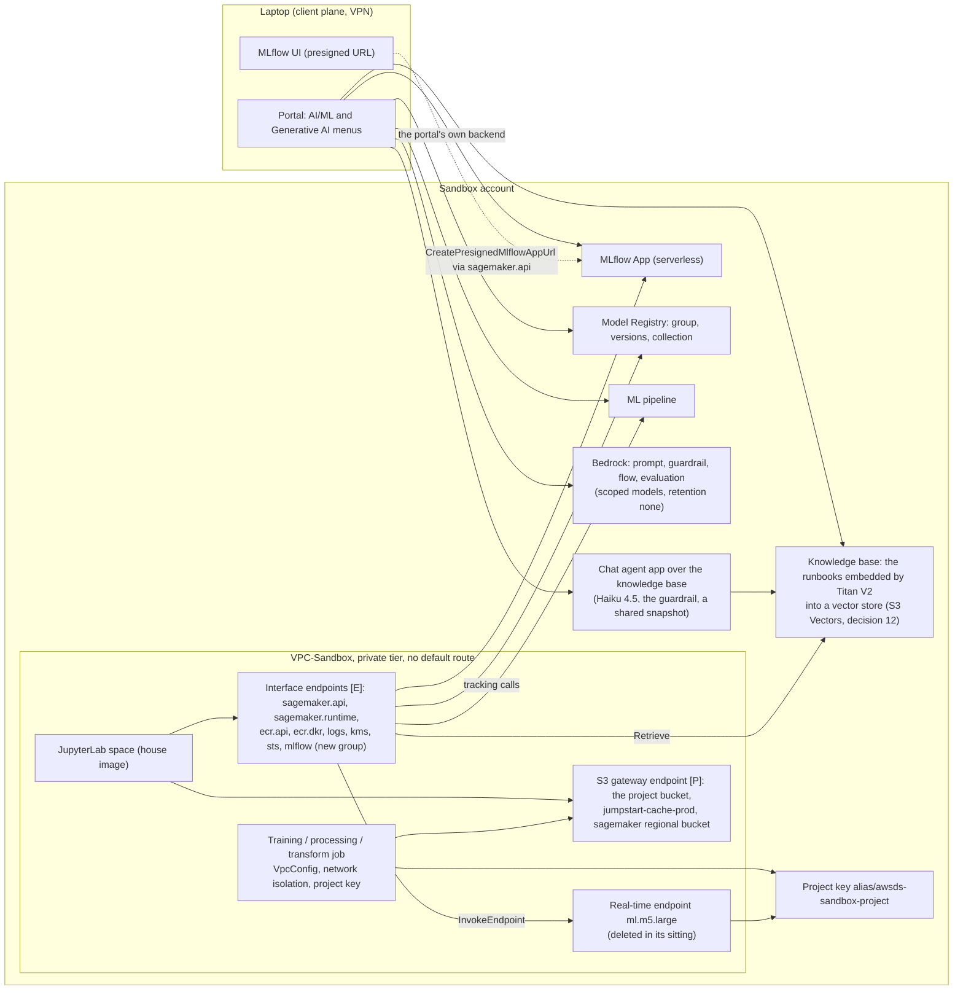
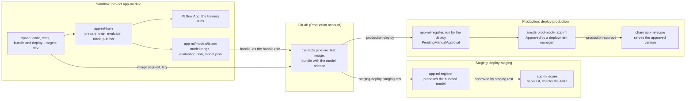
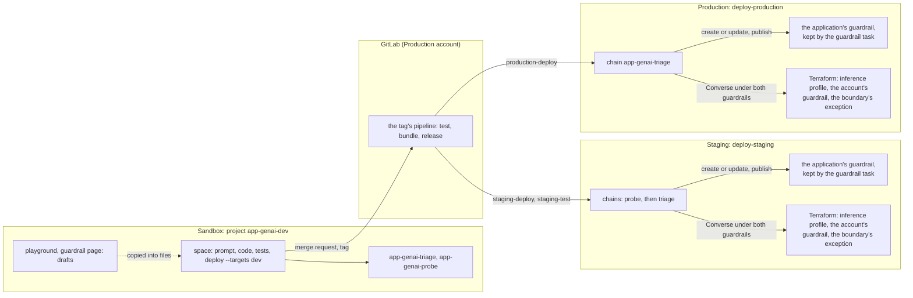

# Stage 17 — Machine learning in a Sandbox project: the AI/ML surface exercised, and its applications promoted to Production

| | |
|---|---|
| **Status** | **Pass 0 in progress, pass 1's 1.1, 1.3, 1.5 and 1.7 done on 2026-10-19, passes 2 to 5 no longer stopped on the quotas, and pass 7's 7.0, 7.0a and 7.0b done and 7.2's menu read the same day** ([the log](../../log/log-stage-17-sandbox-machine-learning.md)): `AmazonBedrockKnowledgeBase` left category 2 at `sagemaker-prereqs-v0.7.0`, applied by the user at 18:33 and 18:36 UTC, both slices re-planned `No changes`; both projects' Generative AI menus then opened, and every model list reads *"No models found"*, the account enabling no model until decision 13, taken as (b) and applied the same evening with five models enabled; 7.3's first chat was refused by the SCP on the application inference profile, and after decision 11's amendment, applied by the user at 21:58 UTC, Haiku 4.5 answered and Nova Lite was refused on its foundation model. `./aws/sandbox-ml.py` (`ML-1`..`ML-9`, step 0.1) and `examples/sandbox-ml/` (0.6) were written 2026-10-17 (PR #157) from a cloud session with no AWS credentials, and the instrument's first run, on the laptop that evening with the session down, read `ml.m5.xlarge for training job usage`, `ml.m5.large for endpoint usage` and `ml.m5.large for transform job usage` at 0 (0.2); the user requested the three increases the same evening, and the second run, on 2026-10-18, read the three at 20, 8 and 8 with each request still `CASE_OPENED`; a third, on 2026-10-18 at 19:51 UTC with the whole environment down, read the same values and requests with nothing built, and `./aws/devenv.py` passed `DE-5` against the Dockerfile's 70 names, `sandbox/egress` being down; since PR #172 put the 72-name literal under `gitlab/` (20:38 UTC) the same comparison fails, version 9 lacking 2 names (read 22:06 UTC). A run on 2026-10-20 at 22:04 UTC, the environment down, read every check as on 2026-10-19 but the session's doors, the three requests still `CASE_OPENED` and `DE-5` still red (the log). Pass 1's change was written the same evening in PR #157: `vpc-egress-v0.18.0` with the `mlflow` group and `sagemaker-prereqs-v0.5.0` with `MLflowApp`, the two callers pointed at them, the governance profile and `US-3` moved with them (1.2, 1.4). On 2026-10-18 the laptop pushed the two tags, planned both of 1.2's slices as predicted from `fa20bfe`, which pinned `sagemaker-prereqs-v0.5.0`, read the template (nothing to declare) and took the first plan of `sandbox/egress` at the new tag (two `mlflow` names the image's literal lacks), and the user read the enable wizard and cancelled it, with nothing to declare either; 1.1's before was read on 2026-10-19, *Create MLflow App* greyed out by a tooltip naming the blueprint, and the user applied 1.3 the same morning (05:11 to 05:12 UTC), both slices re-planned `No changes`, after which the item is still greyed out in both projects; 1.5 read why the same morning (the entry resolves the blueprint from Data Governance's configurations, which D22 keeps empty), and the user created the app `ml-demo-mlflow` through `create-environment`, `Created` at 06:44 UTC and read by `ML-2` (the log); decision 4, taken by the user on 2026-10-18, releases the image with the new literal in the sitting of the group's first apply. PR #157 merged on 2026-10-18 at 02:33 UTC, before any release, so `main` pins `vpc-egress-v0.18.0` and a session raised from it reads `DE-3` and `DE-5` red until that image ships (inferred); `main` also pins `sagemaker-prereqs-v0.6.0` on `sandbox/sagemaker` since PR #166 (`TM-21`'s key-policy narrowing over `MLflowApp`), planned 2026-10-18 by Stage 11's session (2 to add, 1 to change, 0 to destroy), so step 1.3's apply carried both. The first run read `EnableSageMakerMLWorkloadsPermissions` `true` on both project roles (decision 9 does not arise), the managed ML policy at v45 against the v44 of AWS's pages, and `enableNetworkIsolation` `true` in both Tooling stacks (0.8). The user's readings 0.3 and 0.7 and 0.5's interface half wait on a raised session. Step 2.2's image is XGBoost `3.0-5`, since the recipe's `1.7-1` writes a model the house interpreter's `xgboost-cpu` 3.3.0 refused on a build host (the log). The plan was written 2026-10-12 from a session with no AWS reading, so every "read" below is owed to pass 0, and nothing here is a measurement unless it carries its date. Passes 0 to 8 are an exercise, not a promotion path, in [6i](stage-06i-sandbox-orchestration.md)'s shape: one project, one data scientist, the portal's **AI/ML** menu walked end to end (an experiment tracked in an MLflow App, a model trained under the D13 boundary's job settings, registered, deployed, invoked, served offline by batch transform, then the same chain as an ML pipeline), the two entries that provision standing infrastructure read without being created (HyperPod, Partner AI apps), and the **Generative AI** menu's apps built once each, a chat agent over a knowledge base of the user's own documents among them (pass 7, decision 1). The Terraform changes planned are `MLflowApp` and `AmazonBedrockKnowledgeBase` promoted out of category 2 (decisions 2 and 1), an `mlflow` endpoint group in `vpc-egress` (decision 4) and the embeddings model admitted by the SCP `DenyBedrockInvocationOutsideTheScopedModels` (decision 11); the `[P]` grant slice `sandbox/ml/` joins them if pass 2 measures on a training job the tag gap 6i measured on a processing job (decision 7). Decisions 1-3 were taken by the user on 2026-10-12: the Generative AI menu in, with a knowledge base; the `MLflowApp`; the public CSV of AWS's XGBoost recipe. The instance-preference rows pass 2's training job waited on (PR #216) ran 2026-10-22, each as expected, and 1.7 read `ml-demo-mlflow` with no key (PR #190). **Pass 9 was written 2026-11-16** from a cloud session with no AWS credentials ([the log](../../log/log-stage-17-sandbox-machine-learning.md)), at the user's request of that day: an application of its own, `app-ml`, on the `app-etl` template and on release F's path ([Stage 19](stage-19-smus-native-data-product.md) decision 6 (b)), whose training workflow prepares a sample, trains a classifier, evaluates it and publishes the trained model in the `dev` project, and whose releases carry that model in the bundle through Staging into Production, where a task proposes it in the registry, a deployment manager approves the version and the scoring workflow serves it by a batch transform (decision 21 (b), the shape of AWS's `ml/training` and `ml/deployment` examples). Nothing of pass 9 is built or run. Its one measurement is the worker's archive of the MLflow client, 15,288,232 bytes, built and imported on a build host (9.4). The same sitting set the left navigation the user's request names beside this file's entries, added the portal reading that says what the lab's projects show (0.9) and Feature Store's reading (6.4), recorded that Amazon Bedrock Agents, renamed Agents Classic, takes no new customers since 2026-07-30, which reaches 7.4b, and wrote [`runbooks/sagemaker-ai-ml.md`](../runbooks/sagemaker-ai-ml.md). **Pass 10 was written the same evening**, after the user's answer of 22:23 UTC that each path gets an application of its own (decisions 14 and 15): `app-genai`, Amazon Bedrock's, a third application on the template with no image and no SageMaker job, whose workflow sends a synthetic sample of support messages to one foundation model through `Converse` under a guardrail and checks the answers, promoted through Staging into Production as `app-ml` is. A project role of either target has been denied `bedrock:*` since 2026-11-11 ([Stage 19](stage-19-smus-native-data-product.md) decision 21 (b), `TM-30`), so decision 22 is how a task calls a model there. It was put to the user on a card, answered at 22:53 UTC with a criterion, the path SageMaker Unified Studio intends or AWS recommends, read against the CI/CD CLI, and taken on that reading as (a): a narrow exception in each target's boundary, AWS's `genai` example deploying into the project its ETL example uses, under a project role that carries the Bedrock permissions. Nothing of pass 10 is built or run, and no AWS call was made for it. **The open decisions of passes 9 and 10 were put to the user one at a time from 23:17 UTC**, the user's ask. Taken by 2026-11-17 01:28 UTC: 23 (a), Amazon Nova Lite inside `us-west-2`; 24 (b), a task of the workflow creates the application's guardrail, against the recommendation; 25 (b), a knowledge base as an increment; 26 (a), an agent on Amazon Bedrock AgentCore as an increment, after the user's message of 23:42 UTC asking that the plan exercise the service AWS names in place of Agents Classic; 16 (b), a task registers the version in every stage; 17 (a), an MLflow App in each environment; 18 (b), an endpoint created, invoked and deleted inside one run, as an increment; 19 (b), an ML pipeline that a workflow creates from a definition the bundle carries and starts, as an increment; 20 (a), Feature Store read in Sandbox and used by no application; and 21 (b), by the user's words of 01:28 UTC: the trained model is promoted, as AWS's examples promote it, and [Stage 10](stage-10-orchestration-promotion.md) decision 22 is revised with it. Passes 9 and 10 were rewritten for the cards' answers the same night, and pass 9 again on 2026-11-17 for 21 (b), under which no target trains: 17's MLflow App is the `dev` project's alone. Three more decisions were taken on cards on 2026-11-17, from 02:47 to 02:53 UTC: 28 (a), `app-etl`'s model half, which trains in each target, retires in a release of its own once `app-ml`'s first release has passed (9.11); 19's ML pipeline runs in the `dev` project alone; and 27 (a), each target declares and enforces a guardrail of the account's own, found in the SDK on 2026-11-17. No decision of passes 9 and 10 is open. The plan was read the same night against [Stage 20](stage-20-dbt-lineage.md) decision 13, which takes a processing job out of the network-isolation statement: this stage's processing jobs keep `EnableNetworkIsolation: true` by their own request. The CI/CD CLI 1.0.9's handling of a storage item that names a connection was read in its released wheel (`SUP-374`), and AgentCore's rates in the Region's price list ([`docs/PRICING.md`](../../PRICING.md)). **On 2026-11-17, with nothing up**: 9.1 and 10.1 read (the SageMaker quotas above zero in the three accounts and no case open; Nova Lite owes Staging and Production the retention mode `none` alone; the readings are in the verification rows); `examples/app-ml/` (9.2, 9.4) and `examples/app-genai/` (10.2) written, 100 and 95 tests passing; 9.3's and 10.3's rules in [`awsds-workflows` pull request #26](https://github.com/felipenoris/awsds-workflows/pull/26), merged at 15:48:39 UTC as `37cb5a6`, both applications' pins moved to it; 9.5's target slices written, planned and applied on the user's word from 16:00 to 16:12 UTC with Stage 20's 4.4, every re-plan `No changes`, with the denies of a version registered other than `PendingManualApproval` and of an approval by a project role; `TM-33` written, and accepted by the user the same day on the condition that the path is AWS's, which that day's reading of AWS's examples and templates meets. **Open decisions taken on cards on 2026-11-17 from 22:32 UTC**, in the review of the plan's open decisions under the user's default of AWS's suggested path: `EXC-11`'s share created as AWS documents it (the user's RAM write in Data Governance, before 3.2 and 9.6), 7 (a) as read 2026-11-16, 12 (a) S3 Vectors, 10 (a) the Function entry waiting for its control, 6 as AWS's `ml/deployment` example does it, 4.1's endpoint left standing and its lifetime the member's, who deletes and recreates it as needed (2.76 USD a day while it stands), and 5, everything kept at the close, the endpoint included. **On 2026-11-18, with nothing up**, decision 6's owed code was written: `examples/sandbox-ml/serve.py endpoint` keeps the endpoint, its configuration and its model and prints the price with the commands its member deletes and recreates the endpoint with, and `./aws/sandbox-ml.py`'s `ML-5` notes each endpoint with its status, its age and its price (4.6); the instrument's run at 00:45 UTC passed every check, no endpoint standing. The change teaching the deploy and model-chain scripts `app-ml`, `app-genai` and `app-dbt` was written the same day on [pull request #321](https://github.com/felipenoris/AWS-DataScience/pull/321): it merges at R2's opening (`promotion.md` §N.11.2), R1 of 2026-11-22 having run release G without it, and before `app-ml`'s first tag (9.7), and the applications' lint pins pass at `awsds-workflows` `4613ddc` (the log). **On 2026-11-19** the user created `app-ml-dev` and `app-genai-dev` from `experimentation` (9.6, 10.4), each born with the blueprint's domain alone at version 11 (`US-13`) and given its two contributors by the user the same night, and their roles' `sandbox/workflows/` lines were applied with Stage 20's `app-dbt-dev` on the user's word, `3 added` and re-planned `No changes` (9.5). The same night, with nothing applied, the rest of 9.5's `sandbox/workflows/` and 10.4's `sandbox/bedrock/`, `sandbox/model-access/` and `identity/org-policies/` were written with the battery's rows, planned from a worktree and simulated on [pull request #326](https://github.com/felipenoris/AWS-DataScience/pull/326) (9.5, 10.4); each apply and the battery's run wait on the user's word naming it, from `main`, the training pair after 2.2's (a) and (b). The same night `EXC-11`'s share was written as code in `data-governance/governance/` and planned (3.3), and decision 7 (a)'s `sandbox/ml/` with the model package group's statement alone (9.6), on the same pull request; each is applied on the user's word from `main`, the share after the merge and `sandbox/ml/` before sitting B. After the merge (02:49 UTC), `sandbox/workflows/`, `sandbox/bedrock/`, `sandbox/model-access/`, `sandbox/ml/` and the share were applied from `main` at `40c9466c` on the user's word in the session's chat, each re-planned `No changes`, and RAM accepted the share against its own table (`SUP-383`); the apply of `identity/org-policies/` was refused to that session by the app's classifier (*Protected-Scope IaC Apply*), and the orchestrating session applied it at 04:22 UTC on the user's words in its own chat, the battery's `ou` phase reading 54 as expected, 0 unexpected, 5 not measured (9.5, 10.4, 3.3). Nova Lite was enabled in projects by the user at 13:02 UTC, its asset published by the governance project (10.4). With nothing up the same afternoon, sittings B and C were written as one Sandbox sitting with their pre-flight read (the section "Sittings B and C as one Sandbox sitting"), and `EXC-11`'s first runs after the share read `SUCCESS` in `test-experimentation` and, at 17:38, `eighth-experimentation` (verification v). **`EXC-11` closed 2026-11-20** on `app-etl-dev`'s first run after the share, `SUCCESS` at 02:19:55 UTC, and `catalog.py`'s exemption removed (verification v's failure half; the log). **On 2026-11-20, with nothing up**, decision 7's statements for endpoint configurations, endpoints and pipelines were written, planned and applied from `main` on the user's word, `awsds-sandbox-ml` at `v2`, and the simulator read the project tag's `AddTags` `allowed` on the three types at the caller's value and `implicitDeny` at another project's value and with a second key (the log). The same day `sandbox-ml.py` gained `ML-10` and `ML-11`, 9.9's and 10.9's Sandbox halves, run with nothing up (the log). **On 2026-11-21** 0.9 was read in both projects as the Data Scientist User (the log): **AI/ML** holds *Models* (*Foundation models*, *My models*), *Training jobs*, *MLflow*, which opens Compute's *MLflow* tab, *Inference endpoints*, *ML pipelines* and *Feature Store*, and **Generative AI** *Playground* and *AI apps*; xxvii and xxxiii's 0.9 half are answered and "The menu, entry by entry" is corrected. Day 2's saved training-pair plan was refused by Terraform 1.17.2 (`SUP-403`); the same day's pre-flight, with nothing up, planned it again from `main` and saved it (the log). **Day 2's sitting B, 2026-11-21 to 22** (the log): 0.3, 0.5's interface half (`ML-9`), 0.7, 1.6 and 2.1 read, verifications vi and xxvi yes; 2.2 (a)'s untagged job admitted with the space's tags recorded (`SUP-408`), (b) refused, and the training pair applied on the user's word at 23:29 UTC; 2.2 (c)'s job completed, 89 s billed; 2.3's five negatives refused by the boundary; 2.4's portal path opened no notebook, so 2.2's SDK path is the stage's; verification iii yes from `jup`; 3.1's model read and verification iv yes; 3.2's version created with no tag (`SUP-409`) and approved in the portal at 00:45 UTC, the portal offering no collection; 2.5 read by `ML-3`. Pass 7: `ml-demo-runbooks` created after `sagemaker-prereqs-v0.13.0`'s S3 Vectors statement (`SUP-410`), `ACTIVE` with 2 of 20 runbooks (`SUP-411`); 7.4's prompt and flow, and the guardrail after `v0.14.0`'s `kms:CreateGrant` statement (`SUP-417`); the evaluation completed with Nova Lite (`SUP-418`, `SUP-419`); 7.4b's chat agent refused by Agents Classic (`SUP-446`), and its fallback, plan B on the user's word, put a knowledge base node in `ml-demo-flow`, which answered from the base, deploys on each test and has no *Share*, so xxiv's catalog half has no object (`SUP-448`, `SUP-426`); 7.4c read in 0.7. 7.5's `ML-8` fails on the flow's own role (`SUP-447`), waiting on the user; 7.6 keeps the objects. Closing reads at 05:03 UTC: `sandbox-ml.py` exit 2 on `ML-8` alone, `catalog.py` every check passed; the user's `make down ENV=sandbox`, and `make status` at 05:24 UTC reading Sandbox down. 1.4's end condition read green at day 2's opening, after the `mlflow` group's first apply, so 1.4 is done. Owed: 3.3's ingestion half (verification v), read with nothing up after `eighth-experimentation`'s source run of 2026-11-22 about 17:38 UTC, the first since the group's create; `bedrock-usage.py` over pass 7's tokens (7.4b), with nothing up; xxiv's `Retrieve` from a space and the flow's own role, the user's (`waiting-on-the-user.md`). |
| **Prerequisites** | **[6a](stage-06a-unified-studio.md) and [6d](stage-06d-unified-studio-remainder.md)**: the Sandbox project, its project role under the D13 boundary, the house image selectable in a space. **[6c](stage-06c-networking-hub.md)**: the private tier with no default route, and a raised session, `make hub-up` then `make up ENV=sandbox` with the groups each day of [`promotion.md`](../runbooks/promotion.md) §N.9.2 and §N.10.2 names, because `sagemaker.api`, `sagemaker.runtime`, `ecr.api`, `ecr.dkr`, `logs`, `kms` and `sts` are `[E]` endpoints of `sandbox/egress` and only the gateway endpoints are `[P]`. **[6e](stage-06e-claude-code-bedrock.md)** for pass 7: the use-case form, the retention mode `none`, the three scoped models and the grant slice `sandbox/bedrock/`. **[6i](stage-06i-sandbox-orchestration.md)**: the measurements this stage reuses rather than repeats, a processing job admitted under the four settings, the house image pulled cross-account by a job, and the tag gap on create. **Stage 3's S3 gateway allow-list**, which has named `jumpstart-cache-prod-<region>` and `sagemaker-<region>` since it was written and has never been exercised for either (verification iii). **For pass 9**: [Stage 8](stage-08-cicd-pipelines.md)'s pipeline, runners and gates; [Stage 9](stage-09-deployment-targets.md)'s targets and Production's model registry; [Stage 10](stage-10-orchestration-promotion.md)'s chains and the approval job of its model chain, under its decision 22 as the user revised it on 2026-11-17; and [Stage 19](stage-19-smus-native-data-product.md)'s release F, the deployment project of each target with the CI/CD CLI deploying the bundle into it, run for `app-etl` on 2026-11-16 (`v0.5.2`). A promotion sitting raises the hub, GitLab, `staging/egress` and `production/workloads-egress` ([`promotion.md`](../runbooks/promotion.md)). **For pass 10**: what pass 9 names but the registry; the acts that enable a model in an account, [`claude-code-sagemaker.md`](../runbooks/claude-code-sagemaker.md) §M, which only Sandbox has had (`INV-18`); pass 7's playground and guardrail page for the drafts (7.3, 7.4); and both targets' egress slices raised with `bedrock-base` |
| **Consumes** | [D9](../decisions/D09-az-count.md), [D11](../decisions/D11-lab-lifecycle.md), [D12](../decisions/D12-budget-ceiling.md), [D13](../decisions/D13-lake-formation-enforcement.md), [D17](../decisions/D17-interactive-vs-runtime.md), [D20](../decisions/D20-staging-account.md), [D21](../decisions/D21-development-account.md), [D26](../decisions/D26-unified-studio.md), [D28](../decisions/D28-workflow-contract.md), [D38](../decisions/D38-single-egress-hub.md), [D41](../decisions/D41-sagemaker-application.md) |
| **Proves** | — (no `INT-nn` row: the project, the jobs, the models, the endpoint and the apps are all in Sandbox). It reads, under the Sandbox boundary alone, whether `DenySageMakerJobsOffVpc` on `CreateModel` already refuses serverless inference (4.4), a reading [Stage 9](stage-09-deployment-targets.md) 3.7 named and decided without (it took (b) on 2026-10-16), and it gives the Model Registry its first version, after which 3.3 reads whether the `Tooling` data source ingests the group (verification v; the source's daily failure ended with `EXC-11`'s closure on 2026-11-20). Pass 9 opens no `INT-nn` entry and amends one: `app-ml` rides `INT-07`'s image half, a Staging job pulling the application's image from Production's repository, and `INT-08`, the deploy roles across accounts, under a second application's names; and it widens `INT-25`, whose bundle role reads the trained model's bytes from the `dev` project's bucket, where it read the project's catalog alone (9.5). Pass 10 opens none: `app-genai` carries no image, its tasks call Bedrock in their own account, and it rides `INT-08` alone |

*Read with [`docs/SMUS.md`](../../SMUS.md) (the blueprint table and "Promoting a blueprint out of category
2"), [`docs/plan/conventions.md`](../conventions.md) and the D13 module
[`sagemaker-denies`](../../../terraform-modules/sagemaker-denies/main.tf), whose five statements every job
and model here is written against. The documentation rows are the 2026-10-12 entries in
[`docs/REFERENCES.md`](../../REFERENCES.md), under "SageMaker and shared storage".*

---

**Objective:** the machine learning a SageMaker Unified Studio project offers its members, run once each
inside the Sandbox project with every identity, key and path inside the project: an MLflow App tracking
an experiment, a training job the D13 boundary admits, a version in the Model Registry, a real-time endpoint
invoked and deleted in the same sitting, a batch transform, an ML pipeline doing the same chain, and the
Generative AI menu's prompt, guardrail, flow and evaluation over the scoped models, and a chat agent that
answers from a knowledge base of the user's own documents. Each entry is read for what it creates, through
which door, as whom, and what this estate's controls do to it.

**Passes 0 to 8 promote nothing, by design.** Their jobs name the project's subnets, security group,
key, role and tag, which D28's lint refuses for a deployment target; the Model Registry there is the
Sandbox one, and [Stage 9](stage-09-deployment-targets.md) owns Production's. The training data is a
public CSV, the Telco churn table of AWS's XGBoost recipe, fetched by the notebook through the proxy
(decision 3) and written under the project's `shared/`; the knowledge base's documents are this
repository's runbooks, public too. No governed data enters any of this, and the catalog is touched only
by what the registry and the shared chat agent publish into it (3.3, 7.4b).

**Passes 9 and 10 are the promotion path, one application for each service behind the menus.** Each is a
SageMaker application (D41): a manifest, workflows in the CI/CD CLI's notation and their code, in which
every account-scoped value is a variable the CLI resolves per stage, so one bundle deploys into the `dev`
project in Sandbox, into `deploy-staging` and into `deploy-production`. `app-ml` (pass 9) is Amazon
SageMaker AI's: a workflow trains and evaluates a model in the `dev` project, a release carries the
trained model, and a workflow serves it in each target. `app-genai` (pass 10) is Amazon Bedrock's: its
workflow sends messages to a foundation model under a guardrail and checks the answers. Each sample is
synthetic and travels in its bundle, so neither pass reads governed data: `app-ml` proves the path a
trained model takes, and no model here is trained on governed rows (decision 21).

## The menu, entry by entry

What the portal's two menus offer a project member, and what this estate's controls do to each entry. The
"door" column names the network path a call takes from the space or the portal; the "shaped by" column
names the control that admits, refuses or sizes it. A row that says "read" is exercised by reading only
(Lesson 22): the entry provisions standing infrastructure no decision has asked for.

| Entry (portal path) | What it creates | Door | Shaped by | Pass |
|---|---|---|---|---|
| **MLflow** (AI/ML → MLflow, which opens Compute's *MLflow* tab, *MLflow environments* (0.9); *Create* → *Create MLflow App*) | an MLflow App, `mlflow-app/<id>`, serverless; its artifact store an S3 prefix, its role an IAM role | the tracking calls from a space through the `aws.sagemaker.<region>.mlflow` interface endpoint (new group `mlflow`); `CreatePresignedMlflowAppUrl` through `sagemaker.api`; the UI from the laptop over the client plane | the `MLflowApp` blueprint, category 2 until decision 2; the project role's `SageMakerMlflowServerlessPermission`, conditioned on the project tag | 1 |
| **Foundation models**, JumpStart's catalog (AI/ML → Models → *Foundation models*, which Training jobs' *Browse models to train* also opens (0.9); a model's *Train*) | a training job from the public hub's recipe, its artifacts read from `jumpstart-cache-prod-<region>` | `sagemaker.api`; the hub reads on `SageMakerPublicHub`; the artifacts through the S3 gateway endpoint, whose list names the bucket | the form's fields (Lesson 16): a job the form cannot give the four settings is refused by the boundary; the form's default instance type against the ceiling | 2 |
| **Training** (IDEs → JupyterLab, the SageMaker SDK) | `CreateTrainingJob`: XGBoost `3.0-5` from AWS's algorithm registry on `ml.m5.xlarge`, inside the project's subnets, network-isolated, inter-container encryption on, the volume under the project key | `sagemaker.api` from the space; the job's own interfaces in the private tier; the data and the output through the S3 gateway endpoint; the image pulled by the platform as the project role (6i iv) | the boundary's four job statements and `DenySageMakerInstanceCeiling` (`ml.m5.xlarge` is on the list, `ml.m5.2xlarge` is not); the project role's `SageMakerCreatePermissions` (the tag on create) and its `SageMakerTagPermissions`, which excludes `AmazonDataZone*` keys (6i iii) | 2 |
| **Model registry** (AI/ML → Models → *My models*, filtered by *Model group*, *Model* or *Deployable models*; the tab names the SDK for a registration (0.9)) | a model package group, versions with an approval status, a collection | `sagemaker.api` | `SageMakerCreatePermissions`; `EXC-11`'s data source tracks the group type (3.3) | 3 |
| **Inference endpoints** (AI/ML → Inference endpoints → *Create new endpoint* (0.9)) | `CreateModel` (with `VpcConfig` and network isolation), `CreateEndpointConfig` (`ml.m5.large`, one instance), `CreateEndpoint`; `InvokeEndpoint` | `sagemaker.api` for the control plane; `sagemaker.runtime` for the invocations, one AZ (6a's affinity note) | `DenySageMakerJobsOffVpc` and `DenySageMakerJobsWithoutNetworkIsolation` on `CreateModel`; the ceiling on `CreateEndpointConfig`; the form's fields; an endpoint bills every hour it exists, so it dies in its sitting (decision 6) | 4 |
| **Batch transform** (the SDK; no menu entry) | `CreateTransformJob` on `ml.m5.large`, the volume under the project key | `sagemaker.api`; the model's `VpcConfig` | `DenySageMakerJobsWithoutVolumeEncryption` names `CreateTransformJob`; the ceiling | 4 |
| **Serverless inference** (the SDK) | a `CreateModel` with no `VpcConfig`, which serverless requires, then a serverless endpoint configuration | `sagemaker.api` | expected refused by `DenySageMakerJobsOffVpc` on `CreateModel`, the reading Stage 9 3.7 named (decision 8); a model that carries a `VpcConfig` is refused by the service for serverless (verification x) | 4 |
| **ML pipelines** (AI/ML → ML pipelines → *Create in visual editor* (0.9), then the editor's *Import*, *Execute*, *Download pipeline definition*) | a pipeline whose steps are a processing job, a training job, a condition on the validation metric and a registration | `sagemaker.api`; each step's job as above | each step's job carries the four settings; the editor's forms against those settings (Lesson 16, 6i i's shape); the pipeline's role is the project role | 5 |
| **HyperPod clusters** (Compute → HyperPod clusters → *Add compute*) | nothing here: the entry connects a project to an existing cluster, and the project role's policy grants no `sagemaker:CreateCluster` | — | read: a cluster is standing compute (`Cluster:ml.m5.large` 0.115 USD/h in the offer) no decision has asked for | 6 |
| **Partner AI apps** (absent from the left navigation on 2026-11-21 (0.9)) | nothing here: Lakera Guard, Comet, DeepChecks and Fiddler, each an EKS stack with its own EC2, cache and database SKUs | — | read: the `PartnerApps` blueprint is category 3 and the SKUs are standing (Cost) | 6 |
| **Generative AI** (Generative AI → *Playground*: *Chat*, *Image and video*, *Shared apps and prompts*; → *AI apps*: *Build* with *Chat agent*, *Flow*, *Prompt* and *Model evaluations*, and *Asset gallery* with *My apps*, *My prompts* and *My components*, typed *Knowledge base*, *Guardrail* or *Function* (0.9)) | Bedrock objects in the Sandbox account: a prompt, a guardrail, a flow, an evaluation job, and a chat agent over the knowledge base below, shared as a snapshot; a Function is a Lambda | the portal's own backend, not the VPC, as the project role or the project's Bedrock roles (verification xviii); a notebook's invocation through `bedrock-runtime` and `bedrock-agent-runtime` | the SCP's `DenyBedrockInvocationOutsideTheScopedModels` and `DenyBedrockReadsOutsideTheRoutedRegions`; the project role's conditional Bedrock grants (6e 3.1: `InvokeBRModel` needs the IDE tag the role did not carry on 2026-09-11); no control names a Lambda (7.4, decision 10) | 7 |
| **Knowledge bases** (Generative AI → AI apps → Asset gallery → *My components* → *Knowledge Base*) | a Bedrock knowledge base, its data source, its execution role and a vector store created on the user's behalf, OpenSearch Serverless, S3 Vectors or Neptune Analytics by the form's choice (decision 12); for an OpenSearch Serverless store, two Lambdas as well, the index and the ingestion trigger, with their role, which AWS's blueprint page lists with no condition (read 2026-10-12) and the blueprint's template creates for that store alone (read 2026-10-19, 7.0a) | the IDE's backend for the create; the sync is the service's own calls as the knowledge base's role, `InvokeModel` on the embeddings model and the store's API; a notebook's `Retrieve` through `bedrock-agent-runtime` | `AmazonBedrockKnowledgeBase`, category 2 until decision 1; the SCP's `NotResource`, which admits the embeddings model and application inference profiles since decision 11's amendment (applied 2026-10-19); the store's billing shape (decision 12) | 7 |

### The left navigation's entries, and what a promoted application does with each

The user's request of 2026-11-16 names a project's left navigation as **AI/ML** (*Models*, *Training
Jobs*, *MLflow*, *Inference endpoints*, *ML pipelines*, *Feature Store*) and **Generative AI**
(*Playground*, *AI apps*). The first group is Amazon SageMaker AI; the second alone is Amazon Bedrock.
The lab's portal has been read for three of those entries, on 2026-10-19: *AI/ML → MLflow*, the legacy
experiments page (1.1), and *Generative AI → Playground* and *AI apps* (7.2). The table above was
written 2026-10-12 from AWS's pages for a domain on IAM Identity Center. AWS's user guide, read
2026-11-16, documents *Models* with its *Foundation Models* and *Registered Models* tabs, *Training
Jobs* and *Feature Store* in its chapter for IAM-based domains, and *JumpStart models* and *Model
registry* in its chapter for Identity Center domains. Its release note of 2026-10-08 says the old
navigation is gone from Identity Center domains: the chat playground, the image and video playground
and the shared apps and prompts are under *Playground*, and the chat agent, flow, prompt and *my apps*
under *AI apps*. Which entries the lab's **AI/ML** group shows is 0.9's reading, and the paths of the
table above are corrected in that sitting. **Read 2026-11-21** (0.9,
[the log](../../log/log-stage-17-sandbox-machine-learning.md)): **AI/ML** holds the IAM-based chapter's
entries, *Models* with *Foundation models* and *My models*, *Training jobs*, *MLflow*, *Inference
endpoints*, *ML pipelines* and *Feature Store*, and neither *JumpStart models* nor *Model registry*; *MLflow*
opens Compute's *MLflow* tab; **Generative AI** holds *Playground* and *AI apps*, as the release note says.

Interactive compute is Sandbox's alone, so in a target an entry shows what an application's tasks and
the pipeline's jobs created there, and nothing is built through it. The last column says what an
application promoted by the CI/CD CLI does with each entry; pass 9 builds the ones marked `app-ml` and
pass 10 the ones marked `app-genai`.

| Entry | What is behind it | Exercised here | In an application promoted to a target |
|---|---|---|---|
| **Models** | SageMaker AI. *Foundation models* lists pre-trained models (*JumpStart models* in the Identity Center chapter), whose *Deploy* opens a sample notebook that creates an endpoint; *My models*, the IAM-based chapter's *Registered Models* (0.9), is the Model Registry: model package groups, versions with an approval status, collections | 2.4, 3.2, 3.3, 4.5 | The registry is the promotion boundary, and the model's archive is what crosses it. A version is a `CreateModelPackage` in the stage's group, which the account's Terraform declares in a target (`awsds-<env>-model-<app>`). The CLI has no content type for a model: its archive is a file, and AWS's `ml/deployment` example carries the one its `dev` stage's project holds into `test` and `prod` as a storage item of the bundle. `app-ml` does the same (decision 21 (b)): the model is trained in the `dev` project, a release's bundle carries the archive, a task of each target proposes it in that stage's group as `PendingManualApproval` (decision 16 (b)), and a task serves the version once the account's deploy role approved it, the pipeline's job in Staging and a deployment manager's in Production (9.7). `app-etl`'s chain has the earlier shape, each target training and the pipeline's job registering in Production alone (Stage 10 decision 22 as taken on 2026-10-24), and retires after `app-ml`'s first release (decision 28 (a), 9.11). A JumpStart deploy is not promoted: its default instance type is expected off the ceiling (4.5) |
| **Training Jobs** | SageMaker AI: the project's `CreateTrainingJob` jobs, listed, read and stopped. A job is created by a notebook, the SDK or a task | pass 2 | A task, `SageMakerTrainingOperator`, its request carrying the four settings, the project key and the project tag, which the lint's rule `treino` reads. `app-ml-train` runs in the `dev` project alone: a target trains nothing, and holds the job's name in the metadata of the version it serves (decision 21 (b)). `app-etl-train` is the measured one, in both targets (Stage 10 5.1, Stage 19 4.11), and it retires after `app-ml`'s first release (decision 28 (a), 9.11) |
| **MLflow** | SageMaker AI: an MLflow App or a tracking server, holding experiments, runs and their artifacts. In an IAM-based domain the page connects an app that exists and creates none | pass 1, 3.1 | An MLflow App in the project that trains, which decision 21 (b) makes the `dev` project alone (decision 17). No operator logs a run, so the task that tracks is the application's own code with the MLflow client in its archive (`app-ml`'s `track`, 9.4). The bundle carries no experiment and a target holds no app: its record of a model is the registry's version, with `dev`'s evaluation as its metrics. AWS's `ml/training` example tracks where it trains, through an `MLFLOW` connection a bootstrap action creates, which names a tracking server by ARN, the kind decision 2 declined, and `ml/deployment` creates no such connection in `test` or `prod` |
| **Inference endpoints** | SageMaker AI: a model, an endpoint configuration and a real-time endpoint, which bills each hour it exists | pass 4 | None stands in a target: Stage 10 decision 4 serves by batch transform, and no slice declares an endpoint. `app-ml-score` serves the promoted model by a transform task. AWS's `ml/deployment` example leaves an endpoint standing in each stage until its next run, the shape that decision declined. Decision 18 (b) exercises the entry in every stage without it: after the first release a workflow creates an endpoint over the stage's model, invokes it and deletes it inside one run (9.8). The invocation needs `sagemaker.runtime`, which left both targets' endpoint sets, and a failed run leaves the endpoint standing, since the service ignores `trigger_rule` |
| **ML pipelines** | SageMaker AI Pipelines: a definition of steps, each a SageMaker job, with its executions and its graph | pass 5 | The workflow is the promoted orchestrator (D41), and the CLI's bundle has no content type for a pipeline: its definition travels as a file, a task creates or updates the pipeline from it, and `SageMakerStartPipelineOperator` starts an execution, whose steps then run as jobs under the workflow's task. The CLI's README names SageMaker Pipelines among the services a workflow drives, and none of its examples uses one. `app-ml` gains that as an increment after its first release (decision 19 (b), 9.8). The decision was taken for the three environments when each of them trained; a pipeline of a processing and a training step belongs where the training runs, so its place was put to the user again and taken as the `dev` project alone (2026-11-17). AWS documents an import of a SageMaker pipeline into a serverless workflow for IAM-based domains (release note of 2026-06-04) |
| **Feature Store** | SageMaker AI: feature groups, each with an online store, an offline store in the project's bucket as a Glue table, or both. AWS documents the page for IAM-based domains and the SDK for every domain type | 6.4, read | No content type of the CLI and no operator of the provider carries a feature group, and the CLI's README marks Feature Store *(future)* in its list of what it deploys: a task's code would create one and write to it. A job here is network-isolated and reaches no API, so the writer is a worker's task, through Feature Store's runtime endpoint (`featurestore-runtime.sagemaker` in the SDK's model), which no slice declares. An online store bills while it holds records, and an offline store registers a Glue table whose governance in a target is unread. No application uses one: decision 20 (a) reads it in Sandbox and builds nothing (6.4) |
| **Playground** | Bedrock: a chat or an image prompt sent to an enabled model, as the playground's consumption role | 7.3 | Nothing to promote: a playground session leaves no object in the project. A prompt settled there becomes a file of the application, and the portal's copy stays a draft (`app-genai`, 10.2) |
| **AI apps** | Bedrock: chat agent apps and flow apps, with their prompts, guardrails, functions and knowledge bases, built in the Bedrock IDE | 7.4, 7.4a, 7.4b | Outside the CLI's bundle as an object. AWS shows two paths to another account: the app's export from the IDE, a zip of CloudFormation templates and a deploy script a person runs in the target account, without the knowledge base's files; and the CLI's `genai` example, whose bundle carries code that a workflow runs in each stage, as a project role holding the Bedrock permissions, to create the agent and the knowledge base. `app-genai` takes the second path's shape for what this estate's controls admit: a task creates the application's guardrail, and its tasks call one model through `Converse` under it, a project role of a target being denied every Bedrock call the boundary's exception does not name (decisions 22 and 24). Its increments add a knowledge base the application creates and an agent on Amazon Bedrock AgentCore Runtime, the service AWS names in place of Agents Classic (decisions 25 and 26). A chat agent app, a flow app and the export are read in Sandbox and promote nothing |

The rule the last column repeats: the CI/CD CLI's bundle carries storage items, a git repository, catalog
assets, notebooks, QuickSight dashboards and workflows (the manifest's schema, CLI 1.0.9), and no model,
endpoint, pipeline, feature group or Bedrock object. Each of those exists in a target because a task of a
workflow or a job of the pipeline creates it there, or because the account's Terraform declares it (the
registry's group, `app-genai`'s inference profile, the account's own guardrail), under that account's own
controls. What the bundle carries of one is a file: the schema's comment on `storage` reads *"Storage
content (S3 files, data, models)"*, and a model's archive, a pipeline's definition or a guardrail's
definition travels as a storage item or inside a task's archive. Each such file is a file of the tag,
with one exception: `app-ml`'s trained model, which `bundle` reads from the `dev` project, as it reads
the catalog's export for `app-etl` (pass 9, "The model in the bundle, and what the CLI does with it").
AWS's own examples for machine learning and generative AI (the CLI repository's README and its examples
guide, read 2026-11-16) have that shape too, each as one `SageMakerNotebookOperator` task over a notebook
the bundle carries. That operator runs the notebook as a training job with no network, isolation or key
parameter, which the D13 boundary refuses (`SUP-265`) and the lint refuses by name, so here the same work
is written as job and worker tasks. What each entry is, by domain type, and the development flow from a
space to Production are [`runbooks/sagemaker-ai-ml.md`](../runbooks/sagemaker-ai-ml.md).

### Why the experiment is logged from the space, and never from the job

The boundary refuses a training job without network isolation
(`DenySageMakerJobsWithoutNetworkIsolation`), so the training container cannot reach the MLflow App, the
Model Registry or anything else. The run is therefore logged from the notebook: the parameters before
`CreateTrainingJob`, the final metrics read back from `DescribeTrainingJob` after it, and the model
artifact downloaded from the output path and logged as an MLflow model. It is the same consequence 6i met
when the workflow, not the code, had to delete the source: the code inside a job sees only its mounts.

### What a job needs, and who gives it

A job the boundary admits carries, in the request itself: `VpcConfig` with the project's private subnets
and security group; `EnableNetworkIsolation: true`; `EnableInterContainerTrafficEncryption: true` (jobs,
not models); `ResourceConfig.VolumeKmsKeyId`, the project key; an instance type on the ceiling's list; and
the tag `AmazonDataZoneProject` with the caller's own value, which the project role's
`SageMakerCreatePermissions` demands through `aws:ResourceTag`. 6i measured on a processing job
(2026-10-10, run `FVyFira1LY3BuGi`) that the same policy's `SageMakerTagPermissions` refuses that tag's
key on create, and closed it with `sandbox/workflows/`'s second statement, scoped to processing jobs. Pass
2 measures whether a notebook's `CreateTrainingJob` meets the same gap, with the three readings that
separate the hypotheses (2.2); if it does, decision 7's slice carries the statement for every resource type
this stage creates. What the space's SDK configuration fills in by itself is read first (0.3): a default the
space injects is a parameter the notebook does not have to write, and a default it does not inject is one
the notebook must.

A processing job leaves the isolation statement at [Stage 20](stage-20-dbt-lineage.md)'s pass 4, which is
applied nowhere yet: its decision 13, taken 2026-11-16, takes `sagemaker:CreateProcessingJob` out of
`DenySageMakerJobsWithoutNetworkIsolation` in Sandbox, Staging and Production. A processing job without
isolation then runs in its project's subnets as the project role, and isolation becomes the application's
choice, job by job. A training, tuning or AutoML job and a model stay under the statement, and the other
settings stay on every job. The processing jobs this stage writes keep `EnableNetworkIsolation: true`
before and after that change, since each reads its input mounts alone: 5.1's step, `app-ml`'s two
`prepare` tasks and the pipeline increment's step (9.8).

## What this stage builds, and in which accounts

| Where | What | Layer |
|---|---|---|
| `terraform-live/sandbox/sagemaker/` (through `sagemaker-prereqs`) | `MLflowApp` and `AmazonBedrockKnowledgeBase` join `blueprint_names`: `MLflowApp` (decision 2) at `sagemaker-prereqs-v0.5.0` (pass 1, written 2026-10-17) and `AmazonBedrockKnowledgeBase` (decision 1) at `v0.7.0` (7.0a), applied 2026-10-19 by the user (7.0b; `staging/studio/` kept `v0.6.0`, passing `Tooling` alone, until Stage 18 destroyed it on 2026-10-22). The caller pinned `v0.6.0` from PR #166, which adds [Stage 11](stage-11-dlp.md)'s `TM-21`: `aws:PrincipalOrgID` on the project key's two open statements (`kms.tf`, with a `data.tf` lookup of the organization); the slice's plan on that pin, read 2026-10-18 by Stage 11's session, is 2 to add (`MLflowApp` and its grant), 1 to change (that key policy) and 0 to destroy, applied 2026-10-19 by the user (1.3). A blueprint configuration and its `CREATE_ENVIRONMENT_FROM_BLUEPRINT` grant per blueprint arrive in one apply (`grants.tf`'s `for_each`). The roster has three copies, the module default, the governance profile and `aws/studio.py`'s `BLUEPRINT_ALLOWLIST`, and they move in one commit (Lesson 14). Neither blueprint adds a `kms.tf` statement: AWS's key-permissions page for the Tooling blueprint names none for MLflow (read 2026-10-12) or a knowledge base (read 2026-10-19, 7.0a), and a refusal naming KMS at 7.4a reopens it | `[P]` |
| `terraform-live/data-governance/governance/` | the `experimentation` profile gains `MLflowApp` and `AmazonBedrockKnowledgeBase`, `deployment_mode = ON_DEMAND`, like the six Bedrock blueprints already there; `MLflowApp`'s element (order 11) and the knowledge base's (order 12) applied 2026-10-19 (1.3, 7.0b). Decision 13 (b) adds `model-governance.tf`: the profile *Generative AI model governance* with no environment configuration, the project `GenerativeAIModelGovernanceProject` and Sandbox's `InfrastructureAccess` session group as its `PROJECT_CONTRIBUTOR`, applied 2026-10-19 by the user (20:25 UTC) and re-planned `No changes` | `[P]` |
| `terraform-live/sandbox/model-access/` (new, rank 52, decision 13 (b)) | the model provisioning role under the name the console adopts, `AmazonSageMakerBedrockModelManagementRole-<Data Governance Account>`, with a policy of its own that admits a profile of `project_models` alone (the three scoped models and Titan V2), and the playground's `awsds-sandbox-bedrock-model-consumption`, both trusted by `datazone.amazonaws.com` under the domain account and both under `awsds-sandbox-project-boundary`; applied 2026-10-19 by the user (20:27 UTC) and re-planned `No changes` | `[P]` |
| `terraform-modules/vpc-egress` (new tag, `v0.18.0`) and `terraform-live/sandbox/egress/` | the optional group `mlflow`, one endpoint, `aws.sagemaker.<region>.mlflow`: the module's `sagemaker.studio` special case in `service_names_all_groups` becomes a list of the `aws.sagemaker.` short names, `sagemaker.studio` and `sagemaker.mlflow`, since `sagemaker.api` and `sagemaker.runtime` are `com.amazonaws.` names and a prefix match would rename them (written 2026-10-17). `no_proxy_all_groups` grows by the endpoint's names whatever `GROUPS=` names, so the house image's dated literal (70 entries, `aafa08da98a61f5c`, 6d decision 8) goes stale and `DE-5` reads the drift until an image carries the new one (decision 4). Raised per session with `GROUPS=mlflow` | `[E]` |
| `terraform-live/identity/org-policies/` | `DenyBedrockInvocationOutsideTheScopedModels` in `awsds-org-scp-ou-interactive.json` gains two entries in its `NotResource` (decision 11): the embeddings model's `foundation-model` ARN, the first there outside the scoped set's six spellings, and `arn:aws:bedrock:*:*:application-inference-profile/*`, the profile's pass every portal call carries (decision 13); `POLICIES.md`'s row gains the second trigger, `./scripts/check-index.py` reads it, and the battery runs with its Bedrock rows ([`scp-battery.md`](../runbooks/scp-battery.md); PR #159 wrote those of 6e 7.5 and decision 15 on 2026-10-17), plus one allow row on the embeddings model, which no image pin names (7.4a); the profile entry has no row (decision 11). Planned 2026-10-19, `0 to add, 1 to change, 0 to destroy`, applied by the user at 21:58 UTC and re-planned `No changes`. Applied from `Identity` with `awsds-infra-identity`, the slice's profile precondition | `[P]` |
| `terraform-live/sandbox/ml/` (new, rank 57, decision 7 (a); applied 2026-11-19 with the model package group's statement, 9.6; the endpoint configuration's, the endpoint's and the pipeline's written and applied 2026-11-20) | the grants the project role lacks for what only a notebook creates, in `sandbox/workflows/`'s shape: `sagemaker:AddTags` of the key `AmazonDataZoneProject` with the caller's own value, alone, on a resource that carries no project tag or already the caller's, for each resource type the measurements name (endpoint configurations, endpoints, model package groups, pipelines, MLflow apps); a workflow's operators' statements are `sandbox/workflows/`'s (decision 7 (a) as taken). Attached to the project roles, each checked for the D13 boundary as `sandbox/workflows/` checks them | `[P]` |
| `aws/sandbox-ml.py` (new) | `ML-1`..`ML-9`, the evidence: the project role's tags and policy version, the MLflow App, each training job against the five statements and the tag, the registry, the serving objects (each endpoint with its price, decision 6), the pipeline, the read-only entries and the quotas, the Generative AI objects and their doors, the session's `mlflow` endpoint and the DNS Firewall list | — |
| `examples/sandbox-ml/` (new) | the notebook as scripts a person reviews: `data.py` (the recipe's CSV fetched, prepared and split), `train.py` (the estimator, the MLflow run, the negatives), `register.py`, `serve.py` (the endpoint, the transform, the serverless negative), `pipeline.py` and `pipeline/definition.json` with a placeholder for every account-scoped value (6i decision 1's shape), `bedrock/` for the prompt, guardrail, flow and evaluation definitions the portal exports, the knowledge base's document list and the chat agent's exported snapshot, and a `README.md` | — |
| `docs/` | this file; the stage log; `SMUS.md`'s two MLflow rows and its knowledge-base row; `PRICING.md` §8's rows and §5's knowledge-base and guardrail rows, measured 2026-10-12; `REFERENCES.md`; `terraform-live/identity/org-policies/POLICIES.md`'s row (decision 11); `AWS_STATE.md` if a reading becomes an exception | — |

Passes 0 to 8 build nothing in any other account. The Data Governance account's domain carries the profile
change (the governance slice applies from there, as 6a did), and that is their only call outside Sandbox.

### What pass 9 builds

Pass 9 builds along the promotion path: the `dev` project in Sandbox, the GitLab project and the registry
in Production, and both deployment projects. It changes no `[E]` slice: Sandbox's `mlflow` endpoint group
exists since pass 1 and is raised for the sittings that train, and no target tracks a run. Under release
F a leg of the pipeline applies no Terraform, and what a release writes in a target is the CLI's deploy
and the objects the workflows create.

| Where | What | Layer |
|---|---|---|
| GitLab, `awsds/app-ml` | the project with its protection, members, runners and variables, and the mirror's allowlist ([`sagemaker-application.md`](../runbooks/sagemaker-application.md) §L); `examples/app-ml/` pushed to it after the merge | — |
| `terraform-live/production/registry/` | `awsds-prod-ecr-app-ml` on `ecr-repo`, pulled by Sandbox's and Staging's accounts as `app-etl`'s repository is, with its outputs | `[P]` |
| `terraform-live/identity/sso/` | the repository in the data scientists' `ReadAndPullTheApplicationImages` | `[P]` |
| `terraform-live/production/sagemaker/` | `registry.tf`'s `model_families` gains `app-ml`, with a resource-policy shape of its own, since `registry.tf` builds one shape for every family today: the group `awsds-prod-model-app-ml` and its resource policy, which for this family names the deploy role for the approval alone, since a task registers (decision 16 (b)), and no reader in Staging, since the model reaches each account in the release's bundle; the Sandbox readers of a version's status stay | `[P]` |
| `terraform-live/staging/sagemaker/` | a `registry.tf` of its own, with the group `awsds-staging-model-app-ml`: the versions Staging's `register` proposes and `staging-test` approves, read by no other account | `[P]` |
| `terraform-live/staging/foundation/` and `production/foundation/` | each deploy role gains, on its own account's `app-ml` group and its versions, the reads and `UpdateModelPackage`, and no `CreateModelPackage`: a statement of its own in Staging, whose role holds today the reads of Production's registry alone, and in Production beside `RegisterAndApproveTheModel`, whose register stays `app-etl`'s. `ReadTheTrainingJobs` and `ServeTheModels` stay as they are: no target trains this model and no pipeline job serves it. Production's deploy role starts `app-ml-register`'s run with what it holds: `deploy-project.tf` grants `airflow-serverless:StartWorkflowRun` on every workflow tagged with the deployment project (read 2026-11-17) | `[P]` |
| `terraform-live/staging/studio/` and `production/studio/` | `workflows.tf`, the deployment project's role: `DescribeATransformJobNoProjectHolds` and `TagATransformJobWithTheCallersProject`, and `TagAModelWithTheCallersProject`, in the shape of the processing and training pairs; and on the stage's group and its versions `CreateModelPackage`, `ListModelPackages` and `DescribeModelPackage`, and a `Deny` of `UpdateModelPackage` there: AWS's `SageMakerStudioProjectRoleMachineLearningPolicy` allows it on a version that carries the role's `AmazonDataZoneProject` tag (read by simulation 2026-11-17 as Production's project role; Lesson 72), so leaving it out does not keep decision 16 (b). No blueprint joins `blueprint_names`: no target holds an MLflow App | `[P]` |
| `terraform-live/staging/chains/` and `production/chains/` | `applications` gains `app-ml` with its two workflows; the chains `app-ml-register` and `app-ml-score`, each a chain of one with its definition under `definitions/`, `schedule_enabled = false` and a `schedule_expression`, which `orchestration-v0.3.1` requires of a disabled chain too | `[P]` |
| `terraform-live/sandbox/workflows/` | `app-ml-dev`'s role in `project_roles`; the training pair the targets hold since 2026-11-16, the transform pair and the model statement (decision 7); what the role lacks for a `CreateModelPackage` in its own group, where 9.1 reads a gap. In `deploy-role.tf`, the bundle role `awsds-deploy-sandbox-test` gains its first actions outside DataZone: `s3:ListBucket` on the projects' bucket for `app-ml-dev`'s `app-ml/models/latest/` prefix alone, `s3:GetObject` under that prefix and `kms:Decrypt` on the project key. The role becomes a member of `app-ml-dev` as it is of `app-etl-dev`, by hand in the portal, so one role reads each application's `dev` project. Planned after 9.6 creates `app-ml-dev`: the slice reads each listed role with `data "aws_iam_role"`, which fails at plan for a role that does not exist, and the role's name carries ids the project's creation mints (Stage 19 1.5's order) | `[P]` |
| `scripts/`, `aws/cicd.py`, `.pre-commit-config.yaml` | `model-chain.py`'s `approve` takes the application's name, the account and the release's hash, where it names `app-etl` and takes a version's ARN: it finds the `PendingManualApproval` version whose description carries the hash, prints its training job and its metrics, and approves that one. Its `register` and `transform` stay `app-etl`'s. The self-check of `deploy-application.py`, the hook that names `examples/app-etl/` and `aws/cicd.py`'s `APP_REPO` learn a second application | — |
| `examples/app-ml/` (new) | the application: manifest, workflows, sample, code, image, pipeline and the guard on a release's model (9.2) | — |
| `awsds-workflows`, a repository of its own | the lint's rules for the transform, model and endpoint operators, and the `manifest` rule's exception for the item that carries the model (9.3) | — |
| `aws/sandbox-ml.py`, `aws/orchestration.py` | `ML-10` and `OR-10` (9.9) | — |
| `docs/plan/threat-model.md`, `docs/plan/integrations.md` | the entry for a model archive that travels from a Sandbox project into Production's serving container, which the user accepts before the first tag, and `INT-25`'s amendment for the bundle role's read (9.5) | — |

The increments add to the table, each in a release of its own (9.8). **The endpoint** (decision 18 (b)):
`sagemaker.runtime` in both targets' endpoint sets for its sittings, what the project roles lack for an
endpoint and its configuration, and the lint's rule for the endpoint operator. **The ML pipeline**
(decision 19 (b), in the `dev` project alone): what `app-ml-dev`'s role lacks for a pipeline and its
executions, in `sandbox/workflows/` alone, and a rule of the lint that reads a definition's requests.

### What pass 10 builds

Pass 10 builds along the same path, with no image, no registry family and no job: the `dev` project in
Sandbox, the GitLab project, and in each target what a model call needs. Terraform declares the
inference profile, the account's guardrail (decision 27 (a)) and the boundary's exception that admits the
calls (decision 22 (a)); the application's own guardrail is created by a task of its workflow
(decision 24 (b)). The table is the first release's, and the increments' additions follow it.

| Where | What | Layer |
|---|---|---|
| GitLab, `awsds/app-genai` | the project with its protection, members, runners and variables, and the mirror's allowlist ([`sagemaker-application.md`](../runbooks/sagemaker-application.md) §L); `examples/app-genai/` pushed to it after the merge | — |
| `terraform-modules/sagemaker-prereqs` (a new tag, read from `git ls-remote --tags origin` at tagging; both targets pin `v0.10.0`) | the boundary's Bedrock exception, behind an input that is null by default. Where it is set, the ceiling's allow leaves `bedrock:*` out and three statements take its place: `bedrock:InvokeModel` on the named inference profile and the model behind it, where `bedrock:GuardrailIdentifier` is a numbered version of a guardrail of the account (`ArnLike` on `guardrail/*:*`, AWS's example for any numbered version of one guardrail with the guardrail's id left open, since a task creates the guardrail: decision 24 (b)); `bedrock:ApplyGuardrail` on the account's guardrails; and the `guardrail` task's calls, `ListGuardrails`, `GetGuardrail`, `CreateGuardrail`, `UpdateGuardrail`, `CreateGuardrailVersion` and the tagging of a guardrail. One deny keeps the three writes off the account's own guardrail (decision 27). Every other Bedrock action, one AWS adds later and the account-level configuration's included, is then outside the ceiling. `bedrock` leaves the deny `DenyServicesNoProjectUsesHere`, where an explicit deny would win over the allows | — |
| `terraform-live/staging/studio/` and `production/studio/` | `fence.tf`: `bedrock` leaves `fenced_services`; `bedrock-agentcore` stays until 10.11, and `agent-registry` (`TM-28`), `q` and `codewhisperer` stay. A new `genai.tf`, a copy in both slices: the application inference profile `awsds-<env>-app-genai` over the foundation model `amazon.nova-lite-v1:0` (decision 23 (a)), tagged with the deployment project; the project role's statements for the boundary's three sets of calls; under decision 27 (a), the account's guardrail `awsds-<env>-account-guardrail` with its published version and the configuration that enforces it on every invocation of the account, the last as `awscc_bedrock_enforced_guardrail_configuration`, which `awscc` 1.106.0, the slices' pin, carries (10.1, 2026-11-17); the module's input; and one output, the profile's ARN, `app_genai_inference_profile_arn`, the name a deploy composes from the application's (10.2's proposal for `deploy-application.py`). The application's guardrail is no resource of either slice | `[P]` |
| `terraform-live/staging/egress/` and `production/workloads-egress/` | the `bedrock-base` group for the sittings that run the application: `bedrock-runtime` for the model calls and `bedrock` for the `guardrail` task's, with `endpoint_action_scopes` narrowing each to what the tasks call, as `sandbox/egress` narrows the first. The `bedrock` list carries every call the `guardrail` task makes, since a scoped list refuses every call it leaves out (`sandbox/egress/main.tf`). Production's slice threads `optional_service_groups` already, and Staging's gains the variable | `[E]` |
| `terraform-live/staging/foundation/` and `production/foundation/` | each deploy role's `state_read_keys` gain `<env>/studio/`, whose output `deploy-application.py` reads for `MODEL_ID` as the deploy role (`tfhygiene/states.py`): read 2026-11-17, Staging's keys are `foundation`, `sagemaker`, `data` and `egress`, and Production's `workloads`, `foundation`, `sagemaker`, `data` and `workloads-egress`. Nothing else: a deploy role deploys the bundle, starts a chain and reads a report, and calls no Bedrock. 10.1 reads its statements against the new application's names | `[P]` |
| `terraform-live/staging/chains/` and `production/chains/` | `applications` gains `app-genai`; the chain `app-genai-triage` in both targets and `app-genai-probe` in Staging alone, each a chain of one with its definition under `definitions/`, `schedule_enabled = false` | `[P]` |
| `terraform-live/sandbox/workflows/` | `app-genai-dev`'s role in `project_roles`, planned after 10.4 creates the project, as pass 9's row says; the bundle role a member of the project, by hand in the portal, as for `app-ml-dev` | `[P]` |
| `terraform-live/sandbox/bedrock/` | for `app-genai-dev`'s role alone: the invoke of the project's inference profile and the `guardrail` task's calls, each where 10.1 reads the role lacks it, and, behind a variable that starts `false`, the deny of an invocation that names no numbered version of a guardrail of the account (10.4). For 10.4's last step, a guardrail of the account's own with its version, behind a second variable. The application's guardrail is no resource of the slice. Planned after 10.4 creates `app-genai-dev`, whose role the slice reads | `[P]` |
| `terraform-live/sandbox/model-access/` and `identity/org-policies/` | decision 23 (a)'s model, which is outside the scoped set: `amazon.nova-lite-v1:0` in `project_models` with no profile beside it, and its `us-west-2` foundation-model ARN in the interactive OU's `NotResource`, with the battery (decision 11's shape). The battery's interactive deny row samples Nova Lite as the model outside the set (`probes.py`, read 2026-11-17), so the same change gives that row another sample. The `Workloads` document gains nothing | `[P]` |
| `scripts/`, `aws/cicd.py`, `.pre-commit-config.yaml` | `deploy-application.py` learns an application with no image, where `--image-uri` is required today and `TRAINING_IMAGE_URI` is read from the account's state, and fills `MODEL_ID` from `<env>/studio/`'s output, which the deploy role reads once the foundation row's key is added; the hooks and `APP_REPO` learn a third application | — |
| `examples/app-genai/` (new) | the application: manifest, workflows, sample, prompt, code, pipeline (10.2) | — |
| `awsds-workflows`, a repository of its own | the lint's rules for the Bedrock operators (10.3) | — |
| `aws/sandbox-ml.py`, `aws/orchestration.py`, `aws/deploytargets.py` | `ML-11` and `OR-11`; `DT-14` reads the exception's statements where it reads the fence's services today (10.9) | — |
| `docs/plan/threat-model.md` | the entry for a model call by a role that reads the data product, written and accepted before any apply in a target (10.5) | — |

The increments add to the table, each in a release of its own. **The knowledge base** (10.7,
decision 25 (b)): in `genai.tf`, the vector store and the knowledge base's service role; in the
boundary and the role's statements, the calls that create and fill a knowledge base, the pass of that
role and `Retrieve`; in both egress slices, the `bedrock-agent` group. **The agent** (10.11, decision
26 (a)): in `genai.tf`, the agent's execution role; in the boundary, `bedrock-agentcore` out of the
fenced services and the ceiling's allow, the runtime's named actions and the pass of that role; a
`vpc-egress` tag with a `bedrock-agentcore` group, in both egress slices; and the pipeline's job that
builds the agent's archive.

## Who executes each action

| Marker | Meaning |
|---|---|
| **[Claude]** | repository edits, read-only AWS calls and the saved plan of every apply, as the [infrastructure user](../../ORGANIZATION.md#infrastructure-user), `InfrastructureAccess`, on `awsds-infra-sandbox-1` (Sandbox) and `awsds-infra-data` (the domain's profile and blueprint configurations, read) |
| **[Claude⚡]** | an AWS write, only after the user authorizes that act in chat with the SSO user, account and permission set stated first: the battery (7.4a, decision 11), raising and lowering the session, `sandbox/egress` with `GROUPS=mlflow` included (1.4), and a console act the user asks for, as decision 13's third step was on 2026-10-19 |
| **[user]** | every apply, from the plan Claude saved. The app's auto-mode classifier refuses applies to Claude, and each of this stage's was the user's (the log): the roster on `sandbox/sagemaker/` and the governance slice (1.3, 7.0b), decision 13 (b)'s two slices, and decision 11's SCP amendment from `Identity`. On 2026-11-19 the classifier let 9.5's, 10.4's and decision 7 (a)'s Sandbox applies and 3.3's share through to the session that wrote them, on the user's word in its chat, and refused it the SCP's (*Protected-Scope IaC Apply*), which the orchestrating session applied the same night on the user's words in its own chat. The portal and JupyterLab, signed in as the **Data Scientist User**, a member of the Sandbox project: the apps, the notebook, the runs, the approvals, the deletions, and log entries whenever the user wants |
| **[pipeline]** | passes 9 and 10 alone: a job of the tag's GitLab pipeline, as the account's deploy role (`awsds-deploy-staging`, `awsds-deploy-prod`) or, for `bundle`, as `awsds-deploy-sandbox-test`. A manual job is started by a deployment manager |

In passes 9 and 10 Claude's reads and saved plans also run on `awsds-infra-staging`, `awsds-infra-prod`
and `awsds-infra-identity`, and a chain's start in Production is a [Claude⚡] act on `awsds-infra-prod`.
In pass 10 the act that enables the model in a target is the user's: the retention mode `none`
declared in `us-west-2`, as [`claude-code-sagemaker.md`](../runbooks/claude-code-sagemaker.md) §M
has it (M1). The account-level guardrail configuration of decision 27 is declared in `genai.tf`,
`awscc` carrying it (10.1, 2026-11-17). Decision 23 (a) asks nothing of the **AWS Control Tower
Admin**, whose act, the Region deny's exemption on `Workloads` from Management, is (b)'s.

## Step numbers are identifiers, not an order

| Pass | # | What | Done by |
|---|---|---|---|
| **0** | 0 | the readings, the instrument, the prices, the repository files, the forms, the left navigation | Claude; the user reads the space, the forms and the navigation |
| **1** | 1 | the MLflow App: the roster, the endpoint group, the app, the first run logged | Claude writes, plans and raises the session; the user applies, creates and logs |
| **2** | 2 | a model trained: the data, the job, the negatives, the JumpStart path | the user, from JupyterLab and the portal |
| **3** | 3 | tracked and registered: the runs compared, the group, the version, the approval, the collection | the user; Claude reads `EXC-11`'s data source after its next run (3.3) |
| **4** | 4 | deployed and served: the endpoint, the invocations, the deletion, the transform, the serverless negative, the GPU negative | the user, from JupyterLab and the portal |
| **5** | 5 | the pipeline: authored from the SDK, run, read back, the editor's forms | the user |
| **6** | 6 | HyperPod, Partner AI apps and Feature Store, read | the user reads the pages; Claude reads the APIs |
| **7** | 7 | the Generative AI menu: the roles before, the knowledge base's promotion, which opens the menu, the playground, the objects, the knowledge base and the chat agent over it, the doors | the user, who also applies the promotion (7.0b) and decision 11's amendment, which precedes the knowledge base's sync; Claude writes and plans both (7.0a, decision 11) and reads before and after |
| **8** | 8 | the readings, the records, the close | Claude; the user decides decisions 5 and 7's close |
| **9** | 9 | the application `app-ml`: its source, the lint's rules, its names in the estate, the loop in Sandbox that trains the model, the first release carrying it through Staging into Production, the increments | Claude writes and plans; the user accepts the threat-model entry, applies, creates the project, trains the candidate and starts each sitting; the pipeline bundles the model and deploys; a deployment manager tags and approves |
| **10** | 10 | the application `app-genai`: its source, the lint's rules, the loop in Sandbox with the guardrail's enforcement measured, the exception and its names in the targets, the first release through Staging into Production, the increments (a knowledge base, then an agent on Amazon Bedrock AgentCore Runtime), what is read and not promoted | Claude writes and plans; the user accepts the threat-model entry, applies, creates the project, enables the model in each account and starts each sitting; the pipeline deploys; a deployment manager tags |

Pass 1 precedes pass 2 because every later run is logged into the app, and pass 4 follows pass 3 because
the endpoint and the transform serve the registered version. Passes 6 and 7 are independent of the rest;
inside pass 7, 7.2 waits on 7.0b's apply, 7.4a's sync on decision 11's apply, and 7.4b on 7.4a.
Pass 9 depends on none of passes 2 to 8. Two readings come before parts of it: 2.2's (a) and (b) before
`sandbox/workflows/` gains the training pair (9.5), and 1.6's first run before 9.6's `track`, which uses
the same client and the same endpoint from a worker. Inside it, 9.6 comes before 9.7: a release's bundle
carries the candidate the `dev` project last published, and the threat-model entry of 9.5 is accepted
before the first tag.
Pass 10 depends on none of passes 1 to 6 and takes its drafts from pass 7's playground and guardrail
page (7.3, 7.4). It shares 9.1's reading of several applications in one deployment project. Inside it,
10.4 comes before 10.5: the boundary's statements in a target are written to what Sandbox measured.
10.7 and 10.11 follow 10.6 in that order, each a release of its own, and 10.11's agent retrieves from
10.7's knowledge base.

### Sittings B and C as one Sandbox sitting

`promotion.md` §N.9 runs Stage 17's Sandbox steps on days 2 and 3 of its combined Sandbox sitting (§N.6
item 7), and pass 4 on §N.10's day 1. Stage 17's part of each day is below, and each day ends with its
closing reads and §N.9.6's lowering. **Day 2** (§N.9.4) is `make hub-up`, then `make up ENV=sandbox
GROUPS=mwaa,mlflow,bedrock-base,bedrock-agent`: sitting B with 2.3 to 3.2, then pass 7. **Day 3** (§N.9.5)
is `make hub-up`, then `make up ENV=sandbox GROUPS=mwaa,mlflow,bedrock-base`: 6e 6.4's window alone, then
9.6, 10.4 and pass 5. **Pass 4** rides §N.10's day 1 (§N.10.3 step 7), after day 2's 3.2: its endpoint and
transform serve the registered version and need no group, `sagemaker.runtime` being one of Sandbox's 18
endpoints. `mlflow`
serves 1.6 and 9.6's `track`, `mwaa` the CLI's deploys and the workflows, `bedrock-base` 10.4's model and
`guardrail` calls, and `bedrock-agent` pass 7 alone, as 7.1 raises it beside `bedrock-base`. A group
lasts one apply, so each day's raise names every group its rows call. Neither day raises GitLab or
Staging or Production egress. Day 2's groups add six endpoints to Sandbox's 18 and day 3's four, so the
days bill about 0.27 and 0.25 USD an hour with the hub before the spaces (§N.9.7), and each running space
on `ml.t3.medium` 0.050 more (`docs/PRICING.md`).

**Before the sitting, with nothing up** (read 2026-11-19 from 15:01 to 15:16 UTC and the repository at
`0d5b573b`, the log):

- [user] Before day 3, `app-ml-dev`'s MLflow App by 1.5's path, as the infrastructure user, a
  contributor of the project through Sandbox's `InfrastructureAccess`: `datazone create-environment` in
  the project `5rzplmk81vma34` with the `experimentation` profile's `MLflowApp` configuration
  `3342d20e-001b-4b95-9053-fbbc04b5c303`, blueprint `agjvpzxbha9fbk`, its one parameter `mlflowAppName`.
  Its registration mode is read after the create and stated for verification lx, and its ARN is the
  shell's `MLFLOW_APP_ARN`. An MLflow App bills nothing at rest: Sandbox's SageMaker bill from 2026-10-19
  to 2026-11-18 holds no MLflow line while `ml-demo-mlflow` existed.
- [user] 0.9's portal reading, before day 2, which needs no session.
- [Claude] The archives of `examples/app-ml` and `examples/app-genai`, by 9.6's recipe (`SUP-348`), built
  from `main` on day 3's eve so they carry its last merge.
- [Claude] `examples/sandbox-ml`'s scripts read against the house lock, unchanged since `a1c755b5`, the
  day before `default-v0.10.0`'s build: `mlflow` 3.17.2 where the scripts were written against 3.16.0,
  and `boto3` 1.43.92, `sagemaker` 3.21.0, `sagemaker-mlflow` 0.5.0, `pandas` 2.3.3, `xgboost-cpu` 3.3.0
  and Python 3.12 as the folder's README names them. **Done 2026-11-19**: the MLflow calls the scripts make
  have the same signatures in 3.16.0 and 3.17.2, so no script changed and the README names 3.17.2 (the
  log). 0.3 then confirms the versions instead of stopping the sitting (Lesson 65).
- [Claude] 7.4's evaluation dataset. **Written 2026-11-19**: `examples/sandbox-ml/bedrock/evaluation-dataset.jsonl`,
  twenty prompts of the task *Question and answer*, which `evaluation_dataset.py` copies to
  `shared/ml-demo/bedrock/` from the space.
- [Claude] Day 2's pre-flight. **Read 2026-11-21** (the log): the instruments as expected with everything
  down; the training pair planned again from `main` at `0c78f571` with Terraform 1.17.2 and saved as
  `$HOME/tmp/stage17-training-pair-preflight.tfplan`, `0 to add, 1 to change`; `sandbox/egress/` planned with
  day 2's four groups, 24 endpoints and the image's 73 names; 2.4's model and pass 7's service role read
  (2.4, 7.4); `XGBOOST_IMAGE_URI` and `MLFLOW_APP_ARN` written to `$HOME/tmp/stage17-day2-extra_values.json`
  for the space's clone.
- Ready:
  - `sandbox/workflows/` plans *"No changes."*; with `training_pair_enabled=true`, 1 to change:
    `DescribeATrainingJobNoProjectHolds` and `TagATrainingJobWithTheCallersProject` added, 9 statements,
    3,146 characters of 6,144. The policy is attached to every `dev` project's role, `app-dbt-dev`'s
    included, and the pair grants on training jobs alone.
  - `sandbox/bedrock/` plans *"No changes."*; with both switches `true`, 3 to add and 1 to change.
  - `sandbox/ml/` holds the endpoint configuration's, the endpoint's and the pipeline's statements
    (decision 7) since 2026-11-20, applied from `main` with nothing up: day 3's pass 5 creates the pipeline
    and §N.10's day 1's pass 4 the endpoint.
  - Nova Lite enabled in projects (10.4).
  - The jobs' quotas: `ml.m5.xlarge` and `ml.m5.large` 20 each for training, `ml.m5.large` 8 for
    transform and 30 for endpoints, `ml.t3.medium` 10 for processing.
  - `./aws/sandbox-ml.py`: 33 pass, no check failed, no call failed.
  - ML v48's `SageMakerMlflowServerlessPermission` holds the MLflow App's actions.
  - Pass 7's decisions: 5 (everything kept), 10 (a) (no function) and 12 (a) (S3 Vectors), taken
    2026-11-17; decision 11's amendment applied 2026-10-19. The project boundary fences no service in
    Sandbox (`fenced_services` empty at `sagemaker-prereqs-v0.12.0`).
  - 7.4a's documents: `docs/plan/runbooks/*.md` holds 20 files and 1,162,979 bytes at `0d5b573b`,
    against the 16 files and 550 KB 7.4a named then, so the sync's indexed count reads against 20; the
    embeddings stay under 0.01 USD.

**On days 2 and 3, in this order.** Each apply is [Claude⚡] on the user's word naming it, the peers told
first, as 9.5's Sandbox applies were on 2026-11-19; the user may run the saved plan instead.

| Day | Order | Step | Hand | Hours |
|---|---|---|---|---|
| 2 | 1 | The raise, §N.9.4 step 1; 1.4's `EG-1`..`EG-4` (`./aws/egress.py`) and `DE-5` (`./aws/devenv.py`); 0.5's interface half, `ML-9` of `./aws/sandbox-ml.py` run after `./aws/devenv.py`; a space on the house image in `eighth-experimentation`, stopped when the day's steps end | [user]; [Claude] reads | 0.6 |
| 2 | 2 | 0.3 in `eighth-experimentation`'s space, both interpreters; 0.7's forms in the portal, before any run (the *Create MLflow App* item reads greyed out since 2026-10-19, 1.5) | [user]; [Claude] records | 0.7 |
| 2 | 3 | 1.6, the first run into `ml-demo-mlflow`, the endpoint's `BytesProcessed` before and after (verification vi) | [user]; [Claude] reads | 0.3 |
| 2 | 4 | 2.1, the data, from `eighth-experimentation`'s space (verification xxvi) | [user] | 0.2 |
| 2 | 5 | 2.2 (a) and (b), each refusal by its wording | [user] | 0.3 |
| 2 | 6 | `sandbox/workflows/` with `training_pair_enabled=true`, from `main`, re-planned *"No changes."*; the default flips to `true` in day 2's pull request, or the next plan from `main` removes the pair (Lesson 79) | [Claude⚡] | 0.1 |
| 2 | 7 | 2.2 (c), the job `Completed` | [user] | 0.3 |
| 2 | 8 | 2.3, the boundary's five negatives and the admitted request again; 2.4, the portal's JumpStart path, submitted once; 2.5's `ML-3` at the day's closing reads | [user]; [Claude] reads | 0.6 |
| 2 | 9 | 3.1, the second job, the compare view and the better run's artifact logged; 3.2, the group `ml-demo-xgboost`, the version approved from the portal's page, the collection, the second version through the MLflow integration; 3.3 read with nothing up after `eighth-experimentation`'s next source run, about 17:38 UTC | [user]; [Claude] reads | 1.2 |
| 2 | 10 | Pass 7, the one user of `bedrock-agent`: 7.4's prompt, guardrail, flow and evaluation job, its dataset copied by `evaluation_dataset.py`; 7.4a's knowledge base over the runbooks, synced once; 7.4b's chat agent, or a flow app over the knowledge base if the create is refused (verification xxxiv), and one `Retrieve` from the space; 7.4c's pane read; 7.5's `ML-8`, `./aws/catalog.py` and `bedrock-usage.py`; 7.6, nothing deleted (decision 5) | [user]; [Claude] reads | 2.0 |
| 2 | 11 | `./aws/sandbox-ml.py` and `./aws/catalog.py`; the space stopped and the portal tabs closed; §N.9.6's lowering, `make down ENV=sandbox`, `make hub-down`, `make status` | [Claude]; [user]; [Claude⚡] | 0.4 |
| 3 | 12 | The raise and 6e 6.4's window alone, §N.9.5 steps 1 and 2, its hour 6e's; then spaces on the house image in `app-ml-dev` and `app-genai-dev`, each stopped when its steps end | [user]; [Claude] reads | 0.2 |
| 3 | 13 | 9.6: the group `app-ml-dev`, the tests, the lint, `bundle` and `deploy`; `app-ml-train`, `app-ml-register`, `app-ml-score` and `app-ml-register` again; the registry's path; `bundle` after training; verification lx | [user]; [Claude] reads | 2.0 |
| 3 | 14 | 10.4: the tests, the lint and `deploy`, then its readings 1 to 3 | [user]; [Claude] reads | 1.0 |
| 3 | 15 | 10.4's reading 4: `sandbox/bedrock/` with `application_guardrail_required=true`, then its runs | [Claude⚡]; [user] | 0.4 |
| 3 | 16 | 10.4's reading 5, the variants; the infrastructure user deletes the second guardrail | [user]; [Claude⚡] | 0.5 |
| 3 | 17 | 10.4's reading 6: `account_guardrail_enabled=true`, the readings with the deny on and off, both switches back to `false`, `ListEnforcedGuardrailsConfiguration` empty | [Claude⚡]; [user] | 0.8 |
| 3 | 18 | Pass 5 in `eighth-experimentation`'s space: 5.1's pipeline from the SDK, its definition exported to `examples/sandbox-ml/pipeline/definition.json` before `upsert`; 5.2's run, the third version in the registry, the downloaded definition compared; 5.3's visual editor; 5.4's `ML-6` | [user]; [Claude] reads | 1.5 |
| 3 | 19 | `./aws/sandbox-ml.py` and `./aws/catalog.py`; the spaces stopped and the portal tabs closed; §N.9.6's lowering, `make down ENV=sandbox`, `make hub-down`, `make status` | [Claude]; [user]; [Claude⚡] | 0.4 |

Stage 17's rows take about 6.7 hours of day 2 and 6.8 of day 3, beside 6e's hour. §N.9.7 prices each
day's hub, endpoints, spaces and Config cycle; the jobs', the tokens' and the embeddings' cents are the
Cost table's. No row needs a later day's, and day 3's 9.6 and pass 5 need the training pair of order 6, so
day 2's pull request carries its default (Lesson 79); pass 5's registration step needs 3.2's group. Pass 7 depends on none of 1.6,
2.1 and 2.2, and nothing after it depends on it, so a long day 2 can leave it to a day of its own with
`GROUPS=bedrock-base,bedrock-agent`. 0.7 stays on day 2 wherever pass 7 goes, since the forms come before
2.2's job and before 7.4b's fallback, which needs the flow builder's knowledge base node. 7.6's idle bill
is read after day 2, once Cost Explorer shows its day (8.2).

---

## To execute

### 0. Preflight

- **0.1 — [Claude] Write `./aws/sandbox-ml.py` and run it as the before.** `ML-1` reads the project role:
  its tags, among them `EnableSageMakerMLWorkloadsPermissions`, which every `sagemaker:Create*` of the
  role's `SageMakerStudioProjectRoleMachineLearningPolicy` requires as `true` and which no reading in this
  repository has recorded (6e 3.1 read the Bedrock pair on 2026-09-11 and not this one), the policy's
  live default version (v44, last edited 2026-09-14 UTC, read 2026-10-12 on the managed-policy reference),
  the `AddTags` condition that excludes `AmazonDataZone*` keys, and the D13 boundary. `ML-2`..`ML-8` read
  nothing yet and say so; `ML-9` reads the session's endpoints, the DNS Firewall list and `DE-5`'s state. A
  missing `EnableSageMakerMLWorkloadsPermissions` stops the stage at this step and takes decision 9.
- **0.2 — [Claude] Read the quotas** that bound the exercise, by name through
  `service-quotas list-service-quotas --service-code sagemaker`: `ml.m5.xlarge for training job usage`,
  `ml.m5.large for endpoint usage`, `ml.m5.large for transform job usage`, `ml.t3.medium for processing
  job usage`, and the MLflow quota if the service publishes one. A young account can hold a zero for an
  endpoint instance type; a zero is a stop, and the increase is a support case the user opens. `ML-7`
  carries the reading.
- **0.3 — [user] Read the space.** In a JupyterLab on the house image: the SageMaker SDK's configuration
  files the space carries (the SDK's documented search path, and the `SAGEMAKER_USER_CONFIG_OVERRIDE` and
  `SAGEMAKER_ADMIN_CONFIG_OVERRIDE` variables), which say what a `CreateTrainingJob` from this space gets
  filled in without the notebook asking: subnets, security group, key, tags, isolation; and the versions
  of `sagemaker`, `mlflow`, `sagemaker-mlflow`, `xgboost` and `boto3` in both interpreters (6i decision 2
  named them: `/opt/awsds/venv/bin/python` and the distribution's). The scripts of `examples/sandbox-ml/`
  are written against what is read here, and against no other version (Lesson 65).
- **0.4 — [Claude] The prices, measured 2026-10-12** from the `AmazonSageMaker` offer file for `us-west-2`,
  published `2026-10-12T18:05:38Z`, read as `docs/PRICING.md` §0 describes; the rows are in §8 and in Cost
  below. The offer carries no MLflow App SKU, four `MLflow:TrackingServer*` SKUs, `ServerlessInf:Mem-*`
  per second, `Host:ml.m5.large`, and `PartnerApp-*` SKUs per partner and size. The knowledge base's units
  come from three more offers of the same day, `AmazonBedrock` (published `2026-10-10T18:22:42Z`: Titan
  Text Embeddings V2 and the guardrail policies), `AmazonES` (`2026-09-27T12:24:24Z`: the OpenSearch
  Serverless OCU and its storage) and `AmazonS3` (`2026-10-12T17:53:18Z`: S3 Vectors); the rows are in
  `docs/PRICING.md` §5.
- **0.5 — [Claude] Read the network as it stands.** `sandbox/egress`'s always-on list carries
  `sagemaker.api`, `sagemaker.runtime`, `ecr.api`, `ecr.dkr`, `logs`, `kms` and `sts`; the S3 gateway
  endpoint's allow-list names `jumpstart-cache-prod-<region>` and `sagemaker-<region>` (Stage 3's
  `default_aws_buckets`); no endpoint resolves `aws.sagemaker.<region>.mlflow` and the DNS Firewall list
  does not know the MLflow data plane's names, whatever they are (verification vi). `ML-9` reads all three.
- **0.6 — [Claude] Write `examples/sandbox-ml/`**: the scripts, the pipeline definition's source, the
  README, with a placeholder for every account-scoped value and the pre-commit check on account ids as the
  guard. The scripts print no data.
- **0.7 — [user] Read the forms** (Lesson 16), before any run, and record each in the log: JumpStart's
  *Train* form (instance type default, VPC, isolation, key, tags), *Create endpoint* and *Add model*,
  *Create MLflow App*, the pipeline editor's step forms, the Generative AI menu's *Functions* wizard, the
  *Create Knowledge Base* pane (its sources, the embeddings models in its dropdown, its vector stores, its
  chunking and parsing options, the *Local file* limits), the evaluation job's dataset field (whether
  *Choose a dataset from S3* reaches `shared/ml-demo/bedrock/`) and the chat agent's *Model* list. Which
  boundary fields each form lacks decides whether a pass goes through the portal or the SDK.
- **0.8 — [Claude] Read the Tooling environment's `enableNetworkIsolation`**, a parameter AWS's Tooling
  page documents as "network isolation for training and deployed inference containers" (read 2026-10-12)
  and which this estate's profile neither sets nor locks: the deployed value, from the environment's
  parameters, says whether the portal's own creates ask for isolation.
- **0.9 — [user] Read the left navigation**, in `eighth-experimentation` and in `app-etl-dev`, as the
  Data Scientist User: the entries under **AI/ML** and **Generative AI** by name and order, the page
  each opens, whether *Models* holds the *Foundation Models* and *Registered Models* tabs or the menu
  holds *JumpStart models* and *Model registry*, whether *Training Jobs* and *Feature Store* appear,
  and whether *MLflow* still opens the legacy experiments page 1.1 read. The lab's domain signs its
  users in through IAM Identity Center (`single_sign_on` `IAM_IDC`, `data-governance/governance/`),
  and AWS's guide documents the **AI/ML** entries the user's request of 2026-11-16 names in its chapter
  for IAM-based domains (read 2026-11-16), so the reading says which chapter describes this portal.
  The paths of "The menu, entry by entry" are corrected in that sitting, and nothing is created
  (verification xxvii).

### 1. The MLflow App

- **1.1 — [user] The before**: Compute → AI/ML → MLflow in the project. What the portal offers before the
  blueprint exists in the profile (an empty page, a disabled button, or a *Create* that fails) is the
  reading that separates "the blueprint gates it" from "the policy gates it" (verification i).
  **Read 2026-10-19** in `eighth-experimentation`, through Claude in Chrome in the user's portal session
  as the Data Scientist User: the app lives in Compute's *MLflow* tab, whose *Create* dropdown greys out
  *Create MLflow App* with *"The MLflowApp blueprint is not enabled for this project. Contact your
  administrator to enable it."*, so the blueprint gates it, in the menu, before any SageMaker call; the
  left menu's AI/ML → MLflow is the legacy experiments page, which offers a tracking server alone and
  announces its removal on 2026-09-16. Nothing was submitted (the log).
- **1.2 — [Claude] The roster commit**: `MLflowApp` into `sagemaker-prereqs`'s `blueprint_names`, the
  governance profile's blueprint list with `ON_DEMAND`, and `aws/studio.py`'s `BLUEPRINT_ALLOWLIST`; the
  `US-3` message and `docs/SMUS.md`'s row change with it. Plan both slices and read the diff: a
  configuration and a grant added in `sandbox/sagemaker/`, a profile changed in the governance slice.
  **Written 2026-10-17** (PR #157): the module default at `sagemaker-prereqs-v0.5.0`, appended last so
  the governance list keeps every `deployment_order`, and `SMUS.md`'s row and counts (category 1
  twelve, category 2 three); the `US-3` message prints the tuple and needed no change. Before the
  apply, the checklist's step 3 (the template's required parameters without a default, which
  `blueprint_parameters` would declare for `UpdateProjectProfile`) and step 4 (the console's
  enable-wizard fields, which `blueprints.tf`'s regional parameters would carry, since an applied
  configuration cannot be updated through `awscc`) are read and recorded; `kms.tf` gains no `MLflowApp`
  statement (step 2). The plans are the laptop's. **Planned, and step 3 read, 2026-10-18** on the laptop
  from `fa20bfe`, which pinned `sagemaker-prereqs-v0.5.0`: `sandbox/sagemaker` 2 to add, the governance
  slice 1 to change (the profile gains `MLflowApp`, `ON_DEMAND`, order 11). `main` pins `v0.6.0` on the
  first since PR #166, so its plan adds the key policy's in-place change to those two: read 2026-10-18
  on `main`'s pin by the Stage 11 session, `sandbox/sagemaker` plans 2 to add, 1 to change, 0 to destroy,
  the change being `aws:PrincipalOrgID` added to `GrantKMSPermissionsForAllProjectRoles` and
  `AllowCreateGrantForProjectRoles`, not applied ([its log](../../log/log-stage-11-dlp.md)). The one user parameter, `mlflowAppName`, has a default, and the template declares
  no `AllowedValues` and no role, so nothing joins `blueprint_parameters`. **Step 4 read 2026-10-18**
  by the user in `Sandbox`'s console, and cancelled: the form fills a provisioning role, where
  `blueprints.tf` already names `awsds-sandbox-smus-provisioning`, one of the roles it offers, and the
  authorized domain units, which `grants.tf` carries; it has no field for Regions, a manage access role
  or parameters, so nothing joins `blueprints.tf` (the log).
- **1.3 — [user] Apply**, from Claude's saved plans: the infrastructure user, `InfrastructureAccess`,
  on `Sandbox` for `sandbox/sagemaker/` and on `Data Governance` for the governance slice. The slice
  pins `sagemaker-prereqs-v0.6.0`, so its plan is read again first, at that tag: the apply carries
  [Stage 11](stage-11-dlp.md)'s `TM-21` (the project key's two open statements held to the organization, an
  in-place change of the key policy) together with the `MLflowApp` configuration and grant, and no apply
  of this slice on `main` leaves either out. `TM-21`'s apply therefore waits on 1.1's before as this one
  does. Re-plan both to `No changes`. `docs/SMUS.md`'s object table and its profile paragraph then count
  twelve configurations and twelve environment configurations where they count eleven. **Planned again
  2026-10-19** at `v0.6.0` (2 to add, 1 to change; the profile alone, `MLflowApp` `ON_DEMAND` at order
  11) and **applied the same morning by the user** from the saved plans, the classifier refusing the
  applies to Claude: `PutKeyPolicy` 05:11:46 UTC, the configuration 05:11:59, `UpdateProjectProfile`
  05:12:33; both slices re-plan `No changes`, `US-3` passes on twelve configurations, and `SMUS.md`
  counts twelve. After it the portal still greys out *Create MLflow App* in both projects (the log).
- **1.4 — [Claude⚡] The endpoint group**: tag `vpc-egress-v0.18.0` with the `mlflow` group (the two-commit
  tag order of `terraform-changes.md` Recipe B, the version read from `git ls-remote --tags origin`), point
  `sandbox/egress` at it, and raise the session with `GROUPS=mlflow`. **The tag and the pointer were
  written 2026-10-17** (PR #157). The service name came from AWS's pages, so the first plan of
  `sandbox/egress` at the new tag is the catalog's reading: a name the Region does not offer fails it,
  and its `no_proxy_all_groups` prints the names the endpoint answers for (verification vi). **Read
  2026-10-18**: the tag reached origin from the laptop, the plan ran, and the endpoint answers for
  `mlflow.sagemaker.us-west-2.app.aws` and `.mlflow.sagemaker.us-west-2.app.aws`, the two names the
  literal gains (72 entries, `6faf2e4761622508`). Decision 4 orders the rest: the image that carries the new literal is released in the sitting of the first
  apply, and `EG-1`..`EG-4` and `DE-5` are green at its end. **Read 2026-11-21** at day 2's opening, after the
  group's first apply (the log): `egress.py`'s checks and `devenv.py`'s `DE-1` to `DE-6` passed, the image's
  baked list and the account's at 73 names (`61f1e1646df12c14`), so 1.4 is done.
- **1.5 — [user] Make the app creatable, and create it.** **Read 2026-10-19, before anything was
  created** (the log): the portal greys out *Create MLflow App* in every project of this domain,
  whatever the profile carries. The entry resolves the blueprint by name from
  `ListEnvironmentBlueprintConfigurations`, called with the domain id alone as the domain execution
  role, so it reads Data Governance's configurations, which D22 keeps at zero (`US-3`), and its query
  fails with *"No environment blueprint configurations found"*. *Update project* has nothing to apply
  (`GetUpdateEligibility` answers `UPDATE_NOT_AVAILABLE`), a project created later reads the same list,
  and an `MLflowApp` configuration in Data Governance would enable the entry at the price of D22 (read
  from the portal's code). The entry would send a `CreateEnvironment` with the profile's configuration
  id and the app's name, nothing else: no store, role or key field. **The user chose the API path the
  same morning**: `datazone create-environment` with the profile's `MLflowApp` configuration
  (`3342d20e-…`) and the name `ml-demo-mlflow`, run by the user as the infrastructure user, a contributor
  of both projects through a group profile. **Created 2026-10-19** in `eighth-experimentation`: the
  environment, created at 06:39:30 UTC, was `ACTIVE` at 06:40:03 with a stack holding a wait handle
  alone; DataZone's deployer called `CreateMlflowApp` as `awsds-sandbox-smus-provisioning` at 06:39:55,
  and the app was `Created` at 06:44:15. The portal's *MLflow* tab lists it with *Open*, while both
  *Create* items stay greyed. *Open*, the user's act, minted the URL as the project role from the
  laptop's browser (`CreatePresignedMlflowAppUrl` at 06:54:54, no `vpcEndpointId`), and the MLflow UI
  opened. No refusal arose, so `kms.tf` and 2.2's tag gap are untouched (verification ii).
- **1.6 — [user] The first run**: `mlflow.set_tracking_uri(<the app's ARN>)`, an experiment, a run with one
  parameter, one metric and one small artifact, from the house interpreter. The name the client resolves
  and whether it leaves through the new endpoint are read as 6e read Bedrock's door: the endpoint's
  `BytesProcessed` before and after, because the MLflow data plane writes no trail; a resolution failure
  reads `/awsds/sandbox/dns-firewall`'s log first (verification vi).
- **1.7 — [Claude] `ML-2`**: the app's status, `ArtifactStoreUri` under the project path and the project
  key, `RoleArn`, `ModelRegistrationMode`, `AccountDefaultStatus`, `WeeklyMaintenanceWindowStart`, tags;
  CloudTrail's `CreateMlflowApp`: which principal and session created it (verification ii); and the app's
  key: `CreateMlflowApp` takes `KmsKeyId` since 2026-08-20, and an app made without it carries no
  customer-managed key (read 2026-10-18, PR #189; no CloudFormation or Terraform field carries it).
  **Read 2026-10-19 at 06:47 UTC** (the log): `ml-demo-mlflow` `Created`, MLflow `3.10.1`, its store
  `s3://awsds-sandbox-smus-projects/<domain>/<project>/dev/data/ml/mlflow`, the project's prefix but
  not `shared/ml-demo/mlflow/`, in a bucket that encrypts under the project key by default; `RoleArn`
  the project role; `AutoModelRegistrationDisabled`; no `AccountDefaultStatus`; maintenance
  `Sun:14:15`; the four `AmazonDataZone*` tags; no `KmsKeyId`, so `ML-2` notes *"key none is not the
  project key"*. `CreateMlflowApp` was the provisioning role's, session
  `AmazonDataZoneEnvironmentDeployer-<Sandbox Account 1>`, invoked by DataZone with no
  `vpcEndpointId`, and its request carried no `KmsKeyId`: the path the portal and the API share offers
  no key. `ML-7` reads a quota of three MLflow Apps per account. **Read again 2026-10-20 at 22:04 UTC**
  (the log): `ml-demo-mlflow` unchanged, `Created` on MLflow `3.10.1` with the same store, role,
  registration mode, maintenance window, tag and no key, and CloudTrail holds no create after its own.

### 2. A model trained

- **2.1 — [user] The data** (decision 3): the Telco customer churn CSV of AWS's XGBoost recipe, which
  `data.py` fetches from the space through the proxy, from
  `https://raw.githubusercontent.com/IBM/telco-customer-churn-on-icp4d/master/data/Telco-Customer-Churn.csv`
  (7,043 rows), a name on the compute plane's allow-list since 2026-09-19 that answered a space `200 × 7`
  that evening (`docs/NETWORK.md`); the proxy's access log line for the fetch is the reading (verification
  xxvi). Prepared as the recipe does: `TotalCharges` coerced to numeric and the blank rows dropped, the
  label `churn_label`, the features `tenure_months`, `monthly_charges`, `total_charges`, `lifetime_value`,
  `is_month_to_month` and `is_fiber_optic`, shuffled with `random_state=1729`, split 70/15/15 into
  `train.csv`, `validation.csv` and `test.csv` in XGBoost's CSV layout (label first, no header), under
  `shared/ml-demo/data/`. Nothing enters through the lake.
- **2.2 — [user] The job, three times, one change each** (Lesson 20: a refusal proves one statement when
  one thing differs). The estimator: XGBoost `3.0-5` from AWS's algorithm registry for the Region (the
  recipe's `1.7-1` writes the binary format XGBoost 3.1 removed, and the house environment's lock pins
  `xgboost-cpu` 3.3.0, which refused such a booster on a build host on 2026-10-17, so 3.1 could not log
  it; `examples/sandbox-ml/README.md`, "The model format"), `ml.m5.xlarge`, one instance, 30 GB volume
  under the project key, `max_run` 600 s, the project's subnets and security group, network isolation and
  inter-container encryption on, the output under `shared/ml-demo/models/`, the recipe's hyperparameters
  `objective=binary:logistic`, `eval_metric=auc`, `num_round=200`, `max_depth=5`, `eta=0.2`,
  `subsample=0.8`; the MLflow run opened before the call. (a)
  **With no project tag**: expected
  `AccessDeniedException` from `SageMakerCreatePermissions`' `aws:ResourceTag` condition. (b) **With
  `AmazonDataZoneProject` set to the project's id**: expected refused as `sagemaker:AddTags`, the gap 6i
  measured on a processing job; if the space's configuration (0.3) sets the tag by itself, (a) and (b) are
  one reading. (c) **After decision 7's slice is applied**, the same request: expected `Completed` in about
  five minutes, the recipe's own time, the validation AUC recorded as a reading and not a gate, since the
  data is real and the stage measures doors, not models. Each refusal's `errorMessage` is the record,
  never the exit code; a refusal that names no statement is attributed by varying one field (Lesson 42).
- **2.3 — [user] The boundary's negatives**, each the admitted request with one field removed: no
  `VpcConfig`; isolation off; inter-container encryption off; no volume key; then `ml.m5.2xlarge` instead
  of `ml.m5.xlarge`. Five refusals, each naming its statement, none creating a job or billing a second.
  The sixth is the admitted request again, unchanged, so the five are read against a pass of the same
  sitting.
- **2.4 — [user] The portal's JumpStart path**: AI/ML → Models → *Foundation models* (0.9), a trainable CPU
  tabular model (the candidate is `xgboost-classification-model`; the id the portal offers is what the log
  records, Lesson 38), *Train*. The form's default instance type against the ceiling, and whether the form
  carries the four settings (0.7). Submit once: an admitted job is read by `ML-3` like 2.2's; a refusal is
  the boundary's or the ceiling's, by wording, and the SDK path of 2.2 is this stage's training path.
  `DescribeHubContent` on `SageMakerPublicHub` and the `GetObject` on `jumpstart-cache-prod-<region>` are
  the first exercise of Stage 3's two documented bucket names (verification iii). **Read 2026-11-21** from
  the laptop (the log): `xgboost-classification-model` 2.2.0 defaults its training to `ml.m5.4xlarge`,
  outside the ceiling, and lists `ml.m5.xlarge`; its document asks for network isolation and inter-container
  encryption, a 100-hour `MaxRuntimeInSeconds` and a dataset under `jumpstart-cache-prod-<region>`. At the
  default the ceiling refuses the job whatever the other fields hold, so the reading of what the form fills
  is the submission on `ml.m5.xlarge`. **Read 2026-11-22** in `eighth-experimentation` (the log): the model
  page's *JupyterLab* entry answered that JupyterLab was not ready while `jup` read `InService`, and its
  *Notebook* entries are disabled, so no job was submitted from the portal and 2.2's SDK path is the training
  path; verification iii was read from `jup`.
- **2.5 — [Claude] `ML-3`**: every `ml-demo-` training job against the four settings, the ceiling, the
  project key, the project tag and the image's registry; `CreateTrainingJob`'s `vpcEndpointId` (expected
  Sandbox's `sagemaker.api` endpoint, from a space address); the image pull's principal and session in the
  trail (6i iv read `SageMaker`, no endpoint); the five refusals of 2.3 present as events with their
  `errorMessage`.

### 3. Tracked and registered

- **3.1 — [user] The runs compared.** A second admitted job with `num_round=50` and `max_depth=3`, logged
  as a second run; the MLflow UI's compare view over the two; the model artifact of the better run logged
  with `mlflow.xgboost.log_model` after downloading `model.tar.gz` from the output path. The artifact
  store's objects then carry the project key or not (verification iv).
- **3.2 — [user] The registry.** A model package group `ml-demo-xgboost` and a version from the better
  job: the inference image (the same XGBoost image), `ModelDataUrl`, `ModelApprovalStatus
  PendingManualApproval`; then the portal's Model registry page: the version approved by the user from
  the page, a collection holding the group (the portal caps a collection at ten groups). A second version
  registered from the MLflow run through the registry's MLflow integration (`mlflow.register_model`, or
  the app's `ModelRegistrationMode` if 1.7 read it enabled), so both doors into the registry are read. **Read
  2026-11-22** (the log): a version naming `Tags` is refused as `sagemaker:AddTags`, a request the API
  reference excludes, and the version with no tag argument is admitted with its group's tag (`SUP-409`); the
  user approved version 1 from the portal at 00:45 UTC. The portal offers no collection, so none is created.
  The MLflow door wrote MLflow's registry alone, the app reading `AutoModelRegistrationDisabled`.
- **3.3 — [Claude] `ML-4`**: the group, its versions, approval statuses, tags, the model data's
  encryption; `CT-6` after the next run of the exercised project's `Tooling` data source, whose cron
  differs by project (read 2026-10-18: `eighth-experimentation`'s runs start about 17:38 UTC on
  `cron(32 17 * * ? *)`, `test-experimentation`'s about 06:16 UTC on `cron(6 6 * * ? *)`): whether
  the source ingests the group into the catalog as an asset nobody chose (Lesson 17; verification v's
  ingestion half). Its failure on the RAM share ended with the share, and `EXC-11` closed on 2026-11-20.
  The share AWS's page documents for the data source (`EXC-11`'s row, read 2026-11-17) is created before
  3.2 and 9.6, the user's choice of 2026-11-17, so 3.3 reads verification v against a share that exists
  rather than the failure the page predicts.

  **The share written and planned 2026-11-19** (the log), with nothing applied, as code: a hand-made
  share would be `ManagedBy=console` outside Stage 2's table, which the conventions refuse.
  `data-governance/governance/sagemaker-share.tf` holds `awscc_ram_resource_share.sagemaker`, named
  `DataZone-dzd-d8yrvx1ko7im6o-SageMaker` after AWS's example, the domain to `sagemaker.amazonaws.com`
  under the managed permission, with `sources` the domain's accounts (`local.member_account_ids`), RAM's confused-deputy
  constraint, which the console's steps leave unset and the `aws` provider's resource cannot carry.
  The permission, version 3, gives the principal on the domain `Search`, `GetAsset`, `CreateAsset`,
  `CreateAssetRevision`, `CreateDataSource`, `GetDataSource`, `ListDataSources`, `StartDataSourceRun`,
  `GetDataSourceRun`, `UpdateDataSourceRunActivities`, `CreateListingChangeSet`,
  `UpdateSubscriptionGrantStatus`, `GetSubscriptionTarget`, `ListProjectMemberShips`, `ListGroupsForUser`,
  `GetEnvironment`, `ListDataSourceRunActivities`, `ListLinkedTypes`, `GetUserProfile` and `GetConnection`.
  Planned at 02:20 UTC as `awsds-infra-data`: *"Plan: 1 to add, 0 to change, 0 to destroy."* RAM's table
  of shareable resources marks a DataZone domain as not shareable with a service principal, against
  AWS's page and the permission, so the apply is the measurement, read by its wording. Before it, three
  `Tooling` sources, `test-experimentation`'s, `eighth-experimentation`'s and `app-etl-dev`'s, each failed
  daily with the RAM message to 2026-11-18, each tracking an empty list with `publishOnImport` `false`;
  `app-dbt-dev`, `app-ml-dev` and `app-genai-dev` hold none. Their first runs after the share are read
  from Data Governance with `list-data-source-runs`: `app-etl-dev`'s about 02:19 UTC,
  `test-experimentation`'s 06:16 and `eighth-experimentation`'s 17:38.

  **The share created 2026-11-19 from `main`** at `40c9466c`, on the user's word in the session's chat
  (the log): the plan re-taken at 02:54 UTC was identical to the branch's, and the apply at 03:02:25 read
  *"Apply complete! Resources: 1 added, 0 changed, 0 destroyed."*, re-planned *"No changes."* at 03:03.
  RAM accepted it against its own table (`SUP-383`): at 03:03 the share was `ACTIVE`, the principal and
  the domain `ASSOCIATED`, the permission at version 3 and each source association `ASSOCIATED`. Read at
  03:05: each source's newest run was `RUNNING`, started before the share: `app-etl-dev`'s at 02:19:45
  that day, `test-experimentation`'s and `eighth-experimentation`'s on 2026-11-18 at 06:16:57 and
  17:38:11; every run before them had `FAILED` with `VALIDATION_EXCEPTION`. Whether those runs end, and
  how the next scheduled runs end, is the reading after the share (verification v).

### 4. Deployed and served

- **4.1 — [user] The endpoint, from the SDK.** `CreateModel` with the XGBoost image, the registered
  version's `ModelDataUrl`, the project's `VpcConfig` and `EnableNetworkIsolation`;
  `CreateEndpointConfig` on `ml.m5.large`, one instance, `KmsKeyId` the project key; `CreateEndpoint`. The
  time to `InService`; a batch of validation rows through `InvokeEndpoint` and the AUC recomputed from the
  answers; `DescribeEndpoint`. The endpoint then stays up after the sitting, and the member deletes it and
  recreates it from the model and the configuration, which stay, as needed (decision 6). The portal's
  Inference endpoints page is read while it exists.
- **4.2 — [user] The portal's *Create endpoint* form**: *Add model* → *Deployable models* offers the
  registered version; the form's fields (0.7). Submit once: if the form gives the `CreateModel` no
  `VpcConfig`, `DenySageMakerJobsOffVpc` refuses it, recorded with its event; if it is admitted,
  `DescribeModel` says what the portal filled in, and the endpoint is deleted the same way as 4.1's. **Read
  2026-11-22** after 3.2's approval (the log): *Inference endpoints* → *Create new endpoint* lists
  `ml-demo-xgboost`'s approved version and offers *Create endpoint using JupyterLab*, enabled, and *Create
  endpoint using Notebook*, disabled; the dialog was cancelled there, so what the JupyterLab entry opens is
  4.2's reading.
- **4.3 — [user] Batch transform**: `CreateTransformJob` over `validation.csv` on `ml.m5.large`, the volume
  under the project key, the output under `shared/ml-demo/predictions/`; then the negative without the
  key, refused by `DenySageMakerJobsWithoutVolumeEncryption`. The D11-compatible serving shape Stage 10
  decision 4 names, measured once in Sandbox.
- **4.4 — [user] The serverless negative**, the reading Stage 9 3.7 named; Stage 9 took (b) without it on
  2026-10-16. Sandbox carries the boundary alone: `DenySageMakerServerlessInference` is in the
  `Workloads` OU document (applied 2026-10-18), not on Sandbox's path. (a) A `CreateModel` with no
  `VpcConfig`, which a serverless endpoint requires: expected refused by `DenySageMakerJobsOffVpc`. (b) The
  model of 4.1, which carries a `VpcConfig`, named by a serverless endpoint configuration (1024 MB, no
  provisioned concurrency): expected refused by the service as a validation error. Both wordings go to
  Stage 9 3.7 as evidence of what its statement adds over the boundary and the service; the decision is
  taken (decision 8).
- **4.5 — [user] The GPU negative**: a JumpStart foundation model's *Deploy* with the form's default
  instance type, expected a `ml.g5.*`, refused by `DenySageMakerInstanceCeiling`, the ceiling's first
  refusal of a GPU in this estate, recorded with its event. No GPU joins the list (D12).
- **4.6 — [Claude] `ML-5`**: each endpoint as a note with its status, its age and its price, every
  sitting, since 4.1's stays up between them and no slice or `make down` reaches it (decision 6; written
  2026-11-18 and read that day with no endpoint); models and endpoint configurations as notes;
  transform jobs against the key and the ceiling; the endpoint's `Invocations` metric and the
  `sagemaker.runtime` endpoint's `BytesProcessed` over the sitting, since `InvokeEndpoint` writes no
  management event.

### 5. The pipeline

- **5.1 — [user] Authored from the SDK**: a `ProcessingStep` on `ml.t3.medium` in the house image (the
  cross-account pull 6i iv measured) splitting the table again, a `TrainingStep` with 2.2's estimator, a
  `ConditionStep` on the validation AUC read from the job's metrics, a registration step into
  `ml-demo-xgboost` as `PendingManualApproval` on the true branch and a `FailStep` on the false one. Every
  step's job carries the four settings and the project key; the pipeline's `RoleArn` is the project role
  (`iam:PassRole` of the role to SageMaker is read, verification xi). The definition is exported to
  `examples/sandbox-ml/pipeline/definition.json` with placeholders before `upsert`.
- **5.2 — [user] Run**: *Execute* in the portal or `StartPipelineExecution` from the notebook; the
  execution graph on the ML pipelines page; the third version in the registry; *Download pipeline
  definition (JSON)* compared with the committed source, the account-scoped values aside (6i decision 1's
  two directions).
- **5.3 — [user] The visual editor** (Lesson 16): the step forms of the imported pipeline, which boundary
  fields they expose; a pipeline authored in the editor with one training step, run once, admitted or
  refused by wording. [Claude] `ML-7` lists the MLflow Apps before the editor's first entry and after it:
  the SageMaker AI guide's *Add integration* page says *"A default MLflow application will be created when
  you enter the pipeline visual editor."* and names no studio or domain type (read 2026-11-21 by the
  session that wrote `docs/SMUS-GRAPH-TOOLS.md`, PR #360). An app the entry creates is an object nobody
  chose (Lesson 17), read with `DescribeMlflowApp` (its role, artifact store, key, `AccountDefaultStatus`,
  `DefaultDomainIdList` and tags) and the principal of CloudTrail's `CreateMlflowApp`. The account's quota is
  three apps (`ML-7`): `ml-demo-mlflow` holds one and `app-ml-dev`'s app a second.
- **5.4 — [Claude] `ML-6`**: the pipeline's definition against the settings, the executions and their
  steps' jobs, the committed definition against the live one.

### 6. The entries read, not exercised

- **6.1 — HyperPod.** [user] Compute → HyperPod clusters → *Add compute*: the page connects a project to a
  cluster that exists. [Claude] `ListClusters` empty; the project role's policy grants no cluster action
  (0.1); the offer's `Cluster:ml.m5.large` at 0.115 USD/h names what a cluster's smallest node would bill
  while it exists. Nothing is created.
- **6.2 — Partner AI apps.** [user] the catalog page, the four partners. [Claude] `ListPartnerApps` empty;
  the `PartnerApps` blueprint is category 3; the offer's `PartnerApp-*` SKUs are in Cost. Nothing is
  created.
- **6.3 — [Claude] `ML-7`** carries both readings and the quotas of 0.2.
- **6.4 — Feature Store.** [user] The entry, if 0.9 found one: its *Feature groups* and *Features* tabs,
  and what *Create feature group* asks (the store, online, offline or both, the S3 location, the table
  format, the catalog and the database), read and cancelled. AWS documents the page for domains
  configured with IAM and the SDK for every domain type (read 2026-11-16), so an absent entry is a
  reading too. [Claude] `ListFeatureGroups` empty; the project role's feature-group actions and their tag
  conditions in the managed policy; the Region's endpoint service for Feature Store's runtime, by the
  name `describe-vpc-endpoint-services` gives it, which no slice declares. The SDK's model (botocore
  1.43.1, the worker's, read 2026-11-17) names that runtime `featurestore-runtime.sagemaker`, signed as
  `sagemaker`, with `PutRecord`, `GetRecord`, `BatchGetRecord` and `DeleteRecord`; `PutRecord` takes
  `TargetStores`, so a record can go to the offline store alone, and `CreateFeatureGroup` takes the role
  that persists the offline store's data and a `DisableGlueTableCreation`. Nothing is created: an online
  store bills while it holds records, and an offline store writes Parquet into the project's bucket,
  within 15 minutes of a `PutRecord` by AWS's page (read 2026-11-17), and registers a table in the Glue
  Data Catalog, whose reach under Lake Formation in this estate is unread (decision 20, verification
  xxxiii). `ML-7` carries the reading.

### 7. The Generative AI menu

- **7.0 — [Claude] The before**: `ML-8` reads the project role's Bedrock tags again
  (`EnableAmazonBedrockPermissions`, `EnableAmazonBedrockIDEPermissions`, the second absent on
  2026-09-11), the roles the Tooling template creates for the IDE if they exist (AWS's Tooling page names
  `AmazonBedrockServiceRole` and `AmazonBedrockLambdaExecutionRole` beside `datazone_usr_role` as the
  roles its `PermissionsBoundaryArn` reaches, read 2026-10-12), their policies and whether each carries
  the D13 boundary; `ListFunctions` in Sandbox; and which control, if any, names a Lambda: none in the
  SCPs or the boundary as read 2026-10-12 (decision 10). For the knowledge base: `bedrock-agent
  list-knowledge-bases`, `aoss list-collections` and `s3vectors list-vector-buckets` in Sandbox, all
  expected empty; `bedrock get-foundation-model-availability` on `amazon.titan-embed-text-v2:0`, whether
  the account may use the embeddings model at all; and the SCP's `NotResource` as it stands, six spellings
  of three models and no embeddings model (read 2026-10-12).
  **Read 2026-10-19 at 17:36 UTC** by `./aws/sandbox-ml.py` (the log): `EnableAmazonBedrockIDEPermissions`
  still absent on both project roles; the `Tooling` environments' `AmazonBedrockServiceRole-*` and
  `AmazonBedrockLambdaExecutionRole-*`, one pair per project, under the D13 boundary; no knowledge base,
  collection, vector bucket, agent, prompt, flow, guardrail or evaluation job; Control Tower's function
  the only Lambda; Titan V2 `AVAILABLE` and `AUTHORIZED`; the SCP admitting no embeddings model.
- **7.0a — [Claude] The knowledge base's roster commit.** Decision 1 takes `AmazonBedrockKnowledgeBase` out
  of category 2, and pass 1 carried `MLflowApp` alone: the module default, the governance profile's list
  and `aws/studio.py`'s `BLUEPRINT_ALLOWLIST` name six of the seven `AmazonBedrock*` blueprints. One commit
  and one module tag (the two-commit order of `terraform-changes.md` Recipe B, the version read from
  `git ls-remote --tags origin` at the tagging), in the order of `docs/SMUS.md`'s checklist, "Promoting a
  blueprint out of category 2": the three roster copies; `kms.tf`'s statement for the knowledge base if
  AWS's key-permissions page names one (step 2, from the page and never from prose); the template's
  required parameters without a default and its locked values against `AllowedValues`, read from
  `templateUrl` (step 3); the profile's `ON_DEMAND` element at the next `deployment_order` (step 6), the
  price being on the category row (measured 2026-10-12); and `SMUS.md`'s row and counts (category 1
  thirteen, category 2 two). [user] The console's enable wizard for the blueprint (step 4), read in
  `Sandbox` and cancelled as 1.2's was for `MLflowApp`: *Associated domains*, `awsds-studio`, the
  **Blueprints** tab, the row of `AmazonBedrockKnowledgeBase`, **Enable**, every field noted,
  **Cancel**. The form read on 2026-10-18 is `MLflowApp`'s and says nothing about this one. The plans of
  both slices are the laptop's. **Written and read 2026-10-19** (the log): the module commit `5b2f940`,
  tagged `sagemaker-prereqs-v0.7.0`, and the callers' `92f8932`; step 2, the key page names no statement
  for it; step 3, the template's four parameters without a default are DataZone's, so the profile
  declares nothing; step 4, the console has no wizard for this blueprint: it enables the seven as the
  grouping `AmazonBedrockGenerativeAI`, whose form *Set up generative AI*, opened by the user and
  cancelled, asks for the provisioning role and two model roles and nothing `blueprints.tf` lacks. The
  template creates the knowledge base only for an OpenSearch Serverless store, and the form's Submit
  writes an encryption policy for it that neither Terraform nor the template writes (decision 12). The
  plans read 2 to add and 1 to change.
- **7.0b — [user] Apply**, from Claude's saved plans and with no session, both slices being `[P]`: the
  infrastructure user, `InfrastructureAccess`, on `Sandbox` for `sandbox/sagemaker/` and on `Data
  Governance` for the governance slice. Re-plan both to `No changes`. Applied before 1.3, the one apply
  carries `MLflowApp`, the knowledge base and `TM-21` (1.3). **Applied 2026-10-19 by the user** from the
  saved plans, the classifier refusing applies to Claude: `PutEnvironmentBlueprintConfiguration` 18:33:50
  and `AddPolicyGrant` 18:33:56 UTC in Sandbox, `UpdateProjectProfile` 18:36:44 in Data Governance; both
  slices re-plan `No changes`, and `US-3` passes on thirteen configurations (the log).
- **7.1 — [user] The session**, raised as [`promotion.md`](../runbooks/promotion.md) §N.9.2's day 2,
  whose groups include `bedrock-base` and `bedrock-agent`, so a refusal in this pass is attributable to
  identity and never to a door that was not there (Lesson 42), whatever door the portal's backend turns
  out to take.
- **7.2 — [user] The menu 7.0b opens.** The portal has no capabilities page (read 2026-10-19).
  **Read the same day in the portal's code (the log, 1.5's reading)**: the whole Generative AI menu,
  the Playground and *AI apps* included, opens only when the profile carries all seven Bedrock types,
  `ChatApp`, `Evaluation`, `FlowApp`, `Function`, `Guardrail`, `KnowledgeBase` and `Prompt`. The
  `experimentation` profile carries six, `AmazonBedrockKnowledgeBase` being category 2, so
  `test-experimentation`'s *AI apps* answers *"This tool is not available for this project."* 7.0b's
  apply is therefore what opens the menu (inferred from the code), and this step reads the menu then:
  which entry deploys which `ON_DEMAND` environment, and when. [Claude] `ML-8` after: what the
  deployments provisioned, and the role's tags, because the IDE tag's absence in 6e is this stage's
  hypothesis for what the Bedrock environments add (verification xvii). **Read 2026-10-19, 18:53 to
  18:56 UTC** (the log), as the Data Scientist User, nothing saved or created: both projects' *AI apps*
  open the Bedrock IDE's chat agent builder, `test-experimentation`'s where it had answered *"This tool
  is not available"* at 05:56; the Playground opens outside any project; *My components* reads none and
  offers *Knowledge Base*, *Guardrail* and *Function*. No *Update project* ran and the reading deployed
  no environment. Every model list answers *"No models found. Contact your admin to enable more
  models."*, the console's **Amazon Bedrock models** tab reading no model enabled for `Sandbox Account
  1`, so 7.3 waits on decision 13. `ML-8` after (19:01 UTC) reads as 7.0's, the IDE tag still absent;
  which entry deploys which environment is read when the first one is created.
- **7.3 — [user] Playground**: a chat with Claude Haiku 4.5, the scoped model with the lowest rate; then a
  model outside the scoped three, expected refused by `DenyBedrockInvocationOutsideTheScopedModels`, the
  SCP's first refusal from the portal. `bedrock-usage.py` reads the tokens. Waits on decision 13, which
  orders the chat around decision 11's amendment: on 2026-10-19 the Playground listed no model.
  **The first chat, read 2026-10-19 at 21:13 UTC** (the log), after decision 13's third step and before
  the amendment: the playground lists Haiku 4.5 and Nova Lite, and both answer *"…not authorized to
  perform: bedrock:InvokeModelWithResponseStream on resource: …application-inference-profile/… with
  an explicit deny in a service control policy: …p-tgda7n58"*, as the consumption role in a session
  named after the person and the environment, with no `vpcEndpointId`. **The chat after it, read
  2026-10-19 at 22:09 UTC**, decision 11 applied at 21:58: Haiku 4.5 answers `ok` (`Input: 13`,
  `Output: 4`, `Latency: 652ms`), its `ConverseStream` through the profile routed to `us-east-2`, and
  Nova Lite is refused on `foundation-model/amazon.nova-lite-v1:0`, naming `p-tgda7n58`.
  `bedrock-usage.py` reads the Haiku call under the profile's id, 13 tokens in and 4 out; re-run at
  23:05 UTC, it rates the call as `us.anthropic.claude-haiku-4-5-20251001-v1:0`, the system-defined
  profile whose model ARNs the profile lists, and `BU-5` passes.
- **7.4 — [user] The objects, one each**: a prompt with a variable and two versions; a guardrail with one
  denied topic and the PII filter, attached to 7.4b's chat agent; a flow with a prompt node and a model
  node, run once; an evaluation job, automatic, of Haiku 4.5 over the twenty prompts of
  `examples/sandbox-ml/bedrock/evaluation-dataset.jsonl`, the task *Question and answer*, copied to
  `shared/ml-demo/bedrock/` by `evaluation_dataset.py`. The IDE offers automatic evaluations alone, with
  no judge model, so Haiku 4.5 is the model evaluated. Its form uploads a dataset to a bucket the IDE
  manages or chooses one from S3 (AWS's pages, read 2026-11-19); where 0.7 reads that it cannot reach
  `shared/`, the upload takes the same file. **A function is not created** unless decision 10 takes (b):
  the wizard's fields are read (0.7), and the Lambda it would make runs outside the VPC with the internet
  a function has by default, outside D38's hub and every proxy reading, the one shape here no control
  names. **Read 2026-11-21** with nothing up (the log): the project's `AmazonBedrockServiceRole-*`, which
  runs the knowledge base, the evaluation job, the flow and the chat agent, invokes a model only through an
  application inference profile tagged with the project, or a foundation model through a profile, and
  reads the project's `shared/` objects through the project key. `eighth-experimentation` holds such a
  profile for Opus 4.5 alone, so Titan V2's and Haiku 4.5's calls wait on the profile the IDE's first use
  creates (decision 13's path); a refusal naming no identity-based policy on the model is that profile
  missing. **Read 2026-11-22** (the log): the prompt holds two versions. The IDE's guardrail offers content
  filters and denied topics alone, so it carries one denied topic and no PII filter, and its create waited on
  `sagemaker-prereqs-v0.14.0`'s `kms:CreateGrant` statement (`SUP-417`). The flow builder has no model node,
  the prompt node carrying the model, and the flow ran once. Haiku 4.5's evaluation was refused on the form's
  `temperature` with `top_p` (`SUP-418`), and Nova Lite's completed over the twenty prompts.
- **7.4a — [user] The knowledge base** (decisions 1, 11 and 12), the Bedrock IDE's component for a chatbot
  over one's own documents, read against this estate's controls. The documents are this repository's
  runbooks, `docs/plan/runbooks/*.md` (20 files and 1,189,420 bytes at `5dfff219` on 2026-11-20,
  public), copied by the notebook from a clone of
  the repository (`github.com` on the plane since 2026-09-19) into `shared/ml-demo/bedrock/kb/`, the project
  bucket prefix the component's *Project data sources* takes; the *Local file* upload (PDF, Markdown, text,
  Office, HTML and CSV, 50 MB a file, 50 files, read 2026-10-12) is read as a form at 0.7 and not used, so
  the documents stay where `ML-8` and the trail read them. Generative AI → AI apps → Asset gallery → *My
  components* → *Create component* → *Knowledge Base*: embeddings model Titan Text Embeddings V2
  (`amazon.titan-embed-text-v2:0`, 1024 dimensions), the store S3 Vectors (decision 12), default chunking
  and Bedrock's parser; the web crawler is not configured, since its crawl leaves from Bedrock's own
  network and not this estate's. **Decision 11's amendment came first**, the embeddings model's
  `foundation-model` ARN and `application-inference-profile/*` in the statement's `NotResource`, after
  the parser change decision 11 names. Its battery row is an allow row of `invoke-model` on
  `amazon.titan-embed-text-v2:0` from `Sandbox Account 1` with Titan's body (`{"inputText":"ping"}`):
  the Bedrock rows of 6e 7.5 and decision 15, in `probes.py` since PR #159 (2026-10-17), invoke the
  image's pins, and no pin names the embeddings model. The amendment waited for Stage 9 pass 1's apply of
  the same slice and the battery after it, both run on 2026-10-18
  ([its log](../../log/log-stage-09-deployment-targets.md): the `Workloads` document applied at 19:54 UTC,
  the battery's after-half 39 as expected, 0 unexpected, 7 not measured), so its plan changed
  `awsds-org-scp-ou-interactive.json` alone. The user applied it from `Identity` (the infrastructure
  user, `InfrastructureAccess`, `AWS_PROFILE=awsds-infra-identity`) on 2026-10-19 at 21:58:46 UTC, before
  any knowledge base existed (`ML-8` read none at 19:01). The SCP's refusal of the embeddings model was
  therefore read by the battery and by no sync: the before-half read Titan's row `DENY-SCP` naming
  `p-tgda7n58` as `InfrastructureAccess` (21:31 UTC), the after-half `ALLOWED` (22:00; decision 11).
  **Sync once**: the sync embeds through `InvokeModel` on the embeddings model as the knowledge base's
  role, which the amended statement admits on the foundation model's pass and on an application inference
  profile's, so the expected reading is `COMPLETE`, with the indexed document count against the clone's
  file count, 20 on 2026-11-20, and the time (verification xxii); the trail's `InvokeModel` events carry
  the role and the `modelId`, and a refusal is attributed by its wording. [Claude] `ML-8` reads the
  knowledge base, its role with the role's policies and boundary, the data source, any Lambda the create left (the template
  makes two, the index and the ingestion trigger, with their role, for an OpenSearch Serverless store
  alone: 7.0a), the store (which OpenSearch Serverless kind or which S3 Vectors bucket the IDE created, as
  which identity, and what it bills at idle: decision 12's reading), and whether every object carries the
  project tag (verification xxiii). **Read 2026-11-22** (the log): the first create was refused at the S3
  Vectors index until `sagemaker-prereqs-v0.13.0` granted `indexing.s3vectors.amazonaws.com` the project key
  (`SUP-410`). The second created `ml-demo-runbooks` (`QWDNVYXADH`), its role the project role and its
  embeddings through the project's application inference profile, and its syncs indexed 2 of the 20 runbooks,
  the IDE's index leaving the metadata filterable (`SUP-411`).
- **7.4b — [user] The chat agent over it**: AI apps → *Build* → *Chat agent* (0.9); the *Model* list is read first,
  which of the scoped three it offers and under which id, a `us.` profile or a foundation model, since the
  SCP admits both spellings (verification xxv); Haiku 4.5, a system instruction that confines the answers
  to the documents, *Data* → *Use Knowledge Base* with hybrid search and the default five source chunks,
  the guardrail of 7.4; then *Preview*: five questions whose answers are in the runbooks (the hub's up and
  down order, the proxy's port, what `make check` runs), one whose answer is not, to read how the app says
  so, and one on the guardrail's denied topic, to read the refusal. The answers' citations name the
  chunks. **Share** once, with the Data Scientist User alone and link access off: the share deploys a
  snapshot (an alias and a version, up to eight aliases) and publishes the app to the project's catalog,
  which `./aws/catalog.py` then reads (3.3's instrument); AWS's page says a shared snapshot cannot be
  unshared without deleting the app (read 2026-10-12), so the share is decision 5's to keep or delete.
  From the space, one `Retrieve` on the knowledge base through `bedrock-agent-runtime`, the
  `bedrock-agent` group's endpoint, as the project role: admitted or refused by wording, the reading of
  whether the role reaches the store from a notebook and which door it takes (verification xxiv).
  `bedrock-usage.py` reads the sitting's tokens.
  **Read 2026-11-16 on AWS's page** (the log), after the builder's own notice of 2026-10-19 (7.2):
  *"Amazon Bedrock Agents (launched November 2023) is now Amazon Bedrock Agents Classic and will no
  longer be open to new customers starting on July 30, 2026."* The page restricts `CreateAgent` and
  `InvokeInlineAgent` for an account with no agent activity in the previous twelve months, which
  receives an `AccessDeniedException` with *"Bedrock Agents is in Maintenance Mode. New agent creation
  is not available for accounts without prior service usage."*; it says *"There is no exception
  process."*, and that knowledge bases are not affected. This stage has created no agent in `Sandbox
  Account 1` (7.0 read none on 2026-10-19), and the account's standing with the service is unread, so
  the chat agent app's create may be refused with that wording; whether the portal's create calls
  `CreateAgent` is part of the reading (verification xxxiv). If it is refused, a flow app over 7.4a's
  knowledge base answers the question of decision 1, provided the flow builder offers a knowledge
  base node (0.7). The replacement the page recommends, Amazon Bedrock AgentCore, enters this stage
  through decision 26 (a): an agent on AgentCore Runtime is an increment of `app-genai`, promoted
  through the pipeline (10.11), and the harness, AgentCore's managed loop, is read in Sandbox
  (10.8). **Read 2026-11-22** (the log): the chat agent app is Agents Classic, its preview `InvokeInlineAgent`
  and its deploy `CreateAgent`, both refused (`SUP-446`, verification xxxiv). Its fallback, on the user's
  word, put a knowledge base node in 7.4's flow rather than a new flow app, whose stack would create a second
  role with no boundary (`SUP-447`). The flow answered from the two indexed runbooks and the guardrail blocked
  the denied topic; each test message redeploys the flow (`SUP-448`), and a flow app has no *Share*, so no
  snapshot reaches the catalog. The `Retrieve` from the space waits on the user.
- **7.4c — [user] The project data source, read and not created**: the *Create Knowledge Base* pane
  offers the project's Redshift (Lakehouse) tables, up to 50, with descriptions and curated queries, and
  the Lakehouse catalog, read with the project user role's permissions (AWS's page, read 2026-10-12). The
  form's fields are recorded (0.7) and nothing is selected: a structured source copies the project's
  tables into the store, and whether the D13 boundary and Lake Formation reach that copy is a reading for
  a stage that owns governed data in Sandbox, not this one.
- **7.5 — [Claude] `ML-8`**: the objects by project tag, their encryption, the model ids inside the scoped
  three plus the embeddings model, and the trail's `CreateAgent`, `CreateGuardrail`, `CreatePrompt`,
  `CreateFlow`, `CreateEvaluationJob`, `CreateKnowledgeBase`, `CreateDataSource`, `StartIngestionJob`,
  `CreateAgentAlias` and `InvokeModel` events, with `Retrieve` and `InvokeAgent` if the trail carries them:
  principal, session, `vpcEndpointId` present or absent (verification xviii). **Read 2026-11-22** (the log):
  the prompt, the flow, the guardrail and the knowledge base carry the project tag, the vector bucket none,
  and no create carries a `vpcEndpointId`. `ML-8` fails on the role the flow's stack created with no
  permissions boundary, `AmazonBedrockFlowServiceRole-5er1gtql9ewbgw` (`SUP-447`), until the user decides it.
- **7.6 — [user] Keep** (decision 5): the agent, the flow, the prompt, the guardrail, the evaluation job's
  outputs and the knowledge base stay; its S3 Vectors store bills storage at 0.06 USD per GB-month, cents
  for the runbooks, and 7.4a reads its idle bill. **Read 2026-11-22**: no agent exists to keep. The flow, the
  prompt, the guardrail, the evaluation's outputs and the knowledge base stay, and so do the refused chat
  agent's environment and definition, the Haiku 4.5 evaluation's environment and the first knowledge base's
  empty vector bucket, until the user decides them (`waiting-on-the-user.md`).

### 8. Close

- **8.1 — [Claude] The instrument's final run** against the before of 0.1; `ML-5` reads the endpoints
  kept, each with its price (decisions 5 and 6);
  `US-3` passes with `MLflowApp` and `AmazonBedrockKnowledgeBase` on its list; the battery's Bedrock rows
  green; `DE-5`'s state as decision 4 left it; `make check`.
- **8.2 — [Claude] The records**: the log, with every form reading, every refusal's wording and every
  measurement's time; `docs/SMUS.md`'s MLflow rows and `AWS_STATE.md` for `EXC-11` and any new exception;
  Stage 9 3.7's evidence written into Stage 9's file in this sitting (Lesson 34); `POLICIES.md`'s row and
  6e's decision 15 row with the amendment; `PRICING.md` with the MLflow App's and the store's bills once
  Cost Explorer shows the sitting's day.
- **8.3 — [user] Lower the session**; the MLflow App, the registry, the knowledge base and 4.1's endpoint
  stay (decision 5), the endpoint until its member deletes it (decision 6).

### 9. The application `app-ml`, promoted through the pipeline

`app-etl` already trains a model from a workflow, and its pipeline serves and registers it. Its
`app-etl-train` trained in both targets on 2026-10-25 under the Terraform path's job role, the pipeline
registered and approved version 1 of `awsds-prod-model-app-etl` that day, and both batch transforms ran
from pipeline jobs as the deploy role. Under release F, Staging's deployment project trained
`app-etl-train-20261116T020100` as its project role and the job `staging-model` served it on 2026-11-16,
`CreateModel` and `CreateTransformJob` called by `awsds-deploy-staging` with the project role as the
model's execution role, 10 predictions for 10 rows; Production's train chain holds no execution under
release F (read 2026-11-16 at 05:35 UTC), and pipeline #129's three model jobs stayed `manual`
([Stage 10](stage-10-orchestration-promotion.md) 5.4, [Stage 19](stage-19-smus-native-data-product.md)
4.10 and 4.11). That chain trains in each target, as Stage 10 decision 22 was taken on 2026-10-24. No
model has crossed an account, and no serving call has run from a worker, as a project role, in any
account.

`app-ml` promotes the trained model, the shape of AWS's `ml/training` and `ml/deployment` examples
(decision 21 (b), the user's word of 2026-11-17, which revises Stage 10 decision 22). The model is
trained once, in the `dev` project, by a workflow that evaluates it, tracks the run and publishes the
archive as the release candidate. A release's bundle carries that archive, which the CLI's `bundle` reads
from the `dev` project. Each target's deploy writes it into the deployment project, and a task proposes
it in the stage's registry group. Staging serves it by a batch transform and checks its predictions
against a labelled holdout; Production serves it after a deployment manager approves the version. No
target trains. Every run-time step is a task of the application's workflows, run by the worker as the
project role (decision 16 (b) for the registration, 17 for the tracking); the approval in Production
stays a person's act, through the pipeline's job. `app-ml` is a second application on the `app-etl`
template, so it is also the first measurement of
[`sagemaker-application.md`](../runbooks/sagemaker-application.md) §S, which was read from the code and
never run (decision 14).

#### The workflows, task by task

`app-ml-train` is created in the `dev` project alone; `app-ml-register` and `app-ml-score` are created in
every stage, and differ between stages by their variables alone.

| Workflow | Task | Operator | What it does |
|---|---|---|---|
| `app-ml-train` | `prepare` | `SageMakerProcessingOperator` | the application's image runs `python -m app_ml.prepare train` from the `src/` code input over the bundle's sample in `app-ml/inbox/`, and writes the train and validation sets under `app-ml/work/` in XGBoost's CSV layout; `ml.t3.medium`, the four settings, the project key, the project tag, `retries: 0` |
| | `train` | `SageMakerTrainingOperator` | XGBoost `3.0-5` by digest (`TRAINING_IMAGE_URI`), `objective=binary:logistic`, `eval_metric=auc`, `ml.m5.large`, the output under `app-ml/models/`, the job named `app-ml-train-<UTC time>`, `action_if_job_exists: fail`, `retries: 0` |
| | `evaluate` | `PythonOperator` | decodes `train`'s XCom, reads `validation:auc` from `DescribeTrainingJob`, writes `app-ml/models/<job>/evaluation.json` in SageMaker's model-quality shape and the pointer `app-ml/models/last-run.json` (the job, its model data's URI, the image, the hyperparameters and the AUC), and fails under `MIN_AUC` |
| | `track` | `BashOperator` | `python3 -m app_ml_tasks.track`: logs the run `last-run.json` names (the hyperparameters, the AUC and the evaluation file) to the project's MLflow App, which `MLFLOW_APP_ARN` names, through the archive's `mlflow-skinny` and `sagemaker-mlflow` |
| | `publish` | `PythonOperator` | makes the run's model the release candidate: copies the archive to `app-ml/models/latest/model.tar.gz` and the evaluation to `app-ml/models/latest/evaluation.json`, then writes `app-ml/models/latest/model.json`: the training job, both images by digest, the hyperparameters, the AUC, the SHA-256 of the archive, computed over the bytes it copied, and `TRAINING_SOURCE`, the mark of the code and the sample the deploy carried |
| `app-ml-register` | `register` | `PythonOperator` | reads `model.json` under `MODEL_PREFIX` and the archive beside it, and fails where the archive's SHA-256 is not the one `model.json` names. It copies the archive to `app-ml/models/sha256/<hash>/model.tar.gz`, a key no deploy writes, and calls `CreateModelPackage` with boto3 in `MODEL_PACKAGE_GROUP`: the serving image and that copy as the inference specification, the evaluation as the model's quality metrics, the hash in the version's description, the training job and the prefix it was read from as its metadata, and the status `PendingManualApproval`. Where the group already holds a version with that hash it proposes none. It creates no group and sets no other status; `retries: 0` (decision 16 (b)) |
| `app-ml-score` | `prepare` | `SageMakerProcessingOperator` | the same image and module in the scoring mode, `python -m app_ml.prepare score`, over the labelled holdout in `app-ml/inbox/`: the batch set, features alone, and its labels, under `app-ml/work/`; the settings of the training mode's job |
| | `resolve` | `PythonOperator` | finds what to serve, from `model.json` under `MODEL_PREFIX`. Where `MODEL_SOURCE` is `registry` (Staging, Production): the version of `MODEL_PACKAGE_GROUP` that carries the hash `model.json` names, which it serves only where its status is `Approved` and the archive the version names has that hash. Where it is `prefix` (`dev`): the archive beside `model.json`, compared with it. It then creates the model `app-ml-score-{proj.id}` with boto3: `Containers` with the version's `ModelPackageName`, or a `PrimaryContainer` with the serving image and the archive; the project role, the project's `VpcConfig`, `EnableNetworkIsolation`, the project tag. A model of that name left by a failed run, found with `ListModels`, is deleted first: a describe of a free name would repeat `SUP-267`'s gap. It returns what it served |
| | `score` | `SageMakerTransformOperator` | `config.Transform` alone, with no `Model` key: `ModelName` `app-ml-score-{proj.id}`, the batch set in, `app-ml/predictions/{{ ds_nodash }}/` out, `ml.m5.large`, the volume and the output under the project key, the job named `app-ml-score-<UTC time>`, `action_if_job_exists: fail`, `retries: 0` |
| | `check` | `PythonOperator` | decodes `score`'s and `resolve`'s XComs and reads the output: one probability between 0 and 1 for each line of the batch set, and their AUC against the holdout's labels, computed by rank in the task's own code, at least `MIN_AUC`. It writes `app-ml/outbox/score-report.json`: the transform job, the model's SHA-256, its source and its version, both counts and the AUC |
| | `cleanup` | `SageMakerDeleteModelOperator` | deletes `app-ml-score-{proj.id}`, after `check` |

The shape of each task follows what this estate measured on a worker, what the provider's code does and
what a model that crosses accounts asks:

- **No value passes from a Python task into an operator's `config`.** The worker renders an XCom into a
  template as the JSON of its value (`SUP-277`, measured 2026-10-25), so a model name, an image or a
  model data URI pushed by `resolve` would reach `score`'s request quoted. The task that knows what to
  serve therefore creates the model itself, under a name the workflow can write as a constant,
  `app-ml-score-{proj.id}`, and the operators carry static values alone. A Python task decodes an
  operator's XCom, as `app-etl`'s `evaluate` does.
- **No task runs after a failure.** The service ignores `trigger_rule`
  ([`serverless-workflows.md`](../runbooks/serverless-workflows.md) §A), so `cleanup` runs only when
  `check` passed. A failed run leaves the model, which bills nothing; the next run's `resolve` replaces
  it, and `OR-10` reads one that outlives a day (9.9).
- **One run of `app-ml-score` at a time in a project**, since the model's name is the project's. In a
  target the chain is the workflow's only starter (Stage 10 decision 13).
- **`track` is a Bash task.** A Python task imports a pre-installed package before the archive's copy and
  a Bash task's `python3` imports the archive's first (`SUP-274`), and the MLflow client brings
  dependencies the worker also holds. It reads `last-run.json`, so it needs no XCom.
- **The candidate is published last, by a run that passed.** `publish` follows `evaluate` and `track`, so
  `app-ml/models/latest/` holds the model of a run that met `MIN_AUC` and was tracked. It writes
  `model.json` after the two copies: a copy cut short leaves an archive `model.json` does not describe,
  which `register`, `resolve` and the pipeline's guard each refuse. The task hashes the bytes it copies,
  which a worker's memory holds for an archive of a few megabytes; a larger model is hashed by a job.
- **A release carries what `latest/` holds when `bundle` runs, and the pipeline checks that the tag's
  code trained it.** The pipeline trains nothing: the `dev` project's last published candidate becomes
  the release's model. `scripts/dev-cli.sh` gives each deploy to `dev` the stage variable
  `TRAINING_SOURCE`: the SHA-256 of `git ls-tree HEAD` over `src/`, `samples/` and
  `workflows/app-ml-train.yaml`, or the word `dirty` where the working copy differs from `HEAD` under
  them. `publish` writes it into `model.json`, and the pipeline's guard computes the same value over the
  tag and fails where the two differ, so a change to the features, the sample or the training request
  after the last training run asks for a new run before a tag. The value is the deployer's own statement:
  it catches a mistake, and it is no control over a member who writes the prefix by hand, which the
  bullet on the archive covers. `model.json` also names the training job, whose request, images and input
  SageMaker keeps, and the release records the archive's SHA-256 (9.7). The model itself is not rebuilt
  from the tag. AWS's examples hold no such check: their bundle carries whatever the `dev` project holds.
- **A target serves the release's model or none.** `resolve` looks for the version that carries the hash
  of the model the last deploy wrote, and fails where that version is not `Approved`. Between a deploy
  and its approval the scoring chain therefore fails, and a target never serves one release's model under
  another release's code. A redeploy of an older release's bundle serves that release's version again,
  under the approval it already holds.
- **A version names bytes that do not change.** A deploy overwrites `app-ml/bundle/model/`, so a version
  that named that key would serve the next release's archive under an old approval. `register` copies the
  archive to a key that holds its hash and registers the copy, with the hash in the version's
  description, which `UpdateModelPackage` cannot change (the SDK's model at botocore 1.43.1, the
  worker's, read 2026-11-17), and `resolve` hashes what it is about to serve. The version also carries
  the copy's ETag in the container's `ModelDataETag`; what the service does with that field at
  `CreateModel` is unread (verification lix).
- **A registration proposes and never approves.** `register` sends `PendingManualApproval` and holds no
  path to another status, which the application's test asserts. The estate's statements give the project
  role `CreateModelPackage` on its stage's group, and a `Deny` of `UpdateModelPackage` there, since AWS's
  managed policy allows it on a version carrying the role's project tag (read 2026-11-17); a version's
  status moves by the account's deploy role alone: in Staging `staging-test` approves the release's version, which tests
  the path Production runs, and in Production `production-approve` does, a deployment manager's job. In
  `dev` no gate reads the status: `resolve` serves the candidate, and the version is a record. A
  versioned package takes no tag argument and uses its group's tags (the SDK's documentation of
  `CreateModelPackage`, read 2026-11-17). The task never creates a group: Terraform declares a target's,
  and the data scientist creates `dev`'s once (9.6).
- **A model's archive is code.** The XGBoost container's serving code tries Python's `pickle` on the
  model file before the library's own loader (`serve_utils.py` on the repository's `master`, read
  2026-11-17; the `3.0-5` image's copy is unread, verification lxiii), so the archive decides what runs
  inside the serving container. Whoever writes `app-ml-dev`'s `app-ml/models/latest/` decides what a
  release carries: the project's members and every task of the project. Four things hold it. The bundle's
  SHA-256 pins the bytes from `bundle` on. Staging serves and scores the archive before Production holds
  an approved version of it. Production serves `Approved` versions alone, each approved by a person who
  is shown its hash, its training job and its metrics. And every model here is network-isolated, where
  AWS's page says the containers *"can't make any outbound network calls to any service, including Amazon
  S3"* and *"No AWS credentials are made available to the container runtime environment"* (read
  2026-11-17). What is left is a model that answers wrongly on purpose, which `check`'s AUC over a
  labelled holdout bounds and does not exclude. The threat-model entry is written and accepted before the
  first tag (9.5).
- **The MLflow App is `dev`'s alone** (decision 17). `track` runs where a run trains. A target's record
  of a model is its registry version, with `dev`'s evaluation as its metrics, and the score report of the
  stage's own run.
- **The transform task reads its job's name before creating it.** `SageMakerTransformOperator`, read in
  the provider's code at 9.38.0 (`SUP-372`): `DescribeTransformJob` on the name, where only a
  `ValidationException` counts as absent; with no `Model` key, no model call before the job; `HeadBucket`
  and a prefix read on the input; `CreateTransformJob`; then `DescribeTransformJob` and `DescribeModel`
  for its result. The describe before the create is the call 6i measured refused on a processing job
  (`SUP-267`), so the project role needs the pair for transform jobs that it holds for processing and
  training jobs (9.5).
- **The model's request and the package's are code, which the lint does not read.** The lint reads the
  workflows' YAML: the processing, training and transform requests are there, and the `CreateModel` and
  the `CreateModelPackage` are in `resolve` and `register`. The application's own test asserts the
  model's `VpcConfig`, `EnableNetworkIsolation` and tag, and the boundary and the `Workloads` OU refuse a
  model without the first two (`DenySageMakerJobsOffVpc`, `DenySageMakerJobsWithoutNetworkIsolation`).

#### The stage variables

Each is a parameter the CLI writes into the deployed definition and a chain's machine fills from the
record of the last deploy (Stage 19 decision 23). A literal is never empty: what the worker renders for
an empty parameter is unmeasured.

| Variable | `dev` | `staging` | `prod` |
|---|---|---|---|
| `JOB_IMAGE_URI`, `TRAINING_IMAGE_URI`, `SUBNET_AZ1`, `SUBNET_AZ2`, `PROJECT_SG`, `PROJECT_KEY_ARN` | from the shell, as `app-etl`'s manifest reads them | the same | the same |
| `MIN_AUC` | `0.70` | `0.70` | `0.70` |
| `MODEL_PREFIX` | `app-ml/models/latest`, where `publish` writes | `app-ml/bundle/model`, where the deploy writes the bundle's model | the same |
| `MODEL_SOURCE` | `prefix` | `registry` | `registry` |
| `MODEL_PACKAGE_GROUP` | `app-ml-dev`, the project's own group | `awsds-staging-model-app-ml` | `awsds-prod-model-app-ml` |
| `MLFLOW_APP_ARN` | the app's ARN, from the shell: it carries the account's id, which no tracked file holds | the literal `none`: `app-ml-train` alone names the variable and no target creates that workflow, and each variable a workflow names is declared in every stage | the same |
| `TRAINING_SOURCE` | from the shell, where `scripts/dev-cli.sh` sets it at each deploy | the literal `none`, as `MLFLOW_APP_ARN` | the same |

`TRAINING_IMAGE_URI` names AWS's XGBoost image by digest in every stage: `dev` trains with it, and every
stage serves with it.

#### The model in the bundle, and what the CLI does with it

The manifest holds five storage items. `code`, `src`, `samples` and `workflows` are folders of the tag.
`model` names the project's storage connection, `default.s3_shared`, and the prefix
`app-ml/models/latest`, as the `model-artifacts` item of AWS's `ml/deployment` example names
`ml/output/model-artifacts`. What the CLI 1.0.9 does with such an item was read in its released wheel on
2026-11-17 (the log, `SUP-374`), and nothing of it has run here (verification lxii):

- **`bundle` reads the item from the project of the stage it targets, as its caller.** It resolves the
  stage's connection and runs `aws s3 sync` from the connection's location and the include into the
  bundle's folder of the item's name, here `model/`, with the credentials of whoever runs the command:
  the data scientist's project role in a space, the bundle role `awsds-deploy-sandbox-test` in the
  pipeline. An include whose last segment holds a dot is read as one file.
- **A read that fails does not fail the command.** A connection it does not find, or a sync its caller is
  refused, prints a line and the command goes on: the bundle is made without the model and the exit code
  is 0. Before the sync it lists the connection's whole location and prints every key it finds; a refused
  listing prints `Error accessing S3` and the command goes on.
- **A manifest with such an item needs a bundle for every deploy**, `dev`'s included: without one
  `deploy` stops with *"No bundle file found in ./artifacts directory"*.
- **`deploy` writes the items the stage's deployment configuration lists.** An item with no connection is
  copied from the manifest's folder and one with a connection from the bundle's folder of its name; where
  the bundle lacks it, the deploy prints *"No files found for 'model' in bundle"* and goes on.

Three things follow. The pipeline's `bundle` job checks the archive itself, since the CLI's exit code
says nothing of the model (9.2), as it already checks the catalog's export for `app-etl`. The `dev`
stage's deployment configuration leaves `model` out, so no deploy writes a model back into the project
that trains it. And the developer's loop gains a `bundle` before each `deploy` (9.6).

#### The steps

- **9.1 — [Claude] The preflight, with nothing up.** The quotas: in Sandbox
  `ml.t3.medium for processing job usage`, `ml.m5.large for training job usage` and
  `ml.m5.large for transform job usage`; in Staging and Production the processing and the transform ones,
  since no target trains; and `ml.m5.large for endpoint usage` in each account for 9.8's increment. Each
  call of the first release, simulated with `iam simulate-principal-policy` as each project role, the
  boundary included: `DescribeTransformJob` on a free name, `ListModels`, `CreateModel` and
  `CreateTransformJob` with `AddTags` of the project tag, `DescribeModel` and `DeleteModel` on a model
  carrying the project's tag, `iam:PassRole` of the role to SageMaker, `ListModelPackages`,
  `DescribeModelPackage` and `CreateModelPackage` on the stage's group and `UpdateModelPackage` there,
  the last expected refused (verification lviii), and for `app-ml-dev`'s role the training calls and the
  MLflow client's on the project's app. As the bundle role: `s3:ListBucket` on the `dev` project's bucket
  for the model's prefix, `s3:GetObject` under it and `kms:Decrypt` on the project key, with the role's
  ceiling, the bucket's policy and the key's read beside its policy (verification lxii). As each deploy
  role: the approval of a version of its account's group; Production's start of `app-ml-register`'s run
  is held already (the table). As each target's project role: `UpdateModelPackage` on a version carrying
  the project's tag, which AWS's policy allows and the `Deny` refuses. Each policy that gains a statement
  is measured against IAM's size limit before its plan, read 2026-11-17 after the retirement of that day
  ([Stage 19](stage-19-smus-native-data-product.md) item 31): the model statements join the deploy
  roles' inline `apply-application`, 1,642 characters in Staging and 1,874 in Production against the
  role's 10,240 inline aggregate, and the project roles' join `awsds-<env>-workflows`, 1,681 and 1,854 of
  6,144, Production's 2,074 since release G's apply of 13:11 UTC added a statement (read 14:02 UTC); the
  deploy roles' managed policy reads 5,060 and 5,045 of 6,144. The `Workloads` OU's statements read
  against the requests. The CI/CD CLI 1.0.9's code read for a second application in one project: what
  `deploy` does to the first application's workflows and prefixes when it deploys the second
  (verification xxviii). A simulation is a reading of the policies and not of the service, so each result
  is confirmed by 9.6's or 9.7's run.
- **9.2 — [Claude] The source, `examples/app-ml/`**, a copy of the template with its Glue job, its
  warehouse workflow and its catalog item removed, and the pipeline's catalog and warehouse jobs with
  them. `manifest.yaml`: `applicationName: app-ml`; the five storage items; no `content.catalog`; the
  stages `dev` (`${DEV_PROJECT_NAME}`), `staging` (`deploy-staging`) and `prod` (`deploy-production`),
  each with the variables above. `dev`'s deployment configuration lists the four folders, and its
  bootstrap creates the three workflows and runs none. `staging`'s and `prod`'s also write `model` to
  `app-ml/bundle/model` and create `app-ml-register` and `app-ml-score`; `prod`'s bootstrap then runs
  `app-ml-register` and follows it, `workflow.run` with `trailLogs: true`, as `app-etl`'s runs its
  workflow since [Stage 19](stage-19-smus-native-data-product.md) decision 14, so a release ends in
  Production with its model proposed. The three workflows in the CLI's notation. `samples/`: a synthetic
  churn table of a few hundred lines and a labelled holdout the training never reads, both written by a
  committed script with a fixed seed, so no data is fetched and none is governed (decision 3's public CSV
  stays pass 2's). `src/app_ml/`: `prepare`, in its two modes, with its tests. `code/app_ml_tasks/`:
  `evaluate`, `track`, `publish`, `register`, `resolve` and `check`, with tests over
  `botocore.stub.Stubber` that assert the model's request and the package's, its status among them, and
  the refusal of an archive whose hash differs. `scripts/check-model-bundle.py`, the guard on a release's
  model, in the shape of the template's `check-catalog-export.py`: it fails unless the bundle holds
  `model/model.tar.gz`, `model/evaluation.json` and `model/model.json`, the first's SHA-256 is the one
  the last names, the evaluation's AUC is at least `MIN_AUC` and the candidate's `TRAINING_SOURCE` is the
  tag's, and it prints the hash and the training job. `scripts/dev-cli.sh` from the template, which here
  also sets `TRAINING_SOURCE` before a deploy, with the script the guard computes it with. `Dockerfile`,
  `pyproject.toml`, `uv.lock` and `.gitlab-ci.yml` from the template:
  `IMAGE_REPO: awsds-prod-ecr-app-ml`; `bundle` running the guard after the CLI and passing the model's
  hash and its training job on beside `BUNDLE_SHA256`; `release` naming both in its notes; `staging-test`
  starting the chain `app-ml-register`, approving the version that carries the release's hash, starting
  the chain `app-ml-score` and reading `score-report.json`; `production-approve` kept, printing the
  `PendingManualApproval` version that carries the release's hash, with its training job and its metrics,
  and approving that one and no other; and none of `production-register`, `staging-model` and
  `production-transform`, whose work the workflows do. `build-task-code` builds `code/app-ml-train.zip`
  with `awsds-workflows package-task`, the MLflow client inside (9.4), and `code/app-ml-register.zip` and
  `code/app-ml-score.zip` from the module alone, as the template builds its archives.
- **9.3 — [Claude] The lint's rules, in `awsds-workflows`.** At the template's pin (`196acee`) the rule
  `operador` admits every class of the Amazon provider but `SageMakerNotebookOperator`, and the rules
  `job` and `treino` read a processing and a training request: a transform, a model or an endpoint
  operator passes with its request unread (Lesson 71). A pull request there adds a rule for
  `SageMakerTransformOperator` (`TransformResources.InstanceType` on the `--instance-type` list,
  `TransformResources.VolumeKmsKeyId`, `TransformOutput.KmsKeyId`, `action_if_job_exists: fail`, and
  either no `Model` key or a `Model` with `VpcConfig` and `EnableNetworkIsolation: true`), the same two
  fields for `SageMakerModelOperator`, and a refusal by name of three operators:
  `SageMakerRegisterModelVersionOperator`, which creates the group it registers in (`SUP-372`), and
  `SageMakerEndpointOperator` and `SageMakerEndpointConfigOperator`. 9.8's increment replaces the
  endpoint operator's refusal with a rule that reads its request (decision 18 (b)); the configuration
  operator stays refused, its code unread. The same pull request gives the rule `manifest` its exception.
  The rule refuses a storage item that names a connection, since `bundle` then reads a project and not
  the folder beside the manifest; it admits the catalog's export since 2026-11-12, and it would admit,
  behind an option that names it, the one item that carries the model, every other item that names a
  connection staying refused. The template's pin moves to that commit in `app-ml`'s `.gitlab-ci.yml`
  first, and in `app-etl`'s at its next release. **Done 2026-11-17**: pull request #26 merged at 15:48:39
  UTC as `37cb5a6`, and `app-ml`'s pin moved to it the same day, its lint passing `--model-item model`
  (*"ok: 6 arquivo(s)"*, 15:54 UTC); `app-etl` passes at both commits (*"ok: 9 arquivo(s)"*) and keeps
  `196acee` until its next release.
- **9.4 — [Claude] The worker's archive of the MLflow client, measured 2026-11-16 on a build host** (the
  log): `awsds-workflows package-task` over `mlflow-skinny==3.10.1` and `sagemaker-mlflow==0.5.0`, the
  versions the app `ml-demo-mlflow` and 1.6 name, wrote a `.zip` of 15,288,232 bytes, 55,772,613
  uncompressed, 42 distributions, against the service's 250 MB; CPython 3.12.3 imported `mlflow` and
  `sagemaker_mlflow` from it beside `boto3==1.43.1`, the worker's. Not measured: the import inside a Bash
  task on a worker, and a tracking call from a worker to an `mlflow-app` ARN, which leaves through the
  `mlflow` endpoint group as 1.6's does from a space (verification xxxii). The archive is
  `app-ml-train`'s, so it runs in `dev` alone. Read 2026-11-17: `ml-demo-mlflow` runs MLflow 3.16.0
  since its maintenance of 2026-11-15 (`describe-mlflow-app`, `MAINTENANCE_COMPLETE`), while the house
  image's lock carries `mlflow` 3.17.2 (`gitlab/awsds/dev-env/dev-env/python/uv.lock`, read again the same
  day), so the archive is re-pinned to the app's version and re-measured before 9.2 writes the pin. The same read gives `ModelRegistrationMode` `AutoModelRegistrationDisabled`,
  which verification lx depends on.
- **9.5 — [Claude writes and plans; the user applies] The application's names in the estate**, the table
  "What pass 9 builds" above, in the table's dependency order, which `sagemaker-application.md` §S
  points at for release F: the GitLab project and its runners, the repository, the persona's read, the registry's family in Production and
  the group in Staging, the deploy roles' statements, the project roles' pairs and their register, the
  chains, the Sandbox grants, the bundle role's read of the model's prefix among them. Each `[P]` slice
  is planned from a fresh `main` and applied by the user from the saved plan, re-planned `No changes`.
  `sandbox/workflows/`'s policy reaches every project role it lists, the role of the project pass 2 runs
  in among them, so 2.2's readings (a) and (b) come before its training pair is applied, and it is
  planned after 9.6 creates `app-ml-dev`, whose role it reads. `TM-30` is amended before the `studio/`
  applies, as 10.5 does: AWS's policy already gives the project role `ListModelPackages`,
  `DescribeModelPackageGroup` on a group with no project tag and `UpdateModelPackage` on a tagged version
  (read 2026-11-17), where the entry counts the model registry among what AWS's policies close.

  **Written and planned 2026-11-17** (the log), every slice of the table but the GitLab project and
  `sandbox/workflows/`, with nothing applied; the saved plans came from a worktree and are re-planned from
  `main` before any apply (Lesson 79). `production/registry` applies before `identity/sso`, whose
  `data_scientist_prod` set names the new repository (that slice's README names a repository once it
  exists), and the `identity/sso` apply reaches `Data Governance` through the governance managers' set,
  which the user is told before it. By simulation on the planned documents, AWS's
  `SageMakerCreatePermissions` gives the project role `CreateModelPackage` on a tagged version with
  `ModelApprovalStatus` `Approved`, a registration past decision 16 (b)'s gate, so `<env>/studio/workflows.tf`
  denies a create that names any status but `PendingManualApproval`, and its `UpdateModelPackage` deny
  names every version of the account, AWS's statement being bound to the tag and not to a group
  (Lesson 82); both read `explicitDeny`, and `PendingManualApproval` `allowed`, in both targets. The
  build runner gains push on `awsds-prod-ecr-app-ml` at its next `make gitlab-up`, since
  `production/runners` pushes to every repository in `ecr_repository_arns`.

  **Done 2026-11-17**, on the user's word with [Stage 20](stage-20-dbt-lineage.md)'s 4.4, each from a
  plan read first and re-planned *"No changes."*: `production/registry` 16:00:08, `identity/sso`
  16:01:26, `staging/studio` 16:08:13, `production/studio` 16:09:05, `production/sagemaker` 16:09:56,
  `staging/sagemaker` 16:10:22, `staging/foundation` 16:10:54, `production/foundation` 16:11:19,
  `staging/chains` 16:12:03 and `production/chains` 16:12:31 UTC, the four new schedules `DISABLED`
  (the log).

  **The threat-model entry**, before the first tag: [Claude] writes in
  [`threat-model.md`](../threat-model.md) the entry for a model archive that travels from a Sandbox
  project into Production's serving container, with what holds it and what is left (the bullets
  above), and the amendment of `INT-25`, whose bundle role reads bytes of a `dev` project for the
  first time; the user accepts the entry or returns decision 21. **Accepted 2026-11-17 by the user**,
  on the condition that the path is AWS's, which that day's reading of AWS's `ml/deployment` example
  and SageMaker AI's project templates meets (`TM-33`).

  **`sandbox/workflows/`'s line applied 2026-11-19**, after 9.6 created `app-ml-dev`: its role joins
  `project_roles` with `app-dbt-dev`'s ([Stage 20](stage-20-dbt-lineage.md) 2.0) and `app-genai-dev`'s
  (10.4), planned *"Plan: 3 to add, 0 to change, 0 to destroy."* at 00:29 UTC and applied on the user's
  word at 00:49:48, re-planned *"No changes."* The pairs, the
  model statement, `CreateModelPackage` and the bundle role's read are a later change, the training pair
  applied after 2.2's readings (a) and (b).

  **The rest of the slice written and planned 2026-11-19** (the log), from a worktree with nothing
  applied; each saved plan is re-taken from `main` before its apply (Lesson 79). `awsds-sandbox-workflows`
  gains the transform pair, the model's tag and `RegisterAPendingVersionForAppMl`: `CreateModelPackage`
  in the group `app-ml-dev`, for `app-ml-dev`'s role alone, with `ModelApprovalStatus`
  `PendingManualApproval`, from the new map `model_applications` (each application's project role, group
  and model prefix). The training pair stands behind `training_pair_enabled`, `false`, turned `true` by
  `-var` on the plan of the sitting that follows 2.2's (a) and (b), and in the default by that sitting's
  records. The bundle role's `project-reads` gains `ListTheTrainedModelsPrefix`, `ReadTheTrainedModel` and
  `DecryptTheTrainedModelThroughS3`: the projects' bucket under `app-ml-dev`'s
  `shared/app-ml/models/latest/` alone, and the project key through S3 alone. Planned at 01:45 UTC as
  `awsds-infra-sandbox-1`: *"Plan: 0 to add, 2 to change, 0 to destroy."*, the policy and the bundle
  role's inline policy, the same count with the training pair. By simulation on the planned documents
  under AWS's ML v48 and UR v77 and the live boundaries (01:49 to 01:51 UTC): `app-ml-dev`'s role is
  allowed the transform describe on a free name, the tag of a transform job and of a model, and a pending
  version in `app-ml-dev`, and refused an `Approved` version and a version in another group;
  `eighth-experimentation`'s role is refused a version in `app-ml-dev`; the bundle role reads the prefix
  and is refused the rest of the location, another project's prefix, `PutObject` and a `Decrypt` outside
  S3. The job creates read `explicitDeny` against a job's ARN and `allowed` against `*`, the simulator's
  reading of the volume key (`SUP-009`). The tag of the group itself reads `implicitDeny`: 9.6's group is
  what decision 7 (a) puts in `sandbox/ml/`, written the same night (9.6). 9.6's first `app-ml-train` run needs the training
  pair, so 2.2's (a) and (b) come before it in sitting B ([`promotion.md`](../runbooks/promotion.md) §N.6
  item 7).

  **Applied 2026-11-19 from `main`** at `40c9466c`, pull request #326 merged at 02:49 UTC, on the user's
  word in the session's chat (the log): the plan re-taken at 02:52 UTC was identical to the branch's, and
  the apply at 02:55:50 read *"Apply complete! Resources: 0 added, 2 changed, 0 destroyed."*, re-planned
  *"No changes."* at 02:57. The training pair stays off until sitting B.

  **The GitLab project `awsds/app-ml` (id 7) created in R1 on 2026-11-22**, by
  [`sagemaker-application.md`](../runbooks/sagemaker-application.md) §L's steps 1 to 6 with the infrastructure
  repository's job-token allowlist, read through GitLab's API (`promotion.md` §N.11.1 step 3, Stage 19's log).
- **9.6 — [user] The loop in Sandbox, where the model is trained.** The project `app-ml-dev` from the
  `experimentation` profile after 6d step 2.7's step 5, born with the blueprint's domain alone (the user,
  2026-11-18), as `app-etl-dev` was created (Stage 19 1.5); the bundle role
  `awsds-deploy-sandbox-test` and Sandbox's `InfrastructureAccess` its contributors, which makes that
  role a member of each application's `dev` project; its MLflow App through `datazone create-environment`
  with the profile's `MLflowApp` configuration (1.5's path, since the portal greys the entry out), or from
  the project's *Resource blueprints* gallery, which offers *MLflow App* in `app-ml-dev` and asks a name, a
  description and `mlflowAppName` (read 2026-11-21; whether its deployment uses the profile's configuration
  is unread, [`SMUS.md`](../../SMUS.md) §Resource blueprints), and the registration mode verification lx
  needs stated; the house image attached by `dev-env.md` §C6, unless
  6d's step 2.7 has applied decision 16 (a), the user's choice of 2026-11-17, before the project exists;
  and its model package group `app-ml-dev`, created once from the space with 3.2's call. The application
  reaches the space as a tar, so the sitting raises no GitLab: [Claude] builds it before the sitting,
  with nothing up, as [Stage 20](stage-20-dbt-lineage.md) step 2.0 does (`git archive` of
  `examples/app-ml` at the merged commit, the task archive by `package-task`, the tar without
  AppleDouble members, `SUP-348`), and it is uploaded into the space and unpacked there. The raise is
  day 3's ([`promotion.md`](../runbooks/promotion.md) §N.9.2). From a space on the house image: the
  tests, the lint, then `scripts/dev-cli.sh bundle` and `scripts/dev-cli.sh deploy`, each with
  `--targets dev` ([`sagemaker-application.md`](../runbooks/sagemaker-application.md) §D, which holds no
  `bundle` for `app-etl`). The first bundle holds no model, the project having trained none, and the CLI
  says nothing of it. `JOB_IMAGE_URI` names the house image by digest for the runs before the first
  release, the image 6i's processing job ran and one that holds what `prepare` imports: the application's
  image is built by the first tag's pipeline, and `model.json` records which image prepared the
  candidate's data. Then `app-ml-train`, `app-ml-register` and `app-ml-score`, once each, and
  `app-ml-register` a second time. **The project created 2026-11-19** by the user at 00:17 UTC: its
  domain `d-hxxfi3od0xhm` pins version 11 on both app types from its creation, so §C6 takes no step
  (`US-13`); its members, read at 00:20, were the owner and the project's own role, and the user added
  the two contributors the same night (read at 00:54). Its workgroup is
  `workgroup-5rzplmk81vma34-5ae0dd6m1suvbk`.

  **The group's grant written and planned 2026-11-19** (the log), decision 7 (a)'s `sandbox/ml/`, nothing
  applied. `CreateModelPackageGroup` with the project's tag is also authorized as `sagemaker:AddTags`;
  by principal simulation as `app-ml-dev`'s and `eighth-experimentation`'s roles, the organization's
  policies and the live boundary included (02:33 UTC), the tagged create reads `allowed` by ML v48 and its
  `AddTags` `implicitDeny`, in both. `awsds-sandbox-ml` holds one statement,
  `TagAModelPackageGroupWithTheCallersProject`, the tag `AmazonDataZoneProject` alone with the caller's
  own value on a group that carries no project tag or already the caller's, attached to both roles: this
  group and 3.2's `ml-demo-xgboost` in `eighth-experimentation`. Planned at 02:36 UTC as
  `awsds-infra-sandbox-1`: *"Plan: 3 to add, 0 to change, 0 to destroy."* With the planned document
  (02:37 UTC), each role's own tag reads `allowed` on an untagged group and on its own; another project's
  value, a group carrying another project's tag, and a second key beside the project's read
  `implicitDeny`. So the group is created with the project's tag alone. The apply is the user's word,
  from `main`, before sitting B. Sandbox held no model package group at 02:39 UTC. **Applied 2026-11-19
  from `main`** at `40c9466c` on the user's word in the session's chat: the plan re-taken at 02:53 UTC was
  identical, the apply at 02:56:58 read *"Apply complete! Resources: 3 added, 0 changed, 0 destroyed."*,
  re-planned *"No changes."* at 02:57.

  Read: the jobs' settings and tags; the candidate under `app-ml/models/latest/`, its hash against
  `model.json`; the version `register` proposed, with its status, its metrics and its hash, and no
  second version after the second run; the run in the MLflow App with its AUC; the model created and
  deleted by the worker in the trail (principal, session, `vpcEndpointId`); the score report. Then
  the registry's path, which every target takes: the data scientist approves the version in the
  portal (3.2's path), deploys with the `dev` stage's `MODEL_SOURCE` set to `registry` in the
  working copy and runs `app-ml-score` again, the first `CreateModel` from a version by a worker
  (verification lix), then restores the literal. Of `bundle`: what it reads and prints as the
  project role, what the archive holds after the training run, and that `deploy` stops without an
  archive (verification lxii). Each refusal is read by its wording and attributed to one statement
  by changing one field (Lesson 20); a refusal on a describe before a create names the pair that 9.5
  lacks (verification xxix). One reading beside the application: from the space, a model logged to
  the app under a registered model's name, the path of AWS's `ml/training` example, read for what it
  writes to the registry (verification lx).

  The last run of `app-ml-train` that passes decides what the next release carries. Before a tag the
  data scientist reads `model.json` and writes its training job and its hash in the merge request,
  which is what the deployment manager who tags compares with the pipeline's `bundle` job.
- **9.7 — [pipeline; the user] The first release, `v0.1.0`**, in a promotion sitting
  ([`promotion.md`](../runbooks/promotion.md)): the hub, GitLab, `staging/egress` and
  `production/workloads-egress` raised first, with no `mlflow` group in either target. The merge request
  and the tag are a deployment manager's. The pipeline then runs `test`, `build-image`, `scan-gate`,
  `build-task-code`, `bundle` against `app-ml-dev` with the model's guard, `store-bundle` and `release`,
  whose notes name the model's SHA-256 and its training job beside the bundle's. **Staging**:
  `staging-gate`, `staging-check`, `staging-deploy`, which writes the model under `app-ml/bundle/model/`,
  and `staging-test`, which as `awsds-deploy-staging` starts `awsds-staging-chain-app-ml-register`,
  approves in `awsds-staging-model-app-ml` the version that carries the release's hash, starts
  `awsds-staging-chain-app-ml-score` and reads the report: `registry` as the source, the release's hash,
  one prediction per line and the AUC at least `MIN_AUC`. **Production**: `production-check`,
  `production-gate` and `production-deploy`, whose bootstrap creates the two workflows and runs
  `app-ml-register`: the release's model proposed `PendingManualApproval` in `awsds-prod-model-app-ml`,
  as the project role. Production's deploy role starts no chain, so [Claude⚡] starts the scoring chain as
  `awsds-infra-prod` on the user's word, as `promotion.md` does for `app-etl`:
  `awsds-prod-chain-app-ml-score` first, expected `FAILED` at `resolve`, the release's version being
  `PendingManualApproval`, the reading that the gate holds (verification xxxi); then
  `production-approve`, a deployment manager's act; and the chain again, expected `SUCCEEDED`, its report
  naming `registry`, the approved version's ARN and the hash Staging's report named. Read in each
  registry's events: the project role as the version's creator and the deploy role as its approver
  (verification lviii). Read in each target's trail: the principal, the key and the path of the deploy's
  write of the model and of `register`'s copy (verification lxii). Every slice raised for the sitting is
  lowered at its end, and `make status` reads zero.
- **9.8 — The increments, one release each.** Each changes the application and its grants in one release,
  so a refusal belongs to one change. A Bedrock call is not among them: it is pass 10's, in an
  application of its own (decision 15).

  **The endpoint** (decision 18 (b)), in the three environments: a workflow `app-ml-endpoint` that
  creates a real-time endpoint over the stage's model, invokes it and deletes it inside one run. Its
  tasks: `clear`, a Python task that deletes an endpoint, a configuration and a model of the
  workflow's constant names left by a failed run; `resolve`, the scoring workflow's callable, which
  creates the model from the stage's source, the promoted model's approved version in a target;
  `create`, one `SageMakerEndpointOperator` whose `config` carries the configuration (`ml.m5.large`,
  one instance, the volume under the project key) and the endpoint and no `Model` key, which calls
  `CreateEndpointConfig` and `CreateEndpoint` and waits for `InService` inside the task's 3,600 s
  (`SUP-372`); `invoke`, a Python task that sends the lines of the batch set the last scoring run
  wrote with `InvokeEndpoint` and writes the predictions and a report; `check`; and `delete`, which
  removes the three. `clear` runs first, so the operator meets no endpoint of its name and never
  takes its `UpdateEndpoint` path, which drops the tags. [Claude] reads first: the
  `ml.m5.large for endpoint usage` quota in Staging and Production, where a zero is a support case;
  the boundary's and the OU's statements against an endpoint configuration; and what each project
  role lacks for the calls, simulated as 9.1 simulates the first release's. It needs
  `sagemaker.runtime` back in both targets' endpoint sets and the lint's rule for the endpoint
  operator in place of 9.3's refusal. The service ignores `trigger_rule`, so a run that fails
  between the create and the delete leaves an endpoint that bills 0.115 USD per hour: the next run's
  `clear` deletes it, `OR-10` fails on any endpoint, and the chain's sitting ends with a read of
  `ListEndpoints` (verification xxxv).

  **The ML pipeline** (decision 19 (b), placed by the user in the `dev` project alone, where the
  training runs): a workflow `app-ml-pipeline`, created by `dev`'s bootstrap alone, that creates or
  updates a SageMaker pipeline from a definition the bundle carries, starts an execution and reads
  its result. The definition is `pipeline/definition.json` in the worker's archive, with two steps,
  a processing and a training step whose requests are `prepare`'s and `train`'s, writing under
  `app-ml/pipeline/`. Every account-scoped value is a pipeline parameter: the role, the subnets, the
  security group, the key, both images, the prefixes and the project's id; the two boolean settings
  are literals. Its tasks: `upsert`, a Python task that looks for `app-ml-{proj.id}` with
  `ListPipelines`, a describe of a free name being `SUP-267`'s gap, calls `CreatePipeline` with the
  project role and the project tag where none exists, and `UpdatePipeline` where the definition's
  SHA-256, kept in the pipeline's description, differs from the file's; `start`, a
  `SageMakerStartPipelineOperator` that passes the stage's values in `pipeline_params`, a templated
  field, and with `wait_for_completion` waits for the execution inside the task's 3,600 s
  (`SUP-372`); and `check`, a Python task that decodes the execution's ARN, reads
  `ListPipelineExecutionSteps` and the training job's AUC, and writes
  `app-ml/outbox/pipeline-report.json`. The pipeline publishes no candidate and registers nothing:
  `publish` and `register` stay the one path to a release (decision 16 (b)), and a registration step
  is pass 5's, in Sandbox. [Claude] reads first: what the project role holds for a pipeline and its
  executions, the boundary included, simulated as 9.1 simulates the first release's calls, and
  whether a definition admits a parameter inside `VpcConfig` and `Tags`. The lint reads the
  workflows' YAML and no definition, so the application's test asserts each step's four settings,
  key, instance type and tag over the JSON, and a rule that reads a definition file is a pull
  request in `awsds-workflows` before the increment's tag (verification lxi).

  **A feature group** is in no increment (decision 20 (a)): Feature Store is read in Sandbox (6.4)
  and nothing is built.
- **9.9 — [Claude] The instruments.** `./aws/sandbox-ml.py` gains `ML-10`: `app-ml-dev`'s jobs against
  the settings and the tag, no model named `app-ml-score-*` older than a day, the candidate under
  `app-ml/models/latest/` with its hash against `model.json`, the version `register` proposed and the
  MLflow run `track` logged. `./aws/orchestration.py` gains `OR-10` for the targets: the scoring jobs
  against the settings and the tag, no such model, no endpoint, no training job of the application, the
  package group's versions with the hash each carries and who registered and who approved it, the model
  under `app-ml/bundle/model/` against the hash of the release deployed, and the chains' last executions.
  `./aws/cicd.py` reads one application repository (`APP_REPO`) and learns a list. `ML-10` was written
  2026-11-20 with nothing up, its first run reading notes until 9.6; `OR-10` and `cicd.py`'s list are
  owed.
- **9.10 — [Claude] The records.** The log, with each refusal's wording and each run's times;
  `sagemaker-application.md` §S corrected by what a second application met, and its §M and §D by what a
  release that carries a model read from the `dev` project met;
  [`sagemaker-ai-ml.md`](../runbooks/sagemaker-ai-ml.md)'s unmeasured readings replaced by the measured
  ones; `promotion.md`'s sitting for a release of `app-ml`; `docs/AWS_SUPPLEMENT.md` for each behaviour
  the worker and the CLI showed; `docs/plan/integrations.md`'s `INT-25` with the bundle role's read as
  measured; `docs/plan/threat-model.md` read for whether a project role reading the registry moves
  `TM-30`'s fence; `AWS_STATE.md` if a reading becomes an exception.
- **9.11 — The retirement of `app-etl`'s model half** (decision 28 (a)), after 9.7 and after
  [Stage 19](stage-19-smus-native-data-product.md)'s release G, in a release of `app-etl` that changes
  nothing else. **The application**, `examples/app-etl/` and its GitLab project, in one merge request
  [Claude] writes: the workflow `app-etl-train` leaves `workflows/`, the manifest and the worker's
  archive; the pipeline loses `staging-model`, `production-register`, `production-approve` and
  `production-transform`; `scripts/model-chain.py` loses `register` and `transform` and keeps the
  `approve` `app-ml` uses; and the tests and the hooks that name them follow. **The estate**, one pull
  request [Claude] writes and plans and the user applies: the chain `app-etl-train` leaves
  `staging/chains/` and `production/chains/` with its definition file; `app-etl` leaves the families of
  `production/sagemaker/registry.tf`, which deletes the group `awsds-prod-model-app-etl` and its policy;
  both `foundation/` slices lose the deploy roles' statements for `app-etl-train`'s training jobs, its
  model and its transform job; and both `studio/` slices lose the training pair, which no workflow of a
  target then uses. `sagemaker/training-image.tf` stays in both targets, since `app-ml` reads
  `TRAINING_IMAGE_URI` there, and its comment follows. [Claude] reads first: every caller of each name,
  with `grep` over the repository, the application and the instruments; that no schedule on the chain is
  `ENABLED`; and whether `DeleteModelPackageGroup` refuses a group that still holds versions, in which
  case the versions are listed in the log and their deletion is an act the user authorizes by name. **The
  order**: the release deploys to both targets first, so no workflow and no job calls what the slices
  then remove, and each slice is planned from a `main` that holds the pull request's merge (Lesson 79).
  **The records**: `INT-07`'s registry half closed in `docs/plan/integrations.md`; D17's and D20's
  sentences on `app-etl`'s shape; [Stage 10](stage-10-orchestration-promotion.md) step 5 and its
  verifications marked as retired, with the date; `sagemaker-application.md` and `promotion.md` where
  they walk the model jobs; and the instruments' checks that read the chain (verification lxiv).

### 10. The application `app-genai`, promoted through the pipeline

The user's answer of 2026-11-16 gives each path an application of its own (decisions 14 and 15).
`app-ml` is Amazon SageMaker AI's. `app-genai` is Amazon Bedrock's: a third application on the `app-etl`
template, with no image, no SageMaker job, no Glue job and no catalog item, whose tasks call a
foundation model. It is a batch triage. A synthetic sample of support messages travels in the bundle
with the definition of the application's guardrail. One task makes sure the guardrail exists as that
file defines it, a second asks a model for a label and a one-line summary of each message under it,
and a third checks the answers against the labels the sample carries.

No Bedrock call has run from a workflow task in any account of this estate. What has run is Sandbox's,
from a space and from the portal: a Claude Code session through `bedrock-runtime` (6e, 2026-09-12) and
the playground's chat through an application inference profile (7.3, 2026-10-19). In Staging and
Production no project role can call a model today, and pass 10 answers each thing a target lacks:

| What a target lacks | Where it is read | What pass 10 does |
|---|---|---|
| The call: `DenyServicesNoProjectUsesHere`, in the D13 boundary, denies `bedrock:*` to every project role of the account ([Stage 19](stage-19-smus-native-data-product.md) decision 21 (b), `TM-30`, applied 2026-11-11) | `staging/studio/fence.tf`, `production/studio/fence.tf` | the boundary's exception: one model call, on one model, under a published guardrail, and the calls that keep the application's guardrail (decisions 22 (a) and 24 (b), 10.5) |
| A door: neither target's VPC holds a `bedrock-runtime` or a `bedrock` endpoint, and neither has a default route | `staging/egress/main.tf` and `production/workloads-egress/main.tf`, both at `vpc-egress-v0.17.0` | the `bedrock-base` group, raised for the sitting (10.5) |
| A model: in every account but Sandbox the retention mode reads `inherit`, with no use-case form and no model agreement (`INV-18`) | `docs/AWS_STATE.md`; [`claude-code-sagemaker.md`](../runbooks/claude-code-sagemaker.md) §M | the retention mode `none` declared in `us-west-2` by the user in each target; the model is Amazon's, which asks for no form and no agreement (decision 23 (a), 10.5) |
| A Region: `Workloads` carries Control Tower's stock Region deny, without the six `bedrock:` exemptions the interactive OU's copy holds (`INV-12`), so a call through a `us.` cross-Region profile is refused on its pass outside `us-west-2` | `docs/AWS_STATE.md` | a model that answers inside `us-west-2`, so the deny stays as it is (decision 23 (a)) |
| A model ceiling: `awsds-org-scp-ou-workloads` holds no Bedrock statement, `DenyBedrockInvocationOutsideTheScopedModels` being the interactive OU's | `identity/org-policies/policies/` | the boundary names the one model for a project role, and the OU's document stays as it is (decision 23 (a)) |
| A guardrail: no slice of either target declares one, and whether any account of the estate holds an account-level one is unread | `terraform-live/`; `ListEnforcedGuardrailsConfiguration`, read in 10.1 | the application's, created by its own task at the first run in each stage (decision 24 (b)); the account's, declared and enforced before the first call (decision 27, 10.5) |

#### The workflows, task by task

| Workflow | Task | Operator | What it does |
|---|---|---|---|
| `app-genai-triage` | `guardrail` | `PythonOperator` | makes sure the application's guardrail exists as the archive's `guardrail/definition.json` defines it, with boto3 on the `bedrock` endpoint. It finds the guardrail by its name, `app-genai-<project id>`, in `ListGuardrails`, and creates it with `CreateGuardrail`, tagged with the project, where there is none. Where no numbered version carries the SHA-256 of the definition as its description, it sends the whole definition with `UpdateGuardrail`, waits for `READY` and publishes a version with `CreateGuardrailVersion`, the hash as the description. A run over an unchanged definition writes nothing. It returns the guardrail's ARN and the version; `retries: 0` |
| | `triage` | `PythonOperator` | decodes `guardrail`'s XCom, reads the bundle's sample from `app-genai/inbox/messages.jsonl` and sends one `Converse` request for each message to `MODEL_ID`, with boto3: the instructions of the archive's `prompts/triage.md` as the system prompt, the message as the content the guardrail assesses, `temperature` 0, a bound on the output tokens, and `guardrailConfig` naming that ARN and that version with the trace on. It writes `app-genai/work/<run>/answers.jsonl`, one line for each message with the answer, the stop reason, the token counts and what each guardrail did, and returns the totals. Its log holds counts, never a message or an answer; `retries: 0` |
| | `check` | `PythonOperator` | decodes `triage`'s XCom and reads the answers: one line for each message; each answer the guardrail let through parses as JSON with a `label` of the allowed set and a `summary` within its length; the message on the denied topic came back blocked, by the guardrail's own trace; the planted address and telephone number are in no answer, and the trace shows them masked; the labels agree with the sample's on at least `MIN_ACCURACY` of the answers let through. It writes `app-genai/outbox/triage-report.json`, with the model, the guardrail and its version, the counts, the accuracy and the tokens, and fails under the threshold |
| `app-genai-probe`, created in `dev` and `staging` and never in `prod` | `unguarded` | `PythonOperator` | sends one `Converse` request with a fixed prompt and no `guardrailConfig`, and writes what came back, the answer's length or the refusal's wording, to `app-genai/outbox/probe-report.json`. It passes when the outcome equals `EXPECT_UNGUARDED`, so a run that succeeds in Staging is the reading that the boundary refuses a call without the guardrail |

The shape of each task follows what AWS's pages say, what the provider's code does and what this
estate measured on a worker:

- **The model call is the application's code, as in AWS's example.** The CLI's `genai` example is one
  notebook task, `SageMakerNotebookOperator` over `bedrock_agent_notebook.ipynb`, with helper modules
  for the agent and the knowledge base beside it, and its workflow as the README prints it holds no
  Bedrock operator. The service's operators page lists fifteen Bedrock entries, eleven operators and
  four sensors (read 2026-11-16), and the CLI's README names `BedrockInvokeModelOperator` for Bedrock.
  Read in the provider's code at 9.32.0 and 9.38.0 (`SUP-373`), that operator sends `InvokeModel` with
  the model, the body and two content types and nothing else, so it cannot name a guardrail, and it
  writes the prompt and the model's response to the task log. A call that must carry a guardrail is
  therefore a Python task's, and the operator is read once in `dev`, by a workflow outside the bundle
  (10.4).
- **The application's guardrail travels with the application, and the account keeps one of its
  own.** The definition is a file of the bundle, read at the merge request as the prompt is, and a
  task creates and versions the guardrail in each stage when the workflow runs (decision 24 (b)).
  That is the shape of AWS's `genai` example, whose own code lists the account's guardrails and
  creates one (read 2026-11-16). The boundary then asks that every invocation name a published
  guardrail of the account and cannot say which one, since a task that may create one may create
  another. What no task can weaken is the account's guardrail, which the service applies to every
  invocation of the account whatever the request names (decision 27). A prompt and a guardrail the
  application carries are files in git, and the portal's prompt and guardrail pages hold drafts,
  the rule the user set for a Visual ETL job on 2026-10-14.
- **A guardrail the request names acts on the answer and does not stop a prompt.** AWS's page on the
  condition key (read 2026-11-16): *"A user can bypass applying a guardrail in their prompt by using
  guardrail input tags. However, the guardrail is always applied on the response."* The boundary's
  condition makes every answer pass the guardrail the request names. The account's guardrail is the
  one that assesses a prompt whatever its tags: AWS's page on enforcements (read 2026-11-17) gives
  its two content controls the default *Comprehensive*, *"Evaluate all content, regardless of guard
  content tags."* Neither makes the model unreachable for what a task chooses to send (decision
  22's residual).
- **No call that invokes a model on the caller's behalf runs under the condition key.** AWS's page
  on the key says a role bound to a guardrail should not call `RetrieveAndGenerate`, `InvokeAgent`
  or `InvokeInlineAgent`, which *"make multiple `InvokeModel` calls, and some of these calls don't
  include a guardrail"*. `BedrockRaGOperator` is the first of those, so the knowledge base
  increment retrieves and then calls `Converse` itself (decision 25). Whether the account's
  guardrail reaches such calls is not stated on its page, and 10.4 reads it.
- **A value passes between Python tasks and never into an operator** (`SUP-277`): `guardrail`
  returns the ARN and the version, a template hands `triage` the JSON text of that return, and the
  callable decodes it. The provider's guardrail operators are not used for three more reasons, read
  in their code (`SUP-373`): `BedrockCreateGuardrailOperator` leaves an existing guardrail as it is
  (`if_exists: skip`), the operator that updates one is not on the service's list, and
  `BedrockCreateGuardrailVersionOperator` would publish a version at every run. The model is a stage
  variable that Terraform's output fills at deploy.
- **The check reads a model's answers, which are not fixed.** `temperature` 0 narrows them and does not
  pin them. The sample's labels are unambiguous by construction, the threshold leaves a margin, and
  the three planted messages are asserted by what the guardrail's trace says of each, not by what the
  model wrote.
- **The request is code, which the lint does not read.** The application's test asserts the
  `guardrailConfig` of every request and that no message reaches the log; the boundary is what refuses
  a request without it.

#### The stage variables

Each is a parameter the CLI writes into the deployed definition and a chain's machine fills from the
record of the last deploy, as in 9. Every ARN carries an account's id, so none is in a tracked file.

| Variable | `dev` | `staging` | `prod` |
|---|---|---|---|
| `MODEL_ID` | the ARN of `app-genai-dev`'s application inference profile for the model, from the shell | `awsds-staging-app-genai`'s ARN, from `staging/studio/`'s outputs | `awsds-prod-app-genai`'s, from `production/studio/`'s |
| `MIN_ACCURACY` | `0.80` | `0.80` | `0.80` |
| `EXPECT_UNGUARDED` | `answered` until 10.4 turns the deny on, then `refused` | `refused` | `refused`, which no workflow reads there |

The guardrail's ARN and its version are no stage variable: the `guardrail` task returns them at
each run (decision 24 (b)).

#### The steps

- **10.1 — [Claude] The preflight, with nothing up.** In Sandbox, Staging and Production: the text
  models that answer inside `us-west-2` (`ListFoundationModels` by inference type `ON_DEMAND` and output
  modality `TEXT`), and for each candidate what the account still owes it, with the reads of
  `claude-code-sagemaker.md` §M: the agreement, the use-case form, the retention mode (verification
  xxxvi). Each account's Bedrock quotas for that model's on-demand requests and tokens, for
  guardrails and for the versions of one (`service-quotas list-service-quotas --service-code
  bedrock`): a young account can hold a low value or a zero (verifications xlv and xlvii). Each
  account's `ListGuardrails` and `ListEnforcedGuardrailsConfiguration`, the second expected empty
  (verification xlix).

  Each call of the first release is simulated as each project role: under today's boundary with
  `iam simulate-principal-policy`, and under the planned document with `iam simulate-custom-policy` and
  `--permissions-boundary-policy-input-list`. The set: `bedrock:InvokeModel` on the profile and on the
  model, with `bedrock:GuardrailIdentifier` in the context as a numbered version's ARN, as the ARN
  with no version, which is how a request names the `DRAFT`, and absent; `bedrock:ApplyGuardrail` on a
  guardrail of the account; the `guardrail` task's calls, `ListGuardrails`, `GetGuardrail`,
  `CreateGuardrail` with the project's tag in the request, `UpdateGuardrail`,
  `CreateGuardrailVersion` and `TagResource` on a guardrail; the last three on the account's own
  guardrail, expected `explicitDeny`; and `InvokeModelWithResponseStream`, `DeleteGuardrail`,
  `PutEnforcedGuardrailConfiguration`, `InvokeAgent` and `Retrieve`, expected outside the ceiling. A
  simulation reads the policies and not the service, and which keys Bedrock supplies on each pass of a
  call through a profile is 10.4's measurement. The same simulation, with the estate's own statements
  left out, reads what AWS's managed policies give a project role: the invoke of an application
  inference profile that carries the project's tag (verification xli), each of the `guardrail`
  task's calls with the tag a create must carry, and the account-level configuration's writes,
  which are read here and never attempted (Lesson 22).

  Also read: the AWS provider at the estate's pin for a guardrail, a guardrail version, an
  application inference profile and the account-level enforced configuration, and `awscc` or the
  CloudFormation registry where one is missing (Lesson 8); the IAM actions that authorize
  `PutEnforcedGuardrailConfiguration`, `ListEnforcedGuardrailsConfiguration` and
  `DeleteEnforcedGuardrailConfiguration`, which AWS's page on enforcements does not name;
  `vpc-egress-v0.17.0` for the `bedrock-base` group and `endpoint_action_scopes`; the deploy roles'
  statements against the new application's names; and the two AWS pages the cloud session of
  2026-11-16 could not read, Bedrock's Service Authorization Reference, for the action that authorizes
  `Converse`, the actions that carry the condition key and the keys a guardrail's create supports,
  and the tail of the regional table.
- **10.2 — [Claude] The source, `examples/app-genai/`**, a copy of the template with its image, its
  jobs, its Glue job, its warehouse workflow and its catalog item removed, and the pipeline's jobs for
  them. `manifest.yaml`: `applicationName: app-genai`, the storage items `code`, `samples` and
  `workflows`, no `content.catalog`, the stages `dev` (`${DEV_PROJECT_NAME}`), `staging`
  (`deploy-staging`) and `prod` (`deploy-production`) with the variables above; the bootstrap creates
  `app-genai-triage` in every stage and `app-genai-probe` in `dev` and `staging`, and runs neither.
  `samples/messages.jsonl`: about forty synthetic messages written by a committed script with a fixed
  seed, each with its expected label, three of them planted: one carrying an invented e-mail address
  and telephone number, one on the guardrail's denied topic, one that tells the model to ignore its
  instructions. `prompts/triage.md`: the instructions and the label set, drafted in the playground
  (7.3) and committed. `guardrail/definition.json`: the members of a `CreateGuardrail` request but
  its name and its tags, drafted on the guardrail page (7.4) and committed: the content filters, the
  prompt-attack filter, one denied topic, the sensitive-information entities to mask and the two
  blocked messages. Both drafts wait on steps that have not run: 7.4 created no guardrail, and the
  playground refuses Nova Lite until 10.4's amendment of the interactive OU's document; written from the
  API reference otherwise. It names no guardrail profile, so the guardrail's own inference stays in
  `us-west-2`, and which policy tiers that leaves it is read on AWS's page in this step.

  `code/app_genai_tasks/`: `guardrail`, `triage`, `check` and `probe`, with tests over
  `botocore.stub.Stubber`. `guardrail`'s tests cover its three paths: no guardrail of the name, where
  it sends one `CreateGuardrail` and one `CreateGuardrailVersion`; a version that carries the
  definition's hash, where it sends no write; and a changed definition, where it sends the whole
  definition with `UpdateGuardrail` before one `CreateGuardrailVersion`. `triage`'s assert each
  request's `guardrailConfig`, the content the guardrail is asked to assess (the Converse API's
  `guardContent`, read in its reference in this step) and a log free of messages. Whether
  `ListGuardrails` or `GetGuardrail` gives back the description a version was published with is read
  in the API's reference and in 10.4's first run; where neither does, the hash and its version are
  a tag on the guardrail.

  `pyproject.toml`, `uv.lock` and `.gitlab-ci.yml` from the template: no `build-image` and no
  `scan-gate`, since the application has no image; `build-task-code` builds `code/app-genai.zip` as
  the template builds its archives, from the module and the two folders, so the archive holds
  `app_genai_tasks/`, `prompts/triage.md` and `guardrail/definition.json`. A worker extracts an
  archive to a folder on `sys.path` ([`serverless-workflows.md`](../runbooks/serverless-workflows.md)
  §C), where a callable reads a file beside its package. boto3 is the worker's, 1.43.1 on 9.4's
  build host, whose model holds `converse` and the guardrail calls. `staging-test` starts the chains
  `app-genai-probe` and `app-genai-triage` in that order and reads both reports.
  `probes/operator.yaml`, outside the manifest: a one-task workflow over `BedrockInvokeModelOperator`
  with a fixed prompt, for 10.4.
- **10.3 — [Claude] The lint's rules, in `awsds-workflows`.** At the template's pin (`196acee`) the rule
  `operador` admits every Bedrock operator of the provider with its request unread (Lesson 71). A pull
  request there refuses by name, in an application, the three operators that write what they send
  and what they receive to the task log (`SUP-373`): `BedrockInvokeModelOperator`, which can name no
  guardrail; `BedrockRaGOperator`, whose call AWS's page keeps away from a role bound to a
  guardrail; and `BedrockRetrieveOperator`. The operators that create a guardrail, a knowledge base
  or a data source stay admitted and unused: the application's tasks make those calls with boto3
  (decisions 24 (b) and 25 (b)), for the reasons "The workflows, task by task" gives. `app-genai`'s
  pin moves to that commit before its first tag. **Done 2026-11-17**: merged as `37cb5a6`, `app-genai`'s
  pin moved the same day; its lint reads *"ok: 3 arquivo(s)"* and `probes/operator.yaml` is refused by
  `operador` there and passes at `196acee` (15:54 UTC).
- **10.4 — [user; Claude] The loop in Sandbox, and the enforcement measured.** The user's project below
  comes first: both Sandbox slices read `app-genai-dev`'s role with `data "aws_iam_role"`, and its name
  carries the ids the project's creation mints. [Claude writes and plans; the user applies]
  `sandbox/workflows/` and `sandbox/bedrock/` as "What pass 10 builds" has them,
  both of the second slice's variables `false`; and, for decision 23 (a)'s model,
  `sandbox/model-access/` with Nova Lite in `project_models` and, from `Identity`, the interactive
  OU's document with the model's `us-west-2` ARN in its `NotResource`, the battery's row written
  and run in the same sitting [Claude⚡]. [user] Nova Lite enabled in projects on the console's
  **Amazon Bedrock models** tab, its *On-demand* row, as decision 13's third step enabled the first
  five. [user] The project `app-genai-dev` from the `experimentation` profile after 6d step 2.7's step 5 (the user, 2026-11-18), as `app-etl-dev` was
  created (Stage 19 1.5), with the bundle role and Sandbox's `InfrastructureAccess` its
  contributors; the model reaches the project by decision 13's path, and its application inference
  profile is read with `list-inference-profiles`, expected to list the model in `us-west-2` alone. **Created 2026-11-19** by the user at 00:18 UTC, its domain `d-q1bianbhckrd` at version 11 (`US-13`), its two contributors added the same night (read at 00:54) and its workgroup `workgroup-b8fz4ovppjijv4-c9sdti5d2gaqs0`; its `sandbox/workflows/` line applied with 9.5's the same night.
  The application reaches the space as a tar built before the sitting, as 9.6's does, so the sitting
  raises no GitLab. The raise is day 3's ([`promotion.md`](../runbooks/promotion.md) §N.9.2). The deploy
  reads `DEV_MODEL_ID`, the ARN of the project's application inference profile for Nova Lite, which the
  project's first use of the model creates (decision 13's path): [user] exports it in the space from
  `aws bedrock list-inference-profiles --type-equals APPLICATION` before the deploy, as
  [`examples/app-genai/README.md`](../../../examples/app-genai/README.md) says. From a space on the house
  image: the tests, the lint, `aws-smus-cicd-cli deploy --targets dev`. Then, in this order:
  1. **Without the deny.** `app-genai-triage` runs once, expected to succeed with the application's
     guardrail created by its first task, and `app-genai-probe` once with `EXPECT_UNGUARDED`
     `answered`. Read: in the trail, the principal, the session and the `vpcEndpointId` of each
     call, the `guardrail` task's event names, the event name a `Converse` is recorded under and its
     resources; the guardrail's name, its tags and its version 1 with the hash; the task logs, for
     counts alone; the answers; the guardrail's trace for each planted message (verifications xliii
     and xlvi).
  2. **The guardrail's life.** `app-genai-triage` again over the same definition, expected to write
     nothing: the trail holds no Bedrock write of that run. Then a definition changed by one filter's
     strength, deployed from the space and run: one `UpdateGuardrail`, one `CreateGuardrailVersion`,
     version 2 in `triage`'s requests, and the seconds between the publish and the first call that
     names the version, since a version the service has not finished publishing is a run's first
     failure (verification xlvii). The change is discarded before the merge request.
  3. **The operator.** `probes/operator.yaml`, rendered with `awsds-workflows render` and imported in
     the portal's editor, run once: its call in the trail and its log, expected to hold the prompt and
     the response (verification xl).
  4. **With the deny.** [user] `sandbox/bedrock/` applied with the deny's variable `true`.
     `app-genai-triage` again, expected to succeed: the reading that a guarded call through an
     application inference profile carries `bedrock:GuardrailIdentifier` on every pass (verification
     xxxvii). `app-genai-probe` with `EXPECT_UNGUARDED` `refused`, expected to succeed with the
     refusal's wording in its report. The operator's workflow, expected refused.
  5. **The variants**, from the space as the same role, each read by its wording (Lesson 20): the
     application's guardrail's `DRAFT`; the guardrail named by its id where the policy matches an
     ARN; a model outside the profile; a message left outside the content the guardrail assesses;
     and a second guardrail, created and published by the role a minute before with one harmless
     filter, named in a request, which is expected admitted: it is decision 24 (b)'s residual, read
     once and recorded with its wording, and the infrastructure user deletes that guardrail in the
     sitting (verifications xxxix and xlviii). What the portal's own prompt and playground pages do
     for that project under the deny is read in the same sitting.
  6. **The account's guardrail** (decision 27 (a)), after telling the peers, since the configuration
     is the account's. [user] `sandbox/bedrock/` applied with its second variable `true`: a
     guardrail of the account's own, with a denied topic the application's does not hold, so a trace
     tells the two apart, and its version; then the configuration that enforces it, both content
     controls *Comprehensive* and `modelEnforcement` naming Nova Lite alone, so Claude Code's
     sessions and the scoped models stay outside it. Read with the deny on: both guardrails in the
     trace of `app-genai-triage`'s answers, and whether the enforced guardrail fills the condition
     key of `app-genai-probe`'s request, which names none (expected not: the probe stays
     `refused`). Read with the deny's variable back to `false`: the probe answered, with the
     enforced guardrail's assessment in its response; one `Converse` from the space with no
     `guardrailConfig` and the account's denied topic outside any guard tag, expected blocked; and
     one on Haiku 4.5 through its profile, expected free of it (verification l). The configuration
     is deleted and the second variable returns to `false` before the sitting ends, and
     `ListEnforcedGuardrailsConfiguration` reads empty.

  Sandbox's `bedrock-runtime` endpoint admits the two invoke actions alone (`sandbox/egress`'s
  `endpoint_action_scopes`), and 10.1 reads what the role holds for `bedrock:ApplyGuardrail`. Step 1's
  guarded call therefore says at which layer the service asks that action of the caller: a refusal
  names the layer that lacks it, and the endpoint's scope or the role's statement gains it by that
  wording (verification xxxviii).

  If step 4's guarded call is refused, the key is absent from one pass. The foundation model's
  statement is then bound by `bedrock:InferenceProfileArn`, the guardrail's condition stays on the
  profile's pass, and the module is written to that shape before any apply in a target.

  **The Sandbox slices written and planned 2026-11-19** (the log), from a worktree with nothing applied;
  each saved plan is re-taken from `main` before its apply (Lesson 79). By simulation under the boundary,
  AWS's UR v77 already gives `app-genai-dev`'s role, below the interactive OU's ceiling, the invoke of its
  project's application profile, of every system profile and of every foundation model
  (`BRInvokeAppProfile` and `ACInvoke`, on the role's tag `EnableAmazonBedrockPermissions` `true`, read at
  01:57 UTC), `ApplyGuardrail` and `ListTagsForResource` on a guardrail carrying its project's tag, and
  `TagResource` of the `AmazonDataZone*` keys; it lacks the `guardrail` task's calls. So
  `sandbox/bedrock/application.tf` attaches `awsds-sandbox-bedrock-application` to the roles of
  `application_roles`, `app-genai-dev`'s alone: `ListGuardrails`; `CreateGuardrail` with the caller's
  project tag and no other key; `GetGuardrail`, `UpdateGuardrail` and `CreateGuardrailVersion` on a
  guardrail of the caller's project; `TagResource` of the two `awsds:definition-*` keys on such a
  guardrail; and, behind `application_guardrail_required`, `false`, the deny of an invocation whose
  `bedrock:GuardrailIdentifier` names no numbered version of a guardrail of the account. Behind
  `account_guardrail_enabled`, `false`: `awsds-sandbox-account-guardrail` with the denied topic *Legal
  advice*, its version, and `awscc_bedrock_enforced_guardrail_configuration` on `enforced_models`, Nova
  Lite alone, both content controls *Comprehensive* (`awscc` `~> 1.89`, 1.106.0 in the lock). Decision
  27's deny of a write on the account's guardrail is here the absence of a grant, since that guardrail
  carries no project tag. `sandbox/model-access/` gains Nova Lite in `project_models`, and the interactive
  OU's document its `us-west-2` ARN (1,551 characters minified); the battery's deny row now samples
  `us.amazon.nova-lite-v1:0`, a system profile routing to `us-east-1`, `us-west-2` and `us-east-2` (read
  2026-11-19), and a row of its own invokes the model in `us-west-2`, expected to answer. Planned as
  `awsds-infra-sandbox-1` at 01:46 UTC: `sandbox/bedrock` *"Plan: 2 to add, 0 to change, 0 to destroy."*
  (5 to add with both variables `true`, a check), `sandbox/model-access` *"Plan: 0 to add, 1 to change, 0
  to destroy."*; as `awsds-infra-identity` at 02:06 UTC, `identity/org-policies` *"Plan: 0 to add, 1 to
  change, 0 to destroy."*, re-planned after tflint refused the policy's description at 608 characters
  against Organizations' 512, which the plan of 01:48 carried. By simulation on the planned documents (01:49 to 01:51 UTC): each of the task's
  calls `allowed`; the project's tag put on an untagged guardrail, an update of one, `DeleteGuardrail` and
  `PutEnforcedGuardrailConfiguration` `implicitDeny`; an invocation naming a version `allowed`; with the
  deny on, an invocation naming none `explicitDeny` through the application profile, on the foundation
  model, through Haiku 4.5's system profile and as a stream. Whether a create's tag is authorized as
  `TagResource` is step 1's reading.

  **The Sandbox slices applied 2026-11-19 from `main`** at `40c9466c`, after pull request #326's merge,
  on the user's word in the session's chat (the log), each plan re-taken at 02:52 to 02:54 UTC identical
  to the branch's: `sandbox/bedrock` at 02:56:14, *"Apply complete! Resources: 2 added, 0 changed, 0
  destroyed."*, and `sandbox/model-access` at 02:56:37, *"Apply complete! Resources: 0 added, 1 changed, 0
  destroyed."*, both re-planned *"No changes."* at 02:57. The apply of `identity/org-policies` was refused
  to this session by the app's classifier, *"[Protected-Scope IaC Apply]"*, at about 02:58, its plan re-taken
  at 02:53:58 and identical.

  **The SCP applied 2026-11-19** by the orchestrating session, on the user's words in its own chat
  (*"Autorizo SCP e bateria"*), as `awsds-infra-identity` from `main`'s tree at `6c3cc62d` (the log): its
  plan of 04:21:38 identical to this session's of 02:53:58, *"Apply complete! Resources: 0 added, 1
  changed, 0 destroyed."* at 04:22:32 on `p-tgda7n58`, re-planned *"No changes."* at 04:22:51 and by this
  session at 04:27:05. The applied document holds nine `NotResource` entries, Nova Lite's `us-west-2` ARN
  among them, 1,551 characters (read 04:26:53). The battery's `ou` phase, 04:23:30 to 04:24:52, read *"54
  as expected, 0 unexpected, 5 not measured"*: the new row, Nova Lite's invoke in `us-west-2`, `ALLOWED`,
  and the deny row's sample `us.amazon.nova-lite-v1:0` `DENY-SCP`. By simulation at 04:24:17 and 04:26:55,
  `app-genai-dev`'s role invoking that model reads `allowed`, `AllowedByOrganizations` `true`, through AWS's
  `SageMakerStudioProjectUserRolePolicy`; Nova Pro's foundation model and the `us.` profile read
  `explicitDeny`.

  **Nova Lite enabled in projects 2026-11-19** by the user on the console's **Amazon Bedrock models** tab,
  its *On-demand* row (the log): the Submit's writes from 13:02:38 to 13:02:43 UTC, one each of
  `CreateEnvironment`, `AssociateEnvironmentRole`, `CreateAsset` and `CreateListingChangeSet`, in Sandbox's
  and Data Governance's trails. The governance project holds the environment
  `BedrockModelEnvironmentType_3a043e363774`, `ACTIVE`, and the published asset
  `amazon.nova-lite-v1:0us-west-2BedrockModelForm`: `ON_DEMAND`, `us-west-2`, the slice's provisioning
  role, `approvalRequired` `NO`. No role, policy or inference profile was created; `app-genai-dev`'s
  profile comes with the project's first use, in sitting C.
- **10.5 — [Claude writes and plans; the user applies] The exception and the application's names in the
  targets**, after 10.4, and `genai.tf` after 10.4 reads a first answer from Nova Lite through Sandbox's
  in-Region profile: read 2026-11-17 in the three accounts, the Bedrock quotas list Nova Lite's
  cross-Region quotas alone (L-89F8391A, 4,000 requests a minute; L-7C42E72A, 8,000,000 tokens a minute)
  and no `us-west-2` on-demand one, where Titan Text Embeddings V2, which answers in-Region, holds
  L-26C560CE, so decision 23 (a)'s in-Region premise is read before it is declared. First the threat
  model: `docs/plan/threat-model.md` gains the channel, a model
  call by a role that reads the data product, under the next free `TM` id, read at the commit that
  writes it, and `TM-30`'s entry and its `DT-14` trigger are amended. The entry states decision 24
  (b)'s half in its own sentence: a project role creates and publishes guardrails, so the boundary
  asks for a published guardrail and cannot say which, and what bounds every invocation is the one
  model, the account's guardrail (decision 27) and the retention mode. The user accepts the
  residual there, or decisions 22 and 24 are put again. Then, in this order: the module's tag
  (`terraform-changes.md`, Recipe B); `<env>/studio/`, Staging before Production, where one apply
  creates the inference profile, the role's statements and, under decision 27 (a), the account's
  guardrail with its version and the account-level configuration, read back with
  `ListEnforcedGuardrailsConfiguration`, and moves the boundary to its next version, the plan read for a
  boundary diff of the Bedrock statements and nothing else; the user's act in each target, the
  retention mode `none` declared in `us-west-2` and read back there (§M's M1), with 10.1's reading that
  the account owes Amazon's model no form and no agreement; `<env>/chains/`; `<env>/foundation/` with the
  alerts var-file, each deploy role's `state_read_keys` gaining `<env>/studio/` as "What pass 10 builds"
  has it, absent from both on 2026-11-20, since the script pull request #321 merges reads `MODEL_ID` from
  that slice's output `app_genai_inference_profile_arn` as the deploy role. The table's egress row is
  written and planned here and created by 10.6's raises, both slices being `[E]`: `staging/egress/` still
  lacks the `optional_service_groups` variable on 2026-11-20, and without it a Staging `make up` ignores
  `GROUPS=`. The GitLab project was created in R1 on 2026-11-22, `awsds/app-genai` (id 8) beside `awsds/app-ml`
  (7) ([`promotion.md`](../runbooks/promotion.md) §N.11.1 step 3; Stage 19's log).
  After the applies: 10.1's simulation repeated on the applied boundary, the calls `TM-30` lists for
  `bedrock-agentcore`, `q` and `codewhisperer` still read `explicitDeny`, and
  `./aws/deploytargets.py`.
- **10.6 — [pipeline; the user] The first release, `v0.1.0`**, in a promotion sitting
  ([`promotion.md`](../runbooks/promotion.md)): the hub, GitLab, and `staging/egress` and
  `production/workloads-egress` raised with `bedrock-base`. No gates tag comes before it:
  `app-genai`'s `.gitlab-ci.yml` sets no `GATES_UV_PROJECTS`, so its pipeline runs no `pip-audit`, whose
  step's `pinned="$(grep -c == req)"` exits 1 under `set -eu` on the lock's empty export (read
  2026-11-17; `promotion.md` §N.11.2 step 2). The merge request and the tag are a deployment manager's.
  The pipeline runs `test`, `build-task-code`, `bundle` against `app-genai-dev`, `store-bundle` and
  `release`. **Staging**: `staging-gate`, `staging-check`, `staging-deploy`, and
  `staging-test`, which starts `awsds-staging-chain-app-genai-probe`, expected `SUCCEEDED` with the
  boundary's refusal in its report, and then `awsds-staging-chain-app-genai-triage`, as
  `awsds-deploy-staging`, and reads both reports. **Production**: `production-check`,
  `production-gate` and `production-deploy`, whose bootstrap creates `app-genai-triage` and runs
  nothing. [Claude⚡] starts `awsds-prod-chain-app-genai-triage` as `awsds-infra-prod` on the user's
  word, expected `SUCCEEDED`. The first run of the triage chain in each target creates the
  application's guardrail there and publishes its version 1. Read in each target's trail: the role,
  the session, the endpoint, the profile and the guardrail of each call, both guardrails in the
  answers' trace, and no Bedrock event from a project role beyond the model call and the `guardrail`
  task's (verification xlii). Every slice raised for the sitting is lowered at its end, and `make
  status` reads zero.
- **10.7 — The knowledge base, one release after the first (decision 25 (b)).** Retrieval over
  documents the bundle carries. The application creates the knowledge base and its data source when
  it runs, and Terraform keeps what a task must not write. [Claude] reads first (Lesson 8): the AWS
  provider and `awscc` for an S3 Vectors bucket and index; what `CreateKnowledgeBase` asks of a
  store of that kind and of the role it is passed; and the condition keys those calls support.
  [Claude writes and plans; the user applies] In each target's `genai.tf`: the vector store (S3
  Vectors, decision 12) and the knowledge base's service role, trusted by `bedrock.amazonaws.com`
  for the account's knowledge bases, which reads `app-genai/docs/`, invokes Titan Text Embeddings
  V2, In-Region in `us-west-2` on AWS's table (read 2026-11-16), and writes the index. A task
  passes that role, so it carries a permissions boundary (`conventions.md`'s rule for a role a
  non-administrator influences), and the module's next tag admits the embeddings model's invoke to
  that role alone, by `aws:PrincipalArn`. The boundary and the project role's statements gain
  `CreateKnowledgeBase`, `GetKnowledgeBase`, `ListKnowledgeBases`, `CreateDataSource`,
  `GetDataSource`, `ListDataSources`, `StartIngestionJob`, `GetIngestionJob` and `Retrieve`, and
  `iam:PassRole` of the service role to `bedrock.amazonaws.com` alone. Both egress slices gain the
  `bedrock-agent` group: `bedrock-agent` for the calls that create and fill, `bedrock-agent-runtime`
  for `Retrieve`.

  The application gains a storage item `docs`, the stage variables `KB_ROLE_ARN` and
  `VECTOR_INDEX_ARN`, filled from Terraform's outputs, and two Python tasks before `triage`:
  `knowledge_base`, which finds the knowledge base and its data source by their names and creates
  what is missing, and `sync`, which starts an ingestion job and waits for it inside the task's
  3,600 s. `triage` calls `Retrieve` for each message and then its own `Converse` with what it
  retrieved, never `RetrieveAndGenerate`, which the page on the condition key excludes. The ids
  pass between Python tasks as XCom, so `BedrockIngestDataOperator` is not used (`SUP-277`). The
  threat-model entry is amended before the apply: the service role is one more principal that
  calls a model, the embeddings model alone. Read in `dev` first, then in each target: as which
  role the ingestion's embeddings calls and the `Retrieve` run, whether the account's guardrail
  assesses either, and what the store bills at idle (verification li).
- **10.8 — [user; Claude] What is read in Sandbox and promotes nothing** (decision 26 (a)). The export of
  7.4b's app, or of a flow app where no chat agent can be created: the zip opened and its files listed
  against AWS's page (`deployApp.sh`, `provisioning-inline-policy.json`, `kms-key-policy.json`, the
  stack templates, `amazon-bedrock-ide-app.mjs`), and `provisioning-inline-policy.json` read for what
  it asks of the role that deploys it (verification xliv). Nothing is deployed from it. An evaluation
  job over `samples/` from the portal's Evaluations page (7.4), in `dev` alone. And AgentCore's
  **harness**, the managed loop AWS's migration table gives a user of Agents Classic: one harness
  in `app-genai-dev` over Nova Lite with one prompt, invoked once and deleted, in the sitting of
  10.11's loop in `dev`, whose endpoint group it needs. It is read for the identity that creates
  it, the role its model call runs as, and whether that call carries a guardrail, the account's
  included (verification lii). At botocore 1.43.1 and 1.44.4 a harness's model configuration holds
  no member for a guardrail, which is why the agent that promotes is a runtime.
- **10.9 — [Claude] The instruments.** `./aws/sandbox-ml.py` gains `ML-11`: `app-genai-dev`'s
  guardrail, the hash its newest version carries against the definition in the checkout, the
  inference profile, both reports, the deny's state on the role, and an empty
  `ListEnforcedGuardrailsConfiguration` outside 10.4's sitting. `./aws/orchestration.py` gains
  `OR-11` for the targets: the application's guardrail by its name, the hash of the version the last
  report names against the released definition, any other guardrail of the account, which fails
  the check unless it is the account's own, the account-level configuration against decision 27,
  the profile and its model, the account's retention mode in each Region a call can be served in,
  the chains' last executions and the reports. `./aws/deploytargets.py`'s `DT-14` reads the
  exception: `bedrock` outside the ceiling's allow, the three sets of statements with their
  resources and their conditions, the deny over the account's guardrail, and no other Bedrock
  allow. `ML-11` was written 2026-11-20 with nothing up, its first run reading notes until 10.4 and the
  account-level configuration empty; `OR-11` and `DT-14` are owed.
- **10.10 — [Claude] The records.** The log, with each refusal's wording and each run's token counts;
  [`sagemaker-ai-ml.md`](../runbooks/sagemaker-ai-ml.md)'s designed readings replaced by the measured
  ones; `claude-code-sagemaker.md` §M for what enabling a model in a target took;
  `sagemaker-application.md` §S for an application with no image; `POLICIES.md` if an organization policy
  moved; `docs/AWS_SUPPLEMENT.md` for each behaviour the calls showed, `SUP-373` first, and the
  account-level enforcement once it is measured; `docs/PRICING.md` with the first run's tokens and text
  units against the bill, and, after 10.11, which of the offer's two pairs of runtime rates a session
  metered (the offer was read on 2026-11-17); `AWS_STATE.md` for `INV-18`, the boundary's version and the
  account-level configuration.
- **10.11 — The agent, one release after 10.7's (decision 26 (a)).** Agents Classic takes no new
  customers (7.4b), and AWS's migration table sends its users to Amazon Bedrock AgentCore, which
  runs in `us-west-2`. Of AgentCore's two shapes the one that promotes is a **runtime**, the
  application's own agent code hosted by the service, since that code makes its own `Converse`
  calls and each can name a guardrail. The harness is 10.8's reading.

  [Claude] reads first, each a row of the verifications before anything is written for a target:
  who reads the code archive when a runtime starts, the service or the execution role, by which S3
  path and under which key (liii); what trust the project role holds for
  `bedrock-agentcore.amazonaws.com`, what AWS's policies let it pass, and whether a `Null` condition
  on `bedrock-agentcore:subnets` forces a runtime into VPC mode (liv); who writes a runtime's logs
  and through which door, and which endpoint services the Region's catalog holds for
  `bedrock-agentcore` and `bedrock-agentcore-control` (lvii).

  **The source.** `agent/main.py` and `agent/pyproject.toml`: an entry point under
  `BedrockAgentCoreApp`'s `@app.entrypoint`, whose one tool retrieves from 10.7's knowledge base
  and whose model calls are `Converse` on `MODEL_ID` with the `guardrailConfig` its environment
  names. Its tests assert the guardrail on every model call. A new job of the pipeline,
  `build-agent-code`, builds the archive for the service's platform with AWS's own command (read
  2026-11-16), `uv pip install --python-platform aarch64-manylinux2014 --python-version 3.13
  --target=deployment_package --only-binary=:all: -r pyproject.toml`, zipped with the entry point
  under the service's 250 MB, and a storage item carries it to the project's bucket. A workflow
  `app-genai-agent` of Python tasks:
  `guardrail`, the callable of the triage workflow; `deploy`, which finds the runtime by its name
  in `ListAgentRuntimes`, sends `CreateAgentRuntime` or `UpdateAgentRuntime` with the archive's
  location, the execution role, the VPC mode over the project's subnets and security group and the
  guardrail's ARN and version in the runtime's environment, and waits for `READY` with
  `GetAgentRuntime`; `ask`, which sends the sample's questions with `InvokeAgentRuntime` and ends
  its session with `StopRuntimeSession`; and `check`, which reads the answers and the documents
  each cites against the sample. The provider's AgentCore operators are not on the service's list,
  so each is a Python task.

  **In each target** [Claude writes and plans; the user applies], after the threat-model entry is
  amended for the execution role, one more principal that calls the model, and for `TM-28`'s
  tools, which stay refused:
  a `vpc-egress` tag with the group `bedrock-agentcore`, raised in both egress slices for a
  sitting; in `genai.tf`, the execution role `awsds-<env>-app-genai-agent`, trusted by
  `bedrock-agentcore.amazonaws.com` for the account's runtimes (`aws:SourceAccount`,
  `aws:SourceArn`), under the D13 boundary, holding its logs, its traces, the model call under the
  guardrail's condition and `Retrieve` on the knowledge base, and no statement over the data
  product; the service-linked role `AWSServiceRoleForBedrockAgentCoreNetwork`; and in the boundary,
  `bedrock-agentcore` out of the fenced services and the ceiling's allow, the runtime's named
  actions (`CreateAgentRuntime`, `UpdateAgentRuntime`, `GetAgentRuntime`, `ListAgentRuntimes`,
  `InvokeAgentRuntime`, `StopRuntimeSession`) under the VPC condition the reading found, and
  `iam:PassRole` of the execution role to `bedrock-agentcore.amazonaws.com` alone. A harness, a
  gateway, a memory, the managed browser, the code interpreter and a runtime in `PUBLIC` mode stay
  outside the ceiling.

  **The order** is the first release's: `dev`, then Staging, then Production on a tag. `dev` reads
  what needs a running runtime: whether every model call of the agent carries the guardrail, in
  the trail's events of the execution role, and whether the account's guardrail assesses them
  (lv); what a runtime bills with no session, and which network interfaces a deleted one leaves
  and for how long (lvi). A runtime stands between runs, since `deploy` updates it and no task
  deletes it: a bill at idle above cents moves a delete into the workflow before a target holds
  one.

## Deliverables

- **The AI/ML menu walked inside the project** (1.5, 2.2, 3.2, 4.1, 5.2): an experiment, a model, a
  version, an endpoint that served and died, a transform, a pipeline, each attributable to the project
  role and keyed to the project key.
- **The boundary's verdict on each ML create** (2.2, 2.3, 4.1, 4.3, 4.4): the five statements each refusing
  the request that lacks its field, and admitting the request that carries them; the serverless reading
  Stage 9 3.7 named.
- **The portal's forms read against the boundary** (0.7, 2.4, 4.2, 5.3): which path, portal or SDK, each
  entry takes in this estate, and why.
- **The tag gap measured on a training job** (2.2) and, if it holds, the grant slice that closes it for
  every resource type the exercise creates (decision 7).
- **The MLflow App measured** (1.5-1.7, 8.2): what it provisions, which door its tracking calls take, what
  it bills.
- **The Generative AI menu's objects** (7.3-7.5): which identity creates each, through which door, under
  the scoped models; and the Function left uncreated, with the control it waits for named.
- **A chatbot over the user's own documents** (7.4a, 7.4b): whether the Bedrock IDE in SageMaker Unified
  Studio builds one in this estate, and at what price: the blueprint promoted, the embeddings model the
  SCP had to admit, the store the IDE chose and what it bills at idle, the share's snapshot and its catalog
  asset, and the answers read against the runbooks.
- **The Model Registry's first version and `EXC-11`'s answer** (3.3).
- **`./aws/sandbox-ml.py`** and `examples/sandbox-ml/`.
- **A trained model promoted by the pipeline** (9.2, 9.6, 9.7): `app-ml`'s model trained, evaluated and
  tracked once, in the `dev` project, carried by a release's bundle into Staging and Production, proposed
  in each registry by a task, served in Staging before Production holds an approved version of it and
  approved there by a person, with the grants a second application, a bundle that reads a project, a
  registering task and a serving worker needed, each named by the refusal that asked for it.
- **What the CI/CD CLI does with a file it reads from a project** (9.6, 9.7): the bundle role's read,
  each deploy's write and the guard on a release's model, measured against the code read on 2026-11-17
  (verification lxii).
- **`app-ml`'s increments, each promoted by a release of its own** (9.8): an endpoint created, invoked
  and deleted inside one run in each environment, and an ML pipeline that tasks create from a definition
  the bundle carries and start, in the `dev` project alone (decision 19 (b)).
- **One shape for a model across the estate** (9.11): `app-etl`'s model half retired after `app-ml`'s
  first release, the template left to the data product (decision 28 (a)).
- **An application that calls a foundation model, promoted by the pipeline** (10.2, 10.4, 10.6):
  `app-genai` triaging its sample in `dev`, Staging and Production under a guardrail its own task
  creates from a file of the bundle, with what a target owed a model before it answered: the
  boundary's exception, a door, the model's enablement and its Region.
- **The guardrail's enforcement measured** (10.4): which passes of a call through an inference
  profile carry `bedrock:GuardrailIdentifier`, the wording of each refusal, what a boundary can
  ask of a guardrail a task creates, the account-level guardrail read beside it, and the Bedrock
  operator read on a worker against `SUP-373`.
- **The application's increments, each promoted by a release of its own** (10.7, 10.11): retrieval
  over a knowledge base the application creates, and an agent on Amazon Bedrock AgentCore Runtime,
  with the principal, the door and the boundary statements each one added.
- **Each entry of the left navigation read against a promoted application** (0.9, 6.4, the table "The
  left navigation's entries"), and [`runbooks/sagemaker-ai-ml.md`](../runbooks/sagemaker-ai-ml.md).

## Validation

1. `./aws/sandbox-ml.py`: `ML-1`..`ML-9` pass after pass 7; diff the runs before pass 1 and after pass 8.
2. `./aws/studio.py`: `US-3` passes with `MLflowApp` and `AmazonBedrockKnowledgeBase` on its list; `US-8`
   still green, the project role still carrying the D13 boundary.
3. `./aws/egress.py` with the session up: `EG-1`..`EG-4` green with the `mlflow` endpoint.
4. `./aws/devenv.py`: `DE-5` in the state decision 4 chose, and no other check changed.
5. `./aws/catalog.py`: `CT-6`'s reading of `EXC-11`'s data source after 3.2.
6. `make check` clean.
7. Every denial read by its wording, never its exit code.
8. The battery green with its Bedrock rows after decision 11's apply, and `./scripts/check-index.py` clean.
9. `./aws/orchestration.py`: `OR-1`..`OR-10` pass in both targets after 9.7, with no model or endpoint
   named for `app-ml` standing, no training job of the application and each registry's version carrying
   the release's hash; `./aws/sandbox-ml.py`'s `ML-10` passes after 9.6.
10. `awsds-workflows lint` passes on `examples/app-ml/` at the pin 9.3 writes, and fails on a copy of its
    scoring workflow with the volume key removed and on a copy of its manifest with a second storage item
    that names a connection.
11. `./aws/deploytargets.py`: `DT-14` passes in both targets on the exception's statements after
    10.5, with `bedrock-agentcore`, `q` and `codewhisperer` still fenced; after 10.11 it reads the
    runtime's named actions where it read `bedrock-agentcore`'s fence.
12. `./aws/orchestration.py`'s `OR-11` passes in both targets after 10.6, and `./aws/sandbox-ml.py`'s
    `ML-11` after 10.4.
13. `awsds-workflows lint` passes on `examples/app-genai/` at the pin 10.3 writes, and fails on a copy
    whose `triage` task is a `BedrockInvokeModelOperator`.

## Cost

Unit prices measured 2026-10-12 (`docs/PRICING.md` §8; offer `AmazonSageMaker`, `us-west-2`, published
`2026-10-12T18:05:38Z`; the Bedrock token rates are §5's, read 2026-09-11; the knowledge base's and the
guardrail's units are §5's rows measured 2026-10-12 from the `AmazonBedrock`, `AmazonES` and `AmazonS3`
offers):

| Item | Cost |
|---|---|
| Training `ml.m5.xlarge` | 0.23/hour while the job runs; 2.2's and 3.1's jobs and 5.1's step, about five minutes each: **about 0.06 for the stage** |
| Processing `ml.t3.medium` (5.1's step) | 0.050/hour; a five-minute step **under 0.01** |
| Hosting `ml.m5.large` | **0.115/hour while the endpoint exists**: 4.1's hour is 0.115; kept between sittings, as decision 6 keeps 4.1's endpoint, it is 2.76 a day, 84 a month |
| Batch transform `ml.m5.large` | 0.115/hour; 4.3's ten minutes **about 0.02** |
| Serverless inference | 0.00002/second per GB, 1-6 GB tiers; expected to bill nothing here, since 4.4 is refused |
| MLflow App | **no SKU in the offer**; AWS's launch post (2025-12-02) says no additional cost beyond the artifact store. The measurement is the bill of the sitting's day (8.2), Lesson 6 |
| MLflow tracking server (not built, decision 2) | Small 0.60, Medium 1.04, Large 1.91 per hour while it exists, plus 0.10 per GB-month |
| The `mlflow` interface endpoint | 0.010/hour per session with `GROUPS=mlflow`, one AZ (D9), in Sandbox alone: no target tracks a run (decision 21 (b)) |
| Bedrock, pass 7 | Haiku 4.5 at 1.10 per million input and 5.50 per million output tokens: a playground chat, the chat agent's turns, a flow run and a twenty-line evaluation **under 0.20** |
| The guardrail (7.4, 7.4b) | 0.15 per 1,000 text units for the content and the topic policies, 0.10 for sensitive information and contextual grounding, 0 for the word policy: the preview's questions **cents** |
| The knowledge base's embeddings (7.4a) | Titan Text Embeddings V2 at 0.00002 per 1,000 input tokens: the runbooks, 1,189,420 bytes on 2026-11-20, about 300,000 tokens, **under 0.01** for 7.4a's one sync |
| S3 Vectors (decision 12's recommendation) | storage 0.06 per GB-month, 0.20 per GB put, 0.055 per 1,000 requests, 0.0000025 per query: the runbooks' vectors, a few MB, **cents a month and nothing at idle beyond their bytes** |
| OpenSearch Serverless (decision 12's alternative) | 0.24 per OCU-hour and 0.024 per GB-month: a classic collection holds at least 1 OCU in dev/test and 2 in production, **5.76 or 11.52 a day while it exists, idle or not**; a next-generation collection scales to zero after ten idle minutes (AWS's scaling page, read 2026-10-12); which kind the IDE creates is 7.4a's reading |
| HyperPod (read only) | `Cluster:ml.m5.large` 0.115/hour per node, the smallest the offer prices; nothing billed |
| Partner AI apps (read only) | standing stacks: Lakera Guard Small on `m5.2xlarge` 0.384/hour; Fiddler Small adds Aurora Serverless v2 at 0.12 per ACU-hour, `cache.m5.large` 0.156/hour and `mq.m5.large` 0.288/hour; Comet Small `m6i.2xlarge` 0.384/hour and `cache.r5.xlarge` 0.431/hour; DeepChecks Small `m5.2xlarge` 0.384/hour and a `g4dn.xlarge` 0.526/hour; nothing billed |
| S3, CloudWatch | cents |
| The session itself | 0.190/hour for Sandbox's 18 endpoints plus the `mlflow` one, plus 0.0260/hour for the hub's two hosts, the dominant line over a sitting |
| Pass 9, one run of each workflow | in Sandbox, `app-ml-train`: processing `ml.t3.medium` at 0.050/hour and a training job on `ml.m5.large`, whose training rate `docs/PRICING.md` §8 does not hold yet and joins it with the first run's bill (Lesson 6), a few minutes each. In each account, `app-ml-score`: processing `ml.t3.medium` and transform `ml.m5.large` at 0.115/hour, a few minutes each. **Cents** in all. A model, a version, a chain and the archive's copies bill nothing at rest beyond their bytes in S3 |
| Pass 9's sittings | the hub, GitLab and the egress slices of a promotion sitting, as [`promotion.md`](../runbooks/promotion.md) has them, with no endpoint group added in either target; in Sandbox, `mwaa` and `mlflow` for 9.6 in day 3's raise ([`promotion.md`](../runbooks/promotion.md) §N.9.2). `app-ml-dev`'s MLflow App has no SKU: Sandbox's bill of the training day is the reading (8.2). Sandbox's SageMaker bill from 2026-10-19 to 2026-11-18 holds no MLflow line while `ml-demo-mlflow` existed (Cost Explorer, read 2026-11-19) |
| Pass 9's endpoint increment (9.8) | hosting `ml.m5.large` at 0.115/hour for the minutes between a run's create and its delete, in each account, and `sagemaker.runtime` at 0.010/hour while raised: **cents a run**. An endpoint a failed run leaves bills 2.76 a day until the next run's `clear` or a person deletes it |
| Pass 9's ML pipeline increment (9.8) | each step of an execution is a SageMaker job at its own rate, a processing job on `ml.t3.medium` and a training job on `ml.m5.large`, a few minutes each: **cents a run**, in the `dev` project alone (decision 19). What SageMaker Pipelines bills beside its steps' jobs is read in the offer into `docs/PRICING.md` before the increment (Lesson 6) |
| Pass 10, one run of `app-genai-triage` in one account | about forty messages, some 24,000 input and 5,000 output tokens: **under 0.01** at Nova Lite's rate (decision 23 (a)). The guardrail's content, topic and sensitive-information policies over some 80 text units, at 0.40 per 1,000 for the three: **about 0.03**, and about as much again under an account-level guardrail, since AWS's page says charges apply to each enforced guardrail by its configured safeguards (decision 27). The first run's `usage` and the day's bill are the measurement (Lesson 6). A guardrail, an inference profile and a chain are expected to bill nothing at rest, which the same bill reads |
| Pass 10's knowledge base (10.7) | the embeddings of the bundle's documents, a few thousand tokens at Titan Text Embeddings V2's 0.00002 per 1,000: **under 0.01** a sync; S3 Vectors' storage and requests as decision 12's row has them, **cents a month**; `bedrock-agent` and `bedrock-agent-runtime`, 0.010/hour each while raised |
| Pass 10's agent (10.11) | AgentCore Runtime bills what a session consumes, by the second: 0.0895 per vCPU-hour, with no CPU charge while a session waits on I/O, and 0.00945 per GB-hour (AWS's pricing page, read 2026-11-16, and the `us-west-2` offer, read 2026-11-17 into `docs/PRICING.md`, which also holds a pair of usage types ending in `-v2` at 0.1276 and 0.0169; which pair a session meters is 10.11's reading). A run of a few questions is **cents**, with its tokens and text units as the triage's. What a runtime bills with no session is 10.11's reading. The `bedrock-agentcore` endpoints, 0.010/hour each while raised |
| Pass 10's doors and sittings | `bedrock` and `bedrock-runtime`, 0.010/hour each in each account while `bedrock-base` is raised; the hub, GitLab and the egress slices of a promotion sitting; in Sandbox, `mwaa` and `bedrock-base` for 10.4 in day 3's raise (§N.9.2) |

The stage spends **under 2 USD** in ML compute if every endpoint dies in its sitting, pass 9's runs
included, cents in tokens and text units for pass 10's, plus the sessions' hours. What it does not
spend, by decision, is the standing kind: a tracking server, a cluster, a partner stack, a GPU, an
OpenSearch Serverless collection with a minimum OCU. The knowledge base is admitted because its store
can be the one that bills only storage (decision 12), and 7.6 deletes it if the reading says
otherwise.

## Decisions due while executing

**Decisions 1, 2 and 3 were taken by the user on 2026-10-12**, on the cards put to them with the
recommendations kept below: 1 widened to (c) by the user's own ask of the same day, a chatbot over a
custom knowledge base through the Bedrock features SageMaker exposes; 2 as recommended; 3 against the
recommendation. The rest are decided during the stage and written into the stage log with the
recommendation stated (Lesson 16). Decisions 14 to 21 and 28 are pass 9's and 22 to 27 pass 10's.
**Decisions 14 and 15 were taken by the user on 2026-11-16**: one card put both at 20:49 UTC,
recommending a new application with no Bedrock task, and the user answered in the project chat at 22:23
UTC with an application for each path, 15 against the recommendation. **Decision 22 was taken the same
evening as (a)**: its card went out at 22:50 UTC, and the user answered at 22:53 UTC with a criterion in
place of an option, the path SageMaker Unified Studio intends or AWS recommends, read against the CI/CD
CLI. **The open decisions of passes 9 and 10 were put to the user one at a time from 23:17 UTC**, at the
user's ask, each with its context, its options and the recommendation, 23 to 26 before 16 to 21; the log
holds each card's time and each answer's. Each card named the option the criterion supports, and said so
where the recommendation without it would differ, as 17's and 19's did. **Taken in that round**, to
2026-11-17 01:28 UTC: 23 (a), 24 (b) against the recommendation, 25 (b), 26 (a), 16 (b), 17 (a), 18 (b),
19 (b), 20 (a) and 21 (b), the last in the user's words and against the card's recommendation.
**Decisions 16 to 19 were taken while every stage trained**, which 21 (b) ends, and each says below what
is left of it. **Three more were put on cards after that rewrite and taken on 2026-11-17**: 28 (a),
`app-etl`'s model half retires once `app-ml`'s first release has passed (02:47 UTC); where 19's pipeline
runs, the `dev` project alone (02:52 UTC); and 27 (a), a guardrail of the account's own enforced in each
target (02:53 UTC), found on 2026-11-17 while 24 (b) was written and recommended on Claude's own view,
the criterion deciding nothing there. No decision of passes 9 and 10 is open.

1. **The Generative AI menu** (pass 7). **Taken 2026-10-12: (c) in, with a knowledge base and a chat agent
   over it**, the user's ask being whether the Bedrock features SageMaker exposes build a chatbot over a
   custom knowledge base. It promotes `AmazonBedrockKnowledgeBase` out of category 2 through the
   checklist (7.0a), admits an embeddings model at the SCP (decision 11) and prices the vector store first
   (decision 12, Lesson 6). The recommendation had been **(b)** in, with knowledge bases out, because the
   six `AmazonBedrock*` blueprints are category 1 already and the knowledge base is the one entry whose
   store can bill while idle; **(a)** was the AI/ML menu only, the Bedrock IDE left for a stage of its
   own.
2. **Experiment tracking** (pass 1). **Taken 2026-10-12: (a) the `MLflowApp` blueprint**, as recommended:
   serverless, no hourly SKU in the offer, the offering AWS's own page says to prefer over tracking
   servers (read 2026-10-12). The alternatives: **(b)** `MLExperiments`, a tracking server at 0.60
   USD/hour for Small while it exists, one per project, the standing shape `SMUS.md` kept in category 2
   for that reason; **(c)** no MLflow, the registry alone. Either blueprint needs the category-2
   checklist and the `mlflow` or `experiments` endpoint, whose service names differ
   (`aws.sagemaker.<region>.mlflow` for an app, `.experiments` for a server, read 2026-10-12).
3. **The data** (2.1). **Taken 2026-10-12: (b) the Telco churn CSV AWS's XGBoost recipe uses**, from
   `raw.githubusercontent.com`, on the compute plane's allow-list since 2026-09-19: a public table the
   recipe's preparation and hyperparameters are written for, so 2.2's job is the recipe's and its result
   is comparable to AWS's page; the fetch is one more reading of the proxy (verification xxvi). The
   recommendation had been **(a)** synthetic data generated in the notebook, because the exercise
   measures the SageMaker doors and a dataset entering through the proxy adds a measurement 6d made;
   **(c)** was a table the user places in `awsds-sandbox-lake`, read through the S3 gateway endpoint.
4. **The `mlflow` group against the image's `no_proxy` literal** (1.4). **Taken by the user 2026-10-18
   (00:04 UTC), as recommended: (b) the image first, in the sitting of the group's first apply**:
   `./scripts/check-gitlab-mirror.py --plan` reads the
   new `no_proxy_all_groups` from a plan of `sandbox/egress` and writes the line the Dockerfile must
   carry, a `dev-env` release registers the next image version (29 minutes from tag to version in Stage
   8, 1.6), the project's spaces move to it and restart
   ([`dev-env.md`](../runbooks/dev-env.md), "What an endpoint change costs"), and then `make up
   ENV=sandbox GROUPS=mlflow`; `DE-5` is green at the end. PR #157 merged on 2026-10-18 at 02:33 UTC,
   before any release, so `main` pins `vpc-egress-v0.18.0` and `./aws/devenv.py` reads `DE-3` and `DE-5`
   red (2 names missing from the 70-entry image; inferred from the script and the plan of 2026-10-18, no
   session having been up since) in any session raised from it, whatever `GROUPS=` it names, until the
   image ships; `make up` does not refuse on it. With the slice down `DE-5` compares the image with the
   Dockerfile's literal: it passed at 19:48 UTC on 2026-10-18 and fails since PR #172 put the 72 names
   under `gitlab/` (read 22:06 UTC, 2 names version 9 lacks; read again 2026-10-20 at 22:01 UTC), so it
   reads red with the environment down too until the image ships.
   **(a) was the recommendation until 2026-10-17**: the group now,
   with `DE-5` red until the next image, on the premise that the space exports no proxy variable. The
   premise is false. 6d decision 8 put `HTTPS_PROXY` and `NO_PROXY` in the image as `ENV`
   (`dev-env/Dockerfile`, read 2026-10-17), and `sagemaker-mlflow` 0.5.0 sends an app's calls to
   `mlflow.sagemaker.<region>.app.aws`, under `.app.aws`, which no compute plane admits: a client that
   honours the proxy variables and lacks the host in `NO_PROXY` is refused by the proxy with a 403,
   group or no group (`docs/NETWORK.md`). So (a) also means a per-process `NO_PROXY` addition in 1.6's
   notebook. **(c)** the endpoint in `sandbox/egress`'s always-on list, which 6e decision 12 refused for
   the Bedrock pair and is refused here for the same reason.
5. **Keep or delete at close** (7.6, 8.3). Recommended: **keep the MLflow App, the model package group and
   its versions, the Bedrock objects and the knowledge base if its store read zero at idle; delete every
   endpoint, model and endpoint configuration, and a store with a minimum OCU.** The kept objects bill
   nothing at rest on AWS's statements, which the bill of 8.2 checks; the endpoint bills while it exists,
   and the shared chat agent's snapshot cannot be unshared without deleting the app, so keeping it keeps
   the share. The alternative is deleting everything, which leaves nothing for Stage 9 and 10 to read.
   What a job leaves stays either way: Stage 18 read on five processing jobs (8.1, 2026-10-22) that
   SageMaker keeps the jobs, and that their lineage entities (trial components, artifacts, associations)
   and their log group, with no retention, stay until direct calls remove them.
   **Taken 2026-11-17 by the user: everything kept, the endpoint included**, the option *"Manter tudo,
   endpoint incluso"* on a card at 22:51 UTC. The close deletes nothing: the MLflow App, the model package
   group and its versions, the Bedrock objects, the knowledge base on S3 Vectors (decision 12) and the
   chat agent's share stay, and 4.1's endpoint keeps billing 2.76 USD a day after the stage until its
   member deletes it (decision 6).
6. **The endpoint's lifetime** (4.1). Recommended: **within the sitting**, deleted before the session
   lowers, because no slice declares it and D11's cycle does not reach it. The alternative, kept overnight
   for a cost reading, buys a number the offer already gives (2.76 a day).
   **Taken 2026-11-17 by the user as AWS's example does it**, the option *"Como no exemplo da AWS (fica)"*
   on a card at 22:42 UTC, and in words at 22:49 UTC: *"O próprio usuário pode apagar e refazer conforme
   a necessidade."* 4.1's endpoint stays up after its sitting, as AWS's `ml/deployment` example leaves its
   endpoint standing, and its lifetime is the member's: they delete it and recreate it as needed from the
   model and the endpoint configuration, which stay and bill nothing. It bills 2.76 USD a day while it
   stands (84 a month, above D12's ceiling of 50 on its own). No slice declares it, `make down` does not
   reach it and `make status` does not count it. The card's recommendation, after the user asked at
   22:39 UTC why the endpoint could not follow the other resources' cycle, was a `make down` hook deleting
   any endpoint left, as `scripts/down-studio-apps.py` deletes the Studio apps. Written 2026-11-18, before
   4.1's sitting: `serve.py endpoint` keeps what it creates instead of deleting it in its `finally` and
   prints the price with the commands that delete and recreate the endpoint, and `ML-5` prints an endpoint
   with its price instead of failing on it.
7. **The grants the measurements name** (2.2). Recommended: **(a) a new `[P]` slice `sandbox/ml/`, rank
   57, in `sandbox/workflows/`'s shape**, one `AddTags` statement per measured refusal, each admitting only
   the key `AmazonDataZoneProject` with the caller's own value on a resource that carries no project tag
   or already the caller's. The alternatives: **(b)** widen `sandbox/workflows/`, whose name and
   description then lie; **(c)** a tag or an inline policy written by hand on a role the service manages,
   refused (Lessons 14 and 35). If 2.2 (b) is admitted, no slice is written and the finding is that a
   notebook's create differs from a worker's.
   **Read 2026-11-16**: the deployment projects' roles hold the processing and the training pair
   (`<env>/studio/workflows.tf`, release F), and `sandbox/workflows/` holds the processing pair and
   `glue:GetJob` alone. The statements a workflow's operators need therefore belong in
   `sandbox/workflows/`, beside the pair it holds: the training pair, and pass 9's transform pair and
   model statement (9.5). `sandbox/ml/` keeps what only a notebook creates: endpoint configurations,
   endpoints, model package groups, pipelines and MLflow apps. `sandbox/workflows/`'s policy reaches the
   role of the project pass 2 runs in, so 2.2's (a) and (b) are read before the training pair is applied
   there, and (c) is then read after that apply, with no `sandbox/ml/` statement for training jobs.
   **Taken 2026-11-17 by the user as (a) in that form**, the option *"Workflows em workflows/, resto em
   ml/"* on a card at 22:33 UTC: a workflow's operators' statements in `sandbox/workflows/`, what only a
   notebook creates in a new `sandbox/ml/`. **`sandbox/ml/` written and planned 2026-11-19** with the one
   refusal measured, the model package group's tag (9.6), for `eighth-experimentation`'s and `app-ml-dev`'s
   roles, on the user's answer *"Write it before (Recommended)"* that night, and applied from `main` the
   same night on the user's word (9.6). An endpoint configuration, an endpoint, a pipeline or an MLflow
   App joins it once a refusal is measured on it. **The endpoint configuration's, the endpoint's and the
   pipeline's statements written and planned 2026-11-20** with nothing up, from the refusals the simulator
   reads as `eighth-experimentation`'s role (the log): the `AddTags` of the project tag `implicitDeny` on
   those three types and `allowed` on a model, a transform job and a processing job through
   `sandbox/workflows/`. The four statements are generated from one map, `local.tagged_resources`, so their
   conditions cannot drift; *"Plan: 0 to add, 1 to change, 0 to destroy."*, and the planned document,
   simulated beside the role's policies, admits the three tags with the caller's value and refuses another
   project's value and a second key. Applied from `main` after the merge, on the user's word, before
   `promotion.md` §N.9's day 3, whose pass 5 creates the pipeline, and §N.10's day 1, whose pass 4 creates
   the endpoint (Lesson 79). **Applied 2026-11-20** at 19:40 UTC from `main` at `78dc4397`, after pull
   request #343's merge: `0 added, 1 changed, 0 destroyed`, the policy at `v2` on both roles, the re-plan
   `No changes`. The simulator, as `eighth-experimentation`'s role with the context of the run before the
   write, reads the three tags `allowed` through `awsds-sandbox-ml` at the caller's value, and
   `implicitDeny` at `test-experimentation`'s value and with a second key; a training job's tag stays
   `implicitDeny` until `sandbox/workflows/`'s training pair (the log).
8. **Serverless inference's outcome** (4.4). **Taken by Stage 9, not here: 3.7 (b) on 2026-10-16**, before
   this reading, as `DenySageMakerServerlessInference` in the `Workloads` OU document. It denies
   `CreateEndpointConfig` when `sagemaker:ServerlessMemorySize` is present, because a configuration
   carries no VPC field to deny on (Stage 9's log). The reading stays as evidence recorded in Stage 9
   3.7: if `DenySageMakerJobsOffVpc` refuses the model without a `VpcConfig` and the service refuses a
   serverless configuration over a model that has one, the statement duplicates what the boundary and
   the service already refuse in Sandbox; if the service admits the second, a VPC-bound model can be
   served serverlessly in Sandbox and the statement is the only refusal in the `Workloads` OU. No
   decision is left to this stage.
9. **If `EnableSageMakerMLWorkloadsPermissions` is absent from the project role** (0.1). **Did not arise:
   the tag read `true` on both project roles on 2026-10-17.** Recommended:
   **(a) read the Tooling template** (`templateUrl` from `get-environment-blueprint`, the way 6a read
   `AllowedValues` on 2026-08-22) for the parameter or profile setting that writes the tag, and change the
   profile. The alternatives: **(b)** a second profile and a second project; **(c)** the tag set by hand on
   the role, refused: a tag the service owns is overwritten at its next deployment and proves nothing
   about the profile (Lesson 35).
10. **The Function entry** (7.4). Recommended: **(a) not created**: the Lambda it makes has the internet a
    function has by default, outside D38's hub, and no SCP or boundary statement names `lambda:` in
    Sandbox (read 2026-10-12). The control it waits for, a deny on `lambda:CreateFunction` and
    `UpdateFunctionConfiguration` without `lambda:VpcIds`, is written into Stage 11 §3's ledger in this
    sitting (Lesson 34), and the entry is exercised when that control exists. The alternative, **(b)**,
    creates one function, reads where it runs and what it reaches, and deletes it; the reading is worth
    having and the path it opens is the one this estate exists to close. The knowledge base's two Lambdas,
    the index and the ingestion trigger with their execution role, are the blueprint's, not the entry's,
    and depend on decision 12: AWS's blueprint page lists them with no condition (read 2026-10-12), and
    the blueprint's template creates them for an OpenSearch Serverless store alone (read 2026-10-19,
    7.0a), so the recommended S3 Vectors gets none from the template. `ML-8` reads any Lambda 7.4a leaves
    and where it runs; Stage 11 §3's ledger gets them in the same row.
    **Taken 2026-11-17 by the user as (a)**, the option *"Não criar até o controle existir"* on a card at
    22:36 UTC: the entry waits for Stage 11's deny on `lambda:CreateFunction` without `lambda:VpcIds`.
11. **The embeddings model at the SCP** (7.4a). **Taken by the user 2026-10-19: (a), grown by
    `application-inference-profile/*`** as the 2026-10-19 reading below says. Recommended: **(a) the
    `foundation-model` ARN of
    `amazon.titan-embed-text-v2:0` added to `DenyBedrockInvocationOutsideTheScopedModels`'s
    `NotResource`**, region-less like the six entries there, applied from `Identity` with the battery's
    row for it written in the same sitting (6e 7.5's standing rule; 7.4a says which). It is the first entry of that list
    outside the scoped set of 6e decision 14, so the two lists that were one diverge (Lesson 51):
    `sandbox/bedrock/`'s `models` map, the image's pins and the `bedrock-runtime` endpoint policy stay as
    they are, since none of them invokes an embeddings model, and `POLICIES.md`'s row names both
    triggers. The instruments that read the statement diverge with it: `aws/awslib/bedrockscope.py` pairs
    every `foundation-model` ARN of the `NotResource` with a profile (`pairs[model] =
    profiles_seen.get(model, "")`, line 75), so the embeddings model would read as a scoped model with an
    empty profile. Read from the code, with no run: `aws/bedrock-scope.py` `BS-2` fails on the empty
    profile and `BS-7` on a grant map that lacks the model, `aws/bedrock.py` `BR-4` fails on the same
    empty profile, and `aws/sandbox-ml.py` `ML-8` tests membership in the same dictionary. A commit before
    the amendment's teaches the parser to tell a scoped model, one with a profile, from an admitted one,
    which changes no reading while the statement names the six spellings. An embeddings model returns
    vectors, and Titan is the one entry of the component's dropdown
    that is AWS's own; the others are Cohere's, read at 0.7. The alternatives: **(b)** a condition that
    exempts the knowledge base's role by name from the statement, which keeps the ceiling tight but binds
    the SCP to a role name the blueprint generates; **(c)** no knowledge base, which takes decision 1 back
    to (b).

    **Read 2026-10-19 with decision 13** (the log): every call the portal makes, the knowledge base's
    sync included, passes through an application inference profile, which the statement's `NotResource`
    does not name, so Titan's ARN alone leaves 7.4a's sync refused on the profile's pass
    (inferred). The amendment therefore carries a second entry,
    `arn:aws:bedrock:*:*:application-inference-profile/*`: the model ceiling stays on the foundation
    model's pass every such call carries (AWS's prerequisites page; measured 2026-10-19 by 7.3's second
    chat, the model outside the scoped set refused on that pass), and the instruments' patterns match neither half of the
    entry, so no reading moves. The battery carries no row for it: a profile id that does not exist is
    refused before authorization, *"The provided model identifier is invalid"* (`ValidationException`,
    read 2026-10-19 with the entry absent), so such a row reads the same on both sides of the amendment
    (Lesson 21), and a real id is one the console mints. 7.3's chat after the apply measures the
    profile's pass.

    **Written and planned 2026-10-19** (the log): the plan of `identity/org-policies` changes
    `awsds-org-scp-ou-interactive` alone, `0 to add, 1 to change, 0 to destroy`, the two entries and the
    description, 1362 to 1483 bytes. The battery's before-half read 41 as expected, 1 unexpected, 7 not
    measured, the unexpected row Titan's allow row refused by `p-tgda7n58`, as predicted. The apply is
    the user's, from `Identity`.

    **Applied 2026-10-19** by the user at 21:58:46 UTC and re-planned `No changes` (the log). The
    battery's after-half read 41 as expected, 0 unexpected, 7 not measured, Titan's row `ALLOWED`;
    `BS-1`..`BS-7`, `BR-4` and `ML-8` pass with the admitted entries; 7.3's second chat answered with
    Haiku 4.5 and refused Nova Lite on its foundation model (verification xix).
12. **The vector store** (7.4a). Recommended: **(a) S3 Vectors**: storage at 0.06 USD per GB-month and
    requests per use (measured 2026-10-12), nothing at idle beyond the vectors' bytes, and AWS's S3
    Vectors page names Amazon Bedrock in SageMaker Unified Studio knowledge bases among its uses (read
    2026-10-12); the component's page says this store takes no web crawler source, which 7.4a does not
    use. The alternatives: **(b)** OpenSearch Serverless, the store the blueprint's own resource list
    names (a collection and an index Lambda), at 0.24 per OCU-hour, 5.76 a day at its smallest classic
    minimum, the standing shape that kept the blueprint in category 2, acceptable only if the IDE creates
    a next-generation collection that scales to zero, a reading 7.4a makes before the store is kept;
    **(c)** Neptune Analytics for GraphRAG, refused: it needs Claude 3 Haiku, a model outside the scoped
    set, and bills by the hour while it exists, a rate not measured here. **The blueprint's template, read
    2026-10-19 (7.0a)**, creates the knowledge base, the collection, the two Lambdas and their roles only
    for an OpenSearch Serverless store, behind a `network` policy with `AllowFromPublic` true, and writes
    no encryption policy; the console's *Set up generative AI* Submit writes one over `bedrock-ide-*` and
    Terraform does not, so (b) would also meet a collection no encryption policy covers (inferred). For
    (a) the stack creates nothing, so who creates the S3 Vectors store and the knowledge base, and as
    which role, is 7.4a's reading.
    **Taken 2026-11-17 by the user as (a)**, the option *"S3 Vectors"* on a card at 22:34 UTC.
13. **How a model reaches the projects** (7.3, 7.4a, 7.4b). **Taken by the user 2026-10-19, as
    recommended: (b) the two model roles written in a `[P]` slice**, in the order below; its first two
    steps applied by the user the same evening (20:25 and 20:27 UTC), both re-planned `No changes`,
    and its third done at 20:52 UTC, the user's request carried out through Claude in Chrome: five
    models enabled, six environments, assets and listings and the playground's two profiles
    created, no role created by the console (the log). **Read
    2026-10-19** (7.0a, 7.2): the menu
    opens and every model list answers *"No models found. Contact your admin to enable more models."*
    The console's **Amazon Bedrock models** tab on the associated domain enables a model for projects
    and for the playground, and reads none enabled in `Sandbox Account 1`. **What enabling writes, read
    the same evening** in the console's and the portal's code and in AWS's policies (the log;
    unexercised): a model enabled in projects becomes a catalog asset, `BedrockModelAssetType`, owned by
    a project named `GenerativeAIModelGovernanceProject` and published with `approvalRequired` `NO`; its
    form names a provisioning role, which a custom environment of that project holds in `Sandbox Account
    1`. A project subscribes to the listing on a model's first use, and the grant's target is an
    application inference profile in the project's account, created by the provisioning role (inferred:
    `AmazonDataZoneBedrockModelManagementPolicy` v1 creates and tags only profiles carrying
    `AmazonDataZoneProject`). The playground's asset is `BedrockInferenceOnlyAssetType`, its profile
    created by the person pressing *Submit*, its consumption role's credentials handed to the person's
    browser. AWS's policies on the project role and on the Bedrock IDE's roles admit a model only through
    an application inference profile tagged with the project. The domain holds no governance project:
    *Manage* in Sandbox's console stays greyed until one exists with the caller as a member (*"Model
    governance project does not exist"*, read in the console the same evening), and only the domain
    account's setup
    creates it, in the run that also configures the Bedrock blueprints and `Tooling` in Data Governance,
    which D22 forbids. AWS's pages call the two roles `AmazonDataZoneBedrockModelManagementRole` and
    `AmazonDataZoneBedrockFMConsumptionRole`, the console names them
    `AmazonSageMakerBedrockModelManagementRole-<Data Governance Account>` and
    `AmazonSageMakerBedrockModelConsumptionRole-<hash>`, and neither exists in Sandbox. On its first
    *Submit* the console looks for the first by that name and creates it when none exists, before it
    reads a role chosen per model.

    Recommended and taken: **(b) the two model roles written in a `[P]` slice**, in this order:
    1. `data-governance/governance/` writes the profile *Generative AI model governance* with no
       environment configuration, the project `GenerativeAIModelGovernanceProject` (the name Sandbox's
       console resolves) and Sandbox's `InfrastructureAccess` group profile as its `PROJECT_CONTRIBUTOR`,
       the designation the console's own *Add IAM users or roles* writes. No blueprint is configured in
       Data Governance, so `US-3` stays green.
    2. A `[P]` slice `sandbox/model-access/`, rank 52 beside `sandbox/bedrock/` (6e's, held by PR #108),
       writes both roles. The provisioning role takes the console's name, whose suffix is the domain's
       account, Data Governance, which the code reads from the governance slice's `domain_arn` output.
       It sits at the root path `/`, since the `iam-role` module sets no path; the console, whose own
       role would sit at `/service-role/`, finds it by its name. `iam get-role` read both facts on
       2026-10-20 (the log). It is trusted by `datazone.amazonaws.com` (`sts:AssumeRole`,
       `sts:SetContext`) under `aws:SourceAccount` the domain's account, and carries a policy of its own in
       place of AWS's, with its four statements and `CreateApplicationInferenceProfileUsingFoundationModels`
       narrowed to the admitted models. `awsds-sandbox-bedrock-model-consumption` has the same trust,
       AWS's consumption policy and an inline invoke of `foundation-model/*` through the account's
       application inference profiles, so the SCP is the layer that refuses a model outside the scoped
       set (Lesson 20). Both carry `awsds-sandbox-project-boundary`, which subtracts only the lake and the
       job settings.
    3. [user] *Manage* in Sandbox's console: the governance project in its selector; *Enable in
       projects* for the three scoped models' cross-Region rows and Titan V2; *Enable in playground* for
       Haiku 4.5 and one model outside the scoped set (7.3's refusal); the slice's consumption role in
       each playground model's *Roles for model access*; *Submit*. [Claude] The trail, the domain's assets
       and `list-inference-profiles` after, with `./aws/catalog.py` and `./aws/studio.py`.
    4. 7.3's first chat runs before decision 11's amendment and is expected refused by the SCP on the
       profile's pass; then the amendment, grown by `application-inference-profile/*` (decision 11); then
       the chat again, expected answered, and the model outside the scoped set, expected refused on the
       foundation model's pass.

    The roles become objects this repository authors and destroys, under the boundary every other
    interactive principal here carries, and the console adopts them: the provisioning role by its name,
    the consumption role by the form's choice. The alternatives: **(a)** the console's managed roles,
    which costs no code: the provisioning role with AWS's policy, which profiles any foundation model,
    and a consumption role with a customer-managed policy per playground model, none under the boundary
    while the playground hands the consumption role's credentials to a browser, principals no slice
    authors and nothing deletes (Lesson 17). **(c)** an API path: the console's acts are public calls
    (`CreateEnvironment` on `AwsServiceBlueprint`, `AssociateEnvironmentRole`, `CreateAsset`,
    `CreateListingChangeSet`, `bedrock:CreateInferenceProfile`), and the registry and `awscc` 1.98.0
    carry the environment, its role and the profile but no asset, listing or subscription (Lesson 8,
    read 2026-10-19), so the enablement itself would be CLI writes of a form only the console's code
    defines (Lesson 23); it stays the fallback if the form refuses the slice's roles. **The console,
    read the same evening** (the log): the *Manage* page's governance selector offers nothing and
    *Review and submit* stays greyed, and a model's *Manage roles* dialog preselects
    `AmazonSageMakerBedrockModelManagementRole-<Data Governance Account>` as an existing role though no
    such role exists in Sandbox, the code's last fallback, which a role of that name would fill.
14. **Where the example applications live** (9.2, 10.2). **Taken by the user on 2026-11-16: new
    applications beside `app-etl`, one for each path**, `app-ml` for Amazon SageMaker AI (pass 9)
    and `app-genai` for Amazon Bedrock (pass 10). The recommendation was **(a) a new application,
    `app-ml`, beside `app-etl`**. The template stays the measured ETL example, a release of one
    application never carries another's failure, and a second application is the first measurement
    of [`sagemaker-application.md`](../runbooks/sagemaker-application.md) §S and of two applications
    in one deployment project (verification xxviii). Its cost is §S applied once for each: a GitLab
    project and, for `app-ml`, a repository, a registry family and the statements of "What pass 9
    builds". The CLI's README (read 2026-11-16) says a project *"can host a single application or
    multiple applications depending on your architecture and CI/CD methodology"*. Its documents
    differ on the ML examples: in the examples guide the notebooks, ETL and generative AI examples
    deploy into one project, `test-marketing`, and the two ML examples each name a project of their
    own, `test-ml-training` and `test-ml-deployment` (read 2026-11-16), while the two ML manifests
    in the repository's `examples/` folder name the `dev-marketing`, `test-marketing` and
    `prod-marketing` projects (read 2026-11-17). The alternative, **(b)**, extended `app-etl` with
    the scoring workflow and the tasks around its training job: no new name enters the estate, and
    every release of the data product then waits on the model's chains, release G's and the
    retirement's included ([Stage 19](stage-19-smus-native-data-product.md)).
15. **A Bedrock task in a promoted application** (pass 10). **Taken by the user on 2026-11-16, against
    the recommendation: an application of its own on the Bedrock path, `app-genai`**. The
    recommendation was **(a) none**, the Generative AI menu staying pass 7's, in Sandbox. A task that
    invokes a model in a target (`BedrockInvokeModelOperator` is on the service's list of operators,
    read 2026-11-16) reopens the fence of [Stage 19](stage-19-smus-native-data-product.md) decision
    21, and needs `bedrock-runtime` in both targets' endpoint sets, a model enabled in each account, a
    model ceiling the `Workloads` OU does not hold (`DenyBedrockInvocationOutsideTheScopedModels` is
    the interactive OU's) and a threat-model entry for a prompt built from a target's data. Pass 10
    answers each: the fence by decision 22, the model, its Region and its ceiling by decision 23, and
    the door, the enablement and the entry in 10.5. The alternatives were: **(b)** one task in
    `app-ml`, a summary of the score report written by a scoped model, with those changes in one
    release; **(c)** AWS's `genai` example whole, a workflow that creates an agent and a knowledge
    base in each stage, refused: Agents Classic takes no new customers (7.4b), and a knowledge base's
    store can bill at idle (decision 12).
16. **Who registers a version** (9.2, 9.7). **Taken by the user on 2026-11-17 as (b), a task of the
    workflow**, the card's recommendation on the user's criterion of 2026-11-16, where this file's
    first recommendation was (a). The card described the task after `evaluate`, in a workflow every
    stage ran. **Under decision 21 (b)** it is `register`, the one task of `app-ml-register`: in
    every stage it proposes the model the stage holds, `publish`'s candidate in `dev` and the
    bundle's model in a target, with the status `PendingManualApproval`, in the stage's group, and
    it proposes none where the group already holds that archive's hash. The approval stays outside
    the project: the account's deploy role makes it, in the pipeline's `staging-test` for Staging
    and in a deployment manager's `production-approve` for Production. AWS's examples register where
    they train: `ml/training`'s code logs the model to MLflow under a registered model's name and
    its test asserts the package in the SageMaker Model Registry (read 2026-11-16), and
    `ml/deployment`'s files name no registry (read 2026-11-17). A version in each target's group is
    this estate's addition: it is what the approval reads and what `resolve` serves. **What it
    changes against `app-etl`**, whose version the pipeline's `production-register` proposes as the
    deploy role, in Production alone: each stage holds a group for the application, and a project
    role gains `CreateModelPackage` on its stage's group and never `UpdateModelPackage`. A versioned
    package takes no tag argument (botocore 1.43.1), so the request carries no project tag and the
    grant names the group. **The residual**: a project role can propose any archive as a version. A
    target serves the version that carries the release's hash, and only once the account's deploy
    role approved it. Not taken: **(a)** the pipeline's job, where the project role gains no write
    on the registry and a version is proposed only when a deployment manager starts the job; **(c)**
    the provider's `SageMakerRegisterModelVersionOperator`, which calls `CreateModelPackageGroup`
    before `CreateModelPackage` and passes the package's description as the group's (`SUP-372`).
17. **MLflow in the targets** (9.4, 9.6). **Taken by the user on 2026-11-17 at 00:12 UTC as (a), an
    MLflow App in the three environments**, the card's recommendation on the user's criterion; the
    card said that without the criterion the recommendation would stay (b). It was taken while every
    stage trained: `track` logged each stage's run to that stage's app. **Decision 21 (b), taken at
    01:28 UTC, leaves what this card's (b) described**: the app in the `dev` project alone, since a
    run is tracked where the model is trained and no target trains. No blueprint, app or `mlflow`
    endpoint group enters a target. A target's record of a model is its registry version, with
    `dev`'s evaluation as its metrics and the training job's name in its metadata, and the score
    report of its own run. AWS's examples have that shape: `ml/training` creates its `MLFLOW`
    connection in the stage that trains, and `ml/deployment`'s files name no MLflow (their manifests
    and code, read 2026-11-17). The example's connection names a tracking server by ARN (the CLI's
    connections guide, read 2026-11-16), the kind decision 2 declined on its hourly rate, so here
    the ARN is an app's and a stage variable carries it. 21's card said that its (b) would leave
    decisions 16 and 17 without their Production half. An app in a target, for the scoring runs'
    metrics, is in no option taken and is the user's to ask. Not built: **(a)**'s half in the
    targets, the `MLflowApp` blueprint in both accounts and their deployment profiles, an app in
    each deployment project and the `mlflow` group in both endpoint sets; **(c)** a tracking server
    in each account, the example's exact shape, at 0.60 USD per hour while it exists.
18. **The inference endpoint in a promoted application** (9.8). **Taken by the user on 2026-11-17 as
    (b), an increment after the first release, in the three environments**, the recommendation: a
    workflow that creates an endpoint, invokes it with the batch set and deletes it inside one run.
    AWS's `ml/deployment` example, whose files were read on 2026-11-17, deploys the endpoint from a
    workflow task in each stage, asks it for one prediction and leaves it standing until its next
    run, which deletes the endpoints it finds before it creates one; its test asserts an endpoint
    `InService`. That standing shape is what [Stage 10](stage-10-orchestration-promotion.md)
    decision 4 declined for the targets on idle cost, 0.115 USD per hour for an `ml.m5.large`. Under
    (b) a task creates and calls the endpoint in every stage, as the example does, and deletes it
    before the run ends. **Decision 21 (b) leaves it whole**: the endpoint serves the promoted
    model, in a target the release's approved version, which is the example's own subject, a model
    the bundle carried served in `test` and in `prod`. It needs `sagemaker.runtime` back in both
    targets' endpoint sets, the `ml.m5.large for endpoint usage` quota in each account, the lint's
    rules (9.3) and a guard for the run that fails between the create and the delete, which
    `trigger_rule` cannot give: the next run's first task deletes what it finds, and `OR-10` fails
    on any endpoint. Not taken: **(a)** none, the entry staying pass 4's in Sandbox; **(c)** the
    increment in `dev` alone; **(d)** a standing endpoint in each stage, the example's exact shape,
    which would reopen Stage 10 decision 4 and bill about 2.76 USD a day in each account.
19. **ML pipelines in a promoted application** (9.8). **Taken by the user on 2026-11-17 as (b), an
    increment after the first release, in the three environments, and placed the same day in the
    `dev` project alone** (the second card, below). (b) was the first card's recommendation on the
    user's criterion: a workflow creates or updates a pipeline from a definition the bundle carries,
    starts an execution and reads its result (9.8). **What the criterion rests on** (read
    2026-11-16): the CLI's README names SageMaker Pipelines among the services a workflow drives;
    the service's list of operators holds `SageMakerStartPipelineOperator`,
    `SageMakerStopPipelineOperator` and `SageMakerPipelineSensor`; SageMaker Unified Studio's Model
    registry page describes a pipeline that trains a model and registers a version at each run; and
    its pipelines page offers the definition as JSON, for version control and for automation. No
    example of the CLI's repository uses a pipeline, and the bundle has no content type for one, so
    the definition travels as a file and a task upserts it, as decision 24 (b)'s task does a
    guardrail. **What it adds here**: a second graph and a second set of job requests under the
    workflow, which already orchestrates the same jobs (D41) and which no rule of the lint reads
    today. The application's test asserts the definition's requests, and a rule that reads a
    definition file merges before the increment's tag (verification lxi). The first card said that
    without the criterion the recommendation would stay (a). Not taken: **(a)** none, the entry
    staying pass 5's, in Sandbox; **(c)** the increment in `dev` alone. Pass 5 exercises the entry
    in Sandbox as before. **Where it runs was put to the user again on 2026-11-17 and taken as the
    `dev` project alone**, the second card's recommendation. The first card described a pipeline of
    a processing and a training step while every stage trained, and under decision 21 (b) a target
    trains nothing, so the pipeline wraps `prepare` and `train` where the training runs, which is
    what the first card's (c) described; the second card said AWS's page puts the pipeline at the
    training. Not taken: a pipeline of the scoring steps, a processing and a transform step, in the
    three environments, which keeps (b)'s reach and adds to each target a second graph over jobs the
    scoring workflow already orders; and no pipeline in `app-ml`, the entry staying pass 5's.
20. **Feature Store** (6.4, 9.8). **Taken by the user on 2026-11-17 as (a), read it in Sandbox and
    exercise nothing**, the card's recommendation, on the user's criterion and without it: no
    application uses a feature group, and 6.4 reads the entry and the APIs in Sandbox. **What the
    criterion finds** (read 2026-11-16): the CLI's README names Feature Store among the services a
    workflow drives and, in its list of what it deploys, marks it *(future)*; neither the provider's
    SageMaker operators nor the service's list holds one for a feature group; no example of the
    repository uses one; and AWS documents the portal's page for IAM-based domains alone, the SDK
    for every domain type. **What an application would owe it here** (botocore 1.43.1, the worker's,
    and AWS's page on the offline store, read 2026-11-17): a job is network-isolated and reaches no
    API, so the writer is a worker's Python task, `PutRecord` through Feature Store's runtime
    endpoint (`featurestore-runtime.sagemaker`), a `vpc-egress` group no tag holds, with names the
    house image's `NO_PROXY` literal lacks; `CreateFeatureGroup` takes a role the service uses to
    persist the offline store's data, which needs `kms:GenerateDataKey` on the store's key, and
    registers a Glue table unless `DisableGlueTableCreation` is set; and the page says a record is
    *"buffered, batched, and written into Amazon S3 within 15 minutes"*, so a job that reads the
    store's Parquet files waits for them. Not taken: **(b)** an increment in the three environments,
    where a task creates an offline-only feature group and writes the sample's rows with
    `TargetStores` naming the offline store alone, and `prepare` reads the store's files as its
    input; **(c)** the same in `dev` alone. An online store was in no option: it bills while it
    holds records.
21. **What crosses the gate for a model** (9.2, 9.6, 9.7). **Taken by the user on 2026-11-17 at
    01:28 UTC as (b), the trained model, the shape of AWS's examples**, in words and against the
    card's recommendation, (c): *"Revisite o plano, incluindo a decisão 22 do stage 10, replicando o
    exemplo da AWS. A decisão 22 do stage 10 foi tomada num contexto em que cada ambiente seria
    completamente isolado, mas hoje sabemos que todos os ambientes têm acesso aos dados governados,
    logo faz sentido treinar o modelo e promover para produção o modelo treinado."* The card had
    gone out at 01:23 UTC with three options: (a) the code alone, each target training its own
    model; (b) the trained model alone; (c) the code in the first release and the model as an
    increment. The brief's own line reads *"The data scientist can promote Artifacts built in
    SageMaker (dev-env, ML models, workflows) to production (Sandbox -> Staging -> Production),
    making use of CI/CD pipelines"* ([`objectives.md`](../objectives.md)). **The premise holds, with
    limits.** Every consumer account, Sandbox among them, reads the lake's `raw` and `curated`
    tables of classification `public` and `internal` through one tag-based share
    ([`docs/GOVERNANCE.md`](../../GOVERNANCE.md), "The default grants"). `restricted` and `personal`
    tables reach a principal by an explicit grant alone. In Sandbox a project role reads a governed
    table once a subscription is fulfilled for its project, and no application's job has read one
    there: the first governed read by a job is still Staging's leg
    ([`sagemaker-application.md`](../runbooks/sagemaker-application.md) §K). `app-ml`'s sample is
    synthetic, so its releases prove the path a trained model takes and not a training on governed
    rows. **What the examples do** (their manifests and code, read 2026-11-17): `ml/training` is
    deployed into its `test` stage's project, trains there and copies the model to a `latest`
    location; `ml/deployment` names the prefix above it as a storage item on the project's storage
    connection, `bundle` packs what the `dev` stage's project holds there, and its workflow serves,
    in `test` and in `prod`, the file the bundle carried. The CLI's examples guide says of that item
    *"Deploys latest trained model from training pipeline"* (read 2026-11-16). No example trains in
    a production stage, and the manifest schema's comment on `storage` reads *"Storage content (S3
    files, data, models)"*. **What is built** (pass 9): `app-ml` trains once, in the `dev` project;
    `publish` leaves the candidate under one prefix; a release's bundle carries it; a task proposes
    it in each target's group; Staging serves it under the pipeline's approval and Production under
    a deployment manager's. [Stage 10](stage-10-orchestration-promotion.md) decision 22, under which
    each target trained its own model, is revised by the same message, and
    [Stage 9](stage-09-deployment-targets.md) decision 1 stands: the archive travels from `dev`
    upward and nothing leaves Production. D17, D20 and D28 are amended with it: the trained model is
    an artifact class the repository does not carry, and Staging holds a registry group for `app-ml`
    (decision 16 (b)). **What follows for the decisions taken before it**: 16 (b) stands, its task
    proposing the promoted model; 17 (a) is left as the `dev` project's app alone; 18 (b) stands; 19
    (b)'s pipeline runs in the `dev` project alone, by the user's second answer; and `app-etl`'s
    model chain, which trains in each target, retires under decision 28 (a). **What this estate adds
    to the examples' shape**: the pipeline's guard on the bundle's model, with the mark that ties
    the candidate to the tag's code (9.2); a copy of the archive under its own hash, which a version
    names; a target serving the release's version alone, once approved; and the bundle role's read
    of one prefix of the `dev` project's bucket, which amends `INT-25` (9.5). **What it costs**: a
    release carries a file no tag holds, so the lint's rule `manifest` gains an exception for this
    one item (9.3; the user was told at 01:25 UTC, with the card open); the archive is code a
    Sandbox project wrote and Production's serving container loads, the threat-model entry the user
    accepts before the first tag (9.5); and the pipeline trains nothing, so no job of it runs the
    training code beyond the application's unit tests. **Not built, and the user's to ask**: a
    training run in Staging as a test of the code, as `ml/training` runs in its `test` stage; and a
    pipeline job that trains in `dev` from the tag, which would make the candidate the tag's own.
    Not taken: **(a)** the code alone; **(c)** both, in that order, the card's recommendation, which
    without the criterion was (a).
22. **How a deployment project's role may call a model** (10.5), the fence of
    [Stage 19](stage-19-smus-native-data-product.md) decision 21 (b) reopened for one call. **Taken
    on 2026-11-16 as (a), on the user's criterion**: the path SageMaker Unified Studio intends or
    AWS recommends, read against the CI/CD CLI. **(a) A narrow exception in each target's
    boundary**: `bedrock` leaves the fenced services and the ceiling's allow, and the boundary
    admits `InvokeModel` on one inference profile and its model under a published guardrail of the
    account, `ApplyGuardrail` on the account's guardrails and, since decision 24 took (b), the calls
    that keep the application's guardrail ("What pass 10 builds"). **What the CLI's pages show**
    (read 2026-11-16): the README offers *"dedicated projects per application (isolation) or shared
    projects hosting multiple applications (consolidation), based on security, compliance, and
    operational requirements"*; the `genai` example deploys into `test-marketing`, the project the
    ETL and notebooks examples use, under a *"Project-specific IAM role with Bedrock permissions"*,
    with the model a variable of each stage; and only the two ML examples name projects of their
    own. A project role that holds the Bedrock permission, in the project other applications share,
    is the example's shape, and (a) is that shape narrowed to one model under one guardrail.
    SageMaker Unified Studio's own grant of a model to a project is a subscription whose target is
    an application inference profile tagged with the project (decision 13), and
    `DenyDataZoneSubscriptionRequests` refuses a subscription request to every principal of
    `Workloads`, so each target's Terraform declares the profile with that tag. **The residual**: a
    boundary is one document for every project role of its account, and `deploy-<env>`'s role is the
    one that reads the data product, so any application deployed there can put what the role reads
    into a prompt of that model, under a guardrail its own task wrote (decision 24 (b)). What holds
    it: the boundary names the profile and the model and asks for a published guardrail; an
    application's prompt and guardrail are files read at its merge request; the account's own
    guardrail, which no project role can write, assesses every invocation (decision 27 (a)); the
    account's retention mode is `none` wherever a call is served; and the threat-model entry is
    accepted before any apply (10.5). The alternatives: **(b)** a deployment project of its own for
    generative AI in each target, the README's isolation: the exception names that project's role by
    `aws:PrincipalArn`, the role that reads the data product keeps the whole fence, and each target
    gains a project, its membership, an entry in `project_roles` and chains whose `application`
    names it; **(c)** `dev` alone: the application is bundled and released and no target deploys it,
    which leaves the Bedrock path short of Production.
23. **The model, and the Region its calls are served in** (10.1, 10.5). **Taken by the user on
    2026-11-16 as (a), Amazon Nova Lite inside `us-west-2`**, the recommendation. The model is
    `amazon.nova-lite-v1:0`, and its application inference profile is the kind AWS's page calls *for
    one Region*, over the foundation model, so no call leaves the Region: `Workloads` needs no change
    to Control Tower's Region deny and no organization policy, and a target owes the model its
    retention mode in `us-west-2` alone, the one Region that deny leaves a Bedrock call. In Sandbox
    the model joins `project_models` and the interactive OU's `NotResource`, with the battery
    (decision 11's shape), its foundation-model ARN pinned to `us-west-2` where the scoped models'
    entries name no Region, so a profile that routes it elsewhere stays refused. **What the choice
    rests on.** AWS's regional table, read 2026-11-16 in two fetches, shows Nova Lite In-Region in
    `us-west-2`, and Nova Micro, Nova Pro and Nova 2 Lite there through cross-Region inference alone;
    the rows after Claude Haiku 5.5's, Claude Haiku 4.5's and every provider's after Anthropic among
    them, were not read. Sandbox's console agrees: on 2026-10-19 its model-access page listed Nova
    Lite with the inference type *On-demand*, where the three Claude models read *On-demand
    cross-region*, and the application inference profile it created for the playground lists the
    model in `us-west-2` alone, where `us.amazon.nova-lite-v1:0` lists three Regions (the log).
    AWS's Nova guide disagrees: its Regions cell gives Nova Lite in `us-west-2` through cross-Region
    inference alone. No answer of the model has been read here: the playground's one call was
    refused by the SCP on `foundation-model/amazon.nova-lite-v1:0` in `us-west-2` (`SUP-300`). The
    model is Amazon's, which asks for no agreement (measured 2026-09-12), and its rate is 0.00006 USD
    per 1,000 input tokens and 0.00024 per 1,000 output tokens (`docs/PRICING.md` §5). 10.1 reads the
    model's inference types in each account before anything is written for a target, and 10.4's
    first run is its first answer; a reading against it returns the decision to the user with (b),
    as the card said. The alternative, **(b)**, is Claude Haiku 4.5 through its `us.` profile, the
    model Sandbox has scoped and measured and the shape of AWS's `genai` example, whose workflow
    names a `us.` profile id. Each target would owe it the use-case form, the model's agreement and
    the retention mode `none` in the three routed Regions; `Workloads` would owe it the six
    `bedrock:` exemptions in Control Tower's Region deny, a hand edit from Management as the AWS
    Control Tower Admin (`INV-12` records the interactive OU's), and the interactive OU's two Bedrock
    statements, with the battery; and a prompt could be served in `us-east-1` or `us-east-2`. One
    model serves every stage, so `dev`'s answers predict the targets'.
24. **Who owns the guardrail** (10.2, 10.5). **Taken by the user on 2026-11-16 as (b), a task of the
    workflow, against the recommendation**, which was (a), each account's Terraform. A task of
    `app-genai-triage` creates the application's guardrail from a file of the bundle and publishes a
    version when the file changed ("The workflows, task by task"). It is the shape of the CLI's
    `genai` example, whose own code lists the account's guardrails and creates one when the workflow
    runs (read 2026-11-16). **What it costs the boundary.** Under (a) the boundary named one version
    that no task wrote. Under (b) every project role of the account holds `CreateGuardrail`,
    `UpdateGuardrail` and `CreateGuardrailVersion`, so the boundary asks for a published guardrail
    of the account and cannot say which one or what it holds: a task that may create one may create
    another. **What holds in its place.** The definition is a file of the bundle, read at the merge
    request as the prompt is. `OR-11` compares the hash of the version each report names with the
    released definition and fails on a guardrail of the account that no release explains (10.9).
    Decision 27 puts under every invocation a guardrail no project role can write. The task makes
    its calls with boto3 and not with the provider's operators, for the reasons the task table's
    notes give (`SUP-373`). The guardrail stays under the AWS-owned key: a customer key for it meets
    `DenyCustomerKeysButTheProjectKey`, which is read before one is chosen. Not taken: **(a)** each
    account's Terraform, `<env>/studio/genai.tf` in the targets and `sandbox/bedrock/` for `dev`,
    one definition copied under `scripts/check-copies.py`, each publishing a numbered version the
    boundary names, the shape of SageMaker Unified Studio's own export with Terraform in
    CloudFormation's place; **(c)** a job of the pipeline creates it from a definition in the
    bundle, as the deploy role, which would gain Bedrock writes it has never held.
25. **A knowledge base in the promoted application** (10.7). **Taken by the user on 2026-11-16 as (b),
    an increment after the first release**, the recommendation: the first release measures the
    plain model call, and the second adds retrieval over documents the bundle carries, in the three
    environments. The card put (b) in decision 24's shape: the application creates the knowledge
    base and its data source when it runs, and Terraform keeps the vector store and the knowledge
    base's service role, which a task must not write. 10.7 holds the design. The embeddings model is
    Titan Text Embeddings V2, which AWS's regional table lists In-Region in `us-west-2` (read
    2026-11-16), and `triage` calls `Retrieve` and then its own `Converse`, never
    `RetrieveAndGenerate`, which the enforcement's page excludes. Not taken: **(a)** none, the
    knowledge base staying 7.4a's, in Sandbox; **(c)** the increment in `dev` alone; **(d)** the
    knowledge base in the first release, the whole shape of AWS's `genai` example at once, where a
    failure is harder to attribute.
26. **Where an agent is exercised** (10.8, 10.11). **Taken by the user on 2026-11-16 as (a), an agent
    on Amazon Bedrock AgentCore, promoted after the first release.** The first card asked what of
    the Generative AI menu stays in Sandbox and recommended that the chat agent app, the flow app,
    the evaluation job and the export all stay there. The user answered in words, at 23:42 UTC:
    *"Se "agentsclassic" é um serviço que será descontinuado e substituído por "agentcore", revise
    o plano para exercitar o novo serviço."* That card was withdrawn, and a second asked where the
    agent on AgentCore is exercised. Under (a) it is an increment of `app-genai` after the first
    release, promoted to Staging and Production (10.11), and the flow app, the evaluation job and
    the export are read in Sandbox and promote nothing (10.8). **What it rests on** (AWS's pages,
    read 2026-11-16): Agents Classic is in maintenance mode and refuses `CreateAgent` to an account
    with no agent activity in twelve months (7.4b); AWS's migration table sends its users to
    AgentCore, which runs in `us-west-2`; and since 2026-10-29 SageMaker Unified Studio's managed
    policies grant a project role its project-tagged AgentCore resources (`TM-28`). **What this
    estate adds.** The agent is a runtime in VPC mode under an execution role Terraform declares,
    since a harness's model configuration holds no guardrail (botocore 1.43.1 and 1.44.4);
    `bedrock-agentcore` leaves the fence for the runtime's named actions alone; and `TM-28`'s
    managed browser and code interpreter stay refused in the targets. Not taken: **(b)** the agent
    in Sandbox alone, the targets staying closed to AgentCore; **(c)** the agent in the first
    release, which would put the fence, the network and the agent's role into the first promotion
    beside the model call. An app's export is a person's deploy, `deployApp.sh` under a role that
    holds `provisioning-inline-policy.json`, with no place in a pipeline whose legs apply no
    Terraform, and the provider's evaluation operator is not on the service's list of operators
    (`SUP-373`).
27. **An account-level guardrail in each target** (10.4, 10.5). **Taken by the user on 2026-11-17 as
    (a), each target declares a guardrail of its own and enforces it on every invocation of the
    account**, the card's recommendation. The card said the user's criterion decides nothing here:
    AWS documents the enforcement and recommends nothing on it, no example of the CLI's repository
    uses one, and the recommendation was Claude's own, the one floor that does not depend on who
    writes the workflow. It was found on 2026-11-17 in the SDK's model, while decision 24 (b) was
    written. Amazon Bedrock holds an account-level enforcement, `PutEnforcedGuardrailConfiguration`.
    AWS's page on it (read 2026-11-17): *"Account-level enforcement – Designate a particular version
    of a guardrail within an AWS account for all Amazon Bedrock model invocations from that
    account."* Where a request names a guardrail too, *"The net effect is a union of all guardrails,
    with the most restrictive control taking precedence."* Its two content controls default to
    *Comprehensive*, which assesses content whatever its guard tags, and the page says
    `DeleteGuardrail` refuses a guardrail an enforcement names. Under (a) `<env>/studio/genai.tf`
    declares `awsds-<env>-account-guardrail` with a published version, the configuration names that
    version for every model, and the boundary denies a project role the writes on that guardrail and
    leaves the configuration's own calls outside its ceiling. It is the floor no task weakens,
    beside the guardrail the application brings. **What the page does not say, each a reading before
    a target holds one** (10.1, 10.4): the IAM actions of the configuration; whether the enforcement
    reaches a `Retrieve`, an ingestion's embeddings, a flow or AgentCore; whether Terraform or
    `awscc` carries the configuration, which is the user's act by hand where neither does, as the
    retention mode is (10.1 read 2026-11-17: `awscc` 1.106.0 carries it as
    `awscc_bedrock_enforced_guardrail_configuration`, CloudFormation's
    `AWS::Bedrock::EnforcedGuardrailConfiguration`, which takes no tags); and the bill, since *"Charges apply to each enforced guardrail according to
    its configured safeguards"*, so a text is billed once for each guardrail that assesses it.
    Sandbox measures it for Nova Lite alone, in one sitting, and removes it (10.4). Not taken:
    **(b)** none: the boundary's condition, the merge request and `OR-11` are the control, and a
    task that publishes an empty guardrail runs under no filter; **(c)** an organization-level
    enforcement from Management: an Amazon Bedrock policy, an Organizations policy type of its own,
    attached to `Workloads` and naming a guardrail of the management account, which every member
    role must be allowed to apply. It puts the floor outside both accounts, at the price of a
    guardrail in Management, the AWS Control Tower Admin's act and a policy type this estate has
    never enabled.
28. **`app-etl`'s model chain** ([Stage 10](stage-10-orchestration-promotion.md) step 5). **Taken by
    the user on 2026-11-17 as (a), retire `app-etl`'s model half once `app-ml`'s first release has
    passed**, the card's recommendation on the user's criterion. Decision 21 (b) opened it:
    `app-etl-train` trains in each target, the shape Stage 10 decision 22 had until the user revised
    it, and the pipeline's `staging-model`, `production-register`, `production-approve` and
    `production-transform` serve what each target trained. **What retires** (9.11), in a release of
    `app-etl` after [Stage 19](stage-19-smus-native-data-product.md)'s release G: the workflow
    `app-etl-train` and its chain in both targets, the four jobs, `model-chain.py`'s `register` and
    `transform`, the registry family `awsds-prod-model-app-etl`, the deploy roles' statements for
    them and `INT-07`'s registry half, Staging's read of Production's versions. `app-etl` stays the
    data product's template, and the estate keeps one shape for a model, the one the user chose.
    **What the criterion rests on**: AWS's examples keep the two apart, the ETL example of the CLI's
    guide being Glue jobs and a dashboard and a model being in the two ML examples alone (read
    2026-11-16). Production's half of the chain has not run under release F: its three jobs stay
    manual and read release T's training job (Stage 19, read 2026-11-17). Not taken: **(b)** convert
    `app-etl`'s model to the new shape, the template carrying both subjects and each release of the
    data product waiting on a model's bundle and its approval; **(c)** leave it, two shapes standing
    and the template keeping the one the user set aside. Nothing of `app-etl` changes before 9.11's
    release.

## Verifications to answer while executing

| # | Question | Step |
|---|---|---|
| i | What does the MLflow page of a project offer before its profile carries `MLflowApp`, and what changes once it does? **Before, read 2026-10-19**: Compute's *MLflow* tab greys out *Create MLflow App* with *"The MLflowApp blueprint is not enabled for this project"*. **After 1.3's applies, the same day**: unchanged in both projects, the profile and the twelfth blueprint fetched by the page. **1.5's reading, the same morning**: nothing the profile carries changes it, because the entry resolves the blueprint from `ListEnvironmentBlueprintConfigurations` in Data Governance, which D22 keeps empty (the page's query fails with *"No environment blueprint configurations found"*); the app is created through `CreateEnvironment` with the profile's configuration id, after which the tab lists it with *Open* while *Create* stays greyed | 1.1, 1.5 |
| ii | Which principal and session create the MLflow App, and does the create meet the `AddTags` gap of `AmazonDataZone*` keys? **Answered 2026-10-19 (1.5)**: `awsds-sandbox-smus-provisioning`, session `AmazonDataZoneEnvironmentDeployer-<Sandbox Account 1>`, invoked by `datazone.amazonaws.com` with no `vpcEndpointId`. It tags at create with three `AmazonDataZone*` keys and adds `AmazonDataZoneBlueprint` by `AddTags` in the same second, and the project role creates nothing, so the gap does not arise. The `CreateEnvironment` that started it was the infrastructure user's, from the CLI | 1.5, 1.7 |
| iii | Do the hub reads and the `GetObject` on `jumpstart-cache-prod-<region>` succeed through the S3 gateway endpoint, whose list has named the bucket since Stage 3 without a measurement? **Yes, read 2026-11-22 from `jup`** (the log): `DescribeHubContent` through Sandbox's SageMaker API endpoint, and a ranged `GetObject` answered `206` by `jumpstart-cache-prod-us-west-2` through the S3 gateway endpoint, the spoke having no default route | 2.4 |
| iv | Does the MLflow App's artifact store encrypt under the project key, and what does the app's role hold? **The app's half read 2026-10-19 (1.7)**: `CreateMlflowApp` carried no `KmsKeyId`, so the app holds no customer-managed key; its store is `s3://awsds-sandbox-smus-projects/<domain>/<project>/dev/data/ml/mlflow`, whose bucket encrypts by default under the project key with a bucket key; its role is the project role. The objects' key is 3.1's. **Read 2026-11-22 (3.1)**: the run's archive and the logged model's files read `aws:kms` under the project key with the bucket key | 1.7, 3.1 |
| v | After a model package group exists, does `EXC-11`'s data source still fail on the RAM share, or ingest the group into the catalog? **Read 2026-11-19 at 15:01, before any group exists**: `test-experimentation`'s source, the first to run after the share (06:16:57 to 06:17:18 UTC), ended `SUCCESS` with 0 assets, its first success in 35 runs; `app-etl-dev`'s and `eighth-experimentation`'s runs, started before the share, still read `RUNNING`. **Read again at 18:16**: `eighth-experimentation`'s first run after the share, from 17:38:11 to 17:38:19, ended `SUCCESS` with 0 assets, its first success in 88 runs, and its predecessor was marked `FAILED` as it fired; `app-etl-dev`'s, at about 02:19 on 2026-11-20, is owed. `app-ml-dev`, `app-genai-dev` and `app-dbt-dev` hold no such source, so 9.6's group meets none in its own project; the ingestion half waits on 3.2's or 9.6's group. **Read 2026-11-20**: `app-etl-dev`'s first run after the share, 02:19:45 to 02:19:55 UTC, ended `SUCCESS` with 0 assets, its first success in 6 runs, so no source of the name fails on the RAM share and `EXC-11` is closed; the ingestion half still waits on a group. **The group exists since 2026-11-22 at 00:18:45 UTC** (3.2), so `eighth-experimentation`'s source run of about 17:38 UTC that day is the first that can ingest it | 3.3 |
| vi | Which name does the MLflow client resolve from a space, does the `mlflow` endpoint carry its bytes, and does the DNS Firewall list need an entry? **The client's half read from source 2026-10-17**: `sagemaker-mlflow` 0.5.0 dials `https://mlflow.sagemaker.<region>.app.aws` for an `mlflow-app` ARN (its `_get_endpoint`), and `sandbox/egress`'s DNS Firewall list carries `app.aws.` and `*.app.aws.`. **The catalog's half read 2026-10-18** (1.4): the first plan at `vpc-egress-v0.18.0` printed `mlflow.sagemaker.us-west-2.app.aws` and `.mlflow.sagemaker.us-west-2.app.aws` among the names the endpoint answers for, the first being the host the client dials; the bytes are 1.6's. **Yes, read 2026-11-21 (1.6)**: the endpoint carried the client's nine requests on one connection, `BytesProcessed` 9410, and the proxy's log holds no `mlflow` line; nothing failed to resolve, so the list needs no entry | 1.4, 1.6 |
| vii | What does the space's SDK configuration inject into a create: subnets, security group, key, tags, isolation? **Read 2026-11-21 (0.3)**: the admin configuration fills the project role, the project's security group and both private subnets, and no key, tag, isolation or inter-container encryption; a job created from the space is still recorded with the space's seven tags (`SUP-408`) | 0.3 |
| viii | Does a notebook's `CreateTrainingJob` carrying the project tag meet the `AddTags` refusal 6i measured on a worker's `CreateProcessingJob`? **Yes, read 2026-11-21 (2.2 (b))**: refused as `sagemaker:AddTags`, *"because no identity-based policy allows the sagemaker:AddTags action"*, while (a), with no tags, was admitted carrying the space's (`SUP-408`) | 2.2 |
| ix | Does each of the boundary's five statements refuse the request that lacks its field, by a wording that names it? | 2.3 |
| x | Is a serverless endpoint refused here by the boundary's `CreateModel` statement, by the service, or by neither? | 4.4 |
| xi | Does the project role pass itself to SageMaker for a pipeline and an endpoint (`iam:PassRole`), and as which session do the pipeline's steps run? | 5.1, 5.2 |
| xii | What do the portal's *Train*, *Create endpoint* and pipeline-step forms lack of the four settings, and is each portal create refused or admitted? | 0.7, 2.4, 4.2, 5.3 |
| xiii | Which instance type does each JumpStart form default to, and does the ceiling refuse a GPU with a wording that names the list? | 2.4, 4.5 |
| xiv | How long does an `ml.m5.large` endpoint take to `InService`, and what did the sitting's endpoint bill? | 4.1, 8.2 |
| xv | Which door do the invocations take, and does the `sagemaker.runtime` endpoint's AZ affinity show in the metrics? | 4.1, 4.6 |
| xvi | Does the downloaded pipeline definition equal the committed source, placeholders aside? | 5.2 |
| xvii | Does adding the Generative AI capability tag the project role with `EnableAmazonBedrockIDEPermissions`, and what else does it provision? **No, read 2026-11-22 (7.5)**: the six projects' roles carry `EnableAmazonBedrockPermissions` `true` and no `EnableAmazonBedrockIDEPermissions`. The IDE's first use of a model creates the project's application inference profile for it, and each object it builds is a DataZone environment with its stack (the log) | 7.2 |
| xviii | As whom, and through which door, does the portal create and invoke a prompt, a guardrail, an agent, a flow and an evaluation: the project role, a project Bedrock role, a `vpcEndpointId` or none? **Read 2026-11-22 (7.5)**: the creates of the knowledge base, its data source, the guardrail, the prompt, the flow and the agent ran as the provisioning role from `datazone.amazonaws.com`; the *Sync*, the prompt's versions and the evaluation job ran as the project role in the person's session; no create carries a `vpcEndpointId`. A flow's run invokes the models as the project's service role and the embeddings as the project role, each call invoked by `bedrock.amazonaws.com` (`SUP-426`) | 7.5 |
| xix | Does the SCP refuse a model outside the scoped three from the playground, with its wording? **Before decision 11's amendment, read 2026-10-19**: it refuses every playground model, Haiku 4.5 included, on the application inference profile's pass, *"with an explicit deny in a service control policy"* naming `p-tgda7n58`. **After it**, applied at 21:58 UTC, Haiku 4.5 answers through its profile and Nova Lite is refused on `foundation-model/amazon.nova-lite-v1:0`, *"with an explicit deny in a service control policy"* naming `p-tgda7n58` (22:09 UTC) | 7.3 |
| xx | What did the MLflow App bill on the sitting's day, read in Cost Explorer? | 8.2 |
| xxi | Which quotas does a young account hold for the four instance types, and is any zero? **Answered 2026-10-17: three were zero**, `ml.m5.xlarge for training job usage` (`L-CCE2AFA6`), `ml.m5.large for endpoint usage` (`L-614B09FD`) and `ml.m5.large for transform job usage` (`L-236AE59F`); `ml.t3.medium for processing job usage` (`L-0CE343FE`) was 4. **Read again 2026-10-18 at 19:51 UTC: the three read 20, 8 and 8 and the processing quota 10**, the three requests (to 1 each, filed 2026-10-17) still `CASE_OPENED`. **What raised the values is outside the account's record** (read 2026-10-18, ~22:20 UTC): Sandbox's trail holds, from 2026-10-17 21:00Z to 2026-10-18 21:00Z, the three `RequestServiceQuotaIncrease` calls (`desiredValue` 1.0, as `InfrastructureAccess`) and reads alone, and no `support.amazonaws.com` event, so AWS applied 20, 8 and 8 on its side with the cases still open. **Read again 2026-10-20 at 22:04 UTC**: the four values unchanged, and the three requests still `CASE_OPENED`, last updated at 21:45:45 and 21:45:49 on 2026-10-17 and at 00:23:33 on 2026-10-18 (the log) | 0.2 |
| xxii | Does the knowledge base's sync complete under decision 11's amendment, as which role, whether through an application inference profile, and with how many of the clone's runbook files indexed, 20 on 2026-11-20? **The SCP's refusal of the embeddings model was read by the battery, not by a sync** (2026-10-19): the before-half read Titan's allow row `DENY-SCP` naming `p-tgda7n58` as `InfrastructureAccess` at 21:31 UTC, and the amendment was applied at 21:58, before any knowledge base existed. **Read 2026-11-22**: the create's own sync read `COMPLETE` with 2 of the 20 runbooks indexed and 18 failed, and the *Sync* `FAILED` on the same 18, each job's failure reasons naming S3 Vectors' 2,048-byte limit on a metadata string (`SUP-411`); the embeddings ran as the project role through the project's application inference profile, 50 `InvokeModel` calls admitted | 7.4a |
| xxiii | Which vector store does the IDE create for the knowledge base, as which identity, under which key, with the project tag or not, and what does it bill at idle? **Read 2026-11-22 (7.4a)**: an S3 Vectors bucket, `amazon-bedrock-ide-<project id>-<environment id>`, and its index, created by the provisioning role under the project key; the first attempt's bucket carries no tag. The idle bill is 8.2's | 7.4a, 8.2 |
| xxiv | Does the project role reach the knowledge base from a space with `Retrieve` through the `bedrock-agent-runtime` endpoint, and does the shared chat agent's snapshot appear in the project's catalog? **The catalog's half has no object, read 2026-11-22**: the chat agent app is refused (`SUP-446`), and a flow app has no *Share* (`SUP-448`). The `Retrieve` waits on the user | 7.4b |
| xxv | Does the chat agent's *Model* list offer the scoped models under a `us.` profile id or a foundation-model id, and do its answers cite the runbooks' chunks? **Read 2026-11-22**: the list offers Nova Lite and the three Claude 4.5 models, the Claude three *Cross-region*; the saved app names a catalog listing whose base is `us.anthropic.claude-haiku-4-5-20251001-v1:0`, a `us.` profile. No answer cites a chunk: the chat agent's preview is refused (`SUP-446`), and the flow's knowledge base node returns `outputText` alone | 7.4b |
| xxvi | Does the recipe's CSV fetch leave the space through the proxy, as one access-log line on `raw.githubusercontent.com`? **Yes, read 2026-11-21 (2.1)**: one `CONNECT raw.githubusercontent.com:443 200` line of 979,031 bytes, the CSV's 970,457 and the TLS handshake | 2.1 |
| xxvii | Which entries does the **AI/ML** group of the lab's left navigation hold: *Models* with its *Foundation Models* and *Registered Models* tabs, *Training Jobs* and *Feature Store*, which AWS documents for IAM-based domains, or *JumpStart models* and *Model registry*, which it documents for Identity Center domains? **Read 2026-11-21** (0.9): neither chapter as written. Both projects show *Models* with *Foundation models* and *My models* (the IAM-based chapter's *Registered Models*), *Training jobs*, *MLflow*, *Inference endpoints*, *ML pipelines* and *Feature Store*, and neither *JumpStart models* nor *Model registry*. | 0.9 |
| xxviii | Does the CI/CD CLI deploy a second application into a project without touching the first's workflows, prefixes and stage-variables record? **Read 2026-11-17 in the CLI 1.0.9's code** (9.1): `deploy` syncs with no `--delete`, clears nothing (its clearing code runs only when `append_flag` is false, and no call passes it), skips a workflow its manifest does not name, reaches `delete_workflow` from `destroy` alone and writes no stage-variables record, `deploy-application.py` writing one per application; the scans cover the connection's whole prefix (`SUP-287`), so workflow ids and archive basenames stay unique across a project's applications. | 9.1, 9.7 |
| xxix | Do a worker's `CreateModel` and `CreateTransformJob`, as a project role, meet the tag gap 6i measured on a processing job, and which statements close it? **Read 2026-11-17 by simulation** (9.1): the `AddTags` that comes with `CreateModel`, `CreateTransformJob` and `CreateModelPackageGroup` reads `implicitDeny` as each target's project role, the gap of `SUP-267`, which 9.5's statements close on the planned documents. | 9.6 |
| xxx | Does a transform task with no `Model` key run under the D13 boundary and the `Workloads` OU as the project role, and which calls does the operator make, read in the trail against `SUP-372`? | 9.6, 9.7 |
| xxxi | In a target, does the scoring chain fail while the release's version is `PendingManualApproval` and serve that version once the account's deploy role approved it, the project role finding it by the release's hash and creating the model from its ARN? | 9.7 |
| xxxii | Does a Bash task on a worker import the archive's MLflow client, and does its tracking call reach the `dev` project's app through the `mlflow` endpoint? | 9.6 |
| xxxiii | Does an Identity Center domain show *Feature Store*, and what does the project role hold for a feature group? **0.9's half read 2026-11-21**: yes, in both projects, with no feature group; the role's half is 6.4's. | 0.9, 6.4 |
| xxxiv | Which service does the chat agent app's create call, Agents Classic's `CreateAgent` or AgentCore, and does Agents Classic refuse an account that never created an agent? **Agents Classic, and yes, read 2026-11-22**: the preview's `InvokeInlineAgent` answered `403` with the maintenance-mode wording, and the deploy's `CreateAgent`, as the provisioning role, was refused `AccessDenied` with no message (`SUP-446`) | 7.4b |
| xxxv | Does an endpoint created by a task reach `InService` within the task's 3,600 s, which calls do the endpoint operators make, and what does a run that fails after the create leave standing? | 9.8 |
| xxxvi | Which text models answer inside `us-west-2` on demand, and what does each of Sandbox, Staging and Production still owe each candidate: an agreement, the use-case form, the retention mode? **The pages' half, read 2026-11-16**: AWS's regional table shows Nova Lite In-Region in `us-west-2`, and its Nova guide shows it there through cross-Region inference alone; the table's rows after Claude Haiku 5.5's were not read. **Sandbox's console, read 2026-10-19** (the log): its model-access page lists Nova Lite as *On-demand*, and the playground's application inference profile of it lists the model in `us-west-2` alone. Owed: `inferenceTypesSupported`, and what each of those accounts owes the model **The accounts' half, read 2026-11-17** (10.1): 49 on-demand text models, one list in Sandbox, Staging and Production, Nova Lite among them; it needs no agreement (*"Agreement not supported for this model"*), the form is Anthropic's prerequisite alone, and the retention mode reads `none` in Sandbox and `inherit` in Staging and Production, which owe it `none`. | 10.1 |
| xxxvii | Does a guarded `Converse` through an application inference profile carry `bedrock:GuardrailIdentifier` on every pass, the profile's and the foundation model's, so that a deny over the key's absence admits it? | 10.4 |
| xxxviii | Does a guarded invocation ask `bedrock:ApplyGuardrail` of the caller, and at which layers: the identity policy, the boundary, the endpoint's policy? | 10.1, 10.4 |
| xxxix | How does each variant read under the deny: the application's guardrail's `DRAFT`, the id where the policy matches an ARN, a model outside the profile, a message left outside the assessed content? | 10.4 |
| xl | Does `BedrockInvokeModelOperator` on a worker send `InvokeModel` with no guardrail and write the prompt and the response to the task log, as `SUP-373` reads in its code, and does the deny refuse it? | 10.4 |
| xli | Do AWS's managed policies admit a project role on an application inference profile that Terraform created with the project's tag, as they admit the one a subscription creates? **Read 2026-11-17 by simulation** (10.1): AWS's policies alone admit the invoke on any application profile tagged with the project, whoever created it, and refuse one without the tag. | 10.1, 10.4 |
| xlii | In a target, as which role and session, through which endpoint, on which profile and guardrail does each call run, and does the trail hold a Bedrock event from a project role beyond the model call and the `guardrail` task's? | 10.6 |
| xliii | What does the guardrail's trace say of the three planted messages: the address and the telephone number masked, the denied topic blocked, and the instruction to ignore the instructions? | 10.4 |
| xliv | Which files does the export's zip hold against AWS's page, and what does `provisioning-inline-policy.json` ask of the role that deploys it? | 10.8 |
| xlv | Which Bedrock quotas does each account hold for the model's on-demand requests and tokens, and is any zero? **Read 2026-11-17** (10.1): no quota is zero in any account; Nova Lite holds cross-Region quotas alone and no `us-west-2` on-demand one (10.5). | 10.1 |
| xlvi | As which role and through which endpoint do the `guardrail` task's calls run, which tag does its create need, does a second run over an unchanged definition send no write, and does `ListGuardrails` or `GetGuardrail` give back the description a version was published with? | 10.2, 10.4 |
| xlvii | How many guardrails, and versions of one, do the quotas admit in each account, and how long after `CreateGuardrailVersion` does a call that names the new version succeed? **The quotas, read 2026-11-17** (10.1): 100 guardrails an account and 20 versions a guardrail, neither adjustable. | 10.1, 10.4 |
| xlviii | Does `ArnLike` on `guardrail/*:*` admit a numbered version of any guardrail of the account and refuse the `DRAFT`, and is a guardrail the role published a minute before admitted, as decision 24 (b)'s residual says? | 10.1, 10.4 |
| xlix | Which IAM actions authorize the three calls of the account-level configuration, which roles hold them, does Terraform or `awscc` carry the configuration, and does any account of the estate hold one? **Read 2026-11-17** (10.1): each call is authorized as itself, on `*` with no condition key; `InfrastructureAccess` holds the three and neither deploy role does; `awscc` 1.106.0 carries the configuration and the `aws` provider does not; no account holds one (`{"guardrailsConfig": []}`). | 10.1 |
| l | Under an account-level guardrail: do both guardrails show in a guarded answer's trace; is a call that names none assessed, content outside the guard tags included; does the enforced guardrail fill `bedrock:GuardrailIdentifier` for such a call; is a model outside `includedModels` left alone; must the caller hold `bedrock:ApplyGuardrail` on it; and what does the day's bill read for the second assessment? | 10.4 |
| li | As which role do an ingestion's embeddings calls and a `Retrieve` run, does the account's guardrail assess either, what does `CreateKnowledgeBase` ask of the role it is passed and of an S3 Vectors store, and what does the store bill at idle? | 10.7 |
| lii | As which identity is a harness created, as which role does its model call run, and does that call carry a guardrail, the account's included? | 10.8 |
| liii | Who reads the code archive when a runtime starts, the service or the execution role, by which S3 path and under which key? | 10.11 |
| liv | What trust does the project role hold for `bedrock-agentcore.amazonaws.com`, what do AWS's policies let it pass, and does a `Null` condition on `bedrock-agentcore:subnets` refuse a runtime in `PUBLIC` mode? | 10.11 |
| lv | Does every model call of the agent carry the guardrail, read in the trail as the execution role's events, and does the account's guardrail assess them? | 10.11 |
| lvi | What does a runtime bill with no session, and which network interfaces does a deleted runtime leave, for how long? | 10.11 |
| lvii | Who writes a runtime's logs and traces, through which door, and which endpoint services does the Region's catalog hold for `bedrock-agentcore` and `bedrock-agentcore-control`? | 10.11 |
| lviii | As a project role, is `register`'s `CreateModelPackage` admitted on its stage's group, a versioned package taking no tag argument, and `UpdateModelPackage` refused; does a second run over the same archive propose no second version; and whom do the registry's events name as each version's creator and approver? **Read 2026-11-17 by simulation** (9.1, 9.5): AWS's policy admits `CreateModelPackage`, with any status, and `UpdateModelPackage` on a version carrying the project's tag, so 9.5's two denies are required; on the planned documents both deploy roles approve on their `app-ml` group. **Read 2026-11-22 from a space (3.2)**: as `eighth-experimentation`'s project role, a version with no tag argument was admitted under the blueprint's `SageMakerCreatePermissions`, its resource tag at the create being its group's, and one naming `Tags` was refused as `sagemaker:AddTags` (`SUP-409`) | 9.1, 9.6, 9.7 |
| lix | Does `CreateModel` from a version's `ModelPackageName` run as a project role under the D13 boundary and the `Workloads` OU, with `VpcConfig` and network isolation, and does the service compare the version's `ModelDataETag` with the object it loads? | 9.6, 9.7 |
| lx | Does a model logged to the MLflow App under a registered model's name reach the SageMaker Model Registry, as AWS's `ml/training` example asserts, and under which group, name and status? | 9.6 |
| lxi | As which principal and session does a pipeline create each step's job, do the pipeline's tags reach those jobs, does a definition admit a parameter inside `VpcConfig` and `Tags`, and does `UpdatePipeline` over an unchanged definition add a version? | 9.8 |
| lxii | What does the CI/CD CLI 1.0.9 do with a storage item that names a connection, as its code read on 2026-11-17: does `bundle` read `app-ml-dev`'s prefix as a project role and as the bundle role, what does it print and return where a read is refused, what does the zip hold, does `deploy` stop without a bundle, and as which principal, under which key and to which path does each target's deploy write the model? **Read 2026-11-17 in the code** (9.1, `SUP-374`): `bundle` uses the ambient credentials; a refused listing prints `❌ Error accessing S3: …` and a failed sync `Error syncing <pattern>: …`, neither raising; `bundle` exits 1 only when no item added a file; `deploy` stops without a bundle, reports an absent model folder as `✅ … 0 files`, and passes no `--sse`. By simulation the bundle role holds none of the three reads on a stand-in's prefix. | 9.1, 9.6, 9.7 |
| lxiii | Which loader does the `3.0-5` XGBoost image run on a model file, Python's `pickle` before the library's own as the repository's `master` does, and what can a network-isolated serving container reach, read in the image and in the job's network and never probed with a crafted archive? | 9.1, 9.6 |
| lxiv | After `app-etl`'s model half retires, does a release of `app-etl` deploy and run in both targets with no model job, does `DeleteModelPackageGroup` refuse a group that still holds versions, and does each slice the retirement touched re-plan `No changes` from `main`? | 9.11 |

## Risks

- **An instance preference list may pass beside the instance ceiling.** Since 2026-09-15 a training job
  names its instance types in `ResourceConfig.InstancePreferences` and a processing job in
  `ProcessingResources.ClusterConfig.InstancePreferences` (the paths read 2026-10-20 in the AWS CLI's
  SageMaker service model), and whether such a list fills `sagemaker:InstanceTypes`, the key
  `DenySageMakerInstanceCeiling` reads, is unconfirmed (the upstream readings of 2026-10-18, PR #189).
  Before pass 2's training job the SCP battery gains rows for `CreateTrainingJob` and
  `CreateProcessingJob` naming an off-ceiling type only in the list, expected `DENY-SCP`
  (`docs/plan/runbooks/scp-battery.md`); a pass there is a hole in the ceiling. **Read 2026-10-22**:
  Stage 18 8.7's battery ran the seven rows in phase `ou` at 01:53Z, each as expected, so a list fills the
  key and the ceiling refuses an off-ceiling type named there; the answer carries to the D13 boundary
  for pass 2's job ([Stage 9](stage-09-deployment-targets.md) 3.5).
- **The project role lacks `EnableSageMakerMLWorkloadsPermissions`.** Every `sagemaker:Create*` and the
  hub reads are refused, and the AI/ML menu is empty in effect; 0.1 reads it first, and decision 9 owns the
  answer. A day's delay, not a design change.
- **A quota at zero.** A young account can hold zero endpoint or training instances of a type; the
  increase is a support case, outside any session here. 0.2 reads before pass 1 spends anything.
- **The tag gap repeats for every ML create.** 6i's measurement predicts it; pass 2 stops at 2.2 (b) until
  decision 7's slice is applied, and the stage's second sitting starts there.
- **An endpoint stays up between sittings** (decision 6). No slice declares it, `make down` does not
  delete it, `make status` does not count it, and it bills 0.115 an hour, 2.76 a day. `ML-5` prints it
  with its price, the close keeps it (decision 5), and its member's own `DeleteEndpoint` is its only
  end.
- **The MLflow data plane's name is unknown to the DNS Firewall or has no endpoint.** 1.6's first call
  fails at resolution; the group of 1.4 and, if needed, a firewall entry are the repair, and a plane edit
  bites at the next half-hourly tick.
- **`EXC-11` starts ingesting.** A model asset nobody chose appears in the catalog (Lesson 17); 3.3 reads
  it, and publishing or deleting is a decision for 6f, not an act here.
- **The portal's forms admit what the boundary refuses, silently.** A form that carries no field for the
  settings issues a create the boundary refuses, with a wording the portal may not surface; the trail's
  `errorMessage` is read for every portal attempt (Lesson 42).
- **A peer's endpoint groups.** A bare `make up ENV=sandbox` removes the groups a peer session raised; the
  session is raised with the union, after telling the peers (6i's rule).
- **The image's `no_proxy` literal goes stale by the `mlflow` group's names** (decision 4). `main` pins
  `vpc-egress-v0.18.0`, so every session raised from it before an image carries them reads `DE-3` and
  `DE-5` red, another stage's included (and `DE-5` reads red with the environment down since PR #172), and a space on the old image is refused the app's host with a
  403; decision 4's order closes both in one sitting.
- **The Generative AI roles.** A project Bedrock role created without the D13 boundary would be the first
  interactive principal outside it. 7.0 read the Tooling environments' two Bedrock roles under it
  (2026-10-19); the knowledge-base template's own two roles, created only for an OpenSearch Serverless
  store when DataZone passes no role, would carry AWS's `SageMakerStudioProjectUserRolePermissionsBoundary`
  instead, and the console creates decision 13's two model roles with no boundary (read in its code
  2026-10-19), which is why (b) authors them under it.
- **The knowledge base's store bills at idle.** The IDE chooses the store's kind on the user's behalf; an
  OpenSearch Serverless collection with a minimum OCU bills 5.76 a day whether or not anyone asks it
  anything. 7.4a reads the kind before the sync, 7.6 deletes a store with a minimum, and decision
  12's S3 Vectors is the default for that reason.
- **A sync indexes part of the runbooks.** The ingestion job counts the documents it scanned, indexed,
  failed and skipped (`IngestionJobStatistics`); the sync is read for its indexed count against the
  clone's runbook files, 20 on 2026-11-20, and a short count is a re-sync from the IDE.
- **A shared chat agent cannot be unshared.** AWS's page says a shared snapshot is withdrawn only by
  deleting the app, and the share publishes an asset into the project's catalog; 7.4b shares with one
  user and no link, and decision 5 owns the rest.
- **The embeddings model widens the SCP's list.** A reader of `DenyBedrockInvocationOutsideTheScopedModels`
  after decision 11 sees a model the scoped set does not name; `POLICIES.md`'s row says why, and the
  battery's Bedrock rows say what the statement still refuses.
- **A second application shares a deployment project with the first.** Release F deployed one
  application into each project; whether the CLI's deploy of `app-ml` leaves `app-etl`'s workflows,
  prefixes and stage-variables record as they are is read in the CLI's code before the release (9.1)
  and in Staging before Production (verification xxviii). A deploy that rewrites the first
  application's objects stops the release at Staging, and decision 14 is put again.
- **A failed scoring run leaves its model.** The service ignores `trigger_rule`, so `cleanup` runs only
  after `check` passed. A model bills nothing at rest; the next run's `resolve` replaces it, and `OR-10`
  fails on one older than a day (9.9).
- **An endpoint outlives its run in a target** (decision 18 (b), 9.8). No statement of the `Workloads` OU
  refuses a real-time endpoint: the lint's refusal by name (9.3), `OR-10` and the next run's first task
  hold it, and none of them is a deny.
- **A pipeline's steps are job requests no rule reads** (decision 19 (b), 9.8). The definition is a
  second copy of `prepare`'s and `train`'s requests, in a file the lint does not open, so a setting
  changed in one copy and not in the other passes every gate but the boundary. The application's test
  asserts the definition's requests, and the rule that reads a definition file merges before the
  increment's tag. As which principal a pipeline creates each step's job, and whether the pipeline's tags
  reach those jobs, is read at its first run in `dev` (verification lxi).
- **The lint passes a request it does not read.** At the template's pin a transform, a model or an
  endpoint operator passes with its request unread (Lesson 71), so the boundary and the OU are the only
  refusal until 9.3's rules merge; `app-ml`'s pin moves to that commit before its first tag.
- **The MLflow client meets the worker's packages.** `track` precedes `publish`, so a failed import fails
  `app-ml-train` before a candidate is published, in `dev` alone, where it costs a run and no release.
  9.6 reads the import on a worker before any tag (verification xxxii).
- **A project role can propose a version** (decision 16 (b)). It holds `CreateModelPackage` on its
  stage's group, so a task of any application deployed into the project can propose one, with any
  archive. A target serves the version that carries the release's hash, once the account's deploy role
  approved it, and `production-approve` prints the hash, the training job and the metrics of the version
  it is about to approve, and approves the one that carries the release's hash and no other (9.2).
- **The model's archive is code a Sandbox project wrote** (decision 21 (b)). The serving container loads
  what `app-ml-dev`'s members and tasks left under one prefix, and the XGBoost image may unpickle it
  (verification lxiii). The bundle's hash, Staging's scoring run, the approval of a version whose hash,
  training job and metrics the approver is shown, and network isolation hold it (9.2). A model that
  answers wrongly on purpose passes all four unless the holdout shows it. The threat-model entry is
  accepted before the first tag (9.5).
- **A bundle can leave the model out and say nothing.** The CLI's `bundle` exits 0 where its read of the
  project fails, and `deploy` goes on where the bundle lacks the item (verification lxii). The pipeline's
  guard fails a bundle without the three files, `register` and `resolve` fail on a prefix without
  `model.json`, and a developer's first bundle in `dev` is expected to hold none (9.6).
- **No job of the pipeline runs the training code.** The release's model comes from the `dev` project's
  last published run, and the tag's pipeline runs the unit tests alone over `prepare` and the tasks. The
  guard's `TRAINING_SOURCE` says the tag's code and sample are the ones that run was deployed with, on
  the deployer's word (9.2). A training run in Staging, or one the pipeline starts in `dev`, is the
  user's to ask (decision 21).
- **The `bundle` job's log holds what the CLI lists.** Before it syncs an item that names a connection
  the CLI lists the connection's whole location and prints every key, and the job keeps its log a year as
  an artifact. The bundle role's `s3:ListBucket` is held to the model's prefix (9.5), so the wider
  listing is expected refused, printed as `Error accessing S3`, and the sync to read the model's three
  keys alone; 9.6 reads both in the first `bundle` as that role, before a tag (verification lxii).
- **Versions and copies accumulate.** Each release proposes a version in each target and leaves a copy of
  its archive under `app-ml/models/sha256/`, and a project role deletes neither. `OR-10` lists the
  versions with their hashes (9.9), and the infrastructure user removes old ones by hand when a reading
  asks for it.
- **A target's scoring chain fails between a deploy and its approval**, by design: `resolve` refuses a
  version that is not `Approved` (9.2). Both chains are started by hand, `schedule_enabled = false`, so
  the failure is read and never met unattended. A release nobody approves leaves the chain failing until
  the previous release's bundle is deployed again, which serves that release's version under the approval
  it holds.
- **The worker's provider moves without an act of this estate.** The service's page listed 9.32.0 when
  6i read the processing operator and lists 9.38.0 on 2026-11-16 (`SUP-268`). The transform operator's
  calls are read in the trail against `SUP-372` at the first run, and a call the code read at 9.38.0
  does not predict is a supplement entry before it is a grant.
- **The chat agent app cannot be created.** Agents Classic takes no new customers since 2026-07-30, and
  this account never created an agent (7.4b). A refusal there ends decision 1's chat agent and leaves the
  knowledge base and a flow app.
- **The retirement removes the one model chain that ran in both targets** (decision 28 (a), 9.11). Until
  `app-ml`'s first release has passed, `app-etl`'s chain is the one measured path of a model into
  Production, so 9.11 runs after 9.7 and never before it, and Stage 10's step 5 stays in the record as
  the earlier shape's measurements. A slice applied before the release that drops the workflow fails the
  chain's next run on a missing grant, the order 9.11 fixes.
- **Stage 19 edits the slices passes 9 and 10 edit.** Its retirement of release T's path changed both
  `foundation/` slices on 2026-11-17 (item 31, PR #308), and release G's step 3 applied
  `production/studio/` the same day. Each pass's plans are cut from a `main` that holds both, and
  each apply follows that stage's (Lessons 69 and 79).
- **Stage 20's pass 4 edits the boundary pass 10 edits.** Its decision 13 changes `sagemaker-denies`,
  which a tag of `sagemaker-prereqs` carries to the project boundary, and its applies are
  `identity/sso/`, `identity/org-policies/`, `sandbox/sagemaker/` and both `studio/` slices. Pass 9 edits
  `identity/sso/` and both `studio/` slices; pass 10 edits `identity/org-policies/`, both `studio/`
  slices and `sagemaker-prereqs`, whose tag it reads from origin at tagging. The stage that lands second
  cuts its plans from a `main` that holds the other's commits and reads the boundary's diff for its own
  statements alone (Lessons 69 and 79). No job of this stage changes with that decision: its processing
  jobs keep network isolation by their own request.
- **2.2's readings are spoiled by 9.5.** The training pair in `sandbox/workflows/` reaches the role of
  the project pass 2 runs in, and after its apply 2.2 (b) no longer shows the gap. 9.5 holds that apply
  until 2.2's (a) and (b) are read.
- **The exception reaches every project role of the account.** A boundary is one document, so the
  role that reads the data product may call the model from any application deployed into its
  project (decision 22's residual). The threat-model entry is written and accepted before any apply
  in a target (10.5), and `DT-14` fails on a Bedrock allow beyond the exception's statements.
- **A guardrail is not a perimeter.** AWS's page says a prompt can pass a guardrail the request
  names by input tags and that the answer is always assessed. An account-level guardrail assesses
  the prompt too, whatever its tags, for the policies it holds (decision 27). Neither bounds what a
  task sends to the one model beyond those policies. What a prompt holds is the application's code,
  read at its merge request, under the account's retention mode.
- **A task can publish a guardrail of its own** (decision 24 (b)). Every project role of a target
  may create and publish a guardrail, and the boundary admits a call under any published one, so a
  task that publishes one with nothing in it calls the model under no filter of the application's.
  The merge request reads the task's code, `OR-11` fails on a guardrail the release does not explain
  (10.9), and the account's guardrail is under every call (decision 27 (a)).
- **`UpdateGuardrail` replaces the whole working draft** (Lesson 60). The task sends the whole
  definition, so a policy the file leaves out leaves the draft. The published versions do not
  change, and a request names a version: a definition that drops a policy is a new hash, read at
  its merge request.
- **A guardrail's versions accumulate.** Each changed definition publishes one, and a project role
  deletes none. The quota for the versions of one guardrail is read in 10.1 (verification xlvii),
  and the infrastructure user deletes old versions by hand when a reading asks for it.
- **An account-level guardrail assesses every invocation of its account.** In Sandbox that is
  Claude Code's sessions, the playground and a peer's call unless `modelEnforcement` names the one
  model, which is why 10.4 names it and removes the configuration at the sitting's end. In a
  target every later application meets it without having asked, each assessment is billed, and a
  block arrives as an answer with a stop reason, not as a refusal.
- **The account-level configuration takes no tags.** `awscc` carries it (10.1, 2026-11-17), and
  CloudFormation's type is not taggable, so an instrument that finds resources by tag misses it.
  `OR-11` reads it against decision 27 at every run (10.9), and `AWS_STATE.md` records it.
- **The page on enforcements names no IAM action.** The Service Reference authorizes each of the
  three calls as itself, on `*` with no condition key; the user's `InfrastructureAccess` holds them
  and neither deploy role does (10.1, 2026-11-17). The boundary's claim stays the one it can make:
  every Bedrock action the exception does not name is outside the ceiling of a project role.
- **A knowledge base's service role and an agent's execution role call a model with no person and
  no task behind the call** (10.7, 10.11). Each is passed by a project role and assumed by a
  service. Each is declared by Terraform under a permissions boundary, names one model and one
  purpose, and holds no statement over the data product; the project role may pass each to its
  one service alone.
- **A runtime in `PUBLIC` mode.** `CreateAgentRuntime` takes a network mode of `PUBLIC` or `VPC`,
  and whether a condition key can refuse the first is 10.11's reading (verification liv). Where
  none can, the boundary cannot hold a runtime inside the VPC, and the increment returns to the
  user before a target holds one.
- **A runtime stands between runs and leaves network interfaces.** AWS's page says the interfaces
  of a runtime in VPC mode can persist up to 8 hours after it is deleted. What a standing runtime
  bills with no session is read in `dev` before a target holds one (verification lvi), and a
  deleted runtime's interfaces are read before the subnets' slice is touched.
- **AgentCore's managed tools are refused in Sandbox by the `Interactive` OU's SCP**
  (`DenyAgentCoreBuiltInTools`, `TM-28`, written 2026-11-22 and not applied). The increment opens the
  runtime's named actions in the targets and nothing of the browser, the code interpreter, a gateway or
  a memory. The SCP names none of the runtime's actions, and 10.11's agent uses no tool.
- **The condition key on a profile's passes is unmeasured.** A call through an inference profile is
  authorized on the profile and on the model behind it, and whether `bedrock:GuardrailIdentifier` is
  present on both is 10.4's reading (verification xxxvii). A key absent from one pass turns the
  deny into a refusal of every call, which is why Sandbox measures it before a target's boundary is
  written.
- **The boundary's new version binds the data product's release too.** `<env>/studio/`'s apply moves
  the boundary every project role of the account carries, the one `app-etl`'s tasks run under. The
  plan is read for a diff of the Bedrock statements alone, and `app-etl`'s next chain run in that
  target is read before `app-genai`'s tag.
- **The check reads a model's answers.** A model AWS moves behind an id, or an answer that varies at
  `temperature` 0, can fail `check` on a release that changed nothing. The threshold's margin and
  the report's line for each message are the reading, a second run is the first answer, and a
  failure that repeats is a change to the prompt through a merge request.
- **A young account's Bedrock quota.** An account that never called a model can hold a low or a zero
  on-demand quota for it (verification xlv), and an increase is a support case outside any session.
  10.1 reads Sandbox, Staging and Production before anything is built.
- **The model does not answer inside `us-west-2`.** Decision 23 (a) rests on AWS's regional table
  and on Sandbox's console of 2026-10-19, its *On-demand* row and the single-Region profile it
  created; AWS's Nova guide contradicts them, and no answer of the model has been read, the
  playground's one call having been refused by the SCP. 10.1 reads the model's inference types in
  each account before anything is built on it, and 10.4's first run is the first answer. A reading
  against it returns the decision to the user with (b), which brings Control Tower's Region deny and
  the `Workloads` document into the pass, each with its own act and the battery.
- **The retention mode is declared by hand, in each Region.** A target reads `inherit` today
  (`INV-18`), and a call served in a Region nobody declared runs under the model's own default.
  10.5 reads the mode back in each Region a call can be served in before the first call, and
  `OR-11` reads it at every run after (10.9).
- **The operator's log holds the prompt and the answer.** `BedrockInvokeModelOperator` writes both to
  the task log (`SUP-373`), which the workflow's log group keeps. At the template's pin the lint
  admits it (Lesson 71), so until 10.3's rule merges the review of a merge request is what refuses
  it; `app-genai`'s pin moves to that commit before its first tag.

---

*Stage index: [stages/INDEX.md](INDEX.md) · Plan core: [GENERAL_PLAN.md](../../GENERAL_PLAN.md)*
