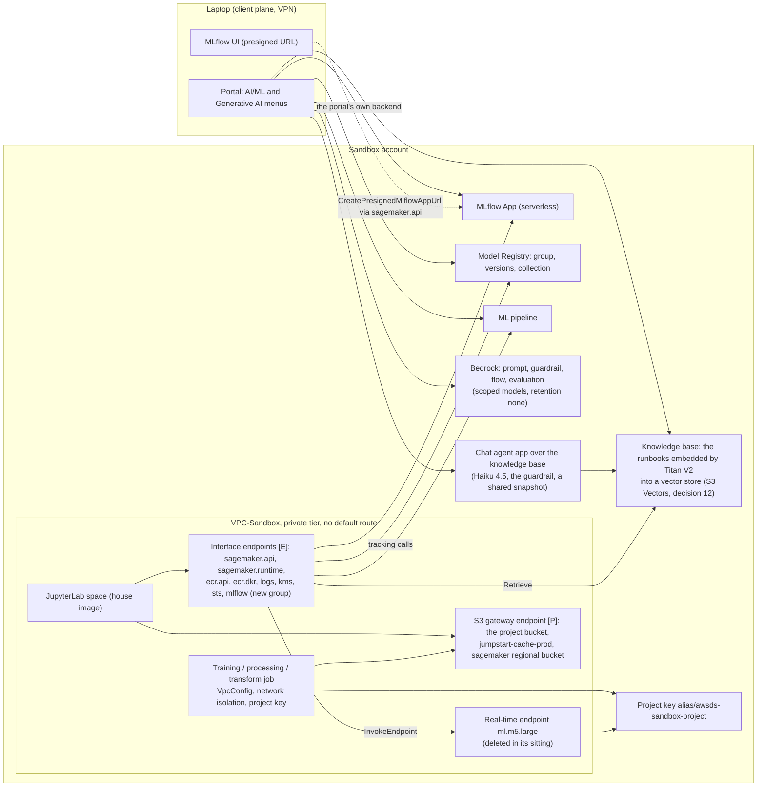

# Stage 17 — Machine learning in a Sandbox project: the AI/ML surface exercised

| | |
|---|---|
| **Status** | **Pass 0 in progress, pass 1 written and not applied, passes 2 to 5 stopped on three quotas at zero** ([the log](../../log/log-stage-17-sandbox-machine-learning.md)): `./aws/sandbox-ml.py` (`ML-1`..`ML-9`, step 0.1) and `examples/sandbox-ml/` (0.6) were written 2026-10-17 (PR #157) from a cloud session with no AWS credentials, and the instrument's first run, on the laptop that evening with the session down, read `ml.m5.xlarge for training job usage`, `ml.m5.large for endpoint usage` and `ml.m5.large for transform job usage` at 0 (0.2); the user requested the three increases the same evening, their status unread. Pass 1's change was written the same evening in PR #157 and nothing of it is applied: `vpc-egress-v0.18.0` with the `mlflow` group and `sagemaker-prereqs-v0.5.0` with `MLflowApp`, the two callers pointed at them, the governance profile and `US-3` moved with them (1.2, 1.4); 1.2's plans, the checklist's template and wizard readings and decision 4 come before any apply. The same run read `EnableSageMakerMLWorkloadsPermissions` `true` on both project roles (decision 9 does not arise), the managed ML policy at v45 against the v44 of AWS's pages, and `enableNetworkIsolation` `true` in both Tooling stacks (0.8). The user's readings 0.3 and 0.7 and 0.5's interface half wait on a raised session. Step 2.2's image is XGBoost `3.0-5`, since the recipe's `1.7-1` writes a model the house interpreter's `xgboost-cpu` 3.3.0 refused on a build host (the log). The plan was written 2026-10-12 from a session with no AWS reading, so every "read" below is owed to pass 0, and nothing here is a measurement unless it carries its date. An exercise, not a promotion path, in [6i](stage-06i-sandbox-orchestration.md)'s shape: one project, one data scientist, the portal's **AI/ML** menu walked end to end (an experiment tracked in an MLflow App, a model trained under the D13 boundary's job settings, registered, deployed, invoked, served offline by batch transform, then the same chain as an ML pipeline), the two entries that provision standing infrastructure read without being created (HyperPod, Partner AI apps), and the **Generative AI** menu's apps built once each, a chat agent over a knowledge base of the user's own documents among them (pass 7, decision 1). The Terraform changes planned are `MLflowApp` and `AmazonBedrockKnowledgeBase` promoted out of category 2 (decisions 2 and 1), an `mlflow` endpoint group in `vpc-egress` (decision 4) and the embeddings model admitted by the SCP `DenyBedrockInvocationOutsideTheScopedModels` (decision 11); the `[P]` grant slice `sandbox/ml/` joins them if pass 2 measures on a training job the tag gap 6i measured on a processing job (decision 7). Decisions 1-3 were taken by the user on 2026-10-12: the Generative AI menu in, with a knowledge base; the `MLflowApp`; the public CSV of AWS's XGBoost recipe |
| **Prerequisites** | **[6a](stage-06a-unified-studio.md) and [6d](stage-06d-unified-studio-remainder.md)**: the Sandbox project, its project role under the D13 boundary, the house image selectable in a space. **[6c](stage-06c-networking-hub.md)**: the private tier with no default route, and a raised session, `make hub-up` then `make up ENV=sandbox GROUPS=mlflow` for passes 1-6 and `GROUPS=mlflow,bedrock-base,bedrock-agent` for pass 7, because `sagemaker.api`, `sagemaker.runtime`, `ecr.api`, `ecr.dkr`, `logs`, `kms` and `sts` are `[E]` endpoints of `sandbox/egress` and only the gateway endpoints are `[P]`. **[6e](stage-06e-claude-code-bedrock.md)** for pass 7: the use-case form, the retention mode `none`, the three scoped models and the grant slice `sandbox/bedrock/`. **[6i](stage-06i-sandbox-orchestration.md)**: the measurements this stage reuses rather than repeats, a processing job admitted under the four settings, the house image pulled cross-account by a job, and the tag gap on create. **Stage 3's S3 gateway allow-list**, which has named `jumpstart-cache-prod-<region>` and `sagemaker-<region>` since it was written and has never been exercised for either (verification iii) |
| **Consumes** | [D9](../decisions/D09-az-count.md), [D11](../decisions/D11-lab-lifecycle.md), [D12](../decisions/D12-budget-ceiling.md), [D13](../decisions/D13-lake-formation-enforcement.md), [D17](../decisions/D17-interactive-vs-runtime.md), [D21](../decisions/D21-development-account.md), [D26](../decisions/D26-unified-studio.md), [D38](../decisions/D38-single-egress-hub.md) |
| **Proves** | — (no `INT-nn` row: the project, the jobs, the models, the endpoint and the apps are all in Sandbox). It answers the reading [Stage 9](stage-09-deployment-targets.md) 3.7 asks for before its decision, whether `DenySageMakerJobsOffVpc` on `CreateModel` already refuses serverless inference (4.4), and it gives the Model Registry its first version, the event `EXC-11` names as the one that turns the `Tooling` data source's daily failure into a gap (3.3) |

*Read with [`docs/SMUS.md`](../../SMUS.md) (the blueprint table and "Promoting a blueprint out of category
2"), [`docs/plan/conventions.md`](../conventions.md) and the D13 module
[`sagemaker-denies`](../../../terraform-modules/sagemaker-denies/main.tf), whose five statements every job
and model here is written against. The documentation rows are the 2026-10-12 entries in
[`docs/REFERENCES.md`](../../REFERENCES.md), under "SageMaker and shared storage".*

---

**Objective:** the machine learning a SageMaker Unified Studio project offers its members, run once each
inside the Sandbox project with every identity, key and path inside the project: an MLflow App tracking
an experiment, a training job the D13 boundary admits, a version in the Model Registry, a real-time endpoint
invoked and deleted in the same sitting, a batch transform, an ML pipeline doing the same chain, and the
Generative AI menu's prompt, guardrail, flow and evaluation over the scoped models, and a chat agent that
answers from a knowledge base of the user's own documents. Each entry is read for what it creates, through
which door, as whom, and what this estate's controls do to it.

**Nothing here is promotable, by design.** The jobs name the project's subnets, security group, key, role
and tag, which D28's lint refuses for a deployment target; the Model Registry here is the Sandbox one, and
[Stage 9](stage-09-deployment-targets.md) owns Production's. The training data is a public CSV, the Telco
churn table of AWS's XGBoost recipe, fetched by the notebook through the proxy (decision 3) and written
under the project's `shared/`; the knowledge base's documents are this repository's runbooks, public too.
No governed data enters any of this, and the catalog is touched only by what the registry and the shared
chat agent publish into it (3.3, 7.4b).

## The menu, entry by entry

What the portal's two menus offer a project member, and what this estate's controls do to each entry. The
"door" column names the network path a call takes from the space or the portal; the "shaped by" column
names the control that admits, refuses or sizes it. A row that says "read" is exercised by reading only
(Lesson 22): the entry provisions standing infrastructure no decision has asked for.

| Entry (portal path) | What it creates | Door | Shaped by | Pass |
|---|---|---|---|---|
| **MLflow** (Compute → AI/ML → MLflow → *Create MLflow App*) | an MLflow App, `mlflow-app/<id>`, serverless; its artifact store an S3 prefix, its role an IAM role | the tracking calls from a space through the `aws.sagemaker.<region>.mlflow` interface endpoint (new group `mlflow`); `CreatePresignedMlflowAppUrl` through `sagemaker.api`; the UI from the laptop over the client plane | the `MLflowApp` blueprint, category 2 until decision 2; the project role's `SageMakerMlflowServerlessPermission`, conditioned on the project tag | 1 |
| **JumpStart models** (AI/ML → JumpStart models → *Trainable* → *Train*) | a training job from the public hub's recipe, its artifacts read from `jumpstart-cache-prod-<region>` | `sagemaker.api`; the hub reads on `SageMakerPublicHub`; the artifacts through the S3 gateway endpoint, whose list names the bucket | the form's fields (Lesson 16): a job the form cannot give the four settings is refused by the boundary; the form's default instance type against the ceiling | 2 |
| **Training** (IDEs → JupyterLab, the SageMaker SDK) | `CreateTrainingJob`: XGBoost `3.0-5` from AWS's algorithm registry on `ml.m5.xlarge`, inside the project's subnets, network-isolated, inter-container encryption on, the volume under the project key | `sagemaker.api` from the space; the job's own interfaces in the private tier; the data and the output through the S3 gateway endpoint; the image pulled by the platform as the project role (6i iv) | the boundary's four job statements and `DenySageMakerInstanceCeiling` (`ml.m5.xlarge` is on the list, `ml.m5.2xlarge` is not); the project role's `SageMakerCreatePermissions` (the tag on create) and its `SageMakerTagPermissions`, which excludes `AmazonDataZone*` keys (6i iii) | 2 |
| **Model registry** (AI/ML → Model registry → *Register*, *Collections*) | a model package group, versions with an approval status, a collection | `sagemaker.api` | `SageMakerCreatePermissions`; `EXC-11`'s data source tracks the group type (3.3) | 3 |
| **Inference endpoints** (AI/ML → Inference endpoints → *Create endpoint*, *Add model*) | `CreateModel` (with `VpcConfig` and network isolation), `CreateEndpointConfig` (`ml.m5.large`, one instance), `CreateEndpoint`; `InvokeEndpoint` | `sagemaker.api` for the control plane; `sagemaker.runtime` for the invocations, one AZ (6a's affinity note) | `DenySageMakerJobsOffVpc` and `DenySageMakerJobsWithoutNetworkIsolation` on `CreateModel`; the ceiling on `CreateEndpointConfig`; the form's fields; an endpoint bills every hour it exists, so it dies in its sitting (decision 6) | 4 |
| **Batch transform** (the SDK; no menu entry) | `CreateTransformJob` on `ml.m5.large`, the volume under the project key | `sagemaker.api`; the model's `VpcConfig` | `DenySageMakerJobsWithoutVolumeEncryption` names `CreateTransformJob`; the ceiling | 4 |
| **Serverless inference** (the SDK) | a `CreateModel` with no `VpcConfig`, which serverless requires, then a serverless endpoint configuration | `sagemaker.api` | expected refused by `DenySageMakerJobsOffVpc` on `CreateModel`, the reading Stage 9 3.7 asks for; a model that carries a `VpcConfig` is refused by the service for serverless (verification x) | 4 |
| **ML pipelines** (AI/ML → ML pipelines → the visual editor, *Import*, *Execute*, *Download pipeline definition*) | a pipeline whose steps are a processing job, a training job, a condition on the validation metric and a registration | `sagemaker.api`; each step's job as above | each step's job carries the four settings; the editor's forms against those settings (Lesson 16, 6i i's shape); the pipeline's role is the project role | 5 |
| **HyperPod clusters** (Compute → HyperPod clusters → *Add compute*) | nothing here: the entry connects a project to an existing cluster, and the project role's policy grants no `sagemaker:CreateCluster` | — | read: a cluster is standing compute (`Cluster:ml.m5.large` 0.115 USD/h in the offer) no decision has asked for | 6 |
| **Partner AI apps** (AI/ML → Partner AI apps) | nothing here: Lakera Guard, Comet, DeepChecks and Fiddler, each an EKS stack with its own EC2, cache and database SKUs | — | read: the `PartnerApps` blueprint is category 3 and the SKUs are standing (Cost) | 6 |
| **Generative AI** (Generative AI → Playground, Chat agent apps, Prompts, Guardrails, Functions, Flows, Evaluations) | Bedrock objects in the Sandbox account: a prompt, a guardrail, a flow, an evaluation job, and a chat agent over the knowledge base below, shared as a snapshot; a Function is a Lambda | the portal's own backend, not the VPC, as the project role or the project's Bedrock roles (verification xviii); a notebook's invocation through `bedrock-runtime` and `bedrock-agent-runtime` | the SCP's `DenyBedrockInvocationOutsideTheScopedModels` and `DenyBedrockReadsOutsideTheRoutedRegions`; the project role's conditional Bedrock grants (6e 3.1: `InvokeBRModel` needs the IDE tag the role did not carry on 2026-09-11); no control names a Lambda (7.4, decision 10) | 7 |
| **Knowledge bases** (Generative AI → AI apps → Asset gallery → *My components* → *Knowledge Base*) | a Bedrock knowledge base, its data source, its execution role, two Lambdas (the OpenSearch index and the ingestion trigger, with their role; AWS's blueprint page, read 2026-10-12) and a vector store created on the user's behalf, OpenSearch Serverless, S3 Vectors or Neptune Analytics by the form's choice (decision 12) | the IDE's backend for the create; the sync is the service's own calls as the knowledge base's role, `InvokeModel` on the embeddings model and the store's API; a notebook's `Retrieve` through `bedrock-agent-runtime` | `AmazonBedrockKnowledgeBase`, category 2 until decision 1; the SCP's `NotResource`, which names no embeddings model and refuses the first sync (7.4a, decision 11); the store's billing shape (decision 12) | 7 |

### Why the experiment is logged from the space, and never from the job

The boundary refuses every job without network isolation (`DenySageMakerJobsWithoutNetworkIsolation`), so
the training container cannot reach the MLflow App, the Model Registry or anything else. The run is
therefore logged from the notebook: the parameters before `CreateTrainingJob`, the final metrics read back
from `DescribeTrainingJob` after it, and the model artifact downloaded from the output path and logged as
an MLflow model. It is the same consequence 6i met when the workflow, not the code, had to delete the
source: the code inside a job sees only its mounts.

### What a job needs, and who gives it

A job the boundary admits carries, in the request itself: `VpcConfig` with the project's private subnets
and security group; `EnableNetworkIsolation: true`; `EnableInterContainerTrafficEncryption: true` (jobs,
not models); `ResourceConfig.VolumeKmsKeyId`, the project key; an instance type on the ceiling's list; and
the tag `AmazonDataZoneProject` with the caller's own value, which the project role's
`SageMakerCreatePermissions` demands through `aws:ResourceTag`. 6i measured on a processing job
(2026-10-10, run `FVyFira1LY3BuGi`) that the same policy's `SageMakerTagPermissions` refuses that tag's
key on create, and closed it with `sandbox/workflows/`'s second statement, scoped to processing jobs. Pass
2 measures whether a notebook's `CreateTrainingJob` meets the same gap, with the three readings that
separate the hypotheses (2.2); if it does, decision 7's slice carries the statement for every resource type
this stage creates. What the space's SDK configuration fills in by itself is read first (0.3): a default the
space injects is a parameter the notebook does not have to write, and a default it does not inject is one
the notebook must.

## What this stage builds, and in which accounts

| Where | What | Layer |
|---|---|---|
| `terraform-live/sandbox/sagemaker/` (through `sagemaker-prereqs`) | `MLflowApp` and `AmazonBedrockKnowledgeBase` join `blueprint_names` (decisions 2 and 1), `MLflowApp` at `sagemaker-prereqs-v0.5.0` (pass 1, written 2026-10-17): a blueprint configuration and its `CREATE_ENVIRONMENT_FROM_BLUEPRINT` grant per blueprint arrive in one apply (`grants.tf`'s `for_each`). The roster has three copies, the module default, the governance profile and `aws/studio.py`'s `BLUEPRINT_ALLOWLIST`, and they move in one commit (Lesson 14). `kms.tf` is untouched: AWS's key-permissions page for the Tooling blueprint names no MLflow statement (read 2026-10-12); whether it names a knowledge-base statement is read at 1.2 (the checklist's step 2), and a refusal naming KMS at 1.5 or 7.4a reopens it | `[P]` |
| `terraform-live/data-governance/governance/` | the `experimentation` profile gains `MLflowApp` and `AmazonBedrockKnowledgeBase`, `deployment_mode = ON_DEMAND`, like the six Bedrock blueprints already there | `[P]` |
| `terraform-modules/vpc-egress` (new tag, `v0.18.0`) and `terraform-live/sandbox/egress/` | the optional group `mlflow`, one endpoint, `aws.sagemaker.<region>.mlflow`: the module's `sagemaker.studio` special case in `service_names_all_groups` becomes a list of the `aws.sagemaker.` short names, `sagemaker.studio` and `sagemaker.mlflow`, since `sagemaker.api` and `sagemaker.runtime` are `com.amazonaws.` names and a prefix match would rename them (written 2026-10-17). `no_proxy_all_groups` grows by the endpoint's names whatever `GROUPS=` names, so the house image's dated literal (70 entries, `aafa08da98a61f5c`, 6d decision 8) goes stale and `DE-5` reads the drift until an image carries the new one (decision 4). Raised per session with `GROUPS=mlflow` | `[E]` |
| `terraform-live/identity/org-policies/` | `DenyBedrockInvocationOutsideTheScopedModels` in `awsds-org-scp-ou-interactive.json` gains the embeddings model's `foundation-model` ARN in its `NotResource` (decision 11), the first entry there outside the scoped set's six spellings; `POLICIES.md`'s row gains the second trigger, `./scripts/check-index.py` reads it, and the battery runs with its Bedrock rows ([`scp-battery.md`](../runbooks/scp-battery.md); PR #159 wrote those of 6e 7.5 and decision 15 on 2026-10-17), plus one allow row on the embeddings model, which no image pin names (7.4a). Applied from `Identity` with `awsds-infra-identity`, the slice's profile precondition | `[P]` |
| `terraform-live/sandbox/ml/` (new, rank 57, decision 7, only if 2.2 measures the gap) | the grants the project role lacks for the exercise, in `sandbox/workflows/`'s shape: `sagemaker:AddTags` of the key `AmazonDataZoneProject` with the caller's own value, alone, on a resource that carries no project tag or already the caller's, for each resource type the measurements name (training jobs, models, endpoint configurations, endpoints, transform jobs, model package groups, pipelines, MLflow apps). Attached to the project roles, each checked for the D13 boundary as `sandbox/workflows/` checks them | `[P]` |
| `aws/sandbox-ml.py` (new) | `ML-1`..`ML-9`, the evidence: the project role's tags and policy version, the MLflow App, each training job against the five statements and the tag, the registry, the serving objects (no endpoint may survive a sitting), the pipeline, the read-only entries and the quotas, the Generative AI objects and their doors, the session's `mlflow` endpoint and the DNS Firewall list | — |
| `examples/sandbox-ml/` (new) | the notebook as scripts a person reviews: `data.py` (the recipe's CSV fetched, prepared and split), `train.py` (the estimator, the MLflow run, the negatives), `register.py`, `serve.py` (the endpoint, the transform, the serverless negative), `pipeline.py` and `pipeline/definition.json` with a placeholder for every account-scoped value (6i decision 1's shape), `bedrock/` for the prompt, guardrail, flow and evaluation definitions the portal exports, the knowledge base's document list and the chat agent's exported snapshot, and a `README.md` | — |
| `docs/` | this file; the stage log; `SMUS.md`'s two MLflow rows and its knowledge-base row; `PRICING.md` §8's rows and §5's knowledge-base and guardrail rows, measured 2026-10-12; `REFERENCES.md`; `terraform-live/identity/org-policies/POLICIES.md`'s row (decision 11); `AWS_STATE.md` if a reading becomes an exception | — |

Nothing in any other account. The Data Governance account's domain carries the profile change (the
governance slice applies from there, as 6a did), and that is the only call outside Sandbox.

## Who executes each action

| Marker | Meaning |
|---|---|
| **[Claude]** | repository edits and read-only AWS calls, as the [infrastructure user](../../ORGANIZATION.md#infrastructure-user), `InfrastructureAccess`, on `awsds-infra-sandbox-1` (Sandbox) and `awsds-infra-data` (the domain's profile and blueprint configurations, read) |
| **[Claude⚡]** | an AWS write, only after the user authorizes that act in chat with the SSO user, account and permission set stated first. Planned: the roster apply on `sandbox/sagemaker/` and the governance slice (1.3), `sandbox/egress` with `GROUPS=mlflow` (1.4), `sandbox/ml/` if decision 7 takes (2.2), the SCP amendment from `Identity` and the battery (7.4a, decision 11), and raising and lowering the session |
| **[user]** | the portal and JupyterLab, signed in as the **Data Scientist User**, a member of the Sandbox project: the apps, the notebook, the runs, the approvals, the deletions, and log entries whenever the user wants |

## Step numbers are identifiers, not an order

| Pass | # | What | Done by |
|---|---|---|---|
| **0** | 0 | the readings, the instrument, the prices, the repository files, the forms | Claude; the user reads the space and the forms |
| **1** | 1 | the MLflow App: the roster, the endpoint group, the app, the first run logged | Claude applies; the user creates and logs |
| **2** | 2 | a model trained: the data, the job, the negatives, the JumpStart path | the user, from JupyterLab and the portal |
| **3** | 3 | tracked and registered: the runs compared, the group, the version, the approval, the collection | the user; Claude reads `EXC-11`'s data source the next day |
| **4** | 4 | deployed and served: the endpoint, the invocations, the deletion, the transform, the serverless negative, the GPU negative | the user, from JupyterLab and the portal |
| **5** | 5 | the pipeline: authored from the SDK, run, read back, the editor's forms | the user |
| **6** | 6 | HyperPod and Partner AI apps, read | the user reads the pages; Claude reads the APIs |
| **7** | 7 | the Generative AI menu: the roles before, the capability, the playground, the objects, the knowledge base and the chat agent over it, the doors | the user; Claude reads before and after, and applies decision 11's amendment between the two syncs |
| **8** | 8 | the readings, the records, the close | Claude; the user decides decisions 5 and 7's close |

Pass 1 precedes pass 2 because every later run is logged into the app, and pass 4 follows pass 3 because
the endpoint and the transform serve the registered version. Passes 6 and 7 are independent of the rest;
inside pass 7, 7.4a's second sync waits on decision 11's apply, and 7.4b on 7.4a.

---

## To execute

### 0. Preflight

- **0.1 — [Claude] Write `./aws/sandbox-ml.py` and run it as the before.** `ML-1` reads the project role:
  its tags, among them `EnableSageMakerMLWorkloadsPermissions`, which every `sagemaker:Create*` of the
  role's `SageMakerStudioProjectRoleMachineLearningPolicy` requires as `true` and which no reading in this
  repository has recorded (6e 3.1 read the Bedrock pair on 2026-09-11 and not this one), the policy's
  live default version (v44, last edited 2026-09-14 UTC, read 2026-10-12 on the managed-policy reference),
  the `AddTags` condition that excludes `AmazonDataZone*` keys, and the D13 boundary. `ML-2`..`ML-8` read
  nothing yet and say so; `ML-9` reads the session's endpoints, the DNS Firewall list and `DE-5`'s state. A
  missing `EnableSageMakerMLWorkloadsPermissions` stops the stage at this step and takes decision 9.
- **0.2 — [Claude] Read the quotas** that bound the exercise, by name through
  `service-quotas list-service-quotas --service-code sagemaker`: `ml.m5.xlarge for training job usage`,
  `ml.m5.large for endpoint usage`, `ml.m5.large for transform job usage`, `ml.t3.medium for processing
  job usage`, and the MLflow quota if the service publishes one. A young account can hold a zero for an
  endpoint instance type; a zero is a stop, and the increase is a support case the user opens. `ML-7`
  carries the reading.
- **0.3 — [user] Read the space.** In a JupyterLab on the house image: the SageMaker SDK's configuration
  files the space carries (the SDK's documented search path, and the `SAGEMAKER_USER_CONFIG_OVERRIDE` and
  `SAGEMAKER_ADMIN_CONFIG_OVERRIDE` variables), which say what a `CreateTrainingJob` from this space gets
  filled in without the notebook asking: subnets, security group, key, tags, isolation; and the versions
  of `sagemaker`, `mlflow`, `sagemaker-mlflow`, `xgboost` and `boto3` in both interpreters (6i decision 2
  named them: `/opt/awsds/venv/bin/python` and the distribution's). The scripts of `examples/sandbox-ml/`
  are written against what is read here, and against no other version (Lesson 65).
- **0.4 — [Claude] The prices, measured 2026-10-12** from the `AmazonSageMaker` offer file for `us-west-2`,
  published `2026-10-12T18:05:38Z`, read as `docs/PRICING.md` §0 describes; the rows are in §8 and in Cost
  below. The offer carries no MLflow App SKU, four `MLflow:TrackingServer*` SKUs, `ServerlessInf:Mem-*`
  per second, `Host:ml.m5.large`, and `PartnerApp-*` SKUs per partner and size. The knowledge base's units
  come from three more offers of the same day, `AmazonBedrock` (published `2026-10-10T18:22:42Z`: Titan
  Text Embeddings V2 and the guardrail policies), `AmazonES` (`2026-09-27T12:24:24Z`: the OpenSearch
  Serverless OCU and its storage) and `AmazonS3` (`2026-10-12T17:53:18Z`: S3 Vectors); the rows are in
  `docs/PRICING.md` §5.
- **0.5 — [Claude] Read the network as it stands.** `sandbox/egress`'s always-on list carries
  `sagemaker.api`, `sagemaker.runtime`, `ecr.api`, `ecr.dkr`, `logs`, `kms` and `sts`; the S3 gateway
  endpoint's allow-list names `jumpstart-cache-prod-<region>` and `sagemaker-<region>` (Stage 3's
  `default_aws_buckets`); no endpoint resolves `aws.sagemaker.<region>.mlflow` and the DNS Firewall list
  does not know the MLflow data plane's names, whatever they are (verification vi). `ML-9` reads all three.
- **0.6 — [Claude] Write `examples/sandbox-ml/`**: the scripts, the pipeline definition's source, the
  README, with a placeholder for every account-scoped value and the pre-commit check on account ids as the
  guard. The scripts print no data.
- **0.7 — [user] Read the forms** (Lesson 16), before any run, and record each in the log: JumpStart's
  *Train* form (instance type default, VPC, isolation, key, tags), *Create endpoint* and *Add model*,
  *Create MLflow App*, the pipeline editor's step forms, the Generative AI menu's *Functions* wizard, the
  *Create Knowledge Base* pane (its sources, the embeddings models in its dropdown, its vector stores, its
  chunking and parsing options, the *Local file* limits) and the chat agent's *Model* list. Which boundary
  fields each form lacks decides whether a pass goes through the portal or the SDK.
- **0.8 — [Claude] Read the Tooling environment's `enableNetworkIsolation`**, a parameter AWS's Tooling
  page documents as "network isolation for training and deployed inference containers" (read 2026-10-12)
  and which this estate's profile neither sets nor locks: the deployed value, from the environment's
  parameters, says whether the portal's own creates ask for isolation.

### 1. The MLflow App

- **1.1 — [user] The before**: Compute → AI/ML → MLflow in the project. What the portal offers before the
  blueprint exists in the profile (an empty page, a disabled button, or a *Create* that fails) is the
  reading that separates "the blueprint gates it" from "the policy gates it" (verification i).
- **1.2 — [Claude] The roster commit**: `MLflowApp` into `sagemaker-prereqs`'s `blueprint_names`, the
  governance profile's blueprint list with `ON_DEMAND`, and `aws/studio.py`'s `BLUEPRINT_ALLOWLIST`; the
  `US-3` message and `docs/SMUS.md`'s row change with it. Plan both slices and read the diff: a
  configuration and a grant added in `sandbox/sagemaker/`, a profile changed in the governance slice.
  **Written 2026-10-17** (PR #157): the module default at `sagemaker-prereqs-v0.5.0`, appended last so
  the governance list keeps every `deployment_order`, and `SMUS.md`'s row and counts (category 1
  twelve, category 2 three); the `US-3` message prints the tuple and needed no change. Before the
  apply, the checklist's step 3 (the template's required parameters without a default, which
  `blueprint_parameters` would declare for `UpdateProjectProfile`) and step 4 (the console's
  enable-wizard fields, which `blueprints.tf`'s regional parameters would carry, since an applied
  configuration cannot be updated through `awscc`) are read and recorded; `kms.tf` stays as it is
  (step 2). The plans are the laptop's.
- **1.3 — [Claude⚡] Apply**, with the user's authorization: the infrastructure user, `InfrastructureAccess`,
  on `Sandbox` for `sandbox/sagemaker/` and on `Data Governance` for the governance slice. Re-plan both to
  `No changes`. `docs/SMUS.md`'s object table and its profile paragraph then count twelve configurations
  and twelve environment configurations where they count eleven.
- **1.4 — [Claude⚡] The endpoint group**: tag `vpc-egress-v0.18.0` with the `mlflow` group (the two-commit
  tag order of `terraform-changes.md` Recipe B, the version read from `git ls-remote --tags origin`), point
  `sandbox/egress` at it, and raise the session with `GROUPS=mlflow`. **The tag and the pointer were
  written 2026-10-17** (PR #157). The service name came from AWS's pages, so the first plan of
  `sandbox/egress` at the new tag is the catalog's reading: a name the Region does not offer fails it,
  and its `no_proxy_all_groups` prints the names the endpoint answers for (verification vi). Decision 4
  orders the rest; with its recommendation, the image that carries the new literal is released in the
  sitting of the first apply, and `EG-1`..`EG-4` and `DE-5` are green at its end.
- **1.5 — [user] Add the capability and create the app.** The project's capabilities page offers the
  blueprint; adding it deploys the environment (what it provisions, a role among it or not, is read by
  `ML-2` and the trail). Then *Create MLflow App*: the name, the artifact store under the project's
  `shared/ml-demo/mlflow/` if the form takes a path, the role the form offers. The app's `InService` time,
  and the presigned URL opening in the laptop's browser. A refusal here is read by its wording: a KMS
  wording reopens `kms.tf`, a tag wording is 2.2's gap arriving early (verification ii).
- **1.6 — [user] The first run**: `mlflow.set_tracking_uri(<the app's ARN>)`, an experiment, a run with one
  parameter, one metric and one small artifact, from the house interpreter. The name the client resolves
  and whether it leaves through the new endpoint are read as 6e read Bedrock's door: the endpoint's
  `BytesProcessed` before and after, because the MLflow data plane writes no trail; a resolution failure
  reads `/awsds/sandbox/dns-firewall`'s log first (verification vi).
- **1.7 — [Claude] `ML-2`**: the app's status, `ArtifactStoreUri` under the project path and the project
  key, `RoleArn`, `ModelRegistrationMode`, `AccountDefaultStatus`, `WeeklyMaintenanceWindowStart`, tags;
  CloudTrail's `CreateMlflowApp`: which principal and session created it (verification ii).

### 2. A model trained

- **2.1 — [user] The data** (decision 3): the Telco customer churn CSV of AWS's XGBoost recipe, which
  `data.py` fetches from the space through the proxy, from
  `https://raw.githubusercontent.com/IBM/telco-customer-churn-on-icp4d/master/data/Telco-Customer-Churn.csv`
  (7,043 rows), a name on the compute plane's allow-list since 2026-09-19 that answered a space `200 × 7`
  that evening (`docs/NETWORK.md`); the proxy's access log line for the fetch is the reading (verification
  xxvi). Prepared as the recipe does: `TotalCharges` coerced to numeric and the blank rows dropped, the
  label `churn_label`, the features `tenure_months`, `monthly_charges`, `total_charges`, `lifetime_value`,
  `is_month_to_month` and `is_fiber_optic`, shuffled with `random_state=1729`, split 70/15/15 into
  `train.csv`, `validation.csv` and `test.csv` in XGBoost's CSV layout (label first, no header), under
  `shared/ml-demo/data/`. Nothing enters through the lake.
- **2.2 — [user] The job, three times, one change each** (Lesson 20: a refusal proves one statement when
  one thing differs). The estimator: XGBoost `3.0-5` from AWS's algorithm registry for the Region (the
  recipe's `1.7-1` writes the binary format XGBoost 3.1 removed, and the house environment's lock pins
  `xgboost-cpu` 3.3.0, which refused such a booster on a build host on 2026-10-17, so 3.1 could not log
  it; `examples/sandbox-ml/README.md`, "The model format"), `ml.m5.xlarge`, one instance, 30 GB volume
  under the project key, `max_run` 600 s, the project's subnets and security group, network isolation and
  inter-container encryption on, the output under `shared/ml-demo/models/`, the recipe's hyperparameters
  `objective=binary:logistic`, `eval_metric=auc`, `num_round=200`, `max_depth=5`, `eta=0.2`,
  `subsample=0.8`; the MLflow run opened before the call. (a)
  **With no project tag**: expected
  `AccessDeniedException` from `SageMakerCreatePermissions`' `aws:ResourceTag` condition. (b) **With
  `AmazonDataZoneProject` set to the project's id**: expected refused as `sagemaker:AddTags`, the gap 6i
  measured on a processing job; if the space's configuration (0.3) sets the tag by itself, (a) and (b) are
  one reading. (c) **After decision 7's slice is applied**, the same request: expected `Completed` in about
  five minutes, the recipe's own time, the validation AUC recorded as a reading and not a gate, since the
  data is real and the stage measures doors, not models. Each refusal's `errorMessage` is the record,
  never the exit code; a refusal that names no statement is attributed by varying one field (Lesson 42).
- **2.3 — [user] The boundary's negatives**, each the admitted request with one field removed: no
  `VpcConfig`; isolation off; inter-container encryption off; no volume key; then `ml.m5.2xlarge` instead
  of `ml.m5.xlarge`. Five refusals, each naming its statement, none creating a job or billing a second.
  The sixth is the admitted request again, unchanged, so the five are read against a pass of the same
  sitting.
- **2.4 — [user] The portal's JumpStart path**: AI/ML → JumpStart models, the *Trainable* filter, a CPU
  tabular model (the candidate is `xgboost-classification-model`; the id the portal offers is what the log
  records, Lesson 38), *Train*. The form's default instance type against the ceiling, and whether the form
  carries the four settings (0.7). Submit once: an admitted job is read by `ML-3` like 2.2's; a refusal is
  the boundary's or the ceiling's, by wording, and the SDK path of 2.2 is this stage's training path.
  `DescribeHubContent` on `SageMakerPublicHub` and the `GetObject` on `jumpstart-cache-prod-<region>` are
  the first exercise of Stage 3's two documented bucket names (verification iii).
- **2.5 — [Claude] `ML-3`**: every `ml-demo-` training job against the four settings, the ceiling, the
  project key, the project tag and the image's registry; `CreateTrainingJob`'s `vpcEndpointId` (expected
  Sandbox's `sagemaker.api` endpoint, from a space address); the image pull's principal and session in the
  trail (6i iv read `SageMaker`, no endpoint); the five refusals of 2.3 present as events with their
  `errorMessage`.

### 3. Tracked and registered

- **3.1 — [user] The runs compared.** A second admitted job with `num_round=50` and `max_depth=3`, logged
  as a second run; the MLflow UI's compare view over the two; the model artifact of the better run logged
  with `mlflow.xgboost.log_model` after downloading `model.tar.gz` from the output path. The artifact
  store's objects then carry the project key or not (verification iv).
- **3.2 — [user] The registry.** A model package group `ml-demo-xgboost` and a version from the better
  job: the inference image (the same XGBoost image), `ModelDataUrl`, `ModelApprovalStatus
  PendingManualApproval`; then the portal's Model registry page: the version approved by the user from
  the page, a collection holding the group (the portal caps a collection at ten groups). A second version
  registered from the MLflow run through the registry's MLflow integration (`mlflow.register_model`, or
  the app's `ModelRegistrationMode` if 1.7 read it enabled), so both doors into the registry are read.
- **3.3 — [Claude] `ML-4`**: the group, its versions, approval statuses, tags, the model data's
  encryption; `CT-6` the next day after 17:32 UTC: whether `EXC-11`'s data source still fails on the RAM
  share with an asset to ingest, or ingests the group into the catalog as an asset nobody chose (Lesson
  17; verification v). Either reading changes `EXC-11`'s row.

### 4. Deployed and served

- **4.1 — [user] The endpoint, from the SDK.** `CreateModel` with the XGBoost image, the registered
  version's `ModelDataUrl`, the project's `VpcConfig` and `EnableNetworkIsolation`;
  `CreateEndpointConfig` on `ml.m5.large`, one instance, `KmsKeyId` the project key; `CreateEndpoint`. The
  time to `InService`; a batch of validation rows through `InvokeEndpoint` and the AUC recomputed from the
  answers; `DescribeEndpoint`; then **`DeleteEndpoint` in the same sitting** (decision 6), with the model
  and the endpoint configuration deleted after it. The portal's Inference endpoints page is read while it
  exists.
- **4.2 — [user] The portal's *Create endpoint* form**: *Add model* → *Deployable models* offers the
  registered version; the form's fields (0.7). Submit once: if the form gives the `CreateModel` no
  `VpcConfig`, `DenySageMakerJobsOffVpc` refuses it, recorded with its event; if it is admitted,
  `DescribeModel` says what the portal filled in, and the endpoint is deleted the same way as 4.1's.
- **4.3 — [user] Batch transform**: `CreateTransformJob` over `validation.csv` on `ml.m5.large`, the volume
  under the project key, the output under `shared/ml-demo/predictions/`; then the negative without the
  key, refused by `DenySageMakerJobsWithoutVolumeEncryption`. The D11-compatible serving shape Stage 10
  decision 4 names, measured once in Sandbox.
- **4.4 — [user] The serverless negative**, the reading Stage 9 3.7 asks for. (a) A `CreateModel` with no
  `VpcConfig`, which a serverless endpoint requires: expected refused by `DenySageMakerJobsOffVpc`. (b) The
  model of 4.1, which carries a `VpcConfig`, named by a serverless endpoint configuration (1024 MB, no
  provisioned concurrency): expected refused by the service as a validation error. Both wordings go to
  Stage 9 3.7 as its evidence; the decision stays Stage 9's (decision 8).
- **4.5 — [user] The GPU negative**: a JumpStart foundation model's *Deploy* with the form's default
  instance type, expected a `ml.g5.*`, refused by `DenySageMakerInstanceCeiling`, the ceiling's first
  refusal of a GPU in this estate, recorded with its event. No GPU joins the list (D12).
- **4.6 — [Claude] `ML-5`**: no endpoint exists (a surviving endpoint is a FAIL, every sitting, because no
  slice declares one and `make down` does not reach it); models and endpoint configurations as notes;
  transform jobs against the key and the ceiling; the endpoint's `Invocations` metric and the
  `sagemaker.runtime` endpoint's `BytesProcessed` over the sitting, since `InvokeEndpoint` writes no
  management event.

### 5. The pipeline

- **5.1 — [user] Authored from the SDK**: a `ProcessingStep` on `ml.t3.medium` in the house image (the
  cross-account pull 6i iv measured) splitting the table again, a `TrainingStep` with 2.2's estimator, a
  `ConditionStep` on the validation AUC read from the job's metrics, a registration step into
  `ml-demo-xgboost` as `PendingManualApproval` on the true branch and a `FailStep` on the false one. Every
  step's job carries the four settings and the project key; the pipeline's `RoleArn` is the project role
  (`iam:PassRole` of the role to SageMaker is read, verification xi). The definition is exported to
  `examples/sandbox-ml/pipeline/definition.json` with placeholders before `upsert`.
- **5.2 — [user] Run**: *Execute* in the portal or `StartPipelineExecution` from the notebook; the
  execution graph on the ML pipelines page; the third version in the registry; *Download pipeline
  definition (JSON)* compared with the committed source, the account-scoped values aside (6i decision 1's
  two directions).
- **5.3 — [user] The visual editor** (Lesson 16): the step forms of the imported pipeline, which boundary
  fields they expose; a pipeline authored in the editor with one training step, run once, admitted or
  refused by wording.
- **5.4 — [Claude] `ML-6`**: the pipeline's definition against the settings, the executions and their
  steps' jobs, the committed definition against the live one.

### 6. The entries read, not exercised

- **6.1 — HyperPod.** [user] Compute → HyperPod clusters → *Add compute*: the page connects a project to a
  cluster that exists. [Claude] `ListClusters` empty; the project role's policy grants no cluster action
  (0.1); the offer's `Cluster:ml.m5.large` at 0.115 USD/h names what a cluster's smallest node would bill
  while it exists. Nothing is created.
- **6.2 — Partner AI apps.** [user] the catalog page, the four partners. [Claude] `ListPartnerApps` empty;
  the `PartnerApps` blueprint is category 3; the offer's `PartnerApp-*` SKUs are in Cost. Nothing is
  created.
- **6.3 — [Claude] `ML-7`** carries both readings and the quotas of 0.2.

### 7. The Generative AI menu

- **7.0 — [Claude] The before**: `ML-8` reads the project role's Bedrock tags again
  (`EnableAmazonBedrockPermissions`, `EnableAmazonBedrockIDEPermissions`, the second absent on
  2026-09-11), the roles the Tooling template creates for the IDE if they exist (AWS's Tooling page names
  `AmazonBedrockServiceRole` and `AmazonBedrockLambdaExecutionRole` beside `datazone_usr_role` as the
  roles its `PermissionsBoundaryArn` reaches, read 2026-10-12), their policies and whether each carries
  the D13 boundary; `ListFunctions` in Sandbox; and which control, if any, names a Lambda: none in the
  SCPs or the boundary as read 2026-10-12 (decision 10). For the knowledge base: `bedrock-agent
  list-knowledge-bases`, `aoss list-collections` and `s3vectors list-vector-buckets` in Sandbox, all
  expected empty; `bedrock get-foundation-model-availability` on `amazon.titan-embed-text-v2:0`, whether
  the account may use the embeddings model at all; and the SCP's `NotResource` as it stands, six spellings
  of three models and no embeddings model (read 2026-10-12), so 7.4a's first sync is expected refused.
- **7.1 — [Claude⚡] The session** with `GROUPS=mlflow,bedrock-base,bedrock-agent`, so a refusal in this
  pass is attributable to identity and never to a door that was not there (Lesson 42), whatever door the
  portal's backend turns out to take.
- **7.2 — [user] The capability**: the project's capabilities page, *Generative AI application
  development*, which deploys the profile's Bedrock blueprints `ON_DEMAND`, the knowledge base's among
  them after 1.3. [Claude] `ML-8` after: what the deployment provisioned, and the role's tags, because the
  IDE tag's absence in 6e is this stage's hypothesis for what the capability adds (verification xvii).
- **7.3 — [user] Playground**: a chat with Claude Haiku 4.5, the scoped model with the lowest rate; then a
  model outside the scoped three, expected refused by `DenyBedrockInvocationOutsideTheScopedModels`, the
  SCP's first refusal from the portal. `bedrock-usage.py` reads the tokens.
- **7.4 — [user] The objects, one each**: a prompt with a variable and two versions; a guardrail with one
  denied topic and the PII filter, attached to 7.4b's chat agent; a flow with a prompt node and a model
  node, run once; an evaluation job, automatic, over a twenty-line dataset in `shared/ml-demo/bedrock/`,
  Haiku 4.5 as the evaluator. **A function is not created** unless decision 10 takes (b): the wizard's
  fields are read (0.7), and the Lambda it would make runs outside the VPC with the internet a function
  has by default, outside D38's hub and every proxy reading, the one shape here no control names.
- **7.4a — [user] The knowledge base** (decisions 1, 11 and 12), the Bedrock IDE's component for a chatbot
  over one's own documents, read against this estate's controls. The documents are this repository's
  runbooks, `docs/plan/runbooks/*.md` (16 files, 550 KB, public), copied by the notebook from a clone of
  the repository (`github.com` on the plane since 2026-09-19) into `shared/ml-demo/bedrock/kb/`, the project
  bucket prefix the component's *Project data sources* takes; the *Local file* upload (PDF, Markdown, text,
  Office, HTML and CSV, 50 MB a file, 50 files, read 2026-10-12) is read as a form at 0.7 and not used, so
  the documents stay where `ML-8` and the trail read them. Generative AI → AI apps → Asset gallery → *My
  components* → *Create component* → *Knowledge Base*: embeddings model Titan Text Embeddings V2
  (`amazon.titan-embed-text-v2:0`, 1024 dimensions), the store S3 Vectors (decision 12), default chunking
  and Bedrock's parser; the web crawler is not configured, since its crawl leaves from Bedrock's own
  network and not this estate's. **Sync once before decision 11 is applied**: the sync embeds through
  `InvokeModel` on the embeddings model as the knowledge base's role, and the SCP's `NotResource` names no
  embeddings model, so the expected reading is a failed sync whose error carries `explicit deny in a
  service control policy` (verification xxii); the trail's `InvokeModel` event carries the role and the
  `errorMessage`. Then [Claude⚡] **the amendment** from `Identity`, the infrastructure user,
  `InfrastructureAccess`, `AWS_PROFILE=awsds-infra-identity`: the embeddings model's `foundation-model`
  ARN into the statement's `NotResource`, `POLICIES.md`'s row with the second trigger,
  `./scripts/check-index.py`, and the battery with its Bedrock rows: those of 6e 7.5 and decision 15 are
  in `probes.py` since PR #159 (2026-10-17), and their allow rows invoke the image's pins, so this sitting
  adds one, an allow row of `invoke-model` on `amazon.titan-embed-text-v2:0` from `Sandbox Account 1`
  with Titan's body (`{"inputText":"ping"}`). The amendment waits for Stage 9 pass 1's apply of the same
  slice and its battery, which had not run on 2026-10-17 (items 2 and 3 of the laptop list in
  [its log](../../log/log-stage-09-deployment-targets.md)): an apply attaches every change pending in
  the slice, and this one's plan changes `awsds-org-scp-ou-interactive.json` alone. Sync again:
  expected `COMPLETE`, with the document count and the time. [Claude] `ML-8` reads the knowledge base,
  its role with the role's policies and boundary, the
  data source, the two Lambdas and their role, the store (which OpenSearch Serverless kind or which S3
  Vectors bucket the IDE created, as which identity, and what it bills at idle: decision 12's reading), and
  whether every object carries the project tag (verification xxiii).
- **7.4b — [user] The chat agent over it**: Chat agent apps → *Create*; the *Model* list is read first,
  which of the scoped three it offers and under which id, a `us.` profile or a foundation model, since the
  SCP admits both spellings (verification xxv); Haiku 4.5, a system instruction that confines the answers
  to the documents, *Data* → *Use Knowledge Base* with hybrid search and the default five source chunks,
  the guardrail of 7.4; then *Preview*: five questions whose answers are in the runbooks (the hub's up and
  down order, the proxy's port, what `make check` runs), one whose answer is not, to read how the app says
  so, and one on the guardrail's denied topic, to read the refusal. The answers' citations name the
  chunks. **Share** once, with the Data Scientist User alone and link access off: the share deploys a
  snapshot (an alias and a version, up to eight aliases) and publishes the app to the project's catalog,
  which `./aws/catalog.py` then reads (3.3's instrument); AWS's page says a shared snapshot cannot be
  unshared without deleting the app (read 2026-10-12), so the share is decision 5's to keep or delete.
  From the space, one `Retrieve` on the knowledge base through `bedrock-agent-runtime`, the
  `bedrock-agent` group's endpoint, as the project role: admitted or refused by wording, the reading of
  whether the role reaches the store from a notebook and which door it takes (verification xxiv).
  `bedrock-usage.py` reads the sitting's tokens.
- **7.4c — [user] The project data source, read and not created**: the *Create Knowledge Base* pane
  offers the project's Redshift (Lakehouse) tables, up to 50, with descriptions and curated queries, and
  the Lakehouse catalog, read with the project user role's permissions (AWS's page, read 2026-10-12). The
  form's fields are recorded (0.7) and nothing is selected: a structured source copies the project's
  tables into the store, and whether the D13 boundary and Lake Formation reach that copy is a reading for
  a stage that owns governed data in Sandbox, not this one.
- **7.5 — [Claude] `ML-8`**: the objects by project tag, their encryption, the model ids inside the scoped
  three plus the embeddings model, and the trail's `CreateAgent`, `CreateGuardrail`, `CreatePrompt`,
  `CreateFlow`, `CreateEvaluationJob`, `CreateKnowledgeBase`, `CreateDataSource`, `StartIngestionJob`,
  `CreateAgentAlias` and `InvokeModel` events, with `Retrieve` and `InvokeAgent` if the trail carries them:
  principal, session, `vpcEndpointId` present or absent (verification xviii).
- **7.6 — [user] Delete or keep** (decision 5): the agent, the flow, the prompt, the guardrail and the
  evaluation job's outputs bill nothing at rest; the knowledge base's store is the one object here that
  can, so it stays only if 7.4a's reading of its idle bill is zero (S3 Vectors bills storage at 0.06 USD
  per GB-month, cents for the runbooks; an OpenSearch Serverless collection with a minimum OCU is deleted
  in the same sitting).

### 8. Close

- **8.1 — [Claude] The instrument's final run** against the before of 0.1; `ML-5` reads no endpoint;
  `US-3` passes with `MLflowApp` and `AmazonBedrockKnowledgeBase` on its list; the battery's Bedrock rows
  green; `DE-5`'s state as decision 4 left it; `make check`.
- **8.2 — [Claude] The records**: the log, with every form reading, every refusal's wording and every
  measurement's time; `docs/SMUS.md`'s MLflow rows and `AWS_STATE.md` for `EXC-11` and any new exception;
  Stage 9 3.7's evidence written into Stage 9's file in this sitting (Lesson 34); `POLICIES.md`'s row and
  6e's decision 15 row with the amendment; `PRICING.md` with the MLflow App's and the store's bills once
  Cost Explorer shows the sitting's day.
- **8.3 — [user] Lower the session** after 4.6 reads no endpoint; the MLflow App, the registry and, if its
  idle bill read zero, the knowledge base stay (decision 5).

## Deliverables

- **The AI/ML menu walked inside the project** (1.5, 2.2, 3.2, 4.1, 5.2): an experiment, a model, a
  version, an endpoint that served and died, a transform, a pipeline, each attributable to the project
  role and keyed to the project key.
- **The boundary's verdict on each ML create** (2.2, 2.3, 4.1, 4.3, 4.4): the five statements each refusing
  the request that lacks its field, and admitting the request that carries them; the serverless reading
  Stage 9 3.7 asked for.
- **The portal's forms read against the boundary** (0.7, 2.4, 4.2, 5.3): which path, portal or SDK, each
  entry takes in this estate, and why.
- **The tag gap measured on a training job** (2.2) and, if it holds, the grant slice that closes it for
  every resource type the exercise creates (decision 7).
- **The MLflow App measured** (1.5-1.7, 8.2): what it provisions, which door its tracking calls take, what
  it bills.
- **The Generative AI menu's objects** (7.3-7.5): which identity creates each, through which door, under
  the scoped models; and the Function left uncreated, with the control it waits for named.
- **A chatbot over the user's own documents** (7.4a, 7.4b): whether the Bedrock IDE in SageMaker Unified
  Studio builds one in this estate, and at what price: the blueprint promoted, the embeddings model the
  SCP had to admit, the store the IDE chose and what it bills at idle, the share's snapshot and its catalog
  asset, and the answers read against the runbooks.
- **The Model Registry's first version and `EXC-11`'s answer** (3.3).
- **`./aws/sandbox-ml.py`** and `examples/sandbox-ml/`.

## Validation

1. `./aws/sandbox-ml.py`: `ML-1`..`ML-9` pass after pass 7; diff the runs before pass 1 and after pass 8.
2. `./aws/studio.py`: `US-3` passes with `MLflowApp` and `AmazonBedrockKnowledgeBase` on its list; `US-8`
   still green, the project role still carrying the D13 boundary.
3. `./aws/egress.py` with the session up: `EG-1`..`EG-4` green with the `mlflow` endpoint.
4. `./aws/devenv.py`: `DE-5` in the state decision 4 chose, and no other check changed.
5. `./aws/catalog.py`: `CT-6`'s reading of `EXC-11`'s data source after 3.2.
6. `make check` clean.
7. Every denial read by its wording, never its exit code.
8. The battery green with its Bedrock rows after decision 11's apply, and `./scripts/check-index.py` clean.

## Cost

Unit prices measured 2026-10-12 (`docs/PRICING.md` §8; offer `AmazonSageMaker`, `us-west-2`, published
`2026-10-12T18:05:38Z`; the Bedrock token rates are §5's, read 2026-09-11; the knowledge base's and the
guardrail's units are §5's rows measured 2026-10-12 from the `AmazonBedrock`, `AmazonES` and `AmazonS3`
offers):

| Item | Cost |
|---|---|
| Training `ml.m5.xlarge` | 0.23/hour while the job runs; 2.2's and 3.1's jobs and 5.1's step, about five minutes each: **about 0.06 for the stage** |
| Processing `ml.t3.medium` (5.1's step) | 0.050/hour; a five-minute step **under 0.01** |
| Hosting `ml.m5.large` | **0.115/hour while the endpoint exists**: 4.1's hour is 0.115; an endpoint forgotten overnight is 2.76 a day, 84 a month, which is why `ML-5` fails on any endpoint and decision 6 ends it in its sitting |
| Batch transform `ml.m5.large` | 0.115/hour; 4.3's ten minutes **about 0.02** |
| Serverless inference | 0.00002/second per GB, 1-6 GB tiers; expected to bill nothing here, since 4.4 is refused |
| MLflow App | **no SKU in the offer**; AWS's launch post (2025-12-02) says no additional cost beyond the artifact store. The measurement is the bill of the sitting's day (8.2), Lesson 6 |
| MLflow tracking server (not built, decision 2) | Small 0.60, Medium 1.04, Large 1.91 per hour while it exists, plus 0.10 per GB-month |
| The `mlflow` interface endpoint | 0.010/hour per session with `GROUPS=mlflow`, one AZ (D9) |
| Bedrock, pass 7 | Haiku 4.5 at 1.10 per million input and 5.50 per million output tokens: a playground chat, the chat agent's turns, a flow run and a twenty-line evaluation **under 0.20** |
| The guardrail (7.4, 7.4b) | 0.15 per 1,000 text units for the content and the topic policies, 0.10 for sensitive information and contextual grounding, 0 for the word policy: the preview's questions **cents** |
| The knowledge base's embeddings (7.4a) | Titan Text Embeddings V2 at 0.00002 per 1,000 input tokens: the runbooks, 550 KB, about 140,000 tokens, **under 0.01** a sync, and two syncs are planned |
| S3 Vectors (decision 12's recommendation) | storage 0.06 per GB-month, 0.20 per GB put, 0.055 per 1,000 requests, 0.0000025 per query: the runbooks' vectors, a few MB, **cents a month and nothing at idle beyond their bytes** |
| OpenSearch Serverless (decision 12's alternative) | 0.24 per OCU-hour and 0.024 per GB-month: a classic collection holds at least 1 OCU in dev/test and 2 in production, **5.76 or 11.52 a day while it exists, idle or not**; a next-generation collection scales to zero after ten idle minutes (AWS's scaling page, read 2026-10-12); which kind the IDE creates is 7.4a's reading |
| HyperPod (read only) | `Cluster:ml.m5.large` 0.115/hour per node, the smallest the offer prices; nothing billed |
| Partner AI apps (read only) | standing stacks: Lakera Guard Small on `m5.2xlarge` 0.384/hour; Fiddler Small adds Aurora Serverless v2 at 0.12 per ACU-hour, `cache.m5.large` 0.156/hour and `mq.m5.large` 0.288/hour; Comet Small `m6i.2xlarge` 0.384/hour and `cache.r5.xlarge` 0.431/hour; DeepChecks Small `m5.2xlarge` 0.384/hour and a `g4dn.xlarge` 0.526/hour; nothing billed |
| S3, CloudWatch | cents |
| The session itself | 0.190/hour for Sandbox's 18 endpoints plus the `mlflow` one, plus 0.0156/hour for the hub's two hosts, the dominant line over a sitting |

The stage spends **under 2 USD** in ML compute if every endpoint dies in its sitting, plus the session's
hours. What it does not spend, by decision, is the standing kind: a tracking server, a cluster, a partner
stack, a GPU, an OpenSearch Serverless collection with a minimum OCU. The knowledge base is admitted
because its store can be the one that bills only storage (decision 12), and 7.6 deletes it if the reading
says otherwise.

## Decisions due while executing

**Decisions 1, 2 and 3 were taken by the user on 2026-10-12**, on the cards put to them with the
recommendations kept below: 1 widened to (c) by the user's own ask of the same day, a chatbot over a
custom knowledge base through the Bedrock features SageMaker exposes; 2 as recommended; 3 against the
recommendation. The rest are decided during the stage and written into the stage log with the
recommendation stated (Lesson 16).

1. **The Generative AI menu** (pass 7). **Taken 2026-10-12: (c) in, with a knowledge base and a chat agent
   over it**, the user's ask being whether the Bedrock features SageMaker exposes build a chatbot over a
   custom knowledge base. It promotes `AmazonBedrockKnowledgeBase` out of category 2 through the
   checklist, admits an embeddings model at the SCP (decision 11) and prices the vector store first
   (decision 12, Lesson 6). The recommendation had been **(b)** in, with knowledge bases out, because the
   six `AmazonBedrock*` blueprints are category 1 already and the knowledge base is the one entry whose
   store can bill while idle; **(a)** was the AI/ML menu only, the Bedrock IDE left for a stage of its
   own.
2. **Experiment tracking** (pass 1). **Taken 2026-10-12: (a) the `MLflowApp` blueprint**, as recommended:
   serverless, no hourly SKU in the offer, the offering AWS's own page says to prefer over tracking
   servers (read 2026-10-12). The alternatives: **(b)** `MLExperiments`, a tracking server at 0.60
   USD/hour for Small while it exists, one per project, the standing shape `SMUS.md` kept in category 2
   for that reason; **(c)** no MLflow, the registry alone. Either blueprint needs the category-2
   checklist and the `mlflow` or `experiments` endpoint, whose service names differ
   (`aws.sagemaker.<region>.mlflow` for an app, `.experiments` for a server, read 2026-10-12).
3. **The data** (2.1). **Taken 2026-10-12: (b) the Telco churn CSV AWS's XGBoost recipe uses**, from
   `raw.githubusercontent.com`, on the compute plane's allow-list since 2026-09-19: a public table the
   recipe's preparation and hyperparameters are written for, so 2.2's job is the recipe's and its result
   is comparable to AWS's page; the fetch is one more reading of the proxy (verification xxvi). The
   recommendation had been **(a)** synthetic data generated in the notebook, because the exercise
   measures the SageMaker doors and a dataset entering through the proxy adds a measurement 6d made;
   **(c)** was a table the user places in `awsds-sandbox-lake`, read through the S3 gateway endpoint.
4. **The `mlflow` group against the image's `no_proxy` literal** (1.4). Recommended: **(b) the image
   first, in the sitting of the group's first apply**: `./scripts/check-gitlab-mirror.py --plan` reads the
   new `no_proxy_all_groups` from a plan of `sandbox/egress` and writes the line the Dockerfile must
   carry, a `dev-env` release registers the next image version (29 minutes from tag to version in Stage
   8, 1.6), the project's spaces move to it and restart
   ([`dev-env.md`](../runbooks/dev-env.md), "What an endpoint change costs"), and then `make up
   ENV=sandbox GROUPS=mlflow`; `DE-5` is green at the end. A session raised from a checkout that pins
   `vpc-egress-v0.18.0` reads `DE-5` red against the 70-entry image whatever `GROUPS=` it names, so PR
   #157's merge belongs to that sitting. **(a) was the recommendation until 2026-10-17**: the group now,
   with `DE-5` red until the next image, on the premise that the space exports no proxy variable. The
   premise is false. 6d decision 8 put `HTTPS_PROXY` and `NO_PROXY` in the image as `ENV`
   (`dev-env/Dockerfile`, read 2026-10-17), and `sagemaker-mlflow` 0.5.0 sends an app's calls to
   `mlflow.sagemaker.<region>.app.aws`, under `.app.aws`, which no compute plane admits: a client that
   honours the proxy variables and lacks the host in `NO_PROXY` is refused by the proxy with a 403,
   group or no group (`docs/NETWORK.md`). So (a) also means a per-process `NO_PROXY` addition in 1.6's
   notebook. **(c)** the endpoint in `sandbox/egress`'s always-on list, which 6e decision 12 refused for
   the Bedrock pair and is refused here for the same reason.
5. **Keep or delete at close** (7.6, 8.3). Recommended: **keep the MLflow App, the model package group and
   its versions, the Bedrock objects and the knowledge base if its store read zero at idle; delete every
   endpoint, model and endpoint configuration, and a store with a minimum OCU.** The kept objects bill
   nothing at rest on AWS's statements, which the bill of 8.2 checks; the endpoint bills while it exists,
   and the shared chat agent's snapshot cannot be unshared without deleting the app, so keeping it keeps
   the share. The alternative is deleting everything, which leaves nothing for Stage 9 and 10 to read.
6. **The endpoint's lifetime** (4.1). Recommended: **within the sitting**, deleted before the session
   lowers, because no slice declares it and D11's cycle does not reach it. The alternative, kept overnight
   for a cost reading, buys a number the offer already gives (2.76 a day).
7. **The grants the measurements name** (2.2). Recommended: **(a) a new `[P]` slice `sandbox/ml/`, rank
   57, in `sandbox/workflows/`'s shape**, one `AddTags` statement per measured refusal, each admitting only
   the key `AmazonDataZoneProject` with the caller's own value on a resource that carries no project tag
   or already the caller's. The alternatives: **(b)** widen `sandbox/workflows/`, whose name and
   description then lie; **(c)** a tag or an inline policy written by hand on a role the service manages,
   refused (Lessons 14 and 35). If 2.2 (b) is admitted, no slice is written and the finding is that a
   notebook's create differs from a worker's.
8. **Serverless inference's outcome** (4.4). Recommended: **recorded as evidence in Stage 9 3.7, the
   decision left there.** If `DenySageMakerJobsOffVpc` refuses the serverless model, 3.7's (b) is a
   reading and not a second statement; if the service admits what the boundary admits, 3.7 decides.
9. **If `EnableSageMakerMLWorkloadsPermissions` is absent from the project role** (0.1). **Did not arise:
   the tag read `true` on both project roles on 2026-10-17.** Recommended:
   **(a) read the Tooling template** (`templateUrl` from `get-environment-blueprint`, the way 6a read
   `AllowedValues` on 2026-08-22) for the parameter or profile setting that writes the tag, and change the
   profile. The alternatives: **(b)** a second profile and a second project; **(c)** the tag set by hand on
   the role, refused: a tag the service owns is overwritten at its next deployment and proves nothing
   about the profile (Lesson 35).
10. **The Function entry** (7.4). Recommended: **(a) not created**: the Lambda it makes has the internet a
    function has by default, outside D38's hub, and no SCP or boundary statement names `lambda:` in
    Sandbox (read 2026-10-12). The control it waits for, a deny on `lambda:CreateFunction` and
    `UpdateFunctionConfiguration` without `lambda:VpcIds`, is written into Stage 11 §3's ledger in this
    sitting (Lesson 34), and the entry is exercised when that control exists. The alternative, **(b)**,
    creates one function, reads where it runs and what it reaches, and deletes it; the reading is worth
    having and the path it opens is the one this estate exists to close. The knowledge base's two Lambdas
    (7.4a) are the blueprint's, not the entry's: AWS's blueprint page lists them with their execution
    role, they are the service's plumbing for the index and the ingestion trigger, and `ML-8` reads where
    they run; Stage 11 §3's ledger gets them in the same row.
11. **The embeddings model at the SCP** (7.4a). Recommended: **(a) the `foundation-model` ARN of
    `amazon.titan-embed-text-v2:0` added to `DenyBedrockInvocationOutsideTheScopedModels`'s
    `NotResource`**, region-less like the six entries there, applied from `Identity` with the battery's
    row for it written in the same sitting (6e 7.5's standing rule; 7.4a says which). It is the first entry of that list
    outside the scoped set of 6e decision 14, so the two lists that were one diverge (Lesson 51):
    `sandbox/bedrock/`'s `models` map, the image's pins and the `bedrock-runtime` endpoint policy stay as
    they are, since none of them invokes an embeddings model, and `POLICIES.md`'s row names both
    triggers. An embeddings model returns vectors, and Titan is the one entry of the component's dropdown
    that is AWS's own; the others are Cohere's, read at 0.7. The alternatives: **(b)** a condition that
    exempts the knowledge base's role by name from the statement, which keeps the ceiling tight but binds
    the SCP to a role name the blueprint generates; **(c)** no knowledge base, which takes decision 1 back
    to (b).
12. **The vector store** (7.4a). Recommended: **(a) S3 Vectors**: storage at 0.06 USD per GB-month and
    requests per use (measured 2026-10-12), nothing at idle beyond the vectors' bytes, and AWS's S3
    Vectors page names Amazon Bedrock in SageMaker Unified Studio knowledge bases among its uses (read
    2026-10-12); the component's page says this store takes no web crawler source, which 7.4a does not
    use. The alternatives: **(b)** OpenSearch Serverless, the store the blueprint's own resource list
    names (a collection and an index Lambda), at 0.24 per OCU-hour, 5.76 a day at its smallest classic
    minimum, the standing shape that kept the blueprint in category 2, acceptable only if the IDE creates
    a next-generation collection that scales to zero, a reading 7.4a makes before the store is kept;
    **(c)** Neptune Analytics for GraphRAG, refused: it needs Claude 3 Haiku, a model outside the scoped
    set, and bills by the hour while it exists, a rate not measured here.

## Verifications to answer while executing

| # | Question | Step |
|---|---|---|
| i | What does the MLflow page of a project offer before its profile carries `MLflowApp`, and what changes once it does? | 1.1, 1.5 |
| ii | Which principal and session create the MLflow App, and does the create meet the `AddTags` gap of `AmazonDataZone*` keys? | 1.5, 1.7 |
| iii | Do the hub reads and the `GetObject` on `jumpstart-cache-prod-<region>` succeed through the S3 gateway endpoint, whose list has named the bucket since Stage 3 without a measurement? | 2.4 |
| iv | Does the MLflow App's artifact store encrypt under the project key, and what does the app's role hold? | 1.7, 3.1 |
| v | After a model package group exists, does `EXC-11`'s data source still fail on the RAM share, or ingest the group into the catalog? | 3.3 |
| vi | Which name does the MLflow client resolve from a space, does the `mlflow` endpoint carry its bytes, and does the DNS Firewall list need an entry? **The client's half read from source 2026-10-17**: `sagemaker-mlflow` 0.5.0 dials `https://mlflow.sagemaker.<region>.app.aws` for an `mlflow-app` ARN (its `_get_endpoint`), and `sandbox/egress`'s DNS Firewall list carries `app.aws.` and `*.app.aws.`. Whether the endpoint answers for that host is the catalog's, printed by the first plan at `vpc-egress-v0.18.0` (1.4); the bytes are 1.6's | 1.4, 1.6 |
| vii | What does the space's SDK configuration inject into a create: subnets, security group, key, tags, isolation? | 0.3 |
| viii | Does a notebook's `CreateTrainingJob` carrying the project tag meet the `AddTags` refusal 6i measured on a worker's `CreateProcessingJob`? | 2.2 |
| ix | Does each of the boundary's five statements refuse the request that lacks its field, by a wording that names it? | 2.3 |
| x | Is a serverless endpoint refused here by the boundary's `CreateModel` statement, by the service, or by neither? | 4.4 |
| xi | Does the project role pass itself to SageMaker for a pipeline and an endpoint (`iam:PassRole`), and as which session do the pipeline's steps run? | 5.1, 5.2 |
| xii | What do the portal's *Train*, *Create endpoint* and pipeline-step forms lack of the four settings, and is each portal create refused or admitted? | 0.7, 2.4, 4.2, 5.3 |
| xiii | Which instance type does each JumpStart form default to, and does the ceiling refuse a GPU with a wording that names the list? | 2.4, 4.5 |
| xiv | How long does an `ml.m5.large` endpoint take to `InService`, and what did the sitting's endpoint bill? | 4.1, 8.2 |
| xv | Which door do the invocations take, and does the `sagemaker.runtime` endpoint's AZ affinity show in the metrics? | 4.1, 4.6 |
| xvi | Does the downloaded pipeline definition equal the committed source, placeholders aside? | 5.2 |
| xvii | Does adding the Generative AI capability tag the project role with `EnableAmazonBedrockIDEPermissions`, and what else does it provision? | 7.2 |
| xviii | As whom, and through which door, does the portal create and invoke a prompt, a guardrail, an agent, a flow and an evaluation: the project role, a project Bedrock role, a `vpcEndpointId` or none? | 7.5 |
| xix | Does the SCP refuse a model outside the scoped three from the playground, with its wording? | 7.3 |
| xx | What did the MLflow App bill on the sitting's day, read in Cost Explorer? | 8.2 |
| xxi | Which quotas does a young account hold for the four instance types, and is any zero? **Answered 2026-10-17: three are zero**, `ml.m5.xlarge for training job usage` (`L-CCE2AFA6`), `ml.m5.large for endpoint usage` (`L-614B09FD`) and `ml.m5.large for transform job usage` (`L-236AE59F`); `ml.t3.medium for processing job usage` (`L-0CE343FE`) is 4 | 0.2 |
| xxii | Does the knowledge base's first sync fail on the SCP's explicit deny of `InvokeModel` on the embeddings model, as which role, and does the second sync complete after decision 11's apply? | 7.4a |
| xxiii | Which vector store does the IDE create for the knowledge base, as which identity, under which key, with the project tag or not, and what does it bill at idle? | 7.4a, 8.2 |
| xxiv | Does the project role reach the knowledge base from a space with `Retrieve` through the `bedrock-agent-runtime` endpoint, and does the shared chat agent's snapshot appear in the project's catalog? | 7.4b |
| xxv | Does the chat agent's *Model* list offer the scoped models under a `us.` profile id or a foundation-model id, and do its answers cite the runbooks' chunks? | 7.4b |
| xxvi | Does the recipe's CSV fetch leave the space through the proxy, as one access-log line on `raw.githubusercontent.com`? | 2.1 |

## Risks

- **The project role lacks `EnableSageMakerMLWorkloadsPermissions`.** Every `sagemaker:Create*` and the
  hub reads are refused, and the AI/ML menu is empty in effect; 0.1 reads it first, and decision 9 owns the
  answer. A day's delay, not a design change.
- **A quota at zero.** A young account can hold zero endpoint or training instances of a type; the
  increase is a support case, outside any session here. 0.2 reads before pass 1 spends anything.
- **The tag gap repeats for every ML create.** 6i's measurement predicts it; pass 2 stops at 2.2 (b) until
  decision 7's slice is applied, and the stage's second sitting starts there.
- **An endpoint survives its sitting.** No slice declares it, `make down` does not delete it, and it bills
  0.115 an hour. `ML-5` fails on any endpoint, the close reads it, and the user's own `DeleteEndpoint` is
  the only guard.
- **The MLflow data plane's name is unknown to the DNS Firewall or has no endpoint.** 1.6's first call
  fails at resolution; the group of 1.4 and, if needed, a firewall entry are the repair, and a plane edit
  bites at the next half-hourly tick.
- **`EXC-11` starts ingesting.** A model asset nobody chose appears in the catalog (Lesson 17); 3.3 reads
  it, and publishing or deleting is a decision for 6f, not an act here.
- **The portal's forms admit what the boundary refuses, silently.** A form that carries no field for the
  settings issues a create the boundary refuses, with a wording the portal may not surface; the trail's
  `errorMessage` is read for every portal attempt (Lesson 42).
- **A peer's endpoint groups.** A bare `make up ENV=sandbox` removes the groups a peer session raised; the
  session is raised with the union, after telling the peers (6i's rule).
- **The image's `no_proxy` literal goes stale by the `mlflow` group's names** (decision 4). A session
  raised at `vpc-egress-v0.18.0` before an image carries them reads `DE-5` red, and a space on the old
  image is refused the app's host with a 403; decision 4's recommendation closes both in one sitting.
- **The Generative AI roles are outside the reading until 7.0.** A project Bedrock role the Tooling
  template creates without the D13 boundary would be the first interactive principal outside it; 7.0 reads
  before 7.2 deploys anything.
- **The knowledge base's store bills at idle.** The IDE chooses the store's kind on the user's behalf; an
  OpenSearch Serverless collection with a minimum OCU bills 5.76 a day whether or not anyone asks it
  anything. 7.4a reads the kind before the first sync, 7.6 deletes a store with a minimum, and decision
  12's S3 Vectors is the default for that reason.
- **A sync fails halfway.** A sync that embeds part of the runbooks before the SCP refuses it leaves a
  partial index; the second sync after decision 11 is read for its document count against the sixteen
  files, and a short count is a re-sync from the IDE.
- **A shared chat agent cannot be unshared.** AWS's page says a shared snapshot is withdrawn only by
  deleting the app, and the share publishes an asset into the project's catalog; 7.4b shares with one
  user and no link, and decision 5 owns the rest.
- **The embeddings model widens the SCP's list.** A reader of `DenyBedrockInvocationOutsideTheScopedModels`
  after decision 11 sees a model the scoped set does not name; `POLICIES.md`'s row says why, and the
  battery's Bedrock rows say what the statement still refuses.

---

*Stage index: [stages/INDEX.md](INDEX.md) · Plan core: [GENERAL_PLAN.md](../../GENERAL_PLAN.md)*
